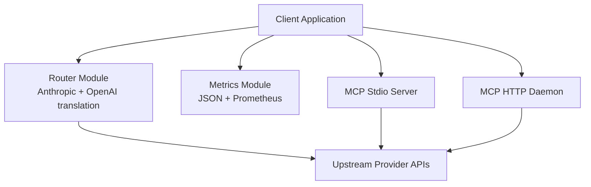
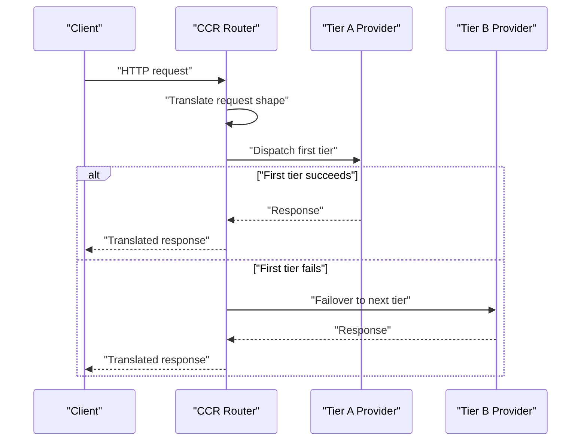
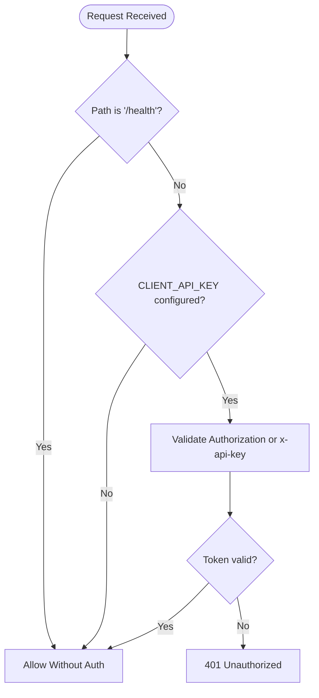
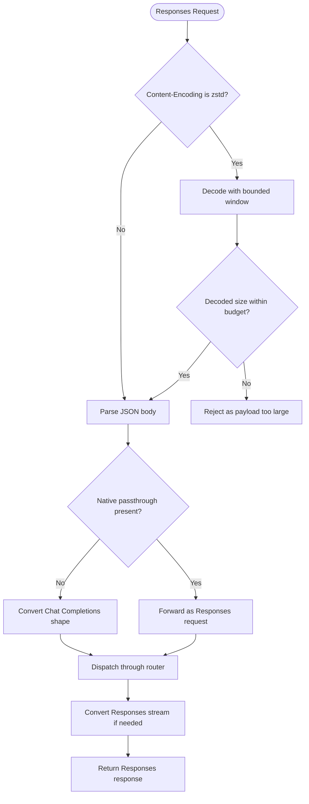
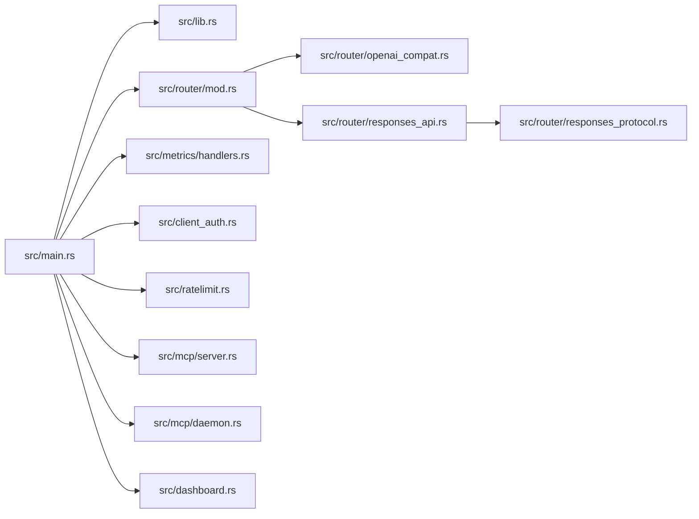

# API Reference

<cite>
**Referenced Files in This Document**
- [main.rs](file://src/main.rs)
- [lib.rs](file://src/lib.rs)
- [router/mod.rs](file://src/router/mod.rs)
- [router/openai_compat.rs](file://src/router/openai_compat.rs)
- [router/responses_api.rs](file://src/router/responses_api.rs)
- [router/responses_protocol.rs](file://src/router/responses_protocol.rs)
- [mcp/daemon.rs](file://src/mcp/daemon.rs)
- [mcp/server.rs](file://src/mcp/server.rs)
- [mcp/protocol.rs](file://src/mcp/protocol.rs)
- [dashboard.rs](file://src/dashboard.rs)
- [metrics/handlers.rs](file://src/metrics/handlers.rs)
- [client_auth.rs](file://src/client_auth.rs)
- [ratelimit.rs](file://src/ratelimit.rs)
- [configuration.md](file://docs/configuration.md)
- [auth-suites.md](file://docs/auth-suites.md)
- [observability.md](file://docs/observability.md)
- [cli.md](file://docs/cli.md)
- [Cargo.toml](file://Cargo.toml)
</cite>

## Table of Contents
1. [Introduction](#introduction)
2. [Project Structure](#project-structure)
3. [Core Components](#core-components)
4. [Architecture Overview](#architecture-overview)
5. [Detailed Component Analysis](#detailed-component-analysis)
6. [Dependency Analysis](#dependency-analysis)
7. [Performance Considerations](#performance-considerations)
8. [Troubleshooting Guide](#troubleshooting-guide)
9. [Conclusion](#conclusion)
10. [Appendices](#appendices)

## Introduction
This document is the authoritative API reference for CCR-Rust, a multi-provider LLM router that accepts Anthropic-compatible and OpenAI-compatible HTTP requests, translates them internally, routes them to configured provider tiers, and returns responses in the protocol expected by the client. It also documents health checks, observability endpoints, the MCP server modes, authentication, rate limiting, streaming behavior, and deployment-related security guidance.

Key public capabilities:
- Anthropic-compatible messages endpoint.
- OpenAI-compatible chat completions endpoint.
- OpenAI-compatible Responses endpoint with native request passthrough support.
- Health check endpoint.
- Prometheus metrics endpoint.
- JSON observability endpoints used by the terminal dashboard.
- MCP stdio server and shared HTTP daemon.

The default listener binds on `127.0.0.1:3456` unless overridden by configuration or CLI arguments. The binary version is `1.3.0`.

**Section sources**
- [README.md:1-120](file://README.md#L1-L120)
- [Cargo.toml:1-12](file://Cargo.toml#L1-L12)
- [main.rs:1-120](file://src/main.rs#L1-L120)

## Project Structure
The repository is organized into Rust modules rather than per-endpoint files. HTTP routing and request translation live under `src/router`, observability under `src/metrics`, authentication helpers under `src/client_auth`, rate-limit tracking under `src/ratelimit`, MCP implementation under `src/mcp`, and the terminal dashboard under `src/dashboard`.



**Diagram sources**
- [router/mod.rs:1-60](file://src/router/mod.rs#L1-L60)
- [metrics/handlers.rs:1-40](file://src/metrics/handlers.rs#L1-L40)
- [mcp/server.rs:1-40](file://src/mcp/server.rs#L1-L40)
- [mcp/daemon.rs:1-40](file://src/mcp/daemon.rs#L1-L40)

**Section sources**
- [lib.rs:1-27](file://src/lib.rs#L1-L27)
- [main.rs:1-120](file://src/main.rs#L1-L120)

## Core Components
CCR-Rust exposes its API through one primary HTTP server plus two optional MCP servers.

| Component | Primary Responsibility | Public Surface |
|---|---|---|
| Router | Accepts Anthropic and OpenAI requests, selects provider tiers, handles retries and hedging, translates formats | `/v1/messages`, `/v1/chat/completions`, `/v1/responses`, `/health` |
| Metrics | Aggregates counters, histograms, throughput, latency, token drift, and Prometheus exposition | `/metrics`, `/v1/usage`, `/v1/token-drift`, `/v1/token-audit`, `/v1/frontend-metrics`, `/v1/throughput`, `/v1/latencies` |
| Dashboard client | Terminal TUI that polls JSON observability endpoints | `ccr-rust dashboard` command; no separate web server |
| MCP stdio server | Model Context Protocol over stdin/stdout, optionally wrapping other MCP backends | `ccr-rust mcp` |
| MCP HTTP daemon | Shared process exposing native tools over HTTP with bearer-token authorization | `POST /mcp`, `GET /health` |

Authentication between clients and CCR’s main listener is not enabled by default. When `CLIENT_API_KEY` is configured, the main listener enforces an authorization header before processing API routes. The MCP daemon always requires bearer-token authentication.

**Section sources**
- [main.rs:120-220](file://src/main.rs#L120-L220)
- [client_auth.rs:1-144](file://src/client_auth.rs#L1-L144)
- [mcp/daemon.rs:1-120](file://src/mcp/daemon.rs#L1-L120)
- [cli.md:100-200](file://docs/cli.md#L100-L200)

## Architecture Overview
At runtime, a client sends a request to one of CCR-Rust’s public paths. The router determines whether the request is Anthropic-shaped or OpenAI-shaped, applies model aliases and direct routing, selects one or more provider tiers, and forwards a translated request upstream. Streaming responses are converted back to the client’s expected format when necessary.



**Diagram sources**
- [router/mod.rs:201-360](file://src/router/mod.rs#L201-L360)
- [router/openai_compat.rs:1-120](file://src/router/openai_compat.rs#L1-L120)
- [router/responses_api.rs:1-120](file://src/router/responses_api.rs#L1-L120)

**Section sources**
- [README.md:60-120](file://README.md#L60-L120)
- [router/mod.rs:1-120](file://src/router/mod.rs#L1-L120)

## Detailed Component Analysis

### Authentication

#### Client API Key Authentication
When `CLIENT_API_KEY` is set, CCR-Rust stores only a SHA-256 digest of the configured token and compares incoming tokens using constant-time comparison. It accepts:

- `Authorization: Bearer <token>`
- `x-api-key: <token>`

The `/health` path remains accessible without authentication so health probes can verify liveness even when client authentication is enabled.

| Header | Required | Behavior |
|---|---:|---|
| `Authorization` | Optional if `x-api-key` is present | Must use scheme `Bearer`; case-insensitive matching is supported |
| `x-api-key` | Optional if `Authorization` is present | Raw token value compared against stored digest |

On missing or invalid credentials, the response is:

- Status code: `401 Unauthorized`
- Header: `WWW-Authenticate: Bearer`
- Body: JSON error object with type `authentication_error`



**Diagram sources**
- [client_auth.rs:1-144](file://src/client_auth.rs#L1-L144)

**Section sources**
- [client_auth.rs:1-144](file://src/client_auth.rs#L1-L144)

#### MCP Daemon Authentication
The MCP HTTP daemon requires bearer-token authentication on every route except its own `/health` endpoint.

| Field | Description |
|---|---|
| Transport | HTTP POST to `/mcp` |
| Authentication | Bearer token via `Authorization` header |
| Default port | `3457` |
| Host | Configurable via `--host` or `CCR_MCP_DAEMON_HOST` |
| Token source | `--auth-token` or `CCR_MCP_AUTH_TOKEN` |

Unauthorized requests receive status `401` with `WWW-Authenticate: Bearer`.

**Section sources**
- [mcp/daemon.rs:80-160](file://src/mcp/daemon.rs#L80-L160)
- [cli.md:160-200](file://docs/cli.md#L160-L200)

### Rate Limiting

CCR-Rust tracks per-tier 429 responses and may skip a tier while its local backoff window is active. It honors explicit `Retry-After` values from upstream providers and caps locally escalated backoffs at 60 seconds. If a route continues receiving successes within 20 seconds, the backoff stays small; sustained starvation doubles the backoff per consecutive 429 until the cap.

| Situation | Behavior |
|---|---|
| Upstream returns `429` with `Retry-After` | Honor the provided duration, capped at 60 seconds |
| Upstream returns `429` without `Retry-After` | Apply one-second pacing while the route is still serving other requests |
| Route has no recent success | Escalate backoff exponentially up to 60 seconds |
| Route resumes success | Clear backoff only when no newer 429 occurred during the request lifetime |

The router may also proactively skip a tier when trusted provider headers indicate remaining quota is zero, depending on provider configuration.

**Section sources**
- [ratelimit.rs:1-200](file://src/ratelimit.rs#L1-L200)
- [router/mod.rs:360-520](file://src/router/mod.rs#L360-L520)

### Endpoints

#### Health Check

| Property | Value |
|---|---|
| Method | `GET` |
| Path | `/health` |
| Authentication | Not required, even when client API key is configured |
| Success response | Plain text `ok` |
| Query parameter | `details=true` returns tier routing metadata |

Example successful response with details:

```json
{
  "status": "ok",
  "tiers": ["tier-name"],
  "default": "provider,model"
}
```

**Section sources**
- [router/mod.rs:40-80](file://src/router/mod.rs#L40-L80)

#### Anthropic-Compatible Messages

| Property | Value |
|---|---|
| Method | `POST` |
| Path | `/v1/messages` |
| Content-Type | `application/json` |
| Authentication | Optional; required only if `CLIENT_API_KEY` is configured |
| Expected request shape | Anthropic Messages API |
| Response shape | Anthropic Messages API |
| Streaming | Supported when the request includes `stream: true` |

The handler normalizes model names, supports direct routing such as `provider,model`, applies web-search routing when enabled, respects strict or EWMA tier ordering, and translates failures across configured tiers.

Important parameters:

| Parameter | Type | Required | Description |
|---|---|---:|---|
| `model` | string | Yes | Model name or direct `provider,model` route |
| `messages` | array | Yes | Message history |
| `system` | string or object | No | System prompt |
| `max_tokens` | integer | No | Maximum output tokens |
| `temperature` | number | No | Sampling temperature |
| `stream` | boolean | No | Enable streaming SSE responses |
| `tools` | array | No | Tool definitions |
| `thinking` | object | No | Native Anthropic thinking controls |
| `output_config` | object | No | Native Anthropic output configuration |

Error handling patterns:

| Condition | Status Code | Response Shape |
|---|---:|---|
| All candidate tiers rate limited | `429 Too Many Requests` | Error object with `type: rate_limit_error`, `code: rate_limited`, and `details` listing exhausted tiers |
| Upstream timeout or failure cascaded through all tiers | Provider-specific error or normalized failure | Normalized error object |
| Invalid JSON body | `400 Bad Request` | JSON error |

Streaming notes:

- Streaming uses Server-Sent Events semantics.
- The router tracks active streams and records usage metrics.
- Hedging may launch a second attempt after a configurable time-to-first-token threshold.

**Section sources**
- [router/mod.rs:120-562](file://src/router/mod.rs#L120-L562)

#### OpenAI-Compatible Chat Completions

| Property | Value |
|---|---|
| Method | `POST` |
| Path | `/v1/chat/completions` |
| Content-Type | `application/json` |
| Authentication | Optional; required only if `CLIENT_API_KEY` is configured |
| Expected request shape | OpenAI Chat Completions API |
| Response shape | OpenAI Chat Completions API |
| Streaming | Supported when the request includes `stream: true` |

This endpoint converts OpenAI-style requests into Anthropic-shaped internal requests, processes them through the same tier selection logic, and then translates the response back to OpenAI format. Image content blocks using `image_url` are rewritten into Anthropic image blocks before dispatch.

Supported request fields include:

| Parameter | Type | Required | Description |
|---|---|---:|---|
| `model` | string | Yes | Model name or alias |
| `messages` | array | Yes | Chat message history |
| `max_tokens` | integer | No | Maximum output tokens |
| `temperature` | number | No | Sampling temperature |
| `stream` | boolean | No | Enable streaming |
| `tools` | array | No | Function/tool definitions |
| `reasoning_effort` | string | No | Reasoning effort control |
| `response_format` | object | No | Structured output format |

Response conversion behavior:

- Non-streaming responses are fully read, parsed, and re-encoded as OpenAI JSON.
- Streaming responses emit `text/event-stream` frames.
- Anthropic tool-call indices are remapped to dense OpenAI indices.
- Usage information is aggregated from streaming events and attached to the final delta or completion.
- Upstream `429` errors are normalized to OpenAI-style rate-limit error objects.

**Section sources**
- [router/openai_compat.rs:1-200](file://src/router/openai_compat.rs#L1-L200)
- [router/openai_compat.rs:201-500](file://src/router/openai_compat.rs#L201-L500)

#### OpenAI-Compatible Responses

| Property | Value |
|---|---|
| Method | `POST` |
| Path | `/v1/responses` |
| Content-Type | `application/json` |
| Authentication | Optional; required only if `CLIENT_API_KEY` is configured |
| Expected request shape | OpenAI Responses API |
| Response shape | OpenAI Responses API |
| Streaming | Supported through incremental stream conversion |
| Compression | Supports `Content-Encoding: zstd` with a bounded window size |

The Responses layer can accept a native passthrough request embedded in the standard OpenAI request envelope. When present, it bypasses normal Chat-to-Responses conversion and forwards the embedded object as the upstream Responses request.

Key request features:

| Feature | Description |
|---|---|
| Native passthrough | Embed a complete Responses request to avoid schema transformation |
| ZSTD compression | Accept compressed request bodies up to the configured maximum decoded size |
| Reasoning items | Map reasoning content into Responses `reasoning` items |
| Tool calls | Map function calls and outputs into Responses `function_call` items |
| Refusals | Map refusal content into Responses refusal items |

Error and validation behavior:

| Condition | Status Code | Response |
|---|---:|---|
| Empty body | `400 Bad Request` | JSON error describing empty payload |
| Unsupported encoding | `400 Bad Request` | JSON error naming the unsupported encoding |
| Decoded body too large | `400 Bad Request` | JSON error referencing `MAX_REQUEST_BODY_BYTES` |
| Malformed JSON | `400 Bad Request` | JSON error with preview of malformed input |



**Diagram sources**
- [router/responses_api.rs:1-200](file://src/router/responses_api.rs#L1-L200)
- [router/responses_api.rs:201-400](file://src/router/responses_api.rs#L201-L400)
- [router/responses_protocol.rs:1-120](file://src/router/responses_protocol.rs#L1-L120)

**Section sources**
- [router/responses_api.rs:1-200](file://src/router/responses_api.rs#L1-L200)
- [router/responses_api.rs:201-600](file://src/router/responses_api.rs#L201-L600)
- [router/responses_protocol.rs:1-200](file://src/router/responses_protocol.rs#L1-L200)

### Observability Endpoints

| Endpoint | Method | Authentication | Response Format | Description |
|---|---|---|---|---|
| `/metrics` | `GET` | Optional | Prometheus text format | Standard Prometheus scrape endpoint |
| `/v1/usage` | `GET` | Optional | JSON | Aggregate usage summary with per-tier counts, costs, cache tokens, and active streams |
| `/v1/token-drift` | `GET` | Optional | JSON Array | Per-tier token estimation accuracy |
| `/v1/token-audit` | `GET` | Optional | JSON Array | Recent pre-request token audit entries |
| `/v1/frontend-metrics` | `GET` | Optional | JSON Array | Per-frontend request counts and average latency |
| `/v1/throughput` | `GET` | Optional | JSON Array | Per-tier TTFT and tokens-per-second statistics |
| `/v1/latencies` | `GET` | Optional | JSON Array | Per-tier EWMA latency estimates |

Usage summary fields:

| Field | Type | Description |
|---|---|---|
| `total_requests` | integer | Total processed requests |
| `total_failures` | integer | Total failed requests |
| `total_input_tokens` | integer | Total input tokens including cached share |
| `total_output_tokens` | integer | Total output tokens |
| `total_cache_read_tokens` | integer | Tokens served from provider prompt caches |
| `total_cache_creation_tokens` | integer | Tokens written into provider prompt caches |
| `total_cost_usd` | number | Estimated USD cost across priced tiers |
| `active_streams` | number | Current streaming connections |
| `active_requests` | number | Current active requests |
| `tiers` | array | Per-tier breakdown |

Throughput entry fields:

| Field | Type | Description |
|---|---|---|
| `tier` | string | Tier name |
| `samples` | integer | Number of completed samples |
| `avg_ttft_seconds` | number | Average time to first token |
| `p50_ttft_seconds` | number | Approximate 50th percentile TTFT |
| `p90_ttft_seconds` | number | Approximate 90th percentile TTFT |
| `p99_ttft_seconds` | number | Approximate 99th percentile TTFT |
| `avg_tokens_per_second` | number | Average output throughput |
| `p50_tokens_per_second` | number | Approximate median throughput |
| `recent` | array | Recent throughput samples |

Prometheus metric examples:

- `ccr_requests_total{tier="..."}`
- `ccr_failures_total{tier="...", reason="..."}`
- `ccr_request_duration_seconds{tier="..."}`
- `ccr_tier_ewma_latency_seconds{tier="..."}`
- `ccr_active_streams`
- `ccr_peak_active_streams`
- `ccr_stream_backpressure_total`
- `ccr_input_tokens_total{tier="..."}`
- `ccr_output_tokens_total{tier="..."}`
- `ccr_rate_limit_backoffs_total{tier="..."}`

Persistence behavior:

- By default, metrics and dashboards are in-memory.
- With Redis persistence enabled, counters, histogram offsets, token drift state, token audit ring buffer, and EWMA latency state survive restarts.
- Persisted state can be cleared with the `clear-stats` CLI command.

**Section sources**
- [metrics/handlers.rs:1-200](file://src/metrics/handlers.rs#L1-L200)
- [metrics/handlers.rs:201-577](file://src/metrics/handlers.rs#L201-L577)
- [observability.md:1-200](file://docs/observability.md#L1-L200)

### Dashboard Interface

CCR-Rust does not expose a separate web-based dashboard server. Instead, the `ccr-rust dashboard` command launches a terminal user interface that periodically polls the router’s JSON observability endpoints.

It fetches:

- `/v1/usage`
- `/v1/latencies`
- `/v1/token-drift`
- `/v1/frontend-metrics`
- `/v1/throughput`

Configuration:

| Option | Environment Variable | Default | Description |
|---|---|---|---|
| `--host` | `CCR_DASHBOARD_HOST` | `127.0.0.1` | Target router host |
| `--port` | `CCR_DASHBOARD_PORT` | `3456` | Target router port |

The dashboard runs a background polling thread that updates shared state approximately every 500 milliseconds and renders usage, latency, token drift, frontend metrics, throughput, and session information in a terminal UI.

**Section sources**
- [dashboard.rs:1-200](file://src/dashboard.rs#L1-L200)
- [cli.md:140-160](file://docs/cli.md#L140-L160)
- [observability.md:120-200](file://docs/observability.md#L120-L200)

### MCP Server Protocol

CCR-Rust provides two MCP modes:

1. **MCP stdio server**: Reads and writes JSON-RPC frames over stdin/stdout.
2. **MCP HTTP daemon**: Serves JSON-RPC over HTTP with bearer-token authentication and native tools.

#### Common Protocol

Both modes implement a subset of JSON-RPC 2.0.

| Field | Type | Required | Description |
|---|---|---:|---|
| `jsonrpc` | string | No | Protocol version, typically `"2.0"` |
| `id` | value | Conditional | Request identifier; omitted for notifications |
| `method` | string | Conditional | RPC method name |
| `params` | object | Conditional | Method parameters |
| `result` | object | Conditional | Successful response result |
| `error` | object | Conditional | Error response |

Supported methods:

| Method | Direction | Description |
|---|---|---|
| `initialize` | Client to server | Initializes the connection and negotiates protocol version |
| `notifications/initialized` | Client to server | Notification that initialization is complete |
| `ping` | Client to server | Health/liveness probe |
| `tools/list` | Client to server | Lists available tools |
| `tools/call` | Client to server | Calls a registered tool by name |

Tool representation:

| Field | Type | Description |
|---|---|---|
| `name` | string | Tool name |
| `description` | string | Human-readable description |
| `inputSchema` | object | JSON Schema describing tool arguments |

Tool call parameters:

| Field | Type | Description |
|---|---|---|
| `name` | string | Tool name |
| `arguments` | object | Tool arguments conforming to `inputSchema` |

Errors:

| JSON-RPC Code | Meaning |
|---:|---|
| `-32700` | Parse error or invalid JSON-RPC frame |
| `-32601` | Method not found or unknown tool |
| `-32000` | Generic server error |

#### MCP Stdio Mode

The stdio mode starts one or more backend MCP processes, discovers their tools, optionally filters them by include/exclude lists, and proxies `tools/call` requests to the appropriate backend.

CLI options:

| Option | Description |
|---|---|
| `--level` | Log level, default `low` |
| `--wrap` | Backend command to wrap (repeatable) |
| `--include` | Comma-separated allowlist of tool names |
| `--exclude` | Comma-separated denylist of tool names |

#### MCP HTTP Daemon Mode

The daemon listens on a configurable host and port and exposes:

| Method | Path | Authentication | Description |
|---|---|---|---|
| `POST` | `/mcp` | Bearer token | MCP JSON-RPC endpoint |
| `GET` | `/health` | None | Health check returning plain `ok` |

Enabled tools include context search, Exa search, Jina search/read, memory graph persistence, Pyright type checking, and optional sindexer integration.

**Section sources**
- [mcp/protocol.rs:1-40](file://src/mcp/protocol.rs#L1-L40)
- [mcp/server.rs:1-227](file://src/mcp/server.rs#L1-L227)
- [mcp/daemon.rs:1-200](file://src/mcp/daemon.rs#L1-L200)
- [cli.md:180-274](file://docs/cli.md#L180-L274)

### Real-Time Event Streams

Real-time behavior is implemented as Server-Sent Events rather than WebSockets:

- Anthropic-native messages return Anthropic SSE frames.
- OpenAI chat completions translate Anthropic SSE frames into OpenAI SSE frames.
- Responses streaming uses an incremental stream converter.
- Active streams are tracked through a global gauge.
- Stream backpressure and buffer overflow events are recorded as metrics.

Clients should handle:

- Incremental event frames.
- `data: [DONE]` termination frames where applicable.
- Connection interruptions and retry policies.
- Backoff when receiving `429` responses.

**Section sources**
- [router/openai_compat.rs:201-500](file://src/router/openai_compat.rs#L201-L500)
- [metrics/handlers.rs:500-577](file://src/metrics/handlers.rs#L500-L577)

### Security Considerations

Guidance from the project documentation and implementation:

1. Keep the default loopback listener on `127.0.0.1` unless explicitly exposed through a reverse proxy with access controls.
2. Configure `CLIENT_API_KEY` when exposing the main listener beyond localhost.
3. Use separate CCR processes and ports for different account suites; do not rely on model names or tier names as isolation boundaries.
4. Store secrets in environment variables or secure credential files, never in source code or shell history.
5. Protect suite directories and credential files with restrictive filesystem permissions.
6. Treat `validate` as a syntax and provider-check step, not proof that runtime secrets were loaded.
7. Use distinct Redis prefixes when enabling persistence for multiple suites.
8. Avoid logging sensitive tokens, headers, or full request/response bodies unless debug capture is intentionally enabled.

**Section sources**
- [auth-suites.md:1-120](file://docs/auth-suites.md#L1-L120)
- [configuration.md:1-80](file://docs/configuration.md#L1-L80)
- [client_auth.rs:1-80](file://src/client_auth.rs#L1-L80)

### API Versioning and Deprecation Policy

CCR-Rust does not declare an explicit REST API version in URL paths or headers. Compatibility is expressed through protocol shapes:

- `/v1/messages` follows the Anthropic Messages wire format.
- `/v1/chat/completions` follows the OpenAI Chat Completions wire format.
- `/v1/responses` follows the OpenAI Responses wire format.
- Internal routing supports model aliases and direct `provider,model` targeting.

Breaking changes are likely to appear as:

- Changes to translated request or response schemas.
- New required fields.
- Changed error codes or headers.
- Removed passthrough behavior.

Migration recommendations:

- Do not hard-code CCR’s internal routing structure; consume documented public endpoints.
- For OpenAI clients, prefer the protocol field they already understand (`chat/completions` or `responses`).
- For Anthropic clients, send Anthropic-shaped requests directly to `/v1/messages`.
- Test against the latest release before upgrading, especially when relying on streaming, reasoning, tool calls, or Responses passthrough.
- Use `ccr-rust validate` and `ccr-rust doctor` to detect configuration and provider catalog issues before deploying changes.

**Section sources**
- [README.md:1-120](file://README.md#L1-L120)
- [router/mod.rs:120-240](file://src/router/mod.rs#L120-L240)
- [router/responses_api.rs:1-120](file://src/router/responses_api.rs#L1-L120)

## Dependency Analysis



**Diagram sources**
- [main.rs:1-120](file://src/main.rs#L1-L120)
- [lib.rs:1-27](file://src/lib.rs#L1-L27)
- [router/mod.rs:1-40](file://src/router/mod.rs#L1-L40)
- [metrics/handlers.rs:1-20](file://src/metrics/handlers.rs#L1-L20)
- [mcp/server.rs:1-20](file://src/mcp/server.rs#L1-L20)
- [mcp/daemon.rs:1-20](file://src/mcp/daemon.rs#L1-L20)
- [dashboard.rs:1-40](file://src/dashboard.rs#L1-L40)

**Section sources**
- [lib.rs:1-27](file://src/lib.rs#L1-L27)
- [main.rs:1-120](file://src/main.rs#L1-L120)

## Performance Considerations

- Default overhead is described as low, with routing designed to stay out of high-latency agent sessions.
- Concurrent streaming is controlled by `--max-streams`, defaulting to 512.
- Admission control limits per-route in-flight attempts and optional per-route in-flight token budgets.
- Hedging can launch a secondary attempt after a configurable time-to-first-token threshold.
- Retry sweeps can hold failed requests open and cascade them later instead of immediately failing clients.
- Metrics persist histogram offsets and EWMA latency data when Redis persistence is enabled.
- Throughput and token-rate percentiles are computed from Prometheus histograms using approximate quantile interpolation.

Operational tuning points:

| Setting | Purpose |
|---|---|
| `--max-streams` | Controls maximum concurrent streaming connections |
| `maxInflight` | Controls per-route admission concurrency |
| `maxInflightTokens` | Controls per-route prefill token budget |
| `tierRetries` | Controls retry count and backoff per tier |
| Persistence | Enables cross-restart observability state |
| `API_TIMEOUT_MS` | Global API timeout |
| `SSE_BUFFER_SIZE` | Server-Sent Events buffer size |

**Section sources**
- [README.md:1-60](file://README.md#L1-L60)
- [configuration.md:80-160](file://docs/configuration.md#L80-L160)
- [metrics/handlers.rs:400-577](file://src/metrics/handlers.rs#L400-L577)

## Troubleshooting Guide

Common diagnostic steps:

1. Verify the server is running:
   - Use `ccr-rust status`.
   - Call `GET /health`.

2. Validate configuration:
   - Run `ccr-rust validate`.
   - Review environment variable expansion warnings.

3. Probe provider connectivity:
   - Run `ccr-rust doctor`.
   - Use `--skip-providers` for listener-only checks.
   - Use `--json` for machine-readable reports.

4. Inspect observability state:
   - Check `/v1/usage` for total requests, failures, and costs.
   - Check `/v1/token-drift` for token estimation accuracy.
   - Check `/v1/throughput` for TTFT and tokens-per-second trends.
   - Scrape `/metrics` for raw Prometheus counters.

5. Reset persisted metrics:
   - Use `ccr-rust clear-stats`.
   - Override Redis URL and prefix when needed.

6. Investigate rate limiting:
   - Look for `429` responses.
   - Check `x-ccr-tier` and `x-ccr-rate-limited-tiers` headers on exhausted responses.
   - Inspect `ccr_rate_limit_backoffs_total` in Prometheus.

7. Diagnose streaming problems:
   - Confirm the client expects SSE.
   - Check active stream metrics.
   - Validate that `[DONE]` is handled.

**Section sources**
- [cli.md:40-140](file://docs/cli.md#L40-L140)
- [observability.md:1-120](file://docs/observability.md#L1-L120)
- [ratelimit.rs:1-200](file://src/ratelimit.rs#L1-L200)
- [metrics/handlers.rs:1-200](file://src/metrics/handlers.rs#L1-L200)

## Conclusion
CCR-Rust presents a unified local surface for Anthropic and OpenAI clients while translating, routing, and failing over behind the scenes. Its most important operational boundaries are the public HTTP endpoints, the optional MCP servers, client API key authentication, and the per-tier provider configuration. For production use, combine loopback binding, optional client API keys, separate account suites, Redis persistence for observability, and regular use of `validate`, `doctor`, and the observability endpoints.

## Appendices

### Example Requests and Responses

#### Anthropic-Compatible Messages

Example request:

```bash
curl -s http://127.0.0.1:3456/v1/messages \
  -H "content-type: application/json" \
  -d '{
    "model": "deepseek-chat",
    "max_tokens": 256,
    "messages": [{"role": "user", "content": "Say hello in one sentence."}]
  }'
```

Expected behavior:

- Returns an Anthropic-shaped response.
- May stream if `stream: true`.
- Routes through configured tiers with automatic failover.

**Section sources**
- [README.md:120-200](file://README.md#L120-L200)
- [router/mod.rs:120-360](file://src/router/mod.rs#L120-L360)

#### OpenAI-Compatible Chat Completions

Example request:

```bash
curl -s http://127.0.0.1:3456/v1/chat/completions \
  -H "content-type: application/json" \
  -d '{
    "model": "gpt-like-model",
    "messages": [{"role": "user", "content": "Summarize this file."}],
    "stream": false
  }'
```

Expected behavior:

- Converts to internal Anthropic shape.
- Returns OpenAI Chat Completions JSON.
- Translates streaming SSE frames when requested.

**Section sources**
- [router/openai_compat.rs:1-200](file://src/router/openai_compat.rs#L1-L200)

#### OpenAI-Compatible Responses

Example request:

```bash
curl -s http://127.0.0.1:3456/v1/responses \
  -H "content-type: application/json" \
  -d '{
    "model": "responses-model",
    "input": [{"role": "user", "content": "Generate a short plan."}]
  }'
```

Expected behavior:

- Returns OpenAI Responses API shape.
- Supports native passthrough and incremental streaming.
- Supports zstd-compressed request bodies.

**Section sources**
- [router/responses_api.rs:1-200](file://src/router/responses_api.rs#L1-L200)

#### Health Check

Example request:

```bash
curl -s http://127.0.0.1:3456/health
```

Expected response:

```
ok
```

With details:

```bash
curl -s "http://127.0.0.1:3456/health?details=true"
```

**Section sources**
- [router/mod.rs:40-80](file://src/router/mod.rs#L40-L80)

#### Prometheus Metrics

Example request:

```bash
curl -s http://127.0.0.1:3456/metrics
```

Expected response:

- Prometheus text format starting with comment lines and metric families.

**Section sources**
- [metrics/handlers.rs:520-577](file://src/metrics/handlers.rs#L520-L577)
- [observability.md:60-120](file://docs/observability.md#L60-L120)