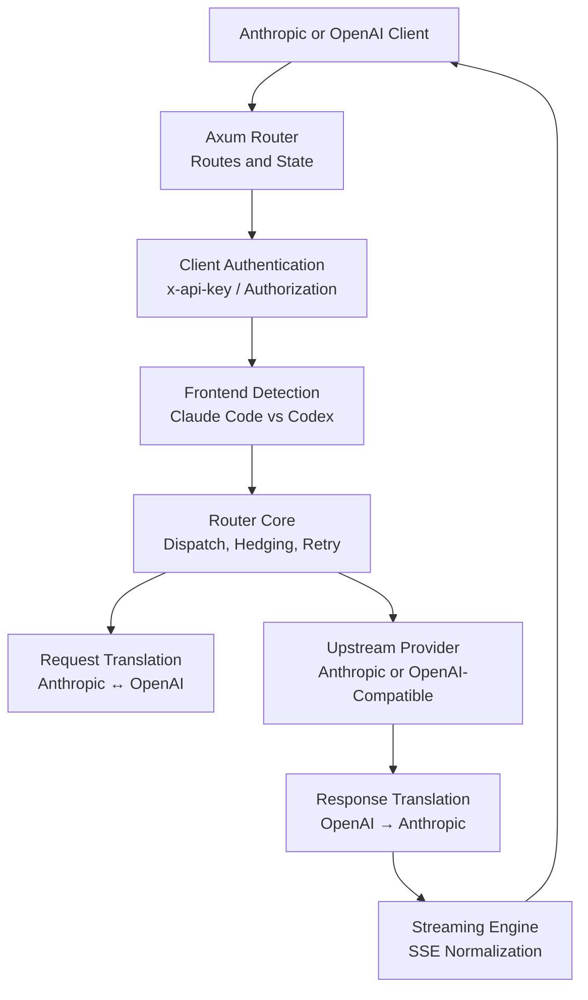
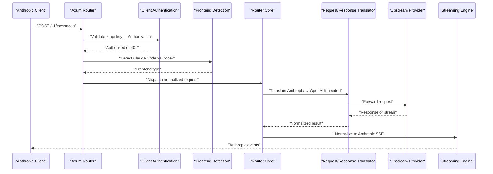
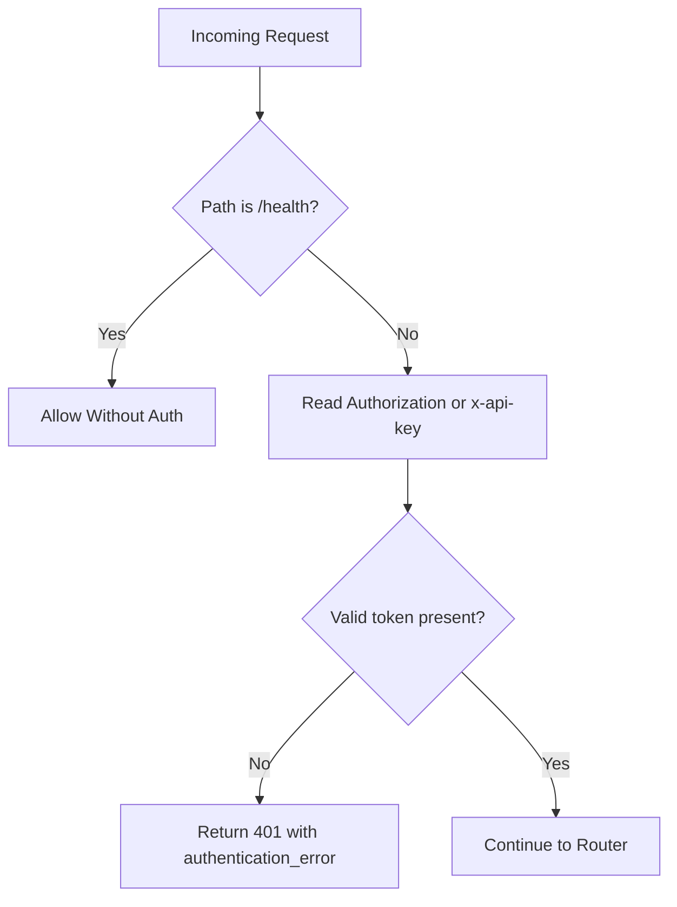
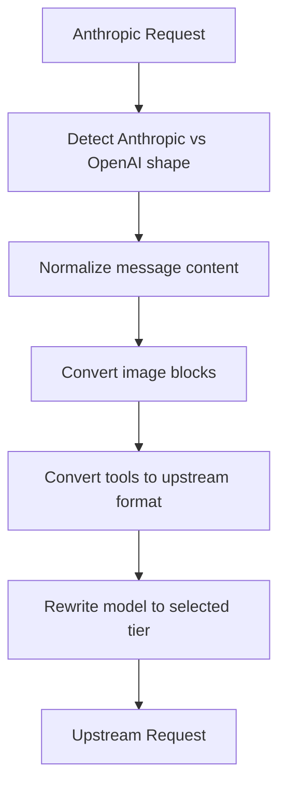
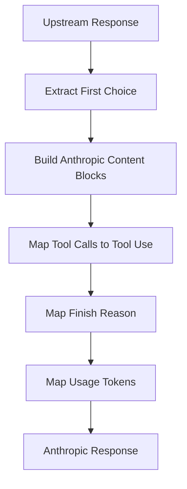
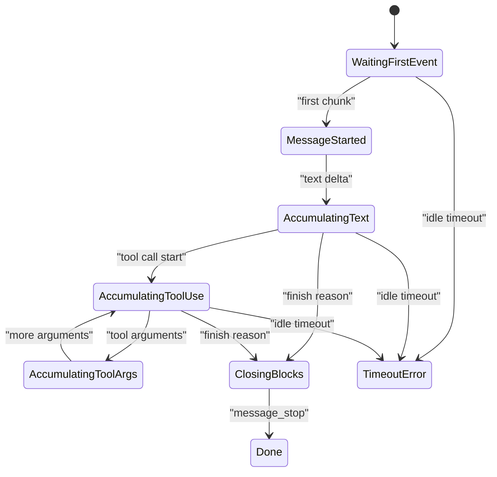
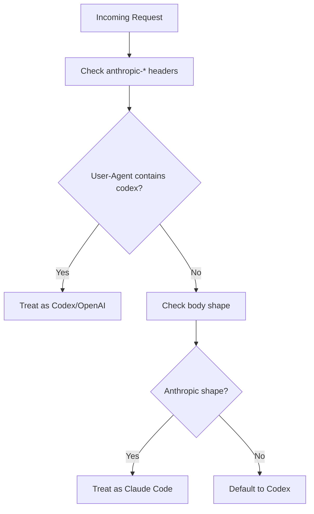
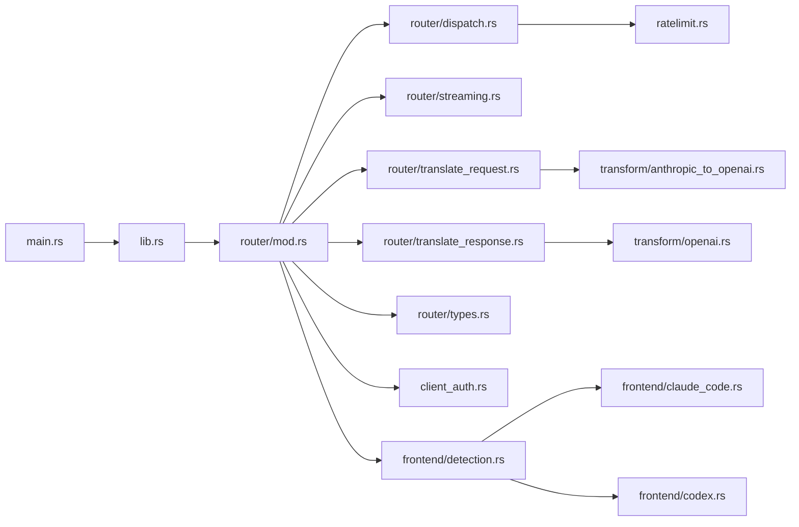

# Anthropic API Compatibility

<cite>
**Referenced Files in This Document**
- [main.rs](file://src/main.rs)
- [lib.rs](file://src/lib.rs)
- [client_auth.rs](file://src/client_auth.rs)
- [ratelimit.rs](file://src/ratelimit.rs)
- [router/mod.rs](file://src/router/mod.rs)
- [router/types.rs](file://src/router/types.rs)
- [router/dispatch.rs](file://src/router/dispatch.rs)
- [router/streaming.rs](file://src/router/streaming.rs)
- [router/translate_request.rs](file://src/router/translate_request.rs)
- [router/translate_response.rs](file://src/router/translate_response.rs)
- [frontend/detection.rs](file://src/frontend/detection.rs)
- [frontend/claude_code.rs](file://src/frontend/claude_code.rs)
- [frontend/codex.rs](file://src/frontend/codex.rs)
- [transform/openai.rs](file://src/transform/openai.rs)
- [transform/anthropic_to_openai.rs](file://src/transform/anthropic_to_openai.rs)
- [docs/claude_code_api_research.md](file://docs/claude_code_api_research.md)
- [tests/integration_claude_code.rs](file://tests/integration_claude_code.rs)
</cite>

## Table of Contents
1. [Introduction](#introduction)
2. [Project Structure](#project-structure)
3. [Core Components](#core-components)
4. [Architecture Overview](#architecture-overview)
5. [Detailed Component Analysis](#detailed-component-analysis)
6. [Dependency Analysis](#dependency-analysis)
7. [Performance Considerations](#performance-considerations)
8. [Troubleshooting Guide](#troubleshooting-guide)
9. [Conclusion](#conclusion)

## Introduction
This document describes CCR-Rust's compatibility layer for the Anthropic Messages API, focusing on the `/v1/messages` endpoint. It explains:

- Which request parameters are accepted and how they map to upstream providers.
- How requests are translated between Anthropic and OpenAI formats.
- How responses and streaming events are normalized back to Anthropic format.
- Authentication requirements, including `x-api-key`.
- Rate limiting behavior and error response shapes.
- Claude Code-specific behaviors and client detection.
- Message history handling, system prompt injection, tool use flows, and multi-turn patterns.

CCR-Rust is a multi-provider router. The Anthropic compatibility layer does not replace provider credentials; it translates Anthropic clients into the appropriate upstream protocol (often OpenAI-compatible chat completions) while presenting an Anthropic-shaped surface.

## Project Structure
The relevant implementation is organized around these layers:

| Layer | Responsibility | Key files |
|---|---|---|
| HTTP entry points | Axum routes, shared state, metrics, health checks | [main.rs](file://src/main.rs), [lib.rs](file://src/lib.rs) |
| Client authentication | Accepts `Authorization: Bearer` and `x-api-key` | [client_auth.rs](file://src/client_auth.rs) |
| Frontend detection | Chooses between Claude Code and Codex/OpenAI clients | [frontend/detection.rs](file://src/frontend/detection.rs), [frontend/claude_code.rs](file://src/frontend/claude_code.rs), [frontend/codex.rs](file://src/frontend/codex.rs) |
| Router core | Request dispatch, tier selection, hedging, retry, streaming coordination | [router/mod.rs](file://src/router/mod.rs), [router/dispatch.rs](file://src/router/dispatch.rs) |
| Protocol translation | Anthropic ↔ OpenAI request/response conversion | [router/translate_request.rs](file://src/router/translate_request.rs), [router/translate_response.rs](file://src/router/translate_response.rs) |
| Streaming engine | SSE framing, idle timeouts, backpressure, event normalization | [router/streaming.rs](file://src/router/streaming.rs) |
| Transformers | Reusable response-format transformers | [transform/openai.rs](file://src/transform/openai.rs), [transform/anthropic_to_openai.rs](file://src/transform/anthropic_to_openai.rs) |
| Rate limiting | Tiered 429 backoff and quota tracking | [ratelimit.rs](file://src/ratelimit.rs) |
| Tests and research | End-to-end behavior and Claude Code header documentation | [tests/integration_claude_code.rs](file://tests/integration_claude_code.rs), [docs/claude_code_api_research.md](file://docs/claude_code_api_research.md) |

**Diagram sources**
- [main.rs:1-200](file://src/main.rs#L1-L200)
- [client_auth.rs:1-144](file://src/client_auth.rs#L1-L144)
- [frontend/detection.rs:1-177](file://src/frontend/detection.rs#L1-L177)
- [router/mod.rs:1-200](file://src/router/mod.rs#L1-L200)
- [router/dispatch.rs:1-200](file://src/router/dispatch.rs#L1-L200)
- [router/translate_request.rs:1-200](file://src/router/translate_request.rs#L1-L200)
- [router/translate_response.rs:1-200](file://src/router/translate_response.rs#L1-L200)
- [router/streaming.rs:1-200](file://src/router/streaming.rs#L1-L200)

**Section sources**
- [lib.rs:1-27](file://src/lib.rs#L1-L27)
- [main.rs:1-200](file://src/main.rs#L1-L200)

## Core Components
### Anthropic Request Model
The internal Anthropic request model used by the router includes:

| Field | Type | Meaning |
|---|---|---|
| `model` | String | Target model identifier; may include provider prefixes before routing resolves to a concrete tier. |
| `messages` | Array | Conversation messages with `role` and `content`; content can be a string or an array of typed blocks. |
| `system` | Optional value | Top-level system prompt supported by the Anthropic Messages API. |
| `max_tokens` | Optional integer | Maximum completion tokens. |
| `temperature` | Optional number | Sampling temperature. |
| `stream` | Optional boolean | Whether the client wants a streaming response. |
| `tools` | Optional array | Tool definitions; the router normalizes them to the upstream provider's expected shape. |
| `thinking` | Optional value | Native thinking/reasoning controls passed through when supported. |
| `output_config` | Optional value | Native output configuration preserved end-to-end. |
| `openai_passthrough_body` | Internal field | Raw OpenAI request body kept when the inbound request was already OpenAI-formatted, avoiding an unnecessary round-trip. |

**Section sources**
- [router/types.rs:1-200](file://src/router/types.rs#L1-L200)

### Response Model
Responses are normalized into an Anthropic-style message structure containing:

- A stable response `id`.
- `response_type`, normally `message`.
- `role`, normally `assistant`.
- `model`, resolved from upstream or the original request.
- `content`, an array of blocks such as text, tool use, thinking, or redacted reasoning.
- `usage`, including input/output tokens and optional cache or reasoning token details.
- `stop_reason`, mapped from upstream finish reasons.
- Optional fields such as refusal, response status, and incomplete details that preserve upstream diagnostic information.

**Section sources**
- [router/translate_response.rs:1-200](file://src/router/translate_response.rs#L1-L200)

## Architecture Overview
The `/v1/messages` flow proceeds through authentication, frontend detection, request translation, upstream dispatch, response translation, and streaming normalization.

**Diagram sources**
- [client_auth.rs:1-144](file://src/client_auth.rs#L1-L144)
- [frontend/detection.rs:1-177](file://src/frontend/detection.rs#L1-L177)
- [router/mod.rs:1-200](file://src/router/mod.rs#L1-L200)
- [router/dispatch.rs:1-200](file://src/router/dispatch.rs#L1-L200)
- [router/streaming.rs:1-200](file://src/router/streaming.rs#L1-L200)

## Detailed Component Analysis

### Endpoint: POST /v1/messages
The `/v1/messages` route is handled by the router module and exposed through the application's Axum setup. The handler accepts an Anthropic-shaped JSON body, normalizes it, selects a backend tier, and returns either a complete Anthropic message or an SSE stream.

Key responsibilities:

- Parse the incoming JSON body into `AnthropicRequest`.
- Detect whether the client is Claude Code or an OpenAI/Codex client.
- Resolve the target model and backend tier.
- Optionally translate the request to OpenAI format for non-Anthropic providers.
- Send the request upstream, supporting both synchronous and streaming modes.
- Normalize the upstream response back to Anthropic format.
- Emit Anthropic-compatible SSE events when streaming.

**Section sources**
- [router/mod.rs:1-200](file://src/router/mod.rs#L1-L200)
- [tests/integration_claude_code.rs:1-200](file://tests/integration_claude_code.rs#L1-L200)

### Request Parameters

#### Required and Primary Fields
| Parameter | Accepted Shape | Behavior |
|---|---|---|
| `model` | String | Resolved to a configured backend tier. The router may rewrite this to the selected tier before forwarding. |
| `messages` | Array of message objects | Preserved conversation history. Content can be a string or an array of content blocks. |
| `system` | Any value | Top-level system prompt forwarded when present. |
| `max_tokens` | Integer | Passed through where supported. |
| `temperature` | Number | Passed through where supported. |
| `stream` | Boolean | Enables streaming mode. If disabled, the response is a single Anthropic message. |
| `tools` | Array | Normalized to the upstream provider's function-calling schema. |
| `thinking` | Object or value | Forwarded when the upstream supports native thinking controls. |
| `output_config` | Object or value | Preserved for native output configuration. |

#### Client-Side Behavior
- If `stream` is true and the selected tier allows streaming, the upstream request sets streaming enabled.
- Some provider protocols force non-streaming even when the client asks for it; the router enforces this per tier.
- Unknown or extra fields are generally preserved rather than rejected, allowing future extension without breaking clients.

**Section sources**
- [router/types.rs:1-200](file://src/router/types.rs#L1-L200)
- [router/mod.rs:1-200](file://src/router/mod.rs#L1-L200)

### Authentication Requirements
CCR-Rust exposes two equivalent forms of client authentication for the API:

| Header | Example | Notes |
|---|---|---|
| `Authorization: Bearer <token>` | `Authorization: Bearer abc123` | Standard bearer token form. |
| `x-api-key` | `x-api-key: abc123` | Anthropic-style API key form. |

Authentication rules:

- Both forms are accepted at the same time.
- Tokens are compared using constant-time digest comparison after SHA-256 hashing, reducing timing risk.
- Empty, non-ASCII, or whitespace-containing configured keys are rejected during initialization.
- Unauthenticated requests receive HTTP 401 with a JSON error object indicating a missing or invalid client API key.
- The `/health` endpoint remains accessible without authentication.

**Diagram sources**
- [client_auth.rs:1-144](file://src/client_auth.rs#L1-L144)

**Section sources**
- [client_auth.rs:1-144](file://src/client_auth.rs#L1-L144)

### Rate Limiting Behavior
Rate limiting is implemented per backend tier:

- When an upstream returns HTTP 429, the router records a backoff window for that tier.
- A server-supplied `Retry-After` duration is honored, capped at 60 seconds.
- If no `Retry-After` is provided:
  - Active routes continue receiving one-second pacing.
  - Starved routes—routes with no recent successful admissions—escalate local backoff exponentially up to 60 seconds.
- Proactive skipping can occur when trusted rate-limit headers indicate zero remaining quota, depending on provider configuration.
- Metrics record total rate limit backoffs per tier.

For clients, this means:

- Rapid retries against a throttled tier are suppressed.
- Failover can move traffic away from a backoffed tier according to the router's failover policy.
- Clients should still honor their own retry backoff and exponential retry policies.

**Section sources**
- [ratelimit.rs:1-200](file://src/ratelimit.rs#L1-L200)

### Error Response Formats

#### Authentication Errors
Unauthenticated requests return:

| Field | Value |
|---|---|
| HTTP status | 401 Unauthorized |
| `error.message` | Indicates missing or invalid client API key |
| `error.type` | `authentication_error` |

#### Provider 429 Errors
When an upstream provider returns 429, CCR-Rust may normalize the error further depending on the integration path. For example, in the OpenAI compatibility path, 429 errors are rewritten to include an OpenAI-compatible error shape with `type: rate_limit_error` and `code: rate_limited`.

#### Streaming Embedded Errors
Some providers return error payloads inside an HTTP 200 streaming body. CCR-Rust peeks at early stream data and converts embedded errors into a failure path, preserving error codes and messages.

**Section sources**
- [client_auth.rs:1-144](file://src/client_auth.rs#L1-L144)
- [router/openai_compat.rs:1-200](file://src/router/openai_compat.rs#L1-L200)
- [router/dispatch.rs:1-200](file://src/router/dispatch.rs#L1-L200)

### Request Translation: Anthropic to Upstream Providers
Most upstream providers do not implement the Anthropic Messages API directly. CCR-Rust translates the request so that:

- Anthropic message content is converted to OpenAI content blocks.
- Text-only arrays are collapsed into strings when possible.
- Image blocks are converted between Anthropic image sources and OpenAI `image_url` blocks.
- Thinking blocks are rendered into compatible text where necessary.
- Tool definitions are translated between Anthropic `{name, description, input_schema}` and OpenAI `{type: function, function: {name, description, parameters}}`.
- The request model is rewritten to the selected backend tier.
- Streaming flags are adjusted based on provider capability.

**Diagram sources**
- [router/translate_request.rs:1-200](file://src/router/translate_request.rs#L1-L200)
- [router/mod.rs:1-200](file://src/router/mod.rs#L1-L200)

**Section sources**
- [router/translate_request.rs:1-200](file://src/router/translate_request.rs#L1-L200)

### Response Translation: Upstream to Anthropic Format
Non-streaming responses are translated from OpenAI format to Anthropic format:

- The first choice becomes the assistant message.
- Content strings become text blocks.
- OpenAI `tool_calls` become Anthropic `tool_use` blocks.
- Finish reasons are mapped:
  - `stop` → `end_turn`
  - `length` → `max_tokens`
  - `tool_calls` → `tool_use`
  - `content_filter` → `stop_sequence`
- Usage tokens are mapped to input and output token counts.
- Reasoning content and refusal information are preserved when available.

**Diagram sources**
- [router/translate_response.rs:1-200](file://src/router/translate_response.rs#L1-L200)
- [transform/openai.rs:1-200](file://src/transform/openai.rs#L1-L200)

**Section sources**
- [router/translate_response.rs:1-200](file://src/router/translate_response.rs#L1-L200)
- [transform/openai.rs:1-200](file://src/transform/openai.rs#L1-L200)

### Streaming Behavior
When `stream: true`, CCR-Rust emits Anthropic-compatible Server-Sent Events:

- A message-start event is emitted for the first chunk.
- Text deltas are emitted as content-block delta events.
- Tool calls are accumulated and emitted as tool-use start, delta, and stop events.
- A final stop event closes all open content blocks.
- Idle timeouts terminate long-running streams and emit an error event.
- Backpressure is tracked when the outbound channel buffer is full.
- Token usage is accumulated across chunks and attached to the final event set.

**Diagram sources**
- [router/streaming.rs:1-200](file://src/router/streaming.rs#L1-L200)
- [router/translate_response.rs:1-200](file://src/router/translate_response.rs#L1-L200)

**Section sources**
- [router/streaming.rs:1-200](file://src/router/streaming.rs#L1-L200)

### Claude Code-Specific Behaviors and Client Detection

#### Detection Rules
Frontend detection uses these priorities:

1. Definitive header signals win:
   - `anthropic-*` headers indicate Claude Code.
   - `User-Agent` containing `codex` indicates Codex/OpenAI.
2. If both signals conflict, explicit Codex `User-Agent` takes precedence.
3. Body-only heuristics fall back to Anthropic shape when no OpenAI role-based pattern is detected.
4. Default is Codex.

Claude Code detection also recognizes:

- Headers prefixed with `anthropic-`.
- Requests containing `anthropic_version`.
- Top-level `system` prompts.
- Messages whose content is an array of typed blocks.

#### Claude Code Parsing
The Claude Code frontend parses:

- `model`, defaulting to a fallback when absent.
- `messages`, including role and content.
- `system`.
- `max_tokens`, `temperature`, `stream`.
- `tools` and `tool_choice`.
- `stop_sequences`.
- Extra provider-specific parameters preserved under `extra_params`.

#### Claude Code Response Serialization
Responses are serialized into Anthropic format:

- Text blocks become `type: text`.
- Thinking blocks include `thinking` and optional `signature`.
- Redacted thinking blocks are dropped from the readable surface.
- Tool use blocks include id, name, and input.

**Diagram sources**
- [frontend/detection.rs:1-177](file://src/frontend/detection.rs#L1-L177)
- [frontend/claude_code.rs:1-200](file://src/frontend/claude_code.rs#L1-L200)

**Section sources**
- [frontend/detection.rs:1-177](file://src/frontend/detection.rs#L1-L177)
- [frontend/claude_code.rs:1-200](file://src/frontend/claude_code.rs#L1-L200)
- [frontend/codex.rs:1-200](file://src/frontend/codex.rs#L1-L200)
- [docs/claude_code_api_research.md:1-200](file://docs/claude_code_api_research.md#L1-L200)

### Message History Handling and Multi-Turn Conversations
Message history is preserved as an ordered array. Each message carries:

- `role`: typically `user`, `assistant`, or `system`.
- `content`: text, multimodal blocks, or tool-related blocks.
- `tool_call_id`: used when returning results for prior tool calls.

Multi-turn tool use follows this general pattern:

1. User sends a message with available tools.
2. Assistant responds with one or more `tool_use` blocks.
3. Client executes tools and returns results with matching `tool_call_id`.
4. Assistant produces final text or additional tool calls.

The router normalizes tool calls between Anthropic `tool_use` and OpenAI `tool_calls`, preserving ids, names, and parsed argument objects.

**Section sources**
- [router/types.rs:1-200](file://src/router/types.rs#L1-L200)
- [router/translate_request.rs:1-200](file://src/router/translate_request.rs#L1-L200)
- [router/translate_response.rs:1-200](file://src/router/translate_response.rs#L1-L200)

### System Prompt Injection
System prompts are handled differently depending on the client:

- Anthropic requests support a top-level `system` field.
- OpenAI/Codex requests embed system instructions in the message array with a system role.
- The router preserves the system prompt in its internal representation and forwards it according to the upstream protocol.
- For Claude Code, the presence of a top-level `system` field is one of the detection signals.

**Section sources**
- [frontend/claude_code.rs:1-200](file://src/frontend/claude_code.rs#L1-L200)
- [frontend/codex.rs:1-200](file://src/frontend/codex.rs#L1-L200)

### Concrete Examples

#### Chat Completion Request
An Anthropic-style chat completion request includes:

- `model` identifying the desired Claude model.
- `messages` with user and assistant turns.
- Optional `system` prompt.
- Optional `max_tokens`, `temperature`, and `stream`.

The router then selects a backend tier, translates the request if needed, and returns either a complete message or a streaming response.

#### Tool Use Flow
A tool use flow includes:

- Tools defined in the request.
- Assistant responding with `tool_use` blocks.
- Client sending tool results.
- Assistant producing final output.

The router ensures tool definitions and tool call arguments are correctly translated between Anthropic and OpenAI formats.

#### Streaming Response
A streaming response includes:

- Initial message-start event.
- Incremental text deltas.
- Tool-use start, delta, and stop events.
- Final stop event.
- Token usage metadata.

**Section sources**
- [tests/integration_claude_code.rs:1-200](file://tests/integration_claude_code.rs#L1-L200)
- [router/translate_response.rs:1-200](file://src/router/translate_response.rs#L1-L200)
- [router/streaming.rs:1-200](file://src/router/streaming.rs#L1-L200)

## Dependency Analysis
The following diagram shows how the main modules depend on each other for the Anthropic compatibility layer:

**Diagram sources**
- [main.rs:1-200](file://src/main.rs#L1-L200)
- [lib.rs:1-27](file://src/lib.rs#L1-L27)
- [router/mod.rs:1-200](file://src/router/mod.rs#L1-L200)
- [router/dispatch.rs:1-200](file://src/router/dispatch.rs#L1-L200)
- [router/streaming.rs:1-200](file://src/router/streaming.rs#L1-L200)
- [router/translate_request.rs:1-200](file://src/router/translate_request.rs#L1-L200)
- [router/translate_response.rs:1-200](file://src/router/translate_response.rs#L1-L200)
- [router/types.rs:1-200](file://src/router/types.rs#L1-L200)
- [client_auth.rs:1-144](file://src/client_auth.rs#L1-L144)
- [frontend/detection.rs:1-177](file://src/frontend/detection.rs#L1-L177)
- [frontend/claude_code.rs:1-200](file://src/frontend/claude_code.rs#L1-L200)
- [frontend/codex.rs:1-200](file://src/frontend/codex.rs#L1-L200)
- [transform/openai.rs:1-200](file://src/transform/openai.rs#L1-L200)
- [transform/anthropic_to_openai.rs:1-200](file://src/transform/anthropic_to_openai.rs#L1-L200)
- [ratelimit.rs:1-200](file://src/ratelimit.rs#L1-L200)

**Section sources**
- [router/mod.rs:1-200](file://src/router/mod.rs#L1-L200)

## Performance Considerations
- **Streaming backpressure**: The streaming engine records backpressure when the outbound channel is full, helping operators detect slow clients or overloaded downstream channels.
- **Idle timeouts**: Long-running streams without progress are terminated with an error event, preventing resource leaks.
- **Dynamic backoff scaling**: CCR-Rust includes EWMA-based dynamic backoff logic that scales retry delays based on observed latency trends.
- **Admission control**: Per-tier admission limits and token budgeting reduce overload on constrained providers.
- **Hedging**: Configurable hedging can launch secondary attempts to reduce tail latency when enabled.
- **Pass-through optimization**: When the inbound request is already OpenAI-formatted, CCR-Rust can avoid an unnecessary Anthropic round-trip by passing the raw body through.

[No sources needed since this section provides general guidance]

## Troubleshooting Guide

### Authentication Fails with 401
Check:

- Whether the configured client API key matches the sent token.
- Whether the client sends either `Authorization: Bearer` or `x-api-key`.
- Whether the token contains only ASCII characters without whitespace.
- Whether the request targets an authenticated listener.

**Section sources**
- [client_auth.rs:1-144](file://src/client_auth.rs#L1-L144)

### Streaming Stops Early
Check:

- Whether the upstream stopped emitting events.
- Whether an idle timeout occurred.
- Whether an embedded error was detected in a 200 stream.
- Whether the client disconnected from the SSE channel.

**Section sources**
- [router/streaming.rs:1-200](file://src/router/streaming.rs#L1-L200)
- [router/dispatch.rs:1-200](file://src/router/dispatch.rs#L1-L200)

### Tools Are Missing or Malformed
Check:

- Whether tools are defined in the Anthropic shape or already in OpenAI shape.
- Whether tool arguments are valid JSON.
- Whether tool call ids are preserved across tool results.
- Whether the upstream provider supports function calling.

**Section sources**
- [router/translate_request.rs:1-200](file://src/router/translate_request.rs#L1-L200)
- [router/translate_response.rs:1-200](file://src/router/translate_response.rs#L1-L200)

### Rate Limited
Check:

- Whether the upstream returned 429.
- Whether a `Retry-After` header was present.
- Whether the tier is starved and experiencing escalating backoff.
- Whether the client is retrying too aggressively.

**Section sources**
- [ratelimit.rs:1-200](file://src/ratelimit.rs#L1-L200)

### Claude Code Detection Is Incorrect
Check:

- Whether `anthropic-*` headers are present.
- Whether `User-Agent` contains `codex`.
- Whether the body contains OpenAI-style roles.
- Whether the configuration expects Anthropic or OpenAI frontends.

**Section sources**
- [frontend/detection.rs:1-177](file://src/frontend/detection.rs#L1-L177)
- [frontend/claude_code.rs:1-200](file://src/frontend/claude_code.rs#L1-L200)
- [frontend/codex.rs:1-200](file://src/frontend/codex.rs#L1-L200)

## Conclusion
CCR-Rust's Anthropic compatibility layer presents a stable Anthropic Messages API surface while routing requests to multiple upstream providers. It handles:

- Authentication via `x-api-key` or `Authorization: Bearer`.
- Frontend detection distinguishing Claude Code from Codex/OpenAI clients.
- Request translation between Anthropic and OpenAI formats.
- Response normalization back to Anthropic shape.
- Streaming event sequencing, idle timeouts, and backpressure.
- Tool use across message turns.
- System prompts and message history.
- Rate limiting with tiered backoff and metric reporting.

For clients, the practical rule is simple: send Anthropic-shaped requests with a valid client API key, and CCR-Rust will manage provider selection, translation, streaming, and normalization behind the scenes.

[No sources needed since this section summarizes without analyzing specific files]