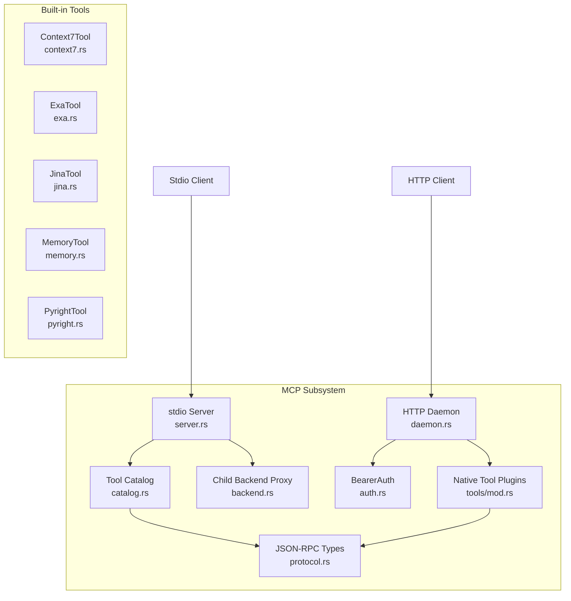
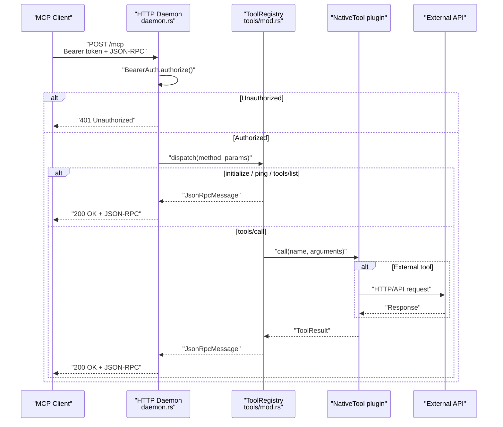
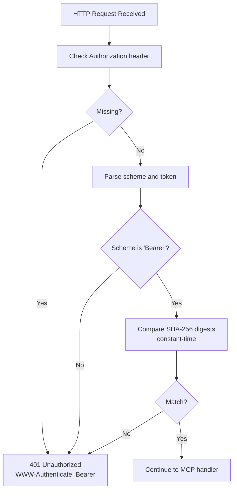
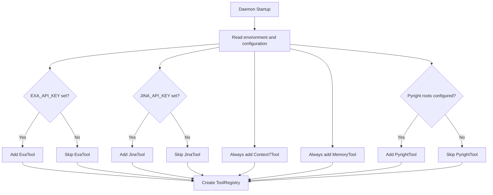

# MCP Server Protocol

<cite>
**Referenced Files in This Document**
- [mod.rs](file://src/mcp/mod.rs)
- [protocol.rs](file://src/mcp/protocol.rs)
- [server.rs](file://src/mcp/server.rs)
- [daemon.rs](file://src/mcp/daemon.rs)
- [catalog.rs](file://src/mcp/catalog.rs)
- [backend.rs](file://src/mcp/backend.rs)
- [auth.rs](file://src/mcp/auth.rs)
- [tools/mod.rs](file://src/mcp/tools/mod.rs)
- [context7.rs](file://src/mcp/tools/context7.rs)
- [exa.rs](file://src/mcp/tools/exa.rs)
- [jina.rs](file://src/mcp/tools/jina.rs)
- [memory.rs](file://src/mcp/tools/memory.rs)
- [pyright.rs](file://src/mcp/tools/pyright.rs)
- [test_mcp_daemon.rs](file://tests/test_mcp_daemon.rs)
- [README.md](file://README.md)
</cite>

## Table of Contents
1. [Introduction](#introduction)
2. [Project Structure](#project-structure)
3. [Core Components](#core-components)
4. [Architecture Overview](#architecture-overview)
5. [Protocol Specification](#protocol-specification)
6. [Daemon Mode and Shared Tool Execution](#daemon-mode-and-shared-tool-execution)
7. [Tool Registration and Catalog Management](#tool-registration-and-catalog-management)
8. [Plugin Architecture](#plugin-architecture)
9. [Security Considerations](#security-considerations)
10. [Client Integration Guide](#client-integration-guide)
11. [Troubleshooting Guide](#troubleshooting-guide)
12. [Conclusion](#conclusion)

## Introduction
This document describes the Model Context Protocol (MCP) server implementation in CCR-Rust. It covers two runtime modes:

- **Streamed JSON-RPC over stdin/stdout**: a process-oriented MCP server that proxies requests to one or more child MCP backend processes.
- **HTTP daemon mode**: a shared, single-process HTTP server exposing `/mcp` for authenticated clients to discover and call native tools.

The protocol is JSON-RPC 2.0 over text frames. The daemon mode uses HTTP POST with `application/json`. While the repository includes an HTTP/SSE layer elsewhere in the codebase, the MCP implementations documented here use either line-delimited JSON-RPC over stdio or HTTP POST; SSE is not implemented by the MCP modules themselves.

**Section sources**
- [README.md:1-60](file://README.md#L1-L60)
- [mod.rs:1-8](file://src/mcp/mod.rs#L1-L8)

## Project Structure
The MCP subsystem lives under `src/mcp` and is split into transport, protocol, routing, authentication, cataloging, and tool plugins.

**Diagram sources**
- [server.rs:1-200](file://src/mcp/server.rs#L1-L200)
- [daemon.rs:1-319](file://src/mcp/daemon.rs#L1-L319)
- [protocol.rs:1-40](file://src/mcp/protocol.rs#L1-L40)
- [catalog.rs:1-72](file://src/mcp/catalog.rs#L1-L72)
- [backend.rs:1-136](file://src/mcp/backend.rs#L1-L136)
- [auth.rs:1-81](file://src/mcp/auth.rs#L1-L81)
- [tools/mod.rs:1-98](file://src/mcp/tools/mod.rs#L1-L98)
- [context7.rs:1-164](file://src/mcp/tools/context7.rs#L1-L164)
- [exa.rs:1-177](file://src/mcp/tools/exa.rs#L1-L177)
- [jina.rs:1-200](file://src/mcp/tools/jina.rs#L1-L200)
- [memory.rs:1-200](file://src/mcp/tools/memory.rs#L1-L200)
- [pyright.rs:1-200](file://src/mcp/tools/pyright.rs#L1-L200)

**Section sources**
- [mod.rs:1-8](file://src/mcp/mod.rs#L1-L8)

## Core Components

### JSON-RPC Message Model
The core message type supports both requests and responses. Fields are optional so the same struct represents outgoing requests, incoming requests, results, and errors.

| Field | Type | Meaning |
|---|---|---|
| `jsonrpc` | String | Protocol version; always `"2.0"` in this implementation. |
| `id` | Value | Request identifier used to match responses. |
| `method` | String | RPC method name. Present on requests and server-to-client notifications. |
| `params` | Value | Request parameters. |
| `result` | Value | Successful response payload. |
| `error` | Value | Error payload containing `code` and `message`. |

Tool definitions use a compact schema:

| Field | Type | Meaning |
|---|---|---|
| `name` | String | Tool name. |
| `description` | String | Human-readable description; may be truncated depending on catalog level. |
| `inputSchema` | Object | JSON Schema describing accepted arguments. |

Tool-call parameters use:

| Field | Type | Meaning |
|---|---|---|
| `name` | String | Target tool name. |
| `arguments` | Object | Arguments passed to the tool. |

**Section sources**
- [protocol.rs:1-40](file://src/mcp/protocol.rs#L1-L40)

### Stdio Server
The stdio server reads one JSON-RPC frame per line from standard input and writes responses to standard output. It:

1. Spawns configured MCP backend commands.
2. Discovers tools from each backend using `tools/list`.
3. Builds a filtered tool catalog.
4. Dispatches supported methods.
5. Proxies `tools/call` to the appropriate backend.

Supported methods:

| Method | Direction | Behavior |
|---|---|---|
| `initialize` | Request → Response | Returns protocol version, server info, and capabilities. |
| `notifications/initialized` | Notification | Accepted but produces no response. |
| `ping` | Request → Response | Returns empty result. |
| `tools/list` | Request → Response | Returns compressed tool list based on log level. |
| `tools/call` | Request → Response | Routes to the registered backend and forwards its response. |

Unsupported request methods return error `-32601` when the request has an ID; otherwise they produce no response.

**Section sources**
- [server.rs:1-200](file://src/mcp/server.rs#L1-L200)

### HTTP Daemon
The daemon exposes an Axum router bound to a host and port. Its routes are:

| Route | Method | Purpose |
|---|---|---|
| `/mcp` | POST | MCP JSON-RPC endpoint. |
| `/health` | GET | Health check returning `ok`. |

All routes except health checks are protected by bearer-token middleware.

**Section sources**
- [daemon.rs:1-200](file://src/mcp/daemon.rs#L1-L200)

### Child Backend Proxy
`McpBackend` wraps a child process running an external MCP server. It:

- Starts the backend through `bash -lc <command>`.
- Writes framed JSON-RPC lines to the child’s stdin.
- Reads one-line JSON-RPC responses from the child’s stdout.
- Skips server-to-client notifications and unrelated response IDs.
- Detects premature child termination.
- Kills the child on drop.

**Section sources**
- [backend.rs:1-136](file://src/mcp/backend.rs#L1-L136)

## Architecture Overview

**Diagram sources**
- [daemon.rs:1-319](file://src/mcp/daemon.rs#L1-L319)
- [tools/mod.rs:1-98](file://src/mcp/tools/mod.rs#L1-L98)
- [auth.rs:1-81](file://src/mcp/auth.rs#L1-L81)

## Protocol Specification

### Connection Establishment

#### Stdio Mode
Connection is implicit: the client launches the server process and communicates through inherited stdin/stdout. Each frame is a single line containing a JSON object.

#### HTTP Mode
Clients connect to the daemon’s HTTP endpoint:

- Base path: `/mcp`
- Transport: HTTP POST
- Content-Type: `application/json`
- Authentication: `Authorization: Bearer <token>`

A successful connection begins with an `initialize` request.

#### Streamable HTTP vs SSE
The MCP modules implement:

- Line-delimited JSON-RPC over stdio.
- HTTP POST JSON-RPC over `/mcp`.

There is no MCP-specific SSE stream handler in the analyzed files. Clients should treat `/mcp` as a request/response HTTP endpoint unless integrating with a higher-level transport wrapper not present in this module set.

**Section sources**
- [server.rs:1-120](file://src/mcp/server.rs#L1-L120)
- [daemon.rs:1-120](file://src/mcp/daemon.rs#L1-L120)
- [backend.rs:1-136](file://src/mcp/backend.rs#L1-L136)

### Authentication Flow

**Diagram sources**
- [auth.rs:1-81](file://src/mcp/auth.rs#L1-L81)
- [daemon.rs:160-200](file://src/mcp/daemon.rs#L160-L200)

Authentication rules:

| Rule | Behavior |
|---|---|
| Missing `Authorization` header | Rejected. |
| Non-`Bearer` scheme | Rejected. |
| Empty token after scheme | Rejected. |
| Token mismatch | Rejected. |
| Correct token | Allowed. Comparison uses constant-time digest comparison. |
| Configured token validation | Tokens must be nonempty ASCII without whitespace or control characters. |

The daemon returns `401 Unauthorized` with `WWW-Authenticate: Bearer` when authentication fails.

**Section sources**
- [auth.rs:1-81](file://src/mcp/auth.rs#L1-L81)
- [daemon.rs:160-200](file://src/mcp/daemon.rs#L160-L200)

### Supported Methods

#### `initialize`

**Request**

| Field | Required | Type | Description |
|---|---:|---|---|
| `jsonrpc` | Yes | String | Must be `"2.0"`. |
| `id` | Recommended | Value | Client-supplied request ID. |
| `method` | Yes | String | Must be `"initialize"`. |
| `params` | Optional | Object | Client capabilities and client information. |

**Response**

| Field | Type | Description |
|---|---|---|
| `jsonrpc` | String | `"2.0"`. |
| `id` | Value | Echoed request ID. |
| `result` | Object | Server capability advertisement. |
| `result.protocolVersion` | String | `"2024-11-05"`. |
| `result.serverInfo.name` | String | `"ccr-rust-mcp-daemon"` in daemon mode; `"ccr-rust-mcp"` in stdio mode. |
| `result.serverInfo.version` | String | Compiled package version. |
| `result.capabilities.tools.listChanged` | Boolean | `false`. |

**Error Codes**

| Code | Meaning |
|---:|---|
| `-32700` | Invalid JSON-RPC parse error. |
| `-32000` | Internal processing error. |
| `-32601` | Method not found. |

#### `notifications/initialized`

A notification indicating the client has finished initialization. The server accepts it and returns no response.

#### `ping`

**Request**

| Field | Required | Type | Description |
|---|---:|---|---|
| `method` | Yes | String | `"ping"`. |

**Response**

| Field | Type | Description |
|---|---|---|
| `result` | Object | Empty object `{}`. |

#### `tools/list`

**Request**

| Field | Required | Type | Description |
|---|---:|---|---|
| `method` | Yes | String | `"tools/list"`. |
| `params` | Optional | Object | Usually empty. |

**Response**

| Field | Type | Description |
|---|---|---|
| `result.tools` | Array | List of tool definitions. |
| `result.tools[].name` | String | Tool name. |
| `result.tools[].description` | String | May be truncated or cleared depending on catalog compression level. |
| `result.tools[].inputSchema` | Object | JSON Schema for arguments. |

In stdio mode, catalog compression depends on the configured log level. In daemon mode, the full tool catalog is returned.

#### `tools/call`

**Request**

| Field | Required | Type | Description |
|---|---:|---|---|
| `method` | Yes | String | `"tools/call"`. |
| `params.name` | Yes | String | Tool name. |
| `params.arguments` | Optional | Object | Tool arguments. Defaults to empty object when missing in daemon mode. |

**Response**

| Field | Type | Description |
|---|---|---|
| `result.content` | Array | Array of content entries. |
| `result.content[].type` | String | Content type, typically `"text"`. |
| `result.content[].text` | String | Text payload. |
| `result.isError` | Boolean | Indicates whether the tool reported an application-level error. |

If the tool panics or returns a Rust error, the server wraps it as a JSON-RPC error with code `-32000`. Unknown tool names return application-level error content rather than a JSON-RPC error in daemon mode.

**Section sources**
- [server.rs:120-227](file://src/mcp/server.rs#L120-L227)
- [daemon.rs:201-319](file://src/mcp/daemon.rs#L201-L319)
- [protocol.rs:1-40](file://src/mcp/protocol.rs#L1-L40)
- [tools/mod.rs:1-98](file://src/mcp/tools/mod.rs#L1-L98)

## Daemon Mode and Shared Tool Execution

### Purpose
Daemon mode runs a single HTTP server that shares tool state across multiple concurrent clients. This contrasts with stdio mode, where each backend process is separate and tool state is isolated per child.

### Lifecycle
1. Construct `BearerAuth` from the configured token.
2. Build an HTTP client with a user agent and timeout.
3. Register enabled native tools.
4. Wrap tools in `ToolRegistry`.
5. Create an Axum router with bearer middleware.
6. Bind to the configured host and port.
7. Serve requests until shutdown.

### Shared State
Shared state includes:

- `ToolRegistry`: read-only discovery and dispatch over registered plugins.
- `MemoryTool`: an in-memory knowledge graph optionally persisted to disk.
- External tool clients: HTTP clients for Context7, Exa, Jina, and other services.

### Concurrency
- The daemon handles multiple HTTP connections concurrently through Tokio and Axum.
- Some tools impose their own concurrency limits. For example, `PyrightTool` uses a semaphore to limit concurrent type-check workloads.

### Process Isolation
Unlike stdio mode, the daemon does not spawn child MCP servers for built-in tools. Built-in tools run in-process. Child backend spawning exists only in stdio mode via `McpBackend`.

**Section sources**
- [daemon.rs:1-200](file://src/mcp/daemon.rs#L1-L200)
- [backend.rs:1-136](file://src/mcp/backend.rs#L1-L136)
- [pyright.rs:1-120](file://src/mcp/tools/pyright.rs#L1-L120)

## Tool Registration and Catalog Management

### Stdio Catalog
In stdio mode, the server:

1. Spawns backends.
2. Calls `tools/list` on each backend.
3. Registers all discovered tools into `ToolCatalog`.
4. Applies include/exclude filters.
5. Compresses descriptions according to log level.

Catalog operations:

| Operation | Complexity | Notes |
|---|---:|---|
| Add tools | O(N) per backend | Adds or replaces existing tool entries by name. |
| Route lookup | O(1) average | Uses a HashMap from tool name to backend index. |
| Compress | O(T) | Iterates all tools once. |
| Schema lookup | O(T) | Linear scan by name. |

Compression levels:

| Level | Description behavior |
|---|---|
| `none` | Clears description and sets `inputSchema` to empty object. |
| `minimal`, `min`, `high`, `aggressive` | Clears description. |
| `medium`, `light` | Normalizes whitespace and truncates to 256 characters. |
| Other values | Preserves full description. |

**Section sources**
- [catalog.rs:1-72](file://src/mcp/catalog.rs#L1-L72)
- [server.rs:1-120](file://src/mcp/server.rs#L1-L120)

### Daemon Catalog
In daemon mode, the catalog is composed at startup from enabled plugins:

- Always enabled: Context7, memory.
- Conditionally enabled: Exa (`EXA_API_KEY`), Jina (`JINA_API_KEY`), Sindexer (`sindexer` feature), Pyright (requires both project root and workspace directory).
- Tool registry lists and calls tools through the `NativeTool` trait.

**Section sources**
- [daemon.rs:40-160](file://src/mcp/daemon.rs#L40-L160)
- [tools/mod.rs:1-98](file://src/mcp/tools/mod.rs#L1-L98)

## Plugin Architecture

### Trait Definition
Each plugin implements `NativeTool`:

| Item | Responsibility |
|---|---|
| `tools()` | Returns declared tool definitions. |
| `call(name, arguments)` | Executes a named tool and returns `ToolResult`. |

### Result Model
Tool execution returns:

| Field | Type | Meaning |
|---|---:|---|
| `content` | Array | Zero or more content parts. |
| `content[].type` | String | Content kind, usually `"text"`. |
| `content[].text` | String | Serialized content, often JSON or Markdown. |
| `isError` | Boolean | Application-level error flag. |

### Built-in Plugins

| Plugin | Name(s) | Key Behavior |
|---|---|---|
| Context7 | `resolve-library-id`, `query-docs` | Queries Context7 documentation APIs. |
| Exa | `web_search_exa`, `web_fetch_exa` | Web search and page fetching via Exa. |
| Jina | `web_search_jina`, `web_fetch_jina` | Live web search and reader access via Jina. |
| Memory | `create_entities`, `create_relations`, `add_observations`, `delete_entities`, `delete_observations`, `delete_relations`, `read_graph`, plus additional graph operations | Persistent in-process knowledge graph. |
| Pyright | `type_check` | Runs Python type diagnostics in an isolated workspace directory. |

### Plugin Discovery Flow

**Diagram sources**
- [daemon.rs:40-160](file://src/mcp/daemon.rs#L40-L160)
- [tools/mod.rs:1-98](file://src/mcp/tools/mod.rs#L1-L98)
- [context7.rs:1-80](file://src/mcp/tools/context7.rs#L1-L80)
- [exa.rs:1-80](file://src/mcp/tools/exa.rs#L1-L80)
- [jina.rs:1-120](file://src/mcp/tools/jina.rs#L1-L120)
- [memory.rs:1-120](file://src/mcp/tools/memory.rs#L1-L120)
- [pyright.rs:1-120](file://src/mcp/tools/pyright.rs#L1-L120)

**Section sources**
- [tools/mod.rs:1-98](file://src/mcp/tools/mod.rs#L1-L98)
- [context7.rs:1-164](file://src/mcp/tools/context7.rs#L1-L164)
- [exa.rs:1-177](file://src/mcp/tools/exa.rs#L1-L177)
- [jina.rs:1-200](file://src/mcp/tools/jina.rs#L1-L200)
- [memory.rs:1-200](file://src/mcp/tools/memory.rs#L1-L200)
- [pyright.rs:1-200](file://src/mcp/tools/pyright.rs#L1-L200)

## Security Considerations

### Bearer Token Validation
- Tokens are validated against the exact configured value.
- Comparison uses SHA-256 digest equality with constant-time comparison to reduce timing side-channel risk.
- The authorization scheme must be case-insensitive `Bearer`.
- Invalid tokens receive `401 Unauthorized` with `WWW-Authenticate: Bearer`.

### Token Configuration Safety
- Configured tokens must be ASCII.
- Whitespace and control characters are rejected during construction.
- Empty tokens are rejected.

### Tool Input Validation
Tools validate inputs before calling external systems:

- Context7 requires library query fields.
- Exa validates queries and URL arrays.
- Jina enforces result count ranges and URL constraints.
- Memory persists changes atomically through temporary-file rename.
- Pyright rejects absolute paths and parent-directory traversal, limits file counts, and isolates work in temporary directories.

### Operational Recommendations
- Run the daemon behind TLS termination in production.
- Restrict access to loopback or an internal network unless explicitly exposed.
- Store bearer tokens in secure secret management, not in logs or command history.
- Limit tool exposure using include/exclude filters in stdio mode.
- Review third-party tool credentials separately from the MCP bearer token.

**Section sources**
- [auth.rs:1-81](file://src/mcp/auth.rs#L1-L81)
- [daemon.rs:160-200](file://src/mcp/daemon.rs#L160-L200)
- [context7.rs:80-164](file://src/mcp/tools/context7.rs#L80-L164)
- [exa.rs:80-177](file://src/mcp/tools/exa.rs#L80-L177)
- [jina.rs:120-200](file://src/mcp/tools/jina.rs#L120-L200)
- [memory.rs:1-120](file://src/mcp/tools/memory.rs#L1-L120)
- [pyright.rs:120-200](file://src/mcp/tools/pyright.rs#L120-L200)

## Client Integration Guide

### HTTP Daemon Client Example
A typical client workflow:

1. Send `POST /mcp` with `Content-Type: application/json` and `Authorization: Bearer <token>`.
2. Call `initialize` to obtain server capabilities.
3. Call `tools/list` to discover available tools.
4. Call `tools/call` with the target tool name and arguments.
5. Read `result.content[0].text` as the primary textual output.
6. Inspect `result.isError` for application-level failures.

The test suite demonstrates:

- Initializing the daemon.
- Listing tools.
- Calling Jina search and fetch through the daemon.
- Verifying that unauthorized requests are rejected.

**Section sources**
- [test_mcp_daemon.rs:1-200](file://tests/test_mcp_daemon.rs#L1-L200)

### Stdio Client Example
For stdio mode:

1. Launch the server process.
2. Write one JSON-RPC line to stdin.
3. Read one JSON-RPC line from stdout.
4. Use `tools/list` to discover backend tools.
5. Use `tools/call` to proxy calls to the selected backend.

**Section sources**
- [server.rs:1-120](file://src/mcp/server.rs#L1-L120)
- [backend.rs:1-136](file://src/mcp/backend.rs#L1-L136)

## Troubleshooting Guide

### Common Errors

| Symptom | Likely Cause | Resolution |
|---|---|---|
| `401 Unauthorized` with `WWW-Authenticate: Bearer` | Missing or incorrect bearer token. | Verify the `Authorization: Bearer` header matches the configured token. |
| `-32700 parse error` | Malformed JSON-RPC body. | Ensure the request body is valid JSON. |
| `-32601 method not found` | Unsupported or misspelled method. | Use `initialize`, `ping`, `tools/list`, or `tools/call`. |
| `unknown tool` | Tool name not registered. | Confirm the tool is enabled and listed by `tools/list`. |
| Backend exits before responding | Child MCP process crashed. | Inspect backend stderr and restart the backend command. |
| Missing tool in stdio mode | Include/exclude filter removed it. | Adjust include/exclude lists or remove filters. |
| Pyright reports path errors | Absolute or unsafe path provided. | Pass relative paths without `..`. |
| Jina or Exa returns application error | External API failure or invalid arguments. | Inspect `result.content[0].text` and `result.isError`. |

### Diagnostic Steps

1. **Check health**: Query `/health` to verify the daemon is listening.
2. **Validate authentication**: Test with the correct bearer token.
3. **List tools**: Confirm the expected tool set appears.
4. **Ping**: Verify basic request/response framing works.
5. **Inspect tool result text**: Many tools return structured JSON inside `content[0].text`.
6. **Review logs**: Daemon and tool code emit tracing logs for tool registration, routing, and failures.
7. **Verify child backends**: In stdio mode, ensure the backend command starts successfully and responds to `tools/list`.

**Section sources**
- [daemon.rs:180-200](file://src/mcp/daemon.rs#L180-L200)
- [server.rs:60-120](file://src/mcp/server.rs#L60-L120)
- [backend.rs:60-136](file://src/mcp/backend.rs#L60-L136)
- [catalog.rs:40-72](file://src/mcp/catalog.rs#L40-L72)

## Conclusion
CCR-Rust’s MCP implementation provides two complementary entry points:

- A simple stdio-based JSON-RPC proxy suitable for chaining external MCP backends.
- An authenticated HTTP daemon offering shared native tools such as web search, documentation lookup, persistent memory, and Python type checking.

The protocol centers on a small set of JSON-RPC methods, with tool discovery and execution delegated to pluggable components. Security relies on bearer-token validation at the HTTP boundary and input validation within individual tools. Clients should begin with `initialize`, enumerate tools with `tools/list`, and invoke functionality through `tools/call`, treating tool output as opaque text unless they understand the specific tool’s schema.