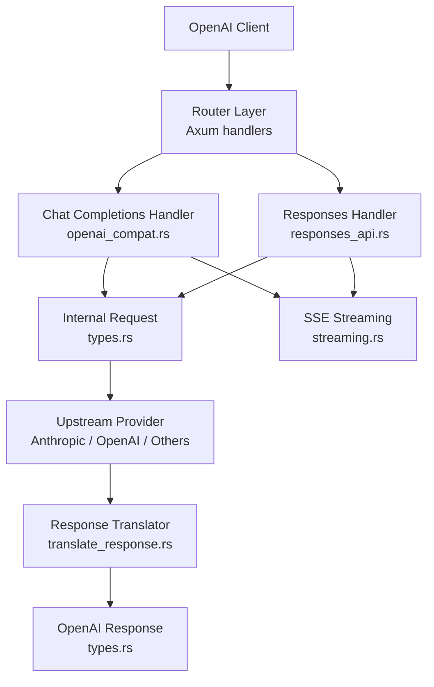
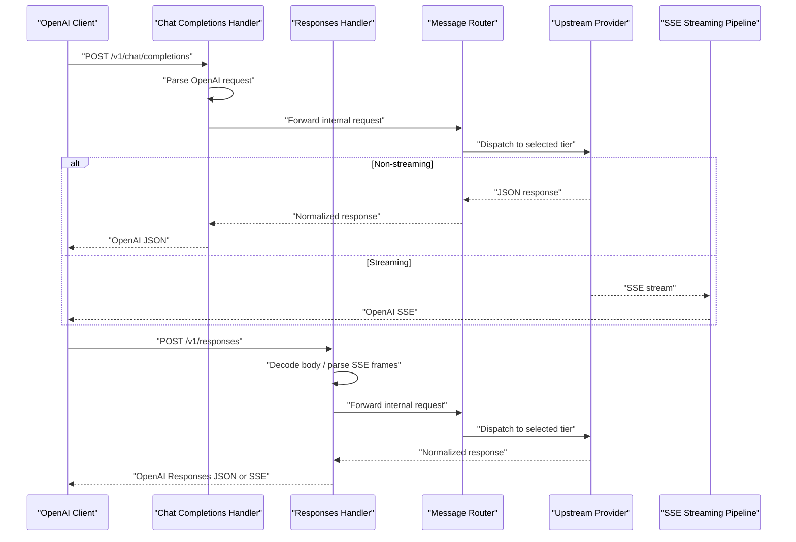
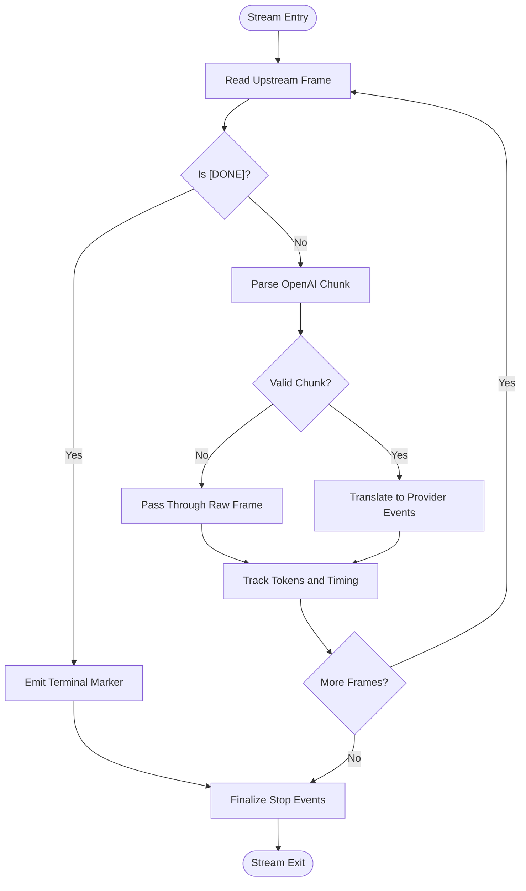
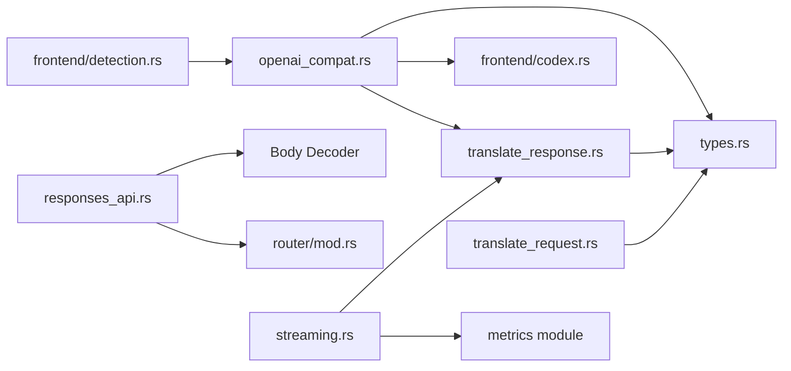

# OpenAI API Compatibility

<cite>
**Referenced Files in This Document**   
- [mod.rs](file://src/router/mod.rs)
- [openai_compat.rs](file://src/router/openai_compat.rs)
- [responses_api.rs](file://src/router/responses_api.rs)
- [translate_request.rs](file://src/router/translate_request.rs)
- [translate_response.rs](file://src/router/translate_response.rs)
- [types.rs](file://src/router/types.rs)
- [streaming.rs](file://src/router/streaming.rs)
- [codex.rs](file://src/frontend/codex.rs)
- [detection.rs](file://src/frontend/detection.rs)
</cite>

## Table of Contents
1. [Introduction](#introduction)
2. [Project Structure](#project-structure)
3. [Core Components](#core-components)
4. [Architecture Overview](#architecture-overview)
5. [Detailed Component Analysis](#detailed-component-analysis)
6. [Dependency Analysis](#dependency-analysis)
7. [Performance Considerations](#performance-considerations)
8. [Troubleshooting Guide](#troubleshooting-guide)
9. [Conclusion](#conclusion)

## Introduction
This document describes CCR-Rust’s OpenAI compatibility layer, focusing on the `/v1/chat/completions` and `/v1/responses` endpoints. CCR-Rust accepts requests in OpenAI format, translates them into an internal representation, forwards them to configured upstream providers (often Anthropic or other OpenAI-compatible backends), and then converts provider responses back into OpenAI-compatible JSON or Server-Sent Events.

The implementation supports:
- Chat completions with text, multimodal images, tool calling, reasoning content, and stop sequences.
- Streaming through SSE, including incremental tool-call deltas and final usage.
- Automatic passthrough to native OpenAI-compatible providers when possible, avoiding unnecessary protocol round-trips.
- Codex-specific client detection and request/response normalization.
- Error normalization toward OpenAI conventions, including rate-limit error shaping.

## Project Structure
The OpenAI compatibility logic is primarily implemented under `src/router`, with frontend parsing and detection under `src/frontend`. Key modules:

| Module | Responsibility |
|---|---|
| `router/openai_compat.rs` | `/v1/chat/completions` handler, OpenAI ↔ internal ↔ provider translation, streaming conversion. |
| `router/responses_api.rs` | `/v1/responses` handler, body decoding, event parsing, passthrough handling. |
| `router/translate_request.rs` | Anthropic → OpenAI request translation and image/tool normalization. |
| `router/translate_response.rs` | OpenAI → Anthropic response translation and streaming chunk mapping. |
| `router/types.rs` | Shared OpenAI and Anthropic request/response types, stream chunks, usage models. |
| `router/streaming.rs` | General SSE streaming pipeline, idle timeouts, token tracking, transformer application. |
| `frontend/codex.rs` | Codex/OpenAI frontend parser and serializer. |
| `frontend/detection.rs` | Frontend detection heuristics for Codex vs Claude Code. |

**Diagram sources**
- [openai_compat.rs:500-762](file://src/router/openai_compat.rs#L500-L762)
- [responses_api.rs:1-200](file://src/router/responses_api.rs#L1-L200)
- [translate_response.rs:1-120](file://src/router/translate_response.rs#L1-L120)
- [types.rs:1-120](file://src/router/types.rs#L1-L120)
- [streaming.rs:1-120](file://src/router/streaming.rs#L1-L120)

**Section sources**
- [mod.rs:1-120](file://src/router/mod.rs#L1-L120)
- [openai_compat.rs:1-60](file://src/router/openai_compat.rs#L1-L60)
- [responses_api.rs:1-60](file://src/router/responses_api.rs#L1-L60)

## Core Components
- **OpenAI Chat Completions handler**: Accepts OpenAI-style JSON, parses it through the Codex frontend, builds an internal request, forwards it, and returns either a JSON response or an SSE stream converted from the provider’s protocol.
- **Responses API handler**: Accepts OpenAI Responses format, decodes optional ZSTD payloads, parses embedded SSE frames when present, routes through the same internal routing pipeline, and preserves passthrough fields between the two OpenAI formats.
- **Request translator**: Normalizes Anthropic messages to OpenAI message arrays, maps system prompts, tool results, thinking blocks, tools, and model-specific behavior such as reasoning-model token fields.
- **Response translator**: Maps OpenAI choices, tool calls, refusal, reasoning content, and finish reasons into Anthropic content blocks and stream events.
- **Streaming pipeline**: Parses SSE frames, tracks first-token time, applies transformers, computes usage, emits final stop events, and records metrics.
- **Codex frontend**: Detects Codex clients by User-Agent or OpenAI message shape, parses OpenAI tools, stop sequences, and extra parameters, and serializes internal responses back to OpenAI JSON.

**Section sources**
- [openai_compat.rs:1-200](file://src/router/openai_compat.rs#L1-L200)
- [responses_api.rs:1-120](file://src/router/responses_api.rs#L1-L120)
- [translate_request.rs:1-120](file://src/router/translate_request.rs#L1-L120)
- [translate_response.rs:1-120](file://src/router/translate_response.rs#L1-L120)
- [streaming.rs:1-120](file://src/router/streaming.rs#L1-L120)
- [codex.rs:1-120](file://src/frontend/codex.rs#L1-L120)
- [detection.rs:1-60](file://src/frontend/detection.rs#L1-L60)

## Architecture Overview
At a high level, an OpenAI client request enters one of two compatibility handlers. Both handlers normalize the request into CCR-Rust’s internal form, select an upstream tier/provider, execute the attempt, and convert the result back to the requested OpenAI surface.

**Diagram sources**
- [openai_compat.rs:500-762](file://src/router/openai_compat.rs#L500-L762)
- [responses_api.rs:1-200](file://src/router/responses_api.rs#L1-L200)
- [streaming.rs:1-200](file://src/router/streaming.rs#L1-L200)

## Detailed Component Analysis

### `/v1/chat/completions` Endpoint

#### Purpose
Implements OpenAI Chat Completions compatibility. It receives standard OpenAI chat-completion JSON, translates it to the internal request shape, routes it to upstream providers, and returns either:
- A non-streaming OpenAI JSON response.
- An SSE stream compatible with OpenAI’s streaming contract.

#### Request Schema
The handler expects an object with at least a `model` and `messages` array. The Codex frontend parser extracts these fields and several optional OpenAI parameters.

| Field | Type | Required | Description |
|---|---|---:|---|
| `model` | String | Yes | Model identifier; used to select routing tiers and provider behavior. |
| `messages` | Array of objects | Yes | Ordered conversation history using OpenAI roles. |
| `max_tokens` | Integer | No | Maximum tokens; may be aliased to `max_completion_tokens` for reasoning models. |
| `max_completion_tokens` | Integer | No | Alias used for reasoning models. |
| `temperature` | Number | No | Sampling temperature forwarded to the internal request. |
| `stream` | Boolean | No | Enables SSE streaming when true. |
| `tools` | Array of function definitions | No | Function-calling tool definitions. |
| `tool_choice` | Object or string | No | Tool selection policy; forwarded as extra parameters. |
| `stop` | Array of strings | No | Stop sequences extracted and forwarded. |
| `reasoning_content` | String | No | Assistant reasoning text carried through history. |
| `reasoning_blocks` | Array | No | Ordered reasoning blocks with optional signatures. |
| Standard OpenAI fields | Various | Optional | Fields such as `top_p`, `n`, `presence_penalty`, `frequency_penalty`, `logit_bias`, `user`, `response_format`, `seed` are captured as extra parameters. |

Messages support:
- `role`: `system`, `user`, `assistant`, `tool`.
- `content`: String or array of content blocks.
- `tool_calls`: Assistant-generated function calls.
- `tool_call_id`: Tool-result message identifier.
- Image content via `image_url` blocks, which can be a URL string or an object containing a URL.

#### Authentication
Authentication is handled at the router layer through shared Axum state and middleware. Requests are associated with client identity and admission/rate-limit state before being routed. The compatibility handlers themselves do not define custom authentication schemes; they rely on the router’s client-auth requirement.

#### Translation to Upstream Providers
The handler performs three main translation steps:
1. Parse the OpenAI request through the Codex frontend.
2. Convert the internal request into the provider-facing shape.
3. For Anthropic-shaped responses, convert back to OpenAI JSON or SSE.

For Anthropic targets, image blocks are rewritten so that OpenAI `image_url` blocks become Anthropic `image` blocks. Tools are normalized to Anthropic’s `{name, description, input_schema}` shape. System prompts and assistant tool-use blocks are preserved according to internal rules.

When the original inbound request was already OpenAI-formatted, CCR-Rust can preserve the raw OpenAI body and forward it directly to OpenAI-compatible backends. This avoids an unnecessary `OpenAI → Anthropic → OpenAI` round-trip.

#### Response Format

##### Non-streaming Response
A successful response follows the OpenAI chat-completion shape:
- `id`: Response identifier.
- `object`: `"chat.completion"`.
- `created`: Unix timestamp.
- `model`: Selected model name.
- `choices`: Array containing a single choice with:
  - `index`: Choice index.
  - `message`: Contains `role`, `content`, optional `reasoning_content`, optional `reasoning_blocks`, optional `refusal`, and optional `tool_calls`.
- `usage`: Token usage with prompt and completion totals and optional details.

Finish reason mapping:
| Internal stop reason | OpenAI finish reason |
|---|---|
| `end_turn` | `stop` |
| `max_tokens` | `length` |
| `tool_use` | `tool_calls` |
| `stop_sequence` | `stop` |

Reasoning content:
- Locally accumulated thinking blocks produce `reasoning_content`.
- Signed reasoning blocks are emitted as `reasoning_blocks`.
- Reasoning from non-Anthropic providers may appear in `extra_data.reasoning_content` and take precedence during serialization.

Tool calls:
- Assistant tool-use blocks become OpenAI `tool_calls` with function name, arguments, and call ID.

Images:
- Assistant-side images are not supported by the OpenAI chat-completion schema. They are represented as a text marker rather than silently dropped.

##### Streaming Response
When `stream` is true, the handler returns an SSE stream. Each frame has:
- `event: data`
- `data`: JSON chunk or `[DONE]`

Streaming behavior includes:
- Incremental content deltas.
- Incremental tool-call argument deltas.
- Final usage embedded in the terminal event.
- Automatic termination with `[DONE]`.

The streaming pipeline also:
- Tracks first-token latency.
- Applies transformer chains.
- Emits final stop events.
- Records usage and cost.

#### Example Workflow
1. Client sends OpenAI chat-completion JSON with a user message and a function tool.
2. CCR-Rust parses the request, normalizes images and tools, and forwards it upstream.
3. The provider responds with either JSON or an SSE stream.
4. CCR-Rust converts the response to OpenAI JSON or SSE and returns it to the client.

**Section sources**
- [openai_compat.rs:1-200](file://src/router/openai_compat.rs#L1-L200)
- [openai_compat.rs:500-762](file://src/router/openai_compat.rs#L500-L762)
- [codex.rs:201-620](file://src/frontend/codex.rs#L201-L620)
- [types.rs:120-240](file://src/router/types.rs#L120-L240)
- [translate_request.rs:201-580](file://src/router/translate_request.rs#L201-L580)
- [translate_response.rs:1-200](file://src/router/translate_response.rs#L1-L200)

### `/v1/responses` Endpoint

#### Purpose
Implements OpenAI Responses API compatibility. It accepts the newer OpenAI Responses format, decodes optional compressed bodies, parses embedded SSE frames when present, and routes through the same internal pipeline.

#### Request Schema
The handler accepts a JSON object representing an OpenAI Responses request. Important behaviors include:
- Decoding `Content-Encoding: zstd` bodies up to a configurable maximum decoded size.
- Parsing double-encoded JSON strings.
- Defensive extraction of the first JSON object span when envelope noise is present.
- Recognizing embedded SSE payloads when the body begins with `event:` or `data:` lines.

Supported request characteristics:
- JSON payload.
- ZSTD-compressed payload.
- Embedded SSE frames with `event:` and `data:` lines.
- Passthrough keys linking the original `/v1/responses` request and response to the underlying chat-completions path.

#### Body Decoding
The decoder:
- Returns uncompressed bytes when no encoding or `identity` encoding is present.
- Decodes ZSTD with a bounded window log.
- Rejects oversized decoded payloads.
- Rejects unsupported encodings.
- Falls back to relaxed JSON parsing strategies for malformed or wrapped payloads.

#### Event Parsing
Embedded SSE payloads are split on blank lines, normalized line endings, and parsed into `(event_type, data_lines)` tuples. Empty frames are ignored.

#### Translation and Routing
The Responses handler preserves the original OpenAI request and response through special passthrough fields. This allows the chat-completions path to send the native OpenAI body directly to OpenAI-compatible providers when configured, avoiding protocol conversion overhead.

#### Response Format
The endpoint returns OpenAI Responses-compatible output. When streaming, it emits SSE frames consistent with the OpenAI Responses contract. When passthrough is used, the original upstream response structure is preserved where appropriate.

#### Example Workflow
1. Client sends an OpenAI Responses request, optionally compressed with ZSTD.
2. CCR-Rust decodes the body and parses embedded SSE if present.
3. The request is routed through the internal pipeline.
4. The response is returned as OpenAI Responses JSON or SSE.

**Section sources**
- [responses_api.rs:1-200](file://src/router/responses_api.rs#L1-L200)
- [openai_compat.rs:500-762](file://src/router/openai_compat.rs#L500-L762)

### OpenAI Request Translation

#### Message Content Normalization
Anthropic-style content arrays are normalized to OpenAI-compatible shapes:
- `text` blocks become OpenAI text blocks.
- Anthropic `image` blocks become OpenAI `image_url` blocks.
- `image_url` blocks are preserved and normalized when the shorthand string form is used.
- `thinking` blocks are rendered inline as fallback text when needed.
- Unknown blocks are stringified into text unless explicit OpenAI blocks exist.

#### Image Block Conversion
OpenAI `image_url` blocks are converted to Anthropic `image` blocks:
- `data:<media_type>;base64,<payload>` becomes a base64 source.
- Other URLs become URL sources.
- Media types are stripped of parameters and normalized, including `image/jpg` to `image/jpeg`.

#### Tool Translation
Anthropic tools use `{name, description, input_schema}`. OpenAI tools use `{type: "function", function: {name, description, parameters}}`. The translator handles both directions and preserves existing OpenAI-shaped tools.

#### Reasoning Models
For models whose names contain reasoning-related tokens:
- `max_tokens` is mapped to `max_completion_tokens`.
- `reasoning_effort` defaults to `"high"` when absent or null.
- DeepSeek models without reasoning behavior receive an explicit disabled-thinking configuration.

**Section sources**
- [translate_request.rs:1-200](file://src/router/translate_request.rs#L1-L200)
- [translate_request.rs:201-580](file://src/router/translate_request.rs#L201-L580)

### OpenAI Response Translation

#### Non-streaming Response Mapping
OpenAI choices are mapped to Anthropic content blocks:
- String content becomes text.
- Arrays of content items are processed by block type.
- Tool calls become `tool_use` blocks.
- Refusal, response status, incomplete details, and reasoning content are preserved for later re-emission to OpenAI clients.

Finish reason mapping:
| OpenAI finish reason | Internal stop reason |
|---|---|
| `stop` | `end_turn` |
| `length` | `max_tokens` |
| `tool_calls` | `tool_use` |
| `content_filter` | `stop_sequence` |

Usage mapping:
- Prompt tokens map to input tokens.
- Completion tokens map to output tokens.
- Cached token details are preserved where available.
- Reasoning token details are preserved where available.

#### Streaming Chunk Mapping
OpenAI streaming chunks are translated into Anthropic stream events:
- First chunk emits `message_start`.
- Text deltas emit `content_block_delta` with `text_delta`.
- Tool-call deltas emit `content_block_start` followed by `input_json_delta` events.
- Terminal chunks emit `content_block_stop` events for all active blocks.
- Final events include `message_delta` and `message_stop`.

State tracking ensures proper block sequencing even though OpenAI chunks are stateless per event.

**Section sources**
- [translate_response.rs:1-200](file://src/router/translate_response.rs#L1-L200)
- [translate_response.rs:201-399](file://src/router/translate_response.rs#L201-L399)
- [types.rs:240-378](file://src/router/types.rs#L240-L378)

### Streaming Support

#### SSE Behavior
The streaming pipeline:
- Uses an SSE frame decoder.
- Forwards provider frames when they do not match expected OpenAI chunks.
- Tracks first-token time and last-token time.
- Applies transformer chains to accumulated content.
- Emits final stop events after stream completion.
- Sets HTTP headers for SSE, cache control, and keep-alive connections.

#### Idle Timeout
If no data arrives within the configured idle timeout, the pipeline sends an error event and terminates the stream. This protects against stalled upstream streams.

#### Usage and Metrics
The pipeline:
- Accumulates input and output tokens.
- Preserves cached input tokens and reasoning tokens.
- Estimates output tokens when upstream usage is missing.
- Records token drift, throughput, TTFT, and cost.
- Clears rate-limit backoff on clean stream completion.

**Diagram sources**
- [streaming.rs:1-200](file://src/router/streaming.rs#L1-L200)
- [streaming.rs:201-524](file://src/router/streaming.rs#L201-L524)

**Section sources**
- [streaming.rs:1-524](file://src/router/streaming.rs#L1-L524)

### Codex-Specific Features and Client Detection

#### Client Detection
Frontend detection uses header and body heuristics:
- `anthropic-*` headers indicate Claude Code.
- A User-Agent containing `codex` indicates Codex.
- If headers conflict, Codex takes priority.
- Without headers, Anthropic-shaped bodies default to Claude Code; otherwise Codex is the default.

#### Codex Request Handling
The Codex frontend:
- Normalizes `developer` role to `system`.
- Converts OpenAI tool calls to Anthropic tool-use blocks.
- Preserves signed reasoning blocks from history.
- Extracts tool-choice and stop-sequence information.
- Captures non-standard OpenAI fields as extra parameters.

#### Codex Response Handling
The Codex serializer:
- Concatenates text content.
- Emits reasoning content and signed reasoning blocks.
- Converts tool-use blocks to OpenAI function calls.
- Represents assistant images as markers.
- Maps internal stop reasons to OpenAI finish reasons.
- Includes usage and extra metadata.

**Section sources**
- [detection.rs:1-177](file://src/frontend/detection.rs#L1-L177)
- [codex.rs:1-200](file://src/frontend/codex.rs#L1-L200)
- [codex.rs:201-620](file://src/frontend/codex.rs#L201-L620)

### Model Parameter Mapping

| OpenAI Field | Internal Behavior | Notes |
|---|---|---|
| `model` | Selects routing tier and provider behavior | Used throughout translation and metrics. |
| `max_tokens` | Forwarded as internal max tokens | Mapped to `max_completion_tokens` for reasoning models. |
| `max_completion_tokens` | Accepted as alias | Preferred for reasoning models. |
| `temperature` | Forwarded unchanged | Applied to internal request. |
| `tools` | Parsed and normalized | Function tools converted to provider format. |
| `stop` | Extracted as stop sequences | Passed through as extra parameters. |
| `reasoning_content` | Preserved in history | May be surfaced as `reasoning_content` in responses. |
| `reasoning_blocks` | Preserved with signatures | Emitted as signed reasoning blocks. |
| `reasoning_effort` | Derived from output config | Defaults to high for reasoning models when absent. |

**Section sources**
- [translate_request.rs:201-580](file://src/router/translate_request.rs#L201-L580)
- [types.rs:120-240](file://src/router/types.rs#L120-L240)

### Error Response Formats and Status Codes

#### HTTP Status Codes
- `400 Bad Request`: Invalid request body or parsing failure.
- `429 Too Many Requests`: Rate-limited upstream; normalized into OpenAI-style error objects.
- `502 Bad Gateway`: Failed to read upstream response body.
- Other upstream HTTP errors are generally passed through after optional normalization.

#### Error Shape
Rate-limit errors are normalized to include:
- `error.type`: `"rate_limit_error"`
- `error.code`: `"rate_limited"`
- `error.retry_after`: Optional integer seconds from the `Retry-After` header.

Other errors may retain the upstream error structure when normalization is not applicable.

#### Streaming Errors
Idle-timeout errors are emitted as SSE events with:
- `event: error`
- `data`: JSON containing error type and message.

**Section sources**
- [openai_compat.rs:201-548](file://src/router/openai_compat.rs#L201-L548)
- [streaming.rs:1-120](file://src/router/streaming.rs#L1-L120)
- [types.rs:1-120](file://src/router/types.rs#L1-L120)

## Dependency Analysis
The compatibility layer depends on shared router state, transformation registries, metrics, SSE utilities, and frontend parsers.

**Diagram sources**
- [openai_compat.rs:1-120](file://src/router/openai_compat.rs#L1-L120)
- [responses_api.rs:1-120](file://src/router/responses_api.rs#L1-L120)
- [translate_request.rs:1-120](file://src/router/translate_request.rs#L1-L120)
- [translate_response.rs:1-120](file://src/router/translate_response.rs#L1-L120)
- [streaming.rs:1-120](file://src/router/streaming.rs#L1-L120)
- [codex.rs:1-120](file://src/frontend/codex.rs#L1-L120)
- [detection.rs:1-60](file://src/frontend/detection.rs#L1-L60)

**Section sources**
- [mod.rs:1-120](file://src/router/mod.rs#L1-L120)
- [types.rs:1-120](file://src/router/types.rs#L1-L120)

## Performance Considerations
- **Passthrough optimization**: When the original request is already OpenAI-formatted, CCR-Rust can forward it directly to OpenAI-compatible providers, avoiding `OpenAI → Anthropic → OpenAI` translation.
- **Streaming efficiency**: The SSE decoder processes frames incrementally, minimizing memory pressure while translating events.
- **Token estimation fallback**: When upstream providers omit usage, accumulated content length is used to estimate output tokens.
- **Backpressure handling**: The streaming channel records backpressure events when the buffer is full.
- **Idle timeouts**: Prevents resource exhaustion from stalled streams.
- **Transformer chaining**: Provider and model-specific transformations are applied only when configured, keeping the common path efficient.

[No sources needed since this section provides general guidance]

## Troubleshooting Guide

### Common Issues
- **Malformed request body**: Use the 400 error path and inspect the request for missing `model` or invalid `messages`.
- **Unsupported content encoding**: Responses API rejects encodings other than identity and ZSTD.
- **Oversized decoded payload**: ZSTD-decoded bodies exceeding the configured limit return a payload-too-large error.
- **Missing usage in streaming**: The pipeline estimates output tokens when upstream usage is absent and may substitute pre-request input estimates for consistency.
- **Stalled streams**: Idle timeouts terminate streams after the configured interval and emit an error event.
- **Tool-call index mismatches**: Anthropic tool-call indices are remapped to dense OpenAI-compatible indices during streaming conversion.

### Diagnostic Steps
1. Verify request shape against the OpenAI schema described above.
2. Check `Content-Encoding` for Responses API payloads.
3. Inspect streaming events for `[DONE]` and final usage.
4. Review metrics for token drift, TTFT, and throughput.
5. Confirm frontend detection matches the intended client.

**Section sources**
- [responses_api.rs:1-200](file://src/router/responses_api.rs#L1-L200)
- [streaming.rs:201-524](file://src/router/streaming.rs#L201-L524)
- [openai_compat.rs:201-548](file://src/router/openai_compat.rs#L201-L548)

## Conclusion
CCR-Rust’s OpenAI compatibility layer provides a robust bridge between OpenAI clients and diverse upstream providers. It normalizes chat completions and responses, supports streaming, preserves reasoning and tool-calling semantics, and optimizes performance through passthrough and incremental SSE processing. Clients can rely on OpenAI-compatible request and response shapes while benefiting from CCR-Rust’s routing, transformation, and observability features.

[No sources needed since this section summarizes without analyzing specific files]