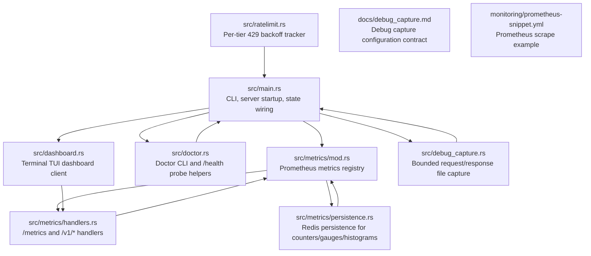
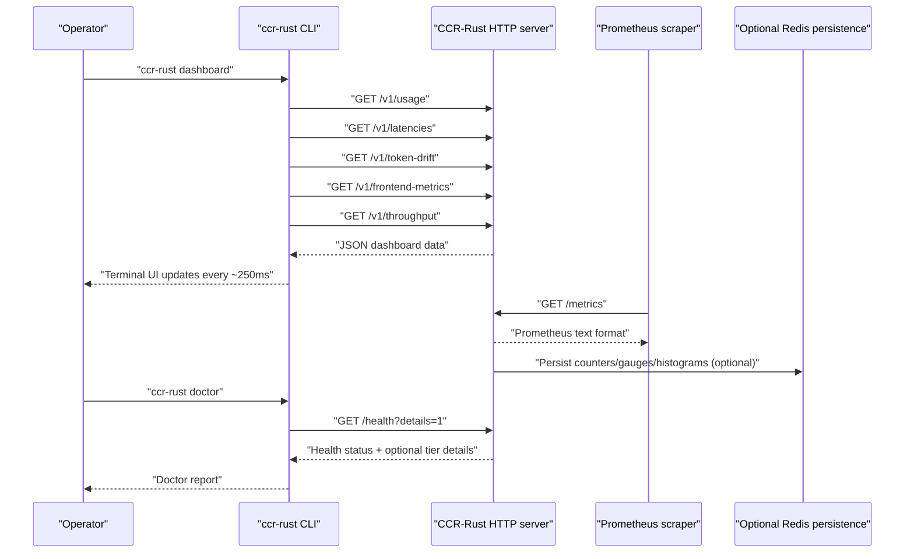
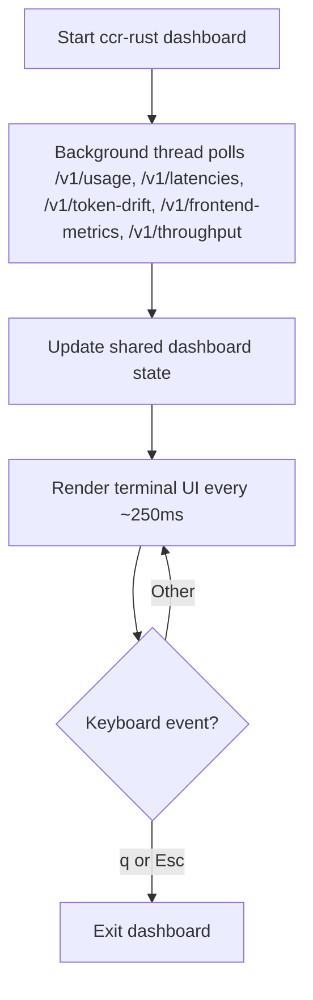
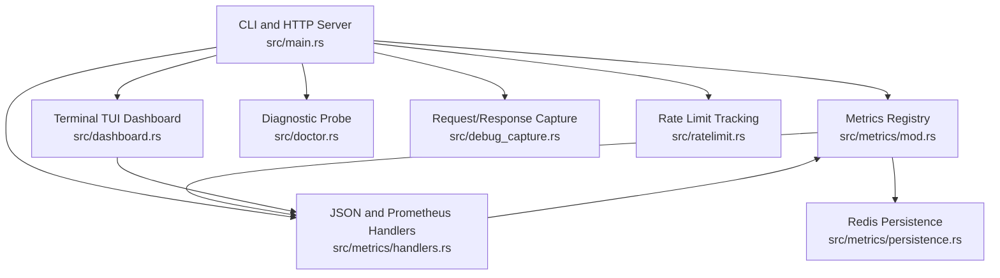
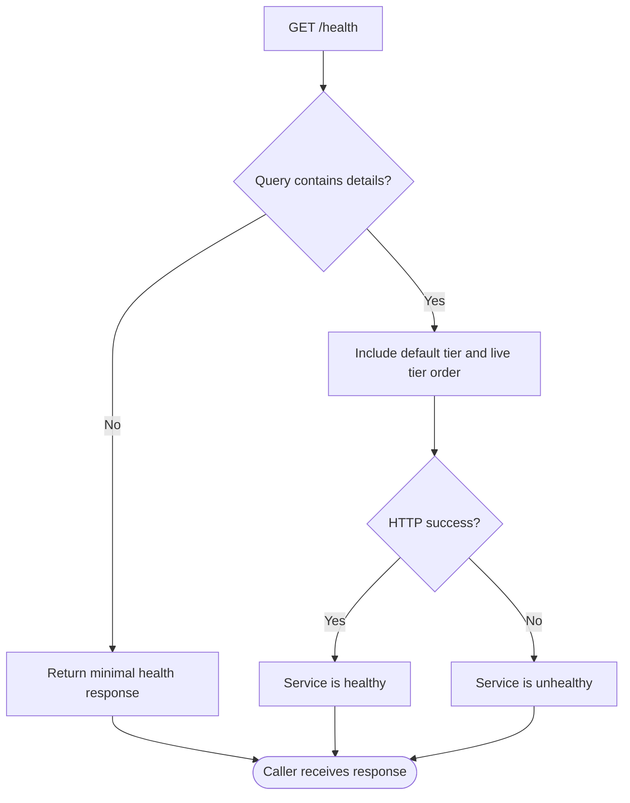
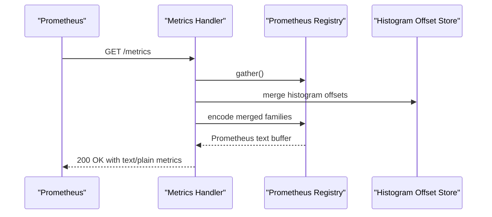
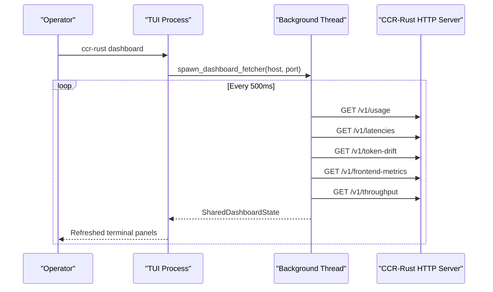
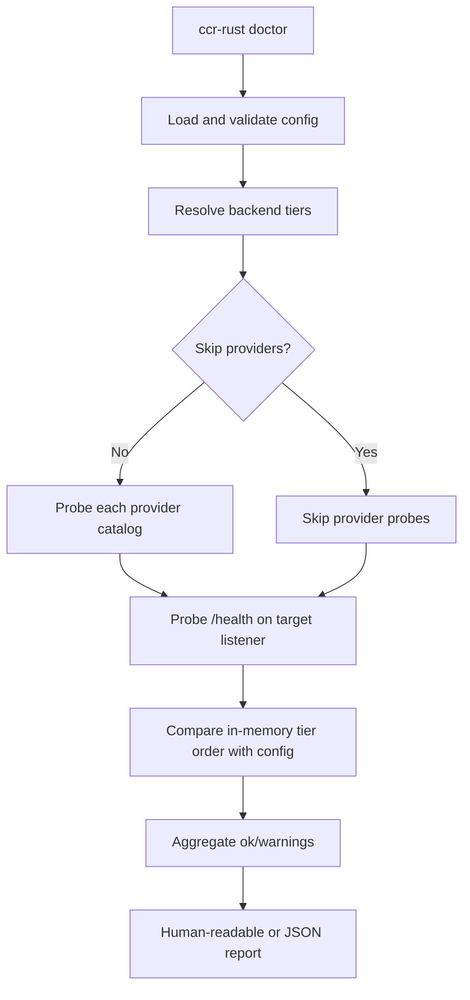
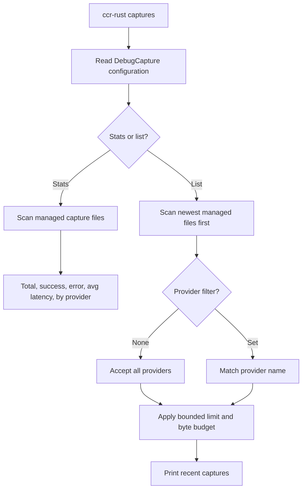
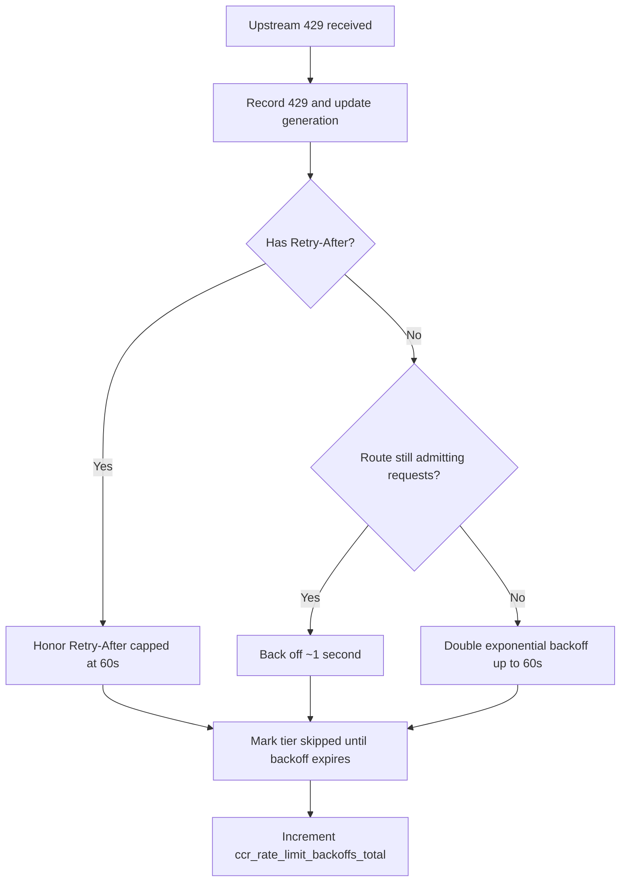

# Operational Endpoints

<cite>
**Referenced Files in This Document**
- [main.rs](file://src/main.rs)
- [doctor.rs](file://src/doctor.rs)
- [metrics/mod.rs](file://src/metrics/mod.rs)
- [metrics/handlers.rs](file://src/metrics/handlers.rs)
- [metrics/persistence.rs](file://src/metrics/persistence.rs)
- [dashboard.rs](file://src/dashboard.rs)
- [debug_capture.rs](file://src/debug_capture.rs)
- [ratelimit.rs](file://src/ratelimit.rs)
- [debug_capture.md](file://docs/debug_capture.md)
- [prometheus-snippet.yml](file://monitoring/prometheus-snippet.yml)
</cite>

## Table of Contents
1. [Introduction](#introduction)
2. [Project Structure](#project-structure)
3. [Core Components](#core-components)
4. [Architecture Overview](#architecture-overview)
5. [Detailed Component Analysis](#detailed-component-analysis)
6. [Dependency Analysis](#dependency-analysis)
7. [Performance Considerations](#performance-considerations)
8. [Troubleshooting Guide](#troubleshooting-guide)
9. [Conclusion](#conclusion)
10. [Appendices](#appendices)

## Introduction
This document describes the operational and monitoring surface of CCR-Rust: service health, Prometheus metrics, terminal dashboard, diagnostic doctor checks, debug capture, authentication boundaries, rate-limit behavior, and integration guidance for Prometheus and Grafana. It is intended for operators who need to monitor availability, throughput, latency, provider usage, token accounting, cost estimates, and request/response diagnostics.

Key operational entry points covered here include:
- Health check endpoint `/health`
- Prometheus text endpoint `/metrics`
- JSON operational endpoints under `/v1/*`
- Terminal-based dashboard command `ccr-rust dashboard`
- Diagnostic doctor command `ccr-rust doctor`
- Debug capture feature for bounded request/response logging
- Rate limiting and backoff behavior that affects upstream routing and 429 handling

## Project Structure
The operational features are implemented across a small set of focused modules:



**Diagram sources**
- [main.rs:201-500](file://src/main.rs#L201-L500)
- [metrics/mod.rs:1-200](file://src/metrics/mod.rs#L1-L200)
- [metrics/handlers.rs:1-200](file://src/metrics/handlers.rs#L1-L200)
- [metrics/persistence.rs:1-200](file://src/metrics/persistence.rs#L1-L200)
- [doctor.rs:1-200](file://src/doctor.rs#L1-L200)
- [dashboard.rs:1-200](file://src/dashboard.rs#L1-L200)
- [debug_capture.rs:1-200](file://src/debug_capture.rs#L1-L200)
- [ratelimit.rs:1-200](file://src/ratelimit.rs#L1-L200)
- [debug_capture.md:1-127](file://docs/debug_capture.md#L1-L127)
- [prometheus-snippet.yml:1-7](file://monitoring/prometheus-snippet.yml#L1-L7)

**Section sources**
- [main.rs:1-200](file://src/main.rs#L1-L200)
- [main.rs:201-500](file://src/main.rs#L201-L500)
- [metrics/mod.rs:1-200](file://src/metrics/mod.rs#L1-L200)
- [metrics/handlers.rs:1-200](file://src/metrics/handlers.rs#L1-L200)
- [metrics/persistence.rs:1-200](file://src/metrics/persistence.rs#L1-L200)
- [doctor.rs:1-200](file://src/doctor.rs#L1-L200)
- [dashboard.rs:1-200](file://src/dashboard.rs#L1-L200)
- [debug_capture.rs:1-200](file://src/debug_capture.rs#L1-L200)
- [ratelimit.rs:1-200](file://src/ratelimit.rs#L1-L200)
- [debug_capture.md:1-127](file://docs/debug_capture.md#L1-L127)
- [prometheus-snippet.yml:1-7](file://monitoring/prometheus-snippet.yml#L1-L7)

## Core Components
This section summarizes the operational components from an operator perspective.

| Component | Purpose | Primary Interface | Authentication | Notes |
|---|---|---|---|---|
| Health check | Service liveness and basic tier information | HTTP GET `/health` | Not explicitly documented as protected; doctor probes it directly | Supports `?details=1` for tier metadata when present |
| Prometheus metrics | Machine-readable counters, gauges, histograms | HTTP GET `/metrics` | Not explicitly documented as protected | Standard Prometheus text format |
| Usage and tier JSON APIs | Human- and machine-friendly operational summaries | HTTP GET `/v1/usage`, `/v1/latencies`, `/v1/token-drift`, `/v1/frontend-metrics`, `/v1/throughput` | Not explicitly documented as protected | Used by the dashboard and external dashboards |
| Terminal dashboard | Live terminal UI over the JSON APIs | Local process invoking remote `/v1/*` endpoints | Uses the configured host/port; no built-in bearer auth for these API calls | Runs via `ccr-rust dashboard` |
| Doctor CLI | Offline config validation plus live listener/provider diagnostics | Local CLI command `ccr-rust doctor` | Does not require router auth; may call `/health` with query parameters | Can skip live provider probes |
| Debug capture | Bounded on-disk request/response logs | Local CLI command `ccr-rust captures`; no HTTP route | No HTTP debug-capture routes exposed | Disabled by default; opt-in configuration only |
| Rate limiter | Per-tier 429 backoff and proactive skip decisions | Internal router logic | Not an HTTP endpoint | Exposes Prometheus metric `ccr_rate_limit_backoffs_total` |

**Section sources**
- [doctor.rs:1-200](file://src/doctor.rs#L1-L200)
- [metrics/handlers.rs:1-200](file://src/metrics/handlers.rs#L1-L200)
- [dashboard.rs:1-200](file://src/dashboard.rs#L1-L200)
- [debug_capture.rs:1-200](file://src/debug_capture.rs#L1-L200)
- [ratelimit.rs:1-200](file://src/ratelimit.rs#L1-L200)
- [debug_capture.md:1-127](file://docs/debug_capture.md#L1-L127)

## Architecture Overview
The operational surface has two layers:

1. **HTTP layer**: The running server exposes health, metrics, and JSON operational endpoints.
2. **Local CLI/TUI layer**: Commands such as `ccr-rust doctor`, `ccr-rust dashboard`, and `ccr-rust captures` run locally and either validate configuration or call the running server’s operational endpoints.



**Diagram sources**
- [dashboard.rs:1-200](file://src/dashboard.rs#L1-L200)
- [metrics/handlers.rs:500-577](file://src/metrics/handlers.rs#L500-L577)
- [metrics/persistence.rs:1-200](file://src/metrics/persistence.rs#L1-L200)
- [doctor.rs:200-513](file://src/doctor.rs#L200-L513)
- [prometheus-snippet.yml:1-7](file://monitoring/prometheus-snippet.yml#L1-L7)

## Detailed Component Analysis

### Health Check Endpoint `/health`
The health endpoint is used for liveness checks and by the doctor diagnostic tool. The doctor implementation constructs a health URL with `?details=1` and parses optional fields such as `default` tier and `tiers`. When reachable and successful, the doctor can compare the listener’s in-memory tier order with the expected backend tier list.

Operational characteristics:
- The doctor treats a non-successful HTTP response as unhealthy.
- A missing tier list is reported as an older build rather than a failure.
- A mismatched tier order indicates a pending restart after configuration changes.
- Transport failures are reported as unreachable.

Recommended use:
- Use `/health` as a Kubernetes or container liveness/readiness probe.
- Use `ccr-rust doctor` during deployment rollouts to validate both configuration and listener state.

**Section sources**
- [doctor.rs:200-513](file://src/doctor.rs#L200-L513)

### Prometheus Metrics Endpoint `/metrics`
The `/metrics` endpoint returns all registered Prometheus metrics in standard text format. The handler gathers metrics through the Prometheus runtime, merges persisted histogram offsets so counts remain correct across restarts, and returns `text/plain; version=0.0.4`.

Important metric families include:

| Metric family | Type | Labels | Meaning |
|---|---|---|---|
| `ccr_requests_total` | Counter | `tier` | Total requests routed per tier |
| `ccr_request_duration_seconds` | Histogram | `tier` | Request duration in seconds |
| `ccr_frontend_requests_total` | Counter | `frontend` | Requests per frontend (`codex`, `claude_code`) |
| `ccr_frontend_request_duration_seconds` | Histogram | `frontend` | Frontend request latency |
| `ccr_failures_total` | Counter | `tier`, `reason` | Failures grouped by tier and reason |
| `ccr_cost_usd_total` | Counter | `tier` | Estimated USD cost for priced tiers |
| `ccr_active_streams` | Gauge | none | Current active SSE streams |
| `ccr_active_requests` | Gauge | none | Current in-flight requests |
| `ccr_input_tokens_total` | Counter | `tier` | Input tokens consumed per tier |
| `ccr_output_tokens_total` | Counter | `tier` | Output tokens generated per tier |
| `ccr_cache_read_tokens_total` | Counter | `tier` | Cache read tokens per tier |
| `ccr_cache_creation_tokens_total` | Counter | `tier` | Cache creation tokens per tier |
| `ccr_tier_ewma_latency_seconds` | Gauge | `tier` | EWMA latency per tier |
| `ccr_stream_backpressure_total` | Counter | none | Stream producer backpressure events |
| `ccr_peak_active_streams` | Gauge | none | High-water mark for concurrent streams |
| `ccr_rejected_streams_total` | Counter | none | Streams rejected due to concurrency limits |
| `ccr_retry_sweeps_total` | Counter | none | Retry sweeps performed while holding exhausted requests open |
| `ccr_deterministic_rejections_total` | Counter | `tier` | Deterministic upstream rejections |
| `ccr_tier_inflight` | Gauge | `tier` | In-flight upstream attempts per tier |
| `ccr_tier_limit` | Gauge | `tier` | AIMD admission limit per tier |
| `ccr_tier_inflight_tokens` | Gauge | `tier` | Estimated prompt tokens in flight per tier |
| `ccr_admission_defers_total` | Counter | `tier` | Admission defers at AIMD limit |
| `ccr_retry_budget_overflow_total` | Counter | none | Retries rejected by process-wide retry budget |
| `ccr_hedges_launched_total` | Counter | none | Fallback hedges launched |
| `ccr_hedge_wins_total` | Counter | `tier` | Hedged fallback attempts that won |
| `ccr_primary_hedge_wins_total` | Counter | `tier` | Primary attempts that won after hedge launch |
| `ccr_hold_wait_seconds` | Histogram | none | Time exhausted requests were held before terminal response |
| `ccr_pre_request_tokens_total` | Counter | `tier`, `component` | Estimated input tokens before sending to backend |
| `ccr_pre_request_tokens` | Histogram | `tier` | Distribution of estimated pre-request token counts |
| `ccr_rate_limit_hits_total` | Counter | `tier` | Number of 429 responses received per tier |
| `ccr_rate_limit_backoffs_total` | Counter | `tier` | Rate-limit backoffs recorded per tier |
| `ccr_token_drift_absolute` | Gauge | `tier` | Absolute token drift between local estimate and upstream report |
| `ccr_token_drift_pct` | Gauge | `tier` | Percentage token drift |
| `ccr_token_drift_alerts_total` | Counter | `tier`, `severity` | Token drift alerts |
| `ccr_ttft_seconds` | Histogram | `tier` | Time to first token per tier |
| `ccr_output_tokens_per_second` | Histogram | `tier` | Output throughput in tokens per second |

Persistence notes:
- Counters, gauges, and histograms can be persisted to Redis when configured.
- Histogram bucket offsets are preserved so average latency and percentile calculations remain meaningful across restarts.
- The `/metrics` handler merges persisted histogram offsets into the live Prometheus output.

**Section sources**
- [metrics/mod.rs:1-600](file://src/metrics/mod.rs#L1-L600)
- [metrics/handlers.rs:500-577](file://src/metrics/handlers.rs#L500-L577)
- [metrics/persistence.rs:1-200](file://src/metrics/persistence.rs#L1-L200)

### JSON Operational Endpoints Under `/v1/*`
The handlers module implements several JSON endpoints used by the dashboard and external monitoring systems.

| Endpoint | Method | Response shape | Purpose |
|---|---|---|---|
| `/v1/usage` | GET | Aggregated usage summary with per-tier requests, failures, tokens, cache tokens, cost, active streams, active requests, and average duration | Overall capacity and cost view |
| `/v1/latencies` | GET | Per-tier EWMA latency entries | Latency monitoring outside Prometheus |
| `/v1/token-drift` | GET | Per-tier drift samples with cumulative and last-sample drift percentages | Token accounting verification |
| `/v1/token-audit` | GET | Recent pre-request token audit entries from an in-memory ring buffer | Pre-dispatch token estimation inspection |
| `/v1/frontend-metrics` | GET | Per-frontend request counts and average latency | Frontend-specific monitoring |
| `/v1/throughput` | GET | Per-tier TTFT and tokens-per-second aggregates with recent samples | Streaming performance monitoring |

Usage summary composition:
- Aggregates counters for requests, failures, input/output tokens, cache reads/creation, and cost.
- Computes average duration using live histogram samples plus persisted histogram offsets.
- Returns active stream and request gauges alongside totals.

Throughput composition:
- Combines TTFT histogram data and output tokens-per-second histogram data.
- Approximates percentiles by interpolating within Prometheus histogram buckets.
- Includes recent per-tier throughput samples.

**Section sources**
- [metrics/handlers.rs:1-500](file://src/metrics/handlers.rs#L1-L500)

### Terminal-Based Dashboard `ccr-rust dashboard`
The dashboard is a local terminal user interface. It does not expose its own HTTP routes; instead, it connects to a running CCR-Rust instance and polls its JSON operational endpoints.

Behavior:
- Spawns a background fetcher thread that calls `/v1/usage`, `/v1/latencies`, `/v1/token-drift`, `/v1/frontend-metrics`, and `/v1/throughput`.
- Updates shared state every 500 milliseconds.
- Renders a terminal UI at approximately 250 millisecond intervals.
- Shows global stats including active streams, active requests, total requests, total failures, and token throughput.
- Displays token drift, frontend metrics, session information, and per-tier statistics.

Configuration:
- Host and port are supplied via CLI arguments or environment variables.
- The dashboard itself does not add authentication headers to the underlying API calls; if the operational endpoints are behind an authenticating proxy, configure the proxy accordingly.



**Diagram sources**
- [dashboard.rs:1-200](file://src/dashboard.rs#L1-L200)
- [dashboard.rs:200-658](file://src/dashboard.rs#L200-L658)

**Section sources**
- [dashboard.rs:1-200](file://src/dashboard.rs#L1-L200)
- [dashboard.rs:200-658](file://src/dashboard.rs#L200-L658)

### Doctor Endpoint and Diagnostic Command
The doctor is primarily a local diagnostic command rather than a persistent HTTP endpoint. Its responsibilities are:

1. Validate configuration parsing and build support.
2. Identify unresolved tiers that do not name a configured provider/model pair.
3. Probe each provider’s catalog endpoint using the same header-building logic as production dispatch.
4. Compare pinned models against the live provider catalog.
5. Probe the running listener’s `/health` endpoint and compare its in-memory tier order with the configured backend tiers.

Output:
- Provides a structured report containing config path, validity, unresolved tiers, per-provider reports, listener report, overall verdict, and warnings.
- Stale models produce warnings but do not automatically fail the doctor run.
- An unreachable listener still allows config and provider diagnostics to complete.

Provider probe behavior:
- Uses protocol-specific header builders.
- Treats 404/404-like catalog responses as “no catalog” rather than credential failure.
- Extracts model IDs from OpenAI-style `data` arrays or bare arrays.
- Matches both configured identity and canonical wire model names.

Listener probe behavior:
- Calls `/health?details=1`.
- Reports reachability, HTTP status, healthy flag, default tier, live tiers, and whether tier order matches the configuration.

**Section sources**
- [doctor.rs:1-200](file://src/doctor.rs#L1-L200)
- [doctor.rs:200-513](file://src/doctor.rs#L200-L513)

### Debug Capture Functionality
Debug capture records bounded request/response material for debugging provider issues. It is disabled by default and intentionally does not expose any HTTP routes for retrieving captures.

Configuration options:
- `enabled`: Opt-in toggle.
- `providers`: Provider filter; empty means capture all providers.
- `output_dir`: Directory for captured files; supports tilde expansion.
- `max_files`: Maximum retained CCR-owned capture files; zero becomes the default and values above 1000 are clamped.
- `include_headers`: Optional inclusion of redacted headers.
- `capture_success`: Persist successful non-streaming interactions when enabled.
- `max_body_size`: Captured response body size limit; zero becomes the default and values above 2 MiB are clamped.

Security and safety properties:
- Files are named with a managed prefix.
- On Unix, the capture directory is created with mode `0700`, and new files are created with mode `0600`.
- Symlink capture directories are rejected.
- Each capture file has a hard byte limit.
- Successful streaming bodies are not persisted; capture is limited to failures known before handing the response to the client.
- Rotation deletes only oldest managed files.

CLI access:
- `ccr-rust captures --stats` shows aggregate statistics.
- `ccr-rust captures --provider <name> --limit <n>` lists recent captures.
- `ccr-rust captures --full` includes full bounded response bodies in terminal output.

**Section sources**
- [debug_capture.rs:1-200](file://src/debug_capture.rs#L1-L200)
- [debug_capture.rs:200-687](file://src/debug_capture.rs#L200-L687)
- [debug_capture.md:1-127](file://docs/debug_capture.md#L1-L127)

### Authentication Requirements
Explicit authentication behavior for operational endpoints is not defined in the analyzed source fragments:
- The `/metrics` handler returns Prometheus text without applying bearer-token middleware in the examined code.
- The dashboard fetcher calls `/v1/*` endpoints without injecting an authorization header.
- The doctor probes `/health` directly without bearer credentials.
- MCP-related CLI flags show a separate bearer token concept for MCP daemon endpoints, but this is distinct from the general CCR-Rust router operational endpoints shown here.

Operational implication:
- If authentication is required, it should be enforced at the network edge, reverse proxy, or load balancer.
- Do not assume that `/health`, `/metrics`, or `/v1/*` are authenticated solely by CCR-Rust source code visible in the referenced files.

**Section sources**
- [metrics/handlers.rs:500-577](file://src/metrics/handlers.rs#L500-L577)
- [dashboard.rs:1-200](file://src/dashboard.rs#L1-L200)
- [doctor.rs:200-513](file://src/doctor.rs#L200-L513)
- [main.rs:201-260](file://src/main.rs#L201-L260)

### Rate Limiting for Operational Endpoints
The repository defines a per-tier rate-limit tracker that records 429 responses, computes backoff windows, and can proactively skip tiers based on remaining quota headers when trusted. This logic is internal to the router’s dispatch path and is not implemented as a dedicated HTTP rate-limiting policy for `/health`, `/metrics`, or `/v1/*`.

Relevant behaviors:
- `record_rate_limit_hit` increments `ccr_rate_limit_hits_total`.
- `record_rate_limit_backoff` persists the backoff counter.
- Backoff logic honors server `Retry-After`, caps local backoff at 60 seconds, and escalates on starved routes.
- Success recording clears backoff only when no newer 429 occurred during the request lifetime.

For protecting operational endpoints, apply rate limiting at the infrastructure level rather than relying on the upstream provider rate-limit tracker.

**Section sources**
- [ratelimit.rs:1-248](file://src/ratelimit.rs#L1-L248)
- [metrics/mod.rs:500-600](file://src/metrics/mod.rs#L500-L600)

### Integration with Prometheus and Grafana
Prometheus integration is straightforward because the server exposes a standard `/metrics` endpoint.

Prometheus configuration example:
- Job name: `ccr-rust`
- Target: `localhost:3456`
- Metrics path: `/metrics`
- Scrape interval: 10 seconds

Grafana integration:
- Add a Prometheus data source pointing at your Prometheus instance.
- Create panels using the metric families documented in the `/metrics` section.
- Use the `/v1/*` JSON endpoints where you need aggregated views already computed by the handlers, such as TTFT percentiles, throughput, token drift, or frontend metrics.

Example operational queries and scenarios:

| Scenario | Example Query or Panel Idea |
|---|---|
| Monitor total request volume per tier | `rate(ccr_requests_total[5m])` |
| Track error rate per tier | `rate(ccr_failures_total[5m])` |
| Observe request latency distribution | `histogram_quantile(0.95, rate(ccr_request_duration_seconds_bucket[5m]))` |
| Detect stream saturation | Panel on `ccr_active_streams` vs `ccr_peak_active_streams` |
| Investigate provider 429 storms | `rate(ccr_rate_limit_hits_total[5m])` |
| Verify token accounting drift | Panel on `ccr_token_drift_pct` and alert when exceeding thresholds |
| Estimate cost trends | Panel on `ccr_cost_usd_total` and its derivative |
| Measure streaming responsiveness | Panel on `ccr_ttft_seconds` or `/v1/throughput` avg TTFT |
| Monitor token throughput | Panel on `ccr_output_tokens_per_second` or `/v1/throughput` avg tok/s |

**Section sources**
- [prometheus-snippet.yml:1-7](file://monitoring/prometheus-snippet.yml#L1-L7)
- [metrics/mod.rs:200-600](file://src/metrics/mod.rs#L200-L600)
- [metrics/handlers.rs:200-500](file://src/metrics/handlers.rs#L200-L500)

## Dependency Analysis
The operational subsystem has clear separation of concerns:

- `main.rs` wires configuration, state, debug capture, rate limiting, persistence initialization, and CLI commands.
- `metrics/mod.rs` owns Prometheus metric definitions, atomic aggregates, and recording functions.
- `metrics/handlers.rs` converts those metrics into HTTP responses for `/metrics` and `/v1/*`.
- `metrics/persistence.rs` persists metrics to Redis and restores them on startup.
- `doctor.rs` depends on configuration, routing utilities, and `/health`.
- `dashboard.rs` depends on the JSON operational endpoints.
- `debug_capture.rs` is independent of the HTTP operational surface and writes files locally.
- `ratelimit.rs<docs>
# Operational Endpoints

<cite>
**Referenced Files in This Document**
- [main.rs](file://src/main.rs)
- [doctor.rs](file://src/doctor.rs)
- [metrics/mod.rs](file://src/metrics/mod.rs)
- [metrics/handlers.rs](file://src/metrics/handlers.rs)
- [metrics/persistence.rs](file://src/metrics/persistence.rs)
- [dashboard.rs](file://src/dashboard.rs)
- [debug_capture.rs](file://src/debug_capture.rs)
- [ratelimit.rs](file://src/ratelimit.rs)
- [debug_capture.md](file://docs/debug_capture.md)
- [prometheus-snippet.yml](file://monitoring/prometheus-snippet.yml)
</cite>

## Table of Contents
1. [Introduction](#introduction)
2. [Project Structure](#project-structure)
3. [Operational Endpoint Summary](#operational-endpoint-summary)
4. [Health Check Endpoint](#health-check-endpoint)
5. [Metrics and Prometheus Integration](#metrics-and-prometheus-integration)
6. [Dashboard Interface](#dashboard-interface)
7. [Doctor Diagnostic Command](#doctor-diagnostic-command)
8. [Debug Capture Functionality](#debug-capture-functionality)
9. [Authentication and Rate Limiting](#authentication-and-rate-limiting)
10. [Prometheus Queries and Example Scenarios](#prometheus-queries-and-example-scenarios)
11. [Grafana Dashboard Guidance](#grafana-dashboard-guidance)
12. [Troubleshooting Guide](#troubleshooting-guide)
13. [Conclusion](#conclusion)

## Introduction

CCR-Rust exposes operational surface areas for monitoring, diagnostics, terminal-based dashboarding, and local debug capture. The primary HTTP server provides a health endpoint, a Prometheus-compatible metrics endpoint, and several JSON endpoints used by the built-in dashboard. The CLI also includes an offline diagnostic command that probes provider credentials, catalog listings, and the running listener.

The most important operational surfaces are:

| Surface | Access method | Purpose |
|---|---:|---|
| Health check | HTTP GET `/health` | Service availability and basic tier information |
| Metrics | HTTP GET `/metrics` | Prometheus text exposition |
| Usage summary | HTTP GET `/v1/usage` | Aggregated request, token, cost, and throughput data |
| Latencies | HTTP GET `/v1/latencies` | Per-tier EWMA latency |
| Token drift | HTTP GET `/v1/token-drift` | Local versus upstream token-count drift |
| Frontend metrics | HTTP GET `/v1/frontend-metrics` | Codex and Claude Code request summaries |
| Throughput | HTTP GET `/v1/throughput` | Time-to-first-token and tokens-per-second per tier |
| Doctor | CLI `ccr-rust doctor` | Configuration, provider, and listener diagnosis |
| Debug captures | Local CLI `ccr-rust captures` | Filesystem-based request/response inspection |
| Dashboard | CLI `ccr-rust dashboard` | Terminal UI driven by CCR-Rust operational endpoints |

**Section sources**
- [main.rs:201-267](file://src/main.rs#L201-L267)
- [dashboard.rs:1-60](file://src/dashboard.rs#L1-L60)
- [debug_capture.md:1-20](file://docs/debug_capture.md#L1-L20)

## Project Structure

The operational features are implemented across several focused modules:



**Diagram sources**
- [main.rs:300-470](file://src/main.rs#L300-L470)
- [metrics/mod.rs:1-120](file://src/metrics/mod.rs#L1-L120)
- [metrics/handlers.rs:1-40](file://src/metrics/handlers.rs#L1-L40)
- [metrics/persistence.rs:1-40](file://src/metrics/persistence.rs#L1-L40)
- [dashboard.rs:1-60](file://src/dashboard.rs#L1-L60)
- [doctor.rs:1-40](file://src/doctor.rs#L1-L40)
- [debug_capture.rs:1-40](file://src/debug_capture.rs#L1-L40)
- [ratelimit.rs:1-30](file://src/ratelimit.rs#L1-L30)

The server initializes shared state including configuration, rate limiting, admission tracking, retry budgeting, sticky sessions, and optional debug capture. Metrics persistence is initialized before the HTTP router becomes active when Redis persistence is enabled.

**Section sources**
- [main.rs:300-470](file://src/main.rs#L300-L470)
- [metrics/persistence.rs:100-160](file://src/metrics/persistence.rs#L100-L160)

## Operational Endpoint Summary

| Endpoint | Method | Response type | Authentication | Notes |
|---|---:|---|---:|---|
| `/health` | GET | JSON or plain text | Not explicitly secured by default | Liveness probe; supports `details=1` for tier metadata |
| `/metrics` | GET | Prometheus text format | Not explicitly secured by default | Exposes all registered Prometheus metrics |
| `/v1/usage` | GET | JSON usage summary | Not explicitly secured by default | Used by dashboard and operators |
| `/v1/latencies` | GET | JSON per-tier latencies | Not explicitly secured by default | EWMA latency from routing tracker |
| `/v1/token-drift` | GET | JSON drift records | Not explicitly secured by default | Local vs upstream input-token drift |
| `/v1/frontend-metrics` | GET | JSON frontend summaries | Not explicitly secured by default | Codex and Claude Code metrics |
| `/v1/throughput` | GET | JSON TTFT and tokens/sec | Not explicitly secured by default | Approximate percentiles from histograms |

The codebase does not implement explicit authentication checks on these operational routes. Operators should place CCR-Rust behind a reverse proxy or network boundary that enforces access control for `/health`, `/metrics`, `/v1/*`, and the dashboard data endpoints.

**Section sources**
- [metrics/handlers.rs:43-60](file://src/metrics/handlers.rs#L43-L60)
- [metrics/handlers.rs:520-577](file://src/metrics/handlers.rs#L520-L577)
- [dashboard.rs:30-120](file://src/dashboard.rs#L30-L120)

## Health Check Endpoint

### Contract

The health endpoint is the liveness contract for the CCR-Rust process. A successful response indicates that the process is alive and has reached a usable state. The doctor command calls it with query parameter `details=1` to retrieve additional tier information.

| Field | Meaning |
|---|---|
| `ok` | Whether the health check considers the service healthy |
| `default` | Default tier name when exposed |
| `tiers` | Ordered list of configured backend tiers when exposed |

The doctor probe treats any non-successful HTTP status as unhealthy and interprets missing tier metadata as compatibility with older builds rather than a failure.

### Behavior



**Diagram sources**
- [doctor.rs:250-340](file://src/doctor.rs#L250-L340)

### Monitoring Guidance

Use `/health` as a Kubernetes liveness probe or a load balancer health check. It answers whether the process can respond, not whether every upstream provider is authenticated or catalog-consistent. For full configuration validation, use the doctor command instead.

**Section sources**
- [doctor.rs:250-340](file://src/doctor.rs#L250-L340)

## Metrics and Prometheus Integration

### Metrics Endpoint

The `/metrics` endpoint returns Prometheus-compatible text output. It gathers all registered metrics and merges histogram offsets so persisted histogram state contributes to the exported view.

Key metric categories:

| Category | Representative metrics |
|---|---|
| Request volume | `ccr_requests_total` |
| Request latency | `ccr_request_duration_seconds` |
| Frontend volume | `ccr_frontend_requests_total` |
| Frontend latency | `ccr_frontend_request_duration_seconds` |
| Failures | `ccr_failures_total` |
| Cost estimation | `ccr_cost_usd_total` |
| Concurrency | `ccr_active_streams`, `ccr_active_requests`, `ccr_peak_active_streams` |
| Streaming pressure | `ccr_stream_backpressure_total`, `ccr_rejected_streams_total` |
| Tokens | `ccr_input_tokens_total`, `ccr_output_tokens_total`, cache token counters |
| Routing internals | `ccr_tier_ewma_latency_seconds`, `ccr_tier_inflight`, `ccr_tier_limit` |
| Admission and retries | `ccr_admission_defers_total`, `ccr_retry_sweeps_total`, `ccr_retry_budget_overflow_total` |
| Hedging | `ccr_hedges_launched_total`, `ccr_hedge_wins_total`, `ccr_primary_hedge_wins_total` |
| Rate limiting | `ccr_rate_limit_hits_total`, `ccr_rate_limit_backoffs_total` |
| Token drift | `ccr_token_drift_absolute`, `ccr_token_drift_pct`, `ccr_token_drift_alerts_total` |
| Stream UX | `ccr_ttft_seconds`, `ccr_hold_wait_seconds` |
| Output throughput | `ccr_output_tokens_per_second` |

### Histogram Offset Merging

Histogram metrics may be partially persisted through restarts. The metrics handler merges live histogram samples with persisted sample sums and counts, then encodes the combined families into Prometheus text format.



**Diagram sources**
- [metrics/handlers.rs:520-577](file://src/metrics/handlers.rs#L520-L577)
- [metrics/mod.rs:180-240](file://src/metrics/mod.rs#L180-L240)

### Prometheus Configuration

The repository ships a minimal scrape configuration targeting port 3456 at `/metrics`.

| Setting | Value |
|---|---|
| Job name | `ccr-rust` |
| Target | `localhost:3456` |
| Metrics path | `/metrics` |
| Scrape interval | `10s` |

Adjust the target host, port, and scrape interval according to your deployment.

**Section sources**
- [metrics/handlers.rs:520-577](file://src/metrics/handlers.rs#L520-L577)
- [prometheus-snippet.yml:1-7](file://monitoring/prometheus-snippet.yml#L1-L7)

### Metrics Persistence

When Redis persistence is enabled, CCR-Rust persists counters, gauges, selected histograms, token drift state, audit log entries, and EWMA latency state. On startup, it loads a snapshot from Redis, applies it to in-memory state, and synchronizes EWMA gauges.

Important operations:

| Operation | Purpose |
|---|---|
| `init_persistence` | Connect to Redis, load snapshot, spawn background worker |
| `clear_redis_persistence` | Delete keys under the configured CCR prefix |
| Key matching | Only removes keys under the configured prefix plus colon-separated suffixes |

**Section sources**
- [metrics/persistence.rs:1-120](file://src/metrics/persistence.rs#L1-L120)
- [metrics/persistence.rs:120-200](file://src/metrics/persistence.rs#L120-L200)

## Dashboard Interface

### Launch

Run the terminal dashboard with:

```bash
ccr-rust dashboard
```

Configuration options include:

| Option | Environment variable | Default | Description |
|---|---|---|---|
| `--host` | `CCR_DASHBOARD_HOST` | `127.0.0.1` | Remote router host |
| `--port` | `CCR_DASHBOARD_PORT` | `3456` | Remote router port |

### Data Source

The dashboard is a thin terminal UI. It does not run its own router. Instead, it starts a background thread that polls the remote CCR-Rust instance every 500 milliseconds:

| API | Purpose |
|---|---|
| `/v1/usage` | Total requests, failures, tokens, cost, active streams, active requests |
| `/v1/latencies` | Per-tier EWMA latency |
| `/v1/token-drift` | Per-tier token drift |
| `/v1/frontend-metrics` | Per-frontend request counts and average latency |
| `/v1/throughput` | Per-tier TTFT and tokens per second |

### UI Panels

| Panel | Content |
|---|---|
| Header | Host/port, active requests, request/failure totals, success rate, input/output token throughput |
| Token Drift Monitor | Samples, cumulative drift percentage, last sample drift percentage |
| Frontend Metrics | Requests and average latency per frontend |
| Session Info | Working directory, Git branch, build version |
| Tier Statistics | EWMA latency, TTFT, tokens per second, requests, input/output tokens |

### Controls

| Action | Key |
|---|---:|
| Exit | `q` or `Esc` |

The fetcher uses a blocking HTTP client with a 5-second timeout per request. If the usage endpoint fails, the dashboard retains previously fetched data but marks error state in the UI.



**Diagram sources**
- [dashboard.rs:30-120](file://src/dashboard.rs#L30-L120)
- [dashboard.rs:230-320](file://src/dashboard.rs#L230-L320)

**Section sources**
- [main.rs:240-267](file://src/main.rs#L240-L267)
- [dashboard.rs:1-120](file://src/dashboard.rs#L1-L120)
- [dashboard.rs:230-320](file://src/dashboard.rs#L230-L320)

## Doctor Diagnostic Command

### Purpose

The doctor command answers three operator questions without being part of the request hot path:

1. Does the configuration parse and do all tier names resolve to configured provider/model pairs?
2. Do provider credentials authenticate and do pinned models still exist in the provider's live catalog?
3. Is the listener reachable, and does its in-memory tier order match the file?

### Invocation

```bash
ccr-rust doctor
ccr-rust doctor --json
ccr-rust doctor --skip-providers
ccr-rust doctor -p 3457
```

| Flag | Description |
|---|---|
| `--host` | Listener host to probe |
| `-p`, `--port` | Listener port to probe |
| `--timeout` | Per-probe timeout in seconds |
| `--skip-providers` | Skip live provider credential/catalog probes |
| `--json` | Emit one machine-readable report |

### Report Fields

| Field | Meaning |
|---|---|
| `config_path` | Loaded configuration path |
| `config_valid` | Build-support validation passed |
| `unresolved_tiers` | Tiers that do not name a configured provider/model pair |
| `providers` | Per-provider probe results |
| `listener` | Listener reachability, health, and tier-order comparison |
| `ok` | Overall pass condition |
| `warnings` | Non-fatal observations such as stale models or unreachable listeners |

Provider statuses include:

| Status | Meaning |
|---|---|
| `ok` | Catalog endpoint authenticated successfully |
| `no_catalog` | Provider has no catalog endpoint; credential was not exercised |
| `error` | Credential rejected or transport failed |

The doctor probe never issues a completion request. It uses the same header builders and endpoint URL construction as the dispatch path so green results reflect what a real request would send.



**Diagram sources**
- [doctor.rs:1-120](file://src/doctor.rs#L1-L120)
- [doctor.rs:340-513](file://src/doctor.rs#L340-L513)

**Section sources**
- [main.rs:220-240](file://src/main.rs#L220-L240)
- [doctor.rs:1-120](file://src/doctor.rs#L1-L120)
- [doctor.rs:250-513](file://src/doctor.rs#L250-L513)

## Debug Capture Functionality

### Security Model

Debug capture is opt-in, disabled by default, and intentionally not exposed over HTTP. Captured files may contain prompts, source code, model output, headers, and other sensitive data. The feature is intended for short, local investigations.

### Configuration

Add `DebugCapture` to the CCR-Rust configuration only while diagnosing a specific provider failure.

| Option | Default | Behavior |
|---|---:|---|
| `enabled` | `false` | Must be explicitly enabled |
| `providers` | `[]` | Empty means capture all providers |
| `output_dir` | `~/.ccr-rust/captures` | Private local directory |
| `max_files` | `100` | Retained CCR-owned files; zero becomes 100, values above 1000 are clamped |
| `include_headers` | `false` | Optional bounded headers after redaction |
| `capture_success` | `false` | Persist successful responses in addition to failures |
| `max_body_size` | `1 MiB` | Bounded captured body size; zero becomes 1 MiB, values above 2 MiB are clamped |

On Unix, the capture directory is created with mode `0700` and new files with mode `0600`. Symlink directories are rejected, and files are created exclusively so existing paths are not overwritten.

### What Is Captured

For non-streaming requests:

- Connection errors
- Non-success HTTP responses
- Provider errors embedded in HTTP 200 bodies
- Successful responses only when `capture_success` is true

For streaming requests:

- Connection failures
- Non-success HTTP responses
- Errors detected during initial bounded stream peek

Successful streaming bodies and later-stream errors are deliberately not persisted.

### File Format

Files follow the naming pattern:

```text
ccr_capture_v1_{provider}_{tier_name}_{timestamp}_{request_id}.json
```

Each file contains:

| Field | Description |
|---|---|
| `request_id` | Monotonic request identifier |
| `provider` | Provider name |
| `tier_name` | Display tier name |
| `model` | Model used |
| `timestamp` | ISO 8601 timestamp |
| `url` | Upstream request URL |
| `method` | HTTP method |
| `request_headers` | Optional, only if enabled |
| `request_body` | Structured JSON request body |
| `response_status` | HTTP status code |
| `response_headers` | Optional, only if enabled |
| `response_body` | Bounded string body |
| `response_truncated` | Whether body exceeded limit |
| `latency_ms` | Milliseconds |
| `is_streaming` | Streaming flag |
| `success` | True for 2xx without recorded error |
| `error` | Optional error message |
| `metadata` | Optional extra metadata |

### CLI Inspection

```bash
ccr-rust captures --stats
ccr-rust captures -p minimax -l 10
ccr-rust captures --full
```

| Flag | Description |
|---|---|
| `--provider` | Filter by provider |
| `-l`, `--limit` | Maximum captures listed |
| `--stats` | Show aggregated statistics |
| `--output-dir` | Override capture directory |
| `--full` | Include full bounded response body |



**Diagram sources**
- [debug_capture.rs:250-430](file://src/debug_capture.rs#L250-L430)
- [debug_capture.rs:430-687](file://src/debug_capture.rs#L430-L687)

**Section sources**
- [debug_capture.md:1-127](file://docs/debug_capture.md#L1-L127)
- [debug_capture.rs:1-200](file://src/debug_capture.rs#L1-L200)
- [debug_capture.rs:200-687](file://src/debug_capture.rs#L200-L687)
- [main.rs:230-350](file://src/main.rs#L230-L350)

## Authentication and Rate Limiting

### Authentication

The documented operational endpoints `/health`, `/metrics`, and `/v1/*` do not include explicit bearer-token checks in the analyzed source. Authentication requirements for those endpoints must therefore be enforced externally:

- Restrict access to trusted networks or internal subnets.
- Use a reverse proxy with IP allowlists.
- Place CCR-Rust behind an API gateway.
- Avoid exposing `/metrics` publicly.

Note that MCP-related configuration and commands accept an auth token, but this is separate from the general HTTP operational endpoints described here.

### Rate Limiting

Rate limiting in CCR-Rust primarily protects upstream provider tiers, not the operational endpoints themselves. The rate limiter tracks per-tier state:

| State | Purpose |
|---|---|
| `remaining` | Provider-reported remaining quota |
| `reset_at` | When quota resets |
| `backoff_until` | Active backoff window |
| `consecutive_429s` | Escalation signal |
| `generation` | Overlap protection for concurrent requests |
| `last_success_at` | Starvation detection |

Key behaviors:

- A 429 sets a backoff window.
- Server-provided `Retry-After` is honored up to 60 seconds.
- Without guidance, a starved route doubles backoff per consecutive 429 up to 60 seconds.
- A route still admitting other requests keeps a flatter one-second pacing.
- Success clears backoff only when no newer 429 occurred after the request started.

This matters for monitoring because rate-limited behavior appears in both the rate limiter state and Prometheus metrics.



**Diagram sources**
- [ratelimit.rs:1-200](file://src/ratelimit.rs#L1-L200)

**Section sources**
- [ratelimit.rs:1-200](file://src/ratelimit.rs#L1-L200)
- [main.rs:201-267](file://src/main.rs#L201-L267)

## Prometheus Queries and Example Scenarios

### Scenario 1: Overall Health and Error Rate

Check whether CCR-Rust is receiving traffic and how many requests fail.

```promql
sum(rate(ccr_requests_total[5m]))
sum(rate(ccr_failures_total[5m]))
```

To compute a rolling error ratio:

```promql
sum(rate(ccr_failures_total[5m])) / sum(rate(ccr_requests_total[5m]))
```

### Scenario 2: Latency by Tier

Find the average request duration per tier using the histogram:

```promql
rate(ccr_request_duration_seconds_sum[5m])
  /
rate(ccr_request_duration_seconds_count[5m])
```

Or compare with EWMA latency:

```promql
ccr_tier_ewma_latency_seconds
```

### Scenario 3: Throughput Degradation

Detect rising time-to-first-token:

```promql
rate(ccr_ttft_seconds_sum[5m])
  /
rate(ccr_ttft_seconds_count[5m])
```

### Scenario 4: Token Production Rate

Track tokens per second per tier:

```promql
rate(ccr_output_tokens_per_second[5m])
```

### Scenario 5: Provider Quota Pressure

Identify tiers receiving too many 429 responses:

```promql
topk(10, rate(ccr_rate_limit_hits_total[15m]))
```

Monitor backoff escalation:

```promql
topk(10, rate(ccr_rate_limit_backoffs_total[15m]))
```

### Scenario 6: Token Drift Detection

Watch absolute drift:

```promql
ccr_token_drift_absolute
```

Watch alert frequency:

```promql
topk(10, rate(ccr_token_drift_alerts_total[1h]))
```

### Scenario 7: Cost Tracking

Estimate total USD cost across priced tiers:

```promql
sum(ccr_cost_usd_total)
```

Per-tier cost:

```promql
ccr_cost_usd_total
```

### Scenario 8: Concurrency and Backpressure

```promql
ccr_active_streams
ccr_active_requests
ccr_stream_backpressure_total
ccr_rejected_streams_total
```

High backpressure suggests downstream producers cannot keep up with the consumer or that stream buffers are saturated.

**Section sources**
- [metrics/mod.rs:1-240](file://src/metrics/mod.rs#L1-L240)
- [metrics/mod.rs:240-600](file://src/metrics/mod.rs#L240-L600)
- [metrics/handlers.rs:200-577](file://src/metrics/handlers.rs#L200-L577)

## Grafana Dashboard Guidance

A useful Grafana dashboard for CCR-Rust should group panels by operational concern:

| Group | Recommended panels |
|---|---|
| Overview | `ccr_active_requests`, `ccr_active_streams`, `ccr_requests_total`, `ccr_failures_total`, success rate |
| Latency | `ccr_request_duration_seconds` averages, `ccr_tier_ewma_latency_seconds`, `ccr_ttft_seconds` |
| Throughput | `ccr_output_tokens_per_second`, `/v1/throughput` derived metrics |
| Capacity | `ccr_stream_backpressure_total`, `ccr_rejected_streams_total`, `ccr_tier_inflight`, `ccr_tier_limit` |
| Reliability | `ccr_rate_limit_hits_total`, `ccr_rate_limit_backoffs_total`, `ccr_retry_sweeps_total`, `ccr_retry_budget_overflow_total` |
| Hedging | `ccr_hedges_launched_total`, `ccr_hedge_wins_total`, `ccr_primary_hedge_wins_total` |
| Cost | `ccr_cost_usd_total`, total cost panel |
| Token Integrity | `ccr_token_drift_absolute`, `ccr_token_drift_pct`, `ccr_token_drift_alerts_total` |
| Frontend | `ccr_frontend_requests_total`, `ccr_frontend_request_duration_seconds` |

Recommended visualizations:

- **Time series** for rates and gauges.
- **Bar chart** for per-tier costs and failures.
- **Table** for token drift and per-tier latency.
- **Alert rules** for sustained high error ratios, extreme token drift, and excessive backpressure.

[No sources needed since this section provides general visualization guidance]

## Troubleshooting Guide

### `/metrics` Returns Nothing

Possible causes:

- Prometheus is scraping the wrong host or port.
- CCR-Rust is not yet listening.
- A reverse proxy is blocking `/metrics`.
- Metrics persistence is misconfigured and initialization failed silently.

Checks:

1. Confirm the scrape target matches the configured host and port.
2. Call `/metrics` directly from the host where Prometheus runs.
3. Verify Redis settings if persistence is expected.

**Section sources**
- [prometheus-snippet.yml:1-7](file://monitoring/prometheus-snippet.yml#L1-L7)
- [metrics/persistence.rs:100-160](file://src/metrics/persistence.rs#L100-L160)

### High `ccr_stream_backpressure_total`

This counter increments when an SSE producer blocks due to a full channel buffer. Investigate:

- Slow downstream consumers.
- Very large response payloads.
- Misconfigured concurrency limits.
- Backends producing output faster than the client can consume.

**Section sources**
- [metrics/mod.rs:540-600](file://src/metrics/mod.rs#L540-L600)

### Sudden Spike in `ccr_rate_limit_backoffs_total`

This indicates the local rate limiter is backing off one or more tiers. Investigate:

- Provider quota exhaustion.
- Missing or incorrect `Retry-After` handling.
- Cascading fallbacks causing repeated 429 storms.
- Starved routes escalating backoff exponentially.

**Section sources**
- [ratelimit.rs:1-200](file://src/ratelimit.rs#L1-L200)

### Token Drift Alerts

Token drift measures the difference between locally estimated input tokens and upstream-reported input tokens. High drift can indicate:

- Token estimation inaccuracies.
- Provider-side token accounting changes.
- Prompt transformation differences.
- Cache interactions affecting reported token counts.

Use `/v1/token-drift` and `/v1/token-audit` for detailed per-request context.

**Section sources**
- [metrics/mod.rs:240-420](file://src/metrics/mod.rs#L240-L420)
- [metrics/handlers.rs:43-120](file://src/metrics/handlers.rs#L43-L120)

### Debug Captures Not Appearing

Check:

- `DebugCapture.enabled` is `true`.
- The provider is included in `providers` or the list is empty.
- The output directory exists and is writable.
- The capture was for an error or `capture_success` is enabled.
- The capture directory is not a symlink.

**Section sources**
- [debug_capture.md:1-127](file://docs/debug_capture.md#L1-L127)
- [debug_capture.rs:200-320](file://src/debug_capture.rs#L200-L320)

### Doctor Reports Stale Models

Stale models mean the configuration pins a model ID that is not present in the provider's live catalog. This can happen when a vendor rotates a preview model ID to a stable ID.

Actions:

1. Run `ccr-rust doctor --skip-providers` to confirm configuration validity.
2. Inspect the provider catalog manually.
3. Update the pinned model ID in configuration.
4. Restart CCR-Rust to apply the change.

**Section sources**
- [doctor.rs:200-340](file://src/doctor.rs#L200-L340)

## Conclusion

CCR-Rust’s operational surface separates concerns clearly:

- `/health` answers liveness.
- `/metrics` exposes Prometheus-compatible observability.
- `/v1/*` endpoints provide structured JSON for dashboards and automation.
- `ccr-rust dashboard` offers a local terminal view of live metrics.
- `ccr-rust doctor` validates configuration, provider connectivity, and listener state.
- `ccr-rust captures` provides bounded, filesystem-local debugging material.

Operators should treat these operational endpoints as privileged interfaces. Secure them through network boundaries or proxies, monitor the relevant Prometheus metrics, and use the doctor and capture tools for targeted troubleshooting rather than routine production access.