# Advanced Routing

<cite>
**Referenced Files in This Document**
- [src/routing.rs](file://src/routing.rs)
- [src/stickiness.rs](file://src/stickiness.rs)
- [src/gp_router.rs](file://src/gp_router.rs)
- [src/router/mod.rs](file://src/router/mod.rs)
- [src/router/dispatch.rs](file://src/router/dispatch.rs)
- [src/router/types.rs](file://src/router/types.rs)
- [src/router/dispatch/provider_overrides.rs](file://src/router/dispatch/provider_overrides.rs)
- [src/config/types.rs](file://src/config/types.rs)
- [docs/failover_architecture.md](file://docs/failover_architecture.md)
- [tests/test_routing.rs](file://tests/test_routing.rs)
</cite>

## Table of Contents
1. [Introduction](#introduction)
2. [Project Structure](#project-structure)
3. [Core Components](#core-components)
4. [Architecture Overview](#architecture-overview)
5. [Detailed Component Analysis](#detailed-component-analysis)
6. [Dependency Analysis](#dependency-analysis)
7. [Performance Considerations](#performance-considerations)
8. [Troubleshooting Guide](#troubleshooting-guide)
9. [Conclusion](#conclusion)

## Introduction
This document explains CCR-Rust’s advanced routing layer: how requests are classified, ordered, attempted, retried, and observed; how provider selection adapts to measured latency; how conversation stickiness preserves protocol families; and how the optional GP-backed reranker adjusts ordering based on request shape and historical performance. It also documents traffic-class routing for default, think, background, and web search behavior; provider override rules; client-specific routing through model aliases; and custom routing controls such as strict tier order, hedging, retry sweeps, admission control, and rate-limit handling.

## Project Structure
Routing is implemented across several modules:

- Request entry and cascade orchestration live in the router module.
- Tier-level latency tracking uses an EWMA tracker.
- Conversation affinity uses a sticky session tracker.
- Optional request-aware reranking is provided by the GP router.
- Provider request mutation happens just before dispatch.
- Configuration types define routing policies, provider metadata, pricing, and runtime tuning.
- Documentation and tests provide behavioral evidence.

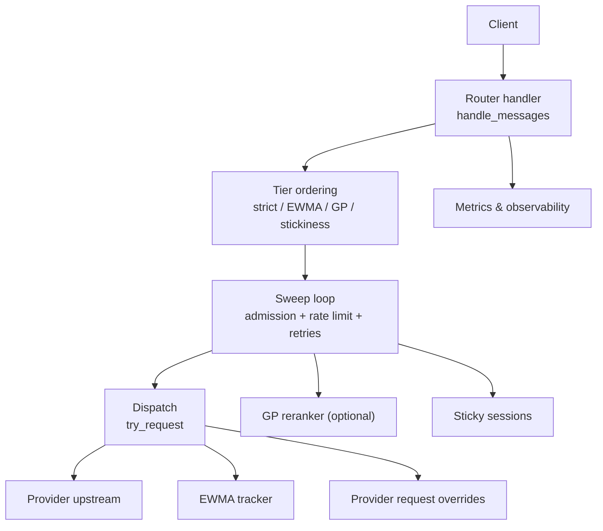

**Diagram sources**
- [src/router/mod.rs:561-887](file://src/router/mod.rs#L561-L887)
- [src/routing.rs:201-618](file://src/routing.rs#L201-L618)
- [src/gp_router.rs:201-640](file://src/gp_router.rs#L201-L640)
- [src/stickiness.rs:1-248](file://src/stickiness.rs#L1-L248)
- [src/router/dispatch/provider_overrides.rs:1-47](file://src/router/dispatch/provider_overrides.rs#L1-L47)

**Section sources**
- [src/router/mod.rs:561-887](file://src/router/mod.rs#L561-L887)
- [docs/failover_architecture.md:1-200](file://docs/failover_architecture.md#L1-L200)

## Core Components
- **Tier ordering**: Built from configured tiers, direct routing pins, web search prepending, EWMA soft ordering, optional GP reranking, and optional sticky partitioning.
- **EWMA latency tracker**: Per-tier exponentially weighted moving average with configurable smoothing, minimum samples, failure penalty, and temperature-weighted sampling.
- **Sweep cascade**: Ordered list traversal with per-tier retries, hedging, retry budget, admission control, rate-limit backoff, deterministic rejection memoization, and optional sweep hold.
- **Sticky sessions**: Stable conversation key hashed from system prompt and first user message; TTL-bound provider preference; stable partition preserving pinned prefix.
- **GP reranker**: Optional request-aware surrogate that reranks candidates using features such as prompt size, streaming flag, tool count, active streams, hour of day, retry count, and relative cost.
- **Provider overrides**: Forced adaptive thinking and forced reasoning effort applied immediately before dispatch.
- **Error classification**: Rate-limited, deterministic rejection, and other failures drive different retry and fallback behaviors.

**Section sources**
- [src/router/mod.rs:561-887](file://src/router/mod.rs#L561-L887)
- [src/routing.rs:1-200](file://src/routing.rs#L1-L200)
- [src/stickiness.rs:1-200](file://src/stickiness.rs#L1-L200)
- [src/gp_router.rs:1-200](file://src/gp_router.rs#L1-L200)
- [src/router/dispatch/provider_overrides.rs:1-47](file://src/router/dispatch/provider_overrides.rs#L1-L47)
- [src/router/types.rs:1-120](file://src/router/types.rs#L1-L120)

## Architecture Overview
The routing pipeline is a layered decision process. The controller constructs an initial ordered list of candidate tiers, applies immovable prefixes, optionally reranks remaining candidates, then runs one or more sweeps over the list while respecting admission, rate limits, retry budgets, and error classifications.

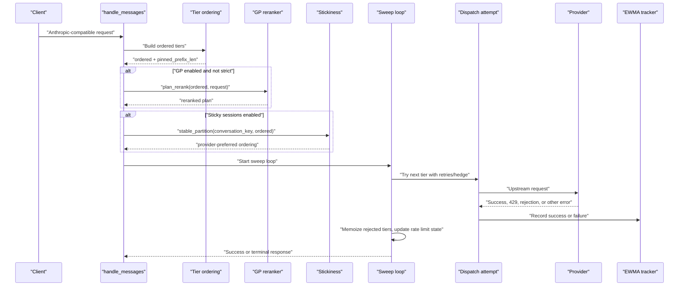

**Diagram sources**
- [src/router/mod.rs:561-887](file://src/router/mod.rs#L561-L887)
- [src/gp_router.rs:201-350](file://src/gp_router.rs#L201-L350)
- [src/stickiness.rs:1-200](file://src/stickiness.rs#L1-L200)
- [src/routing.rs:201-618](file://src/routing.rs#L201-L618)

## Detailed Component Analysis

### Tier-Based Failover Mechanics
The failover pipeline distinguishes three outcomes:

| Outcome | Classification | Behavior |
|---|---|---|
| Success | HTTP success without 429 | Return response; record success duration; apply GP observation if enabled. |
| Rate limited | HTTP 429 | Record rate limit hit/backoff; if sweeps disabled, return passthrough 429; otherwise mark sweep rate-limited, break current tier, continue cascade. |
| Deterministic rejection | 401–404 mapped to `Rejected` | Memoize tier; skip later sweeps; do not consume retry budget; surface aggregate failure when cascade ends. |
| Other failure | Timeouts, transport errors, non-deterministic upstream errors | Retry within per-tier attempts; only these failures justify additional sweeps. |

Key mechanics:

- **Per-tier retries**: Each tier attempts up to `max_retries`, with exponential backoff bounded by `max_backoff_ms`. Backoff applies only to `Other` failures; `RateLimited` and `Rejected` move immediately to the next tier.
- **Retry budget**: Only repeated attempts on the same tier consume the global retry budget. Moving to a different tier is failover, not amplification.
- **Deterministic rejection memoization**: Tiers returning `Rejected` are skipped in later sweeps.
- **Sweep hold**: When retry sweeps are enabled, an exhausted cascade can sleep and re-cascade instead of synthesizing a terminal response immediately. A wall-clock `max_hold_ms` prevents indefinite holds.
- **Admission deferral**: Tiers at AIMD capacity are deferred to the end of the pass; another tier may admit first. If all tiers are deferred, the pass continues but no primary attempt launches.
- **Hedging**: When enabled, the next tier may be launched after a TTFT threshold. Both primary and hedge futures race; usable results are preferred even when the loser was already mid-flight.

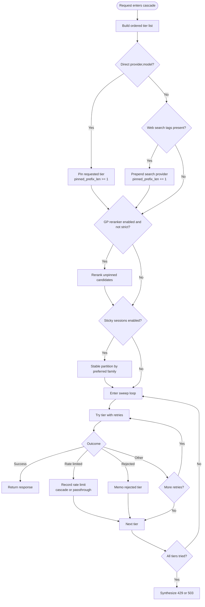

**Diagram sources**
- [src/router/mod.rs:561-887](file://src/router/mod.rs#L561-L887)
- [src/router/dispatch.rs:1-200](file://src/router/dispatch.rs#L1-L200)
- [docs/failover_architecture.md:1-200](file://docs/failover_architecture.md#L1-L200)

**Section sources**
- [src/router/mod.rs:561-887](file://src/router/mod.rs#L561-L887)
- [src/router/dispatch.rs:1-200](file://src/router/dispatch.rs#L1-L200)
- [docs/failover_architecture.md:1-200](file://docs/failover_architecture.md#L1-L200)

### EWMA Latency Tracking Algorithm
The EWMA tracker maintains per-tier state:

| Field | Meaning |
|---|---|
| `ewma` | Current estimated latency in seconds. |
| `samples` | Total recorded samples, including successes and failures. |
| `consecutive_failures` | Consecutive failures, reset on success. |

Algorithm properties:

- **Smoothing factor**: Default alpha is 0.3, giving 30% weight to the newest sample and 70% to history. Higher values react faster but are noisier.
- **Minimum samples**: Tiers below the minimum sample threshold are treated as unmeasured and retain their config-defined position under `sort_tiers`; they receive a large negative logit under softmax sampling.
- **Failure penalty**: A failed attempt does not use wall-clock time. Instead, it applies `failure_penalty × current_ewma`, capped by an effective timeout bound so pathological durations cannot poison gauges.
- **Success recording**: Successful attempts record elapsed time, clamped to the effective upstream timeout.
- **Sorting strategies**:
  - `sort_tiers`: Stable sort by EWMA ascending for measured tiers; unmeasured tiers preserve config order.
  - `sort_tiers_with_config`: Computes logits from negative EWMA divided by routing temperature, applies softmax, then performs weighted sampling without replacement over `top_k` candidates. Cold-start traffic shuffles unmeasured tiers.

Complexity considerations:

- Per-tier updates are O(1).
- Sorting is O(n log n) where n is the number of configured tiers.
- Softmax sampling iterates up to `top_k`, with weighted index sampling per draw.

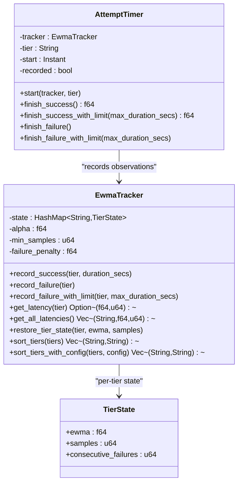

**Diagram sources**
- [src/routing.rs:1-200](file://src/routing.rs#L1-L200)
- [src/routing.rs:201-618](file://src/routing.rs#L201-L618)

**Section sources**
- [src/routing.rs:1-200](file://src/routing.rs#L1-L200)
- [src/routing.rs:201-618](file://src/routing.rs#L201-L618)

### Intelligent Provider Selection Strategies
Provider selection combines multiple signals:

1. **Configured tier order**: When `strictTierOrder` is true, the configured chain is respected as a strict preference list.
2. **Direct routing**: A client-supplied `provider,model` model value moves the matching tier to the front and pins it, unless `ignoreDirect` is set.
3. **Web search tagging**: Requests containing `[search]` or `[web]` strip those tags and prepend the configured search provider, growing the pinned prefix.
4. **Model aliases**: Bare model names resolve to configured `provider,model` routes through `modelAliases`.
5. **EWMA weighting**: When not strict, tiers are reordered using EWMA latency, temperature, and top-k sampling.
6. **GP reranking**: When enabled and not strict, GP reranks candidates beyond the pinned prefix using acquisition strategy, posterior mean/variance, credible-set cost ordering, and request features.
7. **Sticky partitioning**: When enabled, the preferred provider family for a conversation is moved forward in the fallback portion while keeping the pinned prefix untouched.
8. **Admission and rate limits**: At-capacity tiers are deferred; rate-limited tiers are skipped and tracked for terminal synthesis.

Concrete routing outcomes:

| Scenario | Expected ordering behavior |
|---|---|
| Strict tier order with two providers | Configured order is preserved; no EWMA redistribution. |
| Non-strict order with fast tier B and slow tier A | Measured fast tier B is preferred; low temperature makes this nearly deterministic. |
| High routing temperature | Distribution flattens; slower tiers gain probability. |
| Direct route to unavailable tier | Pinned tier still attempted first; failure falls through to later tiers. |
| Web search tag with search provider configured | Search provider is pinned at position zero; original cascade follows. |
| Sticky session previously routed to provider X | Unpinned candidates prefer X among its family; pinned prefix remains unchanged. |
| GP enabled with unfitted surrogate | Original ordering is retained; observations accumulate until fit. |
| GP fitted with credible cost set | Statistically indistinguishable candidates may be reordered toward lower estimated cost. |

**Section sources**
- [src/router/mod.rs:561-887](file://src/router/mod.rs#L561-L887)
- [src/routing.rs:201-618](file://src/routing.rs#L201-L618)
- [src/gp_router.rs:201-640](file://src/gp_router.rs#L201-L640)
- [src/stickiness.rs:1-200](file://src/stickiness.rs#L1-L200)

### Traffic Class Routing: Default, Think, Background, and Web Search
CCR-Rust’s configuration exposes named routing targets:

| Traffic class | Configuration field | Purpose |
|---|---|---|
| Default | `Router.default` | Primary route for ordinary requests. |
| Think | `Router.think` | Route for thinking or reasoning-heavy workloads when explicitly selected. |
| Background | `Router.background` | Route for background or lower-priority workloads when explicitly selected. |
| Web search | `Router.webSearch.search_provider` | Route used when a request contains `[search]` or `[web]`. |

Behavioral notes:

- Named classes are available as routing targets; the actual cascade depends on whether `tiers` is configured and whether `strictTierOrder` is enabled.
- Web search detection scans message text for `[search]` or `[web]`, strips those markers, and prepends the configured search provider into the ordered list.
- Direct routing and web-search pinning are protected by `pinned_prefix_len`, ensuring they remain at the front regardless of EWMA, GP, or stickiness rearrangements.

**Section sources**
- [src/config/types.rs:300-737](file://src/config/types.rs#L300-L737)
- [src/router/mod.rs:561-640](file://src/router/mod.rs#L561-L640)

### GP-Backed Request-Aware Reranking
When the GP feature is enabled and tier ordering is not strict, the GP reranker computes a reranking plan over unpinned candidates.

Request features:

| Feature | Source |
|---|---|
| Prompt characters | Sum of message content and system prompt lengths. |
| Estimated input tokens | Approximately four UTF-8 bytes per token. |
| Max output tokens | From `max_tokens`. |
| Request class | Plain, streaming, tool-heavy, or mixed streaming+tools. |
| Has system prompt | Boolean presence of `system`. |
| Message count | Number of messages. |
| Tool count | Number of tools or presence of tool messages. |
| Active streams | Runtime stream counter. |
| Max streams | Configured stream capacity. |
| Hour of day | Local clock hour. |

Candidate scoring:

- Surrogate predicts mean and variance for each backend slot.
- Acquisition strategy selects exploration/exploitation: UCB, Thompson sampling, greedy, or epsilon-greedy.
- Credible set ordering groups candidates whose upper confidence bound overlaps the best lower bound.
- Within the credible set, estimated cost is preferred when costs are available for all credible candidates.
- Missing pricing retains acquisition ordering rather than treating unknown cost as free.

Observation recording:

- Successful finite durations map to a sigmoid-shaped outcome score between 0 and 1.
- Failed or invalid durations map to 0.
- The buffer refits the surrogate after reaching minimum observations or a configured refit interval.

Bounded capacity:

- GP slots are limited to a fixed backend dimension.
- Excess tiers beyond the GP capacity remain in fallback order.

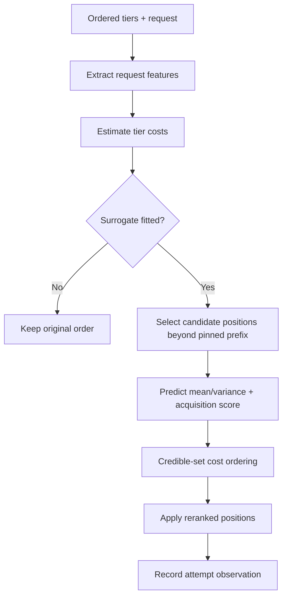

**Diagram sources**
- [src/gp_router.rs:201-640](file://src/gp_router.rs#L201-L640)

**Section sources**
- [src/gp_router.rs:1-200](file://src/gp_router.rs#L1-L200)
- [src/gp_router.rs:201-640](file://src/gp_router.rs#L201-L640)
- [src/config/types.rs:300-737](file://src/config/types.rs#L300-L737)

### Stickiness Mechanisms
Conversation stickiness preserves protocol/provider family affinity across related requests.

Key design points:

- **Conversation key**: Derived from the normalized Anthropic request’s `system` prompt and the first user message, serialized and SHA-256 hashed. Private prompt text never appears in logs or cache keys.
- **TTL**: Entries expire after a configurable TTL; expired entries are evicted on lookup.
- **Map cap**: Locally retained preferences are capped at a maximum number of entries; stale entries are evicted first, then oldest entries.
- **Stable partition**: Preferred provider families are moved forward in the fallback portion<docs>
# Advanced Routing

<cite>
**Referenced Files in This Document**
- [src/router/mod.rs](file://src/router/mod.rs)
- [src/routing.rs](file://src/routing.rs)
- [src/stickiness.rs](file://src/stickiness.rs)
- [src/gp_router.rs](file://src/gp_router.rs)
- [src/router/dispatch.rs](file://src/router/dispatch.rs)
- [src/router/types.rs](file://src/router/types.rs)
- [src/router/dispatch/provider_overrides.rs](file://src/router/dispatch/provider_overrides.rs)
- [src/config/types.rs](file://src/config/types.rs)
- [docs/failover_architecture.md](file://docs/failover_architecture.md)
- [tests/test_routing.rs](file://tests/test_routing.rs)
</cite>

## Table of Contents
1. [Introduction](#introduction)
2. [Project Structure](#project-structure)
3. [Core Components](#core-components)
4. [Architecture Overview](#architecture-overview)
5. [Detailed Component Analysis](#detailed-component-analysis)
6. [Dependency Analysis](#dependency-analysis)
7. [Performance Considerations](#performance-considerations)
8. [Troubleshooting Guide](#troubleshooting-guide)
9. [Decision Examples](#decision-examples)
10. [Conclusion](#conclusion)

## Introduction
This document explains CCR-Rust’s advanced routing system: how requests are classified, ordered, attempted, retried, and optionally reranked or made sticky across a conversation. It focuses on:

- Tier-based failover with retry sweeps and hedging.
- Exponentially weighted moving average (EWMA) latency tracking.
- Intelligent provider selection through EWMA sampling, direct routing, web search injection, stickiness, optional GP-backed reranking, and per-provider request overrides.
- Traffic-class behavior for default, think, background, and web-search paths.
- Monitoring, tuning, and troubleshooting guidance grounded in the implementation.

The routing pipeline is not a single function; it is composed of request handling, tier ordering, attempt execution, failure classification, rate-limit and admission control, sweep retries, and optional post-processing by GP and stickiness.

## Project Structure
The routing subsystem spans several modules:

| Area | Responsibility | Key file |
|---|---|---|
| Request entry and cascade loop | Parses request, builds tier order, runs sweeps, synthesizes terminal responses | `src/router/mod.rs` |
| Latency tracking | EWMA tracker and per-attempt timer | `src/routing.rs` |
| Conversation stickiness | Stable conversation key and provider-family partitioning | `src/stickiness.rs` |
| GP reranking | Optional request-aware surrogate model reranker | `src/gp_router.rs` |
| Provider dispatch | HTTP/protocol dispatch, streaming error detection, header building | `src/router/dispatch.rs` |
| Types and application state | Shared state, request types, error types | `src/router/types.rs` |
| Provider request overrides | Forced thinking or reasoning-effort mutation | `src/router/dispatch/provider_overrides.rs` |
| Configuration | Router, provider, pricing, sweep, hedging, GP, and retry settings | `src/config/types.rs` |
| Design reference | Failover architecture and invariants | `docs/failover_architecture.md` |
| Routing tests | Retry backoff, sweep configuration, alias validation, integration fixtures | `tests/test_routing.rs` |

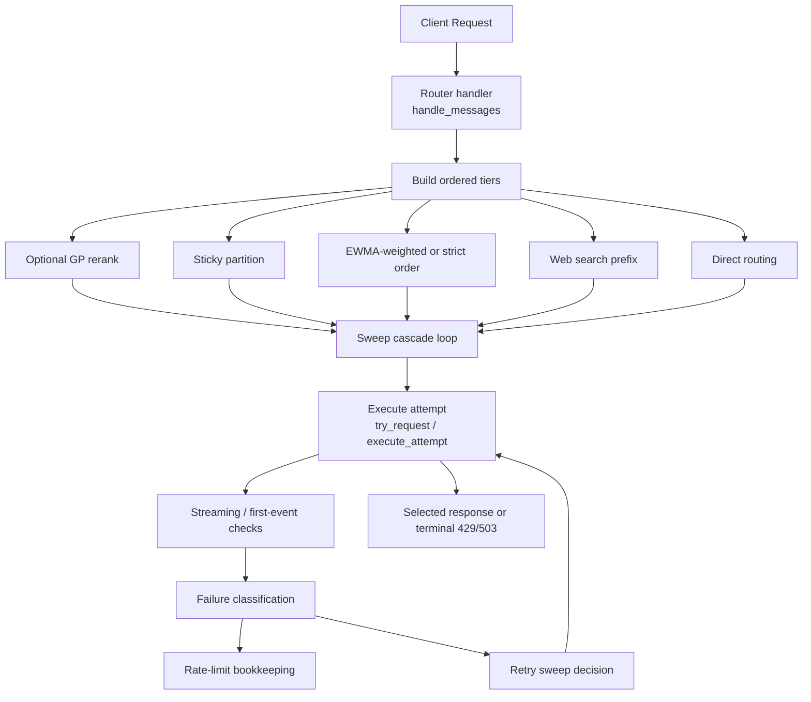

**Diagram sources**
- [src/router/mod.rs:561-887](file://src/router/mod.rs#L561-L887)
- [src/routing.rs:201-618](file://src/routing.rs#L201-L618)
- [src/stickiness.rs:1-248](file://src/stickiness.rs#L1-L248)
- [src/gp_router.rs:1-200](file://src/gp_router.rs#L1-L200)
- [src/router/dispatch.rs:1-200](file://src/router/dispatch.rs#L1-L200)

**Section sources**
- [src/router/mod.rs:200-561](file://src/router/mod.rs#L200-L561)
- [docs/failover_architecture.md:1-200](file://docs/failover_architecture.md#L1-L200)

## Core Components
CCR-Rust’s routing is driven by these core components:

| Component | Purpose | Important behaviors |
|---|---|---|
| `EwmaTracker` | Tracks per-tier latency as an EWMA | Success updates with measured duration; failures apply a penalty multiplier; unmeasured tiers keep config order; supports temperature-based softmax sampling |
| `AttemptTimer` | Wraps per-attempt timing and records success/failure into EWMA | Clamps successful durations to an effective timeout bound; drops without explicit finish record as failure |
| `StickySessionTracker` | Maintains provider affinity within a conversation | Derives a hashed conversation key from system prompt and first user message; stable-partitions fallback providers by family |
| `GpRequestRouter` | Optionally reranks candidate tiers using a GP surrogate | Builds features from request shape, stream state, cost estimates, and backend index; uses UCB, Thompson, greedy, or epsilon-greedy acquisition |
| `handle_messages` | Central routing orchestrator | Applies direct routing, web search, EWMA or strict ordering, GP reranking, stickiness, sweep cascading, hedging, and terminal synthesis |
| Dispatch layer | Sends normalized requests to upstream providers | Detects embedded errors in HTTP 200 streams, classifies deterministic rejections, handles streaming pre-first-token vs post-first-token semantics |

**Section sources**
- [src/routing.rs:1-200](file://src/routing.rs#L1-L200)
- [src/stickiness.rs:1-200](file://src/stickiness.rs#L1-L200)
- [src/gp_router.rs:1-200](file://src/gp_router.rs#L1-L200)
- [src/router/mod.rs:200-561](file://src/router/mod.rs#L200-L561)
- [src/router/dispatch.rs:1-200](file://src/router/dispatch.rs#L1-L200)

## Architecture Overview
The routing architecture separates concerns between ordering, execution, and recovery:

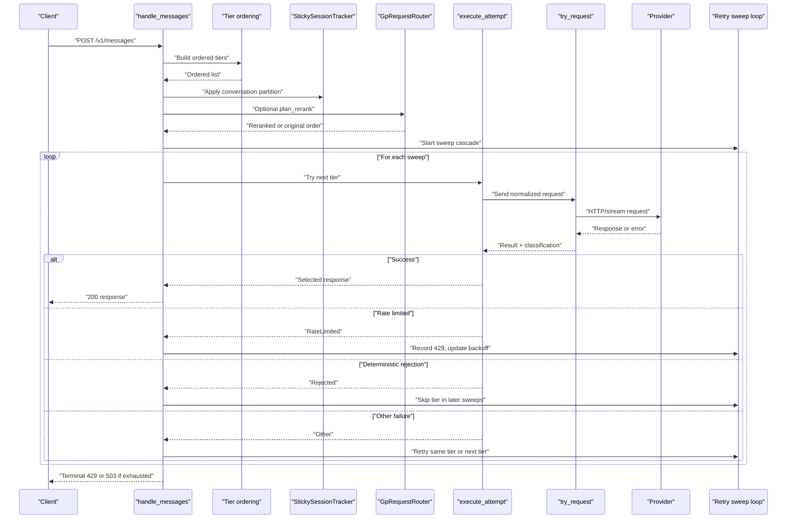

**Diagram sources**
- [src/router/mod.rs:561-887](file://src/router/mod.rs#L561-L887)
- [src/router/dispatch.rs:1-200](file://src/router/dispatch.rs#L1-L200)
- [src/routing.rs:201-618](file://src/routing.rs#L201-L618)
- [src/stickiness.rs:1-200](file://src/stickiness.rs#L1-L200)
- [src/gp_router.rs:201-640](file://src/gp_router.rs#L201-L640)

## Detailed Component Analysis

### Tier-Based Failover and Sweep Mechanics
The central routing flow lives in `handle_messages`. It constructs an ordered list of `(tier_route, tier_name)` pairs and then runs a sweep loop that attempts every eligible tier before deciding whether to synthesize a terminal response or continue.

Key mechanics:

- **Strict vs EWMA ordering**: If `strict_tier_order` is enabled, the configured tier list is used as a strict preference chain. Otherwise, `EwmaTracker::sort_tiers_with_config` computes logits from EWMA latencies, applies softmax, and samples without replacement up to `top_k`.
- **Pinned prefix**: Direct-routed tiers and web-search prefixes are pinned at the front. EWMA ordering, GP reranking, and sticky partitioning preserve this prefix.
- **Per-tier retry**: Each tier can have its own `TierRetryConfig`, controlling `max_retries`, base backoff, multiplier, max backoff, and streaming timeouts.
- **Sweep retry**: The router can hold an exhausted request open and rescan the tier list after a cooldown. Deterministic rejections are skipped in later sweeps; rate-limited tiers contribute to sweep cooldown and the terminal 429 details.
- **Hedging**: When enabled, the next tier in the pass may be launched after a TTFT threshold delay. The primary attempt wins unless it fails and the hedge succeeds.
- **Admission deferral**: Tiers at their AIMD capacity are deferred to the end of the current pass rather than immediately failing.
- **Terminal synthesis**: A synthesized 429 includes a `details` array listing each rate-limited route and its retry hint. Exhausted non-rate-limited cascades return 503.

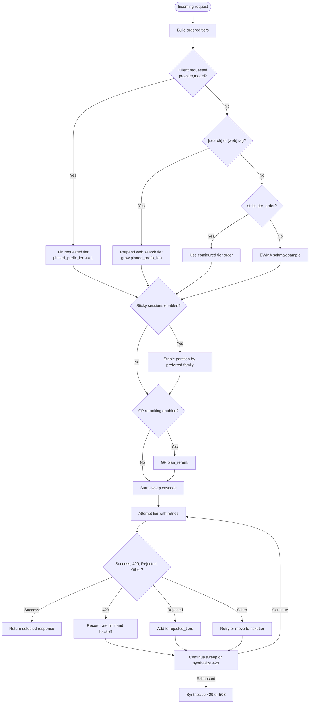

**Diagram sources**
- [src/router/mod.rs:561-887](file://src/router/mod.rs#L561-L887)
- [src/routing.rs:201-618](file://src/routing.rs#L201-L618)
- [src/stickiness.rs:1-200](file://src/stickiness.rs#L1-L200)
- [src/gp_router.rs:1-200](file://src/gp_router.rs#L1-L200)

**Section sources**
- [src/router/mod.rs:561-887](file://src/router/mod.rs#L561-L887)
- [docs/failover_architecture.md:100-200](file://docs/failover_architecture.md#L100-L200)

### EWMA Latency Tracking Algorithms
`EwmaTracker` maintains per-tier state:

- `ewma`: smoothed latency estimate in seconds.
- `samples`: total successes plus failures recorded.
- `consecutive_failures`: reset on success.

Algorithm characteristics:

| Operation | Behavior |
|---|---|
| First success | Sets EWMA to the observed duration |
| Subsequent success | `ewma = alpha * duration + (1 - alpha) * ewma` |
| Failure | Applies `failure_penalty × current_ewma`, bounded by an effective timeout when supplied |
| Sorting | Tiers with fewer than `min_samples` keep config order; measured tiers sort ascending by EWMA |
| Softmax sampling | Converts negative latency logit into probabilities and draws top-k without replacement |

Default constants:

- Alpha: `0.3`
- Minimum samples: `3`
- Failure penalty multiplier: `2.0`

`AttemptTimer` integrates into the attempt path so successful durations are clamped to the effective API timeout and failures are penalized even when no explicit result path is reached.

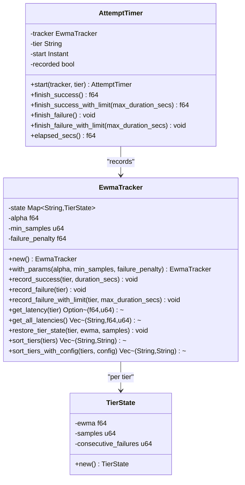

**Diagram sources**
- [src/routing.rs:1-200](file://src/routing.rs#L1-L200)
- [src/routing.rs:201-618](file://src/routing.rs#L201-L618)

**Section sources**
- [src/routing.rs:1-200](file://src/routing.rs#L1-L200)
- [src/routing.rs:201-618](file://src/routing.rs#L201-L618)

### Intelligent Provider Selection Strategies
CCR-Rust combines several selection strategies in a defined precedence:

1. **Model aliases**: A bare model name can resolve to a configured `provider,model` route.
2. **Direct routing**: If the client sends `provider,model` and `ignore_direct` is false, that exact tier is moved to the front.
3. **Web search injection**: Requests containing `[search]` or `[web]` strip those tags and prepend the configured search provider.
4. **Ordering mode**:
   - Strict: configured fallback chain.
   - EWMA: latency-weighted randomized ordering.
5. **GP reranking**: Optional request-aware rerank of candidates beyond the pinned prefix.
6. **Stickiness**: Moves previously used provider families toward the front of the fallback region.
7. **Hedging**: Launches the next tier concurrently after a TTFT threshold.
8. **Admission and rate limiting**: Defer or skip tiers based on AIMD limits and per-route backoffs.

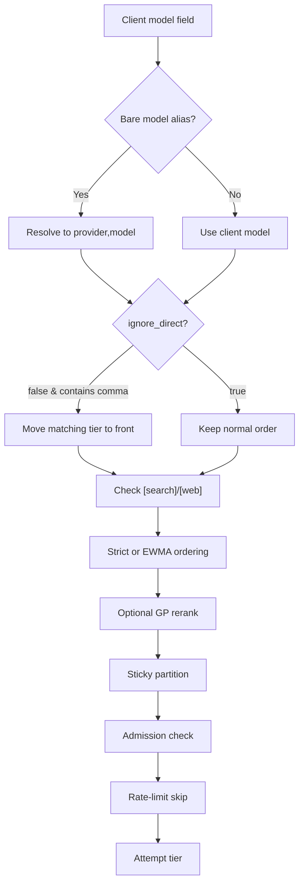

**Diagram sources**
- [src/router/mod.rs:200-561](file://src/router/mod.rs#L200-L561)
- [src/router/mod.rs:561-887](file://src/router/mod.rs#L561-L887)

**Section sources**
- [src/router/mod.rs:200-561](file://src/router/mod.rs#L200-L561)
- [src/config/types.rs:600-737](file://src/config/types.rs#L600-L737)

### Traffic Class Routing: Default, Think, Background, Web Search
The repository exposes traffic-class concepts through configuration:

| Class | Configuration field | Meaning |
|---|---|---|
| Default | `Router.default` | Primary model or route used when no other selector applies |
| Think | `Router.think` | Intended for requests requiring extended reasoning or thinking mode |
| Background | `Router.background` | Intended for lower-priority or batch-oriented workloads |
| Web search | `Router.web_search.search_provider` | Triggered by `[search]` or `[web]` tags in message content |

The implementation recognizes:

- Bare model names resolved through `model_aliases`.
- Explicit `provider,model` targeting.
- Web-search tag detection and stripping.
- Per-class tier lists constructed via `default`, `think`, and `background` when `tiers` is not explicitly set.

Note: The code explicitly detects web-search tags and prepends the configured search provider. The `default`, `think`, and `background` fields exist in `RouterConfig`, but the visible tag-driven mechanism documented here is the web-search path. Clients should treat “default,” “think,” and “background” as configuration-level traffic classes rather than assuming separate HTTP endpoints.

**Section sources**
- [src/config/types.rs:600-737](file://src/config/types.rs#L600-L737)
- [src/router/mod.rs:200-561](file://src/router/mod.rs#L200-L561)

### GP Backed Request-Aware Reranking
When the `gp` feature is enabled and `gpRouting.enabled` is true, the router builds a `GpRequestRouter` and calls `plan_rerank` before applying stickiness.

Key properties:

- **Candidate selection**: Only tiers beyond the pinned prefix and mapped to bounded backend slots are considered.
- **Feature vector**: Includes prompt length, estimated input tokens, max output tokens, request class, presence of a system prompt, message count, tool count, active streams, hour of day, retry count, backend index, idle ratio, in-flight ratio, and relative cost.
- **Acquisition strategies**: UCB, Thompson sampling, greedy, or epsilon-greedy.
- **Credible set**: Candidates whose upper confidence bound overlaps the best lower bound form a credible set. Within that set, lower estimated USD cost is preferred when all credible candidates are priced.
- **Observation buffer**: Observations are pushed with an outcome derived from finite positive duration; fitting occurs after `min_observations` and optionally periodically.
- **Capacity bound**: Only the first `BACKEND_SLOTS` configured tiers are exposed to the GP; tail tiers remain in fallback order.

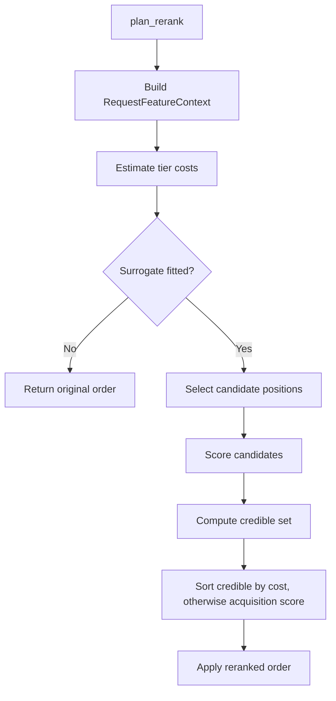

**Diagram sources**
- [src/gp_router.rs:1-200](file://src/gp_router.rs#L1-L200)
- [src/gp_router.rs:201-640](file://src/gp_router.rs#L201-L640)

**Section sources**
- [src/gp_router.rs:1-200](file://src/gp_router.rs#L1-L200)
- [src/gp_router.rs:201-640](file://src/gp_router.rs#L201-L640)
- [src/config/types.rs:600-737](file://src/config/types.rs#L600-L737)

### Stickiness Mechanisms
Conversation stickiness avoids unnecessary protocol translation and reduces mid-conversation fallback visibility.

Mechanism:

- A stable conversation key is derived from the serialized Anthropic request’s `system` prompt and the first user message.
- The key is hashed with SHA-256; raw prompt text never appears in logs or cache keys.
- A TTL-bound map stores the preferred provider for each conversation.
- `stable_partition` moves tiers belonging to the preferred provider family toward the front of the fallback region while preserving the pinned prefix and internal relative order.
- The map caps entries at `MAX_ENTRIES`; expired entries are evicted lazily.

Important constraints:

- No conversation ID is assumed.
- Common system prompts do not collide because the first user message is included.
- Stickiness is disabled by default and controlled by `stickySessions.enabled`.

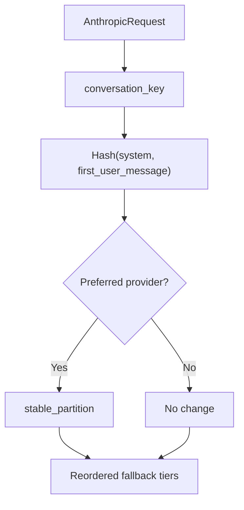

**Diagram sources**
- [src/stickiness.rs:1-200](file://src/stickiness.rs#L1-L200)
- [src/stickiness.rs:201-248](file://src/stickiness.rs#L201-L248)

**Section sources**
- [src/stickiness.rs:1-200](file://src/stickiness.rs#L1-L200)
- [src/stickiness.rs:201-248](file://src/stickiness.rs#L201-L248)
- [src/router/mod.rs:561-887](file://src/router/mod.rs#L561-L887)

### Provider Override Rules and Custom Request Mutation
Before dispatch, validated provider-level request requirements can mutate the outgoing request:

- `force_adaptive_thinking`: Inserts adaptive thinking metadata for providers that require it.
- `force_reasoning_effort`: Forces a specific reasoning effort string, only allowed for OpenAI-compatible protocol providers.

These overrides are applied just before the request is sent and produce typed errors if the request body is not a JSON object or if the protocol constraint is violated.

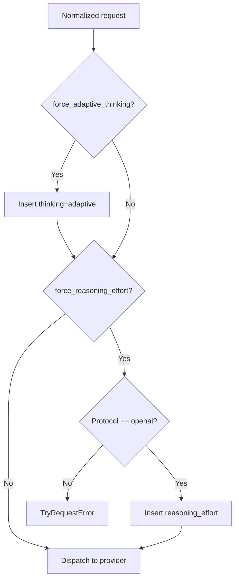

**Diagram sources**
- [src/router/dispatch/provider_overrides.rs:1-47](file://src/router/dispatch/provider_overrides.rs#L1-L47)
- [src/router/types.rs:20-60](file://src/router/types.rs#L20-L60)

**Section sources**
- [src/router/dispatch/provider_overrides.rs:1-47](file://src/router/dispatch/provider_overrides.rs#L1-L47)
- [src/config/types.rs:300-450](file://src/config/types.rs#L300-L450)

### Client-Specific Routing
Client-specific routing in CCR-Rust is primarily expressed through:

- **Explicit model targeting**: Sending `provider,model` routes directly to a configured tier.
- **Model aliases**: Mapping a friendly model name to a concrete route.
- **Frontend detection**: The router detects frontend type from headers and request body, which affects downstream behavior such as rendering refusals for Claude Code.
- **Stream preferences**: The client’s `stream` flag is preserved unless a provider forces non-streaming.

There is no separate per-client identity-based router in the analyzed files; client intent is inferred from request content, headers, and model selection rather than a dedicated client identifier table.

**Section sources**
- [src/router/mod.rs:200-561](file://src/router/mod.rs#L200-L561)
- [src/router/types.rs:100-200](file://src/router/types.rs#L100-L200)

### Custom Routing Strategies
Customization points include:

| Area | Configurable option | Effect |
|---|---|---|
| Ordering | `strict_tier_order` | Enforces strict fallback chain instead of EWMA sampling |
| Temperature | `routing_temperature` | Controls softmax flattening |
| Top-K | `top_k` | Limits number of sampled tiers |
| Direct routing | `ignore_direct` | Honors or ignores explicit `provider,model` targeting |
| Web search | `web_search.enabled`, `web_search.search_provider` | Enables tag-triggered search routing |
| Retries | `tierRetries` | Per-tier retry and streaming timeout policy |
| Sweeps | `retry_sweeps` | Holds request open for re-cascading |
| Hedging | `hedging` | Concurrent hedge launch after TTFT threshold |
| Stickiness | `sticky_sessions` | Keeps provider family affinity |
| GP reranking | `gpRouting` | Optional request-aware reranker |
| Provider overrides | Provider-level `force_adaptive_thinking`, `force_reasoning_effort` | Mutates outgoing request |

**Section sources**
- [src/config/types.rs:600-737](file://src/config/types.rs#L600-L737)
- [src/config/types.rs:300-450](file://src/config/types.rs#L300-L450)

## Dependency Analysis
The routing pipeline composes several subsystems with clear boundaries:

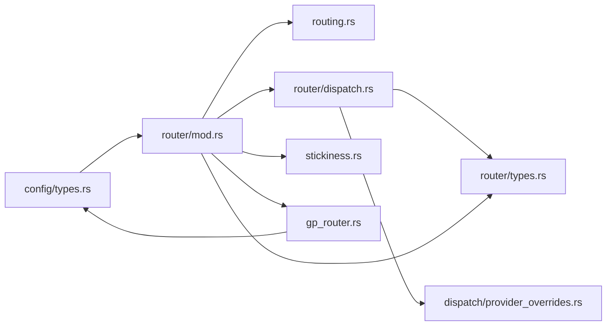

**Diagram sources**
- [src/router/mod.rs:200-561](file://src/router/mod.rs#L200-L561)
- [src/routing.rs:1-200](file://src/routing.rs#L1-L200)
- [src/router/dispatch.rs:1-200](file://src/router/dispatch.rs#L1-L200)
- [src/stickiness.rs:1-200](file://src/stickiness.rs#L1-L200)
- [src/gp_router.rs:1-200](file://src/gp_router.rs#L1-L200)
- [src/router/types.rs:1-200](file://src/router/types.rs#L1-L200)
- [src/router/dispatch/provider_overrides.rs:1-47](file://src/router/dispatch/provider_overrides.rs#L1-L47)
- [src/config/types.rs:600-737](file://src/config/types.rs#L600-L737)

**Section sources**
- [src/router/mod.rs:200-561](file://src/router/mod.rs#L200-L561)
- [src/router/types.rs:1-200](file://src/router/types.rs#L1-L200)

## Performance Considerations
Guidance grounded in the implementation:

| Concern | Recommendation | Rationale |
|---|---|---|
| EWMA responsiveness | Tune `alpha`, `min_samples`, and `failure_penalty` only when you understand your workload | Higher alpha reacts faster but is noisier; low `min_samples` lets EWMA influence decisions sooner |
| Cold-start traffic | Use shuffling or moderate `routing_temperature` | Unmeasured tiers are shuffled or heavily penalized depending on mode |
| Load distribution | Prefer EWMA sampling for load-balanced peers; use strict ordering for deliberate quality chains | EWMA redistributes by latency; strict preserves intended priority |
| Streaming latency | Configure `streamFirstEventTimeoutMs` and `streamIdleTimeoutMs` per tier | Prevents slow-start or stalled streams from blocking retries |
| Sweep amplification | Enable `retryBudgetPercent` judiciously | Bounds retry amplification without abandoning healthy fallback tiers |
| Provider concurrency | Set `max_inflight` and `max_inflight_tokens` per provider | Protects against concurrent prefill and token-budget collisions |
| GP overhead | Disable GP unless you have enough observations and tuned parameters | Surrogate fitting and feature computation add CPU work and require data |
| Stickiness TTL | Adjust TTL to match conversation length | Too short loses affinity; too long retains stale preferences |
| Monitoring | Observe EWMA gauges, rate-limit counters, hedge metrics, and sweep counts | Helps distinguish latency degradation, quota pressure, and misconfigured ordering |

[No sources needed since this section provides general guidance]

## Troubleshooting Guide
Common routing issues and where to look:

| Symptom | Likely cause | Investigation area |
|---|---|---|
| All tiers appear rate limited | Upstream quota or per-request concurrency cap | Rate-limit tracker, `x-ccr-rate-limited-tiers`, terminal 429 details |
| Same tier keeps failing deterministically | 401–404 or provider rejects request shape | `TryRequestError::Rejected`, `rejected_tiers` memo |
| Requests stall during streaming | First-event timeout or idle timeout | `stream_first_event_timeout`, `stream_idle_timeout`, stream peek logic |
| EWMA values become extreme | Unclamped durations or pathological timeouts | `AttemptTimer` limits, upstream timeout bounds |
| Web search does not trigger | Tags absent or web search disabled | Message content inspection, `web_search.enabled` |
| Direct routing ignored | `ignore_direct=true` or model not in tiers | `ignore_direct`, direct routing branch |
| GP reranking has no effect | Surrogate unfitted, few candidates, or strict tier order | GP buffer, fitted state, `strict_tier_order` |
| Stickiness not working | Disabled, expired, or no conversation key | `sticky_sessions.enabled`, TTL, system prompt uniqueness |
| Provider override fails | Wrong protocol or malformed request body | `force_reasoning_effort` protocol check, provider override logic |

Operational checks:

- Inspect `/health?details` for configured tiers and default route.
- Review logs for tier ordering, sweep iteration, attempt numbers, hedge launches, and EWMA updates.
- Validate provider configuration for protocol, pricing, rate-limit headers, and streaming support.
- Confirm `tierRetries` entries exist for custom backoff behavior.
- For sweeps, confirm `retrySweeps.max_hold_ms` and `sweepCooldownMs` behavior.

**Section sources**
- [src/router/dispatch.rs:1-200](file://src/router/dispatch.rs#L1-L200)
- [src/router/types.rs:20-60](file://src/router/types.rs#L20-L60)
- [src/router/dispatch/provider_overrides.rs:1-47](file://src/router/dispatch/provider_overrides.rs#L1-L47)
- [src/config/types.rs:600-737](file://src/config/types.rs#L600-L737)
- [docs/failover_architecture.md:100-200](file://docs/failover_architecture.md#L100-L200)

## Decision Examples
Concrete scenarios show how different inputs affect routing outcomes.

### Scenario 1: Normal default request with EWMA
- Input: Bare model name resolving to a configured tier; no search tags; direct routing disabled or absent.
- Process:
  - Model alias resolves to `provider,model`.
  - Ordering uses EWMA softmax sampling.
  - No sticky preference or GP rerank unless enabled.
  - First eligible tier is attempted with retries.
- Outcome: Lowest-latency measured tier wins probabilistically; failed tiers fall back in the sampled order.

### Scenario 2: Direct routing to a specific provider
- Input: `model="openai,gpt-4"` and `ignore_direct=false`.
- Process:
  - Exact tier is found and moved to position zero.
  - `pinned_prefix_len` becomes at least one.
  - Remaining tiers follow EWMA or strict order behind the pinned tier.
- Outcome: Request targets the specified provider first; failover still proceeds to later tiers if it fails.

### Scenario 3: Web search request
- Input: Message contains `[search]` or `[web]`; web search is enabled.
- Process:
  - Tags are stripped from message content.
  - Search provider is prepended as the first tier.
  - Pinned prefix grows accordingly.
- Outcome: Search provider runs first; subsequent providers handle the cleaned request.

### Scenario 4: Strict fallback chain
- Input: `strict_tier_order=true`.
- Process:
  - Tier list is used exactly as configured.
  - EWMA sampling is bypassed.
  - GP reranking cannot reorder the chain.
- Outcome: Highest-quality or highest-priority tier serves whenever possible; lower tiers act only as explicit fallback.

### Scenario 5: Conversation stickiness
- Input: Enabled sticky sessions; previous request used a particular provider family.
- Process:
  - Conversation key is derived from system prompt and first user message.
  - Preferred provider family is moved ahead in the fallback region.
  - Pinned prefix remains untouched.
- Outcome: Later messages in the same conversation prefer the earlier family, reducing protocol translation and visible fallback.

### Scenario 6: GP reranking enabled
- Input: GP enabled; multiple candidates beyond pinned prefix; sufficient observations.
- Process:
  - Candidate tiers are scored using mean and variance from the surrogate.
  - Acquisition strategy selects exploration vs exploitation.
  - Credible set prefers statistically indistinguishable candidates and then lower estimated cost.
- Outcome: Candidate order may change based on request shape, load, and historical performance; pinned prefix is preserved.

### Scenario 7: Rate-limited sweep
- Input: Multiple tiers return 429; sweeps enabled.
- Process:
  - Each 429 is recorded with per-route backoff.
  - Sweep cooldown honors server `Retry-After` hints capped appropriately.
  - Terminal 429 includes details for every exhausted route.
- Outcome: Client sees a structured 429 with retry hints and provenance; request may be held open for another sweep under the hold budget.

**Section sources**
- [src/router/mod.rs:200-561](file://src/router/mod.rs#L200-L561)
- [src/router/mod.rs:561-887](file://src/router/mod.rs#L561-L887)
- [src/stickiness.rs:1-200](file://src/stickiness.rs#L1-L200)
- [src/gp_router.rs:201-640](file://src/gp_router.rs#L201-L640)
- [src/config/types.rs:600-737](file://src/config/types.rs#L600-L737)

## Conclusion
CCR-Rust’s routing is a layered system designed for resilience and observability. It starts with explicit intent—model aliases, direct targeting, and web search tags—then applies either strict fallback semantics or EWMA-driven intelligent ordering. Failover is reinforced by per-tier retries, sweep loops, hedging, admission control, and rate-limit backoff. Conversation stickiness and optional GP reranking add stability and request-aware optimization without overriding pinned priorities.

For production operation, prioritize correct provider configuration, sensible retry and sweep budgets, meaningful tier ordering, and monitoring of EWMA, rate limits, sweeps, and hedge outcomes. Use strict ordering for intentional quality chains, EWMA sampling for latency-driven load distribution, and GP reranking only when you have enough data and tuned acquisition parameters.

[No sources needed since this section summarizes without analyzing specific files]