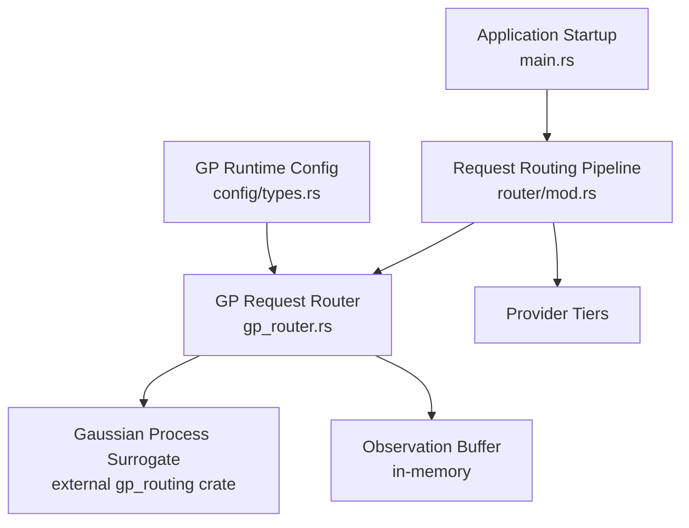
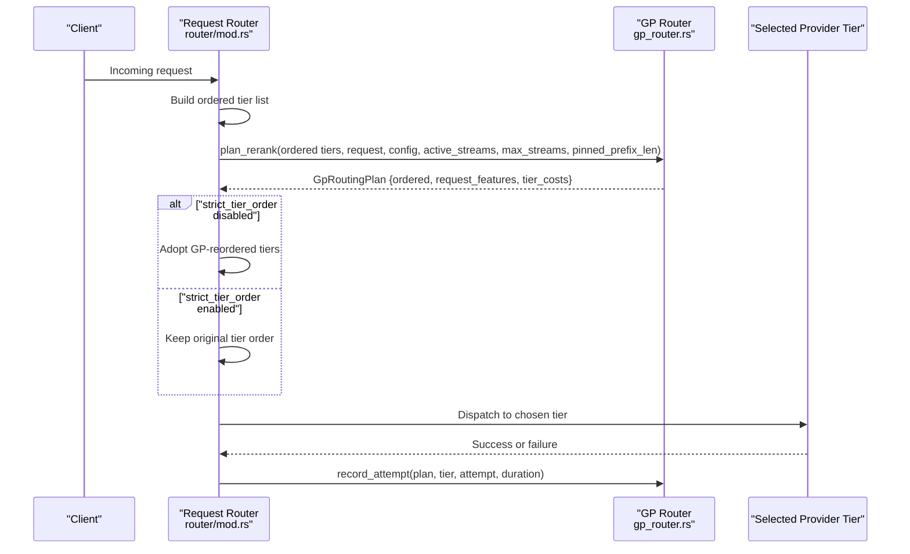
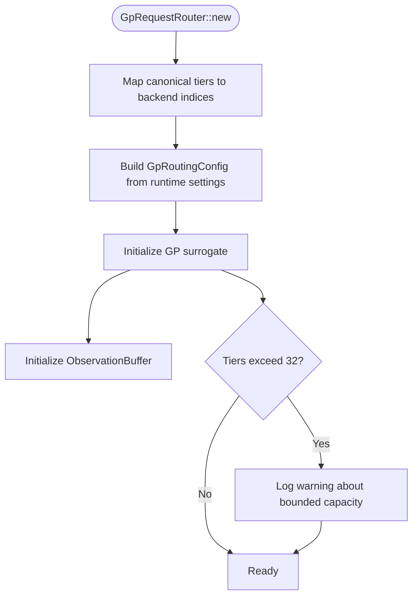
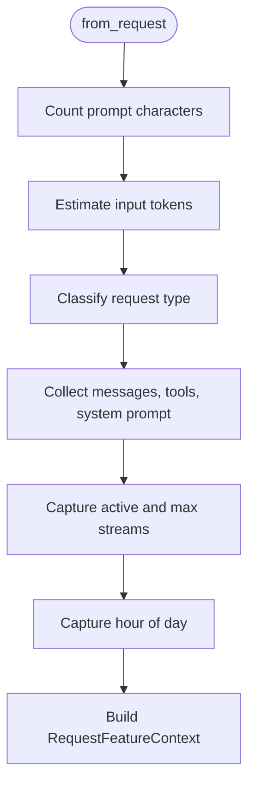
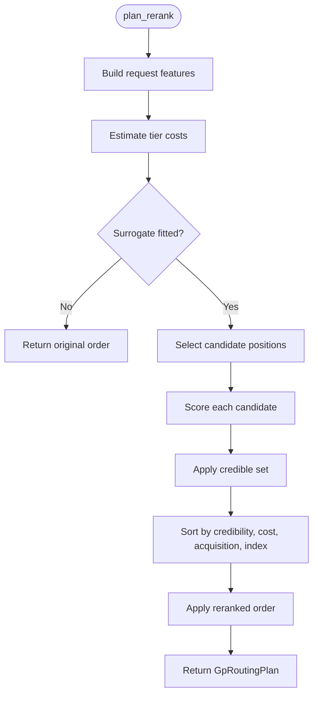
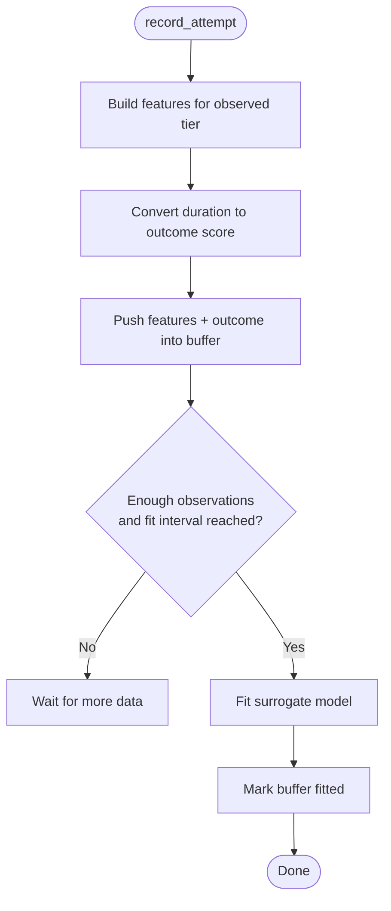
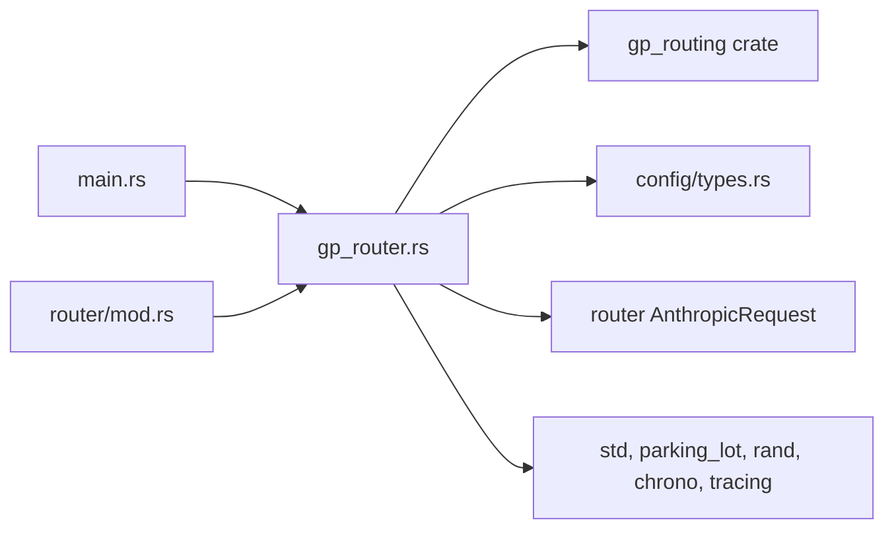

# GP Routing Optimization

<cite>
**Referenced Files in This Document**   
- [gp_router.rs](file://src/gp_router.rs)
- [types.rs](file://src/config/types.rs)
- [mod.rs](file://src/router/mod.rs)
- [main.rs](file://src/main.rs)
- [lib.rs](file://src/lib.rs)
</cite>

## Table of Contents
1. [Introduction](#introduction)
2. [Project Structure](#project-structure)
3. [Core Components](#core-components)
4. [Architecture Overview](#architecture-overview)
5. [Detailed Component Analysis](#detailed-component-analysis)
6. [Dependency Analysis](#dependency-analysis)
7. [Performance Considerations](#performance-considerations)
8. [Troubleshooting Guide](#troubleshooting-guide)
9. [Conclusion](#conclusion)

## Introduction
This document explains CCR-Rust’s Genetic Programming-backed request-aware reranking system. The system augments the existing tier-based routing pipeline by analyzing each incoming request and potentially reordering candidate provider tiers before dispatch. Instead of relying only on fixed priority or simple tier rules, it learns which tiers perform better for particular request shapes using a Gaussian process surrogate model.

Key ideas:
- Each request is described by features such as prompt length, estimated input tokens, output token budget, streaming mode, tool usage, message count, active concurrency, time of day, retry attempt, and relative cost estimate.
- A bounded surrogate model predicts mean performance and uncertainty for each candidate tier.
- An acquisition strategy selects candidates to explore versus exploit.
- Observed outcomes (mostly latency-derived) are recorded into an in-memory buffer and periodically used to refit the surrogate.
- Reranking is optional and can be disabled without changing normal tier routing behavior.

The implementation is feature-gated under `gp`, so the code compiles and runs without GP functionality unless explicitly enabled at build time.

**Section sources**
- [lib.rs:11](file://src/lib.rs#L11)
- [main.rs:33-35](file://src/main.rs#L33-L35)
- [main.rs:55](file://src/main.rs#L55)
- [main.rs:451-459](file://src/main.rs#L451-L459)

## Project Structure
The GP reranker lives alongside CCR-Rust’s router, configuration, and main application lifecycle:

- `src/gp_router.rs`: Core GP reranker logic, request feature extraction, scoring, credible-set ordering, and learning loop integration.
- `src/config/types.rs`: Configuration types for enabling GP routing, population/candidate limits, exploration strategy, buffer size, prior parameters, nugget, KPLS dimensionality, and epsilon rate.
- `src/router/mod.rs`: Integration point where the router builds the initial tier order, asks the GP router for a reranking plan, applies strict-tier-order constraints, and records outcome feedback.
- `src/main.rs`: Application startup that constructs the `GpRequestRouter` when GP routing is enabled and attaches it to application state.
- `src/lib.rs`: Module export exposing the GP router to other crates.

**Diagram sources**
- [main.rs:451-487](file://src/main.rs#L451-L487)
- [router/mod.rs:482-568](file://src/router/mod.rs#L482-L568)
- [gp_router.rs:20-45](file://src/gp_router.rs#L20-L45)
- [config/types.rs:458-508](file://src/config/types.rs#L458-L508)

**Section sources**
- [gp_router.rs:1-45](file://src/gp_router.rs#L1-L45)
- [config/types.rs:458-508](file://src/config/types.rs#L458-L508)
- [router/mod.rs:482-568](file://src/router/mod.rs#L482-L568)
- [main.rs:451-487](file://src/main.rs#L451-L487)
- [lib.rs:11](file://src/lib.rs#L11)

## Core Components
The GP reranking system is centered around these runtime components:

| Component | Responsibility | Key Fields / Methods |
|---|---|---|
| `GpRequestRouter` | Holds runtime configuration, canonical tier-to-backend mapping, the GP surrogate model, observation buffer, and backend index map. | `new`, `plan_rerank`, `record_attempt` |
| `GpRoutingPlan` | Immutable result of reranking, including reordered tier list, extracted request features, and per-tier cost estimates. | `ordered`, `request_features`, `tier_costs` |
| `RequestFeatureContext` | Lightweight snapshot of request characteristics used to build feature vectors. | Prompt character count, estimated input tokens, max output tokens, request class, system prompt flag, message count, tool count, active/max streams, hour of day |
| `ScoredCandidate` | Intermediate representation of a candidate tier during reranking. | Canonical index, tier entry, acquisition score, posterior mean/variance, estimated USD cost, credibility flag |
| `GpAcquisitionStrategy` | Enumerates exploration/exploitation methods: UCB, Thompson sampling, greedy, epsilon-greedy. | `Ucb`, `Thompson`, `Greedy`, `EpsilonGreedy` |
| `GpRoutingRuntimeConfig` | User-configurable runtime parameters controlling GP behavior. | `enabled`, `max_candidates`, `buffer_capacity`, `min_observations`, `refit_interval`, `ucb_kappa`, `nugget`, `kpls_dim`, `prior_mean`, `prior_variance`, `acquisition`, `epsilon` |

### Important Behavioral Constraints
- The GP reranker is capped at 32 backend slots. If more than 32 tiers are configured, tail tiers remain in fallback order and emit a warning.
- When the surrogate is not yet fitted, `plan_rerank` returns the original tier order.
- Strict tier order is respected: if the router is configured with strict ordering, GP reranking does not override the provided chain; it still records observations for future learning.

**Section sources**
- [gp_router.rs:20-45](file://src/gp_router.rs#L20-L45)
- [gp_router.rs:52-97](file://src/gp_router.rs#L52-L97)
- [gp_router.rs:105-158](file://src/gp_router.rs#L105-L158)
- [gp_router.rs:447-508](file://src/gp_router.rs#L447-L508)
- [config/types.rs:458-508](file://src/config/types.rs#L458-L508)
- [router/mod.rs:550-568](file://src/router/mod.rs#L550-L568)

## Architecture Overview
At request time, the routing pipeline first establishes an ordered list of provider tiers. The GP router then optionally reranks those tiers based on learned performance signals. After a tier is selected and dispatched, the router feeds the observed outcome back into the GP router so the surrogate can learn over time.

**Diagram sources**
- [router/mod.rs:482-568](file://src/router/mod.rs#L482-L568)
- [router/mod.rs:829-989](file://src/router/mod.rs#L829-L989)
- [gp_router.rs:105-200](file://src/gp_router.rs#L105-L200)
- [gp_router.rs:201-280](file://src/gp_router.rs#L201-L280)

## Detailed Component Analysis

### GP Request Router Lifecycle
The router constructor maps canonical tier names to bounded backend indices and builds a `GpRoutingConfig` from runtime configuration. It initializes the surrogate model and observation buffer, then warns if the configured tier count exceeds the internal 32-slot capacity.

**Diagram sources**
- [gp_router.rs:52-97](file://src/gp_router.rs#L52-L97)

**Section sources**
- [gp_router.rs:52-97](file://src/gp_router.rs#L52-L97)

### Request Feature Extraction
Before reranking, the router extracts a compact feature context from the incoming request:

- **Prompt size**: Sum of all message content and optional system prompt lengths.
- **Estimated input tokens**: Approximation using four UTF-8 bytes per token.
- **Max output tokens**: Taken from the request when present.
- **Request class**: Categorizes requests as plain, streaming-only, tool-heavy, or mixed.
- **System prompt presence**: Boolean indicator.
- **Message and tool counts**: Structural complexity signals.
- **Concurrency signals**: Active and maximum stream counts.
- **Hour-of-day**: Temporal signal.

These values are later encoded into a `FeatureVector` that includes backend identity, retry attempt, idle and in-flight ratios, loop/tool count, and relative cost.

**Diagram sources**
- [gp_router.rs:29-45](file://src/gp_router.rs#L29-L45)
- [gp_router.rs:316-344](file://src/gp_router.rs#L316-L344)
- [gp_router.rs:346-366](file://src/gp_router.rs#L346-L366)

**Section sources**
- [gp_router.rs:29-45](file://src/gp_router.rs#L29-L45)
- [gp_router.rs:316-366](file://src/gp_router.rs#L316-L366)

### Candidate Scoring and Credible-Set Ordering
For each candidate tier beyond the pinned prefix, the router:

1. Builds a feature vector for that tier.
2. Queries the surrogate for posterior mean and variance.
3. Computes an acquisition score according to the configured strategy.
4. Applies a quality-credible-set filter.
5. Orders credible candidates by estimated cost when pricing metadata is available; otherwise, it preserves acquisition ranking.

**Diagram sources**
- [gp_router.rs:105-200](file://src/gp_router.rs#L105-L200)
- [gp_router.rs:368-445](file://src/gp_router.rs#L368-L445)

**Section sources**
- [gp_router.rs:105-200](file://src/gp_router.rs#L105-L200)
- [gp_router.rs:368-445](file://src/gp_router.rs#L368-L445)

### Acquisition Strategies
The system supports several ways to balance exploration and exploitation:

| Strategy | Behavior |
|---|---|
| `Ucb` | Uses upper confidence bound scoring with configurable kappa. |
| `Thompson` | Samples from the posterior distribution for stochastic exploration. |
| `Greedy` | Selects candidates purely by predicted mean. |
| `EpsilonGreedy` | Randomly explores with probability `epsilon`; otherwise exploits by mean. |

When epsilon-greedy randomly chooses a candidate, that candidate receives an artificial exploration bonus so it can stand out in ordering.

**Section sources**
- [gp_router.rs:280-315](file://src/gp_router.rs#L280-L315)
- [config/types.rs:438-457](file://src/config/types.rs#L438-L457)

### Learning Loop and Outcome Scoring
After a tier is attempted, the router calls `record_attempt`. The GP router:

1. Builds the same feature vector used during planning.
2. Converts observed latency into a normalized outcome score between zero and one.
3. Pushes the observation into the in-memory buffer.
4. Checks whether the buffer has enough samples and whether refitting is required.
5. Fits or refits the surrogate and marks it fitted once successful.

Outcome scoring favors faster responses: a finite non-negative duration is transformed through a decreasing function so shorter latencies receive higher scores. Invalid or missing durations map to zero.

**Diagram sources**
- [gp_router.rs:201-245](file://src/gp_router.rs#L201-L245)
- [gp_router.rs:447-465](file://src/gp_router.rs#L447-L465)

**Section sources**
- [gp_router.rs:201-245](file://src/gp_router.rs#L201-L245)
- [gp_router.rs:447-465](file://src/gp_router.rs#L447-L465)

### Cost Estimation and Tier Ordering
Tier cost estimation uses configured provider pricing when available. For each tier, it estimates USD cost based on estimated input tokens and requested output tokens. Absolute costs are normalized into a relative scale between zero and one.

Credible-set ordering avoids directly trading off quality against dollars unless pricing is uniformly available. It computes a lower confidence bound across candidates, marks candidates whose upper bound overlaps that bound as credible, and then prefers cheaper credible candidates. Missing pricing prevents automatic cost sorting so incomplete metadata does not bias the decision.

**Section sources**
- [gp_router.rs:368-445](file://src/gp_router.rs#L368-L445)

### Configuration Required to Enable GP Routing
GP routing is controlled by `GpRoutingRuntimeConfig`. The important fields are:

| Field | Purpose | Default Value | Tuning Guidance |
|---|---|---:|---|
| `enabled` | Turns GP reranking on or off. | `false` | Set to `true` after baseline routing is stable. |
| `max_candidates` | Number of tiers exposed to the GP encoder. Bounded at 32. | `32` | Reduce if you have many low-value tiers; keep high-quality candidates near the top. |
| `buffer_capacity` | Maximum observations retained in memory. | `500` | Increase for high traffic; too large may retain stale patterns. |
| `min_observations` | Minimum samples before the surrogate is considered fitted. | `40` | Increase if early fits are noisy; decrease if you need faster adaptation. |
| `refit_interval` | New observations between periodic refits; `0` disables periodic refits. | `200` | Lower for rapidly changing environments; higher for stability. |
| `ucb_kappa` | Exploration weight for UCB. | `2.0` | Higher increases exploration; lower makes the router more exploitative. |
| `nugget` | Numerical jitter passed to the surrogate. | `1e-4` | Usually leave unchanged unless surrogate fitting becomes unstable. |
| `kpls_dim` | Optional dimensionality reduction for the surrogate. | `None` | Enable only if feature space is large and training is slow. |
| `prior_mean` | Prior expected performance before sufficient data. | `0.5` | Tune if your environment has systematically better or worse baselines. |
| `prior_variance` | Prior uncertainty before sufficient data. | `0.25` | Higher means stronger reliance on data; lower trusts prior more. |
| `acquisition` | Exploration/exploitation strategy. | `Ucb` | Use `Thompson` for stochastic exploration; `Greedy` for conservative behavior; `EpsilonGreedy` for explicit random exploration. |
| `epsilon` | Random exploration rate for epsilon-greedy. | `0.1` | Higher values explore more; keep moderate to avoid destabilizing routing. |

**Section sources**
- [config/types.rs:438-508](file://src/config/types.rs#L438-L508)
- [config/types.rs:999-1037](file://src/config/types.rs#L999-L1037)

### Integration with the Routing Pipeline
The routing pipeline:

1. Builds the initial tier order, respecting `strict_tier_order` when present.
2. Calls `plan_rerank` when GP routing is enabled.
3. Adopts the GP-reordered tiers only if `strict_tier_order` is disabled.
4. Records every attempted tier as feedback via `record_attempt`, regardless of success or failure.

This design ensures GP reranking improves future decisions while preserving explicit preference-chain semantics when operators require deterministic tier precedence.

**Section sources**
- [router/mod.rs:482-568](file://src/router/mod.rs#L482-L568)
- [router/mod.rs:829-989](file://src/router/mod.rs#L829-L989)

### Example Routing Outcomes Compared to Traditional Tier-Based Routing
Because this system adapts to request shape and historical performance, typical improvements include:

- **Short prompts with small outputs**: The GP may prefer a faster, cheaper tier that historically handles lightweight requests well.
- **Tool-heavy or multi-message requests**: The GP may defer to a tier with better reliability or throughput for complex tool execution.
- **Streaming requests**: Streaming-specific behavior can be learned separately from non-streaming requests because request classification distinguishes them.
- **Time-of-day effects**: Periods with provider degradation or load may cause the GP to shift candidates toward more responsive tiers.

Compared to static tier-based routing:
- Static routing always follows the configured priority unless overridden by failover or admission controls.
- GP routing can reorder within the candidate window based on learned signals, but it cannot violate strict tier order when that option is enabled.
- GP reranking starts from the original tier list and only moves eligible candidates beyond the pinned prefix.

These outcomes are probabilistic and improve as observations accumulate; they do not guarantee correctness on every request.

[No sources needed since this section compares conceptual routing behavior rather than quoting specific implementation lines]

## Dependency Analysis
The GP router depends on both CCR-Rust internals and an external GP routing crate:

- External crate dependencies:
  - `gp_routing::features::BACKEND_SLOTS`: Hard-coded backend slot limit.
  - `gp_routing::{thompson_sample, ucb_score, FeatureVector, GpRoutingConfig, GpSurrogate, ObservationBuffer}`: Core GP primitives.
- Internal dependencies:
  - `crate::config::{Config, GpAcquisitionStrategy, GpRoutingRuntimeConfig}`: Configuration and acquisition strategy.
  - `crate::router::AnthropicRequest`: Normalized request representation.
  - Standard library collections, `parking_lot::Mutex`, `rand`, `chrono`, and `tracing`.

**Diagram sources**
- [gp_router.rs:1-15](file://src/gp_router.rs#L1-L15)
- [main.rs:55](file://src/main.rs#L55)
- [router/mod.rs:550-568](file://src/router/mod.rs#L550-L568)

**Section sources**
- [gp_router.rs:1-15](file://src/gp_router.rs#L1-L15)
- [main.rs:55](file://src/main.rs#L55)
- [router/mod.rs:550-568](file://src/router/mod.rs#L550-L568)

## Performance Considerations
- **Bounded backend slots**: Only the first 32 tiers participate in GP encoding. Tail tiers remain in fallback order.
- **Candidate window**: Only up to `max_candidates` eligible candidates beyond the pinned prefix are scored.
- **Unfitted behavior**: Before the surrogate is fitted, reranking falls back to the original order, avoiding premature optimization.
- **Buffer management**: Observations are stored in a bounded in-memory buffer; old data is overwritten when capacity is exceeded.
- **Refit cadence**: Refits occur only after `min_observations` and then every `refit_interval` new observations.
- **Cost estimation overhead**: Per-request cost estimation scans configured tiers and resolves provider pricing metadata.
- **Feature construction**: Feature vectors reuse categorical slots for request-class buckets and backend identity to keep encoding efficient.

Recommended tuning approach:
- Start with defaults and enable GP routing with a modest `max_candidates` value.
- Monitor fit frequency and observation growth.
- Increase `min_observations` if early reranking is erratic.
- Reduce `refit_interval` if workloads change frequently.
- Raise `ucb_kappa` or use Thompson sampling if the router appears too conservative.
- Disable GP routing if production stability is more important than adaptive optimization.

[No sources needed since this section provides general guidance]

## Troubleshooting Guide
Common issues and diagnostics:

| Symptom | Likely Cause | Action |
|---|---|---|
| GP reranking has no effect | Surrogate is not fitted yet. | Wait until `min_observations` is reached; check logs for fit completion. |
| Original tier order is preserved despite GP enabled | `strict_tier_order` is enabled. | Disable strict ordering if GP reranking should affect dispatch order. |
| Too many tiers ignored | More than 32 tiers configured. | Reduce tiers or ensure high-value tiers are earlier in the list. |
| Reranking feels unstable | High exploration or insufficient data. | Lower `epsilon` for epsilon-greedy, increase `min_observations`, or raise `ucb_kappa` cautiously. |
| Frequent fit failures | Degenerate observations or numerical instability. | Check `nugget`, reduce noise in workload, and inspect observation buffer size. |
| Cost-based ordering seems absent | Some tiers lack pricing metadata. | Add provider pricing; missing prices prevent lexicographic cost sorting. |
| GP routing is never constructed | `gp_routing.enabled` is false or GP feature is disabled. | Enable `gp_routing.enabled` and compile with the `gp` feature. |

Useful log signals:
- Surrogate fit completion and fit count.
- Surrogate fit failure warnings.
- GP reranking debug logs showing prefix length, candidate scores, before/after tier lists.
- Warnings about configured tiers exceeding GP capacity.

**Section sources**
- [gp_router.rs:201-245](file://src/gp_router.rs#L201-L245)
- [gp_router.rs:201-220](file://src/gp_router.rs#L201-L220)
- [gp_router.rs:52-68](file://src/gp_router.rs#L52-L68)
- [router/mod.rs:550-568](file://src/router/mod.rs#L550-L568)

## Conclusion
CCR-Rust’s GP-backed reranking system extends traditional tier-based routing by learning which providers perform best for specific request shapes. It combines request-aware features, a Gaussian process surrogate, and flexible acquisition strategies to propose improved tier orders. The system is intentionally conservative: it preserves original ordering when unfitted or when strict tier order is required, bounds its internal capacity, and separates quality assessment from cost comparison through a credible-set mechanism.

For production use, start with conservative defaults, enable GP routing gradually, collect fit and observation metrics, and adjust exploration, buffer size, and refit cadence based on observed workload stability. The most valuable gains appear when request characteristics vary significantly and historical performance differs across providers.

[No sources needed since this section summarizes without analyzing specific files]