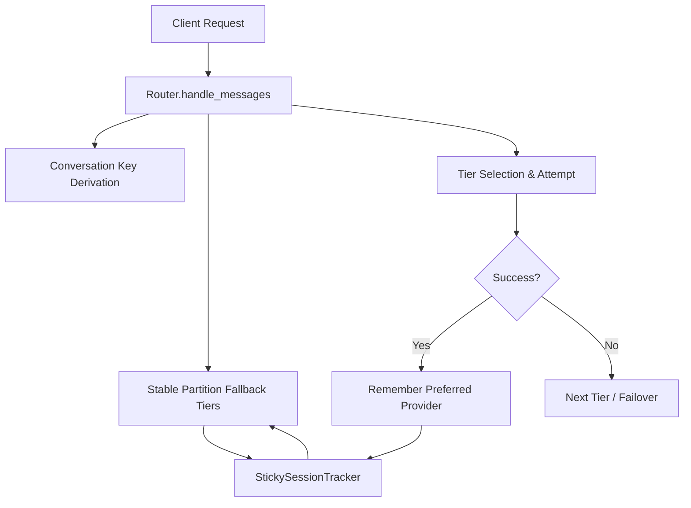
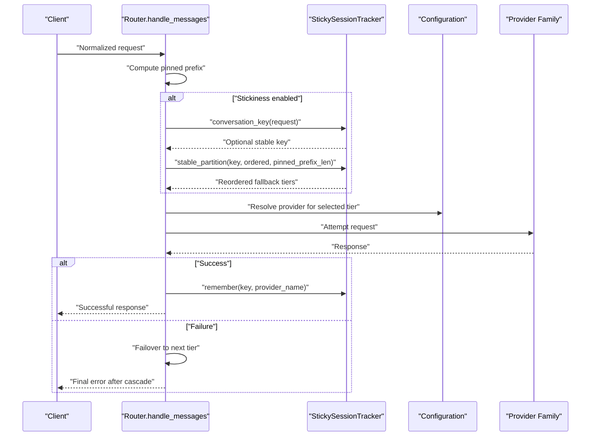
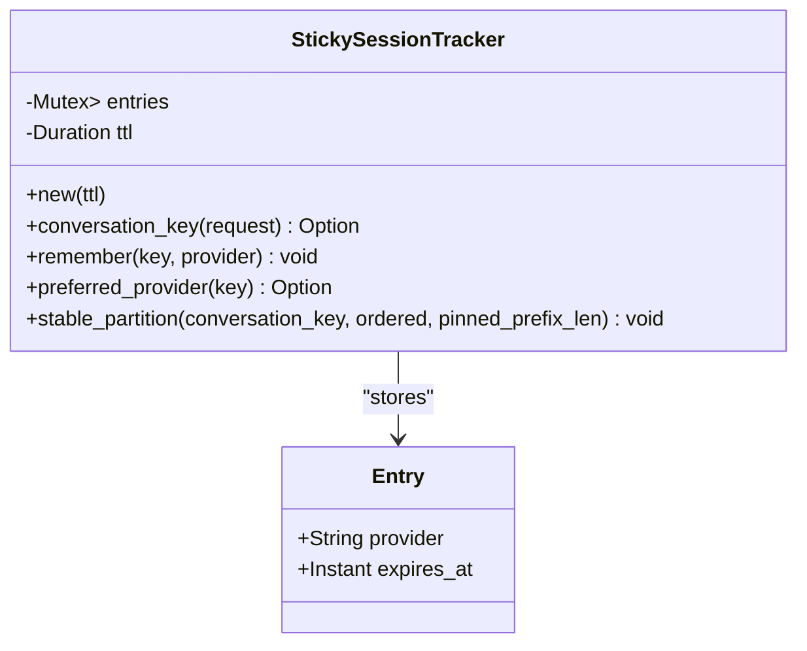
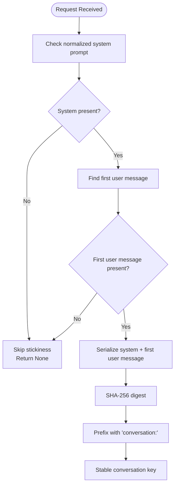
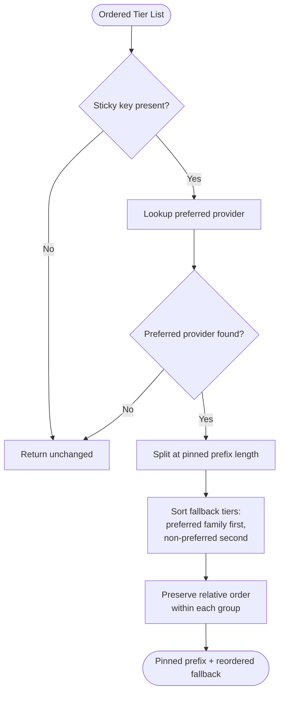
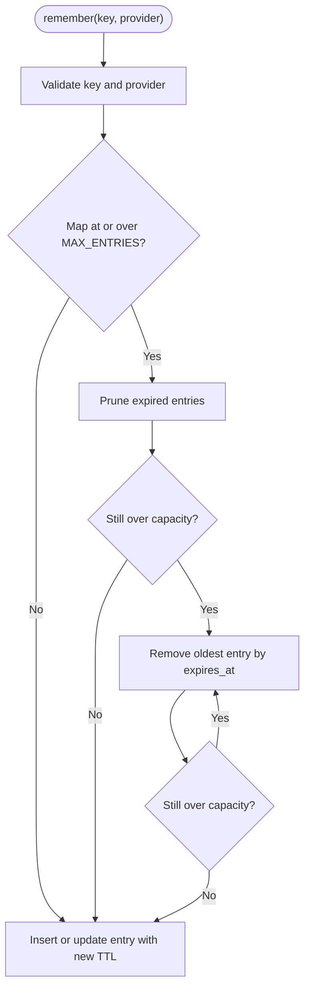
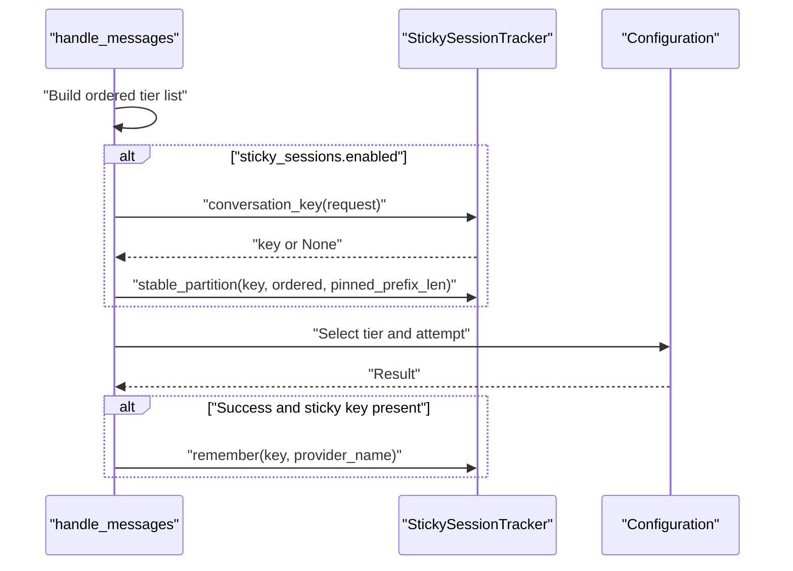
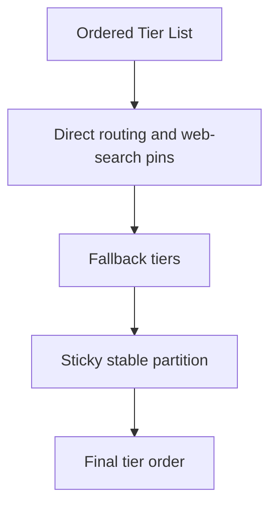
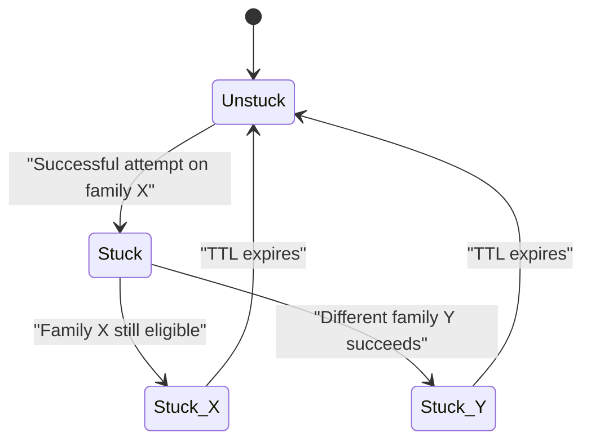

# Provider Stickiness

<cite>
**Referenced Files in This Document**   
- [src/stickiness.rs](file://src/stickiness.rs)
- [src/router/mod.rs](file://src/router/mod.rs)
- [src/config/types.rs](file://src/config/types.rs)
- [src/main.rs](file://src/main.rs)
- [docs/configuration.md](file://docs/configuration.md)
- [docs/failover_architecture.md](file://docs/failover_architecture.md)
- [tests/test_routing.rs](file://tests/test_routing.rs)
</cite>

## Table of Contents
1. [Introduction](#introduction)
2. [Project Structure](#project-structure)
3. [Core Components](#core-components)
4. [Architecture Overview](#architecture-overview)
5. [Detailed Component Analysis](#detailed-component-analysis)
6. [Configuration Reference](#configuration-reference)
7. [Interaction with Failover, Load Balancing, and Traffic Classes](#interaction-with-failover-load-balancing-and-traffic-classes)
8. [Performance Considerations](#performance-considerations)
9. [Troubleshooting Guide](#troubleshooting-guide)
10. [Conclusion](#conclusion)

## Introduction
Provider stickiness is CCR-Rust’s mechanism for keeping a conversation on the same provider family across multiple requests when that family remains eligible. The goal is to reduce mid-conversation protocol translation overhead, improve consistency, and make fallback less visible during normal operation.

Stickiness operates at the request level rather than at the HTTP connection or process level. It derives a stable key from the normalized Anthropic request, remembers a preferred provider family after a successful attempt, and reorders the fallback tier list so that remembered-family tiers appear before other eligible tiers. The remembered preference has a time-to-live and is bounded by an internal entry cap.

## Project Structure
The implementation is small and focused:

- `src/stickiness.rs` defines the `StickySessionTracker`, its TTL cache, key derivation, provider preference storage, and stable partitioning algorithm.
- `src/router/mod.rs` integrates stickiness into the message routing pipeline: it computes the sticky key, applies stable partitioning before tier selection, and records the chosen provider after a successful attempt.
- `src/config/types.rs` declares `StickySessionsConfig`, including the `enabled` flag and `ttlMs`.
- `src/main.rs` constructs router instances with a `StickySessionTracker`, using configuration-driven TTL values in production code paths.
- `docs/configuration.md` documents the user-facing behavior of conversation stickiness.
- `docs/failover_architecture.md` places stickiness within the broader failover design as Phase 3.
- `tests/test_routing.rs` contains tests exercising the integration points around stable partitioning and conversation keys.

**Diagram sources**
- [src/router/mod.rs:572-580](file://src/router/mod.rs#L572-L580)
- [src/router/mod.rs:895-900](file://src/router/mod.rs#L895-L900)
- [src/stickiness.rs:45-199](file://src/stickiness.rs#L45-L199)

**Section sources**
- [src/stickiness.rs:1-44](file://src/stickiness.rs#L1-L44)
- [src/router/mod.rs:572-580](file://src/router/mod.rs#L572-L580)
- [src/config/types.rs:640-675](file://src/config/types.rs#L640-L675)
- [docs/failover_architecture.md:1-30](file://docs/failover_architecture.md#L1-L30)

## Core Components
The core component is `StickySessionTracker`, a thread-safe TTL cache keyed by a hashed conversation identifier. It exposes three main operations:

| Operation | Purpose | Behavior |
|---|---|---|
| `conversation_key(request)` | Derives a stable hash for the conversation | Uses the normalized system prompt and first user message; returns `None` if either is missing |
| `remember(key, provider)` | Records a preferred provider family | Adds or refreshes an entry with expiration; evicts oldest entries when the map reaches `MAX_ENTRIES` |
| `preferred_provider(key)` | Reads a non-expired preference | Returns `None` for expired or absent keys |
| `stable_partition(conversation_key, ordered, pinned_prefix_len)` | Reorders fallback tiers | Moves remembered-family tiers ahead while preserving direct-routing and web-search prefixes |

Key characteristics:

- **Thread safety**: All state access goes through a mutex-guarded `HashMap`.
- **Memory bound**: A hard cap of 10,000 entries prevents unbounded growth. When the cap is exceeded, expired entries are pruned, then the oldest remaining entries are removed until capacity is available.
- **TTL semantics**: Entries expire relative to `Instant::now()`. Expired entries are lazily removed on lookup.
- **Privacy**: Conversation keys are SHA-256 digests of serialized request content; they do not embed raw prompts.
- **Scope**: Stickiness is local to the process instance holding the tracker. It is not distributed across multiple CCR-Rust instances.

**Section sources**
- [src/stickiness.rs:1-199](file://src/stickiness.rs#L1-L199)
- [src/stickiness.rs:201-248](file://src/stickiness.rs#L201-L248)

## Architecture Overview
Stickiness is layered on top of CCR-Rust’s existing tier cascade. It does not replace load balancing, failover, or traffic-class pinning; instead, it influences the order in which eligible fallback tiers are considered.

**Diagram sources**
- [src/router/mod.rs:572-580](file://src/router/mod.rs#L572-L580)
- [src/router/mod.rs:895-900](file://src/router/mod.rs#L895-L900)
- [src/stickiness.rs:45-199](file://src/stickiness.rs#L45-L199)

**Section sources**
- [src/router/mod.rs:562-580](file://src/router/mod.rs#L562-L580)
- [src/router/mod.rs:890-905](file://src/router/mod.rs#L890-L905)
- [docs/failover_architecture.md:18-30](file://docs/failover_architecture.md#L18-L30)

## Detailed Component Analysis

### Sticky Session State Model
The internal state model is intentionally simple:

- `Entry`: stores the remembered provider name and expiration instant.
- `entries`: a mutex-protected `HashMap` mapping conversation keys to entries.
- `ttl`: configurable duration controlling how long a remembered provider remains valid.

**Diagram sources**
- [src/stickiness.rs:17-44](file://src/stickiness.rs#L17-L44)
- [src/stickiness.rs:45-199](file://src/stickiness.rs#L45-L199)

**Section sources**
- [src/stickiness.rs:17-44](file://src/stickiness.rs#L17-L44)
- [src/stickiness.rs:45-199](file://src/stickiness.rs#L45-L199)

### Conversation Key Derivation
The conversation key identifies a conversation without assuming identity metadata that may be absent. It combines:

1. The normalized system prompt.
2. The complete first user message.

These fields are serialized and hashed with SHA-256. If either field is missing, no sticky key is produced, and stickiness is skipped for that request.

This approach means:

- Two requests with identical system prompts and first-user messages produce the same key.
- Different conversations sharing a common default system prompt do not collide because their first user messages differ.
- Raw prompt content is not stored in logs or metrics because only the digest is used as the key.

**Diagram sources**
- [src/stickiness.rs:13-29](file://src/stickiness.rs#L13-L29)
- [src/stickiness.rs:60-84](file://src/stickiness.rs#L60-L84)

**Section sources**
- [src/stickiness.rs:13-29](file://src/stickiness.rs#L13-L29)
- [src/stickiness.rs:60-84](file://src/stickiness.rs#L60-L84)

### Stable Partition Algorithm
After computing the sticky key, the router asks the tracker to perform a stable partition on the ordered tier list.

The algorithm:

1. If no sticky key exists, return without changes.
2. Look up the preferred provider family.
3. Split the tier list at `pinned_prefix_len`.
4. Sort only the fallback portion by whether each tier belongs to the preferred provider family.
5. Preserve the relative order of tiers within each group.
6. Leave the pinned prefix untouched.

This preserves:

- Direct-routing pins.
- Web-search pins.
- Configured order inside the preferred family.
- Configured order among non-preferred families.

**Diagram sources**
- [src/stickiness.rs:145-199](file://src/stickiness.rs#L145-L199)

**Section sources**
- [src/stickiness.rs:145-199](file://src/stickiness.rs#L145-L199)

### Memory Management and Eviction
Stickiness maintains local state, so memory bounds are important.

Eviction rules:

- `MAX_ENTRIES` is 10,000.
- On insertion, if the map is already at capacity, expired entries are pruned.
- If the map still exceeds capacity, the oldest remaining entry is repeatedly removed until the size drops below the limit.
- Successful insertions refresh the TTL for the key.

This makes stale preferences harmless but does not guarantee deterministic eviction of the exact least-recently-used entry; it guarantees that the oldest-by-expiration entries are candidates for removal under pressure.

**Diagram sources**
- [src/stickiness.rs:86-144](file://src/stickiness.rs#L86-L144)

**Section sources**
- [src/stickiness.rs:1-12](file://src/stickiness.rs#L1-L12)
- [src/stickiness.rs:86-144](file://src/stickiness.rs#L86-L144)

### Integration Points in Routing
The router uses stickiness at two points:

1. **Before tier selection**: If stickiness is enabled, the router computes a conversation key and applies `stable_partition`.
2. **After a successful attempt**: If a sticky key exists, the router records the provider name associated with the successful tier.

**Diagram sources**
- [src/router/mod.rs:572-580](file://src/router/mod.rs#L572-L580)
- [src/router/mod.rs:895-900](file://src/router/mod.rs#L895-L900)

**Section sources**
- [src/router/mod.rs:572-580](file://src/router/mod.rs#L572-L580)
- [src/router/mod.rs:890-905](file://src/router/mod.rs#L890-L905)

## Configuration Reference

### StickySessionsConfig
| Field | Type | Default | Description |
|---|---:|---:|---|
| `enabled` | `bool` | `false` | Enables conversation-provider stickiness. Disabled by default while live behavior is qualified. |
| `ttlMs` | `u64` | `3,600,000` | TTL in milliseconds for a remembered provider family. |

The default TTL is one hour. The configuration is part of `Router` settings and is read through `config.router().sticky_sessions`.

### Scope Levels
The current implementation supports one effective scope:

| Scope Level | Supported? | Explanation |
|---|---:|---|
| Per-client | No explicit client ID | Stickiness is derived from request content, not from a per-client identifier. |
| Per-session | Yes, conceptually | A “session” here means a conversation identified by system prompt plus first user message. |
| Per-request | Yes, implicitly | Each request can influence stickiness by being the successful request that records the preferred provider. |

There is no explicit per-connection or per-process-level setting beyond enabling or disabling the feature globally.

### Override Mechanisms
Stickiness interacts with routing overrides as follows:

- Direct routing pins remain at the front of the tier list.
- Web-search tier prepends and grows the pinned prefix.
- Stickiness only reorders the fallback portion after the pinned prefix.
- Therefore, override mechanisms are not overridden by stickiness; they take precedence.

**Diagram sources**
- [src/stickiness.rs:145-199](file://src/stickiness.rs#L145-L199)

**Section sources**
- [src/config/types.rs:640-675](file://src/config/types.rs#L640-L675)
- [src/config/types.rs:808-835](file://src/config/types.rs#L808-L835)
- [docs/configuration.md:461-476](file://docs/configuration.md#L461-L476)
- [src/router/mod.rs:572-580](file://src/router/mod.rs#L572-L580)

## Interaction with Failover, Load Balancing, and Traffic Classes

### Failover
Stickiness reduces the visibility of failover by preferring the provider family that previously succeeded. However, it does not prevent failover:

- If the remembered family is exhausted or consistently fails, the cascade continues to other eligible tiers.
- Stickiness only affects ordering; it does not force a failed tier to succeed.
- Once a different family succeeds, the next successful request can record that new family as the preferred provider.

**Diagram sources**
- [src/stickiness.rs:86-144](file://src/stickiness.rs#L86-L144)
- [src/router/mod.rs:895-900](file://src/router/mod.rs#L895-L900)

**Section sources**
- [docs/failover_architecture.md:18-30](file://docs/failover_architecture.md#L18-L30)
- [src/router/mod.rs:572-580](file://src/router/mod.rs#L572-L580)
- [src/router/mod.rs:895-900](file://src/router/mod.rs#L895-L900)

### Load Balancing
Load balancing in CCR-Rust can use EWMA-based ordering, strict configured order, GP reranking, and other signals depending on configuration. Stickiness adds another signal:

- When enabled, remembered-family tiers are moved ahead of other eligible families.
- Within the preferred family, relative configured order is preserved.
- When disabled, load balancing proceeds without the stickiness bias.

Stickiness is therefore best understood as affinity, not as a replacement for load balancing.

### Traffic Class Routing
Traffic classes such as direct routing and web search define a pinned prefix. Stickiness explicitly preserves this prefix:

- Direct routing pins stay at position zero.
- Web-search tiers grow the pinned prefix.
- Stickiness only sorts the remainder of the tier list.

This ensures that explicit routing intent is never overwritten by conversation affinity.

**Section sources**
- [src/stickiness.rs:145-199](file://src/stickiness.rs#L145-L199)
- [docs/failover_architecture.md:30-120](file://docs/failover_architecture.md#L30-L120)

## Performance Considerations

### Benefits
- Reduced protocol translation overhead when a conversation stays on the same provider family.
- More consistent behavior for long-running agent sessions.
- Lower likelihood of exposing conversion bugs triggered by switching protocol families mid-conversation.

### Costs
- Additional hashing work per request when stickiness is enabled.
- Mutex contention on the shared `StickySessionTracker`.
- Local memory usage proportional to active conversation keys, capped at 10,000 entries.
- Potential uneven load distribution if many conversations converge on one provider family.

### Optimization Opportunities
- Monitor `MAX_ENTRIES` pressure; if processes frequently prune or evict, consider whether TTLs or traffic patterns justify stickiness.
- Tune `ttlMs` to match typical conversation lifetimes. Too short reduces affinity benefits; too long increases memory retention and potential skew.
- Use stickiness together with admission control, retry budgets, and rate-limit tracking to avoid amplifying hotspots.

[No sources needed since this section provides general guidance]

## Troubleshooting Guide

### Stickiness Does Not Apply
Possible causes:

- `Router.stickySessions.enabled` is `false`.
- The request lacks a normalized system prompt.
- The request lacks a first user message.
- The conversation key cannot be serialized.

Check whether `conversation_key` returns `Some` for representative requests.

**Section sources**
- [src/stickiness.rs:60-84](file://src/stickiness.rs#L60-L84)
- [src/router/mod.rs:572-576](file://src/router/mod.rs#L572-L576)

### Providers Are Still Switching Frequently
Possible causes:

- TTL is too short.
- The successful provider changes because the previous family fails or exhausts.
- Multiple unrelated conversations share similar system prompts but different first-user messages, producing distinct keys.

Increase `ttlMs` only if conversation lifetimes and operational risk allow it.

**Section sources**
- [src/config/types.rs:808-835](file://src/config/types.rs#L808-L835)
- [src/stickiness.rs:86-144](file://src/stickiness.rs#L86-L144)

### Memory Usage Grows Under High Concurrency
Stickiness caps entries at 10,000 and evicts the oldest entries when necessary. If memory pressure persists:

- Reduce `ttlMs`.
- Investigate whether many unique conversations are creating distinct keys.
- Confirm that TTL expiry is functioning; tests verify that zero TTL forgets immediately.

**Section sources**
- [src/stickiness.rs:1-12](file://src/stickiness.rs#L1-L12)
- [src/stickiness.rs:86-144](file://src/stickiness.rs#L86-L144)
- [src/stickiness.rs:238-248](file://src/stickiness.rs#L238-L248)

### Load Is Uneven Across Families
Stickiness biases toward the last successful family. If this creates hotspots:

- Disable stickiness temporarily to restore pure load-balancing behavior.
- Review whether upstream capacity constraints or rate limits make one family consistently preferred.
- Combine stickiness with admission control and retry budgets to avoid amplifying failures.

**Section sources**
- [src/stickiness.rs:145-199](file://src/stickiness.rs#L145-L199)
- [docs/configuration.md:461-476](file://docs/configuration.md#L461-L476)

## Conclusion
CCR-Rust’s provider stickiness mechanism adds conversation-aware affinity to the existing routing pipeline. It is intentionally conservative:

- It is disabled by default.
- It respects direct routing and web-search pins.
- It only reorders eligible fallback tiers.
- It expires preferences after a configurable TTL.
- It bounds local state to prevent unbounded memory growth.

When enabled, stickiness improves consistency and reduces protocol translation churn for conversations that remain on the same provider family. Operators should tune `ttlMs` according to conversation lifetime and monitor load distribution, especially when upstream providers have capacity or rate-limit constraints.

[No sources needed since this section summarizes without analyzing specific files]