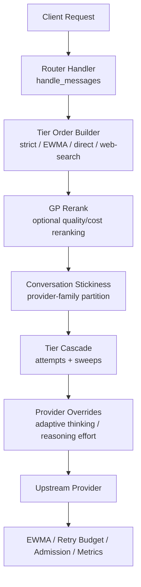
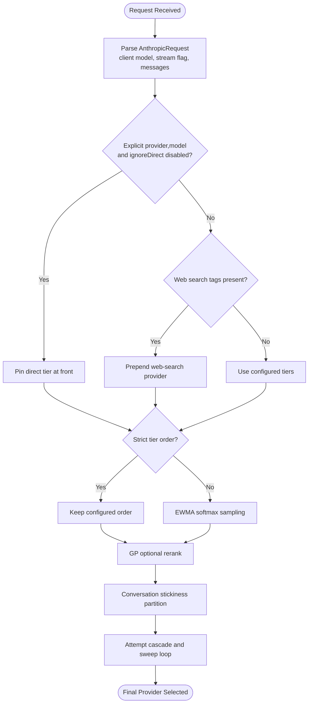
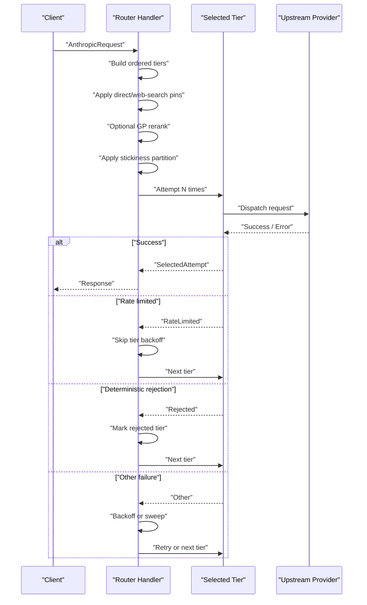
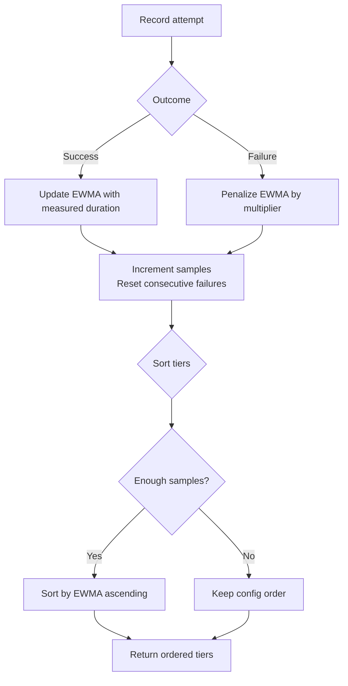
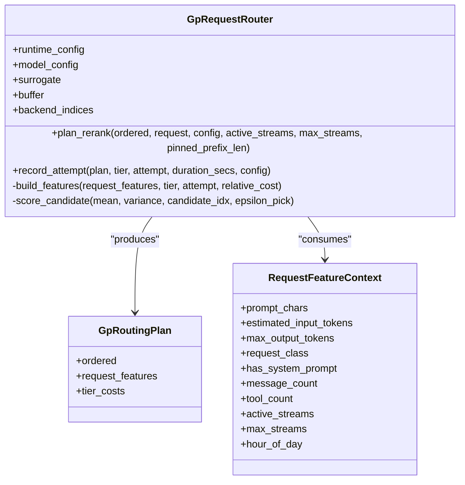
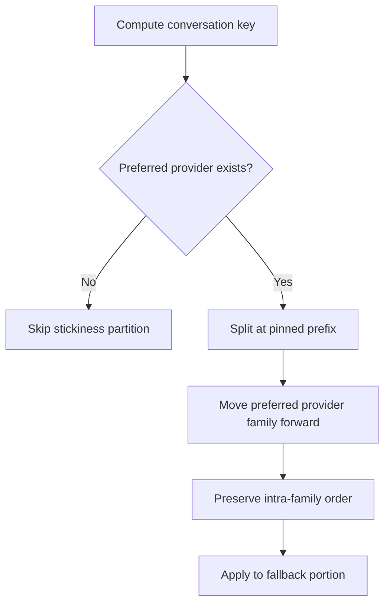
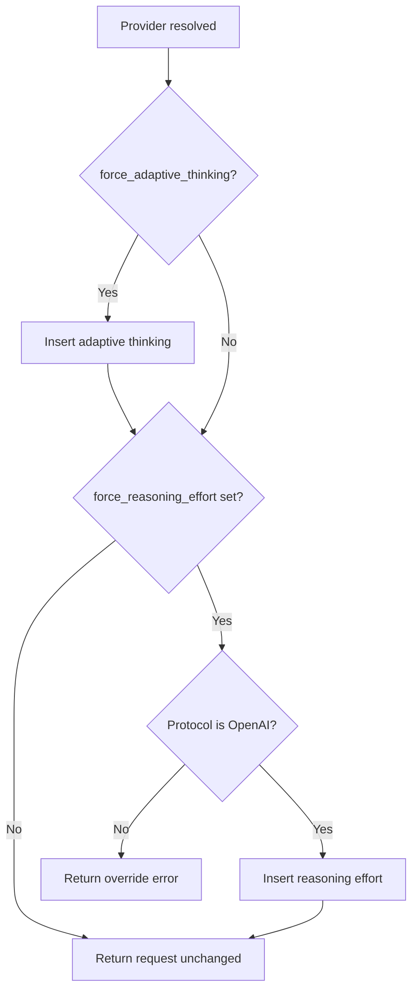
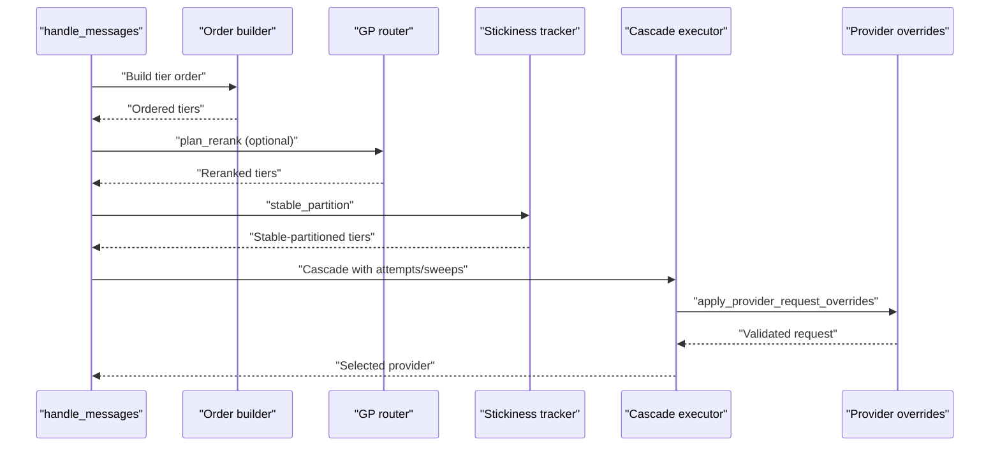
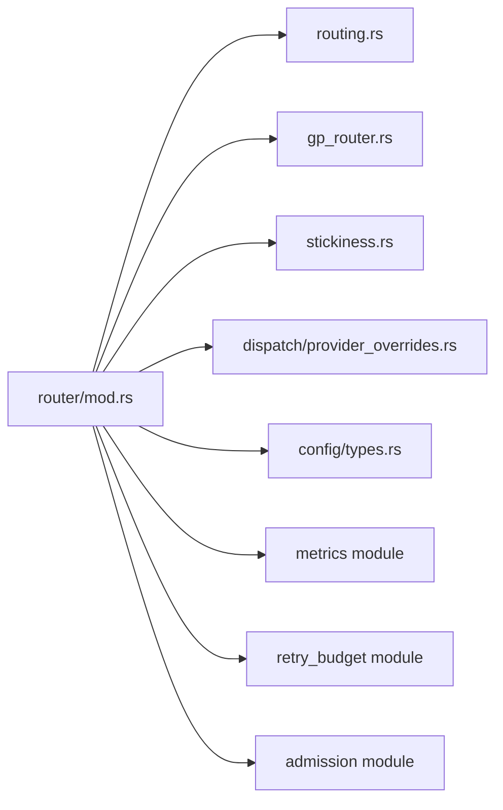

# Routing Decision Engine

<cite>
**Referenced Files in This Document**
- [src/router/mod.rs](file://src/router/mod.rs)
- [src/routing.rs](file://src/routing.rs)
- [src/gp_router.rs](file://src/gp_router.rs)
- [src/stickiness.rs](file://src/stickiness.rs)
- [src/router/dispatch/provider_overrides.rs](file://src/router/dispatch/provider_overrides.rs)
- [docs/failover_architecture.md](file://docs/failover_architecture.md)
- [docs/observability.md](file://docs/observability.md)
- [docs/troubleshooting.md](file://docs/troubleshooting.md)
- [tests/test_routing.rs](file://tests/test_routing.rs)
</cite>

## Table of Contents
1. [Introduction](#introduction)
2. [Project Structure](#project-structure)
3. [Core Components](#core-components)
4. [Architecture Overview](#architecture-overview)
5. [Detailed Component Analysis](#detailed-component-analysis)
6. [Dependency Analysis](#dependency-analysis)
7. [Performance Considerations](#performance-considerations)
8. [Troubleshooting Guide](#troubleshooting-guide)
9. [Conclusion](#conclusion)
10. [Appendices](#appendices)

## Introduction
This document explains CCR-Rust's routing decision engine: the component that decides which backend provider and tier handles each incoming request. The engine combines several strategies:

- Tier-based failover with retries, sweep loops, and admission control.
- Traffic-class-aware GP optimization for dynamic reranking.
- Conversation stickiness to keep a conversation within its provider family.
- Provider override rules for explicit runtime behavior on specific providers.
- Direct routing and web-search pinning for explicit endpoint control.

The goal is deterministic, safe fallback when providers fail, while allowing intelligent load distribution and cost-aware selection when appropriate.

## Project Structure
The routing decision engine lives primarily under `src/router`, with supporting stateful components in `src/routing.rs`, `src/gp_router.rs`, and `src/stickiness.rs`. Dispatch-level provider overrides are isolated in `src/router/dispatch/provider_overrides.rs`. Design constraints and failure semantics are documented in `docs/failover_architecture.md`, while operational visibility is described in `docs/observability.md` and `docs/troubleshooting.md`.

**Diagram sources**
- [src/router/mod.rs:201-562](file://src/router/mod.rs#L201-L562)
- [src/routing.rs:201-420](file://src/routing.rs#L201-L420)
- [src/gp_router.rs:100-240](file://src/gp_router.rs#L100-L240)
- [src/stickiness.rs:1-120](file://src/stickiness.rs#L1-L120)
- [src/router/dispatch/provider_overrides.rs:1-47](file://src/router/dispatch/provider_overrides.rs#L1-L47)

**Section sources**
- [src/router/mod.rs:201-562](file://src/router/mod.rs#L201-L562)
- [docs/failover_architecture.md:1-120](file://docs/failover_architecture.md#L1-L120)

## Core Components
The routing decision engine has five primary responsibilities:

| Component | Responsibility | Key Inputs | Key Outputs |
|---|---|---|---|
| Tier order builder | Produces initial candidate list from configuration, client model, and frontend hints | `Router.tiers`, client `model`, web-search flags | Ordered `(tier_route, tier_name)` list |
| EWMA tracker | Learns per-tier latency and influences non-strict ordering | Attempt durations and failures | Sorted or sampled tier order |
| GP router | Optionally reranks candidates using a Gaussian-process surrogate | Request features, active streams, pricing, observed outcomes | Reranked tier list |
| Stickiness tracker | Keeps conversations in their provider family | Conversation key, remembered provider | Stable-partitioned fallback order |
| Provider overrides | Mutates outgoing requests according to provider policy | Provider configuration, request body | Validated, overridden request payload |

**Section sources**
- [src/router/mod.rs:201-562](file://src/router/mod.rs#L201-L562)
- [src/routing.rs:1-200](file://src/routing.rs#L1-L200)
- [src/gp_router.rs:1-120](file://src/gp_router.rs#L1-L120)
- [src/stickiness.rs:1-120](file://src/stickiness.rs#L1-L120)
- [src/router/dispatch/provider_overrides.rs:1-47](file://src/router/dispatch/provider_overrides.rs#L1-L47)

## Architecture Overview
The routing pipeline is a staged decision tree. Earlier stages constrain later stages; later stages cannot move explicitly pinned prefixes.

**Diagram sources**
- [src/router/mod.rs:201-562](file://src/router/mod.rs#L201-L562)
- [src/routing.rs:201-420](file://src/routing.rs#L201-L420)
- [src/gp_router.rs:100-240](file://src/gp_router.rs#L100-L240)
- [src/stickiness.rs:80-160](file://src/stickiness.rs#L80-L160)

### Priority Order of Routing Considerations
1. **Direct routing**: If the client explicitly targets `provider,model` and `ignoreDirect` is disabled, that tier is pinned at position zero.
2. **Web-search prefix**: When web-search is enabled and detected in message content, the search provider is prepended as another pinned prefix.
3. **Tier ordering strategy**:
   - `strict_tier_order`: Keep configuration-defined priority.
   - Non-strict: Use EWMA-weighted sampling based on recent latency observations.
4. **GP reranking**: Optional, only when enabled and not constrained by strict ordering. It may reorder eligible candidates but never moves the pinned prefix.
5. **Conversation stickiness**: Reorders only the fallback portion so previously used provider families stay together.
6. **Failover cascade**: Attempts each tier up to its retry limit, then sweeps across tiers when rate limiting or retryable failures occur.

### Conflict Resolution Rules
- Pinned prefixes are immutable: direct routing and web-search positions remain fixed through EWMA sorting, GP reranking, and stickiness partitioning.
- GP reranking ignores tiers beyond the bounded feature capacity; tail tiers remain in fallback order.
- Stickiness partitions only after the pinned prefix and does not preserve exact relative order among non-preferred providers, but it preserves the relative order within each provider family.
- Deterministic rejections (`Rejected`) are attempted once per request and do not consume the retry budget.
- Rate-limited responses (`RateLimited`) immediately advance to the next tier and record backoff state.

**Section sources**
- [src/router/mod.rs:201-562](file://src/router/mod.rs#L201-L562)
- [docs/failover_architecture.md:120-220](file://docs/failover_architecture.md#L120-L220)

## Detailed Component Analysis

### Tier-Based Failover and Cascade
The main handler builds the ordered candidate list, applies direct and web-search pins, optionally reranks with GP, then runs the cascade. Each tier supports multiple attempts with exponential backoff, plus sweep loops when rate limits or retryable failures are observed.

Key behaviors:
- `strict_tier_order` preserves configured precedence.
- Non-strict mode uses EWMA-based weighted sampling.
- 429 responses cause immediate tier advancement and backoff tracking.
- Deterministic errors such as authentication or client-request errors are classified as `Rejected` and skipped afterward.
- Streaming pre-first-token failures can cascade; post-first-token failures surface as in-stream errors.

**Diagram sources**
- [src/router/mod.rs:201-562](file://src/router/mod.rs#L201-L562)
- [docs/failover_architecture.md:120-220](file://docs/failover_architecture.md#L120-L220)

**Section sources**
- [src/router/mod.rs:201-562](file://src/router/mod.rs#L201-L562)
- [docs/failover_architecture.md:120-220](file://docs/failover_architecture.md#L120-L220)
- [tests/test_routing.rs:1-120](file://tests/test_routing.rs#L1-L120)

### EWMA Latency Tracker and Tier Ordering
The EWMA tracker maintains per-tier smoothed latency, sample counts, and consecutive failure counters. It exposes two ordering modes:

- `sort_tiers`: Sorts measured tiers by EWMA latency ascending; unmeasured tiers keep config order.
- `sort_tiers_with_config`: Applies softmax over negative latitudes divided by routing temperature, then samples without replacement. Unmeasured tiers receive a large penalty. Cold-start traffic shuffles unmeasured entries.

Parameters:
- Smoothing factor defaults to `0.3`.
- Minimum samples before trusting EWMA defaults to `3`.
- Failure penalty defaults to `2.0×` current EWMA.
- Success duration is clamped against an upstream timeout bound where available.

**Diagram sources**
- [src/routing.rs:1-200](file://src/routing.rs#L1-L200)
- [src/routing.rs:201-420](file://src/routing.rs#L201-L420)

**Section sources**
- [src/routing.rs:1-200](file://src/routing.rs#L1-L200)
- [src/routing.rs:201-420](file://src/routing.rs#L201-L420)

### GP Optimization and Reranking
The GP router is an optional enhancement that learns to rank tiers based on request features and observed performance. It is gated by a feature flag and disabled when the surrogate has not been fitted.

Inputs:
- Request character length.
- Estimated input tokens.
- Maximum output tokens.
- Traffic class (plain, streaming, tool-heavy, mixed).
- System prompt presence.
- Message count, tool count.
- Active and maximum streams.
- Hour of day.
- Per-tier estimated cost.

Algorithm highlights:
- Candidate positions come from the already-prefixed ordered list.
- Only the first bounded number of candidates are scored.
- Acquisition strategies include UCB, Thompson sampling, greedy, and epsilon-greedy.
- Credible candidates are selected using posterior confidence bounds; cost ranking is applied only when credible candidates have known pricing.
- Unfitted routers return the original order unchanged.

**Diagram sources**
- [src/gp_router.rs:1-120](file://src/gp_router.rs#L1-L120)
- [src/gp_router.rs:201-420](file://src/gp_router.rs#L201-L420)

**Section sources**
- [src/gp_router.rs:1-120](file://src/gp_router.rs#L1-L120)
- [src/gp_router.rs:201-420](file://src/gp_router.rs#L201-L420)

### Conversation Stickiness
Stickiness keeps a conversation within its provider family. It derives a stable conversation key from the system prompt and the first user message, hashes it, and stores the preferred provider with a TTL.

Important properties:
- No external identity is assumed; keys are derived from request content.
- Hashed keys avoid leaking prompt text into logs or metrics.
- Local cache is bounded and evicts oldest expired entries.
- `stable_partition` moves preferred-provider entries before other providers while preserving relative order inside each family.
- Pinned prefix positions remain untouched.

**Diagram sources**
- [src/stickiness.rs:1-160](file://src/stickiness.rs#L1-L160)

**Section sources**
- [src/stickiness.rs:1-160](file://src/stickiness.rs#L1-L160)

### Provider Override Rules
Before dispatch, validated provider-level request requirements can mutate the outgoing JSON request:

- `force_adaptive_thinking`: Inserts adaptive thinking configuration into the request object.
- `force_reasoning_effort`: Inserts a reasoning effort value, but only for OpenAI protocol providers.

Errors are returned as typed dispatch errors rather than panicking, making invalid overrides observable and debuggable.

**Diagram sources**
- [src/router/dispatch/provider_overrides.rs:1-47](file://src/router/dispatch/provider_overrides.rs#L1-L47)

**Section sources**
- [src/router/dispatch/provider_overrides.rs:1-47](file://src/router/dispatch/provider_overrides.rs#L1-L47)

### Decision Tree Flow From Request Receipt to Final Provider Selection
The complete flow integrates all components:

1. Request arrives at `handle_messages`.
2. Stream preference is recorded.
3. Ordered tiers are built from configuration or EWMA sampling.
4. Direct routing pins an explicit provider if allowed.
5. Web-search detection prepends a search provider.
6. GP reranking optionally improves candidate selection.
7. Conversation stickiness stabilizes provider-family placement.
8. The cascade attempts each tier with retries and sweeps.
9. Provider overrides adjust the final request before dispatch.
10. A successful attempt returns; exhaustion produces a terminal response.

**Diagram sources**
- [src/router/mod.rs:201-562](file://src/router/mod.rs#L201-L562)
- [src/gp_router.rs:100-240](file://src/gp_router.rs#L100-L240)
- [src/stickiness.rs:80-160](file://src/stickiness.rs#L80-L160)
- [src/router/dispatch/provider_overrides.rs:1-47](file://src/router/dispatch/provider_overrides.rs#L1-L47)

**Section sources**
- [src/router/mod.rs:201-562](file://src/router/mod.rs#L201-L562)

## Dependency Analysis
The routing decision engine has clear layered dependencies:

- `router/mod.rs` is the orchestration layer.
- `routing.rs` provides EWMA latency tracking and tier ordering.
- `gp_router.rs` provides optional learning-based reranking.
- `stickiness.rs` provides conversation-family stability.
- `dispatch/provider_overrides.rs` applies provider-specific request mutations.
- External integration points include configuration, metrics, retry budgets, and admission control.

**Diagram sources**
- [src/router/mod.rs:201-562](file://src/router/mod.rs#L201-L562)
- [src/routing.rs:1-200](file://src/routing.rs#L1-L200)
- [src/gp_router.rs:1-120](file://src/gp_router.rs#L1-L120)
- [src/stickiness.rs:1-120](file://src/stickiness.rs#L1-L120)
- [src/router/dispatch/provider_overrides.rs:1-47](file://src/router/dispatch/provider_overrides.rs#L1-L47)

**Section sources**
- [src/router/mod.rs:201-562](file://src/router/mod.rs#L201-L562)

## Performance Considerations
The routing decision engine balances correctness, safety, and throughput:

- **Decision overhead**: Tier ordering is O(n log n) due to sorting; GP reranking is bounded by a fixed backend slot capacity.
- **Latency feedback**: EWMA smoothing avoids overreacting to single outliers while still adapting to sustained degradation.
- **Cold start behavior**: Unmeasured tiers are shuffled or kept in config order to avoid funneling all early traffic to one backend.
- **Streaming safety**: Post-first-token failures do not cascade, reducing expensive retry storms mid-response.
- **Retry amplification control**: Sweep loops are governed by rate-limit and retryable-failure signals; deterministic rejections bypass retry budgets.
- **Bounded GP state**: The GP router caps backend slots and observation buffer size.
- **Concurrency awareness**: Active stream counts influence GP features and metrics, though concurrency limits are enforced by separate admission and retry-budget mechanisms.

Optimization recommendations for high-throughput scenarios:
- Keep `strict_tier_order` when explicit provider precedence matters more than latency-driven load balancing.
- Tune `routing_temperature` to balance exploration versus exploitation.
- Adjust `min_samples` carefully; too low causes noisy reordering, too long delays adaptation.
- Use provider pricing metadata to enable cost-aware GP reranking only when accurate.
- Monitor `/v1/latencies` and Prometheus gauges to validate EWMA behavior.
- Avoid enabling GP reranking until sufficient observations exist; unfitted routers fall back to original order.

[No sources needed since this section provides general guidance]

## Troubleshooting Guide

### Unexpected Direct Routing
If clients repeatedly target a lower-quality provider because they cache the successful `model` field, look for direct-routing log lines indicating a tier was moved to the front.

Remediation:
- Enable `ignoreDirect` to force requests through the normal tier chain.
- Restart the service after changing configuration.

**Section sources**
- [docs/troubleshooting.md:120-200](file://docs/troubleshooting.md#L120-L200)
- [src/router/mod.rs:201-350](file://src/router/mod.rs#L201-L350)

### Excessive Fallbacks or Missed Tiers
Symptoms:
- Lower-priority tiers receiving most traffic.
- Preferred tiers never reached.
- High 429 rates or repeated sweep activity.

Checks:
- Inspect `/v1/latencies` for stale or poisoned EWMA values.
- Review Prometheus metrics for `ccr_rate_limit_hits_total`, `ccr_failures_total`, and active stream counters.
- Confirm whether the client is sending an explicit `provider,model`.

**Section sources**
- [docs/observability.md:1-120](file://docs/observability.md#L1-L120)
- [docs/troubleshooting.md:1-120](file://docs/troubleshooting.md#L1-L120)

### Streaming Behavior Differences
- Pre-first-token failures cascade to other tiers.
- Post-first-token failures emit in-stream error events instead of cascading.
- Embedded provider errors inside HTTP 200 streams are detected during the first-event peek window.

Validation approach:
- Compare pre-stream vs post-stream failure behavior in integration tests.
- Use capture tools when debugging SSE event shapes.

**Section sources**
- [docs/failover_architecture.md:180-220](file://docs/failover_architecture.md#L180-L220)

### GP Reranking Not Taking Effect
Likely causes:
- GP feature is disabled.
- Surrogate has not been fitted yet.
- All candidates are within the pinned prefix.
- Too few candidates after filtering.
- Missing or incomplete pricing metadata prevents cost-aware ordering.

Validation approach:
- Observe GP fit logs.
- Check rerank debug logs showing before and after tier lists.
- Verify backend slot capacity and candidate filtering.

**Section sources**
- [src/gp_router.rs:100-240](file://src/gp_router.rs#L100-L240)
- [src/gp_router.rs:420-640](file://src/gp_router.rs#L420-L640)

### Provider Overrides Returning Errors
If a provider override fails:
- Check whether `force_reasoning_effort` is used with a non-OpenAI protocol.
- Confirm the request body is a JSON object when overrides expect one.
- Look for provider override trace logs.

**Section sources**
- [src/router/dispatch/provider_overrides.rs:1-47](file://src/router/dispatch/provider_overrides.rs#L1-L47)

## Conclusion
CCR-Rust's routing decision engine is a layered system where explicit controls take precedence and adaptive signals refine fallback behavior. Direct routing and web-search pinning establish hard anchors. EWMA latency tracking provides lightweight load-awareness, while the optional GP router adds request-feature-aware reranking. Conversation stickiness reduces protocol translation churn and makes fallback less visible. Provider overrides give fine-grained control over outgoing request payloads. Together, these mechanisms produce a robust, observable, and tunable routing pipeline suitable for multi-provider LLM gateways.

[No sources needed since this section summarizes without analyzing specific files]

## Appendices

### Debugging and Monitoring Checklist
- Health endpoint with details shows default tier and backend tier list.
- `/v1/latencies` shows EWMA latency and sample counts.
- `/metrics` exposes request counts, failure reasons, latency histograms, active streams, and token accounting.
- Redis persistence restores counters, histogram offsets, token drift state, and EWMA tier state across restarts.
- Terminal dashboard provides real-time monitoring and per-tier statistics.

**Section sources**
- [docs/observability.md:1-200](file://docs/observability.md#L1-L200)