# Tier-Based Failover

<cite>
**Referenced Files in This Document **
- [failover_architecture.md](file://docs/failover_architecture.md)
- [configuration.md](file://docs/configuration.md)
- [shared-fallback-policy.md](file://docs/shared-fallback-policy.md)
- [routing.rs](file://src/routing.rs)
- [gp_router.rs](file://src/gp_router.rs)
- [dispatch.rs](file://src/router/dispatch.rs)
- [mod.rs](file://src/router/mod.rs)
- [admission.rs](file://src/admission.rs)
- [ratelimit.rs](file://src/ratelimit.rs)
- [retry_budget.rs](file://src/retry_budget.rs)
- [stickiness.rs](file://src/stickiness.rs)
- [types.rs](file://src/config/types.rs)
- [test_failover_controls.rs](file://tests/test_failover_controls.rs)
</cite>

## Table of Contents
1. [Introduction](#introduction)
2. [Project Structure](#project-structure)
3. [Core Components](#core-components)
4. [Architecture Overview](#architecture-overview)
5. [Detailed Component Analysis](#detailed-component-analysis)
6. [Dependency Analysis](#dependency-analysis)
7. [Performance Considerations](#performance-considerations)
8. [Troubleshooting Guide](#troubleshooting-guide)
9. [Conclusion](#conclusion)

## Introduction
This document explains CCR-Rust’s tier-based failover system. Providers are grouped into ordered tiers, and each incoming request is routed through a controlled cascade: primary providers are tried first, then secondary providers, then backups. The router combines several mechanisms to keep requests alive under upstream pressure:

- **Tier ordering**: strict configured order or EWMA-driven weighted sampling.
- **Per-tier retries**: bounded attempts with backoff.
- **Retry sweeps**: optional held-request re-cascading across all tiers.
- **Admission control**: AIMD per-tier concurrency plus an optional token budget.
- **Rate-limit tracking**: 429-aware skip windows honoring server hints.
- **Failure classification**: deterministic rejections fail fast; retryable failures cascade.
- **Conversation stickiness**: optional preference for the same provider family within a conversation.
- **Hedging**: optional tail-latency hedge behind the primary attempt.
- **GP reranking**: optional Bayesian model that can reorder candidates after the pinned prefix.

The design intentionally avoids billable provider calls during verification. Integration tests use local mock servers, and the architecture document records production failure context that motivated these controls.

**Section sources**
- [failover_architecture.md:1-40](file://docs/failover_architecture.md#L1-L40)

## Project Structure
The failover system spans configuration, routing, dispatch, metrics, and integration tests.

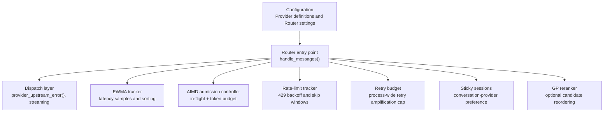

**Diagram sources**
- [mod.rs:461-780](file://src/router/mod.rs#L461-L780)
- [dispatch.rs:640-700](file://src/router/dispatch.rs#L640-L700)
- [routing.rs:1-120](file://src/routing.rs#L1-L120)
- [admission.rs:1-120](file://src/admission.rs#L1-L120)
- [ratelimit.rs:1-120](file://src/ratelimit.rs#L1-L120)
- [retry_budget.rs:1-60](file://src/retry_budget.rs#L1-L60)
- [stickiness.rs:1-60](file://src/stickiness.rs#L1-L60)
- [gp_router.rs:1-60](file://src/gp_router.rs#L1-L60)

**Section sources**
- [mod.rs:461-780](file://src/router/mod.rs#L461-L780)
- [types.rs:591-780](file://src/config/types.rs#L591-L780)

## Core Components
| Component | Responsibility | Key behaviors |
|---|---|---|
| Provider tiers | Ordered list of `provider,model` routes | Constructed from `Router.default`, `Router.tiers`, web-search injection, direct routing pins |
| Failure classifier | Determines whether an error is retryable | 401–404 and 422 → deterministic rejection; 429 intercepted before classification |
| Per-tier retry loop | Attempts a tier multiple times | Respects `max_retries`, base backoff, multiplier, max backoff |
| Retry sweep loop | Re-cascades exhausted requests | Optional hold-and-retry with cooldown, max sweeps, and hold ceiling |
| EWMA tracker | Estimates per-tier latency | Alpha 0.3, minimum samples, failure penalty, softmax-weighted tier selection |
| Admission controller | Limits concurrent work per tier | AIMD on 429s, additive increase on success, optional token budget |
| Rate-limit tracker | Skips starved tiers after 429 | Honors `Retry-After`, caps at 60 seconds, generation-guarded success clearing |
| Retry budget | Bounds aggregate retries | Percentage of active requests with floor of three |
| Sticky sessions | Keeps conversation on one provider family | Hashes system prompt plus first user message; TTL expiration |
| Hedging | Launches a second attempt after slow start | Subject to retry budget and admission control |
| GP reranker | Optionally improves candidate ordering | Respects pinned prefix; bounded backend slots |

**Section sources**
- [failover_architecture.md:41-180](file://docs/failover_architecture.md#L41-L180)
- [types.rs:591-780](file://src/config/types.rs#L591-L780)

## Architecture Overview
The main request flow is centered on the router’s message handler. It computes the tier list, classifies failures, applies per-tier retries, optionally runs retry sweeps, and finally returns either a successful response or a synthesized terminal response.

```mermaid
sequenceDiagram
    participant Client as "Client"
    participant Router as "router::handle_messages"
    participant Orderer as "EwmaTracker / GP"
    participant Attempt as "execute_attempt"
    participant Dispatch as "try_request"
    participant Upstream as "Provider API"

    Client->>Router: POST /v1/messages
    Router->>Orderer: Compute tier order
    Note over Router,Orderer: Direct route pins front; web-search prepends; strict vs EWMA/GP
    Router->>Attempt: Try first tier, attempt 0
    Attempt->>Dispatch: Build provider request
    Dispatch->>Upstream: HTTP call
    Upstream-->>Dispatch: Status + body
    alt Success
        Dispatch-->>Attempt: Ok(response)
        Attempt-->>Router: Selected attempt
        Router-->>Client: 200 response
    else 429
        Dispatch-->>Attempt: RateLimited
        Attempt-->>Router: Next tier immediately
        Router->>Attempt: Try next tier
    else Deterministic 4xx
        Dispatch-->>Attempt: Rejected
        Attempt-->>Router: Skip tier once
        Router->>Attempt: Try next tier
    else Other failure
        Dispatch-->>Attempt: Other
        Attempt-->>Router: Backoff or next tier
    end
    alt Exhausted without success
        Router->>Router: Optional retry sweep
        Router-->>Client: 429 or 503 terminal response
    end
```

**Diagram sources**
- [mod.rs:461-1060](file://src/router/mod.rs#L461-L1060)
- [dispatch.rs:640-700](file://src/router/dispatch.rs#L640-L700)
- [dispatch.rs:850-900](file://src/router/dispatch.rs#L850-L900)
- [failover_architecture.md:41-120](file://docs/failover_architecture.md#L41-L120)

**Section sources**
- [mod.rs:461-1060](file://src/router/mod.rs#L461-L1060)
- [failover_architecture.md:41-120](file://docs/failover_architecture.md#L41-L120)

## Detailed Component Analysis

### Tier Organization and Cascade Logic
Tiers are strings such as `provider,model`. The router builds the effective tier list from:

1. **Explicit tiers**: `Router.tiers` overrides automatic construction.
2. **Default/background/think defaults**: Used when explicit tiers are absent.
3. **Direct routing**: A client-specified `provider,model` pins that tier to position zero unless `ignoreDirect` is enabled.
4. **Web-search tier**: Detected by `[search]`/`[web]` tags and prepended.
5. **Ordering mode**:
   - `strictTierOrder`: fixed configured order.
   - Non-strict: EWMA-based weighted sampling, optionally followed by GP reranking after the pinned prefix.

Within each tier, the router loops `for attempt in 0..=max_retries`. Immediate tier transitions occur for 429 and deterministic `Rejected` errors; other failures may apply backoff based on the tier’s `TierRetryConfig`.

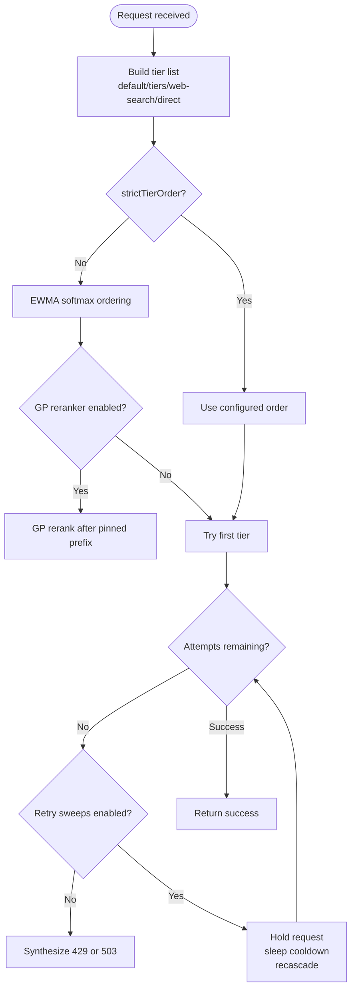

**Diagram sources**
- [mod.rs:461-780](file://src/router/mod.rs#L461-L780)
- [mod.rs:1020-1060](file://src/router/mod.rs#L1020-L1060)
- [types.rs:591-780](file://src/config/types.rs#L591-L780)

**Section sources**
- [mod.rs:461-780](file://src/router/mod.rs#L461-L780)
- [mod.rs:1020-1060](file://src/router/mod.rs#L1020-L1060)
- [types.rs:591-780](file://src/config/types.rs#L591-L780)

### EWMA Latency Tracking Algorithm
The EWMA tracker maintains per-tier state consisting of:

- Current EWMA latency in seconds.
- Total sample count.
- Consecutive failure count.

#### Algorithm parameters
| Parameter | Default | Meaning |
|---|---:|---|
| `alpha` | 0.3 | Weight on the newest sample; older history gets weight `1 - alpha`. |
| `min_samples` | 3 | Tiers with fewer samples keep their config-defined priority. |
| `failure_penalty` | 2.0 | A failure updates EWMA toward `current_ewma × penalty` instead of wall-clock time. |

#### Update rules
- **Success**: `ewma = alpha × duration + (1 - alpha) × ewma`; reset consecutive failures.
- **Failure**: Only penalize if a baseline EWMA exists; clamp synthetic penalty to avoid gauge poisoning.
- **Sorting**: Measured tiers sort ascending by EWMA; unmeasured tiers preserve original index.

When non-strict ordering is used, the router converts latencies into logits, applies softmax, and samples without replacement up to `topK`. Temperature controls sharpness: lower temperature favors the lowest-EWMA tier more strongly; higher temperature distributes traffic more broadly.

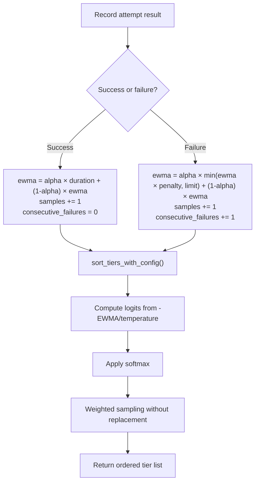

**Diagram sources**
- [routing.rs:1-120](file://src/routing.rs#L1-L120)
- [routing.rs:200-380](file://src/routing.rs#L200-L380)
- [routing.rs:380-460](file://src/routing.rs#L380-L460)

**Section sources**
- [routing.rs:1-120](file://src/routing.rs#L1-L120)
- [routing.rs:200-380](file://src/routing.rs#L200-L380)
- [routing.rs:380-460](file://src/routing.rs#L380-L460)
- [failover_architecture.md:140-160](file://docs/failover_architecture.md#L140-L160)

### Failure Classification and Cascading Rules
Failures are classified before cascading:

| Status or condition | Classification | Behavior |
|---|---|---|
| 429 | Intercepted before normal classification | Recorded by rate-limit tracker; immediate tier transition |
| 401, 402, 403, 404, 422 | `Rejected` | Deterministic rejection; tier skipped once via memoization |
| Context-window-like 400 | Not rejected | Treated as retryable so larger-context tiers can serve it |
| Other status or transport error | `Other` | May trigger backoff and retry within the tier |

Context-window rejections are explicitly allowed to cascade because a later tier may accept longer prompts. Deterministic rejections are attempted at most once per request and never enter the retry budget.

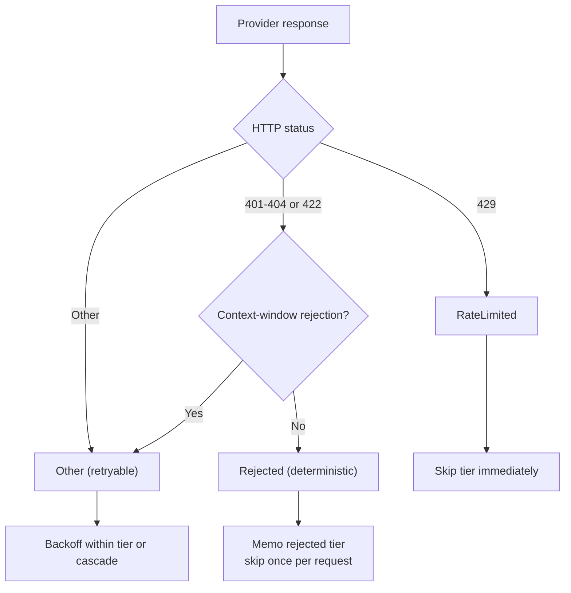

**Diagram sources**
- [dispatch.rs:640-700](file://src/router/dispatch.rs#L640-L700)
- [dispatch.rs:850-900](file://src/router/dispatch.rs#L850-L900)
- [failover_architecture.md:100-140](file://docs/failover_architecture.md#L100-L140)

**Section sources**
- [dispatch.rs:640-700](file://src/router/dispatch.rs#L640-L700)
- [dispatch.rs:850-900](file://src/router/dispatch.rs#L850-L900)
- [failover_architecture.md:100-140](file://docs/failover_architecture.md#L100-L140)
- [test_failover_controls.rs:120-200](file://tests/test_failover_controls.rs#L120-L200)

### Configuration Options for Tiers, Fallback Policies, and Failover Behavior
Key configuration fields live under `Providers` and `Router`.

#### Provider-level options
| Field | Type | Default | Description |
|---|---|---:|---|
| `name` | string | Required | Unique provider identifier |
| `api_base_url` | string | Required | Upstream endpoint |
| `api_key` | string | Required | Authentication credential |
| `models` | array | Required | Available model identifiers |
| `maxInflight` | integer | 8 | AIMD initial and maximum in-flight attempts; clamped to 1–64 |
| `maxInflightTokens` | integer | None | Static token-budget ceiling; clamped to 1,000–4,000,000 |

#### Router-level failover options
| Field | Type | Default | Description |
|---|---|---:|---|
| `default` | string | Required | Primary `provider,model` route |
| `tiers` | array | None | Explicit tier chain overriding default construction |
| `strictTierOrder` | boolean | false | Disable EWMA/GP reordering |
| `ignoreDirect` | boolean | false | Ignore client-specified direct routing |
| `tierRetries` | map | Per-tier defaults | `max_retries`, `base_backoff_ms`, `backoff_multiplier`, `max_backoff_ms`, stream timeouts |
| `retrySweeps` | object | Disabled | `enabled`, `maxSweeps`, `sweepCooldownMs`, `maxHoldMs` |
| `retryBudgetPercent` | byte | 20 | Process-wide retry amplification percentage |
| `stickySessions` | object | Disabled | Conversation-provider stickiness |
| `hedging` | object | Disabled | Tail-latency hedging |
| `topK` | integer | All tiers | Number of top-performing providers considered |
| `routingTemperature` | float | 1.0 | Softmax sharpness |
| `gpRouting` | object | Disabled | Bayesian reranker runtime settings |

#### Example multi-tier configuration patterns
A typical three-tier setup uses:

- **Primary**: high-throughput, low-latency provider.
- **Secondary**: alternative provider for load sharing or resilience.
- **Backup**: large-context or offline provider for degraded operation.

Example pattern (described conceptually):

```json
{
  "Providers": [
    {
      "name": "primary",
      "api_base_url": "...",
      "api_key": "${PRIMARY_KEY}",
      "models": ["model-a"],
      "maxInflight": 16
    },
    {
      "name": "secondary",
      "api_base_url": "...",
      "api_key": "${SECONDARY_KEY}",
      "models": ["model-b"],
      "maxInflight": 8
    },
    {
      "name": "backup",
      "api_base_url": "...",
      "api_key": "${BACKUP_KEY}",
      "models": ["model-c"]
    }
  ],
  "Router": {
    "default": "primary,model-a",
    "tiers": ["primary,model-a", "secondary,model-b", "backup,model-c"],
    "strictTierOrder": true,
    "tierRetries": {
      "primary": {
        "max_retries": 2,
        "base_backoff_ms": 100,
        "backoff_multiplier": 2.0,
        "max_backoff_ms": 5000
      }
    },
    "retrySweeps": {
      "enabled": true,
      "maxSweeps": 3,
      "sweepCooldownMs": 1000,
      "maxHoldMs": 10000
    },
    "retryBudgetPercent": 20
  }
}
```

For shared operator fallback policies, see the shared policy documentation, which derives synchronized consumer configurations and preserves existing retry behavior.

**Section sources**
- [configuration.md:1-200](file://docs/configuration.md#L1-L200)
- [types.rs:591-780](file://src/config/types.rs#L591-L780)
- [shared-fallback-policy.md:1-120](file://docs/shared-fallback-policy.md#L1-L120)

### Health Monitoring, Failure Detection, and Automatic Tier Switching
The system does not implement a classical circuit breaker with isolated open/half-open states. Instead,<docs>
# Tier-Based Failover

<cite>
**Referenced Files in This Document**
- [failover_architecture.md](file://docs/failover_architecture.md)
- [configuration.md](file://docs/configuration.md)
- [shared-fallback-policy.md](file://docs/shared-fallback-policy.md)
- [routing.rs](file://src/routing.rs)
- [gp_router.rs](file://src/gp_router.rs)
- [admission.rs](file://src/admission.rs)
- [retry_budget.rs](file://src/retry_budget.rs)
- [ratelimit.rs](file://src/ratelimit.rs)
- [types.rs](file://src/config/types.rs)
- [mod.rs](file://src/router/mod.rs)
- [dispatch.rs](file://src/router/dispatch.rs)
- [stickiness.rs](file://src/stickiness.rs)
- [test_failover_controls.rs](file://tests/test_failover_controls.rs)
</cite>

## Table of Contents
1. [Introduction](#introduction)
2. [Project Structure](#project-structure)
3. [Core Components](#core-components)
4. [Architecture Overview](#architecture-overview)
5. [Detailed Component Analysis](#detailed-component-analysis)
6. [Dependency Analysis](#dependency-analysis)
7. [Performance Considerations](#performance-considerations)
8. [Troubleshooting Guide](#troubleshooting-guide)
9. [Conclusion](#conclusion)
10. [Appendices](#appendices)

## Introduction
This document explains CCR-Rust’s tier-based failover system: how providers are grouped into ordered tiers, how requests cascade through them, and how the router decides which provider to use. It also documents the EWMA latency tracker, retry sweeps, admission control, rate-limit handling, conversation stickiness, hedging, and configuration options for controlling fallback behavior. The goal is to make the routing pipeline understandable for operators who configure primary, secondary, and backup providers while keeping failures contained and client-visible outcomes predictable.

CCR’s design treats a “tier” as a route string such as `provider,model`. A request normally begins with one or more configured tiers, then falls back through later tiers when an earlier tier fails in a way that warrants cascading. Deterministic client errors (for example, invalid credentials or malformed input) are not retried across tiers; transient upstream problems may trigger per-tier retries, retry sweeps, and eventually a synthesized response if all tiers are exhausted.

**Section sources**
- [failover_architecture.md:1-40](file://docs/failover_architecture.md#L1-L40)

## Project Structure
The failover system spans several modules:

| Area | Responsibility | Key files |
|---|---|---|
| Configuration | Tier lists, retry policies, sweep budgets, admission limits, hedging, GP reranking | [types.rs](file://src/config/types.rs), [configuration.md](file://docs/configuration.md) |
| Routing order | EWMA sorting, weighted sampling, GP reranking, pinned prefixes | [routing.rs](file://src/routing.rs), [gp_router.rs](file://src/gp_router.rs) |
| Request execution | Tier selection, attempt loops, streaming, hedging, sweep orchestration | [mod.rs](file://src/router/mod.rs) |
| Provider dispatch | HTTP calls, protocol translation, failure classification | [dispatch.rs](file://src/router/dispatch.rs) |
| Admission control | AIMD in-flight and token-budget gating | [admission.rs](file://src/admission.rs) |
| Retry budgeting | Process-wide retry amplification cap | [retry_budget.rs](file://src/retry_budget.rs) |
| Rate limiting | Per-route 429 backoff, header interpretation, generation guard | [ratelimit.rs](file://src/ratelimit.rs) |
| Stickiness | Conversation-family preference for fallback ordering | [stickiness.rs](file://src/stickiness.rs) |
| Tests | Deterministic rejection, context-window cascade, retry budget behavior | [test_failover_controls.rs](file://tests/test_failover_controls.rs) |

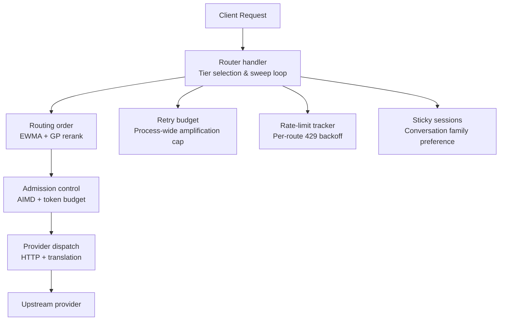

**Diagram sources**
- [mod.rs:461-540](file://src/router/mod.rs#L461-L540)
- [routing.rs:214-339](file://src/routing.rs#L214-L339)
- [admission.rs:1-120](file://src/admission.rs#L1-L120)
- [dispatch.rs:640-700](file://src/router/dispatch.rs#L640-L700)
- [retry_budget.rs:1-80](file://src/retry_budget.rs#L1-L80)
- [ratelimit.rs:1-80](file://src/ratelimit.rs#L1-L80)
- [stickiness.rs:1-80](file://src/stickiness.rs#L1-L80)

**Section sources**
- [mod.rs:461-540](file://src/router/mod.rs#L461-L540)
- [types.rs:591-780](file://src/config/types.rs#L591-L780)
- [configuration.md:1-120](file://docs/configuration.md#L1-L120)

## Core Components
The failover system is composed of these cooperating parts:

- **Tier list**: Ordered routes derived from `Router.default`, optional background/think routes, explicit `Router.tiers`, direct model routing, web-search prepending, and GP reranking.
- **Failure classifier**: Classifies upstream responses into deterministic rejections, rate-limited responses, or retryable failures.
- **EWMA tracker**: Tracks per-attempt latency per tier and penalizes failures.
- **Admission controller**: Limits concurrent in-flight requests and token prefill volume using additive-increase/multiplicative-decrease.
- **Retry budget**: Caps total retries allowed per active request percentage plus a small floor.
- **Rate-limit tracker**: Honors `Retry-After`, paces starved routes, and protects against overlapping success clearing stale backoffs.
- **Sweep orchestrator**: Optionally holds requests open and re-cascades the tier list.
- **Stickiness tracker**: Keeps conversation traffic on the same provider family when possible.
- **Hedging**: Optionally launches a second attempt after a threshold delay.
- **GP reranker**: Optionally reshuffles non-pinned tiers using Thompson sampling/UCB-style scoring.

**Section sources**
- [failover_architecture.md:40-160](file://docs/failover_architecture.md#L40-L160)
- [types.rs:591-780](file://src/config/types.rs#L591-L780)
- [routing.rs:1-120](file://src/routing.rs#L1-L120)
- [admission.rs:1-120](file://src/admission.rs#L1-L120)
- [retry_budget.rs:1-80](file://src/retry_budget.rs#L1-L80)
- [ratelimit.rs:1-80](file://src/ratelimit.rs#L1-L80)
- [stickiness.rs:1-80](file://src/stickiness.rs#L1-L80)

## Architecture Overview
The end-to-end request flow is:

1. The router builds a candidate tier list.
2. Direct routing pins a requested provider/model to the front unless `ignoreDirect` is enabled.
3. Web-search detection prepends a search-specific tier.
4. EWMA sorts measured tiers by latency; unmeasured tiers preserve configuration order.
5. GP reranking optionally reshuffles candidates behind the pinned prefix.
6. Sticky sessions partition the fallback suffix so the preferred provider family stays first.
7. For each tier, the router attempts up to `max_retries + 1` attempts.
8. Deterministic rejections do not enter retry sweeps.
9. Rate-limited responses skip the tier immediately and may stretch sweep cooldowns.
10. If all tiers fail, the router either returns a synthesized error or starts retry sweeps.
11. Each sweep reorders and reattempts eligible tiers within hold and budget limits.

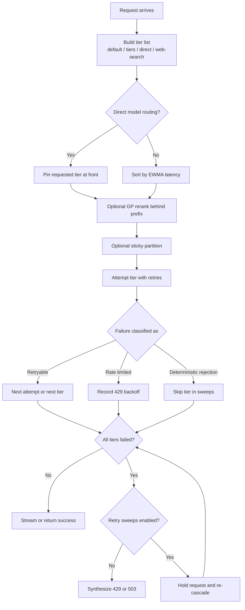

**Diagram sources**
- [mod.rs:461-780](file://src/router/mod.rs#L461-L780)
- [routing.rs:214-339](file://src/routing.rs#L214-L339)
- [gp_router.rs:1-120](file://src/gp_router.rs#L1-L120)
- [dispatch.rs:640-700](file://src/router/dispatch.rs#L640-L700)
- [ratelimit.rs:45-141](file://src/ratelimit.rs#L45-L141)

**Section sources**
- [mod.rs:461-780](file://src/router/mod.rs#L461-L780)
- [failover_architecture.md:40-160](file://docs/failover_architecture.md#L40-L160)

## Detailed Component Analysis

### Tier Organization and Cascade Logic
A tier is a full route identifier such as `provider,model`. The router derives the effective tier order from:

- `Router.default`: the default route.
- Optional `Router.background` and `Router.think`: alternate default routes.
- `Router.tiers`: explicit override of automatic tier construction.
- Direct routing: a client-specified `provider,model` in the model field, controlled by `ignoreDirect`.
- Web-search tagging: `[search]` or `[web]` content prepends a search tier.
- EWMA ordering: low-latency measured tiers move ahead when `strictTierOrder` is false.
- GP reranking: optional algorithmic rearrangement behind the pinned prefix.
- Sticky sessions: stable partition keeps the preferred provider family first in the fallback suffix.

The cascade is strict in the sense that earlier tiers must fail before later tiers serve a normal request. However, without `strictTierOrder`, “earlier” is probabilistically influenced by EWMA rather than fixed config order.

Key invariants:
- Pinned direct and web-search tiers remain at the front.
- GP reranking never moves the pinned prefix.
- Deterministic rejections are attempted once per tier and skipped in subsequent sweeps.
- Post-first-token streaming failures do not cascade; they surface as in-stream errors.

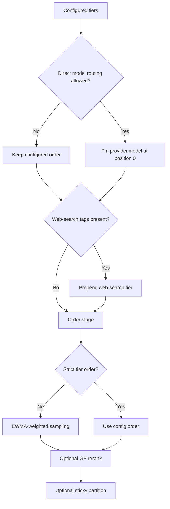

**Diagram sources**
- [mod.rs:461-780](file://src/router/mod.rs#L461-L780)
- [routing.rs:214-339](file://src/routing.rs#L214-L339)
- [gp_router.rs:1-120](file://src/gp_router.rs#L1-L120)
- [stickiness.rs:120-200](file://src/stickiness.rs#L120-L200)

**Section sources**
- [mod.rs:461-780](file://src/router/mod.rs#L461-L780)
- [routing.rs:214-339](file://src/routing.rs#L214-L339)
- [gp_router.rs:1-120](file://src/gp_router.rs#L1-L120)
- [failover_architecture.md:40-120](file://docs/failover_architecture.md#L40-L120)

### Failure Classification
The dispatcher classifies upstream responses into three categories:

| Classification | Meaning | Cascading behavior |
|---|---|---|
| `Rejected(status)` | Deterministic client-side or provider-rejection error | Attempt once; do not retry in sweeps |
| `RateLimited(Duration?)` | HTTP 429 intercepted before classification | Skip tier immediately; record backoff |
| `Other` | Transport error, timeout, or other non-deterministic failure | Retry within tier; may cascade to next tier |

Status codes `401` through `404`, and `400` or `422` unless they match a context-window signature, become `Rejected`. Context-window rejections are deliberately retryable because a larger-context tier may succeed. HTTP 429 is intercepted before this classification path and becomes `RateLimited`.

Context-window signatures include messages such as prompt-too-long or context-length-exceeded.

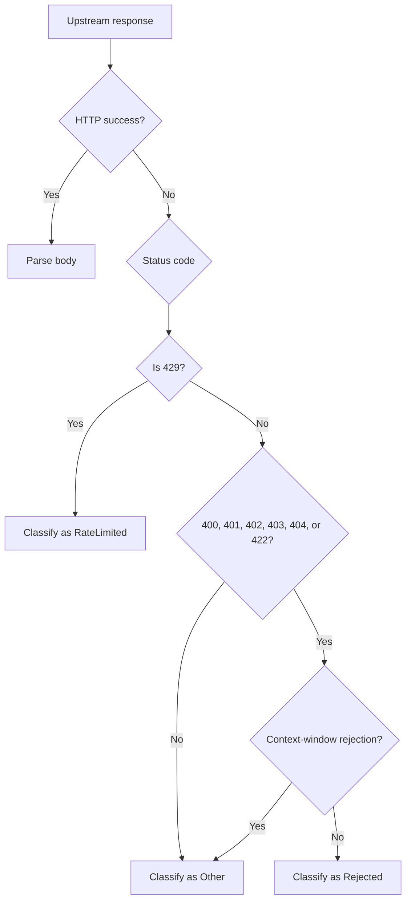

**Diagram sources**
- [dispatch.rs:640-700](file://src/router/dispatch.rs#L640-L700)
- [dispatch.rs:850-900](file://src/router/dispatch.rs#L850-L900)
- [failover_architecture.md:100-140](file://docs/failover_architecture.md#L100-L140)

**Section sources**
- [dispatch.rs:640-700](file://src/router/dispatch.rs#L640-L700)
- [dispatch.rs:850-900](file://src/router/dispatch.rs#L850-L900)
- [failover_architecture.md:100-140](file://docs/failover_architecture.md#L100-L140)

### EWMA Latency Tracking Algorithm
The EWMA tracker maintains per-tier state:

| Field | Purpose |
|---|---|
| `ewma` | Exponentially weighted average latency in seconds |
| `samples` | Total number of recorded samples |
| `consecutive_failures` | Counts consecutive failures and resets on success |

Algorithm parameters:

| Parameter | Default | Behavior |
|---|---:|---|
| Alpha | 0.3 | New sample gets 30% weight; history gets 70% |
| Min samples | 3 | Tiers below this count keep configuration order |
| Failure penalty multiplier | 2.0 | Failed attempts increase EWMA relative to current estimate |

For successes, the tracker updates the EWMA with the measured attempt duration. For failures, it applies a synthetic penalty instead of recording wall-clock failure time, because timeouts or connection errors do not reflect backend speed. When no baseline EWMA exists, failures do not multiply zero.

The tracker exposes:

- `record_success(tier, duration_secs)`
- `record_failure(tier)`
- `record_failure_with_limit(tier, max_duration_secs)`
- `get_latency(tier)`
- `sort_tiers(tiers)`
- `sort_tiers_with_config(tiers, config)`

Sorting preserves configuration order for unmeasured or insufficiently sampled tiers and orders measured tiers by ascending EWMA. When used with configuration-aware sorting, the system computes logits from negative EWMA divided by temperature, applies softmax, and performs weighted sampling without replacement to distribute load rather than always selecting the fastest tier.

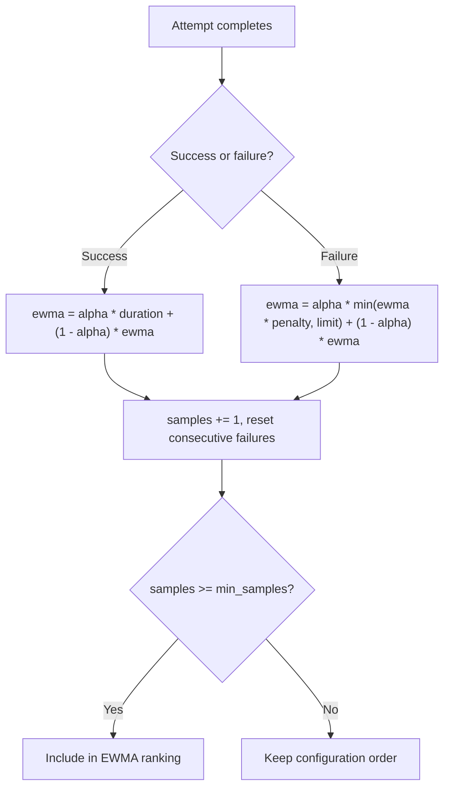

**Diagram sources**
- [routing.rs:1-120](file://src/routing.rs#L1-L120)
- [routing.rs:214-339](file://src/routing.rs#L214-L339)
- [routing.rs:362-400](file://src/routing.rs#L362-L400)

**Section sources**
- [routing.rs:1-120](file://src/routing.rs#L1-L120)
- [routing.rs:214-339](file://src/routing.rs#L214-L339)
- [routing.rs:362-400](file://src/routing.rs#L362-L400)

### Per-Tier Retries and Backoff
Each tier has a `TierRetryConfig`:

| Option | Default | Description |
|---|---:|---|
| `max_retries` | 3 | Number of additional attempts beyond the first |
| `base_backoff_ms` | 100 | Initial backoff delay |
| `backoff_multiplier` | 2.0 | Multiplicative growth per attempt |
| `max_backoff_ms` | 10000 | Maximum per-attempt backoff |
| `stream_first_event_timeout_ms` | Configured default | Timeout waiting for first useful SSE frame |
| `stream_idle_timeout_ms` | Configured default | Idle timeout between useful SSE frames |

Within a tier, the router iterates from attempt 0 through `max_retries`. Non-rate-limited failures sleep using EWMA-scaled backoff. Rate-limited and rejected failures move immediately to the next tier.

**Section sources**
- [types.rs:698-742](file://src/config/types.rs#L698-L742)
- [mod.rs:700-780](file://src/router/mod.rs#L700-L780)
- [failover_architecture.md:60-100](file://docs/failover_architecture.md#L60-L100)

### Retry Sweeps and Hold Budget
When all tiers fail, the router can synthesize a terminal response or start retry sweeps:

- Without sweeps: return a synthesized 429 if every tier was rate limited, otherwise 503.
- With sweeps: hold the client request open and re-cascade the full tier list.

Sweep controls:

| Option | Default | Behavior |
|---|---:|---|
| `enabled` | false | Enables held-request re-cascading |
| `maxSweeps` | 0 | Unlimited sweeps unless explicitly capped |
| `sweepCooldownMs` | Derived default | Minimum cooldown between sweeps |
| `maxHoldMs` | Bounded default or 0 for unlimited | Wall-clock cap on holding a request open |

Sweep cooldown stretches to the largest rate-limit backoff hint seen during the sweep, capped at 60 seconds, and is clamped to the remaining hold budget. Sweeps stop when successful, when all tiers are deterministically rejected, when the sweep budget is exhausted, or when the hold budget is exceeded.

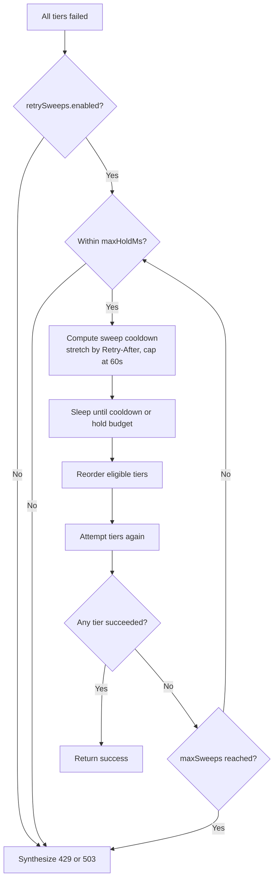

**Diagram sources**
- [mod.rs:620-780](file://src/router/mod.rs#L620-L780)
- [types.rs:743-780](file://src/config/types.rs#L743-L780)
- [failover_architecture.md:60-100](file://docs/failover_architecture.md#L60-L100)

**Section sources**
- [mod.rs:620-780](file://src/router/mod.rs#L620-L780)
- [types.rs:743-780](file://src/config/types.rs#L743-L780)
- [failover_architecture.md:60-100](file://docs/failover_architecture.md#L60-L100)

### Rate-Limit Interactions
The rate-limit tracker stores per-route state including remaining quota, reset time, backoff window, consecutive 429 count, generation counter, and last-success timestamp.

Behavior:

- `should_skip_tier` skips a tier while its backoff is active and optionally skips when `remaining == 0` before `reset_at`, depending on `honor_ratelimit_headers`.
- `record_429` honors server `Retry-After` verbatim, capped at 60 seconds.
- Without guidance, a still-admitting route paces at 1 second; a starved route doubles backoff per consecutive 429 up to 60 seconds.
- Success clears the backoff only if its captured generation matches the latest 429 generation, preventing overlapping requests from clearing newer backoffs.

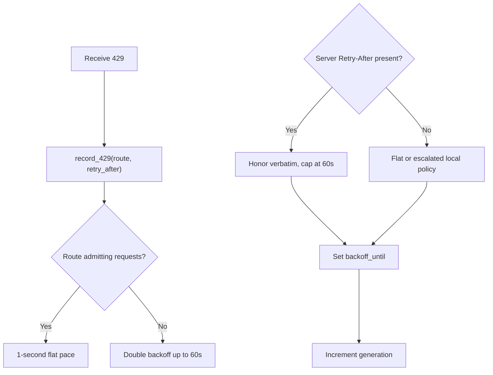

**Diagram sources**
- [ratelimit.rs:45-141](file://src/ratelimit.rs#L45-L141)
- [ratelimit.rs:151-178](file://src/ratelimit.rs#L151-L178)
- [failover_architecture.md:120-160](file://docs/failover_architecture.md#L120-L160)

**Section sources**
- [ratelimit.rs:1-200](file://src/ratelimit.rs#L1-L200)
- [failover_architecture.md:120-160](file://docs/failover_architecture.md#L120-L160)

### Admission Control and Circuit-Breaker Analogy
CCR does not implement a classic circuit breaker with long-term open/closed/half-open states. Instead, it uses adaptive concurrency admission control:

- Each route has an AIMD in-flight limit bounded by a minimum, initial value, and ceiling.
- Successful completions additively increase the limit.
- Rejections multiplicatively halve the limit.
- A configured `maxInflightTokens` provides a static token-budget gate alongside AIMD.
- A large request exceeding the whole token budget is admitted only when the route is idle, so fallback traffic can still run alone.

This behaves like a fast-acting, request-count-oriented circuit breaker that adapts to per-route congestion rather than long-term outage isolation.

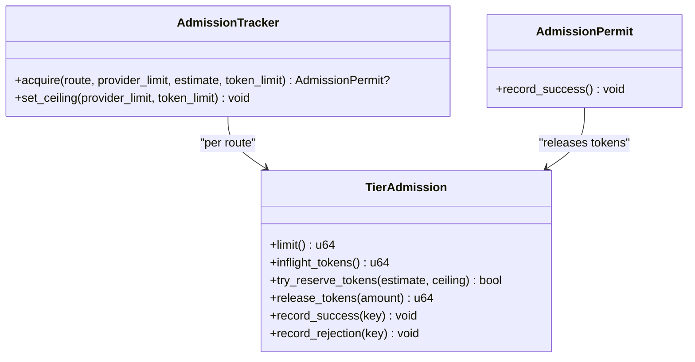

**Diagram sources**
- [admission.rs:1-200](file://src/admission.rs#L1-L200)
- [admission.rs:200-320](file://src/admission.rs#L200-L320)

**Section sources**
- [admission.rs:1-320](file://src/admission.rs#L1-L320)
- [configuration.md:120-220](file://docs/configuration.md#L120-L220)

### Retry Budget
The retry budget bounds aggregate retry amplification across the process. It tracks active requests and admitted retries in a single atomic counter.

Rules:

- `percent == 0` disables retries.
- There is a floor of three retries even when 20% of one active request would mathematically be zero.
- Concurrency-safe CAS loops prevent multiple threads from overcounting permits.
- Hedging and retry sweeps acquire permits from the same budget.

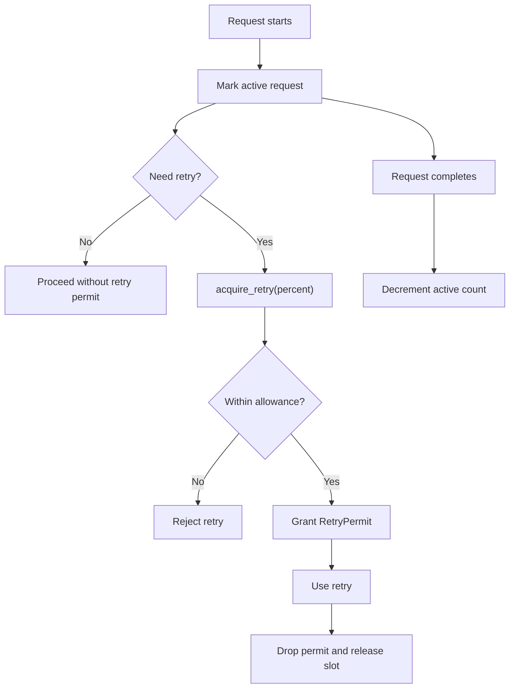

**Diagram sources**
- [retry_budget.rs:1-120](file://src/retry_budget.rs#L1-L120)
- [mod.rs:1-80](file://src/router/mod.rs#L1-L80)

**Section sources**
- [retry_budget.rs:1-181](file://src/retry_budget.rs#L1-L181)
- [mod.rs:1-80](file://src/router/mod.rs#L1-L80)

### Conversation Stickiness
Sticky sessions map a conversation key to a preferred provider. The key is derived from the system prompt and first user message, hashed so private prompt text is not exposed. The cache has a maximum entry count and TTL.

Effect on routing:

- Sticky sessions do not change the pinned prefix.
- They perform a stable partition of the fallback suffix so the preferred provider family remains first.
- This reduces mid-conversation protocol translation and makes fallback less visible.

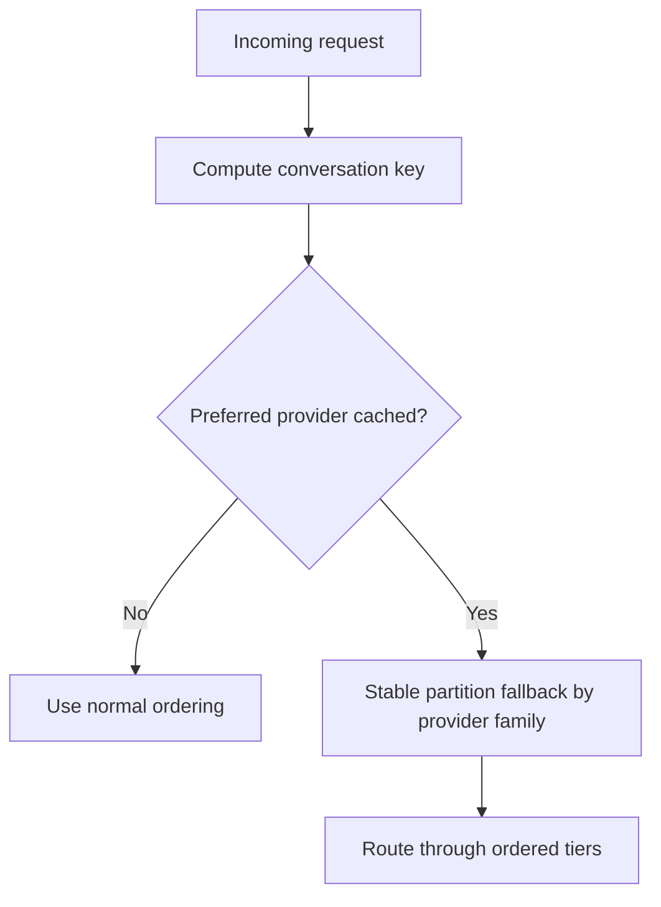

**Diagram sources**
- [stickiness.rs:1-120](file://src/stickiness.rs#L1-L120)
- [stickiness.rs:120-200](file://src/stickiness.rs#L120-L200)

**Section sources**
- [stickiness.rs:1-200](file://src/stickiness.rs#L1-L200)

### Hedging
Hedging is optional and disabled by default. When enabled, after a configurable time-to-first-token threshold, the router may launch a hedge attempt on another tier if the primary has not completed.

Important behaviors:

- Hedging requires a retry budget permit.
- Hedging also consumes admission permits for both primary and hedge tiers.
- If the primary wins, it is preferred even if the hedge finishes first.
- If the primary fails but the hedge succeeds, the hedge result is returned.
- Metrics distinguish primary wins, hedge wins, and hedge launches.

**Section sources**
- [mod.rs:160-380](file://src/router/mod.rs#L160-L380)
- [types.rs:828-866](file://src/config/types.rs#L828-L866)

### GP Reranking
The GP router optionally reshuffles candidate tiers behind the pinned prefix using features such as prompt length, estimated input tokens, output tokens, request class, tool count, active streams, hour of day, and estimated cost. It uses a surrogate model with Thompson sampling and UCB-style scoring.

Constraints:

- Only tiers within the bounded backend-slot capacity participate in GP scoring.
- Tail tiers beyond the slot capacity remain in fallback order.
- If the surrogate is unfitted, the original order is preserved.
- Direct and web-search pinned prefixes are never moved by GP reranking.<docs>
# Tier-Based Failover

<cite>
**Referenced Files in This Document**   
- [failover_architecture.md](file://docs/failover_architecture.md)
- [configuration.md](file://docs/configuration.md)
- [shared-fallback-policy.md](file://docs/shared-fallback-policy.md)
- [routing.rs](file://src/routing.rs)
- [gp_router.rs](file://src/gp_router.rs)
- [dispatch.rs](file://src/router/dispatch.rs)
- [mod.rs](file://src/router/mod.rs)
- [admission.rs](file://src/admission.rs)
- [ratelimit.rs](file://src/ratelimit.rs)
- [retry_budget.rs](file://src/retry_budget.rs)
- [stickiness.rs](file://src/stickiness.rs)
- [types.rs](file://src/config/types.rs)
- [test_failover_controls.rs](file://tests/test_failover_controls.rs)
</cite>

## Table of Contents
1. [Introduction](#introduction)
2. [Project Structure](#project-structure)
3. [Core Components](#core-components)
4. [Architecture Overview](#architecture-overview)
5. [Detailed Component Analysis](#detailed-component-analysis)
6. [Dependency Analysis](#dependency-analysis)
7. [Performance Considerations](#performance-considerations)
8. [Troubleshooting Guide](#troubleshooting-guide)
9. [Conclusion](#conclusion)
10. [Appendices](#appendices)

## Introduction
This document explains CCR-Rust’s tier-based failover system: how providers are grouped into ordered tiers, how requests cascade through them, and how latency health, rate limits, admission control, retry budgets, and optional conversation stickiness combine to select the best available provider for each request. It also documents the EWMA latency tracking algorithm, configuration options, monitoring signals, and common operational scenarios such as primary/secondary/backup provider chains.

## Project Structure
The failover logic is implemented across several modules:

- Configuration parsing and tier definitions live in `src/config/types.rs`.
- The main request handler and tier cascade loop are in `src/router/mod.rs`.
- Provider dispatch, status classification, and streaming error detection are in `src/router/dispatch.rs`.
- EWMA latency tracking is in `src/routing.rs`.
- Adaptive per-tier admission control is in `src/admission.rs`.
- Rate-limit backoff tracking is in `src/ratelimit.rs`.
- Process-wide retry amplification control is in `src/retry_budget.rs`.
- Conversation stickiness is in `src/stickiness.rs`.
- Optional GP reranking can refine non-pinned tier order in `src/gp_router.rs`.
- Operational behavior is validated by integration tests in `tests/test_failover_controls.rs` and documented at a design level in `docs/failover_architecture.md`.

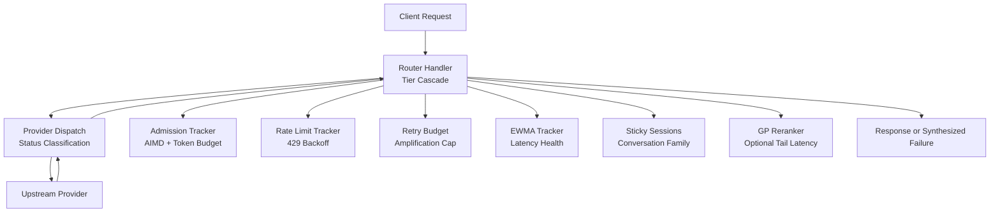

**Diagram sources**
- [mod.rs:461-780](file://src/router/mod.rs#L461-L780)
- [dispatch.rs:640-700](file://src/router/dispatch.rs#L640-L700)
- [admission.rs:1-120](file://src/admission.rs#L1-L120)
- [ratelimit.rs:1-141](file://src/ratelimit.rs#L1-L141)
- [retry_budget.rs:1-120](file://src/retry_budget.rs#L1-L120)
- [routing.rs:1-129](file://src/routing.rs#L1-L129)
- [stickiness.rs:1-80](file://src/stickiness.rs#L1-L80)
- [gp_router.rs:1-60](file://src/gp_router.rs#L1-L60)

**Section sources**
- [failover_architecture.md:1-120](file://docs/failover_architecture.md#L1-L120)
- [mod.rs:461-780](file://src/router/mod.rs#L461-L780)

## Core Components
CCR-Rust treats each provider-model combination as a *tier*. A tier is an ordered candidate in a fallback chain. The router computes one or more ordered lists of tiers before attempting an upstream call.

Key responsibilities:

| Component | Responsibility |
|---|---|
| `RouterConfig` | Defines default routes, explicit tiers, strict ordering, retry sweeps, retry budget percentage, sticky sessions, hedging, and GP routing options. |
| Tier cascade | Attempts providers in priority order, applying per-tier retries and sweep re-cascading when enabled. |
| Failure classifier | Classifies upstream responses as deterministic rejections, rate-limited, or other retryable failures. |
| EWMA tracker | Tracks per-attempt latency and failure penalties to rank tiers when not using strict order. |
| Admission tracker | Applies AIMD-style in-flight request limits and optional token-budget deferral. |
| Rate limit tracker | Honors server `Retry-After`, tracks consecutive 429s, and applies per-route backoff windows. |
| Retry budget | Bounds aggregate retry amplification across concurrent client requests. |
| Sticky sessions | Keeps a conversation within its provider family when possible. |
| GP reranker | Optionally refines ordering of non-pinned candidates based on learned tail-latency features. |

**Section sources**
- [types.rs:591-730](file://src/config/types.rs#L591-L730)
- [mod.rs:461-780](file://src/router/mod.rs#L461-L780)
- [dispatch.rs:640-700](file://src/router/dispatch.rs#L640-L700)
- [routing.rs:1-129](file://src/routing.rs#L1-L129)
- [admission.rs:1-120](file://src/admission.rs#L1-L120)
- [ratelimit.rs:1-141](file://src/ratelimit.rs#L1-L141)
- [retry_budget.rs:1-120](file://src/retry_budget.rs#L1-L120)
- [stickiness.rs:1-80](file://src/stickiness.rs#L1-L80)
- [gp_router.rs:1-60](file://src/gp_router.rs#L1-L60)

## Architecture Overview
A request enters the router and becomes an internal Anthropic-compatible request with its target model replaced by a full tier route such as `provider,model`. The router then:

1. Builds the canonical tier list from configuration.
2. Pins direct-routed tiers and web-search tiers at the front when applicable.
3. Orders the remaining tiers either strictly or by EWMA-aware sampling.
4. Optionally applies GP reranking to non-pinned candidates.
5. Optionally partitions candidates by provider family for conversation stickiness.
6. For each tier, attempts up to `max_retries + 1` calls.
7. On certain failures, advances to the next tier immediately.
8. When retry sweeps are enabled, may hold the client request open and re-cascade after a cooldown.
9. Returns a successful response, or synthesizes a terminal 429 or 503 when all tiers are exhausted.

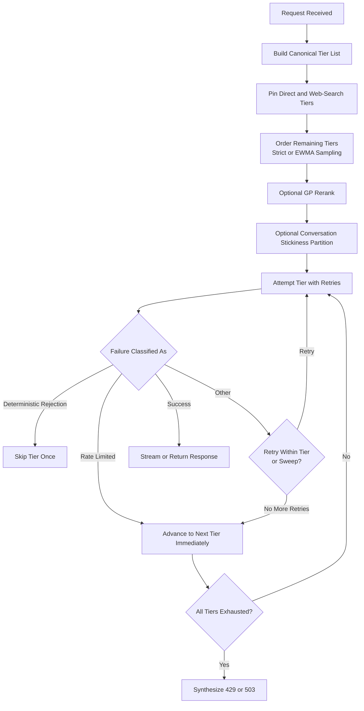

**Diagram sources**
- [mod.rs:461-1060](file://src/router/mod.rs#L461-L1060)
- [dispatch.rs:640-700](file://src/router/dispatch.rs#L640-L700)
- [routing.rs:214-339](file://src/routing.rs#L214-L339)
- [gp_router.rs:100-180](file://src/gp_router.rs#L100-L180)
- [stickiness.rs:160-200](file://src/stickiness.rs#L160-L200)

**Section sources**
- [failover_architecture.md:120-220](file://docs/failover_architecture.md#L120-L220)
- [mod.rs:461-1060](file://src/router/mod.rs#L461-L1060)

## Detailed Component Analysis

### Tier Organization and Cascade Logic
The tier list comes from the configured `default`, `background`, `think`, or explicit `tiers` field. If `strictTierOrder` is true, the configured order is preserved; otherwise, measured tiers are reordered by EWMA latency and unmeasured tiers keep their configuration position.

Direct routing occurs when the client explicitly targets a provider-model pair and `ignoreDirect` is false. Such tiers are pinned at the front. Web-search tags also prepend a search tier. These pinned prefixes are never moved by EWMA sorting, GP reranking, or sticky partitioning.

Within each tier, the router tries `max_retries + 1` attempts. Immediate tier advancement happens for:

- Deterministic rejections (e.g., authentication, billing, permission, unknown model).
- Context-window errors, which are deterministic but intentionally steerable to a larger-context tier.
- 429 responses, which are intercepted before general classification and routed through the rate-limit tracker.

If retry sweeps are enabled and there are still retries or sweep capacity, the router may sleep for a cooldown and re-cascade the full tier list rather than returning immediately.

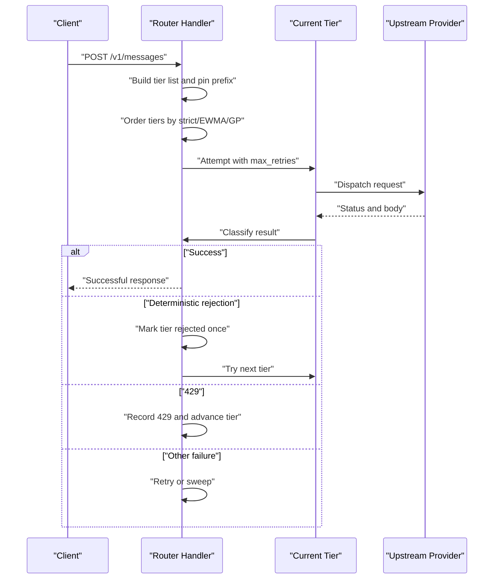

**Diagram sources**
- [mod.rs:461-1060](file://src/router/mod.rs#L461-L1060)
- [dispatch.rs:640-700](file://src/router/dispatch.rs#L640-L700)
- [dispatch.rs:850-900](file://src/router/dispatch.rs#L850-L900)

**Section sources**
- [types.rs:591-680](file://src/config/types.rs#L591-L680)
- [mod.rs:461-780](file://src/router/mod.rs#L461-L780)
- [dispatch.rs:640-700](file://src/router/dispatch.rs#L640-L700)
- [dispatch.rs:850-900](file://src/router/dispatch.rs#L850-L900)

### EWMA Latency Tracking Algorithm
The EWMA tracker maintains per-tier state:

- `ewma`: current estimated latency in seconds.
- `samples`: total number of recorded samples.
- `consecutive_failures`: resets on success and increments on failure.

Parameters:

| Parameter | Default | Meaning |
|---|---:|---|
| `alpha` | 0.3 | Weight given to the newest sample; older history gets 0.7. |
| `min_samples` | 3 | Tiers below this sample count are treated as unmeasured and retain config order. |
| `failure_penalty` | 2.0 | Failed attempts treat the tier as if it took roughly twice the current EWMA instead of wall-clock time. |

On success, the EWMA is updated with the actual attempt duration. On failure, the tracker applies a penalty multiplier to the current EWMA. This avoids treating timeouts or connection failures as normal slow performance while still pushing unhealthy tiers down in priority.

When sorting tiers without strict order, the tracker converts EWMA latencies into logits, applies softmax, and draws tiers proportionally. Unmeasured tiers receive a large negative logit so they fall behind measured tiers but preserve relative configuration order among themselves.

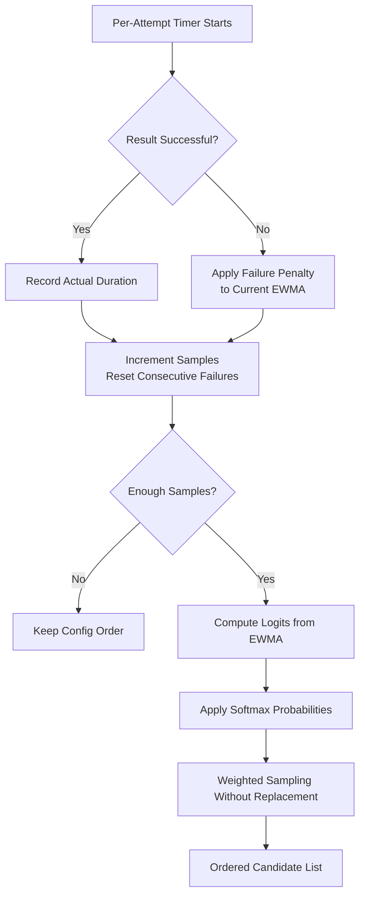

**Diagram sources**
- [routing.rs:1-129](file://src/routing.rs#L1-L129)
- [routing.rs:214-339](file://src/routing.rs#L214-L339)
- [routing.rs:362-400](file://src/routing.rs#L362-L400)

**Section sources**
- [routing.rs:1-129](file://src/routing.rs#L1-L129)
- [routing.rs:214-339](file://src/routing.rs#L214-L339)
- [routing.rs:362-400](file://src/routing.rs#L362-L400)
- [failover_architecture.md:180-220](file://docs/failover_architecture.md#L180-L220)

### Failure Classification
The dispatcher classifies upstream HTTP responses into three categories:

| Category | Typical Status Codes | Behavior |
|---|---|---|
| `Rejected` | 400, 401–404, 422 | Deterministic request problem; tier attempted once unless it is a context-window rejection. |
| `RateLimited` | 429 | Recorded through the rate-limit tracker; tier advanced immediately. |
| `Other` | 400 context-window cases, 422 non-deterministic cases, transport errors, timeouts | Retryable within the tier or eligible for sweep re-cascade. |

Context-window rejections are special: although they are classified as deterministic, the cascade continues to later tiers that may support larger context windows. This is why a 400 does not always mean “give up.”

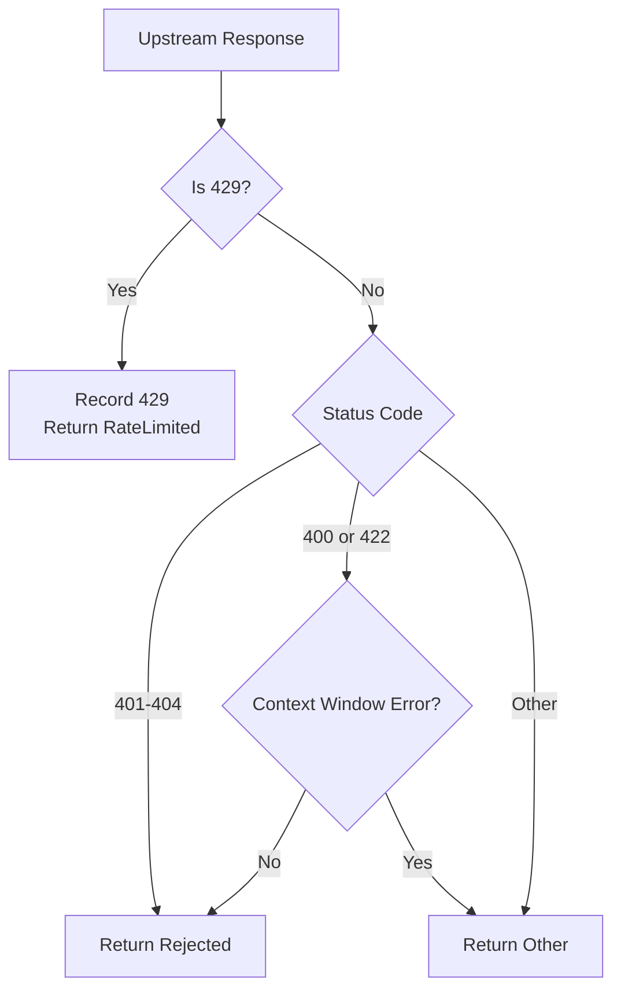

**Diagram sources**
- [dispatch.rs:640-700](file://src/router/dispatch.rs#L640-L700)
- [dispatch.rs:850-900](file://src/router/dispatch.rs#L850-L900)

**Section sources**
- [dispatch.rs:640-700](file://src/router/dispatch.rs#L640-L700)
- [dispatch.rs:850-900](file://src/router/dispatch.rs#L850-L900)
- [failover_architecture.md:220-300](file://docs/failover_architecture.md#L220-L300)

### Rate Limiting and 429 Handling
The rate-limit tracker keeps per-route state including:

- `remaining` and `reset_at` from provider headers.
- `backoff_until`, the active 429 backoff window.
- `consecutive_429s`, used to escalate local backoff under sustained starvation.
- `generation`, used to avoid letting an overlapping successful response clear a newer backoff.

Important behaviors:

- Server `Retry-After` is honored verbatim, capped at 60 seconds.
- A 429 without guidance paces the tier for one second while the route is still admitting other requests.
- On a starved route with no recent successes, local backoff doubles per consecutive 429, up to the same 60-second ceiling.
- A success clears the backoff only if its generation snapshot matches the latest 429 generation.
- Proactive skipping based on `X-RateLimit-Remaining: 0` is controlled by `honor_ratelimit_headers`; some providers include informational headers even on 200 responses.

```mermaid
flowchart TD
    Receive429["Receive 429"] --> CheckGuidance{"Server Retry-After Present?"}
    CheckGuidance -->|Yes| HonorRetryAfter["Honor Retry-After<br/>Cap at 60 Seconds"]
    CheckGuidance -->|No| StarvationCheck{"Route Still Admitting Requests?"}
    StarvationCheck -->|Yes| FlatPace["One-Second Flat Pace"]
    StarvationCheck -->|No| ExponentialEscalation["Double Consecutive Backoff<br/>Cap at 60 Seconds"]
    HonorRetryAfter --> SetBackoff["Set backoff_until"]
    FlatPace --> SetBackoff
    ExponentialEscalation --> SetBackoff
    SetBackoff --> IncrementGeneration["Increment Generation"]
```

**Diagram sources**
- [ratelimit.rs:1-141](file://src/ratelimit.rs#L1-L141)
- [ratelimit.rs:151-178](file://src/ratelimit.rs#L151-L178)

**Section sources**
- [ratelimit.rs:1-141](file://src/ratelimit.rs#L1-L141)
- [ratelimit.rs:151-178](file://src/ratelimit.rs#L151-L178)
- [failover_architecture.md:280-360](file://docs/failover_architecture.md#L280-L360)

### Retry Budgets and Amplification Control
Per-request retry limits cannot prevent aggregate retry storms when many client requests fail together. The process-wide `RetryBudget` bounds total retries as a configurable percentage of active client requests, with a floor of three retries even when the percentage would allow fewer.

Usage pattern:

- An `ActiveRequest` marks one client request as in flight.
- Before launching a retry or hedge, the router asks the budget for a `RetryPermit`.
- If the budget denies the permit, the router falls back instead of retrying.
- Permits and active requests release their counters via RAII drop semantics.

This protects against amplification while still allowing recovery from isolated transient failures.

```mermaid
flowchart TD
    RequestStart["Client Request Starts"] --> Active["Acquire ActiveRequest"]
    Active --> NeedRetry{"Need Retry or Hedge?"}
    NeedRetry -->|No| Proceed["Proceed Normally"]
    NeedRetry -->|Yes| AcquirePermit["Try acquire_retry(percent)"]
    AcquirePermit --> Allowed{"Permit Granted?"}
    Allowed -->|Yes| Retry["Launch Retry or Hedge"]
    Allowed -->|No| Fallback["Fall Back Instead of Retrying"]
    Retry --> Release["Release Permit on Drop"]
    Fallback --> Release
    Proceed --> Release
    Release --> RequestEnd["Request Ends"]
```

**Diagram sources**
- [retry_budget.rs:1-120](file://src/retry_budget.rs#L1-L120)
- [mod.rs:60-120](file://src/router/mod.rs#L60-L120)

**Section sources**
- [retry_budget.rs:1-120](file://src/retry_budget.rs#L1-L120)
- [mod.rs:60-120](file://src/router/mod.rs#L60-L120)
- [failover_architecture.md:360-420](file://docs/failover_architecture.md#L360-L420)

### Adaptive Admission Control
The admission tracker prevents overloading individual tiers by limiting both:

1. In-flight request count using AIMD.
2. In-flight prefill-token volume using a static token budget.

AIMD behavior:

- Initial and maximum limits are clamped between 1 and 64.
- A configured `maxInflight` pins both starting limit and ceiling.
- A rejection halves the current limit.
- A completed success increases the limit by one step, bounded by the ceiling.

Token budget behavior:

- `maxInflightTokens` is a static ceiling, not AIMD-adjusted.
- Large requests exceeding the whole budget are admitted only when the route is otherwise idle, so long-context fallback traffic can still reach a capable tier.
- Admission defers a request locally; it does not itself trigger upstream failover.

```mermaid
flowchart TD
    Acquire["Admission Acquire"] --> CheckCount["Check In-Flight Count vs AIMD Limit"]
    CheckCount -->|Denied| Defer["Defer to Next Tier"]
    CheckCount -->|Allowed| CheckTokens["Check Token Budget Reservation"]
    CheckTokens -->|Denied| Defer
    CheckTokens -->|Allowed| Admit["Admit Request"]
    Admit --> Success{"Request Succeeded?"}
    Success -->|Yes| Increase["AIMD Additive Increase"]
    Success -->|No| Decrease["AIMD Multiplicative Decrease"]
    Increase --> Release["Release Admission Permit"]
    Decrease --> Release
```

**Diagram sources**
- [admission.rs:1-200](file://src/admission.rs#L1-L200)
- [mod.rs:140-220](file://src/router/mod.rs#L140-L220)

**Section sources**
- [admission.rs:1-200](file://src/admission.rs#L1-L200)
- [configuration.md:120-200](file://docs/configuration.md#L120-L200)
- [mod.rs:140-220](file://src/router/mod.rs#L140-L220)

### Conversation Stickiness
Conversation stickiness is disabled by default. When enabled, the router derives a stable key from the normalized request’s system prompt and first user message, hashes it, and stores the preferred provider for that conversation. Subsequent requests are partitioned so the preferred provider family stays eligible without moving pinned prefixes.

This reduces mid-conversation protocol translation and makes fallback less visible, especially for conversations that span multiple protocol families.

```mermaid
flowchart TD
    NewConversation["First Request"] --> DeriveKey["Derive Hashed Conversation Key"]
    DeriveKey --> Route["Route Through Normal Tier Selection"]
    Route --> Remember["Remember Preferred Provider"]
    LaterRequest["Later Request"] --> Lookup["Lookup Preferred Provider"]
    Lookup --> Found{"Preferred Provider Found?"}
    Found -->|Yes| Partition["Partition Candidates by Provider Family"]
    Found -->|No| NormalRouting["Use Normal Routing"]
    Partition --> RouteAgain["Route With Stable Preference"]
```

**Diagram sources**
- [stickiness.rs:1-120](file://src/stickiness.rs#L1-L120)
- [stickiness.rs:160-200](file://src/stickiness.rs#L160-L200)

**Section sources**
- [stickiness.rs:1-120](file://src/stickiness.rs#L1-L120)
- [stickiness.rs:160-200](file://src/stickiness.rs#L160-L200)
- [failover_architecture.md:300-360](file://docs/failover_architecture.md#L300-L360)

### Optional GP Reranking
The GP reranker is optional and layered on top of EWMA ordering. It builds a feature vector from request characteristics such as prompt size, estimated input tokens, output token budget, tool usage, active streams, and hour of day. It then scores candidate positions after the pinned prefix.

Key constraints:

- Only non-pinned candidates are considered.
- The number of backend slots is bounded.
- If insufficient data has been collected, the original order is preserved.
- Epsilon-greedy exploration can randomly pick a candidate when enabled.

```mermaid
classDiagram
    class GpRequestRouter {
        +runtime_config
        +model_config
        +surrogate
        +buffer
        +backend_indices
        +plan_rerank(ordered, request, config, active_streams, max_streams, pinned_prefix_len)
    }

    class GpRoutingPlan {
        +ordered
        +request_features
        +tier_costs
    }

    class ScoredCandidate {
        +canonical_index
        +entry
        +acquisition_score
        +mean
        +variance
        +estimated_cost_usd
        +credible
    }

    GpRequestRouter --> GpRoutingPlan : "produces"
    GpRoutingPlan --> ScoredCandidate : "contains"
```

**Diagram sources**
- [gp_router.rs:1-120](file://src/gp_router.rs#L1-L120)
- [gp_router.rs:100-180](file://src/gp_router.rs#L100-L180)

**Section sources**
- [gp_router.rs:1-120](file://src/gp_router.rs#L1-L120)
- [gp_router.rs:100-180](file://src/gp_router.rs#L100-L180)

## Dependency Analysis
The failover pipeline composes several independent controllers:

- `RouterConfig` drives tier construction and sweep/hedge policy.
- `EwmaTracker` provides latency health for soft ordering.
- `AdmissionTracker` controls per-tier concurrency and token-volume pressure.
- `RateLimitTracker` coordinates 429 pacing and sweep cooldown stretching.
- `RetryBudget` bounds aggregate retry amplification.
- `StickySessionTracker` preserves conversation-family stability.
- `GpRequestRouter` optionally refines candidate selection.

```mermaid
graph TB
    Config["RouterConfig"] --> Cascade["Tier Cascade"]
    Ewma["EwmaTracker"] --> Ordering["Tier Ordering"]
    Admission["AdmissionTracker"] --> Attempt["Attempt Gate"]
    Rate["RateLimitTracker"] --> Attempt
    Budget["RetryBudget"] --> Attempt
    Sticky["StickySessionTracker"] --> Ordering
    Gp["GpRequestRouter"] --> Ordering
    Ordering --> Cascade
    Attempt --> Outcome["Success, Retry, or Failover"]
```

**Diagram sources**
- [types.rs:591-730](file://src/config/types.rs#L591-L730)
- [routing.rs:214-339](file://src/routing.rs#L214-L339)
- [admission.rs:120-200](file://src/admission.rs#L120-L200)
- [ratelimit.rs:1-141](file://src/ratelimit.rs#L1-L141)
- [retry_budget.rs:1-120](file://src/retry_budget.rs#L1-L120)
- [stickiness.rs:1-80](file://src/stickiness.rs#L1-L80)
- [gp_router.rs:100-180](file://src/gp_router.rs#L100-L180)

**Section sources**
- [failover_architecture.md:120-220](file://docs/failover_architecture.md#L120-L220)
- [mod.rs:461-1060](file://src/router/mod.rs#L461-L1060)

## Performance Considerations
- EWMA alpha 0.3 reacts moderately quickly to latency changes; higher values make ordering more responsive but noisier.
- The minimum sample threshold prevents cold-start traffic from being routed entirely to the first provider.
- Failure penalties avoid inflating EWMA with timeout durations while still penalizing failing tiers.
- AIMD adapts to concurrency-capped providers better than global backoff alone.
- Token budgets protect against collisions caused by large prefill volumes.
- Retry budgets bound aggregate amplification during load spikes.
- Streaming post-first-token failures do not cascade; they surface as in-stream errors to avoid partial-response confusion.
- GP reranking adds computation and requires sufficient observations; it should be evaluated carefully in production.

[No sources needed since this section provides general guidance]

## Troubleshooting Guide

### Common Scenarios

| Scenario | Likely Cause | Expected Behavior | What to Inspect |
|---|---|---|---|
| Primary tier returns 400 once and fails fast | Deterministic request validation error | One attempt on the rejecting tier; no sweep amplification | Dispatcher logs, downstream 400 body |
| Prompt too long cascades to larger-context tier | Context-window rejection | First tier attempted once; later tier serves | Context-window signature check |
| 429 storm causes tier skipping | Sustained rate limiting | Tier advanced immediately; backoff window applied | Rate-limit tracker, `Retry-After` header |
| Router holds requests longer than expected | Retry sweeps enabled | Client sees elevated latency instead of immediate failure | Sweep configuration, cooldown, hold budget |
| EWMA gauges appear extremely large | Unclassified or pathological durations fed into EWMA | Should be bounded; inspect update path | EWMA records, success/failure timers |
| Conversations jump between providers unexpectedly | Sticky sessions disabled or TTL expired | Requests use normal tier ordering | Sticky session map and TTL |
| Retry budget rejects retries during load | Aggregate retries exceed percentage of active requests | Fallback chosen without extra retry | Retry budget metrics |

### Verification Techniques

1. **Health endpoint:** Use `/health?details` to inspect configured tiers and default route.
2. **Metrics:** Monitor per-tier rate-limit backoffs, retry budget overflow, active requests, admitted retries, and EWMA gauges.
3. **Integration tests:** Reproduce behavior with local mock upstreams; the test suite validates deterministic 400 handling, context-window cascading, and retry budget interaction.
4. **Shared fallback policy:** When using shared policies, verify derived consumer files and run the preflight step to confirm provider authorization before changing routes.

**Section sources**
- [test_failover_controls.rs:1-120](file://tests/test_failover_controls.rs#L1-L120)
- [test_failover_controls.rs:120-200](file://tests/test_failover_controls.rs#L120-L200)
- [shared-fallback-policy.md:1-120](file://docs/shared-fallback-policy.md#L1-L120)
- [ratelimit.rs:1-141](file://src/ratelimit.rs#L1-L141)
- [retry_budget.rs:1-120](file://src/retry_budget.rs#L1-L120)

## Conclusion
CCR-Rust’s tier-based failover combines explicit provider ordering, adaptive latency health, per-tier admission control, coordinated 429 handling, bounded retry amplification, and optional conversation stickiness. The system is designed to survive intermittent rate limits, deterministic request errors, and concurrency-capped upstreams without amplifying load or confusing clients with inconsistent streaming behavior. Operators should configure tiers deliberately, enable retry sweeps cautiously, monitor rate-limit and retry-budget signals, and validate behavior with mocked integration tests before deploying to production.

[No sources needed since this section summarizes without analyzing specific files]

## Appendices

### Configuration Reference for Failover

| Option | Location | Purpose |
|---|---|---|
| `Router.default` | `src/config/types.rs` | Default provider-model route. |
| `Router.tiers` | `src/config/types.rs` | Explicit tier ordering; overrides automatic tier construction. |
| `Router.strictTierOrder` | `src/config/types.rs` | Preserve configured tier order instead of EWMA sampling. |
| `Router.ignoreDirect` | `src/config/types.rs` | Ignore direct model routing and force tier order. |
| `Router.webSearch` | `src/config/types.rs` | Prepend a web-search tier when requested. |
| `Router.tierRetries` | `src/config/types.rs` | Per-tier retry count and backoff settings. |
| `Router.retrySweeps` | `src/config/types.rs` | Enable held-request re-cascading. |
| `Router.retryBudgetPercent` | `src/config/types.rs` | Percentage of active requests allowed as retries. |
| `Router.stickySessions` | `src/config/types.rs` | Enable conversation-provider stickiness. |
| `Router.hedging` | `src/config/types.rs` | Optional tail-latency hedging. |
| `Router.topK` | `src/config/types.rs` | Number of top-performing providers to consider. |
| `Router.routingTemperature` | `src/config/types.rs` | Softmax temperature for EWMA routing. |
| `Router.gpRouting` | `src/config/types.rs` | Optional GP reranker runtime configuration. |
| `Providers[].maxInflight` | `docs/configuration.md` | AIMD initial and maximum per-route in-flight attempts. |
| `Providers[].maxInflightTokens` | `docs/configuration.md` | Static per-route in-flight prefill-token budget. |

**Section sources**
- [types.rs:591-730](file://src/config/types.rs#L591-L730)
- [configuration.md:120-200](file://docs/configuration.md#L120-L200)

### Example Multi-Tier Configurations

Below are conceptual examples showing how to define primary, secondary, and backup providers. They illustrate structure rather than providing executable secrets.

#### Three-Tier Cloud Chain
- Primary: high-performance cloud provider.
- Secondary: alternative cloud provider.
- Backup: local or lower-cost provider.

Configuration elements:

- `Providers`: define primary, secondary, and backup provider entries with names, base URLs, API keys, and models.
- `Router.default`: set the primary route.
- `Router.tiers`: explicitly list `primary,model`, `secondary,model`, `backup,model`.
- `Router.strictTierOrder`: enable if you want exact cascade order.
- `Router.tierRetries`: give the primary tier zero or low retries if deterministic errors should fail fast.
- `Router.retrySweeps`: enable for agent sessions where holding the request open improves survival.

#### Provider-Family Stickiness Chain
- Primary: provider family A.
- Secondary: provider family B.
- Backup: provider family C.

Additionals:

- Enable `Router.stickySessions` so a conversation started on family A remains in family A when possible.
- Keep family boundaries clear in tier names so the sticky partition can group candidates correctly.

#### Context-Window Aware Chain
- Primary: small-context model.
- Secondary: large-context model.

Behavior:

- A context-window rejection on the primary is classified deterministically but intentionally steerable.
- The cascade moves to the secondary, which can serve longer prompts.
- Tests in the repository assert that the primary is attempted once and the secondary succeeds.

**Section sources**
- [test_failover_controls.rs:120-200](file://tests/test_failover_controls.rs#L120-L200)
- [shared-fallback-policy.md:1-120](file://docs/shared-fallback-policy.md#L1-L120)
- [configuration.md:120-200](file://docs/configuration.md#L120-L200)