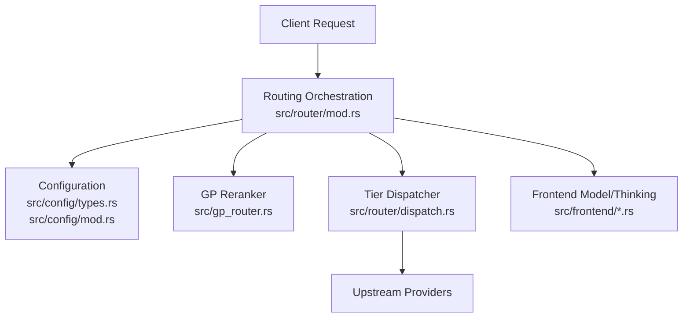
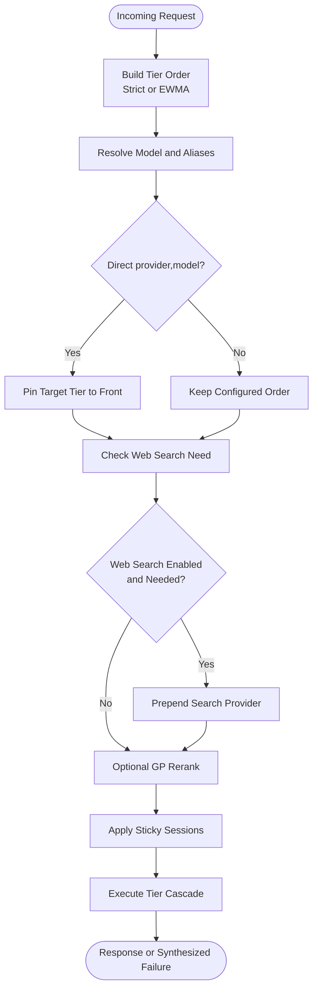
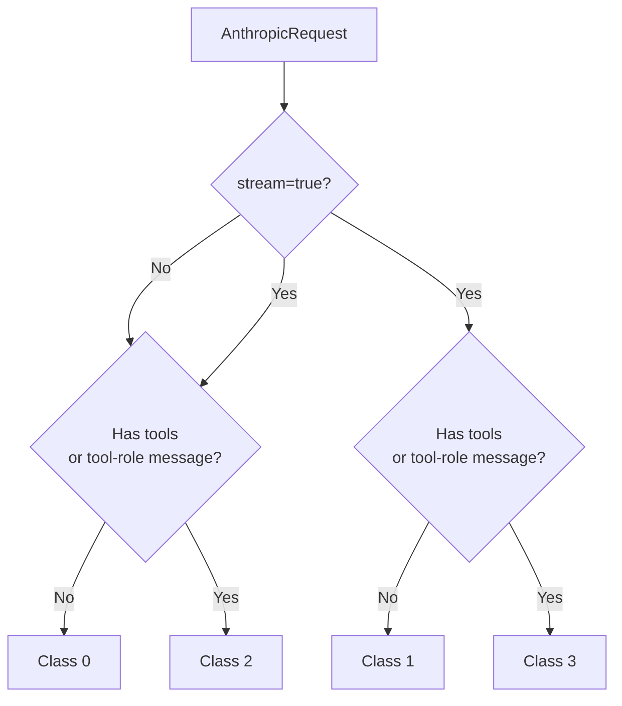
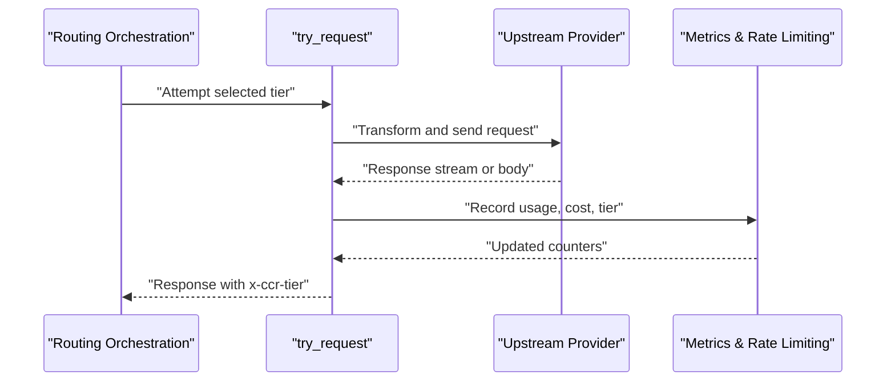
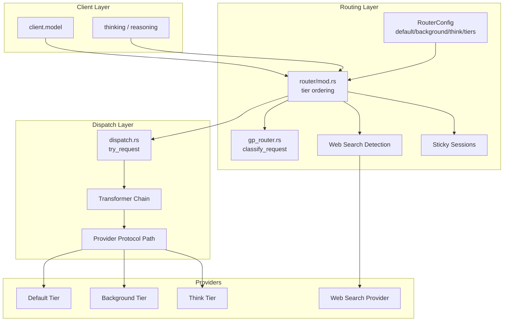
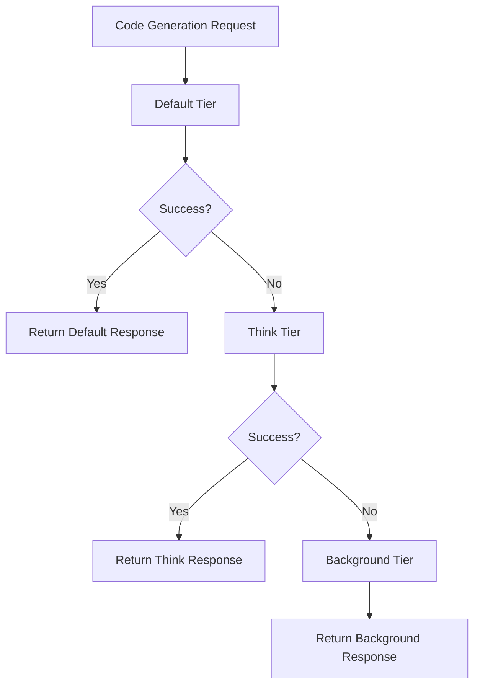
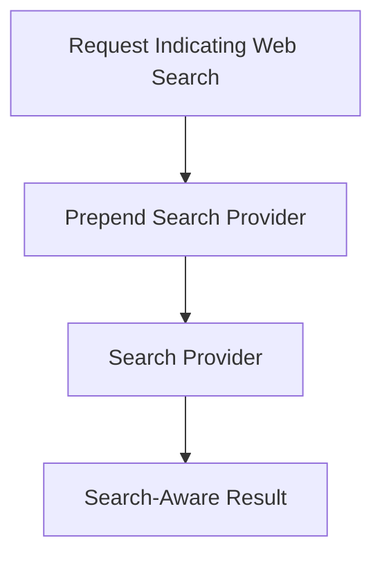
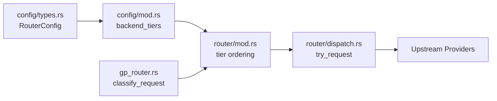

# Traffic Class Routing

<cite>
**Referenced Files in This Document**
- [gp_router.rs](file://src/gp_router.rs)
- [mod.rs](file://src/router/mod.rs)
- [dispatch.rs](file://src/router/dispatch.rs)
- [types.rs](file://src/config/types.rs)
- [config.rs](file://src/config/mod.rs)
- [frontend/mod.rs](file://src/frontend/mod.rs)
- [frontend/codex.rs](file://src/frontend/codex.rs)
</cite>

## Table of Contents
1. [Introduction](#introduction)
2. [Project Structure](#project-structure)
3. [Core Components](#core-components)
4. [Architecture Overview](#architecture-overview)
5. [Detailed Component Analysis](#detailed-component-analysis)
6. [Dependency Analysis](#dependency-analysis)
7. [Performance Considerations](#performance-considerations)
8. [Troubleshooting Guide](#troubleshooting-guide)
9. [Conclusion](#conclusion)
10. [Appendices](#appendices)

## Introduction
This document explains how CCR-Rust classifies incoming requests into traffic classes and routes them through a tiered provider pipeline. The system supports:

- A **default** provider tier for ordinary requests.
- A **think** tier for reasoning-heavy or long-thinking requests.
- A **background** tier for lower-priority or batch-oriented workloads.
- Optional **web search** routing that can prepend a dedicated search provider when requested content indicates web search is needed.
- Client-controlled direct model routing, aliasing, strict fallback ordering, EWMA-based reordering, optional GP reranking, sticky sessions, hedging, retry sweeps, and per-tier retry/backoff configuration.

The classification logic used by the optional GP reranker distinguishes four request shapes based on streaming preference and tool usage. Web search detection is separate from this four-class signal and is evaluated during routing to optionally insert a search provider at the front of the tier chain.

## Project Structure
Traffic class routing spans configuration, routing orchestration, request classification, provider dispatch, and frontend protocol handling:

| Area | Responsibility | Key files |
|---|---|---|
| Configuration schema | Declares `RouterConfig` fields such as `default`, `background`, `think`, `tiers`, `strict_tier_order`, `web_search`, `top_k`, `routing_temperature`, and `gp_routing` | [types.rs](file://src/config/types.rs), [config.rs](file://src/config/mod.rs) |
| Routing orchestration | Builds the ordered tier list, applies direct routing, web search insertion, sticky partitioning, and optional GP reranking | [mod.rs](file://src/router/mod.rs) |
| Request classification | Produces a numeric request class used by the GP reranker feature | [gp_router.rs](file://src/gp_router.rs) |
| Provider dispatch | Executes a single tier attempt with transformers, protocol translation, admission, rate limiting, retries, metrics, and response headers | [dispatch.rs](file://src/router/dispatch.rs) |
| Frontend models | Defines the client-facing model field and thinking/reasoning metadata consumed upstream and downstream | [frontend/mod.rs](file://src/frontend/mod.rs), [frontend/codex.rs](file://src/frontend/codex.rs) |

**Diagram sources**
- [mod.rs:470-620](file://src/router/mod.rs#L470-L620)
- [types.rs:591-696](file://src/config/types.rs#L591-L696)
- [gp_router.rs:1-120](file://src/gp_router.rs#L1-L120)
- [dispatch.rs:301-460](file://src/router/dispatch.rs#L301-L460)
- [frontend/mod.rs:121-166](file://src/frontend/mod.rs#L121-L166)

**Section sources**
- [types.rs:591-696](file://src/config/types.rs#L591-L696)
- [config.rs:694-731](file://src/config/mod.rs#L694-L731)
- [mod.rs:470-620](file://src/router/mod.rs#L470-L620)
- [gp_router.rs:320-370](file://src/gp_router.rs#L320-L370)
- [dispatch.rs:301-460](file://src/router/dispatch.rs#L301-L460)

## Core Components
### Router Configuration
The router configuration defines the canonical tier surfaces and behavior controls:

| Field | Meaning |
|---|---|
| `default` | Required default provider tier used when no explicit tier list is configured. |
| `background` | Optional background provider tier appended after `default`. |
| `think` | Optional think provider tier appended after `background`. |
| `tiers` | Optional explicit tier list; when present, it overrides automatic construction from `default`, `background`, and `think`. |
| `model_aliases` | Maps bare model names to provider/model routes. |
| `ignore_direct` | When true, ignores client-provided `provider,model` model routing and forces tier-based selection. |
| `strict_tier_order` | Treats the tier list as a strict preference chain rather than an EWMA-weighted reorderable list. |
| `web_search` | Enables optional web search provider injection. |
| `tier_retries` | Per-tier retry limits and backoff. |
| `retry_sweeps` | Optional “hold the request open” retry sweep mode. |
| `retry_budget_percent` | In-flight retry budget percentage. |
| `sticky_sessions` | Conversation stickiness across tiers. |
| `hedging` | Optional tail-latency hedging. |
| `presets` | Named presets that override model parameters and routing. |
| `batching` | Request batching configuration. |
| `top_k` | Number of top-performing providers considered by some routing modes. |
| `routing_temperature` | Softmax temperature for probabilistic routing modes. |
| `gp_routing` | Optional Gaussian-process reranker runtime configuration. |

Automatic tier construction produces a fallback chain starting with `default`, then appending any configured `background` and `think` values while avoiding duplicates.

**Section sources**
- [types.rs:591-696](file://src/config/types.rs#L591-L696)
- [config.rs:694-731](file://src/config/mod.rs#L694-L731)

### Routing Orchestration
The routing layer builds the candidate tier order before attempting any provider call. Its main responsibilities are:

1. Determine whether to use strict tier order or EWMA-based sorting.
2. Resolve the requested model, including aliases and direct `provider,model` targets.
3. Pin a directly targeted tier to the front unless `ignore_direct` is enabled.
4. Detect web search needs and optionally prepend the configured search provider.
5. Optionally apply GP reranking behind the pinned prefix.
6. Apply sticky session partitioning.
7. Execute the tier cascade with retry, hedging, admission, metrics, and synthesis.

**Diagram sources**
- [mod.rs:470-620](file://src/router/mod.rs#L470-L620)

**Section sources**
- [mod.rs:470-620](file://src/router/mod.rs#L470-L620)

### Request Classification for GP Reranking
The GP reranker uses a simple four-class request signature:

| Class | Streaming | Tool Usage | Intended Signal |
|---|---:|---:|---|
| 0 | No | No | Ordinary non-streaming text/tool-free request. |
| 1 | Yes | No | Streaming request without heavy tool usage. |
| 2 | No | Yes | Non-streaming request with tools or tool-role messages. |
| 3 | Yes | Yes | Streaming request with tools or tool-role messages. |

Streaming is taken from the request’s stream flag, and tool heaviness is detected when tools are present or when any message has role `tool`. This classification does not itself select a provider; it is a feature vector used by the GP surrogate to estimate relative quality and cost among candidate tiers.

**Diagram sources**
- [gp_router.rs:336-355](file://src/gp_router.rs#L336-L355)

**Section sources**
- [gp_router.rs:1-120](file://src/gp_router.rs#L1-L120)
- [gp_router.rs:320-370](file://src/gp_router.rs#L320-L370)

### Provider Dispatch
A single tier attempt resolves the provider, canonicalizes the model name, builds the transformer chain, selects the correct protocol path, performs admission and rate-limit tracking, streams or collects responses, records metrics and costs, and injects the selected tier header.

Key behaviors include:

- Resolving the full `provider,model` route.
- Canonicalizing MiniMax M3-family model names to the official M3.1 Flash ID.
- Building a transformer chain based on the requested model.
- Rejecting native Responses payloads when request transformers would be lossy.
- Supporting OpenAI-compatible and Anthropic protocols.
- Tracking rate-limited routes and recording cost and usage.
- Adding `x-ccr-tier` to successful responses.

**Diagram sources**
- [dispatch.rs:301-460](file://src/router/dispatch.rs#L301-L460)
- [dispatch.rs:716-1142](file://src/router/dispatch.rs#L716-L1142)
- [dispatch.rs:1142-1532](file://src/router/dispatch.rs#L1142-L1532)

**Section sources**
- [dispatch.rs:301-460](file://src/router/dispatch.rs#L301-L460)
- [dispatch.rs:716-1142](file://src/router/dispatch.rs#L716-L1142)
- [dispatch.rs:1142-1532](file://src/router/dispatch.rs#L1142-L1532)

## Architecture Overview
The complete traffic class routing pipeline integrates configuration, classification, tier ordering, optional intelligent reranking, and provider dispatch.

**Diagram sources**
- [types.rs:591-696](file://src/config/types.rs#L591-L696)
- [mod.rs:470-620](file://src/router/mod.rs#L470-L620)
- [gp_router.rs:320-370](file://src/gp_router.rs#L320-L370)
- [dispatch.rs:301-460](file://src/router/dispatch.rs#L301-L460)
- [frontend/mod.rs:121-166](file://src/frontend/mod.rs#L121-L166)

## Detailed Component Analysis

### Traffic Class Definitions and Classification Criteria
CCR-Rust exposes three named routing surfaces in `RouterConfig`:

- **default**: Primary tier for normal requests.
- **background**: Secondary tier intended for lower-priority or background workloads.
- **think**: Tertiary tier intended for reasoning-focused or long-thinking workloads.

If `tiers` is not explicitly configured, the effective fallback chain is:

1. `default`
2. `background` (if configured)
3. `think` (if configured)

Duplicates are removed while preserving insertion order.

The four-class signal used by the GP reranker is derived from:

- Whether the request is streaming.
- Whether the request contains tools or tool-role messages.

These two dimensions produce classes 0 through 3. This classification is informational for the GP reranker and does not independently force a provider selection.

**Section sources**
- [types.rs:591-636](file://src/config/types.rs#L591-L636)
- [config.rs:694-731](file://src/config/mod.rs#L694-L731)
- [gp_router.rs:336-355](file://src/gp_router.rs#L336-L355)

### Client-Specified Routing Behavior
Clients influence routing through several mechanisms:

| Mechanism | Behavior |
|---|---|
| `model` field | Specifies the desired model. If it contains a comma-separated `provider,model`, the router treats it as a direct target. |
| `model_aliases` | Allows clients to refer to a bare model name that maps to a provider/model route. |
| `ignore_direct` | Forces all requests into tier-based routing even if the client specifies `provider,model`. |
| `strict_tier_order` | Makes the configured tier chain a strict preference order instead of an EWMA-weighted reorderable list. |
| `web_search.enabled` and related fields | Enable optional web search provider injection when the request indicates search is needed. |
| `gp_routing` | Enables optional GP reranking that may reorder candidates behind the pinned prefix. |
| `sticky_sessions` | Partitions tiers so conversation-related requests prefer consistent providers. |

When a client sends `provider,model` and `ignore_direct` is false, the matching tier is moved to the front. If the requested model is not in the configured tier list, the router creates a single-tier route using that model.

**Section sources**
- [types.rs:591-696](file://src/config/types.rs#L591-L696)
- [mod.rs:470-620](file://src/router/mod.rs#L470-L620)

### Web Search Routing
Web search routing is orthogonal to the default/background/think classification. It is controlled by `web_search.enabled` and a search provider configuration. When enabled and the request requires web search, the router strips search tags from the request and prepends the configured search provider as the first tier.

This means web search takes precedence over both the default tier and other configured tiers.

**Section sources**
- [types.rs:636-640](file://src/config/types.rs#L636-L640)
- [mod.rs:470-620](file://src/router/mod.rs#L470-L620)

### Think Requests and Reasoning Content
Think routing is primarily a configuration surface. Clients typically indicate reasoning or thinking through:

- The `model` field, which may reference a reasoning-capable model.
- The `thinking` field in frontend request/response models.
- Reasoning-related content blocks handled by Codex and Claude Code frontend adapters.

The dispatcher preserves thinking-related control fields during transformation, removing synthetic defaults and inserting provided thinking values where supported.

**Section sources**
- [types.rs:591-636](file://src/config/types.rs#L591-L636)
- [frontend/mod.rs:60-63](file://src/frontend/mod.rs#L60-L63)
- [frontend/mod.rs:121-166](file://src/frontend/mod.rs#L121-L166)
- [frontend/codex.rs:122-151](file://src/frontend/codex.rs#L122-L151)
- [dispatch.rs:1197-1203](file://src/router/dispatch.rs#L1197-L1203)

### Background Tasks
Background tasks are best modeled by configuring a separate `background` tier. Such requests can:

- Use a cheaper or higher-latency provider.
- Be retried with different policies via `tier_retries`.
- Benefit from EWMA-based load distribution when `strict_tier_order` is false.
- Avoid interfering with low-latency default or think tiers unless they reach later positions in the fallback chain.

There is no special automatic classification that detects “background task” requests; administrators configure this behavior through the `background` tier and workload separation.

**Section sources**
- [types.rs:591-636](file://src/config/types.rs#L591-L636)
- [config.rs:694-731](file://src/config/mod.rs#L694-L731)

### Practical Examples

#### Example 1: Code Generation vs Background Tasks
- **Code generation**: Usually sent to `default` or `think`, depending on whether strong reasoning is expected. If the client specifies a high-quality model directly, that tier can be pinned to the front.
- **Background tasks**: Send to a slower or cheaper `background` tier. Because `background` appears after `default` in the automatic chain, ordinary code generation will not fall into it unless the default tier fails.

**Diagram sources**
- [types.rs:591-636](file://src/config/types.rs#L591-L636)
- [config.rs:694-731](file://src/config/mod.rs#L694-L731)
- [mod.rs:470-620](file://src/router/mod.rs#L470-L620)

#### Example 2: Web Search Precedence
A request that indicates web search needs receives the configured search provider as the first tier. Even if the client requested a default or think model, the search provider runs first because it is prepended.

**Diagram sources**
- [mod.rs:470-620](file://src/router/mod.rs#L470-L620)

#### Example 3: Direct Model Routing
A client sends `provider,model`. With `ignore_direct=false`, the router moves that tier to the front. With `ignore_direct=true`, the request is routed according to the configured tier order instead.

**Section sources**
- [types.rs:616-636](file://src/config/types.rs#L616-L636)
- [mod.rs:470-620](file://src/router/mod.rs#L470-L620)

## Dependency Analysis
The following diagram shows how traffic class routing depends on configuration, classification, and dispatch components.

**Diagram sources**
- [types.rs:591-696](file://src/config/types.rs#L591-L696)
- [config.rs:694-731](file://src/config/mod.rs#L694-L731)
- [gp_router.rs:320-370](file://src/gp_router.rs#L320-L370)
- [mod.rs:470-620](file://src/router/mod.rs#L470-L620)
- [dispatch.rs:301-460](file://src/router/dispatch.rs#L301-L460)

Coupling summary:

- `router/mod.rs` depends on `config/types.rs` and `config/mod.rs` for tier construction and policy.
- `gp_router.rs` depends on the internal request shape to compute classification and features.
- `router/dispatch.rs` depends on configuration, rate limiting, admission, metrics, and provider protocols.
- Frontend modules define client-facing model and thinking fields but do not directly implement tier selection.

Potential circular dependencies are avoided by keeping classification in the GP module, tier construction in configuration, orchestration in the router, and execution in dispatch.

**Section sources**
- [types.rs:591-696](file://src/config/types.rs#L591-L696)
- [config.rs:694-731](file://src/config/mod.rs#L694-L731)
- [gp_router.rs:1-120](file://src/gp_router.rs#L1-L120)
- [mod.rs:470-620](file://src/router/mod.rs#L470-L620)
- [dispatch.rs:301-460](file://src/router/dispatch.rs#L301-L460)

## Performance Considerations
### Throughput Across Request Types
- **Default tier**: Should host the fastest, most reliable providers for interactive code generation and user-facing requests.
- **Think tier**: May host stronger reasoning models that can be slower or more expensive. Use it when reasoning quality matters more than latency.
- **Background tier**: Can absorb batch jobs, offline processing, or lower-priority workloads. EWMA-based reordering can distribute these across measured peers when `strict_tier_order` is false.

### EWMA vs Strict Ordering
- **EWMA ordering**: Reorders tiers by observed latency, shuffling equal or unmeasured tiers. Good for load balancing similar peers.
- **Strict ordering**: Preserves the configured preference chain. Better when `default` must always beat `think`, or when a deliberate quality-ordered fallback chain is required.

### GP Reranking Overhead
GP reranking adds:

- Feature extraction from the request.
- Candidate scoring using a Gaussian process surrogate.
- Credible-set cost ordering.
- Observation buffering and periodic refitting.

It is only applied when fitted and when there are enough candidates beyond the pinned prefix. It should be tuned carefully for high-throughput environments.

### Retry Sweeps and Budget
Retry sweeps keep a request in flight and re-cascade tiers after cooldown. This improves message survival but increases latency variance. The retry budget prevents retries from consuming too much concurrency.

### Streaming and Tool-Heavy Requests
Tool-heavy requests carry additional payload and potentially larger token counts. Classification distinguishes streaming vs non-streaming and tool-heavy vs tool-light patterns, allowing GP reranking to consider these signals when available.

**Section sources**
- [mod.rs:470-620](file://src/router/mod.rs#L470-L620)
- [gp_router.rs:1-120](file://src/gp_router.rs#L1-L120)
- [gp_router.rs:320-450](file://src/gp_router.rs#L320-L450)
- [dispatch.rs:301-460](file://src/router/dispatch.rs#L301-L460)

## Troubleshooting Guide
### Requests Always Hit the Background Tier
Likely causes:

- `default` is failing repeatedly.
- `ignore_direct` is enabled and the client’s direct model is being ignored.
- Web search is enabled and prepending a search provider that fails.
- Sticky sessions or GP reranking is moving candidates unexpectedly.

Checks:

- Inspect the configured `default`, `background`, and `think` tiers.
- Confirm whether `ignore_direct` is true.
- Check whether web search is enabled and what search provider is configured.
- Review tier headers and metrics to see which tier actually served the request.

**Section sources**
- [types.rs:591-696](file://src/config/types.rs#L591-L696)
- [config.rs:694-731](file://src/config/mod.rs#L694-L731)
- [mod.rs:470-620](file://src/router/mod.rs#L470-L620)
- [dispatch.rs:1131-1137](file://src/router/dispatch.rs#L1131-L1137)

### Think Requests Are Not Using the Think Tier
The `think` field is a configuration surface, not an automatic classifier. To route reasoning requests to a dedicated tier:

- Configure `think` separately from `default`.
- Use `model_aliases` to map reasoning model names to the think tier.
- Disable `ignore_direct` if you want clients to pin reasoning models directly.
- Ensure web search is not prepending another provider.

**Section sources**
- [types.rs:591-636](file://src/config/types.rs#L591-L636)
- [mod.rs:470-620](file://src/router/mod.rs#L470-L620)

### Web Search Is Not Being Used
Verify:

- `web_search.enabled` is true.
- A search provider is configured.
- The request actually triggers web search detection.
- The search provider is reachable and returning valid responses.

**Section sources**
- [types.rs:636-640](file://src/config/types.rs#L636-L640)
- [mod.rs:470-620](file://src/router/mod.rs#L470-L620)

### High Latency on Background Workloads
Recommendations:

- Use a dedicated `background` tier with appropriate provider characteristics.
- Prefer EWMA ordering for similar peer pools.
- Use `strict_tier_order` only when a strict fallback contract is required.
- Tune retry budgets and retry sweep cooldowns to avoid saturation.

**Section sources**
- [types.rs:625-640](file://src/config/types.rs#L625-L640)
- [mod.rs:470-620](file://src/router/mod.rs#L470-L620)

## Conclusion
CCR-Rust’s traffic class routing system separates concerns cleanly:

- **Configuration** declares the routing surfaces: default, background, think, optional web search, and explicit tier chains.
- **Routing orchestration** decides the candidate order, honors client intent when allowed, inserts web search when needed, and applies sticky sessions and optional GP reranking.
- **Classification** provides a lightweight four-class signal for GP reranking based on streaming and tool usage.
- **Dispatch** executes individual tier attempts with protocol translation, transformers, admission, rate limiting, metrics, and response headers.

For predictable throughput:

- Put fast, interactive code generation in `default`.
- Put strong reasoning models in `think`.
- Put batch or lower-priority work in `background`.
- Use `strict_tier_order` for intentional fallback contracts.
- Use EWMA ordering for load-balanced peer pools.
- Use web search routing only when requests explicitly need search.
- Tune retry sweeps, retry budgets, and GP reranking according to workload characteristics.

[No sources needed since this section summarizes without analyzing specific files]

## Appendices

### Configuration Quick Reference
| Setting | Recommended Use |
|---|---|
| `default` | Primary interactive model. |
| `background` | Batch, offline, or lower-priority work. |
| `think` | Reasoning-heavy or long-thinking workloads. |
| `tiers` | Override automatic ordering for complex deployments. |
| `strict_tier_order` | Enforce strict fallback chain. |
| `ignore_direct` | Prevent clients from bypassing tier policy. |
| `web_search` | Enable search-aware routing. |
| `tier_retries` | Tune per-tier retry/backoff. |
| `retry_sweeps` | Improve survival at the cost of latency. |
| `gp_routing` | Enable learned reranking with caution. |

**Section sources**
- [types.rs:591-696](file://src/config/types.rs#L591-L696)
- [config.rs:694-731](file://src/config/mod.rs#L694-L731)