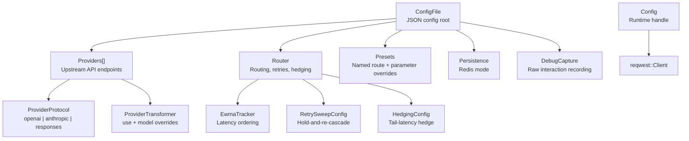
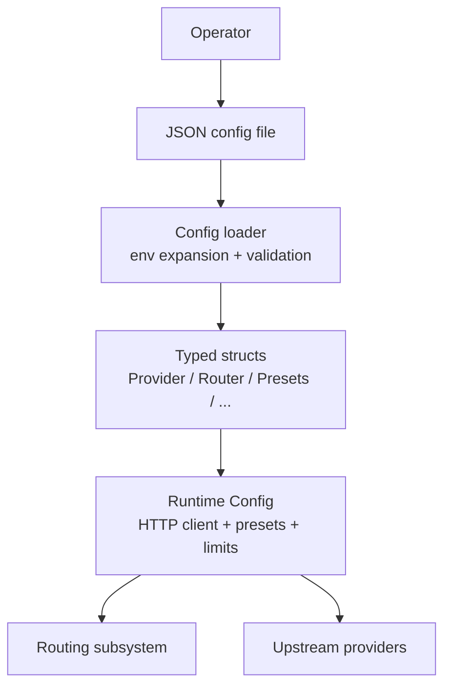
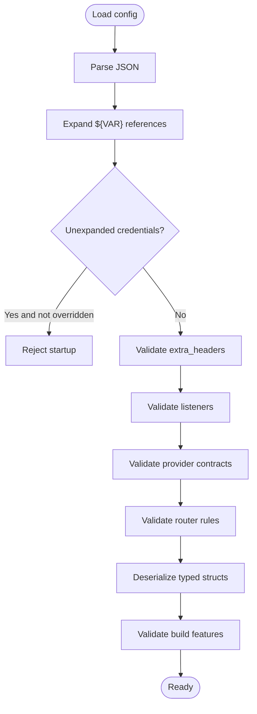

# Configuration Reference

<cite>
**Referenced Files in This Document**
- [src/config/types.rs](file://src/config/types.rs)
- [src/config/mod.rs](file://src/config/mod.rs)
- [src/routing.rs](file://src/routing.rs)
- [src/router/dispatch/provider_overrides.rs](file://src/router/dispatch/provider_overrides.rs)
- [docs/configuration.md](file://docs/configuration.md)
- [docs/presets.md](file://docs/presets.md)
- [examples/coding-plans.json](file://examples/coding-plans.json)
- [examples/meta.json](file://examples/meta.json)
- [examples/openrouter-free.json](file://examples/openrouter-free.json)
- [examples/sensenova.json](file://examples/sensenova.json)
</cite>

## Table of Contents
1. [Introduction](#introduction)
2. [Project Structure](#project-structure)
3. [Core Components](#core-components)
4. [Architecture Overview](#architecture-overview)
5. [Detailed Component Analysis](#detailed-component-analysis)
6. [Dependency Analysis](#dependency-analysis)
7. [Performance Considerations](#performance-considerations)
8. [Troubleshooting Guide](#troubleshooting-guide)
9. [Conclusion](#conclusion)

## Introduction
This document is the authoritative configuration reference for CCR-Rust. It describes the complete JSON configuration schema, provider settings for Anthropic, OpenAI, GLM, MiniMax, DeepSeek, Kimi, OpenRouter, and SenseNova backends, tier and routing behavior, presets, environment variable expansion, validation rules, error handling, debugging options, and security considerations. The goal is to help operators configure safe, predictable routing across multiple LLM providers while understanding how each section affects runtime behavior.

CCR-Rust reads one JSON configuration file. At startup it parses the file, expands environment variable references, validates cross-field constraints, constructs a shared HTTP client pool, and exposes routes for normal traffic, authenticated clients, presets, models, metrics, and optional MCP or dashboard features. Provider configuration determines protocol, authentication, model availability, pricing, transformers, streaming behavior, reasoning controls, admission limits, and extra headers. Router configuration determines default routes, fallback tiers, retry behavior, cost-aware reranking, search tagging, hedging, stickiness, batching, and request body limits.

## Project Structure
The configuration system lives primarily under `src/config/`. The public types are declared in `src/config/types.rs`, and loading, environment expansion, credential gating, server listener checks, and runtime wrapper logic are in `src/config/mod.rs`. Routing and admission behavior that consumes this configuration is implemented in `src/routing.rs`. Provider-level request overrides are applied in `src/router/dispatch/provider_overrides.rs`. User-facing documentation and examples live in `docs/configuration.md`, `docs/presets.md`, and the `examples/` directory.

**Diagram sources**
- [src/config/types.rs:601-1071](file://src/config/types.rs#L601-L1071)
- [src/config/mod.rs:201-616](file://src/config/mod.rs#L201-L616)
- [src/routing.rs:1-120](file://src/routing.rs#L1-L120)

**Section sources**
- [src/config/types.rs:1-200](file://src/config/types.rs#L1-L200)
- [src/config/mod.rs:1-200](file://src/config/mod.rs#L1-L200)
- [src/routing.rs:1-120](file://src/routing.rs#L1-L120)

## Core Components
The configuration has<docs>
# Configuration Reference

<cite>
**Referenced Files in This Document**
- [types.rs](file://src/config/types.rs)
- [mod.rs](file://src/config/mod.rs)
- [configuration.md](file://docs/configuration.md)
- [presets.md](file://docs/presets.md)
- [coding-plans.json](file://examples/coding-plans.json)
- [meta.json](file://examples/meta.json)
- [openrouter-free.json](file://examples/openrouter-free.json)
- [sensenova.json](file://examples/sensenova.json)
- [routing.rs](file://src/routing.rs)
- [provider_overrides.rs](file://src/router/dispatch/provider_overrides.rs)
</cite>

## Table of Contents
1. [Introduction](#introduction)
2. [Project Structure](#project-structure)
3. [Configuration Loading and Environment Expansion](#configuration-loading-and-environment-expansion)
4. [Top-Level Configuration Schema](#top-level-configuration-schema)
5. [Provider Configuration](#provider-configuration)
6. [Router, Tiers, and Routing Behavior](#router-tiers-and-routing-behavior)
7. [Preset Configurations](#preset-configurations)
8. [Provider-Specific Backends](#provider-specific-backends)
9. [Validation Rules and Error Handling](#validation-rules-and-error-handling)
10. [Security and Secrets Management](#security-and-secrets-management)
11. [Practical Configuration Patterns](#practical-configuration-patterns)
12. [Performance and Runtime Characteristics](#performance-and-runtime-characteristics)
13. [Troubleshooting Guide](#troubleshooting-guide)
14. [Conclusion](#conclusion)

## Introduction
This document is the complete configuration reference for CCR-Rust. It explains the JSON schema, nested structures, validation rules, environment-variable expansion, presets, routing behavior, provider backends, security considerations, and runtime implications. It is intended for operators configuring CCR-Rust as a router between LLM clients and upstream providers such as Anthropic, OpenAI, GLM, MiniMax, DeepSeek, Kimi, OpenRouter, SenseNova, and Meta.

CCR-Rust reads a single JSON configuration file. The file can be supplied explicitly or located through an environment variable or default path. At load time, CCR-Rust expands `${VAR}` references in string values, validates provider contracts, checks HTTP headers, enforces listener constraints, deserializes typed structures, and builds runtime state.

## Project Structure
The configuration system is centered around two Rust modules:

| File | Responsibility |
|---|---|
| `src/config/types.rs` | Typed data models for providers, pricing, transformers, routing, persistence, retry sweeps, hedging, batching, GP routing, presets, and aliases. |
| `src/config/mod.rs` | Configuration loading, environment expansion, credential gating, extra-header validation, listener validation, preset/runtime accessors, and build-feature checks. |
| `docs/configuration.md` | Human-readable schema documentation, examples, and behavioral explanations. |
| `docs/presets.md` | Preset usage, supported fields, request format, fallback behavior, and search tagging. |
| `examples/*.json` | Real-world example configurations used by the codebase. |

**Diagram sources**
- [mod.rs:201-616](file://src/config/mod.rs#L201-L616)
- [types.rs:201-1071](file://src/config/types.rs#L201-L1071)

**Section sources**
- [types.rs:1-200](file://src/config/types.rs#L1-L200)
- [mod.rs:1-200](file://src/config/mod.rs#L1-L200)
- [configuration.md:1-120](file://docs/configuration.md#L1-L120)

## Configuration Loading and Environment Expansion
### Load order
1. Read the JSON file from the configured path.
2. Parse the raw JSON into a generic `serde_json::Value`.
3. Recursively expand `${VAR_NAME}` and `$VAR` references in every string value.
4. Record expansion failures with JSON pointer paths.
5. Validate provider credentials against recorded failures.
6. Validate provider `extra_headers`.
7. Validate client API key exposure.
8. Deserialize into typed structs.
9. Apply cross-field validations (listener, provider contracts, tier ordering, aliasing, retry budgets).
10. Build the runtime `Config`, which wraps parsed data, an HTTP client, effective body-size limits, and presets.

### Variable syntax
| Syntax | Meaning |
|---|---|
| `${VAR_NAME}` | Expand from the process environment. |
| `$VAR_NAME` | Heuristic scan for placeholders; real expansion uses `shellexpand`, while startup hints also detect bare `$VAR` patterns. |

Variables are expanded at config-load time. They come from the router process environment, not from `.env` files loaded by CCR-Rust. If you use a `.env` file, export its variables into the shell before starting CCR-Rust.

### Security note on `.env` files
A sourced `.env` file is executable shell code. Use only trusted, private files and add them to `.gitignore`. Production should prefer exported environment variables or a service manager’s secret injection mechanism.

**Section sources**
- [mod.rs:1-200](file://src/config/mod.rs#L1-L200)
- [configuration.md:12-60](file://docs/configuration.md#L12-L60)

## Top-Level Configuration Schema
The top-level JSON object has the following sections:

| Section | Type | Required | Purpose |
|---|---|---:|---|
| `Providers` | array | Yes | Upstream LLM provider endpoints, models, protocol settings, pricing, transformers, and runtime controls. |
| `Router` | object | Yes | Default routes, tier lists, retry policy, EWMA/GP routing, hedging, stickiness, and search behavior. |
| `Presets` | object | No | Named Anthropic Messages routes with optional parameter overrides. |
| `Persistence` | object | No | Optional metrics/dashboard persistence backend. |
| `DebugCapture` | object | No | Raw API interaction recording. |
| `HOST` | string | No | HTTP server bind address. |
| `PORT` | number | No | HTTP server port. |
| `AUTH_HOST` | string | No | Authenticated listener bind address. |
| `AUTH_PORT` | number | No | Dedicated authenticated listener port. |
| `API_TIMEOUT_MS` | number | No | Request timeout. |
| `PROXY_URL` | string | No | HTTP proxy URL. |
| `POOL_MAX_IDLE_PER_HOST` | number | No | Idle connection pool size per host. |
| `POOL_IDLE_TIMEOUT_MS` | number | No | Connection idle timeout. |
| `SSE_BUFFER_SIZE` | number | No | SSE channel buffer size. |
| `CLIENT_API_KEY` | string | No | Client-facing API key. |
| `BROKER_SOCKET` | string | No | Local broker Unix socket path. |
| `MAX_REQUEST_BODY_BYTES` | number | No | Maximum accepted request body size. |

### Server and connection fields
| Field | Type | Default | Description |
|---|---|---|---|
| `HOST` | string | `127.0.0.1` | Bind address for the normal local listener. |
| `PORT` | number | `3456` | HTTP server port. |
| `API_TIMEOUT_MS` | number | `600000` | Request timeout in milliseconds. |
| `PROXY_URL` | string | `null` | Optional HTTP proxy URL. |
| `POOL_MAX_IDLE_PER_HOST` | number | `64` | Maximum idle connections per host. |
| `POOL_IDLE_TIMEOUT_MS` | number | `90000` | Idle connection timeout in milliseconds. |
| `SSE_BUFFER_SIZE` | number | `32` | SSE channel buffer size. |
| `CLIENT_API_KEY` | string | `null` | Client-facing API key for standard and Anthropic-style requests. |
| `AUTH_HOST` | string | Local default | Dedicated authenticated listener host. |
| `AUTH_PORT` | number | `null` | Dedicated authenticated listener port; required when `CLIENT_API_KEY` is set. |
| `BROKER_SOCKET` | string | `null` | Local broker socket path; also overridable via `CCR_BROKER_SOCKET`. |
| `MAX_REQUEST_BODY_BYTES` | number | `67108864` | Effective maximum request body size in bytes after defaulting and clamping. |

**Section sources**
- [mod.rs:350-616](file://src/config/mod.rs#L350-L616)
- [configuration.md:520-611](file://docs/configuration.md#L520-L611)

## Provider Configuration
Each entry in `Providers` describes one upstream API endpoint.

### Provider fields
| Field | Type | Required | Default | Description |
|---|---|---:|---|---|
| `name` | string | Yes | - | Unique provider identifier used in routes. |
| `api_base_url` | string | Yes | - | Full upstream API base URL. |
| `api_key` | string | Yes | - | Authentication credential. |
| `models` | array | Yes | - | Available model identifiers served by this provider. |
| `protocol` | enum | No | `openai` | Upstream API protocol: `openai`, `anthropic`, or `responses`. |
| `anthropic_version` | string | No | Canonical default | Anthropic API version header for `protocol=anthropic`. |
| `auth_header` | string | No | Anthropic default | Authentication header style for `protocol=anthropic`; use `authorization` for providers requiring `Authorization: Bearer`. |
| `transformer` | object | No | - | Request/response transformer chain. |
| `tier_name` | string | No | Provider name | Display name for metrics/dashboard. |
| `extra_headers` | map | No | - | Extra HTTP headers sent to the provider. |
| `honor_ratelimit_headers` | boolean | No | `true` | Skip tier if upstream reports rate-limit exhaustion. |
| `allow_streaming` | boolean | No | `false` | Force native streaming even when global non-streaming is enabled. |
| `force_reasoning_effort` | string | No | - | Force OpenAI Chat reasoning effort after frontend normalization. |
| `force_adaptive_thinking` | boolean | No | `false` | Inject adaptive thinking state for providers that require it. |
| `max_inflight` | number | No | Global default | Per-route AIMD admission control limit, 1–64. |
| `max_inflight_tokens` | number | No | - | Static in-flight prefill token budget, 1000–4,000,000. |

### Pricing
Provider pricing is optional but must be internally consistent.

| Field | Type | Required | Description |
|---|---|---:|---|
| `input_per_million_tokens` | float | Yes within pricing block | Input token cost in USD per million tokens. |
| `output_per_million_tokens` | float | Yes within pricing block | Output token cost in USD per million tokens. |
| `cache_read_per_million_tokens` | float | No | Discounted cached-input rate. |
| `cache_creation_per_million_tokens` | float | No | Surcharged cache-write rate. |

At the provider level, both base rates are required when pricing is present. A `model_pricing` map can override the provider default for specific models. If a cached rate is unset, those tokens contribute zero to the estimate, keeping reported cost a lower bound rather than falsely inflating cached traffic.

### Transformers
Transformers modify requests and responses per provider and per model.

| Subfield | Type | Description |
|---|---|---|
| `use` | array | Provider-level transformer chain applied to all models. |
| `<model-name>` | object | Model-specific transformer override keyed by model ID. |

Transformer entries support two forms:
1. Bare name: `"deepseek"`
2. Name with options: `["maxtoken", {"max_tokens": 65536}]`

Model overrides replace the provider-level chain for that model.

**Section sources**
- [types.rs:201-420](file://src/config/types.rs#L201-L420)
- [types.rs:1-200](file://src/config/types.rs#L1-L200)
- [configuration.md:200-340](file://docs/configuration.md#L200-L340)

## Router, Tiers, and Routing Behavior
The `Router` section controls how incoming requests are routed across configured providers and models.

### Core routing fields
| Field | Type | Required | Default | Description |
|---|---|---:|---|---|
| `default` | string | Yes | - | Default route in `provider,model` form. |
| `background` | string | No | - | Route for background tasks. |
| `think` | string | No | - | Route for reasoning/thinking models. |
| `tiers` | array | No | Derived | Explicit tier cascade; otherwise derived from `default`, `background`, and `think`. |
| `ignoreDirect` | boolean | No | `false` | Ignore direct client model targeting and enforce tier order. |
| `strictTierOrder` | boolean | No | `false` | Serve tiers in exact configured order without EWMA/GP reordering. |
| `webSearch` | object | No | Disabled | Optional web-search tag detection and routing. |
| `tierRetries` | map | No | Global defaults | Per-tier retry and stream-timeout configuration. |
| `retrySweeps` | object | No | Disabled | Hold-request open mode for re-cascading exhausted tiers. |
| `retryBudgetPercent` | number | No | `20` | Percentage of active requests allowed as retries. |
| `stickySessions` | object | No | Disabled | Conversation-provider stickiness. |
| `hedging` | object | No | Disabled | Tail-latency hedging. |
| `batching` | object | No | - | Optional request batching configuration. |
| `topK` | number | No | All tiers | Number of top-performing providers considered for routing. |
| `routingTemperature` | number | No | `1.0` | Softmax temperature for probabilistic tier sampling. |
| `gpRouting` | object | No | Disabled | Gaussian-process-based reranking. |
| `modelAliases` | map | No | `{}` | Map bare client model IDs to explicit `provider,model` routes. |

### Tier construction and ordering
Without explicit `tiers`, CCR-Rust derives a tier list from `default`, `background`, and `think`. When `tiers` is provided, it overrides automatic construction.

Default routing uses EWMA latency tracking:
- Successful attempts update the exponentially weighted moving average.
- Failures apply a penalty multiplier instead of raw wall-clock failure latency.
- Unmeasured tiers preserve configured priority.
- Measured tiers are reordered by latency once enough samples exist.
- With `routingTemperature`, CCR applies softmax probabilities and samples without replacement.

`strictTierOrder` disables EWMA reordering, cold-start shuffling, and GP reranking. It cannot be combined with `topK`.

### Web search routing
When enabled, CCR detects `[search]` or `[web]` tags in string-valued message content, strips the tags, and prepends the configured search route to candidates. This does not add web-search capability to a model that lacks it; it only affects routing.

### Retry sweeps
By default, when all tiers fail, CCR synthesizes a 429 or 503. With `retrySweeps.enabled=true`, CCR keeps the client request in flight and re-cascades the same tier list after a cooldown. Deterministic rejection codes are attempted once per request; raw upstream 429s are tracked and cascaded.

### Retry budget
`retryBudgetPercent` bounds same-tier retries to a percentage of active requests. The first attempt on each fallback tier is not charged against the budget. Zero disables same-tier retries.

### Hedging
Hedging launches one fallback attempt when the primary has not produced a usable result before `ttftThresholdMs`. The first usable result wins. Hedging consumes retry-budget and admission permits.

### Sticky sessions
When enabled, CCR remembers the successful provider family for a conversation key for `ttlMs`. Later turns partition eligible tiers so remembered-family tiers come after the pinned prefix and before other eligible tiers.

### Model aliases
Bare-model aliases let clients send a simple model ID while CCR resolves it to an explicit `provider,model` route. Aliases are exact and do not chain. An alias target may include `display_name` and `description` metadata surfaced by `/v1/models`.

**Section sources**
- [types.rs:601-1071](file://src/config/types.rs#L601-L1071)
- [routing.rs:1-300](file://src/routing.rs#L1-L300)
- [routing.rs:300-618](file://src/routing.rs#L300-L618)
- [configuration.md:340-520](file://docs/configuration.md#L340-L520)

## Preset Configurations
Presets give Anthropic Messages clients a named route and optional parameter overrides. A preset is not a credential store and does not isolate accounts.

### Supported preset fields
| Field | Type | Required | Description |
|---|---|---:|---|
| `route` | string | Yes | Target route in `provider,model` form. |
| `max_tokens` | number | No | Override max tokens. |
| `temperature` | number | No | Override temperature. |

Only these three fields are implemented. Arbitrary parameters and `extra_params` are not applied.

### Request flow
1. Client calls `/preset/{name}/v1/messages`.
2. CCR loads the preset.
3. CCR replaces the request model with the preset route.
4. Configured preset `max_tokens` and `temperature` win over request values.
5. Provider transformers and routing still run afterward.

### Listing presets
`GET /v1/presets` returns an array of preset objects. Unknown preset names return 404 when the rest of the request is valid.

### Fallback behavior
A preset delegates to ordinary routing after replacing the model. If the resulting route is in `Router.tiers`, other candidates remain eligible for fallback.

**Section sources**
- [presets.md:1-91](file://docs/presets.md#L1-L91)
- [mod.rs:350-616](file://src/config/mod.rs#L350-L616)

## Provider-Specific Backends
CCR-Rust supports multiple upstream protocols and provider families. The most important distinction is the upstream protocol rather than the vendor name.

### Protocol selection
| Protocol | Typical endpoint shape | Notes |
|---|---|---|
| `openai` | OpenAI-compatible Chat Completions | Default protocol. Supports `force_reasoning_effort`. |
| `anthropic` | Anthropic Messages | Supports `anthropic_version`, custom `auth_header`, and native thinking/output_config handling. |
| `responses` | OpenAI Responses | Passes through Responses semantics; reasoning mapping differs from Chat. |

### Anthropic-compatible providers
Examples include Z.AI GLM and Kimi. For these providers:
- Set `protocol: "anthropic"`.
- Use `anthropic_version` when needed.
- Use `auth_header: "authorization"` when the provider requires `Authorization: Bearer`.
- Preserve native `thinking` and `output_config` objects.
- Do not assume OpenAI reasoning labels are interchangeable with Anthropic-native controls.

### OpenAI-compatible providers
Examples include SenseNova and OpenRouter passthrough. For these providers:
- Use `protocol: "openai"`.
- `force_reasoning_effort` is validated at config load and applied at dispatch time.
- `force_adaptive_thinking` can inject adaptive thinking state when required by the destination.

### GLM
GLM is typically configured as an Anthropic-compatible provider. Reasoning effort mapping depends on the destination protocol:
- Native Messages requests preserve `output_config.effort`.
- OpenAI Chat `reasoning_effort` maps to `output_config.effort`.
- GLM-5.3 accepts specific effort labels and may have provider-specific defaults.

### MiniMax
MiniMax uses Anthropic-compatible transport in many integrations. Special handling exists for MiniMax-M3 thinking blocks and signed replay behavior. Provider-level transformer chains commonly include the MiniMax transformer.

### DeepSeek
DeepSeek is commonly configured as an OpenAI-compatible provider. Transformer chains often include a DeepSeek transformer, and model-specific overrides may adjust tool-use or token-limit behavior.

### Kimi
Kimi is configured as an Anthropic-compatible provider in the examples. Its coding agent identity check may require a specific `User-Agent` header through `extra_headers`.

### OpenRouter
OpenRouter acts as a meta-provider. The free-inference example includes several free-tier models behind a single OpenRouter provider. The example sets `transformer.use` to `["anthropic", "openrouter"]` and supplies a `User-Agent` header aligned with the coding agent.

### SenseNova
SenseNova is configured as an OpenAI-compatible provider. The example enables `force_adaptive_thinking` and `force_reasoning_effort: "none"` because some providers require adaptive thinking state when reasoning is disabled.

### Meta
The Meta example shows a provider named `meta` using Anthropic-compatible transport and a MaxToken transformer with `only_if_missing: true`.

**Section sources**
- [types.rs:300-420](file://src/config/types.rs#L300-L420)
- [configuration.md:120-200](file://docs/configuration.md#L120-L200)
- [provider_overrides.rs:1-47](file://src/router/dispatch/provider_overrides.rs#L1-L47)

## Validation Rules and Error Handling
Configuration validation occurs in stages:

### Environment expansion validation
- Missing variables are logged with JSON pointer paths.
- Literal placeholder keys in provider credentials cause startup failure unless overridden.
- The override `CCR_ALLOW_UNEXPANDED_CREDENTIALS=true` allows intentionally keyless local setups.

### Credential validation
Startup rejects unexpanded provider `api_key` values and unexpanded `extra_headers` values when they appear in recorded expansion failures. It also rejects an unexpanded top-level `CLIENT_API_KEY`.

### Header validation
Provider `extra_headers` are validated as:
- Valid HTTP header names.
- String values.
- Parsed HTTP header values.

Invalid headers produce a startup error identifying the provider and header key.

### Listener validation
- `CLIENT_API_KEY` and `AUTH_PORT` must be configured together.
- `AUTH_PORT` must differ from `PORT`.
- `AUTH_HOST` must parse as an IP address.

### Provider contract validation
- `maxInflight` must be between 1 and 64.
- `maxInflightTokens` must be between 1000 and 4,000,000.
- `force_reasoning_effort` requires `protocol: "openai"`.
- `force_reasoning_effort` values must be one of the supported reasoning effort labels.

### Router validation
- `retrySweeps.sweepCooldownMs` must be greater than zero when enabled.
- `retryBudgetPercent` must be between 0 and 100.
- `hedging.ttftThresholdMs` must be greater than zero when hedging is enabled.
- `strictTierOrder` cannot be combined with `topK`.
- Model alias keys must be nonblank, trimmed, and comma-free.
- Alias targets must be explicit `provider,model` routes referencing configured providers and models.

### Build-feature validation
GP routing is gated by the compiled feature set. When `gpRouting.enabled=true` without the `gp` feature, startup fails. When the feature is enabled, optional dimensions such as `kplsDim` are bounded.

**Diagram sources**
- [mod.rs:1-200](file://src/config/mod.rs#L1-L200)
- [mod.rs:201-616](file://src/config/mod.rs#L201-L616)

**Section sources**
- [mod.rs:1-200](file://src/config/mod.rs#L1-L200)
- [mod.rs:201-616](file://src/config/mod.rs#L201-L616)

## Security and Secrets Management
### Secret storage recommendations
| Method | Security level | Recommended use |
|---|---|---|
| Hardcoded secrets | Low | Never use in shared code or production configs. |
| `.env` file | Medium | Development only; ensure it is ignored by version control. |
| Process environment | High | Production, CI/CD, container orchestration. |
| Service manager secrets | High | systemd, Docker, Kubernetes, cloud secret managers. |

### Key configuration risks
- Leaving `${VAR}` literals in `api_key` causes 401 errors indistinguishable from expired credentials.
- Using the normal `HOST/PORT` listener for externally exposed APIs bypasses `CLIENT_API_KEY` authentication.
- Exposing `AUTH_PORT` to untrusted networks without proper network controls exposes authenticated routes.
- Provider `extra_headers` can leak sensitive values through logs if misconfigured.
- `CLIENT_API_KEY` should not be treated as encryption; it authenticates clients, not upstream providers.

### Best practices
1. Store provider API keys in the process environment.
2. Set `CLIENT_API_KEY` only when the authenticated listener is reachable.
3. Bind `AUTH_HOST` to a safe interface.
4. Keep `PORT` local unless a reverse proxy handles TLS and authorization.
5. Avoid logging full request bodies when debug capture is enabled.
6. Restrict `DebugCapture` to controlled environments.
7. Treat `BROKER_SOCKET` as a local IPC secret.

**Section sources**
- [mod.rs:1-200](file://src/config/mod.rs#L1-L200)
- [configuration.md:12-60](file://docs/configuration.md#L12-L60)

## Practical Configuration Patterns

### Minimal GLM and Kimi setup
The coding plans example defines:
- Z.AI GLM as an Anthropic-compatible provider.
- Kimi as an Anthropic-compatible provider with a MaxToken transformer.
- A default route and tier list.
- Presets for GLM and Kimi.
- Persistence disabled.
- Debug capture disabled.
- Local HOST and PORT.

**Section sources**
- [coding-plans.json:1-36](file://examples/coding-plans.json#L1-L36)
- [presets.md:1-91](file://docs/presets.md#L1-L91)

### Meta model setup
The Meta example shows:
- Anthropic-compatible protocol.
- Authorization header style.
- A MaxToken transformer with `only_if_missing: true`.
- Strict tier order.
- Persistence disabled.

**Section sources**
- [meta.json:1-38](file://examples/meta.json#L1-L38)

### OpenRouter free inference setup
The OpenRouter example shows:
- OpenAI-compatible base URL.
- Free-tier model list.
- Pricing set to zero.
- Custom `User-Agent` header.
- Transformer chain including Anthropic and OpenRouter.
- Strict tier order matching the configured tier list.

**Section sources**
- [openrouter-free.json:1-54](file://examples/openrouter-free.json#L1-L54)

### SenseNova setup
The SenseNova example shows:
- OpenAI-compatible protocol.
- Adaptive thinking forced.
- Reasoning effort forced to `none`.
- Single-tier strict ordering.

**Section sources**
- [sensenova.json:1-29](file://examples/sensenova.json#L1-L29)

## Performance and Runtime Characteristics
### Admission control
Provider-level `maxInflight` limits concurrent attempts per route. Values outside 1–64 are rejected. Provider-level `maxInflightTokens` provides a static token-volume budget for providers whose 429s come from concurrent prefill volume rather than request count.

### EWMA routing
CCR-Rust tracks per-tier latency and reorders measured tiers by speed. Unmeasured tiers preserve configured priority. Probabilistic routing with `routingTemperature` distributes load across candidates proportional to their softmax scores.

### Retry sweeps
Held-request sweeps trade fail-fast semantics for message survival. Sweep cooldowns respect upstream `Retry-After` hints and the rate-limit tracker’s live backoff window. A disconnect cancels the sweep loop.

### Hedging
Hedging reduces tail latency by racing a primary and fallback attempt. It consumes retry budget and admission permits, so saturation does not amplify traffic.

### Persistence
Persistence defaults to disabled. When enabled, Redis is the supported backend. The default Redis prefix is `ccr-rust:persistence:v1`.

### Body size limits
The default maximum request body is 64 MiB, with a hard ceiling of 1 GiB. Zero falls back to the default.

**Section sources**
- [types.rs:201-420](file://src/config/types.rs#L201-L420)
- [types.rs:601-1071](file://src/config/types.rs#L601-L1071)
- [routing.rs:1-300](file://src/routing.rs#L1-L300)
- [routing.rs:300-618](file://src/routing.rs#L300-L618)

## Troubleshooting Guide

### Startup fails with unexpanded credential references
**Symptoms:**
- Startup error mentions unexpanded credential references.
- Requests return 401 for every provider.
- Logs show literal `${VAR}` text in credentials.

**Causes:**
- Variables were not exported before starting CCR-Rust.
- CCR-Rust was started directly instead of through the credential launcher.
- The process environment did not contain the referenced variables.

**Resolution:**
1. Export required variables before starting the router.
2. Use the credential launcher where applicable.
3. Verify variables with shell commands before starting CCR-Rust.
4. Only use `CCR_ALLOW_UNEXPANDED_CREDENTIALS=true` for intentionally keyless local setups.

**Section sources**
- [mod.rs:1-200](file://src/config/mod.rs#L1-L200)

### Invalid extra_headers
**Symptoms:**
- Startup error identifies a provider and header key.
- Error mentions invalid header name, non-string value, or invalid header value.

**Resolution:**
- Ensure header names are valid HTTP header names.
- Ensure header values are strings.
- Ensure header values parse as valid HTTP header values.

**Section sources**
- [mod.rs:1-200](file://src/config/mod.rs#L1-L200)

### AUTH_PORT conflicts
**Symptoms:**
- Startup error says `CLIENT_API_KEY` and `AUTH_PORT` must be configured together.
- Startup error says `AUTH_PORT` must differ from `PORT`.
- Startup error says `AUTH_HOST` must be an IP address.

**Resolution:**
- Configure `AUTH_PORT` whenever `CLIENT_API_KEY` is set.
- Use a different port from `PORT`.
- Use a valid IP address for `AUTH_HOST`.

**Section sources**
- [mod.rs:201-260](file://src/config/mod.rs#L201-L260)

### force_reasoning_effort errors
**Symptoms:**
- Startup error says `force_reasoning_effort` requires `protocol: "openai"`.
- Startup error says the reasoning effort value is invalid.

**Resolution:**
- Set `protocol: "openai"` for providers that accept OpenAI Chat reasoning effort.
- Use one of the supported reasoning effort values.

**Section sources**
- [mod.rs:201-350](file://src/config/mod.rs#L201-L350)
- [provider_overrides.rs:1-47](file://src/router/dispatch/provider_overrides.rs#L1-L47)

### strictTierOrder and topK conflict
**Symptoms:**
- Startup error says `strictTierOrder` and `topK` cannot be combined.

**Resolution:**
- Remove `topK` when using `strictTierOrder`.
- Remove `strictTierOrder` when relying on EWMA/top-K candidate selection.

**Section sources**
- [mod.rs:201-350](file://src/config/mod.rs#L201-L350)

### Preset returns 404
**Symptoms:**
- GET or POST to `/preset/{name}/v1/messages` returns 404.

**Resolution:**
- Verify the preset name exists under top-level `Presets`.
- Remember that only `/preset/{name}/v1/messages` is registered.
- Remember that arbitrary preset parameters beyond `route`, `max_tokens`, and `temperature` are not applied.

**Section sources**
- [presets.md:1-91](file://docs/presets.md#L1-L91)

### GP routing fails without the right build
**Symptoms:**
- Startup error says GP routing requires the `gp` feature.
- Startup error says `kplsDim` is out of range.

**Resolution:**
- Build CCR-Rust with the `gp` feature when enabling `gpRouting`.
- Ensure `kplsDim` is between 1 and the compiled feature dimension.

**Section sources**
- [mod.rs:350-616](file://src/config/mod.rs#L350-L616)

## Conclusion
CCR-Rust’s configuration system separates concerns clearly:
- `Providers` define upstream connectivity, protocol behavior, pricing, and transformation.
- `Router` defines routing strategy, retry policy, admission control, and observability-related behavior.
- `Presets` provide convenient named routes for Anthropic Messages clients.
- Validation runs before traffic is accepted, protecting operators from misconfigurations that would otherwise surface as ambiguous upstream errors.
- Environment expansion and credential gating make secret management safer, while explicit listener and header validation reduce operational risk.

For new deployments, start with a small provider list, verify environment variables, validate the configuration, enable debugging only temporarily, and observe routing metrics before enabling advanced features like retry sweeps, hedging, sticky sessions, or GP routing.