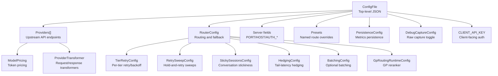
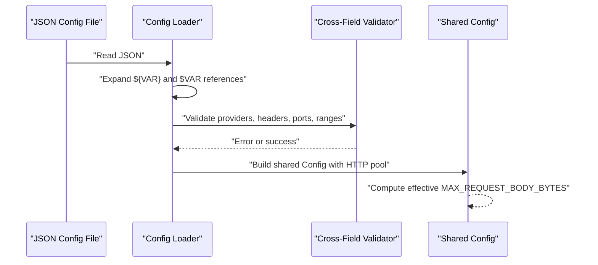
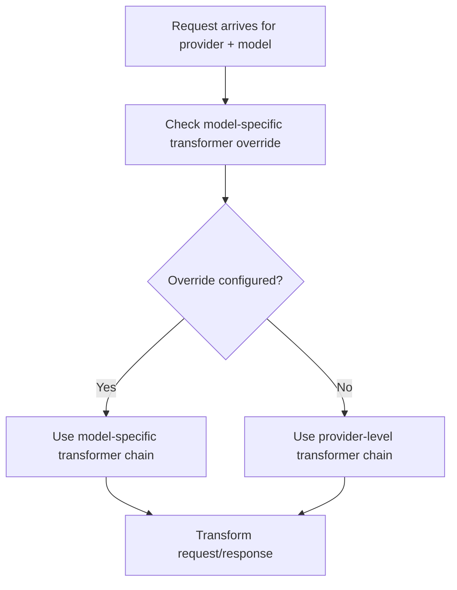
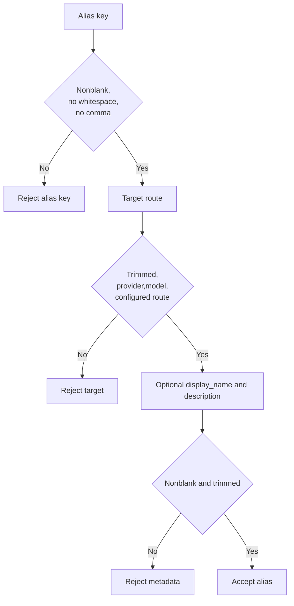
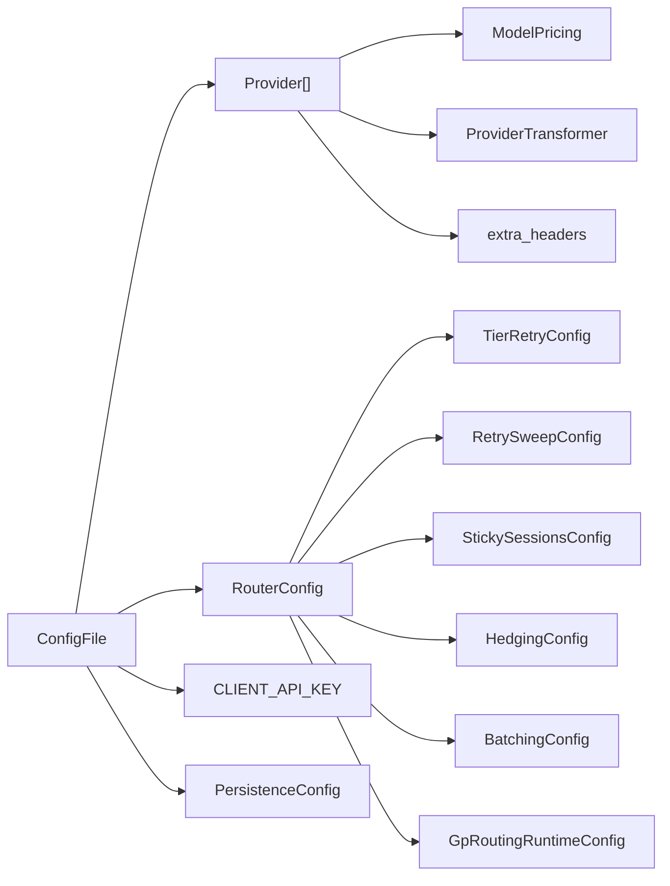

# Configuration Schema Reference

<cite>
**Referenced Files in This Document**   
- [types.rs](file://src/config/types.rs)
- [mod.rs](file://src/config/mod.rs)
- [configuration.md](file://docs/configuration.md)
- [coding-plans.json](file://examples/coding-plans.json)
- [meta.json](file://examples/meta.json)
</cite>

## Table of Contents
1. [Introduction](#introduction)
2. [Project Structure](#project-structure)
3. [Core Components](#core-components)
4. [Architecture Overview](#architecture-overview)
5. [Detailed Component Analysis](#detailed-component-analysis)
6. [Dependency Analysis](#dependency-analysis)
7. [Performance Considerations](#performance-considerations)
8. [Troubleshooting Guide](#troubleshooting-guide)
9. [Conclusion](#conclusion)

## Introduction
This document is the single source of truth for CCR-Rust configuration. It documents the complete JSON schema derived from the Rust types, including data types, required and optional fields, defaults, constraints, inheritance/override behavior, validation rules, and examples of valid and invalid configurations.

CCR-Rust loads a JSON configuration file, expands environment variables, applies defaults, validates cross-field constraints, and exposes the parsed configuration to the router, authentication layer, HTTP client pool, metrics, and dashboard subsystems.

## Project Structure
The configuration system lives under `src/config` and is composed of:

- **Schema types**: Rust structs and enums that define every supported JSON field, alias, default, and serialization behavior.
- **Loader and validators**: Functions that expand `${VAR}` references, validate credentials, check header syntax, enforce ranges, and reject contradictory combinations.
- **Runtime wrapper**: A shared configuration object used by handlers, routing, admission control, and observability.

**Diagram sources**
- [mod.rs:300-520](file://src/config/mod.rs#L300-L520)
- [types.rs:201-600](file://src/config/types.rs#L201-L600)
- [types.rs:601-1071](file://src/config/types.rs#L601-L1071)

**Section sources**
- [mod.rs:1-200](file://src/config/mod.rs#L1-L200)
- [types.rs:1-200](file://src/config/types.rs#L1-L200)

## Core Components
The top-level JSON object maps to `ConfigFile`. Every key is case-sensitive as documented; aliases such as `modelPricing`, `maxInflight`, and `maxInflightTokens` are accepted by the deserializer but should be treated as implementation details unless explicitly referenced elsewhere.

| Top-level Field | Type | Required | Default | Description |
|---|---|---:|---:|---|
| `Providers` | array | Yes | - | List of upstream provider endpoint definitions. |
| `Router` | object | Yes | - | Routing, fallback, retries, hedging, GP reranking, and model aliases. |
| `PORT` | integer | No | `3456` | HTTP server listen port. |
| `HOST` | string | No | `127.0.0.1` | HTTP server bind address. |
| `AUTH_HOST` | string | Conditional | `127.0.0.1` | Dedicated authenticated listener host; must be a valid IP when used. |
| `AUTH_PORT` | integer | Conditional | None | Dedicated authenticated listener port; required when `CLIENT_API_KEY` is set. |
| `API_TIMEOUT_MS` | integer | No | `600000` | Request timeout in milliseconds. |
| `PROXY_URL` | string | No | None | Optional HTTP proxy URL. |
| `POOL_MAX_IDLE_PER_HOST` | integer | No | `64` | Maximum idle connections per host. |
| `POOL_IDLE_TIMEOUT_MS` | integer | No | `90000` | Idle connection timeout in milliseconds. |
| `SSE_BUFFER_SIZE` | integer | No | `32` | SSE channel buffer size measured in chunks. |
| `Presets` | map | No | `{}` | Named preset routes and parameter overrides. |
| `Persistence` | object | No | Disabled | Runtime persistence backend settings. |
| `DebugCapture` | object | No | Disabled | Raw API interaction capture settings. |
| `BROKER_SOCKET` | string | No | None | Optional Unix socket path; can also be supplied via `CCR_BROKER_SOCKET`. |
| `MAX_REQUEST_BODY_BYTES` | integer | No | `67108864` (64 MiB) | Hard request-body limit; clamped at load time to a 1 GiB ceiling. |
| `CLIENT_API_KEY` | string | Conditional | None | Client-facing bearer/API-key requirement. |

**Section sources**
- [mod.rs:300-520](file://src/config/mod.rs#L300-L520)

## Architecture Overview
Configuration loading follows this sequence:

1. Read the JSON file.
2. Recursively expand `${VAR}` and `$VAR` references using the process environment.
3. Record expansion failures so credential checks can distinguish missing variables from runtime 401 errors.
4. Apply Serde defaults and aliases.
5. Validate cross-field contracts such as listener ports, provider limits, reasoning controls, tier ordering conflicts, and model aliases.
6. Build the shared runtime `Config` with an HTTP client pool and effective request-body limit.

**Diagram sources**
- [mod.rs:1-200](file://src/config/mod.rs#L1-L200)
- [mod.rs:201-520](file://src/config/mod.rs#L201-L520)

**Section sources**
- [mod.rs:1-200](file://src/config/mod.rs#L1-L200)
- [mod.rs:201-520](file://src/config/mod.rs#L201-L520)

## Detailed Component Analysis

### Providers Array
Each provider configures one upstream API endpoint.

| Field | Type | Required | Default | Constraints / Notes |
|---|---|---:|---:|---|
| `name` | string | Yes | - | Unique identifier used in routes. |
| `api_base_url` | string | Yes | - | Full upstream API endpoint URL. |
| `api_key` | string | Yes | - | Authentication secret; expanded through environment variables. |
| `models` | array of strings | Yes | - | Model names available from this provider. |
| `pricing` | object | No | None | Provider-default token pricing. Both base rates must be present if the object exists. |
| `model_pricing` | map | No | `{}` | Model-specific pricing override keyed by model name. Alias: `modelPricing`. |
| `protocol` | enum | No | `openai` | One of `openai`, `anthropic`, `responses`. |
| `anthropic_version` | string | No | None | Anthropic API version header for `protocol=anthropic`. |
| `auth_header` | string | No | None | Header style for `protocol=anthropic`; example value `authorization`. |
| `transformer` | object | No | None | Request/response transformer chain. |
| `tier_name` | string | No | None | Display name for metrics/dashboard; falls back to provider name. |
| `extra_headers` | map of strings | No | None | Extra HTTP headers sent to this provider; keys/values validated as HTTP header tokens. |
| `honor_ratelimit_headers` | boolean | No | `true` | Skip tier on successful responses with `X-RateLimit-Remaining: 0`. |
| `allow_streaming` | boolean | No | `false` | Force streaming even when global `forceNonStreaming` is enabled. |
| `force_reasoning_effort` | string | No | None | Valid only for `protocol=openai`; values restricted to `none`, `minimal`, `low`, `medium`, `high`, `xhigh`, `max`. |
| `force_adaptive_thinking` | boolean | No | `false` | Insert adaptive thinking state for providers that require it in non-thinking mode. |
| `max_inflight` | integer | No | Global default | AIMD admission-control in-flight attempts; must be between 1 and 64. Alias: `maxInflight`. |
| `max_inflight_tokens` | integer | No | None | Per-route prefill-token budget; must be between 1,000 and 4,000,000. Alias: `maxInflightTokens`. |

#### Pricing Fields
| Field | Type | Required Inside Object | Default | Notes |
|---|---|---:|---:|---|
| `input_per_million_tokens` | number | Yes | - | Base input rate in USD per million tokens. Alias: `inputPerMillionTokens`. |
| `output_per_million_tokens` | number | Yes | - | Base output rate in USD per million tokens. Alias: `outputPerMillionTokens`. |
| `cache_read_per_million_tokens` | number | No | None | Discounted cached-input rate; contributes zero when absent or invalid. Alias: `cacheReadPerMillionTokens`. |
| `cache_creation_per_million_tokens` | number | No | None | Surcharged cache-write rate; contributes zero when absent or invalid. Alias: `cacheCreationPerMillionTokens`. |

A model-specific pricing entry takes precedence over the provider default. Missing pricing is unknown cost, not free.

**Section sources**
- [types.rs:201-520](file://src/config/types.rs#L201-L520)
- [configuration.md:200-320](file://docs/configuration.md#L200-L320)

#### Provider Protocol Values
| Value | Behavior |
|---|---|
| `openai` | OpenAI-compatible `/chat/completions` requests. |
| `anthropic` | Anthropic-compatible `/messages` requests. |
| `responses` | OpenAI Responses-compatible `/responses` requests. |

**Section sources**
- [types.rs:520-600](file://src/config/types.rs#L520-L600)

### Transformer Configuration
Transformers modify requests and responses per provider and optionally per model.

#### Provider-Level Transformers
| Field | Type | Required | Default | Description |
|---|---|---:|---:|---|
| `use` | array | No | Empty | Ordered list of transformers applied to all models for this provider. |
| `<model-name>` | object | No | None | Model-specific transformer override keyed by model name. |

#### Transformer Entry Format
Each entry in `use` is either:

1. A bare string transformer name.
2. A tuple `[name, options]`, where `options` is an arbitrary JSON object.

Example patterns appear in the repository’s example configurations.

#### Inheritance and Override Rules
- Provider-level `use` applies to every model.
- A model-specific entry replaces the provider-level chain for that exact model.
- The bypass/passthrough logic considers whether a provider has exactly one matching transformer and no conflicting model overrides.

**Diagram sources**
- [types.rs:1-200](file://src/config/types.rs#L1-L200)

**Section sources**
- [types.rs:1-200](file://src/config/types.rs#L1-L200)
- [configuration.md:320-420](file://docs/configuration.md#L320-L420)
- [coding-plans.json:1-36](file://examples/coding-plans.json#L1-L36)
- [meta.json:1-38](file://examples/meta.json#L1-L38)

### Router Configuration
The `Router` object governs routing, fallback tiers, retries, admission behavior, and advanced features.

| Field | Type | Required | Default | Constraints / Notes |
|---|---|---:|---:|---|
| `default` | string | Yes | - | Default route in `provider,model` form. |
| `background` | string | No | None | Route used for background tasks. |
| `think` | string | No | None | Route used for reasoning/thinking workloads. |
| `tiers` | array of strings | No | Auto-derived | Explicit tier chain overriding automatic construction. |
| `strict_tier_order` | boolean | No | `false` | Serve configured tier order verbatim; incompatible with `topK`. |
| `ignore_direct` | boolean | No | `false` | Ignore explicit client model targeting and enforce tier order. |
| `web_search` | object | No | Disabled search | Web-search routing configuration. |
| `tier_retries` | map | No | Global defaults | Per-tier retry/backoff settings keyed by tier name. |
| `retry_sweeps` | object | No | Disabled | Hold-the-request-open re-cascade mode. |
| `retry_budget_percent` | integer | No | `20` | Percentage of active requests allowed as retries; range 0–100; 0 disables retries. |
| `sticky_sessions` | object | No | Disabled | Conversation-provider stickiness. |
| `hedging` | object | No | Disabled | Tail-latency hedging. |
| `presets` | map | No | `{}` | Named preset route and parameter overrides. |
| `batching` | object | No | None | Optional request batching configuration. |
| `top_k` | integer | No | None | Number of top-performing providers considered for routing. |
| `routing_temperature` | float | No | None | Softmax temperature for probabilistic routing. |
| `gp_routing` | object | No | Disabled | GP-backed reranker. |

#### Route Format
Routes use `provider,model`:
- `provider` must match a configured provider's `name`.
- `model` must be listed in that provider's `models` array.

#### Model Aliases
`modelAliases` maps bare client model IDs to explicit `provider,model` routes. An alias may be:
- A route string.
- An object with `route`, optional `display_name`, and optional `description`.

Validation rules:
- Alias key must be nonblank, untrimmed, and contain no comma.
- Target route must be trimmed, contain exactly one comma, and reference a configured provider and model.
- Detailed alias metadata must be nonblank and untrimmed when provided.
- Aliases do not chain and do not isolate accounts.

**Diagram sources**
- [mod.rs:201-300](file://src/config/mod.rs#L201-L300)
- [types.rs:601-750](file://src/config/types.rs#L601-L750)

**Section sources**
- [types.rs:601-750](file://src/config/types.rs#L601-L750)
- [configuration.md:420-611](file://docs/configuration.md#L420-L611)

### Per-Tier Retry Configuration
| Field | Type | Required | Default | Description |
|---|---|---:|---:|---|
| `max_retries` | integer | No | `3` | Maximum retry attempts per tier. |
| `base_backoff_ms` | integer | No | `100` | Initial backoff delay in milliseconds. |
| `backoff_multiplier` | float | No | `2.0` | Exponential backoff multiplier. |
| `max_backoff_ms` | integer | No | `10000` | Maximum backoff delay in milliseconds. |
| `stream_first_event_timeout_ms` | integer | No | `120000` | Timeout waiting for the first useful SSE frame after upstream headers arrive. Alias: `streamFirstEventTimeoutMs`. |
| `stream_idle_timeout_ms` | integer | No | `120000` | Maximum idle time between useful SSE frames once streaming has started. Alias: `streamIdleTimeoutMs`. |

Backoff calculation:
- Delay for attempt `n` is `min(base_backoff_ms * backoff_multiplier^n, max_backoff_ms)`.

EWMA-aware scaling adjusts the base delay by a latency factor bounded between 0.5× and 3.0× relative to a baseline, then clamps to `[minimum_backoff, max_backoff_ms]`.

**Section sources**
- [types.rs:750-950](file://src/config/types.rs#L750-L950)

### Retry Sweeps
| Field | Type | Required | Default | Description |
|---|---|---:|---:|---|
| `enabled` | boolean | No | `false` | Enable held-request re-cascading. |
| `max_sweeps` | integer | No | `0` | Additional full cascades after the first; `0` means unlimited. Alias: `maxSweeps`. |
| `sweep_cooldown_ms` | integer | No | `2000` | Minimum cooldown between sweeps. Must be greater than zero when enabled. Alias: `sweepCooldownMs`. |
| `max_hold_ms` | integer | No | `60000` | Wall-clock cap holding one request open; `0` opts into unlimited. Alias: `maxHoldMs`. |

Constraints:
- `sweep_cooldown_ms > 0` when `enabled = true`.
- Cooldown stretches to strongest observed `Retry-After` hint or rate-limit tracker backoff window, capped at 60 seconds.
- Deterministic failures such as 401/402/403/404 are attempted once and skipped in later sweeps.

**Section sources**
- [types.rs:850-950](file://src/config/types.rs#L850-L950)
- [configuration.md:500-611](file://docs/configuration.md#L500-L611)

### Conversation Stickiness
| Field | Type | Required | Default | Description |
|---|---|---:|---:|---|
| `enabled` | boolean | No | `false` | Remember last successful provider family per conversation. |
| `ttl_ms` | integer | No | `3600000` | TTL for remembered family in milliseconds. Alias: `ttlMs`. |

Behavior:
- When enabled, a remembered family is attempted before other eligible tiers.
- Cross-family movement still occurs after the remembered family is exhausted.

**Section sources**
- [types.rs:950-1020](file://src/config/types.rs#L950-L1020)
- [configuration.md:500-611](file://docs/configuration.md#L500-L611)

### Tail-Latency Hedging
| Field | Type | Required | Default | Description |
|---|---|---:|---:|---|
| `enabled` | boolean | No | `false` | Launch one fallback attempt after a threshold. |
| `ttft_threshold_ms` | integer | No | `10000` | Threshold in milliseconds; must be greater than zero when enabled. Alias: `ttftThresholdMs`. |

Hedging consumes retry budget and admission permits. A saturated fallback does not amplify traffic.

**Section sources**
- [types.rs:1020-1071](file://src/config/types.rs#L1020-L1071)
- [configuration.md:500-611](file://docs/configuration.md#L500-L611)

### Request Batching
| Field | Type | Required | Default | Description |
|---|---|---:|---:|---|
| `max_requests` | integer | No | `16` | Maximum buffered requests before sending a batch. |
| `max_latency_ms` | integer | No | `100` | Maximum wait time before sending a batch even if not full. |

**Section sources**
- [types.rs:1071-1120](file://src/config/types.rs#L1071-L1120)

### GP Routing Reranker
| Field | Type | Required | Default | Description |
|---|---|---:|---:|---|
| `enabled` | boolean | No | `false` | Enable GP reranking. |
| `max_candidates` | integer | No | `32` | Maximum configured tiers exposed to the GP. |
| `buffer_capacity` | integer | No | `500` | Observations retained in memory. |
| `min_observations` | integer | No | `40` | Minimum observations before surrogate fit. |
| `refit_interval` | integer | No | `200` | New observations between periodic refits; `0` disables periodic refits. |
| `ucb_kappa` | float | No | `2.0` | UCB exploration weight. |
| `nugget` | float | No | `0.0001` | Nugget passed to the GP model. |
| `kpls_dim` | integer | No | None | Optional KPLS dimensionality reduction. |
| `prior_mean` | float | No | `0.5` | Prior mean before a fitted model is available. |
| `prior_variance` | float | No | `0.25` | Prior variance before a fitted model is available. |
| `acquisition` | enum | No | `ucb` | Acquisition strategy: `ucb`, `thompson`, `greedy`, `epsilonGreedy`. |
| `epsilon` | float | No | `0.1` | Random exploration rate when acquisition is `epsilonGreedy`. |

The standard build includes GP support; enable it with `gpRouting.enabled`.

**Section sources**
- [types.rs:520-600](file://src/config/types.rs#L520-L600)
- [configuration.md:420-500](file://docs/configuration.md#L420-L500)

### Presets
A preset maps a named route to a `provider,model` route and optional parameter overrides.

| Field | Type | Required | Default | Description |
|---|---|---:|---:|---|
| `route` | string | Yes | - | Provider-model route. |
| `max_tokens` | integer | No | None | Optional max-tokens override. |
| `temperature` | float | No | None | Optional temperature override. |

Presets are stored in both the top-level `Presets` map and the `Router.presets` map.

**Section sources**
- [mod.rs:250-320](file://src/config/mod.rs#L250-L320)
- [coding-plans.json:1-36](file://examples/coding-plans.json#L1-L36)

### Persistence
| Field | Type | Required | Default | Description |
|---|---|---:|---:|---|
| `mode` | enum | No | `none` | Backend mode: `none`, `redis`. |
| `redis_url` | string | No | None | Redis URL when mode is `redis`. |
| `redis_prefix` | string | No | `ccr-rust:persistence:v1` | Prefix for CCR-Rust Redis keys. |

**Section sources**
- [types.rs:600-700](file://src/config/types.rs#L600-L700)

### Debug Capture
The debug capture configuration is loaded as part of the top-level config. Its presence toggles raw API interaction recording.

**Section sources**
- [mod.rs:300-520](file://src/config/mod.rs#L300-L520)

## Dependency Analysis
The following diagram shows how the top-level configuration depends on nested objects and external concerns.

**Diagram sources**
- [mod.rs:300-520](file://src/config/mod.rs#L300-L520)
- [types.rs:201-700](file://src/config/types.rs#L201-L700)
- [types.rs:750-1120](file://src/config/types.rs#L750-L1120)

**Section sources**
- [mod.rs:300-520](file://src/config/mod.rs#L300-L520)
- [types.rs:201-700](file://src/config/types.rs#L201-L700)
- [types.rs:750-1120](file://src/config/types.rs#L750-L1120)

## Performance Considerations
- `max_inflight` controls AIMD admission concurrency; too high can increase contention, too low reduces throughput.
- `max_inflight_tokens` targets providers whose 429s come from concurrent prefill volume rather than request count.
- `pool_max_idle_per_host` and `pool_idle_timeout_ms` affect HTTP connection reuse.
- `sse_buffer_size` affects per-stream memory and backpressure behavior.
- `retry_budget_percent` bounds retry amplification globally.
- `retry_sweeps` trades fail-fast behavior for longer request lifetimes; unlimited sweeps with no hold cap can keep requests alive until the client disconnects.
- `hedging` adds parallel upstream attempts and should be tuned carefully because it consumes retry budget and admission permits.
- `gp_routing.enabled` activates statistical reranking and retains in-memory observation buffers.

[No sources needed since this section provides general guidance]

## Troubleshooting Guide

### Environment Variable Expansion Failures
- Variables are expanded using `${VAR}` and `$VAR` syntax from the router process environment.
- Expansion failures are recorded per JSON pointer.
- If provider credentials retain placeholders, startup rejects them unless `CCR_ALLOW_UNEXPANDED_CREDENTIALS=true`.
- `validate` alone does not prove credentials were loaded or accepted by a provider.

Common remediation:
- Export required variables before starting CCR-Rust.
- Use a service manager or launcher that exports secrets.
- Avoid hardcoding secrets in shared configuration files.

**Section sources**
- [mod.rs:1-200](file://src/config/mod.rs#L1-L200)

### Invalid Extra Headers
- Each extra header key must parse as a valid HTTP header name.
- Each extra header value must be a string that parses as a valid HTTP header value.

**Section sources**
- [mod.rs:150-200](file://src/config/mod.rs#L150-L200)

### Listener Port and Authentication Conflicts
- `CLIENT_API_KEY` and `AUTH_PORT` must be configured together.
- `AUTH_PORT` must differ from `PORT`.
- `AUTH_HOST` must be a valid IP address.

**Section sources**
- [mod.rs:201-250](file://src/config/mod.rs#L201-L250)

### Provider Validation Errors
- `max_inflight` must be between 1 and 64.
- `max_inflight_tokens` must be between 1,000 and 4,000,000.
- `force_reasoning_effort` requires `protocol=openai`.
- `force_reasoning_effort` must be one of `none`, `minimal`, `low`, `medium`, `high`, `xhigh`, `max`.

**Section sources**
- [mod.rs:201-250](file://src/config/mod.rs#L201-L250)

### Router Validation Errors
- `retrySweeps.sweepCooldownMs` must be greater than zero when enabled.
- `retryBudgetPercent` must be between 0 and 100.
- `hedging.ttftThresholdMs` must be greater than zero when hedging is enabled.
- `strictTierOrder` and `topK` cannot be combined.
- Model alias keys must be nonblank, untrimmed, and without commas.
- Model alias targets must be trimmed, formatted as `provider,model`, and reference a configured route.

**Section sources**
- [mod.rs:201-300](file://src/config/mod.rs#L201-L300)

### Examples of Valid and Invalid Configurations

#### Valid Minimal Example
A minimal valid configuration defines two providers and routes a default bare model through an alias.

See:
- [coding-plans.json:1-36](file://examples/coding-plans.json#L1-L36)

#### Valid Meta Model Example
A valid configuration demonstrates an Anthropic-compatible provider with a transformer tuple containing options.

See:
- [meta.json:1-38](file://examples/meta.json#L1-L38)

#### Invalid: Unsupported Reasoning Effort
Setting `force_reasoning_effort` on a non-OpenAI protocol is rejected.

Expected error pattern:
- `provider '...' force_reasoning_effort requires protocol 'openai'`

**Section sources**
- [mod.rs:201-250](file://src/config/mod.rs#L201-L250)

#### Invalid: Out-of-Range In-Flight Budget
Setting `max_inflight_tokens` outside 1,000–4,000,000 is rejected.

Expected error pattern:
- `provider '...' maxInflightTokens must be between 1000 and 4000000, got ...`

**Section sources**
- [mod.rs:201-250](file://src/config/mod.rs#L201-L250)

#### Invalid: Unexpanded Credential Placeholder
Starting without exporting a required credential variable leaves a placeholder in the provider API key.

Expected error pattern:
- `unexpanded credential references: ... Start via the credential launcher ... Set CCR_ALLOW_UNEXPANDED_CREDENTIALS=true to override.`

**Section sources**
- [mod.rs:1-200](file://src/config/mod.rs#L1-L200)

#### Invalid: Contradictory Routing Controls
Enabling both `strictTierOrder` and `topK` is rejected because strict ordering serves the full configured chain.

Expected error pattern:
- `Router.strictTierOrder and Router.topK cannot be combined...`

**Section sources**
- [mod.rs:201-300](file://src/config/mod.rs#L201-L300)

## Conclusion
CCR-Rust’s configuration schema centers on three concerns:

1. **Providers** define upstream endpoints, protocols, pricing, transformers, admission limits, and authentication.
2. **Router** defines routing policy, fallback tiers, retries, sweep behavior, hedging, batching, GP reranking, and model aliases.
3. **Server and runtime settings** configure listeners, timeouts, connection pooling, client authentication, persistence, debugging, and request-size limits.

When writing or validating configuration:
- Prefer explicit `provider,model` routes in `default`, `think`, `background`, and `tiers`.
- Use `modelAliases` to preserve client-facing model names while controlling actual routing.
- Keep `strictTierOrder` and `topK` mutually exclusive.
- Tune admission, retries, and sweeps conservatively for long-lived agent sessions.
- Never hardcode secrets; rely on environment variable expansion and the credential launcher.
- Treat missing pricing as unknown cost, not zero cost.

[No sources needed since this section summarizes without analyzing specific files]