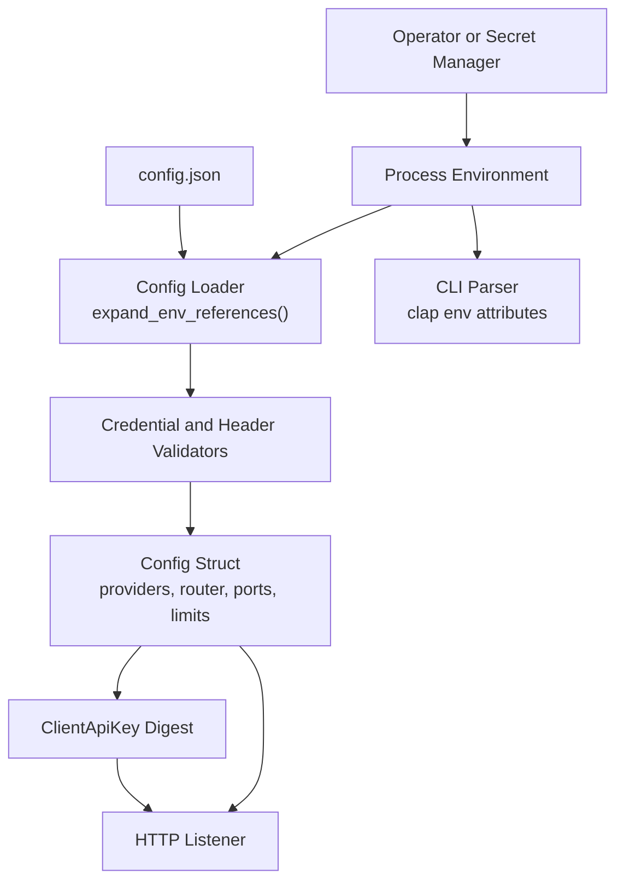
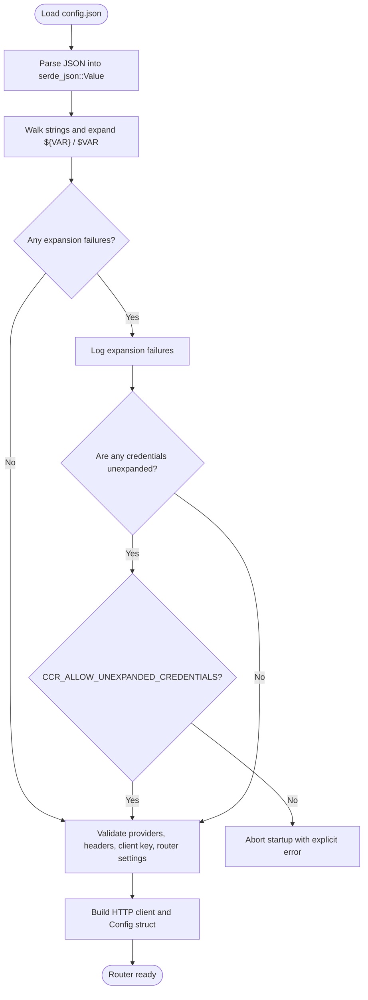
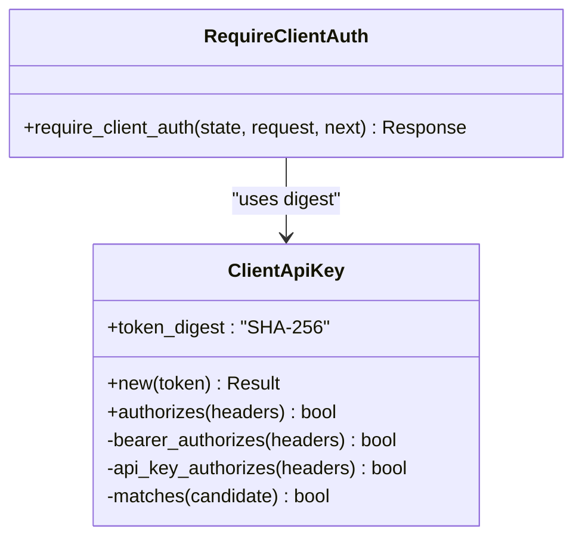
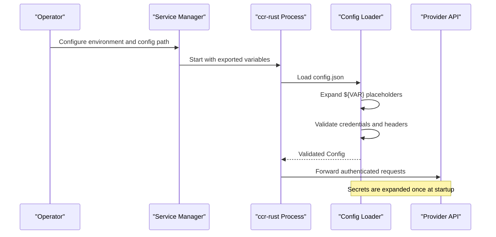
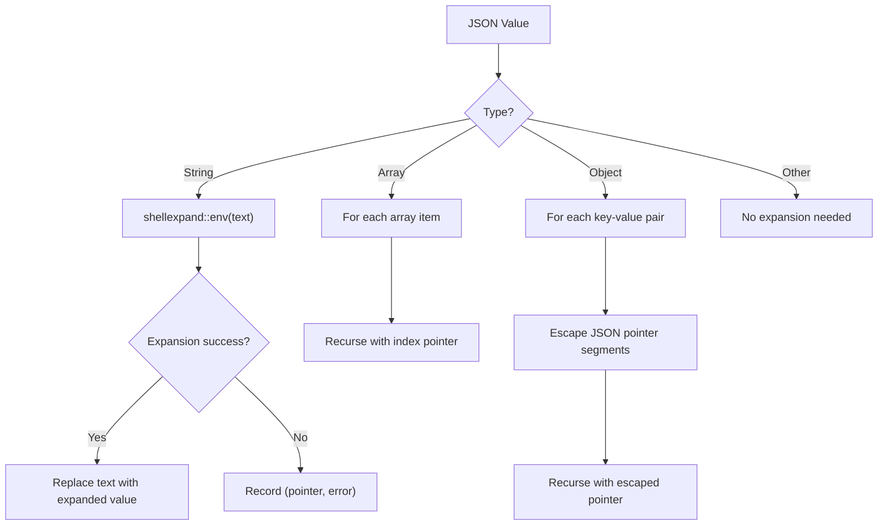
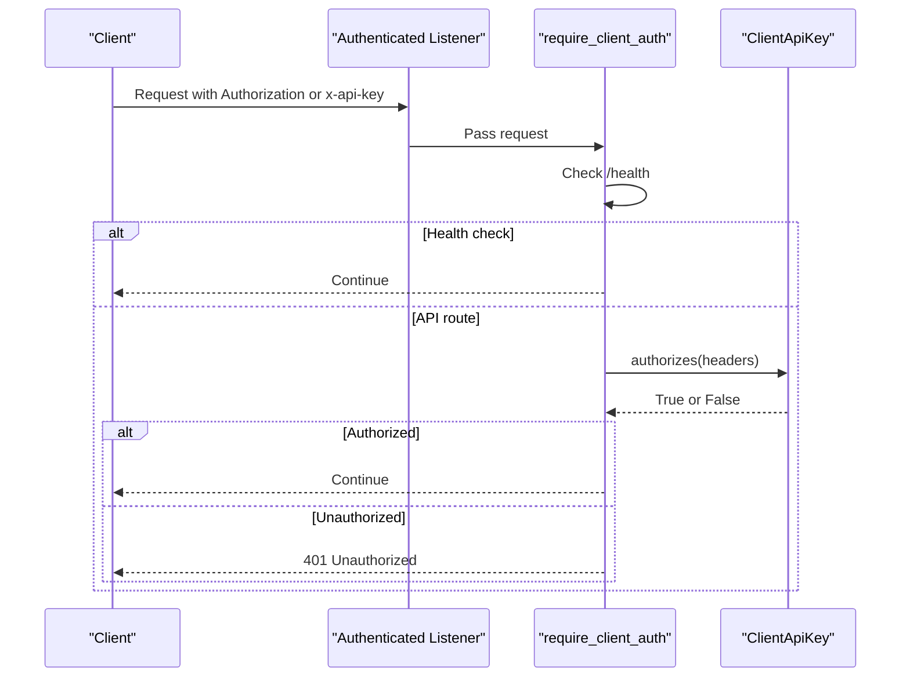
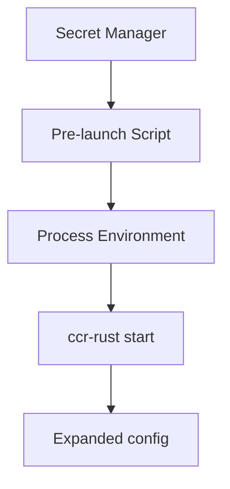
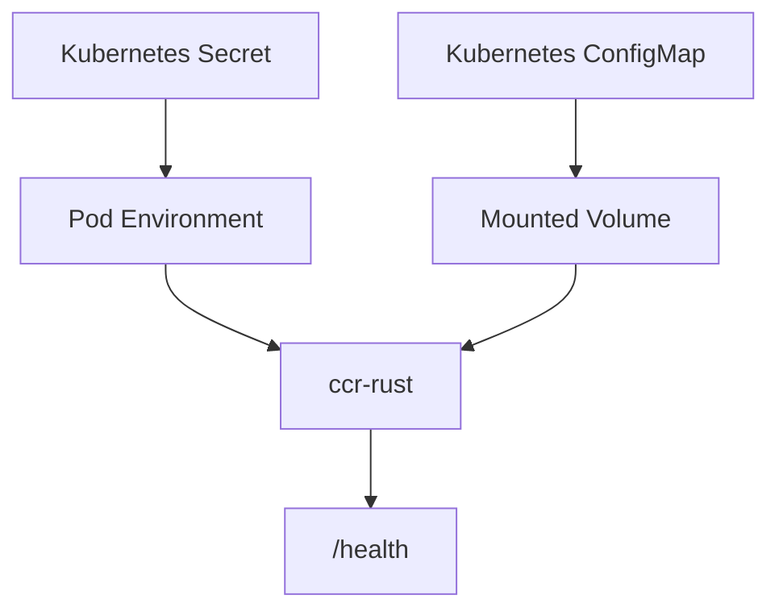

# Environment Variables and Secrets Management

<cite>
**Referenced Files in This Document**   
- [src/config/mod.rs](file://src/config/mod.rs)
- [src/config/types.rs](file://src/config/types.rs)
- [src/main.rs](file://src/main.rs)
- [src/client_auth.rs](file://src/client_auth.rs)
- [docs/configuration.md](file://docs/configuration.md)
- [docs/local-operation.md](file://docs/local-operation.md)
- [docs/auth-suites.md](file://docs/auth-suites.md)
- [README.md](file://README.md)
- [Dockerfile](file://Dockerfile)
</cite>

## Table of Contents
1. [Introduction](#introduction)
2. [Project Structure](#project-structure)
3. [Core Components](#core-components)
4. [Architecture Overview](#architecture-overview)
5. [Detailed Component Analysis](#detailed-component-analysis)
6. [Environment Variable Catalog](#environment-variable-catalog)
7. [Security Best Practices](#security-best-practices)
8. [Configuration File Encryption and Secret Injection](#configuration-file-encryption-and-secret-injection)
9. [Integration with External Secret Managers](#integration-with-external-secret-managers)
10. [Secure Configuration Examples](#secure-configuration-examples)
11. [Troubleshooting Guide](#troubleshooting-guide)
12. [Conclusion](#conclusion)

## Introduction
This document explains how CCR-Rust reads, expands, validates, and protects configuration values that contain secrets. It focuses on:

- The environment variable expansion mechanism used for provider API keys, client-facing tokens, and runtime settings.
- Every supported environment variable related to configuration, authentication, routing, persistence, and telemetry.
- Security guidance for file permissions, secret rotation, auditability, and process isolation.
- How to integrate CCR-Rust into secure deployment patterns such as Docker, systemd, Kubernetes, and external secret managers.
- Troubleshooting common failures caused by missing, unexpanded, or misconfigured secrets.

CCR-Rust is an LLM router: it accepts requests from coding tools and forwards them to configured upstream providers. Because the router carries both provider credentials and optional client-facing authentication, correct secrets management is essential for availability and security.

## Project Structure
The secrets-related behavior lives primarily in the configuration loader, CLI argument parsing, and client authentication layer:

| Area | Responsibility | Key files |
|---|---|---|
| Configuration loading | Reads JSON, expands `${VAR}` placeholders, validates credentials and headers | `src/config/mod.rs` |
| Configuration types | Defines provider, router, persistence, and runtime fields | `src/config/types.rs` |
| CLI entry point | Parses `--config`, `CCR_CONFIG`, `CCR_MAX_STREAMS`, dashboard and Redis overrides | `src/main.rs` |
| Client authentication | Validates and compares a client-facing API key without retaining the plaintext token | `src/client_auth.rs` |
| Documentation | Explains config locations, environment variables, suites, and local operation | `docs/configuration.md`, `docs/local-operation.md`, `docs/auth-suites.md` |
| Deployment artifacts | Container image defaults and health check | `Dockerfile` |



**Diagram sources**
- [src/config/mod.rs:1-120](file://src/config/mod.rs#L1-L120)
- [src/main.rs:100-160](file://src/main.rs#L100-L160)
- [src/client_auth.rs:21-90](file://src/client_auth.rs#L21-L90)

**Section sources**
- [src/config/mod.rs:1-120](file://src/config/mod.rs#L1-L120)
- [src/main.rs:100-160](file://src/main.rs#L100-L160)
- [src/client_auth.rs:21-90](file://src/client_auth.rs#L21-L90)
- [docs/configuration.md:1-80](file://docs/configuration.md#L1-L80)

## Core Components
### Environment Expansion Engine
CCR-Rust parses the configuration JSON first, then recursively walks every string value in the parsed document and substitutes `${VAR_NAME}` and `$VAR` references using the process environment. This design avoids breaking JSON when substituted values contain characters such as quotes.

Expansion details:

- Placeholders are expanded during configuration load, not at request time.
- Missing variables produce recorded expansion failures rather than immediate startup failure.
- A credential gate inspects those failures and rejects startup if provider API keys or extra headers failed to expand.
- An operator can override this behavior through `CCR_ALLOW_UNEXPANDED_CREDENTIALS=true`, but this is intended only for intentionally keyless local setups.



**Diagram sources**
- [src/config/mod.rs:1-120](file://src/config/mod.rs#L1-L120)
- [src/config/mod.rs:601-660](file://src/config/mod.rs#L601-L660)

**Section sources**
- [src/config/mod.rs:1-120](file://src/config/mod.rs#L1-L120)
- [src/config/mod.rs:601-660](file://src/config/mod.rs#L601-L660)
- [docs/configuration.md:18-65](file://docs/configuration.md#L18-L65)

### Client API Key Handling
When `CLIENT_API_KEY` is set, CCR-Rust stores only a SHA-256 digest of the token. Incoming requests are checked against this digest using constant-time comparison for both `Authorization: Bearer` and Anthropic-style `x-api-key` headers.

Key properties:

- Plaintext client API key is not retained after hashing.
- Empty, non-ASCII, whitespace-containing, or control-character tokens are rejected.
- The `/health` endpoint remains accessible even when client authentication is enabled.
- The normal `HOST`/`PORT` listener is unauthenticated; `AUTH_PORT` provides a separate gated listener when `CLIENT_API_KEY` is configured.



**Diagram sources**
- [src/client_auth.rs:21-90](file://src/client_auth.rs#L21-L90)
- [src/client_auth.rs:92-144](file://src/client_auth.rs#L92-L144)

**Section sources**
- [src/client_auth.rs:21-144](file://src/client_auth.rs#L21-L144)

### Configuration Validation
After expansion, CCR-Rust performs several validation steps relevant to secrets and runtime safety:

- Provider API keys and extra header values must expand successfully unless overridden.
- Extra headers are validated as valid `reqwest` header names and values.
- `CLIENT_API_KEY` must be configured together with `AUTH_PORT`.
- `AUTH_PORT` must differ from `PORT`.
- `AUTH_HOST` must parse as an IP address.
- Request body size defaults to 64 MiB and is clamped to a hard cap of 1 GiB.

**Section sources**
- [src/config/mod.rs:201-270](file://src/config/mod.rs#L201-L270)
- [src/config/mod.rs:540-660](file://src/config/mod.rs#L540-L660)

## Architecture Overview
The secrets flow through three main layers:

1. **Secret supply:** Operators export environment variables, source `.env` files, use service manager environment directives, or inject values through container orchestration.
2. **Expansion and validation:** The config loader expands placeholders and validates that sensitive fields did not remain as raw references.
3. **Runtime enforcement:** Client authentication uses a hashed token, while provider API keys are forwarded to upstream providers according to provider configuration.



**Diagram sources**
- [src/config/mod.rs:1-120](file://src/config/mod.rs#L1-L120)
- [src/main.rs:100-160](file://src/main.rs#L100-L160)
- [Dockerfile:1-19](file://Dockerfile#L1-L19)

**Section sources**
- [src/config/mod.rs:1-120](file://src/config/mod.rs#L1-L120)
- [src/main.rs:100-160](file://src/main.rs#L100-L160)
- [Dockerfile:1-19](file://Dockerfile#L1-L19)

## Detailed Component Analysis

### Environment Variable Expansion Mechanism
The expansion function recursively handles:

- String values: substitute `${VAR}` and `$VAR`.
- Arrays: recurse into each element.
- Objects: recurse into each value while tracking JSON pointers.
- Other JSON types: leave unchanged.

Missing variables are recorded with their JSON pointer and error message. This allows the credential gate to distinguish between a missing provider API key and unrelated placeholder text elsewhere in the configuration.



**Diagram sources**
- [src/config/mod.rs:18-65](file://src/config/mod.rs#L18-L65)

**Section sources**
- [src/config/mod.rs:18-65](file://src/config/mod.rs#L18-L65)

### Credential Gate
The credential gate prevents startup when provider credentials failed expansion. This protects operators from accidentally starting a router that sends literal placeholder text instead of real keys, which would cause widespread 401 responses and make diagnosis difficult.

Behavior:

- If `CCR_ALLOW_UNEXPANDED_CREDENTIALS` is truthy (`true`, `1`, `yes`, `on`), the gate passes.
- Otherwise, provider entries with unexpanded `api_key` or `extra_headers` values cause startup to fail.
- A heuristic scan also exists for runtime hints, but the startup gate relies on recorded expansion failures, not substring matching.

**Section sources**
- [src/config/mod.rs:67-120](file://src/config/mod.rs#L67-L120)
- [src/config/mod.rs:601-640](file://src/config/mod.rs#L601-L640)

### Client Authentication Lifecycle
Client authentication applies to the dedicated authenticated listener, not the default local listener.

Lifecycle:

1. `CLIENT_API_KEY` is read from the configuration file after expansion.
2. The token is validated and converted into a SHA-256 digest.
3. Incoming requests on the authenticated listener are checked against the digest.
4. `/health` bypasses authentication so liveness checks work.
5. Unauthenticated requests receive an `Unauthorized` response.



**Diagram sources**
- [src/client_auth.rs:92-144](file://src/client_auth.rs#L92-L144)
- [src/client_auth.rs:21-90](file://src/client_auth.rs#L21-L90)

**Section sources**
- [src/client_auth.rs:21-144](file://src/client_auth.rs#L21-L144)

## Environment Variable Catalog
This section lists every environment variable that affects CCR-Rust configuration, runtime behavior, or secret handling.

### Configuration and Startup
| Variable | Source | Purpose | Notes |
|---|---|---|---|
| `CCR_CONFIG` | CLI parser | Path to the configuration file | Overrides `--config`; defaults to `~/.claude-code-router/config.json` |
| `CCR_ALLOW_UNEXPANDED_CREDENTIALS` | Config loader | Override credential expansion validation | Truthy values include `true`, `1`, `yes`, `on` |
| `CCR_BROKER_SOCKET` | Config loader | Unix socket path for broker fallback | Overrides `BROKER_SOCKET` in the config file |

**Section sources**
- [src/main.rs:100-160](file://src/main.rs#L100-L160)
- [src/config/mod.rs:67-120](file://src/config/mod.rs#L67-L120)
- [src/config/mod.rs:540-560](file://src/config/mod.rs#L540-L560)

### Runtime Settings
| Variable | Source | Purpose | Default or Behavior |
|---|---|---|---|
| `CCR_MAX_STREAMS` | CLI parser | Maximum concurrent streams for `start` | `512` |
| `CCR_DASHBOARD_HOST` | CLI parser | Dashboard tracker host | `127.0.0.1` |
| `CCR_DASHBOARD_PORT` | CLI parser | Dashboard tracker port | `3456` |
| `CCR_REDIS_URL` | CLI parser | Redis URL override for `clear-stats` | Uses `Persistence.redis_url` if not provided |

**Section sources**
- [src/main.rs:100-160](file://src/main.rs#L100-L160)

### Configuration File Fields That Can Contain Secrets
These fields are read from the configuration file, not directly from the process environment, but they commonly contain `${ENV_VAR}` placeholders.

| Field | Meaning | Security Consideration |
|---|---|---|
| `Providers[].api_key` | Upstream provider API key | Must expand successfully unless intentionally overridden |
| `Providers[].extra_headers.*` | Additional HTTP headers sent to provider | Header names and values are validated; secrets here should not be logged |
| `CLIENT_API_KEY` | Client-facing bearer/API key for the authenticated listener | Stored as a digest, never logged |
| `PROXY_URL` | Optional HTTP proxy URL | May contain embedded credentials; keep out of logs |
| `Persistence.redis_url` | Optional Redis connection URL | May contain passwords or tokens |
| `DebugCapture.*` | Debug capture settings | Should remain disabled in production |

**Section sources**
- [src/config/mod.rs:480-600](file://src/config/mod.rs#L480-L600)
- [src/config/types.rs:539-620](file://src/config/types.rs#L539-L620)

### Known Limitations
- CCR-Rust does not automatically load `.env` files.
- Expansion happens once at startup; changing an environment variable requires restarting the router.
- `validate` alone does not prove that every environment variable was present or that the upstream provider accepted the key.

**Section sources**
- [docs/configuration.md:36-65](file://docs/configuration.md#L36-L65)
- [docs/local-operation.md:100-115](file://docs/local-operation.md#L100-L115)

## Security Best Practices

### File Permissions
- Keep configuration directories and credential files private.
- Use directory mode `0700` and credential file mode `0600` for suite layouts.
- Never commit `.env`, `credentials.env`, `runtime-credentials.json`, `ccr-api-key.env`, or similar secret-bearing files to version control.
- Add `.env` and related files to `.gitignore`.

**Section sources**
- [docs/auth-suites.md:60-120](file://docs/auth-suites.md#L60-L120)
- [docs/local-operation.md:55-85](file://docs/local-operation.md#L55-L85)

### Process Isolation
- Prefer one CCR process per account or suite.
- Use separate configurations, ports, log paths, and credential environments.
- Avoid shared fallback chains across accounts because routes can cascade between configured providers.
- Keep listeners on loopback unless explicitly exposed through a reverse proxy with TLS and access controls.

**Section sources**
- [docs/auth-suites.md:1-40](file://docs/auth-suites.md#L1-L40)
- [docs/auth-suites.md:120-200](file://docs/auth-suites.md#L120-L200)

### Secret Rotation
- Rotate provider API keys in the secret store, not by editing a running process's config.
- Restart the router after updating credentials.
- Verify the new key through `/v1/models` and a small test request before removing the old key.
- For Redis-backed persistence, ensure rotated suites use distinct prefixes to avoid mixing metrics state.

**Section sources**
- [docs/local-operation.md:100-120](file://docs/local-operation.md#L100-L120)
- [docs/auth-suites.md:150-200](file://docs/auth-suites.md#L150-L200)

### Audit Considerations
- Log startup and configuration warnings, but never log provider API keys or client API keys.
- Redact logs before sharing them externally.
- Inspect process environment carefully; inherited environment variables may leak secrets between suites.
- Use recovery and backup tools that exclude `.env`, `ccr-api-key.env`, and `runtime-credentials.json`.

**Section sources**
- [docs/local-operation.md:120-166](file://docs/local-operation.md#L120-L166)
- [scripts/ccr_recovery.py:60-100](file://scripts/ccr_recovery.py#L60-L100)

## Configuration File Encryption and Secret Injection
CCR-Rust itself does not implement configuration file encryption or decryption. The recommended pattern is to decrypt secrets outside the router process and expose them as environment variables before launching CCR-Rust.

Recommended approaches:

| Approach | How It Works | When to Use |
|---|---|---|
| Shell-sourced `.env` | Source a trusted shell file before starting the router | Development and manual operations |
| Service manager environment | Use `Environment=` in systemd, `launchd` plist, or equivalent | Linux services and macOS launch agents |
| Container environment | Use `-e` flags, environment files, or orchestration platform secrets | Docker and containerized deployments |
| Pre-launch decryption script | Decrypt secrets into a temporary environment and exec the router | External secret managers |
| Separate suite directories | One isolated suite per account with its own credential file | Multi-account setups |

Important constraint: CCR-Rust does not read `.env` files itself. Any `.env` usage must be sourced by the shell that starts the router.

**Section sources**
- [docs/configuration.md:36-65](file://docs/configuration.md#L36-L65)
- [docs/local-operation.md:100-120](file://docs/local-operation.md#L100-L120)
- [docs/auth-suites.md:60-120](file://docs/auth-suites.md#L60-L120)

## Integration with External Secret Managers
External secret managers fit naturally into CCR-Rust because the router expects secrets in the process environment.

### AWS Secrets Manager, GCP Secret Manager, HashiCorp Vault, or Similar
1. Retrieve the secret through your secret manager CLI or SDK.
2. Export the value into the environment under the expected variable name.
3. Start CCR-Rust with the decrypted environment.
4. Do not pass secrets through command-line arguments or logs.
5. Restart the router whenever secrets rotate.

Example concept:



[No sources needed since this diagram shows conceptual workflow, not actual code structure]

### Kubernetes Integration
Use a ConfigMap for non-sensitive configuration and a Secret for sensitive values. Mount the Secret as environment variables and reference the mounted config file path via `CCR_CONFIG`.



[No sources needed since this diagram shows conceptual workflow, not actual code structure]

### Docker Integration
The Dockerfile exposes port `3456`, runs as a non-root user named `ccr`, and defaults to starting the router with `--host 0.0.0.0`. In production, prefer passing secrets through container environment variables and mounting configuration read-only.

**Section sources**
- [Dockerfile:1-19](file://Dockerfile#L1-L19)
- [README.md:70-110](file://README.md#L70-L110)

## Secure Configuration Examples

### Minimal Single-Provider Setup
Use a minimal configuration with only the providers you need, and place the API key in the environment.

Recommended layout:

- Configuration file: `~/.claude-code-router/config.json`
- API key: exported environment variable such as `DEEPSEEK_API_KEY`
- Listener: `127.0.0.1:3456`

Configuration concept:

```json
{
  "Providers": [
    {
      "name": "deepseek",
      "api_base_url": "https://api.deepseek.com",
      "api_key": "${DEEPSEEK_API_KEY}",
      "models": ["deepseek-chat"]
    }
  ],
  "Router": {
    "default": "deepseek,deepseek-chat"
  },
  "PORT": 3456,
  "HOST": "127.0.0.1"
}
```

**Section sources**
- [README.md:110-190](file://README.md#L110-L190)
- [docs/configuration.md:18-65](file://docs/configuration.md#L18-L65)

### Multi-Account Suite Layout
Separate personal and corporate accounts using independent directories, credential files, and ports.

Recommended layout:

```text
~/.claude-code-router/suites/personal/
  config.json
  credentials.env
  logs/
~/.claude-code-router/suites/corporate/
  config.json
  credentials.env
  logs/
```

Each suite should:

- Use `0700` directories and `0600` credential files.
- Source only its own `credentials.env`.
- Run on a unique loopback port.
- Use disjoint provider names and routes.
- Avoid mixing fallback chains across accounts.

**Section sources**
- [docs/auth-suites.md:60-200](file://docs/auth-suites.md#L60-L200)

### Authenticated Local Listener
Enable client authentication by setting `CLIENT_API_KEY` and `AUTH_PORT`.

Rules:

- `CLIENT_API_KEY` and `AUTH_PORT` must be configured together.
- `AUTH_PORT` must differ from `PORT`.
- Point external clients or proxies at the authenticated listener.
- Keep the normal `HOST`/`PORT` listener on loopback.

**Section sources**
- [src/config/mod.rs:201-240](file://src/config/mod.rs#L201-L240)
- [src/client_auth.rs:92-144](file://src/client_auth.rs#L92-L144)

## Troubleshooting Guide

### All Providers Return 401 After Startup
**Likely cause:** Provider API keys were not expanded and the literal placeholder was sent to upstream APIs.

**Checklist:**

1. Confirm the referenced environment variables exist in the router process environment.
2. Check whether the router was started through the credential launcher or with the required variables exported.
3. Look for startup warnings about failed environment expansion.
4. If starting manually outside the launcher, export all required variables before `ccr-rust start`.
5. Only use `CCR_ALLOW_UNEXPANDED_CREDENTIALS=true` for intentionally keyless local setups.

**Section sources**
- [src/config/mod.rs:67-120](file://src/config/mod.rs#L67-L120)
- [src/config/mod.rs:601-640](file://src/config/mod.rs#L601-L640)
- [docs/configuration.md:36-65](file://docs/configuration.md#L36-L65)

### CLIENT_API_KEY Not Accepted
**Likely causes:**

- The key was not expanded from the configuration.
- The request did not include a valid `Authorization: Bearer` or `x-api-key` header.
- The request went to the wrong listener.
- The key contains whitespace, non-ASCII characters, or control characters.

**Checklist:**

1. Ensure `CLIENT_API_KEY` and `AUTH_PORT` are both configured.
2. Send authenticated requests to the authenticated listener, not the default local listener.
3. Use a clean, ASCII-only token.
4. Verify the token matches the configured value exactly.
5. Remember that the stored digest is not recoverable; regenerate the token if lost.

**Section sources**
- [src/config/mod.rs:201-240](file://src/config/mod.rs#L201-L240)
- [src/client_auth.rs:21-90](file://src/client_auth.rs#L21-L90)
- [src/client_auth.rs:92-144](file://src/client_auth.rs#L92-L144)

### .env Changes Do Not Take Effect
**Cause:** CCR-Rust does not reload `.env` files automatically.

**Resolution:**

1. Source the `.env` file before starting the router.
2. Restart the router after changing credentials.
3. Use service restart commands rather than expecting live reload.
4. Verify the process environment includes the updated variables.

**Section sources**
- [docs/configuration.md:36-65](file://docs/configuration.md#L36-L65)
- [docs/local-operation.md:100-120](file://docs/local-operation.md#L100-L120)

### validate Passes But Requests Still Fail
**Cause:** `validate` checks configuration structure and some constraints, but it does not authenticate to upstream providers and does not prove every environment variable was present.

**Resolution:**

1. Run a health check: `/health`.
2. List models: `/v1/models`.
3. Send a small test request.
4. Inspect logs for expansion warnings or upstream errors.
5. Confirm provider endpoints, protocols, and headers match the provider documentation.

**Section sources**
- [docs/local-operation.md:120-166](file://docs/local-operation.md#L120-L166)
- [docs/configuration.md:40-65](file://docs/configuration.md#L40-L65)

### AUTH_PORT Conflict or Misconfiguration
**Symptoms:** Startup fails with messages about `CLIENT_API_KEY`, `AUTH_PORT`, `PORT`, or `AUTH_HOST`.

**Resolution:**

- Set `CLIENT_API_KEY` and `AUTH_PORT` together.
- Ensure `AUTH_PORT` differs from `PORT`.
- Ensure `AUTH_HOST` is a valid IP address.
- Keep the normal listener on loopback unless a reverse proxy handles exposure.

**Section sources**
- [src/config/mod.rs:201-240](file://src/config/mod.rs#L201-L240)

## Conclusion
CCR-Rust’s secrets model is deliberately simple and explicit:

- Secrets come from the process environment.
- Placeholders in the configuration file are expanded once at startup.
- Provider credentials and client API keys are validated early.
- Client API keys are stored as hashes, not plaintext.
- Sensitive values should be supplied through secure process isolation, proper file permissions, and external secret managers.

For most deployments, the safest pattern is to keep configuration files free of plaintext secrets, supply values through environment variables managed by the service manager or secret manager, run one router instance per account or workload, and verify secrets through health and model endpoints after rotation.