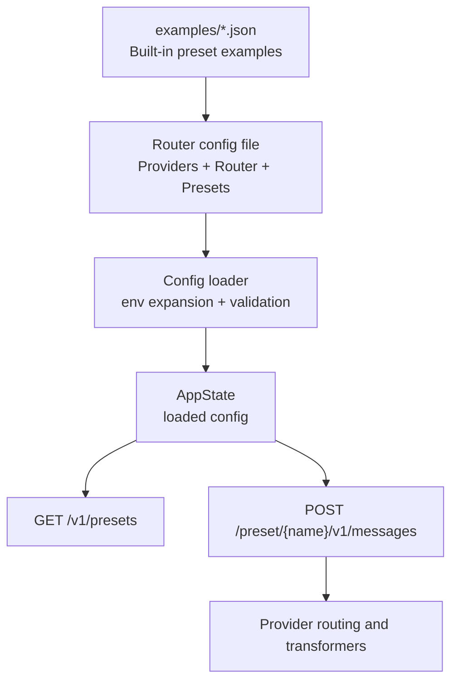
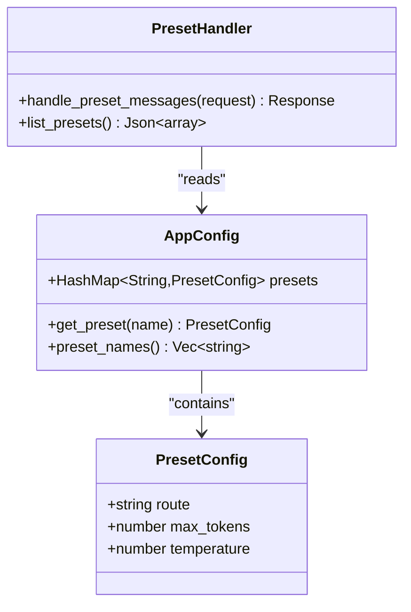
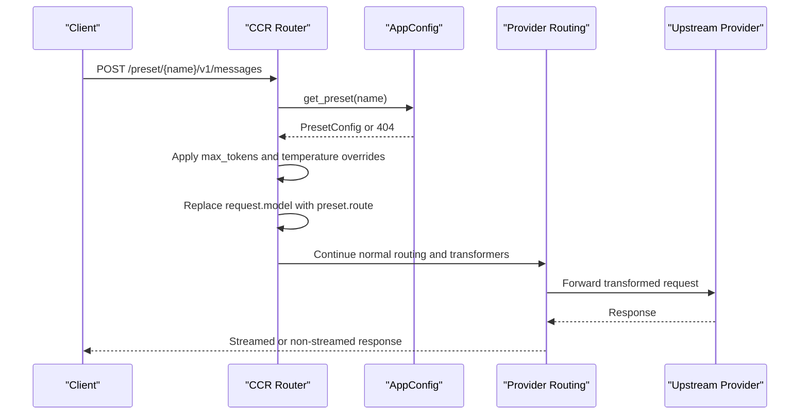
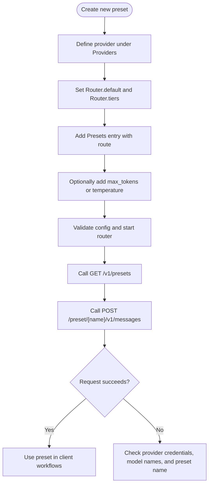
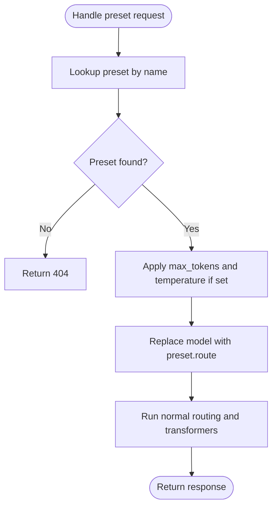
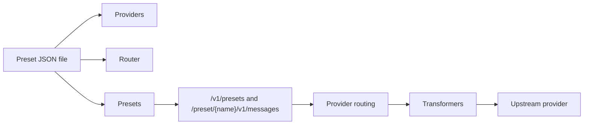

# Preset Configurations

<cite>
**Referenced Files in This Document**   
- [coding-plans.json](file://examples/coding-plans.json)
- [openrouter-free.json](file://examples/openrouter-free.json)
- [sensenova.json](file://examples/sensenova.json)
- [presets.md](file://docs/presets.md)
- [types.rs](file://src/config/types.rs)
- [mod.rs](file://src/config/mod.rs)
- [integration_preset_cli.rs](file://tests/integration_preset_cli.rs)
</cite>

## Table of Contents
1. [Introduction](#introduction)
2. [Project Structure](#project-structure)
3. [Core Components](#core-components)
4. [Architecture Overview](#architecture-overview)
5. [Detailed Component Analysis](#detailed-component-analysis)
6. [Dependency Analysis](#dependency-analysis)
7. [Performance Considerations](#performance-considerations)
8. [Troubleshooting Guide](#troubleshooting-guide)
9. [Conclusion](#conclusion)
10. [Appendices](#appendices)

## Introduction
Preset configurations in CCR-Rust are named routing shortcuts that let clients select a provider and model without repeatedly specifying the full route string. They also support limited parameter overrides, such as maximum token count and temperature, so common deployment patterns can be reused safely.

The repository ships three example presets:

| Example file | Purpose |
|---|---|
| [coding-plans.json](file://examples/coding-plans.json) | Shows multiple providers with two named presets for coding-oriented models. |
| [openrouter-free.json](file://examples/openrouter-free.json) | Demonstrates a free-tier OpenRouter catalog with tiered fallback ordering. |
| [sensenova.json](file://examples/sensenova.json) | Demonstrates SenseNova’s token-plan provider settings and forced reasoning behavior. |

Presets simplify deployments by grouping provider credentials, models, transformers, and routing rules into reusable files. They do not isolate accounts, and they are not a credential store.

**Section sources**
- [coding-plans.json:1-36](file://examples/coding-plans.json#L1-L36)
- [openrouter-free.json:1-54](file://examples/openrouter-free.json#L1-L54)
- [sensenova.json:1-29](file://examples/sensenova.json#L1-L29)
- [presets.md:1-15](file://docs/presets.md#L1-L15)

## Project Structure
Preset-related configuration lives in two places:

1. **Example preset files** under `examples/` provide ready-to-use starting points.
2. **Runtime preset handling** is implemented in the Rust source tree under `src/config/` and exposed through HTTP endpoints.

**Diagram sources**
- [coding-plans.json:1-36](file://examples/coding-plans.json#L1-L36)
- [openrouter-free.json:1-54](file://examples/openrouter-free.json#L1-L54)
- [sensenova.json:1-29](file://examples/sensenova.json#L1-L29)
- [mod.rs:350-353](file://src/config/mod.rs#L350-L353)
- [mod.rs:425-428](file://src/config/mod.rs#L425-L428)
- [mod.rs:505-507](file://src/config/mod.rs#L505-L507)
- [mod.rs:551-553](file://src/config/mod.rs#L551-L553)
- [mod.rs:1111-1126](file://src/config/mod.rs#L1111-L1126)
- [mod.rs:1246-1272](file://src/config/mod.rs#L1246-L1272)

**Section sources**
- [coding-plans.json:1-36](file://examples/coding-plans.json#L1-L36)
- [openrouter-free.json:1-54](file://examples/openrouter-free.json#L1-L54)
- [sensenova.json:1-29](file://examples/sensenova.json#L1-L29)
- [mod.rs:350-353](file://src/config/mod.rs#L350-L353)
- [mod.rs:425-428](file://src/config/mod.rs#L425-L428)
- [mod.rs:505-507](file://src/config/mod.rs#L505-L507)
- [mod.rs:551-553](file://src/config/mod.rs#L551-L553)
- [mod.rs:1111-1126](file://src/config/mod.rs#L1111-L1126)
- [mod.rs:1246-1272](file://src/config/mod.rs#L1246-L1272)

## Core Components
A preset configuration has two layers:

1. **Configuration schema**: The top-level `Presets` object maps a preset name to a `PresetConfig`.
2. **HTTP API**: `/v1/presets` lists configured presets; `/preset/{name}/v1/messages` applies a preset before normal routing.

### Preset data structure
At the code level, a preset is represented by `PresetConfig`, which contains:

| Field | Meaning |
|---|---|
| `route` | Full provider-and-model route string, such as `provider,model`. |
| `max_tokens` | Optional override for request maximum tokens. |
| `temperature` | Optional override for request temperature. |

Only these three fields are implemented as preset parameters. Arbitrary request fields or extra provider parameters are not applied by presets.

**Diagram sources**
- [types.rs:350-353](file://src/config/types.rs#L350-L353)
- [mod.rs:425-428](file://src/config/mod.rs#L425-L428)
- [mod.rs:505-507](file://src/config/mod.rs#L505-L507)
- [mod.rs:551-553](file://src/config/mod.rs#L551-L553)
- [mod.rs:1111-1126](file://src/config/mod.rs#L1111-L1126)
- [mod.rs:1246-1272](file://src/config/mod.rs#L1246-L1272)

**Section sources**
- [types.rs:350-353](file://src/config/types.rs#L350-L353)
- [mod.rs:425-428](file://src/config/mod.rs#L425-L428)
- [mod.rs:505-507](file://src/config/mod.rs#L505-L507)
- [mod.rs:551-553](file://src/config/mod.rs#L551-L553)
- [mod.rs:1111-1126](file://src/config/mod.rs#L1111-L1126)
- [mod.rs:1246-1272](file://src/config/mod.rs#L1246-L1272)

## Architecture Overview
The preset workflow replaces the incoming request model with the preset’s route, applies supported parameter overrides, and then continues through ordinary provider routing and transformers.

**Diagram sources**
- [mod.rs:1246-1272](file://src/config/mod.rs#L1246-L1272)
- [mod.rs:551-553](file://src/config/mod.rs#L551-L553)
- [mod.rs:1111-1126](file://src/config/mod.rs#L1111-L1126)

**Section sources**
- [mod.rs:1246-1272](file://src/config/mod.rs#L1246-L1272)
- [presets.md:26-44](file://docs/presets.md#L26-L44)

## Detailed Component Analysis

### Built-in example presets

#### coding-plans.json
This file demonstrates:

- Two providers: one using the Anthropic protocol and another using an Anthropic-compatible endpoint with a transformer chain.
- A default router route and a single active tier.
- Two named presets: one for a Z.AI model and one for a Kimi model.
- Disabled persistence and debug capture for local testing.
- Environment variable references for API keys.

Key characteristics:

| Section | Behavior |
|---|---|
| Providers | Define provider names, base URLs, protocols, models, and optional transformers. |
| Router | Sets the default route and the active tier list. |
| Presets | Map friendly names to provider/model routes. |
| Persistence | Set to `none` for stateless operation. |
| Network | Binds to localhost port 3456 by default. |

**Section sources**
- [coding-plans.json:1-36](file://examples/coding-plans.json#L1-L36)
- [presets.md:17-24](file://docs/presets.md#L17-L24)

#### openrouter-free.json
This file demonstrates a free-tier OpenRouter deployment:

- One OpenRouter provider exposing several free model IDs.
- Zero-cost pricing metadata.
- A custom `User-Agent` header aligned with CLI expectations.
- Transformer chain including Anthropic and OpenAI compatibility.
- Tiered fallback order with strict ordering enabled.
- Disabled persistence.

Important notes from the embedded README:

- The free tier is account-wide.
- Free endpoints may gate requests depending on the `User-Agent` header.
- Operators should export `OPENROUTER_API_KEY` before validating or starting the router.

**Section sources**
- [openrouter-free.json:1-54](file://examples/openrouter-free.json#L1-L54)

#### sensenova.json
This file demonstrates a SenseNova token-plan setup:

- One OpenAI-compatible provider named `sensenova`.
- Environment variable reference for the API key.
- Model `sensenova-6.8-flash-lite`.
- Provider-level settings that force adaptive thinking and set reasoning effort to `none`.
- Strict tier ordering.
- Disabled persistence.

This preset is useful when a provider requires non-thinking mode to include adaptive thinking state.

**Section sources**
- [sensenova.json:1-29](file://examples/sensenova.json#L1-L29)
- [types.rs:358-369](file://src/config/types.rs#L358-L369)

### Using built-in presets
To use a built-in preset:

1. Copy the desired file from `examples/` into your working directory.
2. Export required environment variables, such as `ZAI_API_KEY`, `KIMI_API_KEY`, `OPENROUTER_API_KEY`, or `CCR_SENSENOVA_API_KEY`.
3. Start the router with the copied file as its configuration.
4. Call `/v1/presets` to inspect available preset names and their values.
5. Send requests to `/preset/{name}/v1/messages`.

The request body must include a `model` field even though the preset replaces it. The preset route always wins over the submitted model.

**Section sources**
- [presets.md:26-44](file://docs/presets.md#L26-L44)
- [integration_preset_cli.rs:1-155](file://tests/integration_preset_cli.rs#L1-L155)

### Customizing presets
Presets do not inherit from other presets. There is no preset inheritance mechanism in this implementation. Instead, customization follows these patterns:

- **Copy and rename**: Duplicate an existing example file and edit its `Providers`, `Router`, and `Presets` sections.
- **Add new presets**: Extend the top-level `Presets` object with additional entries.
- **Change defaults**: Edit `Router.default` and `Router.tiers`.
- **Tighten routing**: Enable `strictTierOrder` when fallback order must be preserved.
- **Override parameters**: Use `max_tokens` or `temperature` inside a preset entry when you need a stable value for that preset.

Do not rely on arbitrary preset fields beyond `route`, `max_tokens`, and `temperature`.

**Section sources**
- [presets.md:17-24](file://docs/presets.md#L17-L24)
- [mod.rs:1246-1272](file://src/config/mod.rs#L1246-L1272)

### Creating new presets
A minimal preset definition consists of a name and a route. A complete preset file should also define at least one provider and a router.

Recommended steps:

1. Create a JSON file with a `Providers` array containing the target provider.
2. Configure `Router.default` and `Router.tiers` to include the provider and model.
3. Add a `Presets` object mapping a readable name to `{"route": "provider,model"}`.
4. Optionally add `max_tokens` or `temperature` to the preset if you want those values to override client input.
5. Validate the configuration and start the router.

Validation rules relevant to presets:

- Preset names come from the top-level `Presets` object.
- Referenced providers and models must exist under `Providers`.
- Unknown preset names return 404 for valid message requests.
- Only `/preset/{name}/v1/messages` is registered for preset routing.
- `/preset/{name}/v1/responses` and `/preset/{name}/v1/chat/completions` are not registered.

**Diagram sources**
- [presets.md:17-24](file://docs/presets.md#L17-L24)
- [mod.rs:1111-1126](file://src/config/mod.rs#L1111-L1126)
- [mod.rs:1246-1272](file://src/config/mod.rs#L1246-L1272)

**Section sources**
- [presets.md:17-24](file://docs/presets.md#L17-L24)
- [mod.rs:1111-1126](file://src/config/mod.rs#L1111-L1126)
- [mod.rs:1246-1272](file://src/config/mod.rs#L1246-L1272)

### Preset override semantics
When a preset request arrives:

1. The router looks up the preset by name.
2. If the preset exists, it applies `max_tokens` and `temperature` only when they are present in the preset.
3. It replaces the request’s `model` field with the preset’s `route`.
4. Normal provider routing and transformers continue after the replacement.

This means:

- Unset preset parameters leave request values unchanged.
- Preset overrides take precedence over request values.
- Provider transformers still run after the preset route is applied.
- Fallback and search routing behave like ordinary routing after the preset replaces the model.

**Diagram sources**
- [mod.rs:1246-1272](file://src/config/mod.rs#L1246-L1272)

**Section sources**
- [mod.rs:1246-1272](file://src/config/mod.rs#L1246-L1272)
- [presets.md:33-44](file://docs/presets.md#L33-L44)

### Validation and error handling
Preset validation is part of the broader configuration validation pipeline:

- Environment variable references in provider credentials are expanded at startup.
- Unexpanded credential references cause startup failure unless explicitly allowed.
- Invalid `extra_headers` are rejected during configuration loading.
- Unknown preset names return 404 for otherwise valid preset message requests.
- The preset listing endpoint returns an array of preset objects.

Integration tests verify:

- The CLI starts with a configuration containing presets.
- `/v1/presets` returns the configured preset name.
- A known preset route forwards to the upstream provider.
- An unknown preset returns 404.
- Unsupported preset endpoints such as `/preset/{name}/v1/responses` return 404.

**Section sources**
- [mod.rs:1-120](file://src/config/mod.rs#L1-L120)
- [mod.rs:1111-1126](file://src/config/mod.rs#L1111-L1126)
- [mod.rs:1246-1272](file://src/config/mod.rs#L1246-L1272)
- [integration_preset_cli.rs:1-155](file://tests/integration_preset_cli.rs#L1-L155)

## Dependency Analysis
Presets depend on:

- **Providers**: A preset route refers to a provider name and model defined under `Providers`.
- **Router**: Presets delegate to ordinary routing, tiers, `ignoreDirect`, and search routing after replacing the model.
- **Transformers**: Provider transformers run after the preset route is applied.
- **HTTP layer**: The preset handler reads `AppState.config` and exposes `/preset/{name}/v1/messages` and `/v1/presets`.

**Diagram sources**
- [coding-plans.json:1-36](file://examples/coding-plans.json#L1-L36)
- [openrouter-free.json:1-54](file://examples/openrouter-free.json#L1-L54)
- [sensenova.json:1-29](file://examples/sensenova.json#L1-L29)
- [mod.rs:425-428](file://src/config/mod.rs#L425-L428)
- [mod.rs:1111-1126](file://src/config/mod.rs#L1111-L1126)
- [mod.rs:1246-1272](file://src/config/mod.rs#L1246-L1272)

**Section sources**
- [mod.rs:425-428](file://src/config/mod.rs#L425-L428)
- [mod.rs:1111-1126](file://src/config/mod.rs#L1111-L1126)
- [mod.rs:1246-1272](file://src/config/mod.rs#L1246-L1272)

## Performance Considerations
Presets have negligible runtime overhead compared to provider calls. Their main performance impact is indirect:

- **Predictable routing**: Presets reduce client-side routing logic and avoid accidental selection of slow or expensive models.
- **Token limits**: Setting `max_tokens` in a preset prevents callers from accidentally requesting very long outputs.
- **Fallback tiers**: Multiple tiers can improve resilience but increase routing complexity.
- **Strict tier order**: Enabling `strictTierOrder` reduces ambiguity in fallback behavior.

Presets themselves do not cache responses or bypass transformers.

[No sources needed since this section provides general guidance]

## Troubleshooting Guide

### Common issues

| Symptom | Likely cause | Resolution |
|---|---|---|
| `/preset/{name}/v1/messages` returns 404 | Preset name is misspelled or missing from `Presets`. | Check `/v1/presets` and confirm the exact name. |
| Request reaches wrong provider | Preset `route` does not match the intended provider/model. | Edit the preset’s `route` field. |
| Preset parameters are ignored | The field is not `route`, `max_tokens`, or `temperature`. | Use only supported preset fields. |
| Startup fails with unexpanded credential references | Environment variables were not exported. | Export required variables or use the credential launcher. |
| `/preset/{name}/v1/responses` returns 404 | Only `/preset/{name}/v1/messages` is registered. | Use the messages endpoint or Codex profile selection. |
| Free OpenRouter models fail | Account-wide free quota exhausted or `User-Agent` mismatch. | Check quotas and keep the documented header. |

### Credential expansion
Credential placeholders such as `${VAR}` are expanded before startup. Missing variables produce explicit errors instead of silently sending literal placeholder strings. You can allow unexpanded credentials only when intentionally running a loopback-only setup without real provider authentication.

**Section sources**
- [presets.md:1-15](file://docs/presets.md#L1-L15)
- [presets.md:46-91](file://docs/presets.md#L46-L91)
- [mod.rs:1-120](file://src/config/mod.rs#L1-L120)
- [integration_preset_cli.rs:1-155](file://tests/integration_preset_cli.rs#L1-L155)

## Conclusion
Preset configurations are a lightweight way to package provider setups, routing rules, and safe parameter overrides. The built-in examples cover coding-focused routing, free-tier OpenRouter usage, and SenseNova token-plan behavior. Presets do not inherit from each other; customization is done by copying, editing, and extending the top-level `Presets` object. For predictable deployments, prefer explicit preset definitions, validate credentials at startup, and test both `/v1/presets` and `/preset/{name}/v1/messages` before relying on them in production clients.

[No sources needed since this section summarizes without analyzing specific files]

## Appendices

### API summary for presets

| Endpoint | Method | Purpose | Notes |
|---|---|---|---|
| `/v1/presets` | GET | List configured presets | Returns an array of preset objects. |
| `/preset/{name}/v1/messages` | POST | Send a request routed through a preset | Requires a `model` field in the request body. |
| `/preset/{name}/v1/responses` | Not registered | Not supported | Returns 404. |
| `/preset/{name}/v1/chat/completions` | Not registered | Not supported | Returns 404. |

**Section sources**
- [mod.rs:1111-1126](file://src/config/mod.rs#L1111-L1126)
- [mod.rs:1246-1272](file://src/config/mod.rs#L1246-L1272)
- [presets.md:26-44](file://docs/presets.md#L26-L44)
- [integration_preset_cli.rs:1-155](file://tests/integration_preset_cli.rs#L1-L155)