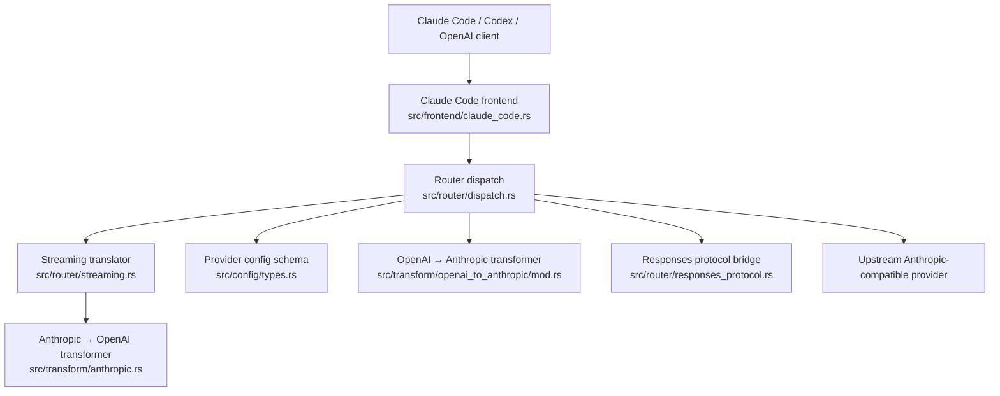
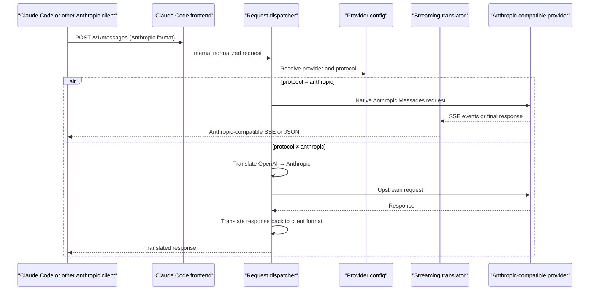
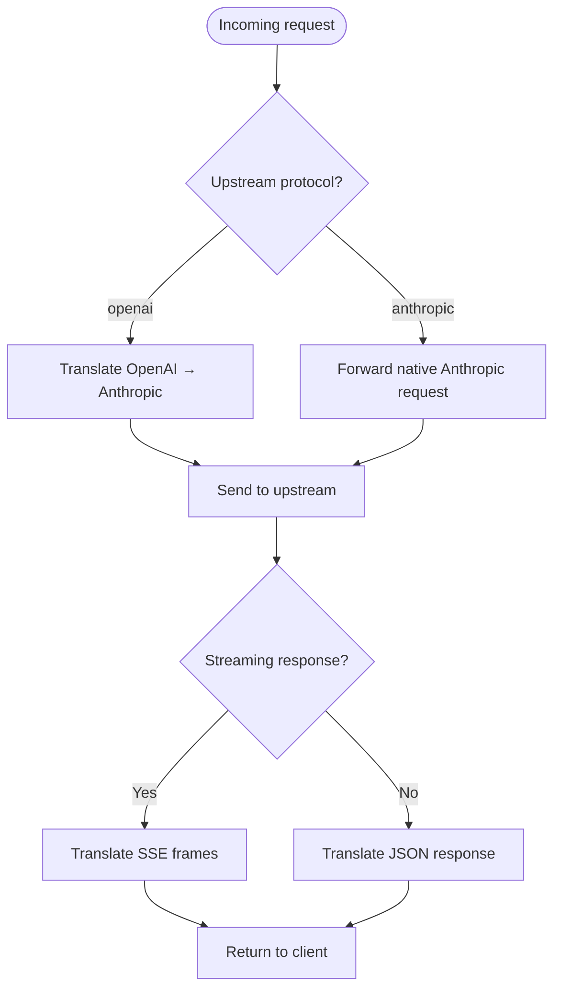
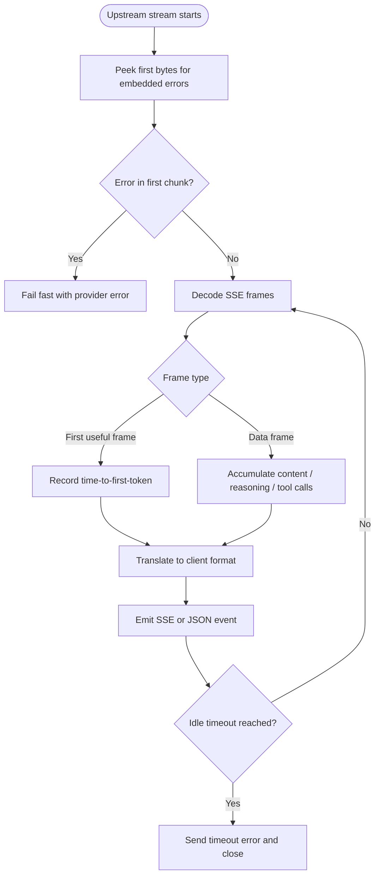
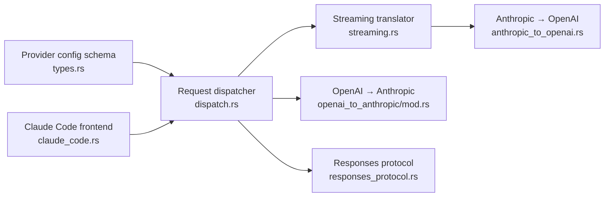

# Anthropic Provider

<cite>
**Referenced Files in This Document**   
- [README.md](file://README.md)
- [configuration.md](file://docs/configuration.md)
- [claude_code_setup.md](file://docs/claude_code_setup.md)
- [codex_setup.md](file://docs/codex_setup.md)
- [zai_anthropic_endpoint.md](file://docs/zai_anthropic_endpoint.md)
- [types.rs](file://src/config/types.rs)
- [anthropic.rs](file://src/transform/anthropic.rs)
- [openai_to_anthropic/mod.rs](file://src/transform/openai_to_anthropic/mod.rs)
- [anthropic_to_openai.rs](file://src/transform/anthropic_to_openai.rs)
- [claude_code.rs](file://src/frontend/claude_code.rs)
- [responses_protocol.rs](file://src/router/responses_protocol.rs)
- [streaming.rs](file://src/router/streaming.rs)
- [dispatch.rs](file://src/router/dispatch.rs)
</cite>

## Table of Contents
1. [Introduction](#introduction)
2. [Project Structure](#project-structure)
3. [Core Components](#core-components)
4. [Architecture Overview](#architecture-overview)
5. [Detailed Component Analysis](#detailed-component-analysis)
6. [Dependency Analysis](#dependency-analysis)
7. [Performance Considerations](#performance-considerations)
8. [Troubleshooting Guide](#troubleshooting-guide)
9. [Conclusion](#conclusion)
10. [Appendices](#appendices)

## Introduction
This document explains how to configure and operate the Anthropic provider in CCR-Rust. It covers:

- Configuring an upstream provider whose `protocol` is `anthropic`.
- Supplying the API key through environment variables.
- Selecting custom base URLs, model names, version headers, authentication headers, extra headers, and rate-limit behavior.
- Routing Anthropic requests as a primary or fallback tier.
- Integrating Claude Code and Codex clients through CCR-Rust.
- Request/response transformations between Anthropic and OpenAI wire formats.
- Streaming behavior, timeout configuration, and error handling.

CCR-Rust accepts both Anthropic-style and OpenAI-style client requests and translates them to the configured upstream protocol. When the upstream is Anthropic-compatible, CCR forwards native Anthropic fields such as content blocks, tool definitions, thinking blocks, and stop sequences without unnecessary conversion.

## Project Structure
Anthropic-related functionality spans configuration types, frontend detection, request/response transformers, streaming translation, and documentation examples.



**Diagram sources**
- [claude_code.rs:1-200](file://src/frontend/claude_code.rs#L1-L200)
- [dispatch.rs:1-200](file://src/router/dispatch.rs#L1-L200)
- [streaming.rs:1-200](file://src/router/streaming.rs#L1-L200)
- [types.rs:200-633](file://src/config/types.rs#L200-L633)
- [openai_to_anthropic/mod.rs:1-200](file://src/transform/openai_to_anthropic/mod.rs#L1-L200)
- [anthropic.rs:1-200](file://src/transform/anthropic.rs#L1-L200)
- [responses_protocol.rs:1-200](file://src/router/responses_protocol.rs#L1-L200)

**Section sources**
- [README.md:1-120](file://README.md#L1-L120)
- [configuration.md:1-120](file://docs/configuration.md#L1-L120)

## Core Components
The Anthropic provider configuration is defined by the `Provider` struct and related router settings. The most important options are:

| Option | Type | Default | Meaning for Anthropic |
|---|---|---:|---|
| `name` | string | — | Unique provider identifier used in routes. |
| `api_base_url` | string | — | Full upstream base URL; CCR appends `/messages` when using `protocol=anthropic`. |
| `api_key` | string | — | Upstream secret, expanded from `${VAR}` at process startup. |
| `models` | array of strings | — | Allowed model identifiers advertised to clients and selected by routes. |
| `protocol` | enum | `openai` | Set to `anthropic` to send native Anthropic Messages requests. |
| `anthropic_version` | optional string | Canonical Anthropic-compatible default | Sets the `anthropic-version` header for Anthropic endpoints. |
| `auth_header` | optional string | `x-api-key` | Use `authorization` for providers that require `Authorization: Bearer`. |
| `extra_headers` | optional map | empty | Additional HTTP headers sent to this provider. |
| `honor_ratelimit_headers` | boolean | true | Skip the tier after seeing `X-RateLimit-Remaining: 0`; disable for providers like Z.AI where the header is informational on success. |
| `allow_streaming` | boolean | false | Force native streaming even if the router globally forces non-streaming mode. |
| `max_inflight` | optional integer | Global default | Per-route AIMD admission-control limit. |
| `max_inflight_tokens` | optional integer | None | Static token-budget admission control for providers sensitive to concurrent prefill volume. |

Additional routing behavior relevant to Anthropic includes:

- `force_non_streaming`: can force all clients to receive non-streaming responses.
- `tiers`: explicit cascade order for primary and fallback providers.
- `tierRetries`: per-tier retry limits, backoff, and stream timeouts.
- `retrySweeps`: holds exhausted requests open and re-cascades tiers under a bounded hold time.
- `topK`, `routingTemperature`, `gpRouting`: latency-aware and GP-assisted reranking across configured tiers.

**Section sources**
- [types.rs:200-633](file://src/config/types.rs#L200-L633)
- [types.rs:634-1116](file://src/config/types.rs#L634-L1116)
- [configuration.md:1-200](file://docs/configuration.md#L1-L200)

## Architecture Overview
When a client sends an Anthropic request, CCR-Rust follows one of these paths depending on the selected upstream protocol.



**Diagram sources**
- [claude_code.rs:1-200](file://src/frontend/claude_code.rs#L1-L200)
- [dispatch.rs:1-200](file://src/router/dispatch.rs#L1-L200)
- [streaming.rs:1-200](file://src/router/streaming.rs#L1-L200)
- [openai_to_anthropic/mod.rs:1-200](file://src/transform/openai_to_anthropic/mod.rs#L1-L200)

## Detailed Component Analysis

### Anthropic Provider Configuration
To use an Anthropic-compatible provider directly, set its `protocol` to `anthropic` and supply the required endpoint, key, and models.

Key configuration points:

1. **Base URL**: `api_base_url` must point to the provider’s Anthropic-compatible messages endpoint. For example, Z.AI uses a base path ending in `/api/anthropic/v1`, and CCR appends `/messages`.
2. **API key**: Put `${ENV_VAR_NAME}` in `api_key` and export the variable before starting CCR-Rust.
3. **Authentication header**: Keep the default `x-api-key` unless the provider requires `Authorization: Bearer`, in which case set `auth_header` to `authorization`.
4. **Model list**: Every model name in `models` becomes routable. Clients can select a route with `provider,model`.
5. **Rate-limit headers**: Set `honor_ratelimit_headers` to `false` for providers that include rate-limit headers on successful 200 responses without actually rejecting at quota zero.
6. **Version header**: Set `anthropic_version` when the provider requires a specific value.

Example reference configuration:

```json
{
  "Providers": [
    {
      "name": "anthropic-primary",
      "api_base_url": "https://your-anthropic-compatible-host/api/anthropic/v1",
      "api_key": "${ANTHROPIC_API_KEY}",
      "protocol": "anthropic",
      "auth_header": "authorization",
      "anthropic_version": "2023-06-01",
      "models": ["claude-sonnet-4-6"],
      "honor_ratelimit_headers": false
    }
  ],
  "Router": {
    "default": "anthropic-primary,claude-sonnet-4-6"
  }
}
```

Environment variable setup:

```bash
export ANTHROPIC_API_KEY="sk-ant-..."
ccr-rust --config ~/.claude-code-router/config.json validate
ccr-rust --config ~/.claude-code-router/config.json start
```

For Z.AI specifically, the documented contract shows `protocol=anthropic`, `auth_header=authorization`, and disabled rate-limit header honoring because the provider reports rate-limit information on successful responses.

**Section sources**
- [types.rs:200-633](file://src/config/types.rs#L200-L633)
- [zai_anthropic_endpoint.md:1-150](file://docs/zai_anthropic_endpoint.md#L1-L150)
- [configuration.md:1-120](file://docs/configuration.md#L1-L120)

### Basic Setup: Claude Code Through CCR
The simplest way to use an Anthropic-compatible provider with Claude Code is:

1. Configure a provider with `protocol=anthropic`.
2. Export the provider key.
3. Validate and start CCR-Rust.
4. Launch Claude Code with `ANTHROPIC_BASE_URL=http://127.0.0.1:3456` and dummy client tokens.
5. Optionally override `ANTHROPIC_MODEL` and default model variables so secondary Claude requests stay on the intended route.

Claude Code requests are detected by Anthropic-specific headers, the `anthropic_version` field, top-level `system`, or message content arrays. Once detected, CCR parses the request into its internal format and forwards it according to the selected provider.

**Section sources**
- [claude_code_setup.md:1-123](file://docs/claude_code_setup.md#L1-L123)
- [claude_code.rs:1-200](file://src/frontend/claude_code.rs#L1-L200)

### Advanced Setup: Custom Timeouts, Fallback Tiers, and Streaming Control
Advanced Anthropic configurations commonly combine:

- A primary Anthropic provider.
- One or more fallback providers.
- Explicit tier ordering.
- Per-tier retry and streaming timeouts.
- Optional global non-streaming override.

Recommended structure:

```json
{
  "Providers": [
    {
      "name": "anthropic-primary",
      "api_base_url": "https://primary-provider.example.com/api/anthropic/v1",
      "api_key": "${ANTHROPIC_API_KEY}",
      "protocol": "anthropic",
      "models": ["claude-sonnet-4-6"],
      "honor_ratelimit_headers": true
    },
    {
      "name": "fallback-provider",
      "api_base_url": "https://fallback-provider.example.com/v1/chat/completions",
      "api_key": "${FALLBACK_API_KEY}",
      "protocol": "openai",
      "models": ["gpt-4"],
      "honor_ratelimit_headers": true
    }
  ],
  "Router": {
    "default": "anthropic-primary,claude-sonnet-4-6",
    "tiers": ["anthropic-primary,claude-sonnet-4-6", "fallback-provider,gpt-4"],
    "tierRetries": {
      "tier-0": {
        "max_retries": 3,
        "base_backoff_ms": 100,
        "backoff_multiplier": 2.0,
        "max_backoff_ms": 10000,
        "stream_first_event_timeout_ms": 120000,
        "stream_idle_timeout_ms": 120000
      },
      "tier-1": {
        "max_retries": 2,
        "base_backoff_ms": 200,
        "backoff_multiplier": 2.0,
        "max_backoff_ms": 15000,
        "stream_first_event_timeout_ms": 120000,
        "stream_idle_timeout_ms": 120000
      }
    },
    "retrySweeps": {
      "enabled": true,
      "sweepCooldownMs": 2000,
      "maxHoldMs": 60000
    }
  }
}
```

Behavioral notes:

- `tierRetries.stream_first_event_timeout_ms` controls how long CCR waits for the first useful SSE frame after upstream headers arrive.
- `tierRetries.stream_idle_timeout_ms` controls idle gaps during streaming.
- `retrySweeps.enabled=true` keeps the client request in flight and re-cascades tiers instead of immediately returning a synthesized 429 or 503.
- `retrySweeps.maxHoldMs` bounds how long a held request may remain open.
- If the global `forceNonStreaming` is enabled, set `allow_streaming=true` on an Anthropic provider to keep native streaming for that provider.

**Section sources**
- [types.rs:634-1116](file://src/config/types.rs#L634-L1116)
- [configuration.md:1-200](file://docs/configuration.md#L1-L200)

### Integration With Claude Code
Claude Code connects to CCR-Rust by pointing its Anthropic-compatible client at the local router:

- Set `ANTHROPIC_BASE_URL=http://127.0.0.1:3456`.
- Set `ANTHROPIC_AUTH_TOKEN` and `ANTHROPIC_API_KEY` to placeholder values; CCR chooses upstream credentials from its own provider configuration.
- Override `ANTHROPIC_MODEL` and default model variables to pin routes for different Claude models.
- Verify tool behavior with a file-reading probe rather than only checking health or a greeting.

Claude Code detection relies on:

- Headers beginning with `anthropic-`.
- Body fields such as `anthropic_version` or top-level `system`.
- Message content being an array of content blocks.

**Section sources**
- [claude_code_setup.md:1-123](file://docs/claude_code_setup.md#L1-L123)
- [claude_code.rs:1-200](file://src/frontend/claude_code.rs#L1-L200)

### Integration With Codex
Codex integrates through CCR-Rust’s OpenAI-compatible endpoints, typically `/v1` or `/v1/responses`. CCR then selects the upstream protocol based on provider configuration.

For a Responses-based Codex integration:

- Configure CCR-Rust as a custom provider in Codex.
- Set `wire_api=responses`.
- Point the profile’s `base_url` to `http://127.0.0.1:3456/v1`.
- Choose a configured route such as `provider,model`.
- Disable client-side retries during initial troubleshooting so CCR’s own retry policy is easier to observe.

Under the hood, CCR can translate OpenAI Chat Completions or Responses requests to Anthropic when needed, or forward native Requests to an Anthropic-compatible upstream if configured accordingly.

**Section sources**
- [codex_setup.md:1-130](file://docs/codex_setup.md#L1-L130)
- [responses_protocol.rs:1-200](file://src/router/responses_protocol.rs#L1-L200)

### Request Transformations

#### From Anthropic-Compatible Upstream to OpenAI Clients
When a client speaks OpenAI but the upstream is Anthropic-compatible, CCR translates OpenAI requests to Anthropic format. Key transformations include:

- Top-level system messages become the Anthropic `system` field.
- OpenAI messages are converted to Anthropic content blocks.
- OpenAI function tools become Anthropic tools with `input_schema`.
- OpenAI `tool_choice=function` becomes Anthropic `tool_choice=tool`.
- OpenAI `tool_choice=required` becomes Anthropic `tool_choice=any`.
- OpenAI `stop` becomes `stop_sequences`.
- `max_completion_tokens` is mapped to `max_tokens`.
- Unsupported OpenAI-only fields such as `n`, `logprobs`, `top_logprobs`, `logit_bias`, `response_format`, and `seed` are removed.

#### From Anthropic-Compatible Upstream to OpenAI Responses
When translating Anthropic responses to OpenAI Chat Completions:

- `message_start`, `content_block_start`, `content_block_delta`, `content_block_stop`, `message_delta`, and `message_stop` become OpenAI-compatible SSE events.
- Non-streaming content blocks are collapsed to strings where appropriate or kept as arrays for multimodal payloads.
- `stop_reason` maps to OpenAI `finish_reason`.
- `tool_use` blocks become OpenAI `tool_calls`.
- Usage data is translated to OpenAI usage shape.
- Thinking blocks can be exposed through reasoning-related fields when present.



**Diagram sources**
- [openai_to_anthropic/mod.rs:1-200](file://src/transform/openai_to_anthropic/mod.rs#L1-L200)
- [anthropic_to_openai.rs:1-200](file://src/transform/anthropic_to_openai.rs#L1-L200)

**Section sources**
- [openai_to_anthropic/mod.rs:1-200](file://src/transform/openai_to_anthropic/mod.rs#L1-L200)
- [anthropic.rs:1-200](file://src/transform/anthropic.rs#L1-L200)
- [anthropic_to_openai.rs:1-200](file://src/transform/anthropic_to_openai.rs#L1-L200)

### Streaming Behavior
Anthropic-compatible providers return standard SSE events such as `message_start`, `ping`, `content_block_start`, `thinking` deltas, `text_delta`, `content_block_stop`, `message_delta`, and `message_stop`.

CCR-Rust handles streaming in two main ways:

1. **Native Anthropic streaming**: When the upstream protocol is `anthropic`, CCR forwards or translates Anthropic SSE events into the expected client format.
2. **Translated streaming**: When translating OpenAI upstream responses into Anthropic output, CCR reads SSE frames, accumulates content, reasoning, and tool calls, and emits corresponding client-side events.

Important runtime behaviors:

- Idle timeouts are per-tier and configurable via `tierRetries.stream_idle_timeout_ms`.
- The first useful event timeout is configurable via `tierRetries.stream_first_event_timeout_ms`.
- Embedded errors inside a 200 stream body are detected early by peeking the first chunk(s).
- Backpressure is tracked when the downstream channel buffer is full.
- TTFT and throughput metrics are recorded for active streams.
- If the global `forceNonStreaming` is enabled, a provider can still force streaming by setting `allow_streaming=true`.



**Diagram sources**
- [dispatch.rs:1-200](file://src/router/dispatch.rs#L1-L200)
- [streaming.rs:1-200](file://src/router/streaming.rs#L1-L200)

**Section sources**
- [streaming.rs:1-200](file://src/router/streaming.rs#L1-L200)
- [dispatch.rs:1-200](file://src/router/dispatch.rs#L1-L200)
- [types.rs:634-1116](file://src/config/types.rs#L634-L1116)

### Error Handling Patterns
CCR-Rust applies several layered error-handling strategies for Anthropic providers:

| Scenario | Behavior |
|---|---|
| Deterministic rejections (for example, 401/402/403/404) | Attempted once and skipped afterward. |
| Rate limits (429) | Tier is stopped for that attempt window; later eligible tiers can serve the request. |
| 5xx or timeout | Cascades to the next tier according to configured `tiers`. |
| Exhausted tiers with `retrySweeps` enabled | Keeps the client request in flight and re-cascades after cooldown. |
| Embedded error in 200 stream | Detected by inspecting the first chunk(s); surfaced as a provider error. |
| Missing first useful SSE frame | Uses `stream_first_event_timeout_ms`. |
| No useful frames during streaming | Uses `stream_idle_timeout_ms`. |
| Downstream client disconnects | Stops forwarding and updates completion state. |

Configuration knobs:

- `tierRetries.max_retries`: number of retries within a tier.
- `tierRetries.base_backoff_ms`, `backoff_multiplier`, `max_backoff_ms`: exponential backoff parameters.
- `retrySweeps.enabled`, `sweepCooldownMs`, `maxHoldMs`: held-request sweep behavior.
- `honor_ratelimit_headers`: proactive skip when `X-RateLimit-Remaining: 0`.
- `API_TIMEOUT_MS`: global API timeout for the router process.

**Section sources**
- [types.rs:634-1116](file://src/config/types.rs#L634-L1116)
- [configuration.md:1-200](file://docs/configuration.md#L1-L200)
- [dispatch.rs:1-200](file://src/router/dispatch.rs#L1-L200)

## Dependency Analysis
Anthropic provider support depends on several layers working together.



**Diagram sources**
- [types.rs:200-633](file://src/config/types.rs#L200-L633)
- [claude_code.rs:1-200](file://src/frontend/claude_code.rs#L1-L200)
- [dispatch.rs:1-200](file://src/router/dispatch.rs#L1-L200)
- [streaming.rs:1-200](file://src/router/streaming.rs#L1-L200)
- [openai_to_anthropic/mod.rs:1-200](file://src/transform/openai_to_anthropic/mod.rs#L1-L200)
- [anthropic_to_openai.rs:1-200](file://src/transform/anthropic_to_openai.rs#L1-L200)
- [responses_protocol.rs:1-200](file://src/router/responses_protocol.rs#L1-L200)

Coupling summary:

- The configuration layer defines provider identity, transport, authentication, admission control, and routing behavior.
- The frontend layer identifies Anthropic-shaped requests.
- The dispatcher resolves the provider, builds the request, and coordinates retries and streaming.
- Transformers handle protocol mismatches between OpenAI and Anthropic wire formats.
- The streaming layer preserves incremental delivery while recording operational metrics.

**Section sources**
- [types.rs:200-633](file://src/config/types.rs#L200-L633)
- [dispatch.rs:1-200](file://src/router/dispatch.rs#L1-L200)

## Performance Considerations
When configuring Anthropic providers:

- Prefer native Anthropic streaming for interactive coding agents to reduce perceived latency.
- Tune `tierRetries.stream_first_event_timeout_ms` and `stream_idle_timeout_ms` to match upstream behavior and network conditions.
- Use `maxInflight` and `maxInflightTokens` when a provider’s 429s are caused by concurrent prefill volume rather than pure request count.
- Enable `retrySweeps` for long-lived agent sessions where message survival is more important than immediate failure feedback.
- Avoid setting `forceNonStreaming` unless the client cannot parse SSE frames reliably.
- Monitor per-tier latency and failure counters to identify degraded Anthropic endpoints.

[No sources needed since this section provides general guidance]

## Troubleshooting Guide

### API Key Not Loaded
Symptoms:

- Startup fails with unexpanded credential references.
- Upstream returns 401 with a literal `${VAR}` placeholder.

Checks:

- Export `ANTHROPIC_API_KEY` before starting CCR-Rust.
- Confirm the config uses `${ANTHROPIC_API_KEY}` rather than a hardcoded value.
- Run `ccr-rust validate` before `ccr-rust start`.
- Do not print keys when checking their presence.

**Section sources**
- [configuration.md:1-120](file://docs/configuration.md#L1-L120)
- [zai_anthropic_endpoint.md:1-150](file://docs/zai_anthropic_endpoint.md#L1-L150)

### Wrong Authentication Header
Symptoms:

- 401 from a provider that expects `Authorization: Bearer`.
- Works with another client but not through CCR-Rust.

Fix:

- Set `auth_header=authorization` for providers requiring bearer tokens.
- Keep `x-api-key` for providers expecting the standard Anthropic header style.

**Section sources**
- [zai_anthropic_endpoint.md:1-150](file://docs/zai_anthropic_endpoint.md#L1-L150)
- [types.rs:200-633](file://src/config/types.rs#L200-L633)

### Model Not Found
Symptoms:

- Client receives `unrecognized_model`.
- Route does not appear in `/v1/models`.

Fix:

- Ensure the model name in `models` matches the upstream account’s available deployment.
- Use explicit `provider,model` selection to preserve routing provenance.
- Remember that configured route IDs are not proof of upstream access.

**Section sources**
- [claude_code_setup.md:1-123](file://docs/claude_code_setup.md#L1-L123)
- [codex_setup.md:1-130](file://docs/codex_setup.md#L1-L130)

### Streaming Times Out
Symptoms:

- Long prompts produce no output until the idle timeout fires.
- First token takes too long.

Fix:

- Increase `tierRetries.stream_first_event_timeout_ms`.
- Increase `tierRetries.stream_idle_timeout_ms`.
- Check whether the upstream is slow to emit the first SSE frame.
- Inspect streaming metrics and per-tier failure counts.

**Section sources**
- [types.rs:634-1116](file://src/config/types.rs#L634-L1116)
- [streaming.rs:1-200](file://src/router/streaming.rs#L1-L200)

### Rate Limits Appear Incorrectly Honored
Symptoms:

- Provider continues accepting requests despite reporting zero remaining capacity.
- Or provider rejects requests even though the header says remaining is zero.

Fix:

- For providers that report rate-limit headers on every 200 without enforcing rejection, set `honor_ratelimit_headers=false`.
- For providers that enforce quotas through those headers, keep the default `true`.

**Section sources**
- [types.rs:200-633](file://src/config/types.rs#L200-L633)
- [zai_anthropic_endpoint.md:1-150](file://docs/zai_anthropic_endpoint.md#L1-L150)

## Conclusion
CCR-Rust treats the Anthropic provider as a first-class upstream option alongside OpenAI and Responses protocols. The essential configuration is straightforward: set `protocol=anthropic`, provide the base URL, API key, and model names, and add it to the router’s default or tier chain. Advanced setups benefit from explicit tier ordering, per-tier retry and streaming timeouts, rate-limit header policies, and held-request sweeps.

For Claude Code, CCR-Rust detects Anthropic-shaped requests and forwards them natively when possible. For Codex and OpenAI-compatible clients, CCR-Rust translates between wire formats while preserving critical fields such as tools, thinking blocks, and usage. Proper environment variable management, careful timeout tuning, and monitoring of tier metrics make Anthropic providers reliable as either primary or fallback destinations.

## Appendices

### Environment Variables Reference
| Variable | Purpose | Required for Anthropic? |
|---|---|---:|
| `ANTHROPIC_API_KEY` | Upstream Anthropic-compatible API key | Yes, when using an Anthropic-compatible provider |
| `CCR_CONFIG` | Path to CCR-Rust configuration file | Optional |
| `ANTHROPIC_BASE_URL` | Claude Code client base URL | Only for Claude Code client routing |
| `ANTHROPIC_AUTH_TOKEN` | Placeholder client token for Claude Code | Recommended for local testing |
| `ANTHROPIC_MODEL` | Claude Code model override | Optional |

**Section sources**
- [configuration.md:1-120](file://docs/configuration.md#L1-L120)
- [claude_code_setup.md:1-123](file://docs/claude_code_setup.md#L1-L123)

### Practical Examples Summary
| Example | Primary goal | Key settings |
|---|---|---|
| Basic Claude Code setup | Route Claude Code to an Anthropic-compatible provider | `protocol=anthropic`, `api_base_url`, `api_key`, `models` |
| Custom endpoint and auth header | Use a provider that requires bearer authorization | `auth_header=authorization`, correct base URL |
| Fallback chain | Try Anthropic first, then another provider | `tiers` array, multiple provider entries |
| Advanced timeouts | Tune streaming and retry behavior | `tierRetries`, `retrySweeps`, `forceNonStreaming` |
| Codex integration | Connect Codex through CCR-Rust | OpenAI or Responses client profile, `provider,model` route |

**Section sources**
- [claude_code_setup.md:1-123](file://docs/claude_code_setup.md#L1-L123)
- [codex_setup.md:1-130](file://docs/codex_setup.md#L1-L130)
- [types.rs:200-633](file://src/config/types.rs#L200-L633)
- [types.rs:634-1116](file://src/config/types.rs#L634-L1116)