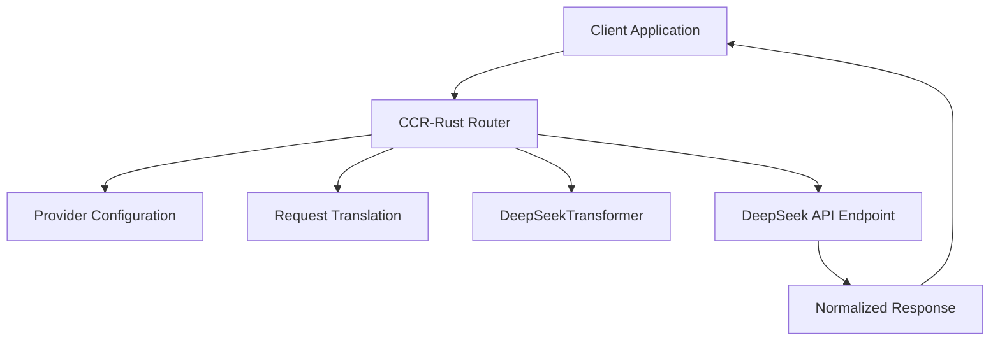
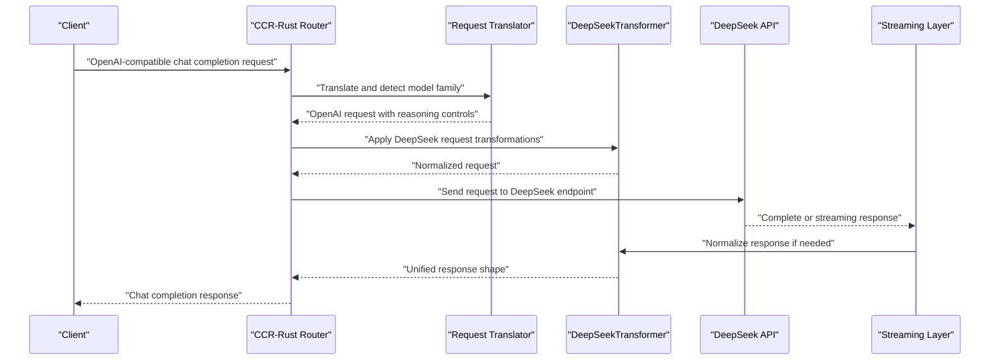
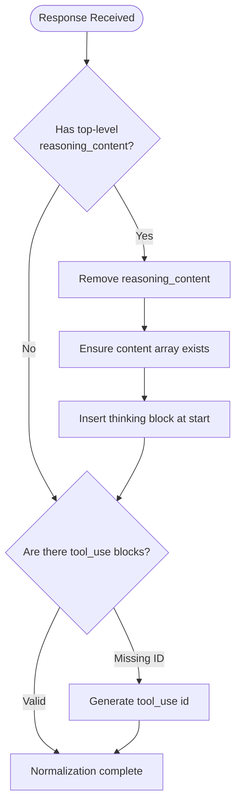
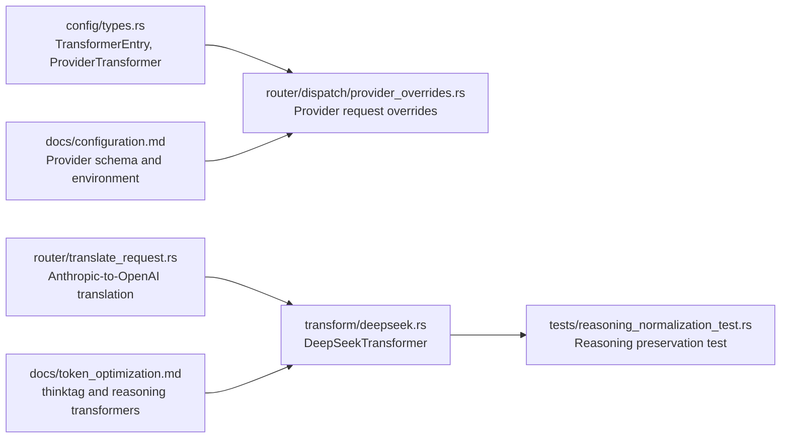

# DeepSeek Provider

<cite>
**Referenced Files in This Document **
- [deepseek.rs](file://src/transform/deepseek.rs)
- [translate_request.rs](file://src/router/translate_request.rs)
- [types.rs](file://src/config/types.rs)
- [configuration.md](file://docs/configuration.md)
- [provider_overrides.rs](file://src/router/dispatch/provider_overrides.rs)
- [token_optimization.md](file://docs/token_optimization.md)
- [reasoning_normalization_test.rs](file://tests/reasoning_normalization_test.rs)
- [openai_sdk_setup.md](file://docs/openai_sdk_setup.md)
- [sensenova.json](file://examples/sensenova.json)
</cite>

## Table of Contents
1. [Introduction](#introduction)
2. [Project Structure](#project-structure)
3. [Core Components](#core-components)
4. [Architecture Overview](#architecture-overview)
5. [Detailed Component Analysis](#detailed-component-analysis)
6. [Dependency Analysis](#dependency-analysis)
7. [Performance Considerations](#performance-considerations)
8. [Troubleshooting Guide](#troubleshooting-guide)
9. [Conclusion](#conclusion)

## Introduction
This document explains how CCR-Rust configures and processes requests routed to DeepSeek providers. It covers:

- Provider configuration fields, authentication, endpoint setup, and model selection.
- How the `DeepSeekTransformer` handles thinking blocks, reasoning content, tool calls, and protocol compatibility.
- Special handling for DeepSeek reasoning models versus non-reasoning DeepSeek models.
- Streaming behavior, OpenAI compatibility, and integration with CCR-Rust's routing and transformer system.
- Practical examples for basic setup, thinking block configuration, and token optimization.

The documentation is based on the current repository implementation rather than external provider documentation.

## Project Structure
DeepSeek support in CCR-Rust is implemented primarily through:

- A provider-neutral transformer that normalizes DeepSeek-specific request and response shapes.
- Request translation logic that detects DeepSeek models and adjusts reasoning/thinking behavior.
- Configuration types that let you attach transformers per provider or per model.
- Documentation and tests that demonstrate expected behavior.

**Diagram sources**
- [deepseek.rs:1-60](file://src/transform/deepseek.rs#L1-L60)
- [translate_request.rs:210-475](file://src/router/translate_request.rs#L210-L475)
- [types.rs:1-120](file://src/config/types.rs#L1-L120)

**Section sources**
- [deepseek.rs:1-60](file://src/transform/deepseek.rs#L1-L60)
- [types.rs:1-120](file://src/config/types.rs#L1-L120)

## Core Components
### DeepSeekTransformer
The `DeepSeekTransformer` is responsible for provider-specific normalization around DeepSeek endpoints:

- Removes unsupported fields such as Anthropic metadata from requests.
- Detects DeepSeek reasoning model names and logs detection.
- Injects leading thinking blocks into bare tool-loop assistant turns when required by the upstream endpoint.
- Converts top-level `reasoning_content` into a normalized `thinking` content block for reasoner responses.
- Ensures `tool_use` blocks have generated IDs when missing.
- Preserves OpenAI-style nested `reasoning_content` fields so clients can still read them.

Key responsibilities are defined in the transformer’s request and response methods, plus helper model-name detection.

**Section sources**
- [deepseek.rs:1-120](file://src/transform/deepseek.rs#L1-L120)
- [deepseek.rs:201-297](file://src/transform/deepseek.rs#L201-L297)

### Request Translation for DeepSeek Models
During Anthropic-to-OpenAI translation, CCR-Rust detects whether a model name contains DeepSeek-related tokens. For DeepSeek reasoning models, it ensures assistant tool-turns include an empty reasoning field when needed. For non-reasoning DeepSeek models, it explicitly sets a disabled thinking marker.

It also:

- Extracts signed thinking blocks and preserves them during translation.
- Maps `output_config.effort` to OpenAI `reasoning_effort`.
- Uses `max_completion_tokens` for reasoning models instead of `max_tokens`.

**Section sources**
- [translate_request.rs:210-475](file://src/router/translate_request.rs#L210-L475)

### Configuration Types
Provider configuration supports:

- A provider-level transformer chain.
- Model-specific transformer overrides.
- The ability to bypass transformers when only a single named transformer is configured.
- Environment variable expansion for secrets such as `DEEPSEEK_API_KEY`.

These types allow you to add `deepseek` to the provider transform list and optionally override transforms per model.

**Section sources**
- [types.rs:1-120](file://src/config/types.rs#L1-L120)
- [configuration.md:1-120](file://docs/configuration.md#L1-L120)

## Architecture Overview
The DeepSeek flow in CCR-Rust combines routing, request translation, provider-specific transformation, and response normalization.

**Diagram sources**
- [deepseek.rs:1-120](file://src/transform/deepseek.rs#L1-L120)
- [translate_request.rs:210-475](file://src/router/translate_request.rs#L210-L475)
- [configuration.md:1-120](file://docs/configuration.md#L1-L120)

## Detailed Component Analysis

### DeepSeek Provider Setup
To configure a DeepSeek provider:

1. Add a provider entry with:
   - `name`: a unique identifier used by routes.
   - `api_base_url`: the full DeepSeek endpoint URL.
   - `api_key`: your DeepSeek API key, preferably loaded from an environment variable.
   - `models`: one or more DeepSeek model names exposed by this provider.
   - `protocol`: typically `openai` when using the Chat Completions path.
2. Configure a route that selects this provider and model.
3. Attach the `deepseek` transformer at the provider level or per model if needed.

Authentication variables are expanded at process startup. Use shell exports or a service manager environment; do not hardcode keys.

Example reference patterns:

- Basic provider configuration structure and environment variables are documented in the configuration guide.
- An example provider JSON shows how to set `api_key`, `api_base_url`, `protocol`, `models`, and router routing entries.
- The OpenAI SDK setup page explains that CCR-Rust exposes an OpenAI-compatible `/v1/chat/completions` endpoint.

**Section sources**
- [configuration.md:1-120](file://docs/configuration.md#L1-L120)
- [sensenova.json:1-29](file://examples/sensenova.json#L1-L29)
- [openai_sdk_setup.md:1-51](file://docs/openai_sdk_setup.md#L1-L51)

### Thinking Blocks and Reasoning Models
DeepSeek reasoning models behave differently from non-reasoning DeepSeek models:

| Aspect | Reasoning DeepSeek models | Non-reasoning DeepSeek models |
|---|---|---|
| Detection | Names containing `reasoner`, `r1`, or `thinking`, plus DeepSeek-specific variants. | DeepSeek model names that are not detected as reasoning. |
| Request behavior | Empty reasoning content may be injected for assistant turns participating in tool calling. | Explicit disabled thinking marker may be added. |
| Response behavior | Top-level `reasoning_content` is converted into a normalized `thinking` content block. | Normal text and tool-use responses pass through after provider-specific cleanup. |

#### Reasoning Model Detection
The transformer identifies reasoning models using model-name heuristics:

- Contains `deepseek-reasoner`.
- Contains `deepseek_r1` or `deepseek-r1`.
- Contains both `deepseek` and `reason`.

The translator uses broader reasoning detection (`reasoner`, `r1`, `thinking`) and then applies DeepSeek-specific adjustments.

#### Leading Thinking Block Injection
For DeepSeek’s Anthropic-compatible endpoint, tool-loop continuation turns without a leading thinking block can fail. The transformer injects a leading thinking block into assistant turns that contain tool calls or plain text after tool results. This keeps tool-loop continuations uniform.

#### Response Reasoning Mapping
When a DeepSeek reasoner returns `reasoning_content`, the transformer:

1. Removes the top-level `reasoning_content` field.
2. Creates or updates the `content` array.
3. Inserts a `thinking` block as the first element.
4. Preserves existing text or tool blocks.

For OpenAI-style responses, nested `reasoning_content` is intentionally preserved rather than rewritten, allowing downstream consumers to access it.

**Diagram sources**
- [deepseek.rs:60-160](file://src/transform/deepseek.rs#L60-L160)

**Section sources**
- [deepseek.rs:1-160](file://src/transform/deepseek.rs#L1-L160)
- [translate_request.rs:210-475](file://src/router/translate_request.rs#L210-L475)

### DeepSeek-Specific Parameters
There is no separate `DeepSeekConfig` struct in the analyzed code. DeepSeek behavior is controlled through:

- Model name selection.
- Provider-level `force_reasoning_effort` (OpenAI protocol only).
- Provider-level `force_adaptive_thinking` (adds adaptive thinking marker before dispatch).
- Transformer chains under the provider’s `transformer` configuration.

`force_reasoning_effort` is validated against the provider protocol and inserted into the request object before dispatch. `force_adaptive_thinking` inserts a thinking object with type `adaptive`. These are generic provider overrides, but they apply when a DeepSeek provider is configured with the OpenAI protocol.

Important distinction:

- `force_reasoning_effort` does not invent thinking budgets.
- `force_adaptive_thinking` does not replace DeepSeek’s native reasoning model behavior.
- Protocol-specific controls should match the destination protocol.

**Section sources**
- [configuration.md:120-220](file://docs/configuration.md#L120-L220)
- [provider_overrides.rs:1-47](file://src/router/dispatch/provider_overrides.rs#L1-L47)
- [types.rs:120-260](file://src/config/types.rs#L120-L260)

### Streaming Behavior
DeepSeek responses travel through CCR-Rust’s normal streaming pipeline:

- Requests preserve the original `stream` flag.
- Responses are normalized after the upstream stream is consumed.
- Streaming chunks are converted through the same response transformation path where applicable.
- Tests confirm that OpenAI-style streaming and complete responses are handled by the unified normalization layer.

For DeepSeek reasoning models, the important streaming consideration is that `reasoning_content` is mapped into normalized thinking blocks when present. Clients consuming streaming events should expect unified content structures rather than raw provider-specific fields.

**Section sources**
- [deepseek.rs:60-160](file://src/transform/deepseek.rs#L60-L160)
- [reasoning_normalization_test.rs:1-80](file://tests/reasoning_normalization_test.rs#L1-L80)

### Integration with CCR-Rust Routing
DeepSeek integrates into CCR-Rust like any other provider:

1. Define a provider entry with its API base URL, API key, and model list.
2. Set a route such as `default: "provider,model"` or use tiered routing.
3. Attach the `deepseek` transformer if protocol normalization requires it.
4. Use OpenAI-compatible clients pointing at CCR-Rust’s local endpoint.

Routing does not require special DeepSeek-only logic beyond the transformer and translator behavior described above.

**Section sources**
- [configuration.md:1-120](file://docs/configuration.md#L1-L120)
- [openai_sdk_setup.md:1-51](file://docs/openai_sdk_setup.md#L1-L51)

## Dependency Analysis
The following diagram maps the main components involved in DeepSeek processing.

**Diagram sources**
- [types.rs:1-120](file://src/config/types.rs#L1-L120)
- [provider_overrides.rs:1-47](file://src/router/dispatch/provider_overrides.rs#L1-L47)
- [translate_request.rs:210-475](file://src/router/translate_request.rs#L210-L475)
- [deepseek.rs:1-160](file://src/transform/deepseek.rs#L1-L160)
- [reasoning_normalization_test.rs:1-80](file://tests/reasoning_normalization_test.rs#L1-L80)
- [configuration.md:1-220](file://docs/configuration.md#L1-L220)
- [token_optimization.md:180-300](file://docs/token_optimization.md#L180-L300)

**Section sources**
- [types.rs:1-120](file://src/config/types.rs#L1-L120)
- [deepseek.rs:1-160](file://src/transform/deepseek.rs#L1-L160)
- [translate_request.rs:210-475](file://src/router/translate_request.rs#L210-L475)
- [provider_overrides.rs:1-47](file://src/router/dispatch/provider_overrides.rs#L1-L47)

## Performance Considerations
For DeepSeek deployments, consider these performance-related points derived from the codebase:

- **Token optimization:** Use the `thinktag` transformer when you want to strip reasoning tags such as `<think>` from output, reducing returned tokens. Use the `reasoning` transformer when you want to preserve structured reasoning content.
- **Transformer ordering:** Transformers execute in declaration order. Place protocol transformers early and compression transformers later for predictable behavior.
- **In-flight limits:** Provider configuration supports admission-control settings such as `maxInflight` and optional token-budget controls. Tune these according to upstream rate limits and token-volume collisions.
- **Reasoning cost:** Reasoning models can produce additional reasoning tokens. Decide whether to enable thinking output or strip it based on client needs.

**Section sources**
- [token_optimization.md:180-300](file://docs/token_optimization.md#L180-L300)
- [configuration.md:1-220](file://docs/configuration.md#L1-L220)

## Troubleshooting Guide

### API Key Not Loaded
**Symptoms:** Startup warnings about missing environment variables or provider validation failures.  
**Checks:**
- Export `DEEPSEEK_API_KEY` or another chosen variable before starting CCR-Rust.
- Verify the provider’s `api_key` references the correct environment variable.
- Remember that `.env` files are not automatically read; source them into the shell first if used.

**Section sources**
- [configuration.md:1-120](file://docs/configuration.md#L1-L120)

### Reasoning Content Missing in OpenAI-Style Responses
**Symptoms:** Clients do not see reasoning content in normalized responses.  
**Checks:**
- Confirm the response reaches `DeepSeekTransformer::transform_response`.
- Verify that top-level `reasoning_content` is present in the upstream response.
- Confirm the test expectation that `reasoning_content` is preserved for OpenAI-style messages.

**Section sources**
- [deepseek.rs:60-160](file://src/transform/deepseek.rs#L60-L160)
- [reasoning_normalization_test.rs:1-80](file://tests/reasoning_normalization_test.rs#L1-L80)

### Tool Calls Fail After Thoughtful Assistant Turns
**Symptoms:** Upstream rejects tool-loop continuation turns.  
**Cause:** DeepSeek’s Anthropic-compatible endpoint expects a leading thinking block on certain assistant turns.  
**Resolution:** Let the `DeepSeekTransformer` inject the leading thinking block. Avoid removing or reordering content blocks before the transformer runs.

**Section sources**
- [deepseek.rs:1-120](file://src/transform/deepseek.rs#L1-L120)

### Unexpected Thinking Behavior on Non-Reasoning DeepSeek Models
**Symptoms:** Thinking is disabled or behaves unexpectedly.  
**Cause:** Non-reasoning DeepSeek models receive explicit disabled thinking behavior during translation.  
**Resolution:** If reasoning is desired, select a DeepSeek reasoning model name or adjust routing to use a model that supports reasoning.

**Section sources**
- [translate_request.rs:210-475](file://src/router/translate_request.rs#L210-L475)

### Force Reasoning Effort Fails Validation
**Symptoms:** Startup error about `force_reasoning_effort`.  
**Cause:** This option requires the provider protocol to be `openai`.  
**Resolution:** Set `protocol: "openai"` for the provider, or remove `force_reasoning_effort` if using another protocol.

**Section sources**
- [provider_overrides.rs:1-47](file://src/router/dispatch/provider_overrides.rs#L1-L47)
- [configuration.md:120-220](file://docs/configuration.md#L120-L220)

## Conclusion
DeepSeek support in CCR-Rust is built around three layers:

1. **Configuration:** Providers expose DeepSeek endpoints through standard CCR-Rust provider configuration, with environment-based authentication and optional provider-wide reasoning overrides.
2. **Translation:** Request translation detects DeepSeek models and adjusts reasoning fields, thinking markers, and token budget fields appropriately.
3. **Transformation:** The `DeepSeekTransformer` normalizes DeepSeek-specific request and response shapes, especially around thinking blocks, reasoning content, and tool-call identifiers.

For most users, a working DeepSeek setup consists of:

- A provider entry with API base URL, API key, and model names.
- A route selecting the provider and model.
- Optional transformer configuration for token optimization or specialized reasoning behavior.

If reasoning quality matters, choose a DeepSeek reasoning model and decide whether to preserve or strip thinking output. If latency and token cost matter more, prefer non-reasoning DeepSeek models and disable thinking as appropriate.