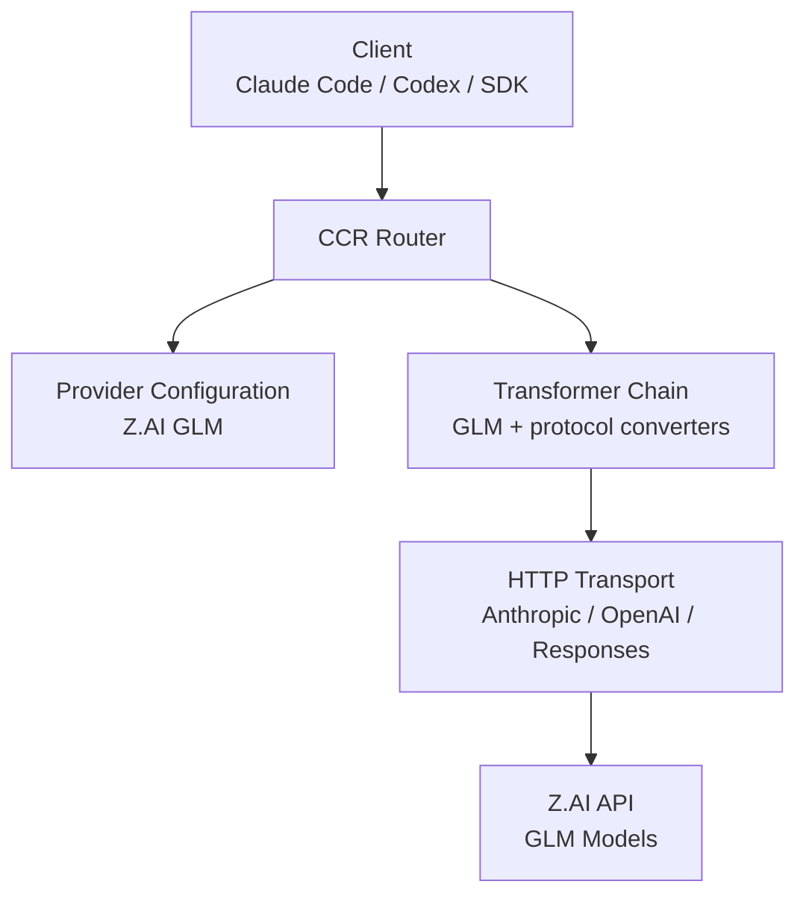
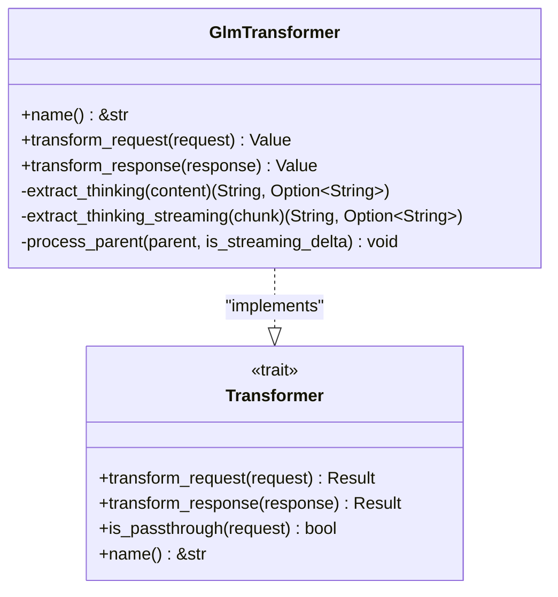
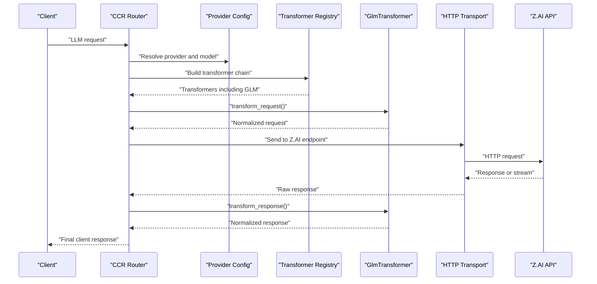
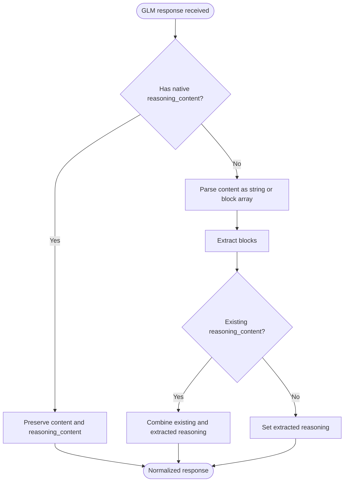
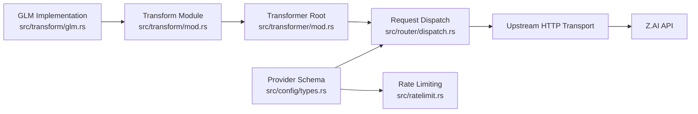

# GLM/Z.AI Provider

<cite>
**Referenced Files in This Document**
- [README.md](file://README.md)
- [docs/configuration.md](file://docs/configuration.md)
- [docs/zai_anthropic_endpoint.md](file://docs/zai_anthropic_endpoint.md)
- [docs/zai_minimax_setup.md](file://docs/zai_minimax_setup.md)
- [src/config/types.rs](file://src/config/types.rs)
- [src/transform/glm.rs](file://src/transform/glm.rs)
- [src/transform/mod.rs](file://src/transform/mod.rs)
- [src/transformer/mod.rs](file://src/transformer/mod.rs)
- [src/ratelimit.rs](file://src/ratelimit.rs)
- [src/router/dispatch.rs](file://src/router/dispatch.rs)
</cite>

## Table of Contents
1. [Introduction](#introduction)
2. [Project Structure](#project-structure)
3. [Core Components](#core-components)
4. [Architecture Overview](#architecture-overview)
5. [Detailed Component Analysis](#detailed-component-analysis)
6. [Dependency Analysis](#dependency-analysis)
7. [Performance Considerations](#performance-considerations)
8. [Troubleshooting Guide](#troubleshooting-guide)
9. [Conclusion](#conclusion)
10. [Appendices](#appendices)

## Introduction
This document explains how to configure and operate the GLM provider through Z.AI in CCR-Rust. It covers:
- Provider configuration for Anthropic-compatible, OpenAI-compatible, and native Responses transports.
- Z.AI-specific authentication, endpoint selection, and header requirements.
- The GLM transformer’s role in request/response conversion between Anthropic/OpenAI formats and GLM’s native behavior.
- Practical setup examples, model selection guidance, reasoning controls, streaming behavior, rate limiting, timeouts, error handling, and troubleshooting.

The repository supports multiple coding plans and providers; GLM is one of the supported upstreams behind CCR-Rust. See the top-level README for high-level context about CCR-Rust acting as a routing proxy for Claude Code, Codex, and other clients.

**Section sources**
- [README.md:36-37](file://README.md#L36-L37)

## Project Structure
GLM support spans three layers:

| Layer | Responsibility | Key files |
|---|---|---|
| Configuration | Defines provider fields such as `api_base_url`, `api_key`, `protocol`, `auth_header`, `honor_ratelimit_headers`, and per-provider retry/admission settings. | [src/config/types.rs](file://src/config/types.rs) |
| Transformation | Converts between Anthropic/OpenAI request shapes and GLM-native responses, extracts legacy `<think>` blocks, preserves modern `reasoning_content`, and injects GLM-specific parameters where supported. | [src/transform/glm.rs](file://src/transform/glm.rs), [src/transform/mod.rs](file://src/transform/mod.rs), [src/transformer/mod.rs](file://src/transformer/mod.rs) |
| Routing and transport | Selects the configured provider tier, builds the request, applies transformers, handles retries, streaming, and 429 backoff. | [src/router/dispatch.rs](file://src/router/dispatch.rs), [src/ratelimit.rs](file://src/ratelimit.rs) |
| Operational documentation | Empirical endpoint contract, credential injection rules, image transport notes, and managed-service restart procedures. | [docs/zai_anthropic_endpoint.md](file://docs/zai_anthropic_endpoint.md), [docs/zai_minimax_setup.md](file://docs/zai_minimax_setup.md) |

**Diagram sources**
- [src/router/dispatch.rs:320-365](file://src/router/dispatch.rs#L320-L365)
- [src/transform/mod.rs:1-41](file://src/transform/mod.rs#L1-L41)
- [src/config/types.rs:291-410](file://src/config/types.rs#L291-L410)

**Section sources**
- [src/config/types.rs:291-410](file://src/config/types.rs#L291-L410)
- [src/transform/mod.rs:1-41](file://src/transform/mod.rs#L1-L41)
- [src/transformer/mod.rs:1-40](file://src/transformer/mod.rs#L1-L40)
- [src/router/dispatch.rs:320-365](file://src/router/dispatch.rs#L320-L365)
- [docs/zai_anthropic_endpoint.md:1-25](file://docs/zai_anthropic_endpoint.md#L1-L25)

## Core Components
### Provider configuration schema
A GLM provider entry in CCR-Rust must specify at least:
- `name`: provider identifier, commonly `zai`.
- `api_base_url`: Z.AI base URL for the selected transport.
- `api_key`: Z.AI API key, normally injected via environment variables.
- `models`: model identifiers exposed by this provider route, such as `glm-5.3`.
- `protocol`: transport protocol (`anthropic`, `openai`, or `responses`).
- Optional but important for Z.AI:
  - `auth_header`: set to `authorization` when using the Anthropic-compatible endpoint with `Authorization: Bearer`.
  - `honor_ratelimit_headers`: set to `false` because Z.AI may include rate-limit headers on successful responses without enforcing quota zero.
  - `force_reasoning_effort`: valid only for `openai` protocol requests.
  - `allow_streaming`, `max_inflight`, `max_inflight_tokens`, pricing overrides, and extra headers.

Key field behaviors relevant to GLM:
- `auth_header` defaults to Anthropic-style `x-api-key`; Z.AI’s Anthropic-compatible endpoint requires `authorization`.
- `honor_ratelimit_headers` defaults to `true`; disable it for Z.AI.
- `protocol` determines whether CCR sends `/messages`, `/chat/completions`, or `/responses` semantics.

**Section sources**
- [src/config/types.rs:291-410](file://src/config/types.rs#L291-L410)
- [docs/zai_anthropic_endpoint.md:9-25](file://docs/zai_anthropic_endpoint.md#L9-L25)
- [docs/zai_minimax_setup.md:13-54](file://docs/zai_minimax_setup.md#L13-L54)

### GLM transformer responsibilities
The GLM transformer implements the `Transformer` trait and participates in the shared transformation registry:
- **Request side:**
  - Injects `reasoning_effort` for supported GLM models when not already present.
  - Strips Anthropic-specific passthrough fields that are not part of GLM’s expected shape.
  - Preserves assistant thinking blocks in Anthropic-shaped requests so the translation layer can handle them correctly.
- **Response side:**
  - Detects modern GLM responses that already contain `reasoning_content` and preserves both content and reasoning fields.
  - Extracts legacy `<think>...</think>` blocks from string or array content into a normalized `reasoning_content` field.
  - Handles streaming deltas by buffering partial `<think>` markers across chunks.

**Diagram sources**
- [src/transform/glm.rs:1-120](file://src/transform/glm.rs#L1-L120)
- [src/transform/glm.rs:201-290](file://src/transform/glm.rs#L201-L290)
- [src/transformer/mod.rs:24-52](file://src/transformer/mod.rs#L24-L52)

**Section sources**
- [src/transform/glm.rs:1-120](file://src/transform/glm.rs#L1-L120)
- [src/transform/glm.rs:201-290](file://src/transform/glm.rs#L201-L290)
- [src/transform/mod.rs:1-41](file://src/transform/mod.rs#L1-L41)
- [src/transformer/mod.rs:10-15](file://src/transformer/mod.rs#L10-L15)

## Architecture Overview
The GLM provider path integrates provider configuration, protocol translation, and GLM-specific transformation before reaching Z.AI.

**Diagram sources**
- [src/router/dispatch.rs:320-365](file://src/router/dispatch.rs#L320-L365)
- [src/transform/glm.rs:201-290](file://src/transform/glm.rs#L201-L290)
- [src/transformer/mod.rs:330-340](file://src/transformer/mod.rs#L330-L340)

**Section sources**
- [src/router/dispatch.rs:320-365](file://src/router/dispatch.rs#L320-L365)
- [src/transform/glm.rs:201-290](file://src/transform/glm.rs#L201-L290)

## Detailed Component Analysis

### Z.AI endpoint and authentication
#### Supported transports
| Transport | Base URL | Protocol | Notes |
|---|---|---|---|
| Native Anthropic-compatible endpoint | `https://api.z.ai/api/anthropic/v1` | `anthropic` | CCR appends `/messages`; use `auth_header: authorization`. |
| OpenAI-compatible Chat Completions | `https://api.z.ai/api/coding/paas/v4` | `openai` | Use `force_reasoning_effort` here if required by your model. |
| Native Responses | `https://api.z.ai/api/v1` | `responses` | Suitable for Codex or native Responses workflows; do not attach request transformers to a native Responses passthrough provider. |

#### Authentication
- The Anthropic-compatible endpoint expects `Authorization: Bearer <key>`.
- Configure `auth_header: authorization` for the Z.AI provider.
- A missing or invalid key typically returns a 401 indicating an expired or incorrect token.
- The same key can be used with the OpenAI-compatible sibling endpoint.

#### Credentials and environment expansion
- `api_key` values may reference environment variables using `${VAR}` syntax.
- The router expands these variables at config load time.
- If credentials are not expanded, startup validation rejects the configuration unless explicitly allowed by an environment flag intended for keyless setups.
- Managed services inject variables from governed credential stores; starting the binary manually without those variables can produce placeholder-key 401 errors.

**Section sources**
- [docs/zai_anthropic_endpoint.md:9-25](file://docs/zai_anthropic_endpoint.md#L9-L25)
- [docs/zai_anthropic_endpoint.md:106-150](file://docs/zai_anthropic_endpoint.md#L106-L150)
- [docs/configuration.md:13-62](file://docs/configuration.md#L13-L62)
- [src/config/types.rs:319-323](file://src/config/types.rs#L319-L323)

### Model selection and reasoning controls
#### Supported GLM models
Commonly tested GLM models include:
- `glm-5.3`
- `glm-5.3-flash`
- `glm-5.2`
- `glm-5.1`

Model availability depends on the Z.AI plan and catalog. A listed model does not guarantee every plan exposes all capabilities.

#### Reasoning effort mapping
- For `openai` protocol providers, `force_reasoning_effort` can enforce a single reasoning effort value.
- GLM-5.3 accepts specific effort labels and defaults to a higher reasoning level when no control is supplied.
- For Anthropic-compatible endpoints, CCR preserves native thinking and output configuration rather than forcing OpenAI-style reasoning fields.
- Older GLM models supported by the transformer may receive automatic `reasoning_effort` injection when enabled.

Important constraint:
- `force_reasoning_effort` is valid only for `openai` protocol entries. It is not valid for `anthropic` or `responses` provider entries.

**Section sources**
- [docs/zai_minimax_setup.md:61-85](file://docs/zai_minimax_setup.md#L61-L85)
- [docs/configuration.md:95-145](file://docs/configuration.md#L95-L145)
- [src/transform/glm.rs:24-35](file://src/transform/glm.rs#L24-L35)
- [src/transform/glm.rs:220-260](file://src/transform/glm.rs#L220-L260)

### GLM transformer behavior
#### Request transformation
The GLM transformer:
- Reads the requested model name.
- Injects `reasoning_effort` for supported models when absent.
- Removes Anthropic-specific fields that should not reach GLM.
- Keeps assistant thinking blocks intact in Anthropic-shaped requests so earlier translation stages preserve signed thinking state.

#### Response transformation
The GLM transformer:
- Preserves modern GLM responses that already expose `reasoning_content`.
- Extracts legacy `<think>...</think>` text into a normalized `reasoning_content` field while removing the tags from visible content.
- Merges extracted reasoning with existing `reasoning_content` when both are present.
- Handles streaming deltas by buffering incomplete `<think>` boundaries across chunks.

**Diagram sources**
- [src/transform/glm.rs:201-290](file://src/transform/glm.rs#L201-L290)

**Section sources**
- [src/transform/glm.rs:1-120](file://src/transform/glm.rs#L1-L120)
- [src/transform/glm.rs:201-290](file://src/transform/glm.rs#L201-L290)
- [src/transform/glm.rs:291-493](file://src/transform/glm.rs#L291-L493)

### Streaming and content format
- The Z.AI Anthropic-compatible endpoint uses standard Anthropic SSE events.
- Messages begin with `message_start`, followed by content blocks and delta events.
- Reasoning models may emit thinking blocks first; downstream clients can discard thinking-only events and still receive final text.
- Image support exists in the Anthropic-compatible endpoint, but GLM-5.3 flash is recommended for vision workloads because standard GLM-5.3 has known color interpretation issues in empirical probes.
- OpenAI-style image blocks are silently ignored by the Z.AI endpoint; CCR converts OpenAI image URLs to Anthropic image blocks internally so most clients are protected, but raw API callers must use native Anthropic image blocks.

**Section sources**
- [docs/zai_anthropic_endpoint.md:27-71](file://docs/zai_anthropic_endpoint.md#L27-L71)
- [docs/zai_minimax_setup.md:87-117](file://docs/zai_minimax_setup.md#L87-L117)

### Rate limiting and timeout behavior
#### Rate limiting
- By default, CCR honors upstream rate-limit headers.
- Z.AI includes rate-limit headers on successful responses as informational warnings without necessarily rejecting requests at quota zero.
- Set `honor_ratelimit_headers: false` for the Z.AI provider to avoid skipping tiers based solely on informational headers.
- Actual HTTP 429 responses are still tracked and cause local backoff behavior independent of header honoring.

#### Timeouts and retries
- Per-tier retry configuration controls maximum retries and backoff parameters.
- Stream-first-event timeout and stream idle timeout control streaming connection behavior.
- Global API timeout and provider admission controls also influence overall request lifetime.
- These settings are general CCR configuration options and apply to GLM routes like any other provider route.

**Section sources**
- [src/config/types.rs:343-346](file://src/config/types.rs#L343-L346)
- [src/config/types.rs:696-727](file://src/config/types.rs#L696-L727)
- [src/ratelimit.rs:21-180](file://src/ratelimit.rs#L21-L180)
- [docs/zai_anthropic_endpoint.md:11-25](file://docs/zai_anthropic_endpoint.md#L11-L25)

### Practical configuration examples
#### Basic Anthropic-compatible GLM setup
Use this when connecting Claude Code or another Anthropic-compatible client through CCR:
- Provider name: `zai`
- Base URL: `https://api.z.ai/api/anthropic/v1`
- Protocol: `anthropic`
- Auth header: `authorization`
- Model: `glm-5.3`
- Honor rate-limit headers: `false`
- Environment variable: `ZAI_API_KEY` or `CCR_ZAI_API_KEY`, depending on how the launcher injects credentials.

#### Native Responses alternative for Codex
Use this when connecting Codex directly to CCR’s Responses interface:
- Provider name: `zai`
- Base URL: `https://api.z.ai/api/v1`
- Protocol: `responses`
- Model: `glm-5.3`
- Do not attach request transformers to a native Responses passthrough provider.

#### OpenAI-compatible GLM setup
Use this when targeting the OpenAI-compatible chat completions endpoint:
- Provider name: `zai`
- Base URL: `https://api.z.ai/api/coding/paas/v4`
- Protocol: `openai`
- Model: appropriate GLM model available on that endpoint.
- Optionally set `force_reasoning_effort` if the model requires explicit reasoning behavior.

These examples reflect the documented Z.AI endpoints and CCR provider schema. Replace placeholders with real environment-variable references rather than hardcoding secrets.

**Section sources**
- [docs/zai_anthropic_endpoint.md:11-25](file://docs/zai_anthropic_endpoint.md#L11-L25)
- [docs/zai_minimax_setup.md:27-54](file://docs/zai_minimax_setup.md#L27-L54)
- [docs/zai_minimax_setup.md:56-85](file://docs/zai_minimax_setup.md#L56-L85)
- [docs/configuration.md:63-145](file://docs/configuration.md#L63-L145)

## Dependency Analysis
The GLM provider depends on configuration, transformation, routing, and rate-limiting subsystems.

**Diagram sources**
- [src/config/types.rs:291-410](file://src/config/types.rs#L291-L410)
- [src/transform/mod.rs:1-41](file://src/transform/mod.rs#L1-L41)
- [src/transformer/mod.rs:10-15](file://src/transformer/mod.rs#L10-L15)
- [src/transform/glm.rs:1-20](file://src/transform/glm.rs#L1-L20)
- [src/router/dispatch.rs:320-365](file://src/router/dispatch.rs#L320-L365)
- [src/ratelimit.rs:21-180](file://src/ratelimit.rs#L21-L180)

**Section sources**
- [src/config/types.rs:291-410](file://src/config/types.rs#L291-L410)
- [src/transform/mod.rs:1-41](file://src/transform/mod.rs#L1-L41)
- [src/transformer/mod.rs:10-15](file://src/transformer/mod.rs#L10-L15)
- [src/transform/glm.rs:1-20](file://src/transform/glm.rs#L1-L20)
- [src/router/dispatch.rs:320-365](file://src/router/dispatch.rs#L320-L365)
- [src/ratelimit.rs:21-180](file://src/ratelimit.rs#L21-L180)

## Performance Considerations
- Prefer GLM-5.3 flash for vision workloads. Empirical evidence indicates standard GLM-5.3 can misread colors even when image transport succeeds.
- Streaming reduces perceived latency compared with non-streaming completion, especially for longer reasoning outputs.
- Avoid attaching transformers to a native Responses passthrough provider, as CCR rejects that combination to prevent dropping native Responses fields.
- Tune admission control and rate-limit behavior per provider:
  - Disable `honor_ratelimit_headers` for Z.AI.
  - Adjust per-tier retry limits and backoff for degraded conditions.
  - Use stream timeouts appropriately to avoid hanging connections.
- Keep model names explicit in routes and avoid relying on undocumented aliases.

[No sources needed since this section provides general guidance]

## Troubleshooting Guide

### 401 authentication errors
**Symptoms:**
- Immediate 401 responses.
- Error message indicating the token is expired or incorrect.
- Startup fails with unexpanded credential references.

**Likely causes:**
- Missing or incorrect `ZAI_API_KEY` / `CCR_ZAI_API_KEY`.
- Using a literal `${VAR}` placeholder instead of an expanded secret.
- Starting the router manually without the managed service’s credential loader.
- Using the wrong auth header for the selected endpoint.

**Resolution steps:**
1. Verify the environment variable contains a real key.
2. Confirm the provider uses `auth_header: authorization` for the Anthropic-compatible endpoint.
3. Restart through the governed launcher rather than manually invoking the binary.
4. Inspect process environment variables without printing secret values.
5. Check service logs under the managed router log directory rather than manual-process log paths.

**Section sources**
- [docs/zai_anthropic_endpoint.md:9-25](file://docs/zai_anthropic_endpoint.md#L9-L25)
- [docs/zai_anthropic_endpoint.md:106-150](file://docs/zai_anthropic_endpoint.md#L106-L150)
- [docs/configuration.md:13-62](file://docs/configuration.md#L13-L62)

### Vision or image input appears dropped
**Symptoms:**
- Text prompt works but the model reports no image.
- OpenAI-style `image_url` blocks are sent and ignored.
- Colors are misread despite successful transport.

**Likely causes:**
- Raw API caller used OpenAI-style image blocks instead of native Anthropic image blocks.
- Used GLM-5.3 standard instead of GLM-5.3 flash for vision.
- Small or single-color test images are unreliable for verification.

**Resolution steps:**
1. Send native Anthropic image blocks for the Anthropic-compatible endpoint.
2. Use GLM-5.3 flash for image workloads.
3. Use structured two-color probes rather than tiny solid-color images for validation.
4. Confirm input-token inflation consistent with image processing.

**Section sources**
- [docs/zai_anthropic_endpoint.md:27-71](file://docs/zai_anthropic_endpoint.md#L27-L71)
- [docs/zai_anthropic_endpoint.md:73-104](file://docs/zai_anthropic_endpoint.md#L73-L104)

### Rate-limit skips or unexpected tier behavior
**Symptoms:**
- Tier appears skipped even on successful responses.
- Quota warnings appear as headers but requests still succeed.

**Likely causes:**
- Default `honor_ratelimit_headers: true` treats informational rate-limit headers as reasons to skip the tier.

**Resolution steps:**
1. Set `honor_ratelimit_headers: false` for the Z.AI provider.
2. Remember this only changes header-based proactive skipping; actual 429 responses remain handled by CCR’s rate-limit tracking.

**Section sources**
- [src/config/types.rs:343-346](file://src/config/types.rs#L343-L346)
- [docs/zai_minimax_setup.md:54-59](file://docs/zai_minimax_setup.md#L54-L59)
- [src/ratelimit.rs:21-180](file://src/ratelimit.rs#L21-L180)

### Reasoning output looks duplicated or missing
**Symptoms:**
- `reasoning_content` appears alongside `<think>` tags.
- Thinking appears twice after normalization.
- Modern GLM responses lose reasoning when older transformation logic runs.

**Likely causes:**
- Older models return `<think>` tags that need extraction.
- Modern GLM models return native `reasoning_content`.
- The transformer merges reasoning carefully but must not duplicate what the upstream already provides.

**Resolution steps:**
1. Ensure the GLM transformer is active for the provider.
2. For modern GLM-5.2+ responses, preserve native `reasoning_content`.
3. For legacy `<think>` blocks, allow the transformer to extract them into `reasoning_content`.
4. Avoid attaching transformers to native Responses passthrough providers.

**Section sources**
- [src/transform/glm.rs:1-20](file://src/transform/glm.rs#L1-L20)
- [src/transform/glm.rs:201-290](file://src/transform/glm.rs#L201-L290)
- [docs/zai_minimax_setup.md:56-85](file://docs/zai_minimax_setup.md#L56-L85)

## Conclusion
CCR-Rust provides a flexible GLM provider integration over Z.AI by combining:
- Explicit provider configuration for Anthropic-compatible, OpenAI-compatible, and native Responses transports.
- Z.AI-specific authentication and header requirements.
- A GLM transformer that normalizes reasoning output, strips unsupported fields, and injects GLM-specific request parameters where applicable.
- Shared routing, streaming, retry, and rate-limit behavior.

For reliable operation:
- Use the correct endpoint and protocol for your workload.
- Configure `auth_header: authorization` for the Anthropic-compatible endpoint.
- Disable `honor_ratelimit_headers` for Z.AI.
- Choose GLM-5.3 flash for vision tasks.
- Use environment variables for credentials and restart through governed launchers.
- Rely on CCR’s built-in retry, streaming, and 429 handling rather than custom workarounds.

[No sources needed since this section summarizes without analyzing specific files]

## Appendices

### Quick checklist for GLM provider setup
- Obtain a Z.AI coding-plan key from the Z.AI console.
- Choose the correct base URL and protocol.
- Set `api_key` to an environment variable reference.
- For Anthropic-compatible endpoint, set `auth_header: authorization`.
- Set `honor_ratelimit_headers: false`.
- Pin `models` to the tested model ID, such as `glm-5.3`.
- Configure router defaults and tiers to select the GLM provider.
- Restart the router and verify health, basic completion, and streaming.

**Section sources**
- [docs/zai_minimax_setup.md:13-54](file://docs/zai_minimax_setup.md#L13-L54)
- [docs/zai_anthropic_endpoint.md:106-150](file://docs/zai_anthropic_endpoint.md#L106-L150)