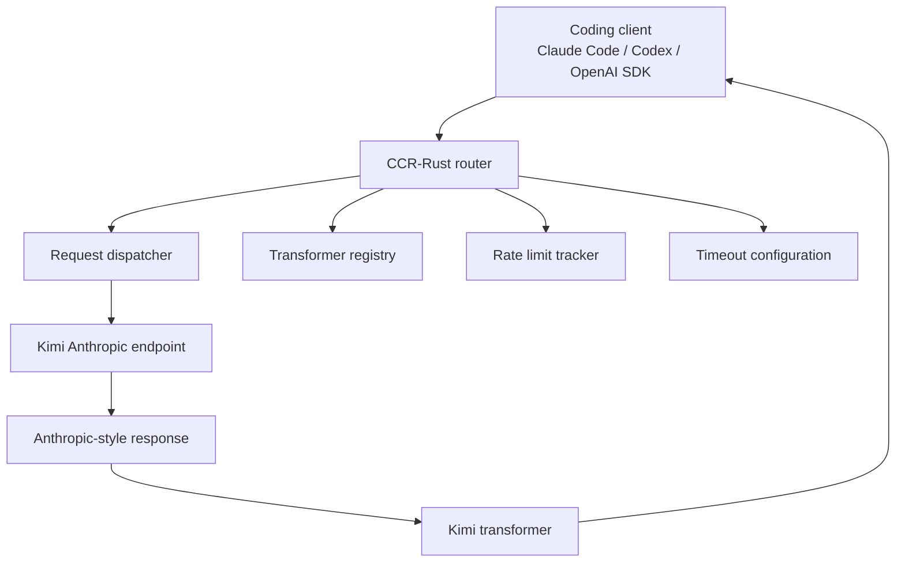
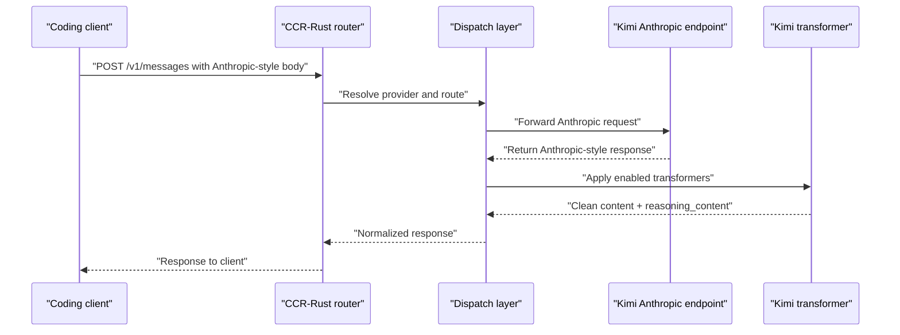
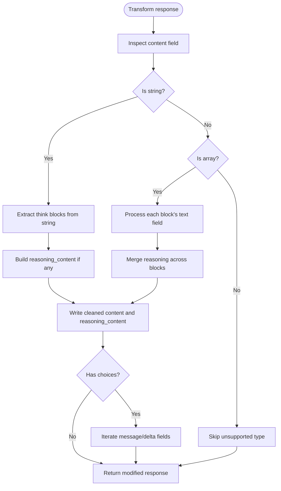
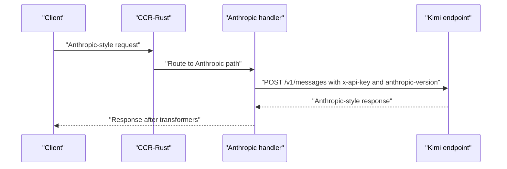
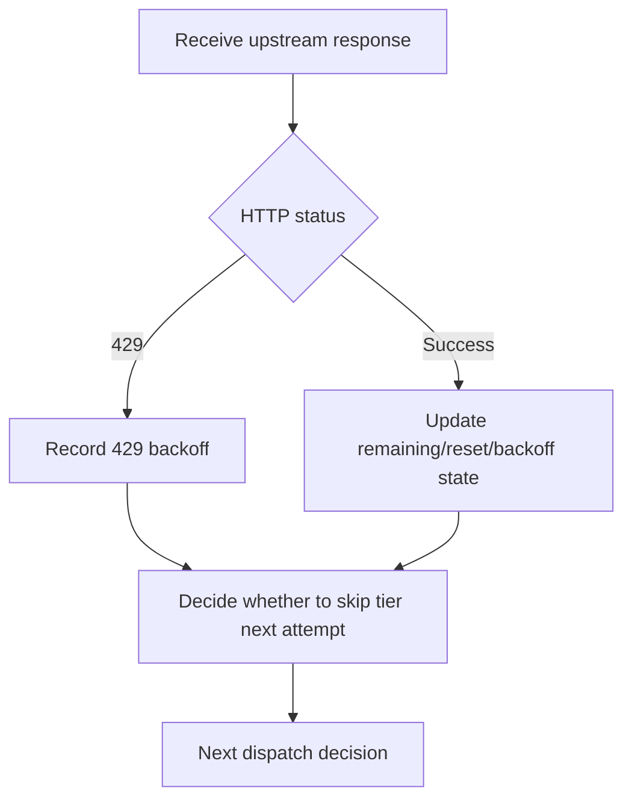
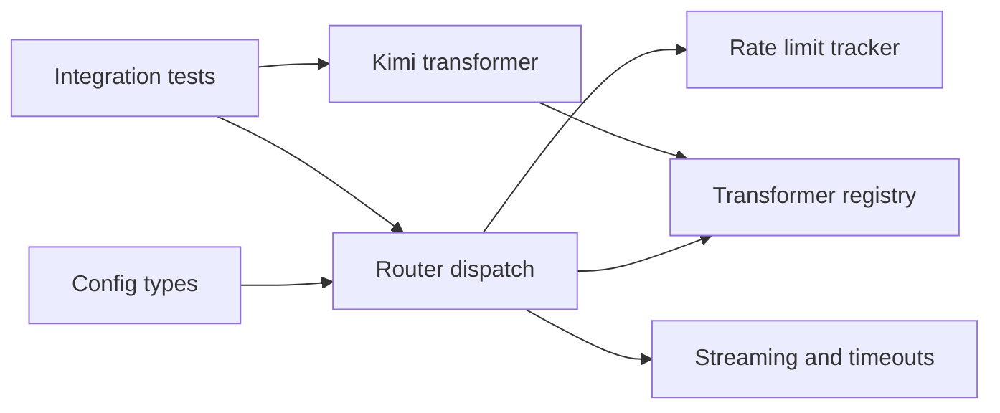

# Kimi Provider

<cite>
**Referenced Files in This Document**
- [kimi_setup.md](file://docs/kimi_setup.md)
- [kimi.rs](file://src/transform/kimi.rs)
- [integration_kimi.rs](file://tests/integration_kimi.rs)
- [types.rs](file://src/config/types.rs)
- [dispatch.rs](file://src/router/dispatch.rs)
- [ratelimit.rs](file://src/ratelimit.rs)
- [README.md](file://README.md)
</cite>

## Table of Contents
1. [Introduction](#introduction)
2. [Project Structure](#project-structure)
3. [Core Components](#core-components)
4. [Architecture Overview](#architecture-overview)
5. [Detailed Component Analysis](#detailed-component-analysis)
6. [Dependency Analysis](#dependency-analysis)
7. [Performance Considerations](#performance-considerations)
8. [Troubleshooting Guide](#troubleshooting-guide)
9. [Conclusion](#conclusion)

## Introduction
This document explains how to configure and operate the Kimi provider in CCR-Rust. It covers authentication, API endpoints, model selection, the Anthropic-based protocol path used by Kimi Code, the built-in Kimi transformer for reasoning content, configuration structure, rate limiting behavior, timeouts, and troubleshooting guidance.

Kimi is integrated as an Anthropic-compatible provider through CCR-Rust’s router. The verified setup uses the Kimi Code console key, the `/v1` coding endpoint, and the Anthropic wire format. A dedicated transformer extracts Unicode think tokens from Kimi responses and places them into a `reasoning_content` field while cleaning the visible response text.

**Section sources**
- [kimi_setup.md:1-113](file://docs/kimi_setup.md#L1-L113)
- [README.md:1-120](file://README.md#L1-L120)

## Project Structure
The Kimi integration spans documentation, configuration types, routing, transformation, tests, and shared retry/rate-limit infrastructure:



**Diagram sources**
- [kimi_setup.md:25-113](file://docs/kimi_setup.md#L25-L113)
- [integration_kimi.rs:1-120](file://tests/integration_kimi.rs#L1-L120)
- [dispatch.rs:399-423](file://src/router/dispatch.rs#L399-L423)
- [ratelimit.rs:1-120](file://src/ratelimit.rs#L1-L120)

**Section sources**
- [kimi_setup.md:25-113](file://docs/kimi_setup.md#L25-L113)
- [integration_kimi.rs:1-120](file://tests/integration_kimi.rs#L1-L120)

## Core Components
- **Kimi provider configuration**: Defines name, base URL, API key, protocol, models, tier name, and transformer chain.
- **Anthropic protocol path**: Kimi Code is accessed through CCR-Rust’s Anthropic handler rather than a custom HTTP client.
- **Kimi transformer**: Extracts Unicode think blocks and writes clean content plus `reasoning_content`.
- **Integration tests**: Validate direct routing, thinking-token extraction, 429 passthrough, and required headers.
- **Shared infrastructure**: Retry budget, EWMA tier tracking, rate-limit backoff, streaming timeouts, and request/response translation are reused by Kimi just like other providers.

Key responsibilities:
- Authentication uses the configured provider key.
- Endpoint selection is driven by `api_base_url` and the selected protocol.
- Model selection is driven by the provider’s `models` list and the routed tier/model.
- Reasoning content handling is implemented by the Kimi transformer when explicitly enabled.

**Section sources**
- [kimi_setup.md:25-113](file://docs/kimi_setup.md#L25-L113)
- [integration_kimi.rs:1-120](file://tests/integration_kimi.rs#L1-L120)
- [kimi.rs:1-60](file://src/transform/kimi.rs#L1-L60)

## Architecture Overview
The Kimi flow follows CCR-Rust’s standard multi-provider routing pattern:



**Diagram sources**
- [integration_kimi.rs:120-200](file://tests/integration_kimi.rs#L120-L200)
- [kimi_setup.md:25-113](file://docs/kimi_setup.md#L25-L113)
- [kimi.rs:60-180](file://src/transform/kimi.rs#L60-L180)

## Detailed Component Analysis

### Kimi Authentication and Credentials
- Use a Kimi Code API key obtained from the Kimi Code console.
- Do not assume that a Moonshot/Kimi Platform pay-as-you-go key is interchangeable with a Kimi Code membership quota.
- The environment variable name shown in examples is illustrative; the important requirement is that the running router loads the intended credential file and that the correct Kimi Code key is present.
- For the Anthropic protocol path, the upstream header is `x-api-key`. No fabricated client identity or special user agent is required by the verified configuration.

Practical steps:
1. Obtain a Kimi Code API key.
2. Store it in the provider configuration using an environment-variable placeholder.
3. Validate the configuration before starting the router.
4. Start the router and point Claude Code or Codex at the local CCR-Rust endpoint.

Common mistakes:
- Using a non-Kimi Code key.
- Assuming the key variable name itself performs conversion between key products.
- Printing credentials during diagnostics.

**Section sources**
- [kimi_setup.md:1-24](file://docs/kimi_setup.md#L1-L24)
- [kimi_setup.md:64-113](file://docs/kimi_setup.md#L64-L113)
- [integration_kimi.rs:100-120](file://tests/integration_kimi.rs#L100-L120)

### Endpoint and Model Selection
| Use | Base URL | Request endpoint |
| --- | --- | --- |
| CCR Anthropic provider | `https://api.kimi.com/coding/v1` | CCR appends `/messages` |
| Direct Claude/Anthropic SDK | `https://api.kimi.com/coding/` | Client appends `/v1/messages` |
| OpenAI Chat Completions | `https://api.kimi.com/coding/v1` | `/chat/completions` |

Supported models referenced by the current official catalog include:
- `kimi-for-coding`
- `kimi-for-coding-highspeed`
- `k3`
- `k3-256k`

Important notes:
- `kimi-for-coding` is a service alias, not a pinned release.
- Access and context limits depend on membership.
- Older model IDs such as `kimi-k2.5` or `kimi-k2-thinking` should not be assumed to apply to the coding-plan endpoint.
- Always verify against the account’s actual catalog and a real request.

In CCR-Rust, the provider’s `api_base_url` and `models` list define where requests go and which models can be selected. The router selects a tier and model according to the `Router.default` and `Router.tiers` settings.

**Section sources**
- [kimi_setup.md:25-63](file://docs/kimi_setup.md#L25-L63)
- [kimi_setup.md:64-113](file://docs/kimi_setup.md#L64-L113)

### CCR Configuration for Kimi
A complete single-provider Kimi configuration includes:
- Provider name.
- `api_base_url` pointing to the Kimi coding endpoint.
- `api_key` loaded from the environment.
- `protocol` set to `anthropic`.
- `models` listing supported model identifiers.
- Optional `tier_name` for routing identification.
- `transformer.use` for enabling provider-level transformers.
- Router default and tiers.
- Local listener host and port.

Example configuration shape:
```json
{
  "Providers": [{
    "name": "kimi",
    "api_base_url": "https://api.kimi.com/coding/v1",
    "api_key": "${KIMI_API_KEY}",
    "protocol": "anthropic",
    "models": ["kimi-for-coding", "k3-256k"],
    "transformer": {
      "use": [["maxtoken", {"max_tokens": 8192}]]
    }
  }],
  "Router": {
    "default": "kimi,k3-256k",
    "tiers": ["kimi,k3-256k"],
    "ignoreDirect": false
  },
  "HOST": "127.0.0.1",
  "PORT": 3456
}
```

Configuration loading and startup:
- Export the Kimi API key.
- Run validation.
- Start the router with the config file.

For multi-provider suites, use the documented coding plans example and the switching-plans recipes rather than inventing a new command.

**Section sources**
- [kimi_setup.md:25-113](file://docs/kimi_setup.md#L25-L113)
- [types.rs:104-160](file://src/config/types.rs#L104-L160)

### Transformer Configuration
CCR-Rust supports a nested transformer configuration per provider:
- `use`: provider-level transformer chain applied to all models.
- `<model-name>`: model-specific transformer overrides.

For Kimi:
- The `kimi` transformer extracts Unicode think tokens.
- The `maxtoken` transformer ensures an output token limit is present because the tested Codex build omitted it and Kimi returned a 400 without `max_tokens`.
- The recommended starter output budget is 8192 tokens, including reasoning where counted by the upstream. Adjust based on task needs and provider limits.

Do not add the `kimi` transformer solely because the provider name is `kimi`. It handles a different response convention than the native Anthropic path and is not a login mechanism.

**Section sources**
- [kimi_setup.md:40-63](file://docs/kimi_setup.md#L40-L63)
- [kimi_setup.md:88-113](file://docs/kimi_setup.md#L88-L113)
- [types.rs:104-160](file://src/config/types.rs#L104-L160)

### Kimi Transformer Implementation
The Kimi transformer implements CCR-Rust’s `Transformer` interface. Its responsibilities:
- Match Unicode think delimiters around reasoning content.
- Remove those delimiters from visible response text.
- Collect extracted reasoning into a `reasoning_content` string.
- Handle both string content and arrays of content blocks.
- Handle streaming delta payloads.
- Leave normal responses unchanged when no think tokens are present.



**Diagram sources**
- [kimi.rs:1-180](file://src/transform/kimi.rs#L1-L180)

Complexity considerations:
- The regex scans content once per relevant text segment.
- Array processing clones each block but only mutates text fields when present.
- Multiple think blocks are concatenated with newline separators.
- Empty or missing reasoning is represented as absent rather than an empty string.

Test coverage validates:
- Think-block extraction.
- Multibyte UTF-8 handling.
- Passthrough when no tokens exist.
- Multiple think blocks.
- Empty think blocks.
- Streaming delta payloads.
- Anthropic-style content arrays.

**Section sources**
- [kimi.rs:1-180](file://src/transform/kimi.rs#L1-L180)
- [kimi.rs:180-264](file://src/transform/kimi.rs#L180-L264)

### Protocol-Specific Considerations
- The verified Kimi integration uses the Anthropic protocol through CCR-Rust’s Anthropic handler.
- Required headers include `x-api-key` and `anthropic-version`.
- The test suite asserts that `anthropic-version` is forwarded.
- When using the OpenAI endpoint, do not assume native Responses tools map directly to Chat Completions tools. The documented verified configuration uses the Anthropic translation path.
- If a provider uses a different wire format, CCR-Rust translates requests and responses, but Kimi Code is configured here as Anthropic-compatible.



**Diagram sources**
- [integration_kimi.rs:201-305](file://tests/integration_kimi.rs#L201-L305)
- [kimi_setup.md:25-63](file://docs/kimi_setup.md#L25-L63)

**Section sources**
- [integration_kimi.rs:201-305](file://tests/integration_kimi.rs#L201-L305)
- [kimi_setup.md:25-63](file://docs/kimi_setup.md#L25-L63)

### Practical Setup Examples

#### Single Provider Kimi Configuration
Use the full single-provider example from the Kimi setup documentation. It includes:
- Provider metadata.
- Anthropic protocol.
- Verified model list.
- Maxtoken transformer.
- Router defaults and tiers.
- Local server binding.

#### Environment and Startup
1. Export the Kimi API key.
2. Validate the saved configuration.
3. Start the router on loopback.

#### Verifying Connectivity
- Call `/v1/models` on CCR-Rust to inspect configuration; this does not authenticate the upstream.
- Perform a tool round trip with the installed client and verify both tool results and per-tier counters.
- Confirm that the expected model IDs respond successfully.

**Section sources**
- [kimi_setup.md:25-113](file://docs/kimi_setup.md#L25-L113)

### Rate Limiting and 429 Behavior
Kimi’s 429 responses follow CCR-Rust’s shared rate-limit policy:
- A 429 records a backoff window for the affected tier.
- Server-provided `Retry-After` values are honored up to a cap.
- Without server guidance, the first backoff is short and escalates under sustained starved conditions.
- Successful responses clear backoff state only when they belong to the same generation as the latest 429, protecting against overlapping-request ordering issues.
- The integration test verifies that a 429 is passed through to the client rather than converted into a generic error.



**Diagram sources**
- [ratelimit.rs:1-200](file://src/ratelimit.rs#L1-L200)
- [integration_kimi.rs:220-280](file://tests/integration_kimi.rs#L220-L280)

**Section sources**
- [ratelimit.rs:1-200](file://src/ratelimit.rs#L1-L200)
- [integration_kimi.rs:220-280](file://tests/integration_kimi.rs#L220-L280)

### Timeouts and Streaming Behavior
Timeout-related settings in CCR-Rust include:
- General API timeout configuration used by tests.
- Streaming first-event timeout.
- Streaming idle timeout.

These settings affect how long CCR-Rust waits for upstream responses and stream progress. They are part of CCR-Rust’s shared transport and streaming stack and apply to Kimi the same way they apply to other providers.

Recommendations:
- Keep the timeout consistent with expected upstream latency.
- Increase streaming timeouts when working with very large outputs or slow upstream endpoints.
- Monitor per-tier latency and failure metrics to detect degraded Kimi connectivity.

**Section sources**
- [integration_kimi.rs:100-120](file://tests/integration_kimi.rs#L100-L120)
- [README.md:120-200](file://README.md#L120-L200)

### Performance Tuning Recommendations
- Use the Anthropic protocol path for Kimi Code unless you have verified OpenAI compatibility requirements.
- Keep the maxtoken transformer when using Codex to avoid missing-output-limit errors.
- Tune the output budget to match your task length and Kimi’s limits.
- Prefer explicit model IDs from the account catalog instead of relying on aliases.
- Separate workloads into different router instances to isolate quotas.
- Use CCR-Rust’s tiered routing and retry sweeps to absorb transient failures.
- Observe per-tier token, latency, and rate-limit metrics.
- Avoid unnecessary transformers; the native Anthropic path already preserves content blocks.

**Section sources**
- [kimi_setup.md:40-63](file://docs/kimi_setup.md#L40-L63)
- [kimi_setup.md:88-113](file://docs/kimi_setup.md#L88-L113)
- [README.md:1-120](file://README.md#L1-L120)

## Dependency Analysis
The Kimi integration depends on several CCR-Rust subsystems:



**Diagram sources**
- [types.rs:104-160](file://src/config/types.rs#L104-L160)
- [dispatch.rs:399-423](file://src/router/dispatch.rs#L399-L423)
- [kimi.rs:1-60](file://src/transform/kimi.rs#L1-L60)
- [integration_kimi.rs:1-120](file://tests/integration_kimi.rs#L1-L120)

Coupling and cohesion:
- Kimi shares the generic provider configuration schema.
- Routing and protocol dispatch are provider-agnostic; Kimi is one provider choice among many.
- The Kimi transformer is pluggable and must be explicitly enabled.
- Rate limiting and retry behavior are centralized and reused.

Potential pitfalls:
- Enabling a transformer only because the provider name matches a legacy implementation.
- Assuming model aliases behave identically to pinned releases.
- Treating `/v1/models` as proof of upstream authentication.

**Section sources**
- [types.rs:104-160](file://src/config/types.rs#L104-L160)
- [dispatch.rs:399-423](file://src/router/dispatch.rs#L399-L423)
- [kimi.rs:1-60](file://src/transform/kimi.rs#L1-L60)

## Performance Considerations
- CCR-Rust targets small routing overhead and stays out of the critical path.
- EWMA-based tier tracking helps prefer lower-latency tiers after enough samples.
- Failed requests apply a penalty multiplier rather than raw wall-clock time, avoiding pathological timeout distortion.
- Streaming timeouts protect against stalled connections.
- Kimi transformer cost is proportional to content size and number of text blocks.
- Output budget tuning reduces truncation risk and downstream retries.

[No sources needed since this section provides general guidance]

## Troubleshooting Guide

### Common Errors
| Symptom | Likely cause | Action |
| --- | --- | --- |
| HTTP 401 | Wrong key or wrong credential product | Verify the key belongs to Kimi Code and the router loaded the intended config. |
| HTTP 400 from Anthropic endpoint with Codex | Missing `max_tokens` after transformer chain | Ensure the maxtoken transformer is configured. Validation alone does not prove runtime behavior. |
| Tool-name errors on OpenAI endpoint | Misapplied Responses tools to Chat Completions | Use the verified Anthropic translation path unless OpenAI compatibility is explicitly validated. |
| 429 or transport failure | Quota exhaustion or upstream instability | Keep CCR-Rust’s retry and rate-limit policy active. Do not silently switch accounts. |
| Thinking tokens still appear in content | Kimi transformer not enabled or incorrect response shape | Enable the `kimi` transformer only when appropriate and confirm the response format. |

### Verification Steps
1. Validate configuration before starting.
2. Check `/v1/models` for configuration presence.
3. Send a minimal Anthropic-style request to the local router.
4. Confirm the expected model responds.
5. Test a tool round trip with the installed client.
6. Inspect per-tier counters to confirm traffic reaches Kimi.

### Diagnostics
- Do not print API keys.
- Keep Kimi Code and Moonshot/Kimi Platform keys separate.
- Use temporary router instances for diagnostic runs.
- Reproduce with synthetic content rather than private project data.
- Remember that available model IDs were verified for credential acceptance; inference quality and additional model IDs were not exhaustively tested.

**Section sources**
- [kimi_setup.md:64-113](file://docs/kimi_setup.md#L64-L113)
- [integration_kimi.rs:220-305](file://tests/integration_kimi.rs#L220-L305)

## Conclusion
The Kimi provider in CCR-Rust is best used as an Anthropic-compatible endpoint with a Kimi Code API key. The verified configuration routes through the Anthropic protocol, lists supported models, and enables the maxtoken transformer for Codex compatibility. The optional Kimi transformer extracts Unicode reasoning content and cleans visible text. Rate limiting, retries, streaming timeouts, and tiered routing are provided by CCR-Rust’s shared infrastructure. For reliable operation, validate credentials, select models from the account catalog, tune output budgets, and monitor per-tier metrics rather than treating configuration presence as proof of connectivity.

[No sources needed since this section summarizes without analyzing specific files]