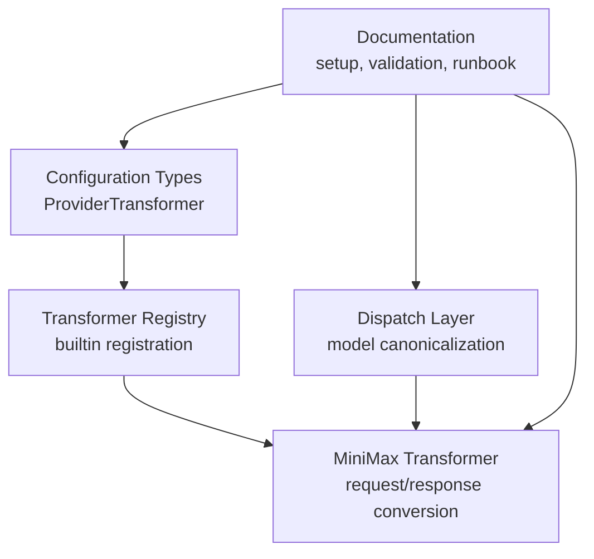
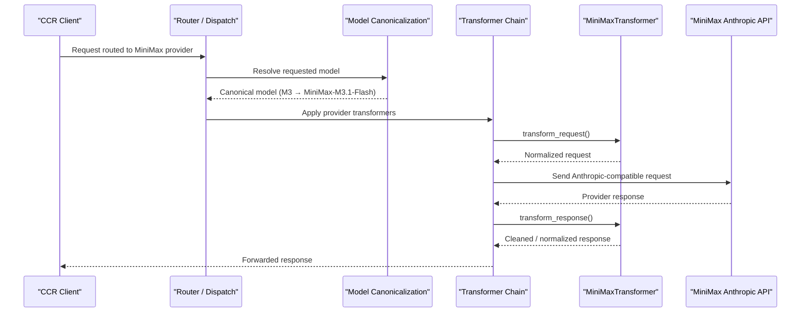
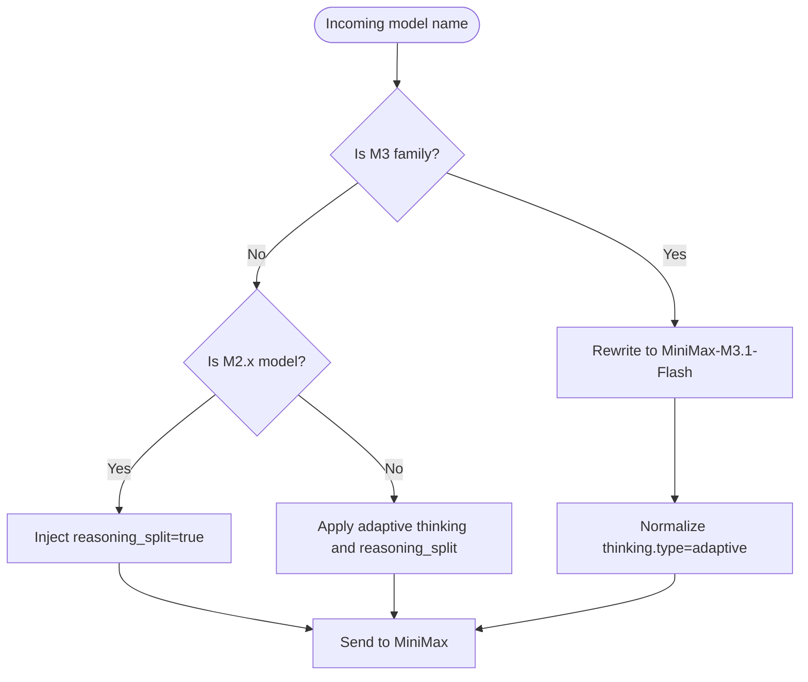
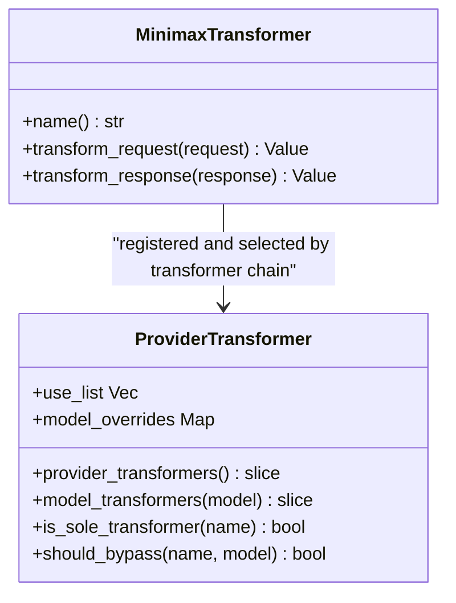
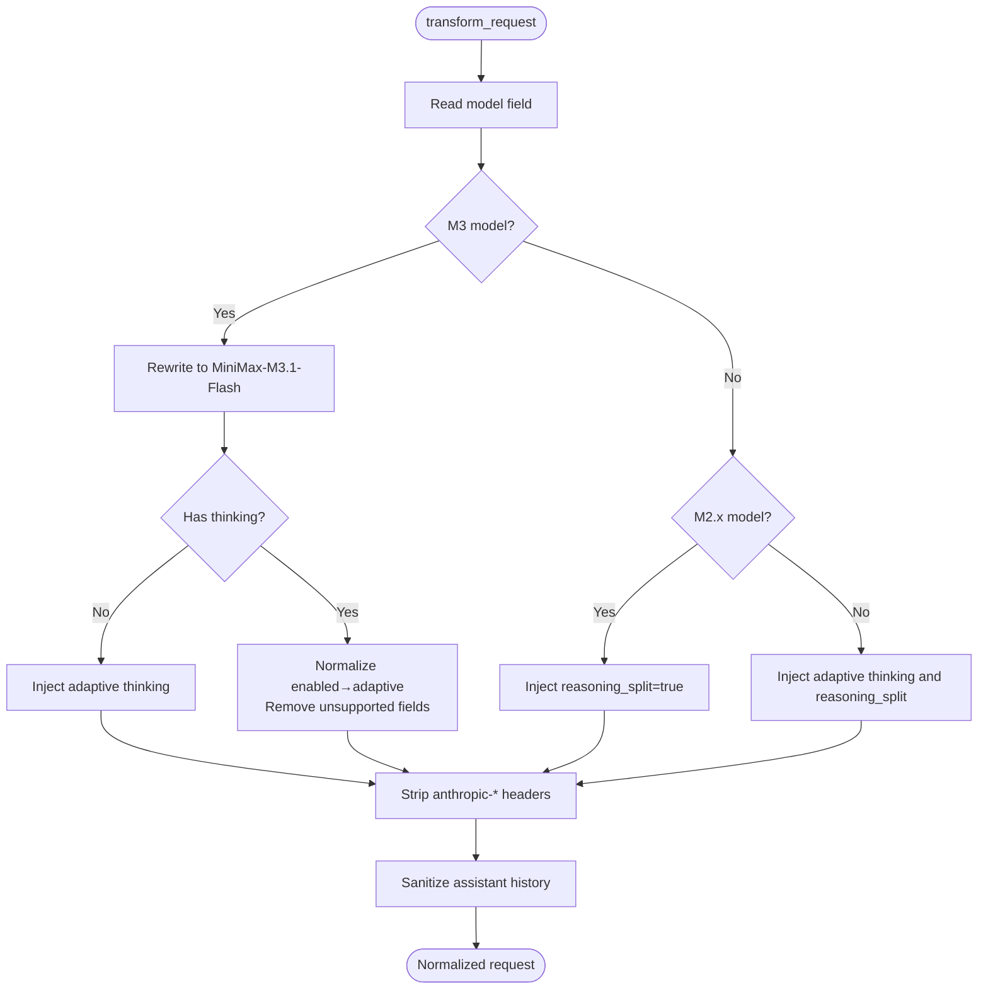
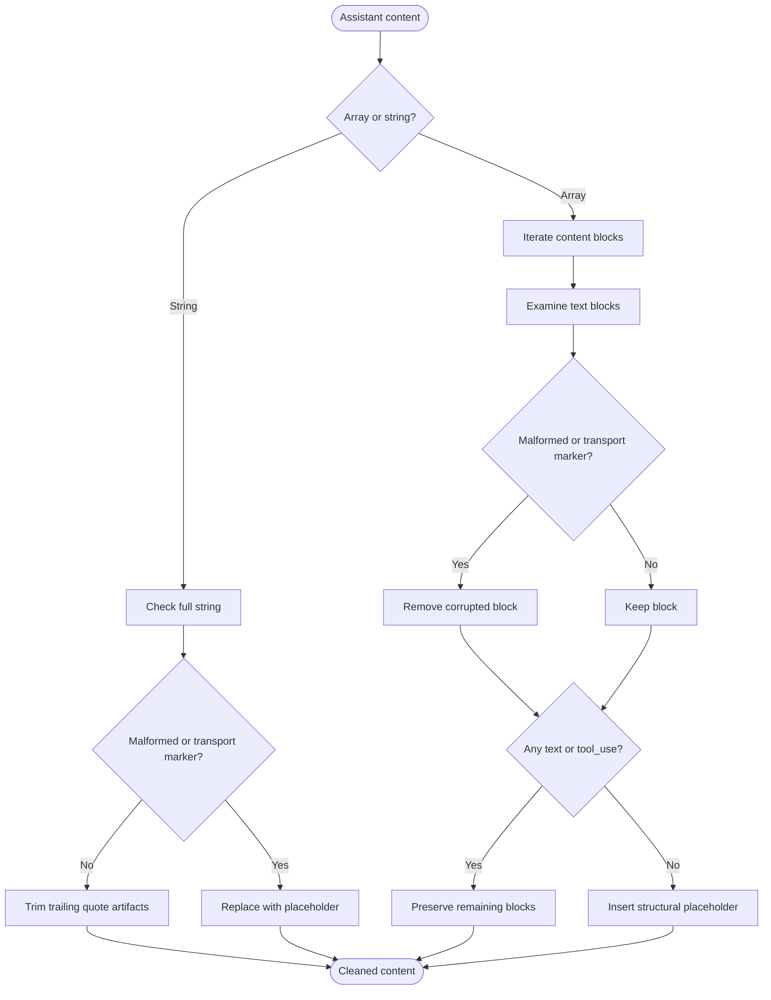
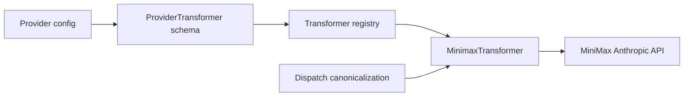

# MiniMax Provider

<cite>
**Referenced Files in This Document**   
- [minimax.md](file://docs/minimax.md)
- [zai_minimax_setup.md](file://docs/zai_minimax_setup.md)
- [configuration.md](file://docs/configuration.md)
- [minimax.rs](file://src/transform/minimax.rs)
- [mod.rs](file://src/transformer/mod.rs)
- [types.rs](file://src/config/types.rs)
- [dispatch.rs](file://src/router/dispatch.rs)
</cite>

## Table of Contents
1. [Introduction](#introduction)
2. [Project Structure](#project-structure)
3. [Core Components](#core-components)
4. [Architecture Overview](#architecture-overview)
5. [Detailed Component Analysis](#detailed-component-analysis)
6. [Dependency Analysis](#dependency-analysis)
7. [Performance Considerations](#performance-considerations)
8. [Troubleshooting Guide](#troubleshooting-guide)
9. [Conclusion](#conclusion)

## Introduction
This document explains how CCR-Rust integrates the MiniMax provider. It covers authentication setup, API configuration, model selection, transformer-based protocol conversion, interleaved thinking handling, malformed-output recovery, rate-limiting behavior, and operational validation. The goal is to help operators configure MiniMax safely while understanding why explicit transformer wiring and canonical model routing are required.

MiniMax support centers on two hard requirements:
- Use the official `MiniMax-M3.1-Flash` model ID.
- Explicitly include `transformer: { "use": ["minimax"] }` for the MiniMax provider entry.

Without these, CCR can still return HTTP 200 responses while serving an incompatible model or bypassing MiniMax compatibility logic.

**Section sources**
- [minimax.md:1-25](file://docs/minimax.md#L1-L25)

## Project Structure
MiniMax-related code is split across documentation, configuration types, the transformer registry, the dispatch layer, and the MiniMax-specific transformer implementation:

**Diagram sources**
- [types.rs:1-200](file://src/config/types.rs#L1-L200)
- [mod.rs:320-335](file://src/transformer/mod.rs#L320-L335)
- [dispatch.rs:25-30](file://src/router/dispatch.rs#L25-L30)
- [dispatch.rs:329-330](file://src/router/dispatch.rs#L329-L330)
- [minimax.rs:1-40](file://src/transform/minimax.rs#L1-L40)
- [minimax.md:1-25](file://docs/minimax.md#L1-L25)

**Section sources**
- [types.rs:1-200](file://src/config/types.rs#L1-L200)
- [mod.rs:320-335](file://src/transformer/mod.rs#L320-L335)
- [dispatch.rs:25-30](file://src/router/dispatch.rs#L25-L30)
- [minimax.rs:1-40](file://src/transform/minimax.rs#L1-L40)

## Core Components
The MiniMax integration consists of five primary pieces:

| Component | Responsibility |
|---|---|
| Provider configuration fragment | Declares MiniMax credentials, base URL, Anthropic protocol, models, and the explicit MiniMax transformer chain. |
| Model canonicalization | Maps M3-family aliases and preview IDs to the canonical `MiniMax-M3.1-Flash` before dispatch. |
| MiniMax transformer | Converts requests and responses between CCR's internal representation and MiniMax expectations. |
| Interleaved-thinking preservation | Keeps signed `thinking` blocks opaque and replayable across tool-result turns. |
| Malformed-output hygiene | Removes transport-corrupted text while preserving tool-use structure. |

Key facts:
- MiniMax detection uses both provider name and API base URL. A provider named `minimax-anthropic`, a custom name containing `minimax`, or a MiniMax API host receives the same M3-family handling.
- M3 models use native Anthropic-style thinking with `thinking.type: "adaptive"`.
- M2.x models use `reasoning_split` and do not receive the M3 thinking injection path.
- Unknown models receive both adaptive thinking and reasoning-split as a compatibility fallback.

**Section sources**
- [minimax.md:26-120](file://docs/minimax.md#L26-L120)
- [minimax.rs:1-40](file://src/transform/minimax.rs#L1-L40)
- [minimax.rs:40-80](file://src/transform/minimax.rs#L40-L80)
- [dispatch.rs:329-330](file://src/router/dispatch.rs#L329-L330)

## Architecture Overview
The MiniMax request flow passes through several stages before reaching the upstream API and back through CCR’s response pipeline:

**Diagram sources**
- [dispatch.rs:329-330](file://src/router/dispatch.rs#L329-L330)
- [minimax.rs:240-400](file://src/transform/minimax.rs#L240-L400)
- [minimax.rs:400-600](file://src/transform/minimax.rs#L400-L600)

## Detailed Component Analysis

### Authentication and Provider Configuration
A minimal MiniMax provider fragment includes:
- Provider name.
- Anthropic-compatible base URL.
- API key loaded from environment variables.
- Protocol set to `anthropic`.
- Authorization header field.
- Allowed models list.
- Explicit MiniMax transformer entry.

Environment variable expansion supports `${VAR_NAME}` syntax. CCR does not load `.env` files itself; the router process must have the required variables exported before startup. For multi-credential setups, use distinct provider names and separate credential variables.

Recommended minimum fields:
- `name`: provider identifier used in routes.
- `api_base_url`: MiniMax Anthropic endpoint.
- `api_key`: environment-expanded secret.
- `protocol`: `anthropic`.
- `auth_header`: authorization header name.
- `models`: at least `MiniMax-M3.1-Flash`.
- `transformer.use`: array containing `minimax`.

For Z.AI coding-plan keys, MiniMax also accepts dedicated plan tokens, but the operational guidance remains the same: configure the MiniMax provider fragment and validate end-to-end.

**Section sources**
- [minimax.md:44-80](file://docs/minimax.md#L44-L80)
- [zai_minimax_setup.md:1-40](file://docs/zai_minimax_setup.md#L1-L40)
- [zai_minimax_setup.md:120-168](file://docs/zai_minimax_setup.md#L120-L168)
- [configuration.md:1-60](file://docs/configuration.md#L1-L60)

### Model Selection and Canonicalization
MiniMax supports multiple families:

| Family | Behavior |
|---|---|
| M3 family | Native Anthropic-style thinking blocks; canonicalized to `MiniMax-M3.1-Flash`; adaptive thinking injected when missing. |
| M2.x family | Uses `reasoning_split`; no M3 thinking injection. |
| Legacy preview IDs | Recognized as M3 family and redirected to the canonical model. |
| Unknown models | Compatibility fallback applies both adaptive thinking and reasoning-split. |

Supported M3 identifiers include exact case-insensitive matches for `MiniMax-M3` and `minimax-m3`, plus any model beginning with `MiniMax-M3.`. Supported M2.x identifiers include `MiniMax-M2`, `MiniMax-M2.1`, `MiniMax-M2.5`, `MiniMax-M2.7`, their highspeed variants, and `M2-her`.

Before dispatch, M3-family requests are rewritten to `MiniMax-M3.1-Flash`. This ensures consistent pricing resolution, catalog exposure, and downstream transformation behavior.

**Diagram sources**
- [minimax.rs:40-80](file://src/transform/minimax.rs#L40-L80)
- [minimax.rs:240-400](file://src/transform/minimax.rs#L240-L400)
- [dispatch.rs:329-330](file://src/router/dispatch.rs#L329-L330)

**Section sources**
- [minimax.md:81-120](file://docs/minimax.md#L81-L120)
- [minimax.rs:40-80](file://src/transform/minimax.rs#L40-L80)
- [dispatch.rs:329-330](file://src/router/dispatch.rs#L329-L330)

### MiniMax Transformer Implementation
The `MinimaxTransformer` implements CCR’s `Transformer` interface and performs three major responsibilities:

1. **Request normalization**
   - Rewrites M3 aliases to `MiniMax-M3.1-Flash`.
   - Injects `thinking: { type: "adaptive" }` for M3 when missing.
   - Normalizes Anthropic-style `thinking.type: "enabled"` to `"adaptive"` and removes unsupported control fields such as `budget_tokens` and `display`.
   - Injects `reasoning_split: true` for M2.x models.
   - Strips Anthropic passthrough headers such as `anthropic-beta`, `anthropic-version`, and `anthropic_version`.
   - Sanitizes assistant history before sending it upstream.

2. **Response cleaning**
   - Detects and removes MiniMax transport corruption from complete content arrays and streaming deltas.
   - Preserves structured `thinking` and `tool_use` blocks.
   - Inserts a structural placeholder only when no usable text or tool-use block remains after cleanup.

3. **Reasoning content mapping**
   - For OpenAI-format responses, maps `reasoning_details` to `reasoning_content`.
   - Extracts text from structured `reasoning_content` arrays and joins them into a single string.
   - Leaves usage fields untouched so CCR’s usage recording can sum input and cache activity correctly.

**Diagram sources**
- [minimax.rs:240-400](file://src/transform/minimax.rs#L240-L400)
- [minimax.rs:400-600](file://src/transform/minimax.rs#L400-L600)
- [types.rs:1-200](file://src/config/types.rs#L1-L200)

#### Request Transformation Logic

**Diagram sources**
- [minimax.rs:240-400](file://src/transform/minimax.rs#L240-L400)

**Section sources**
- [minimax.rs:240-400](file://src/transform/minimax.rs#L240-L400)
- [minimax.rs:400-600](file://src/transform/minimax.rs#L400-L600)
- [types.rs:1-200](file://src/config/types.rs#L1-L200)

### Interleaved Thinking Preservation
MiniMax M3.1 Flash requires the complete ordered assistant response, including signed `thinking` blocks, to be replayed with tool results. CCR preserves this contract across its Codex and OpenAI Responses frontends:

- Structured `thinking` blocks and their opaque `signature` remain hidden.
- Non-streaming and streaming converters expose a Responses `reasoning` item whose `encrypted_content` carries the ordered provider blocks.
- On the next Responses request, adjacent `reasoning`, assistant message, and function-call items are regrouped into one Anthropic assistant turn.
- The matching `tool_result` follows immediately in the next user turn.
- The transformer never rewrites hidden MiniMax thinking into visible text.
- A valid MiniMax response may contain a tool call without thinking; CCR does not synthesize a thinking block in that case.
- `metadata` is passed through because MiniMax supports it.
- Explicit `thinking.type: "disabled"` is left for provider validation rather than being overridden.

**Section sources**
- [minimax.md:121-170](file://docs/minimax.md#L121-L170)
- [minimax.rs:700-780](file://src/transform/minimax.rs#L700-L780)

### Malformed Output Handling
Observed MiniMax transport corruption includes:
- Quote-only assistant text.
- Provider delimiters.
- Embedded NUL characters.
- Tool tags carrying MiniMax’s zero-width transport marker.

The transformer distinguishes transport corruption from legitimate prose. It removes corrupted text from assistant history while preserving `tool_use` blocks and their adjacent tool-result pairing. If no usable text or tool-use block remains, CCR inserts a structural placeholder to keep the turn valid. Streaming deltas preserve ordinary whitespace and quotation marks because they are fragments; only confirmed transport markers are cleared.

**Diagram sources**
- [minimax.rs:80-240](file://src/transform/minimax.rs#L80-L240)
- [minimax.rs:201-300](file://src/transform/minimax.rs#L201-L300)

**Section sources**
- [minimax.md:171-200](file://docs/minimax.md#L171-L200)
- [minimax.rs:80-240](file://src/transform/minimax.rs#L80-L240)
- [minimax.rs:201-300](file://src/transform/minimax.rs#L201-L300)

### Usage and Cache Fields
MiniMax reports cached tokens in canonical Anthropic shape. The transformer does not fold cache token fields into `input_tokens`. CCR’s usage recording sums input and cache activity independently; folding here would double-count cached shares and break the wire contract for clients that sum those fields.

**Section sources**
- [minimax.rs:400-600](file://src/transform/minimax.rs#L400-L600)

### Configuration Schema and Transformer Wiring
The provider-level transformer configuration supports:
- A provider-wide `use` array applied to all models.
- Model-specific overrides keyed by model name.
- Bypass logic that mirrors Node.js behavior when a provider has exactly one transformer matching a given name.

For MiniMax, the critical requirement is an explicit `use` entry containing `minimax`. The registry does not infer a transformer from the provider name alone. A provider without the explicit entry builds an empty chain, which was a real production defect where the MiniMax transformer existed but none of its behavior ran until the shared policy pinned its `use` entry.

**Section sources**
- [types.rs:1-200](file://src/config/types.rs#L1-L200)
- [minimax.md:121-170](file://docs/minimax.md#L121-L170)

### Rate Limiting and Backoff
MiniMax integration interacts with CCR’s broader rate-limiting and admission system:

- Per-route admission uses `maxInflight` for initial and maximum in-flight attempts.
- MiniMax-specific token-volume limits can be configured with `maxInflightTokens`, expressed as a static per-route budget measured against pre-request estimates.
- Raw upstream 429 responses are cascaded rather than silently passed through.
- CCR tracks 429s and can skip tiers during cooldown periods.
- `honor_ratelimit_headers` changes handling of rate-limit header hints but does not ignore actual HTTP 429 responses.

For MiniMax, `maxInflightTokens` is particularly relevant when 429s are caused by token-volume collisions rather than pure request counts.

**Section sources**
- [configuration.md:130-160](file://docs/configuration.md#L130-L160)
- [configuration.md:432-510](file://docs/configuration.md#L432-L510)

### Error Handling and Validation
Common MiniMax error signatures include:
- `401 authentication_error` for malformed or invalid API keys.
- `402 insufficient_balance_error` for unfunded pay-as-you-go keys.
- Provider validation errors for unsupported thinking configurations, such as explicitly disabled thinking where the provider rejects it.

Validation should not stop at JSON parsing or health checks:
- Validate the config file.
- Confirm the listener is alive.
- Confirm the `/v1/models` catalog is exposed.
- Run a representative client tool round trip.
- For non-streaming responses, confirm the echoed model is `MiniMax-M3.1-Flash`, even when the route uses an M3-family alias or legacy preview ID.

**Section sources**
- [zai_minimax_setup.md:130-168](file://docs/zai_minimax_setup.md#L130-L168)
- [minimax.md:201-230](file://docs/minimax.md#L201-L230)

## Dependency Analysis
The MiniMax integration depends on several layers:

**Diagram sources**
- [types.rs:1-200](file://src/config/types.rs#L1-L200)
- [mod.rs:320-335](file://src/transformer/mod.rs#L320-L335)
- [dispatch.rs:329-330](file://src/router/dispatch.rs#L329-L330)
- [minimax.rs:240-400](file://src/transform/minimax.rs#L240-L400)

Coupling highlights:
- Dispatch and pricing resolution share the MiniMax provider predicate, ensuring canonical model routing and pricing stay consistent across differently named providers.
- Model-keyed transformer overrides resolve by the requested route name, not by the post-canonicalization model string.
- The transformer is independent of provider naming once selected, but its presence must be declared explicitly.

Potential risks:
- Ambiguous provider names or missing transformer entries can disable MiniMax compatibility without obvious startup failures.
- Relying on a health endpoint alone does not prove end-to-end correctness.

**Section sources**
- [dispatch.rs:329-330](file://src/router/dispatch.rs#L329-L330)
- [minimax.md:81-120](file://docs/minimax.md#L81-L120)
- [minimax.rs:40-80](file://src/transform/minimax.rs#L40-L80)

## Performance Considerations
- MiniMax M3 models support up to 1 million context and multimodal inputs according to the transformer documentation.
- M2.x models are documented as supporting 204K context.
- Token-volume collision patterns observed for MiniMax make `maxInflightTokens` a useful complement to `maxInflight`.
- Response cleaning operates on JSON values and is intended to avoid unnecessary allocations where possible, but malformed output detection adds processing cost proportional to assistant content size.
- Transport-corruption detection is intentionally narrow to avoid discarding legitimate prose that mentions provider markup.

[No sources needed since this section provides general guidance]

## Troubleshooting Guide

### Symptom: HTTP 200 but wrong model or missing MiniMax behavior
Likely causes:
- Missing explicit `transformer: { "use": ["minimax"] }`.
- Using a legacy or preview model ID without verifying canonical routing.
- Confusing M2.x and M3 capabilities.

Resolution:
- Add the MiniMax transformer entry.
- Verify the live route echoes `MiniMax-M3.1-Flash`.
- Run a representative tool round trip, not just `/health` or `/v1/models`.

**Section sources**
- [minimax.md:1-25](file://docs/minimax.md#L1-L25)
- [minimax.md:201-230](file://docs/minimax.md#L201-L230)

### Symptom: 401 authentication_error
Likely causes:
- Missing or malformed API key.
- Key loaded with surrounding quotes from a shell `.env` source.
- Using a personal key where a coding-plan key is required.

Resolution:
- Export the correct `MINIMAX_API_KEY` variable in the router process.
- Avoid embedding secrets directly in configuration.
- Verify the key type in the provider console.

**Section sources**
- [zai_minimax_setup.md:130-168](file://docs/zai_minimax_setup.md#L130-L168)
- [configuration.md:1-60](file://docs/configuration.md#L1-L60)

### Symptom: 402 insufficient_balance_error
Likely causes:
- Pay-as-you-go account without sufficient balance.
- Coding-plan key mismatch.

Resolution:
- Switch to the intended billing plan or add funds.
- Validate the provider and model against current pricing and entitlements in the provider console.

**Section sources**
- [zai_minimax_setup.md:130-168](file://docs/zai_minimax_setup.md#L130-L168)

### Symptom: Assistant output contains invisible transport markers or malformed text
Likely causes:
- MiniMax transport-layer artifacts leaking into visible text.

Resolution:
- Allow CCR’s transformer to clean assistant history and response content.
- Inspect whether tool-use blocks survived; if not, expect the structural placeholder.
- Treat malformed-output cleanup as transport hygiene, not a blanket quality claim.

**Section sources**
- [minimax.md:171-200](file://docs/minimax.md#L171-L200)
- [minimax.rs:80-240](file://src/transform/minimax.rs#L80-L240)

### Symptom: Unexpected 429 or slow tier routing
Likely causes:
- Request-count rate limits.
- Token-volume collision rate limits.
- Tier cooling after repeated 429s.

Resolution:
- Tune `maxInflight` for request-count pressure.
- Configure `maxInflightTokens` for token-volume pressure.
- Review tier retry and sweep configuration.
- Do not rely on `honor_ratelimit_headers` alone; actual 429 tracking still applies.

**Section sources**
- [configuration.md:130-160](file://docs/configuration.md#L130-L160)
- [configuration.md:432-510](file://docs/configuration.md#L432-L510)

## Conclusion
MiniMax support in CCR-Rust is built around explicit transformer wiring, canonical M3 routing, and robust transport hygiene. Operators should treat the MiniMax provider as requiring:
- The official `MiniMax-M3.1-Flash` model ID.
- An explicit `transformer: { "use": ["minimax"] }` entry.
- Environment-loaded API credentials.
- End-to-end validation beyond health endpoints.

The transformer handles protocol differences between M3 and M2.x models, preserves signed thinking blocks for tool-result replay, cleans transport-corrupted output, and integrates with CCR’s rate-limiting and usage accounting. When troubleshooting, check provider naming, transformer registration, model canonicalization, credential validity, and representative client behavior rather than relying solely on catalog or health responses.