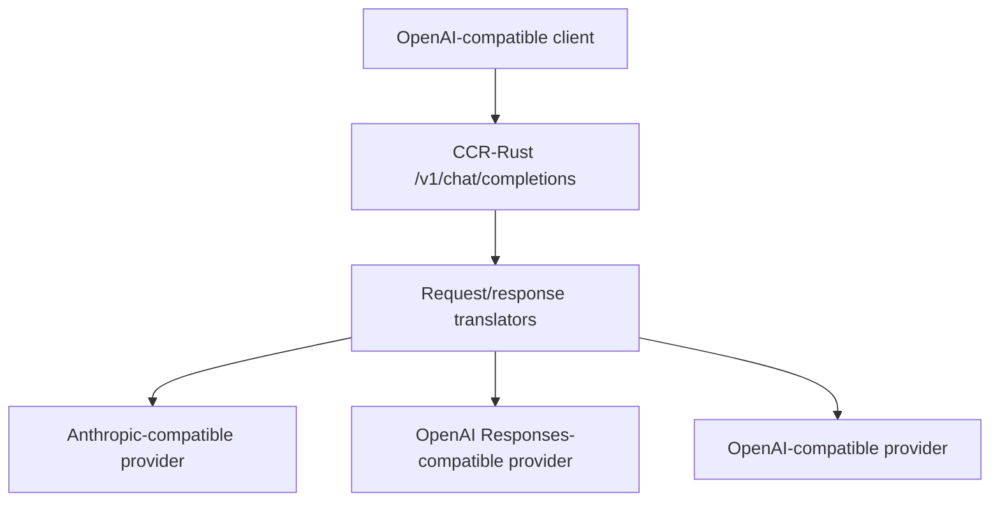
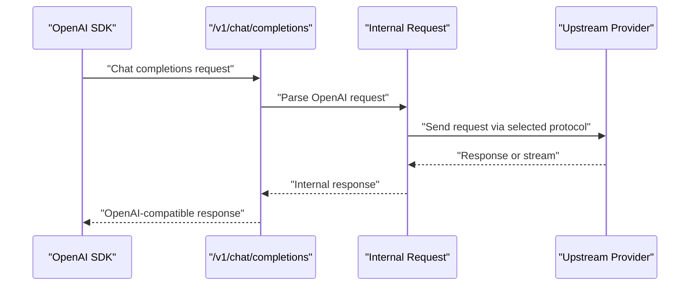
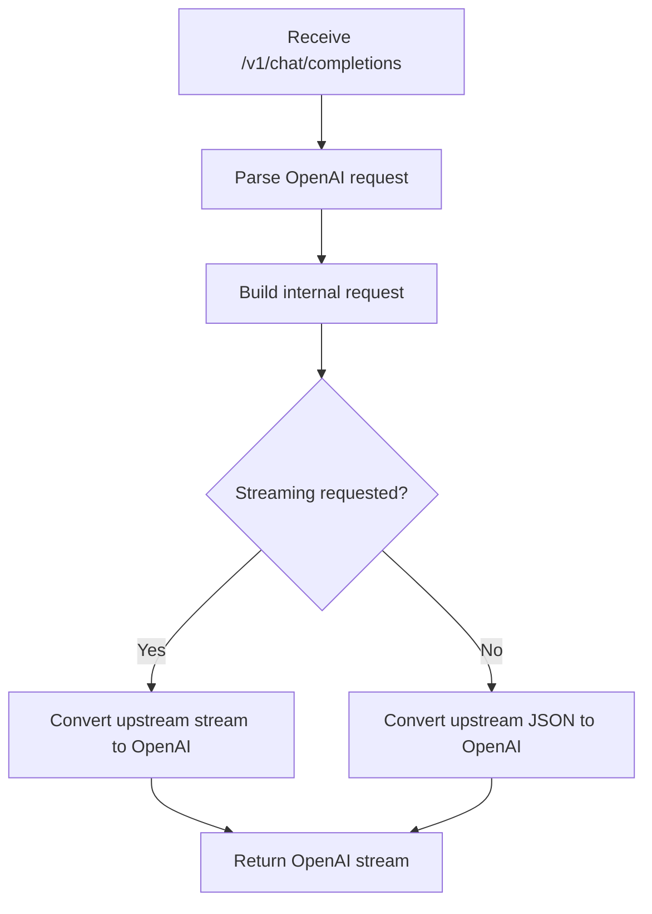
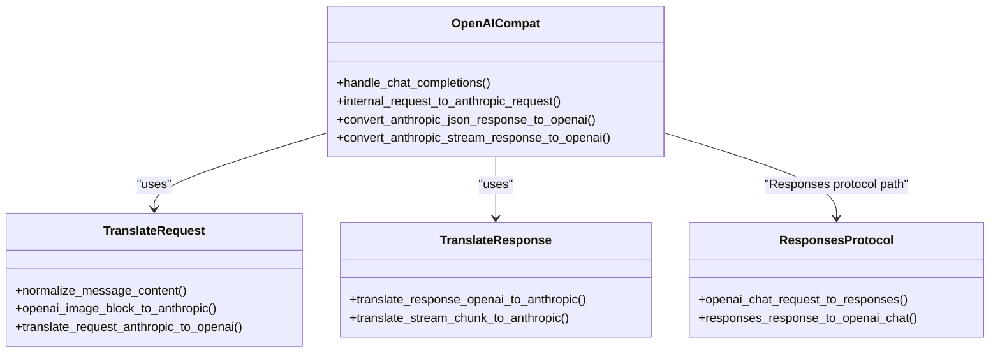
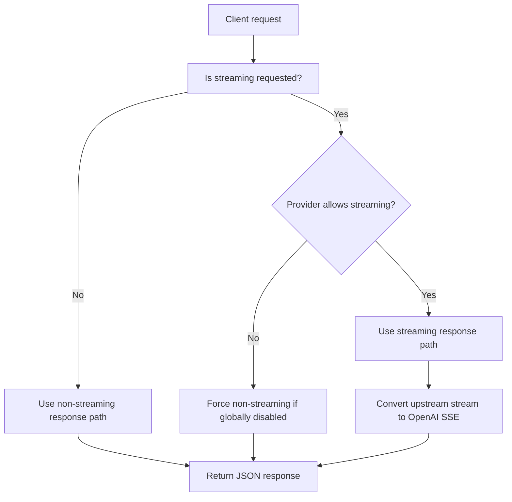
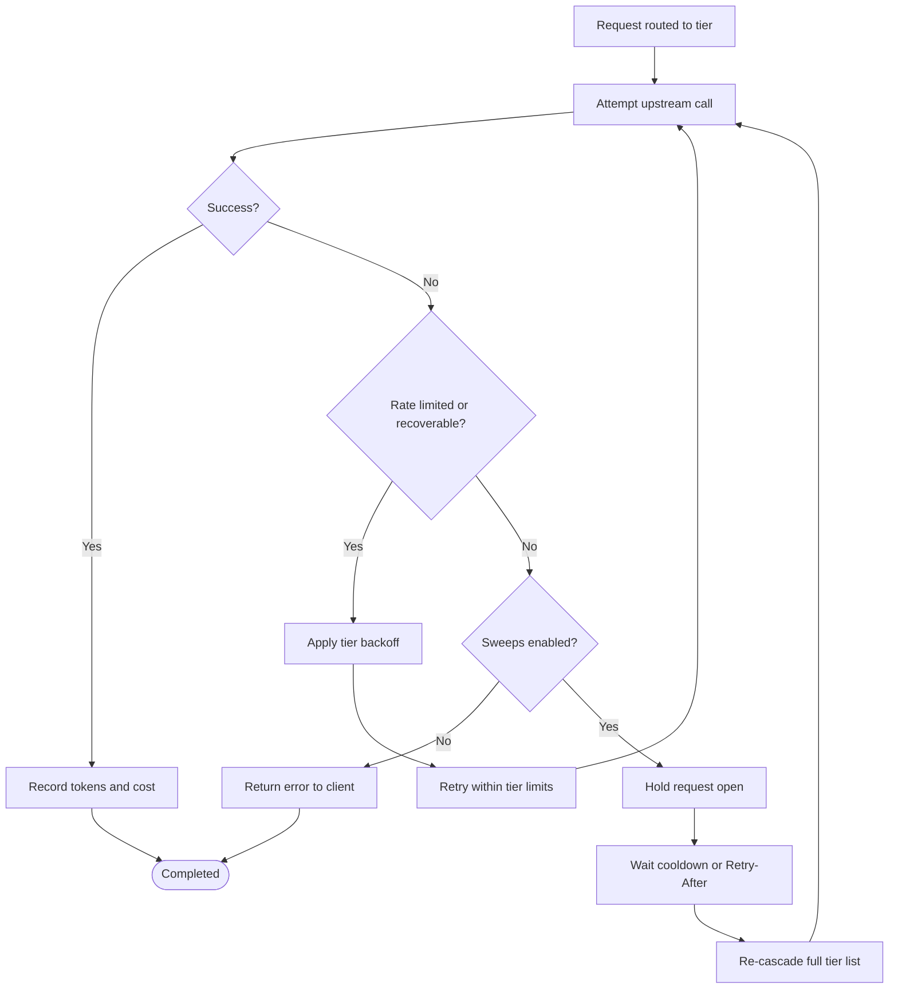
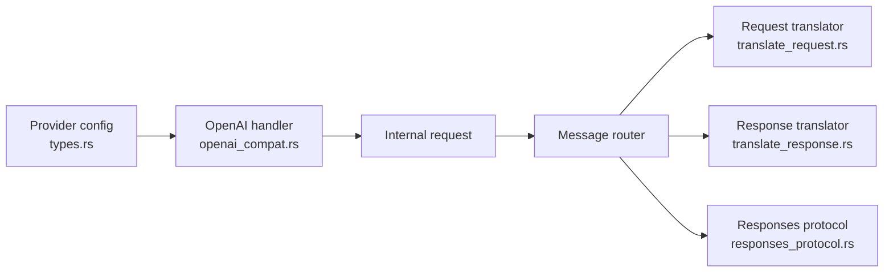

# OpenAI Provider

<cite>
**Referenced Files in This Document**   
- [README.md](file://README.md)
- [configuration.md](file://docs/configuration.md)
- [openai_sdk_setup.md](file://docs/openai_sdk_setup.md)
- [openrouter.md](file://docs/openrouter.md)
- [types.rs](file://src/config/types.rs)
- [openai_compat.rs](file://src/router/openai_compat.rs)
- [translate_request.rs](file://src/router/translate_request.rs)
- [translate_response.rs](file://src/router/translate_response.rs)
- [responses_protocol.rs](file://src/router/responses_protocol.rs)
- [coding-plans.json](file://examples/coding-plans.json)
- [openrouter-free.json](file://examples/openrouter-free.json)
</cite>

## Table of Contents
1. [Introduction](#introduction)
2. [Project Structure](#project-structure)
3. [Core Components](#core-components)
4. [Architecture Overview](#architecture-overview)
5. [Detailed Component Analysis](#detailed-component-analysis)
6. [Dependency Analysis](#dependency-analysis)
7. [Performance Considerations](#performance-considerations)
8. [Troubleshooting Guide](#troubleshooting-guide)
9. [Conclusion](#conclusion)

## Introduction
This document explains how CCR-Rust configures and operates an OpenAI provider path. It covers:

- The provider configuration fields that select the OpenAI-compatible protocol, API key, base URL, model list, pricing, headers, streaming behavior, and reasoning controls.
- How CCR-Rust exposes `/v1/chat/completions` to OpenAI SDK clients.
- How OpenAI requests are translated into Anthropic or Responses upstream formats when needed.
- Direct OpenAI usage, Azure OpenAI integration through a custom base URL, and third-party OpenAI-compatible endpoints such as OpenRouter.
- Streaming behavior, retry policies, sweep-based hold-and-retry, and cost tracking for providers configured with the default OpenAI protocol.

CCR-Rust is a local router. Clients connect to one local endpoint; CCR-Rust selects a configured provider, translates protocols when necessary, streams responses back, and fails over across tiers.

**Section sources**
- [README.md:1-100](file://README.md#L1-L100)
- [openai_sdk_setup.md:1-51](file://docs/openai_sdk_setup.md#L1-L51)

## Project Structure
The OpenAI provider configuration lives primarily in the provider schema and router translation layers:

| Area | Responsibility |
|---|---|
| `src/config/types.rs` | Defines `Provider`, `ProviderProtocol`, pricing, per-provider headers, streaming, admission, and reasoning controls. |
| `src/router/openai_compat.rs` | Handles the OpenAI `/v1/chat/completions` request path, request normalization, and response conversion. |
| `src/router/translate_request.rs` | Translates Anthropic internal messages and tools into OpenAI Chat format. |
| `src/router/translate_response.rs` | Translates OpenAI non-streaming and streaming responses back into Anthropic-compatible form. |
| `src/router/responses_protocol.rs` | Converts OpenAI Chat Requests to OpenAI Responses upstream payloads when a provider uses the Responses protocol. |
| `docs/openai_sdk_setup.md` | Documents using the OpenAI SDK against CCR-Rust. |
| `examples/openrouter-free.json` | Example third-party OpenAI-compatible provider configuration. |



**Diagram sources**
- [openai_compat.rs:500-560](file://src/router/openai_compat.rs#L500-L560)
- [translate_request.rs:1-200](file://src/router/translate_request.rs#L1-L200)
- [translate_response.rs:1-120](file://src/router/translate_response.rs#L1-L120)
- [responses_protocol.rs:1-120](file://src/router/responses_protocol.rs#L1-L120)

**Section sources**
- [types.rs:200-360](file://src/config/types.rs#L200-L360)
- [openai_compat.rs:500-560](file://src/router/openai_compat.rs#L500-L560)
- [openai_sdk_setup.md:1-51](file://docs/openai_sdk_setup.md#L1-L51)

## Core Components
The OpenAI provider path is built from these core pieces:

### Provider Configuration Fields Relevant to OpenAI
For an OpenAI-compatible provider, the relevant fields are:

| Field | Meaning |
|---|---|
| `name` | Provider identifier used in routes and metrics. |
| `api_base_url` | Full upstream endpoint URL. For OpenAI-compatible providers this should point to their Chat Completions endpoint. |
| `api_key` | Upstream authentication credential, expanded from environment variables. |
| `models` | Allowed model names for this provider. |
| `protocol` | Defaults to `openai`; also supports `anthropic` and `responses`. |
| `pricing` / `model_pricing` | USD per million tokens for cost estimation. |
| `extra_headers` | Additional HTTP headers sent to the upstream. |
| `honor_ratelimit_headers` | Proactive tier cordon based on rate-limit headers. |
| `allow_streaming` | Forces streaming even when global non-streaming mode is enabled. |
| `force_reasoning_effort` | Overrides OpenAI Chat `reasoning_effort` after normalization. |
| `force_adaptive_thinking` | Inserts adaptive thinking state for providers that require it. |
| `max_inflight` | Per-route AIMD admission control limit. |
| `max_inflight_tokens` | Static token-budget admission control for collision-heavy providers. |

The default protocol is `openai`, meaning CCR-Rust sends OpenAI-compatible requests directly to the configured `api_base_url`.

**Section sources**
- [types.rs:200-360](file://src/config/types.rs#L200-L360)
- [types.rs:300-360](file://src/config/types.rs#L300-L360)
- [configuration.md:1-120](file://docs/configuration.md#L1-L120)

### OpenAI Protocol Selection
`ProviderProtocol` has three values:

| Value | Behavior |
|---|---|
| `openai` | Default. Sends OpenAI-compatible requests to the provider’s Chat Completions endpoint. |
| `anthropic` | Sends Anthropic Messages requests; requires Anthropic-compatible configuration such as `anthropic_version` and possibly `auth_header`. |
| `responses` | Sends OpenAI Responses-compatible requests; used when the upstream expects the Responses wire format. |

When `protocol` is omitted, the provider is treated as OpenAI-compatible.

**Section sources**
- [types.rs:300-360](file://src/config/types.rs#L300-L360)

### Authentication and Base URLs
- `api_key` is required for every provider entry.
- `api_base_url` is required and must be the full upstream endpoint.
- Environment variable expansion allows secrets such as `${OPENAI_API_KEY}` or `${AZURE_OPENAI_API_KEY}` without hardcoding them.
- `extra_headers` can carry provider-specific headers. For example, OpenRouter examples use a Claude CLI `User-Agent` because CCR builds fresh upstream headers rather than forwarding the inbound client agent.

**Section sources**
- [types.rs:200-360](file://src/config/types.rs#L200-L360)
- [openrouter.md:1-74](file://docs/openrouter.md#L1-L74)

### Model Selection
A provider declares its supported models through the `models` array. Routes then select a provider and model, either explicitly (for example, `provider,model`) or through defaults, background, think, or tier definitions.

Model selection does not change the OpenAI compatibility layer: clients still send OpenAI-style requests, and CCR-Rust chooses which configured backend serves them.

**Section sources**
- [types.rs:200-360](file://src/config/types.rs#L200-L360)
- [openai_sdk_setup.md:1-51](file://docs/openai_sdk_setup.md#L1-L51)

### Response Format Options
For OpenAI-compatible providers, structured output is expressed through the OpenAI `response_format` field. When routing to a Responses-compatible upstream, CCR-Rust converts selected OpenAI Chat request fields into Responses request fields, including text response format mapping.

Important boundary: translating Anthropic native Messages to OpenAI only maps `output_config.effort`. It does not convert Anthropic schema format to OpenAI `response_format`. Keep structured-output schemas on a provider/model that supports the required format.

**Section sources**
- [responses_protocol.rs:1-120](file://src/router/responses_protocol.rs#L1-L120)
- [configuration.md:120-200](file://docs/configuration.md#L120-L200)

## Architecture Overview
The OpenAI provider path supports two main directions:

1. **OpenAI-compatible upstream**: The provider uses the same Chat Completions wire format. CCR-Rust may translate between OpenAI and Anthropic internally depending on the chosen upstream protocol.
2. **Responses-compatible upstream**: A separate protocol path converts OpenAI Chat requests to OpenAI Responses payloads.



**Diagram sources**
- [openai_compat.rs:500-560](file://src/router/openai_compat.rs#L500-L560)
- [openai_sdk_setup.md:1-51](file://docs/openai_sdk_setup.md#L1-L51)

**Section sources**
- [openai_compat.rs:500-560](file://src/router/openai_compat.rs#L500-L560)
- [responses_protocol.rs:1-120](file://src/router/responses_protocol.rs#L1-L120)

## Detailed Component Analysis

### OpenAI Compatibility Mode
CCR-Rust exposes `/v1/chat/completions` so any OpenAI SDK client can point at CCR-Rust instead of directly at a provider. The handler:

1. Parses the incoming OpenAI request.
2. Normalizes it into an internal request.
3. Wraps it for the downstream message handler.
4. If streaming was requested, converts the upstream stream back to OpenAI SSE.
5. Otherwise, converts the upstream JSON response to OpenAI Chat shape.

This is what “OpenAI compatibility mode” means in CCR-Rust: the client speaks OpenAI, while the router decides whether the actual upstream is OpenAI-compatible, Anthropic-compatible, or Responses-compatible.



**Diagram sources**
- [openai_compat.rs:500-560](file://src/router/openai_compat.rs#L500-L560)

**Section sources**
- [openai_compat.rs:500-560](file://src/router/openai_compat.rs#L500-L560)
- [openai_sdk_setup.md:1-51](file://docs/openai_sdk_setup.md#L1-L51)

### Translation Between OpenAI and Anthropic Formats
When CCR-Rust needs to route an OpenAI request to an Anthropic-compatible upstream, it performs bidirectional translation.

#### Request Translation
- Anthropic internal messages become OpenAI messages.
- System prompts are placed as the first system message.
- Tool results become OpenAI tool messages.
- Anthropic tool blocks become OpenAI function tool calls.
- Reasoning content and signed reasoning blocks are preserved where appropriate.
- Image blocks are normalized between Anthropic image shapes and OpenAI `image_url` shapes.
- `reasoning_effort` is mapped from Anthropic `output_config.effort`.

#### Response Translation
- OpenAI choices are converted to Anthropic content blocks.
- Finish reasons are mapped: `stop` → `end_turn`, `length` → `max_tokens`, `tool_calls` → `tool_use`, `content_filter` → `stop_sequence`.
- Usage information is mapped, including cached and reasoning token details when available.
- Streaming chunks are reconstructed into Anthropic event sequences, preserving content block start/delta/stop ordering.



**Diagram sources**
- [openai_compat.rs:500-560](file://src/router/openai_compat.rs#L500-L560)
- [translate_request.rs:1-200](file://src/router/translate_request.rs#L1-L200)
- [translate_response.rs:1-120](file://src/router/translate_response.rs#L1-L120)
- [responses_protocol.rs:1-120](file://src/router/responses_protocol.rs#L1-L120)

**Section sources**
- [translate_request.rs:1-200](file://src/router/translate_request.rs#L1-L200)
- [translate_request.rs:400-580](file://src/router/translate_request.rs#L400-L580)
- [translate_response.rs:1-120](file://src/router/translate_response.rs#L1-L120)
- [translate_response.rs:200-399](file://src/router/translate_response.rs#L200-L399)

### Streaming Configuration
Streaming behavior is controlled by both the client request and provider configuration:

- The OpenAI handler checks whether the parsed internal request requested streaming.
- `Router.force_non_streaming` forces all requests to non-streaming mode unless a provider overrides it.
- `Provider.allow_streaming` forces streaming for a specific provider even when global non-streaming is enabled.
- Streaming errors are normalized: 429 responses are rewritten with OpenAI-style error type and code fields.
- The stream converter emits `[DONE]` once, deduplicates duplicate stop events, and ensures consistent usage totals.



**Diagram sources**
- [openai_compat.rs:500-560](file://src/router/openai_compat.rs#L500-L560)
- [types.rs:500-700](file://src/config/types.rs#L500-L700)

**Section sources**
- [openai_compat.rs:200-500](file://src/router/openai_compat.rs#L200-L500)
- [openai_compat.rs:500-560](file://src/router/openai_compat.rs#L500-L560)
- [types.rs:500-700](file://src/config/types.rs#L500-L700)

### Retry Policies and Cost Tracking
CCR-Rust provides two related retry mechanisms:

1. **Per-tier retries** configure maximum retries, exponential backoff, and streaming timeouts for each tier.
2. **Retry sweeps** hold an exhausted request open and re-cascade the entire tier list after a cooldown, trading fail-fast semantics for session survival.

Cost tracking is provider-level:

- `pricing` sets default input/output rates.
- `model_pricing` overrides per-model rates.
- Cached input and cache creation rates are optional.
- Missing or invalid rates produce a lower-bound estimate rather than silently assuming zero cost.
- Usage tokens come from upstream responses and are mapped into CCR-Rust’s usage model.



**Diagram sources**
- [types.rs:500-700](file://src/config/types.rs#L500-L700)
- [types.rs:200-300](file://src/config/types.rs#L200-L300)

**Section sources**
- [types.rs:500-700](file://src/config/types.rs#L500-L700)
- [types.rs:200-300](file://src/config/types.rs#L200-L300)

### Examples

#### Direct OpenAI Usage
Point any OpenAI SDK client at CCR-Rust’s local `/v1` endpoint. Set the base URL to the CCR-Rust listener and supply a placeholder local API key because CCR-Rust’s local listener does not authenticate clients. The selected model must match a route in the configuration.

```text
base_url = http://localhost:3456/v1
api_key = unused
model = <configured model name>
messages = [...]
```

**Section sources**
- [openai_sdk_setup.md:1-51](file://docs/openai_sdk_setup.md#L1-L51)

#### Azure OpenAI Integration
Azure OpenAI is an OpenAI-compatible endpoint. Configure it like any other OpenAI-compatible provider:

1. Set `api_base_url` to the Azure deployment endpoint.
2. Set `api_key` to the Azure API key.
3. Add `models` matching the Azure-deployed model IDs.
4. Add any required Azure headers through `extra_headers` if the proxy or gateway requires them.
5. Optionally add `pricing` and `model_pricing` so cost estimates reflect Azure pricing.

The important distinction is that CCR-Rust treats Azure as another OpenAI-compatible provider; it does not have a dedicated Azure-only adapter.

**Section sources**
- [types.rs:200-360](file://src/config/types.rs#L200-L360)

#### Third-Party OpenAI-Compatible Endpoints
OpenRouter is documented as an OpenAI-compatible provider. Its example configuration shows:

- Custom `api_base_url`.
- `api_key` from environment.
- Optional pricing set to zero for free inference.
- `extra_headers` such as `User-Agent`.
- Multiple models in `models`.
- Transformers applied through the provider transformer chain.

**Section sources**
- [openrouter-free.json:1-54](file://examples/openrouter-free.json#L1-L54)
- [openrouter.md:1-74](file://docs/openrouter.md#L1-L74)

## Dependency Analysis
The OpenAI provider path depends on several layers:

| Layer | Dependency | Purpose |
|---|---|---|
| HTTP handler | Axum request parsing | Reads JSON bodies, headers, and status codes. |
| Frontend parser | Internal request builder | Normalizes OpenAI requests into CCR-Rust’s internal shape. |
| Message router | `handle_messages` | Selects provider, applies routing rules, and invokes upstream. |
| Request translator | `translate_request.rs` | Maps Anthropic internal messages and tools to OpenAI. |
| Response translator | `translate_response.rs` | Maps OpenAI responses back to Anthropic-compatible form. |
| Responses protocol | `responses_protocol.rs` | Bridges OpenAI Chat and OpenAI Responses wire formats. |
| Config schema | `types.rs` | Declares provider protocol, headers, pricing, streaming, and retries. |



**Diagram sources**
- [types.rs:200-360](file://src/config/types.rs#L200-L360)
- [openai_compat.rs:500-560](file://src/router/openai_compat.rs#L500-L560)
- [translate_request.rs:1-200](file://src/router/translate_request.rs#L1-L200)
- [translate_response.rs:1-120](file://src/router/translate_response.rs#L1-L120)
- [responses_protocol.rs:1-120](file://src/router/responses_protocol.rs#L1-L120)

**Section sources**
- [openai_compat.rs:500-560](file://src/router/openai_compat.rs#L500-L560)
- [translate_request.rs:1-200](file://src/router/translate_request.rs#L1-L200)
- [translate_response.rs:1-120](file://src/router/translate_response.rs#L1-L120)
- [responses_protocol.rs:1-120](file://src/router/responses_protocol.rs#L1-L120)

## Performance Considerations
- Streaming avoids buffering complete responses when the upstream supports SSE.
- `force_non_streaming` can reduce parsing errors caused by client-side SSE frame limits, but increases latency for long responses.
- `allow_streaming` per provider can force streaming for providers where non-streaming causes excessive latency.
- Admission control (`max_inflight` and `max_inflight_tokens`) prevents overloading providers whose 429s come from concurrent prefill volume.
- Retry sweeps keep long-lived agent sessions alive under temporary provider outages, but increase memory and connection lifetime.
- Cost estimates are lower bounds when cached or creation rates are missing.

[No sources needed since this section provides general guidance]

## Troubleshooting Guide

### Common OpenAI Provider Issues

| Symptom | Likely Cause | Recommended Action |
|---|---|---|
| OpenAI SDK connects but returns no data | Wrong base URL or wrong port | Verify `api_base_url` points to the correct OpenAI-compatible endpoint. |
| 401 Unauthorized | Missing or wrong `api_key` | Confirm environment variable expansion and upstream key validity. |
| 429 Rate limited | Provider quota exceeded or account-wide allowance exhausted | Adjust tier order, enable retry sweeps, or wait for the quota window. |
| Streaming stops early | Global non-streaming override or provider incompatibility | Check `force_non_streaming` and `allow_streaming`. |
| Structured output fails | Schema mismatch across protocols | Keep structured-output requests on a provider/model that supports the required format. |
| Tool calls work in Chat but fail in Responses | Protocol-specific tool handling | Test tools on the exact upstream protocol being used. |
| Azure OpenAI works locally but not behind a proxy | Missing proxy headers or wrong base URL | Add required headers through `extra_headers` and verify the base URL. |

### Error Normalization
- 429 responses from upstream are rewritten with OpenAI-style error fields, including optional `retry_after`.
- Non-Anthropic-shaped upstream responses may be passed through unchanged in some conversion paths.
- Malformed streaming frames are logged and forwarded as raw data rather than crashing the stream converter.

**Section sources**
- [openai_compat.rs:200-500](file://src/router/openai_compat.rs#L200-L500)
- [translate_response.rs:200-399](file://src/router/translate_response.rs#L200-L399)

## Conclusion
CCR-Rust’s OpenAI provider support is best understood as a compatibility layer rather than a single hardcoded provider implementation. The default OpenAI protocol sends requests to the configured base URL, while the router can translate between OpenAI, Anthropic, and Responses wire formats. Configuration focuses on `api_base_url`, `api_key`, `models`, pricing, headers, streaming behavior, and reasoning controls. Direct OpenAI usage, Azure OpenAI, and third-party OpenAI-compatible endpoints share the same configuration surface, differing mainly in base URL, credentials, headers, and model IDs. Streaming, retries, and cost tracking are provided at the router level to make multi-provider operation predictable and observable.

[No sources needed since this section summarizes without analyzing specific files]