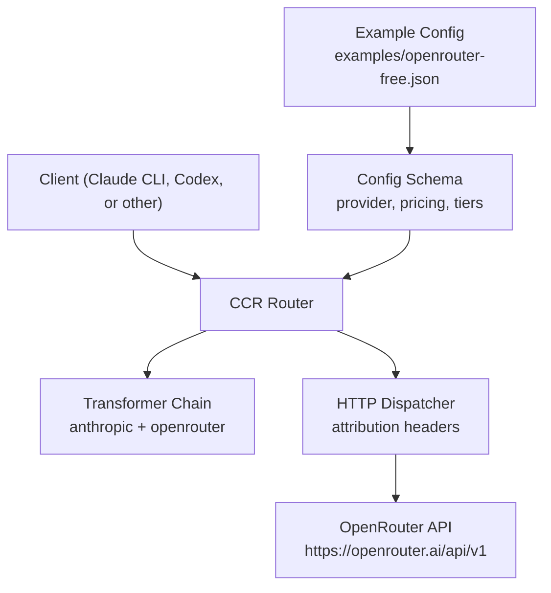
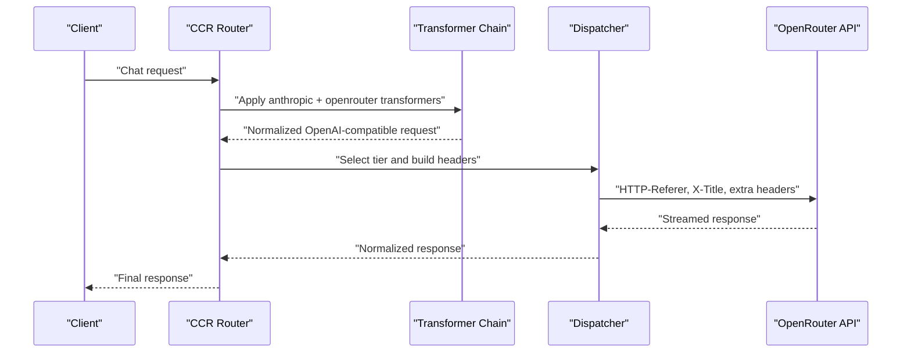
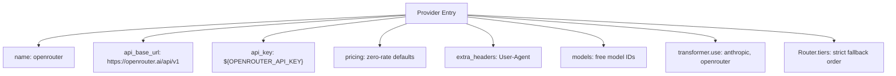
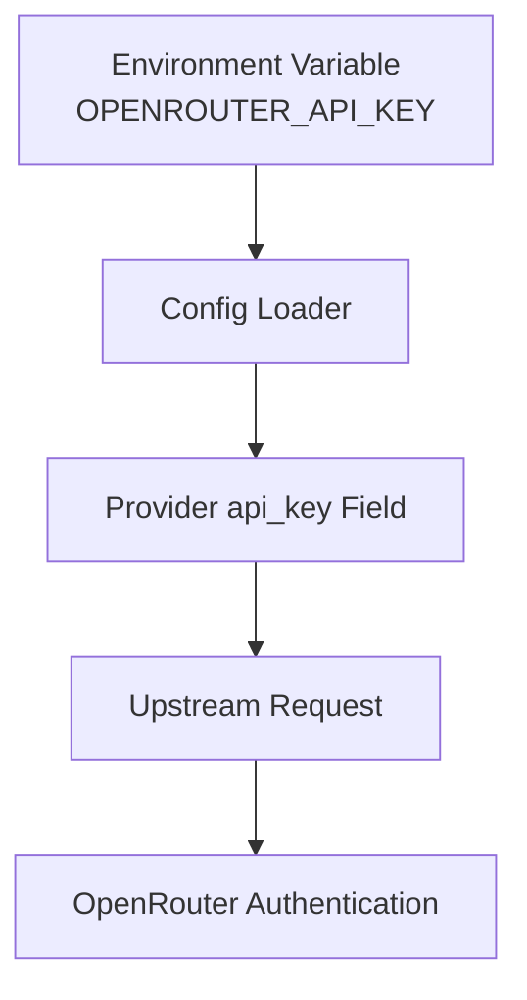
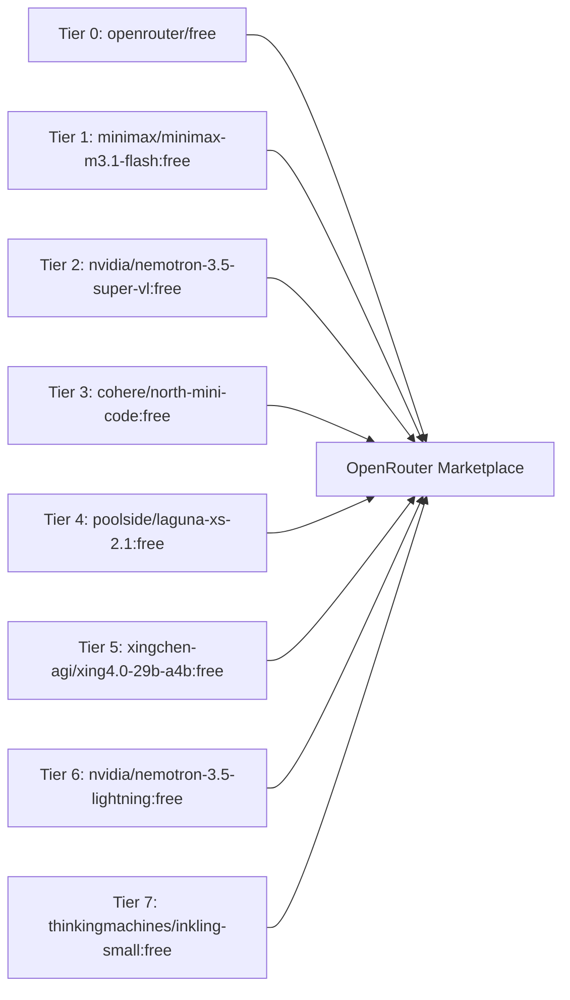
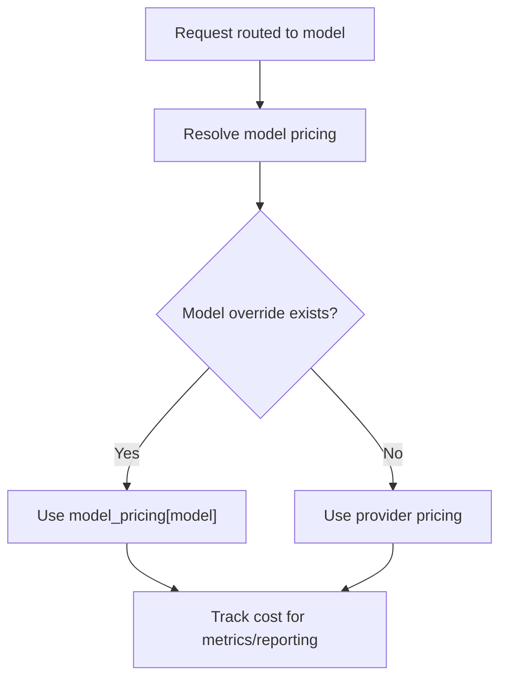
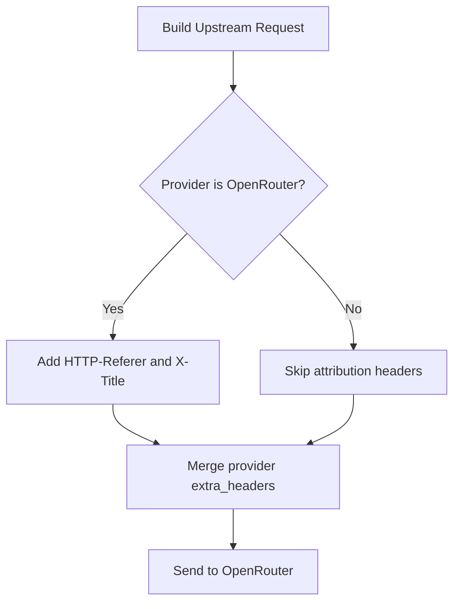
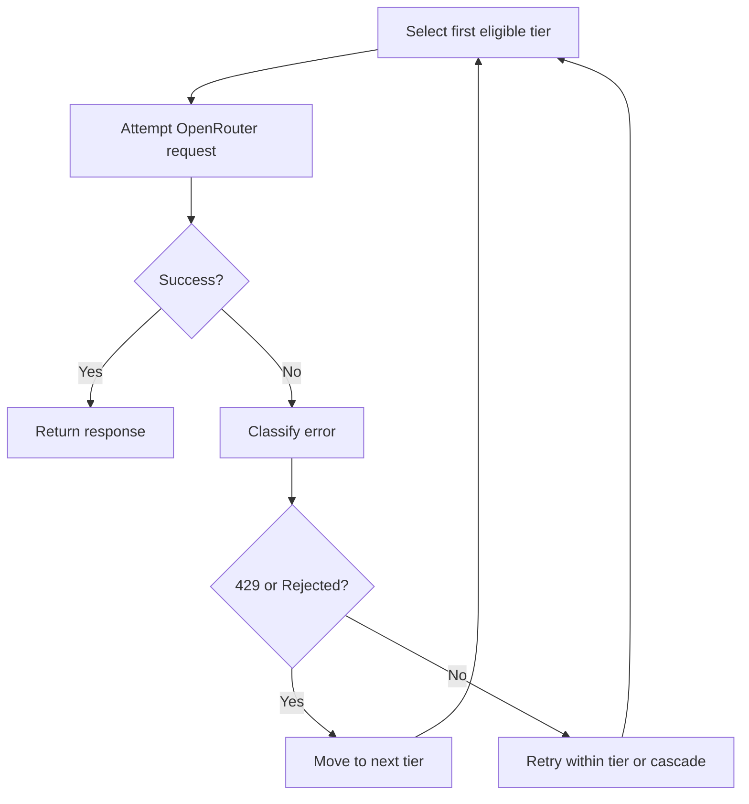
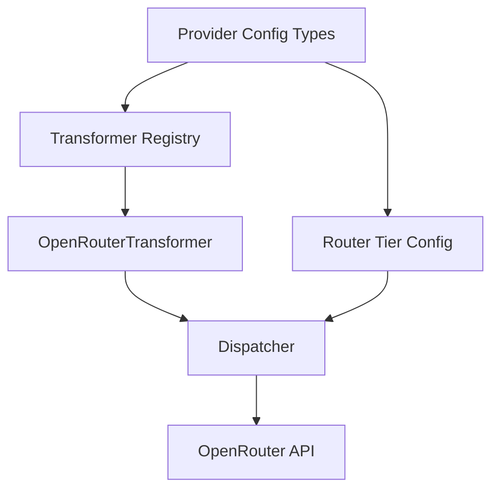

# OpenRouter Provider

<cite>
**Referenced Files in This Document**
- [openrouter.md](file://docs/openrouter.md)
- [openrouter-free.json](file://examples/openrouter-free.json)
- [configuration.md](file://docs/configuration.md)
- [failover_architecture.md](file://docs/failover_architecture.md)
- [transformer/mod.rs](file://src/transformer/mod.rs)
- [dispatch.rs](file://src/router/dispatch.rs)
- [types.rs](file://src/config/types.rs)
- [mod.rs](file://src/config/mod.rs)
- [openrouter-free-20261019.md](file://evidence/openrouter-free-20261019.md)
</cite>

## Table of Contents
1. [Introduction](#introduction)
2. [Project Structure](#project-structure)
3. [Core Components](#core-components)
4. [Architecture Overview](#architecture-overview)
5. [Detailed Component Analysis](#detailed-component-analysis)
6. [Dependency Analysis](#dependency-analysis)
7. [Performance Considerations](#performance-considerations)
8. [Troubleshooting Guide](#troubleshooting-guide)
9. [Conclusion](#conclusion)

## Introduction
This document explains how to configure CCR-Rust as an OpenRouter provider. It covers API key setup, model routing through OpenRouter’s marketplace, pricing configuration, unified endpoint usage for multiple underlying models, free and paid model workflows, cost optimization, OpenRouter-specific headers, authentication, and integration with CCR-Rust’s tier-based failover system.

OpenRouter is treated as an OpenAI-compatible upstream. Standard OpenRouter Chat Completions models do not require a per-model adapter: the Anthropic transformer converts Anthropic client requests into OpenAI Chat format, and the OpenAI frontend sends them directly to OpenRouter. The `openrouter` transformer entry is primarily an explicit compatibility marker; CCR also injects OpenRouter attribution headers automatically when the provider name or API host identifies OpenRouter.

## Project Structure
The OpenRouter guidance in this repository spans three layers:

- Documentation: high-level setup, free-model catalog notes, and compatibility boundaries.
- Example configuration: a validated JSON file demonstrating a zero-cost OpenRouter provider, eight models, and a strict fallback tier list.
- Source code: transformer registration, automatic attribution header injection, provider configuration schema, and routing behavior.

**Diagram sources**
- [openrouter.md:1-74](file://docs/openrouter.md#L1-L74)
- [openrouter-free.json:1-54](file://examples/openrouter-free.json#L1-L54)
- [transformer/mod.rs:221-234](file://src/transformer/mod.rs#L221-L234)
- [dispatch.rs:533-549](file://src/router/dispatch.rs#L533-L549)
- [types.rs:280-340](file://src/config/types.rs#L280-L340)

**Section sources**
- [openrouter.md:1-74](file://docs/openrouter.md#L1-L74)
- [openrouter-free.json:1-54](file://examples/openrouter-free.json#L1-L54)

## Core Components
The OpenRouter integration relies on these components:

| Component | Responsibility | Key Configuration or Behavior |
|---|---|---|
| Provider entry | Declares OpenRouter as an OpenAI-compatible upstream | `name`, `api_base_url`, `api_key`, `models`, `pricing`, `extra_headers`, `transformer.use` |
| Transformer chain | Converts Anthropic requests to OpenAI Chat and marks OpenRouter compatibility | `use: ["anthropic", "openrouter"]` |
| Dispatcher | Adds OpenRouter attribution headers when detected | Injects `HTTP-Referer` and `X-Title` for OpenRouter endpoints |
| Router tiers | Defines ordered fallback across multiple OpenRouter models | `default`, `tiers`, `strictTierOrder` |
| Pricing model | Tracks USD-per-million-token costs | Provider default plus optional model overrides |
| Environment expansion | Loads secrets without hardcoding keys | `${OPENROUTER_API_KEY}` expanded at config load time |

**Section sources**
- [openrouter.md:1-74](file://docs/openrouter.md#L1-L74)
- [openrouter-free.json:1-54](file://examples/openrouter-free.json#L1-L54)
- [transformer/mod.rs:221-234](file://src/transformer/mod.rs#L221-L234)
- [dispatch.rs:533-549](file://src/router/dispatch.rs#L533-L549)
- [types.rs:280-340](file://src/config/types.rs#L280-L340)

## Architecture Overview
OpenRouter functions as a unified OpenAI-compatible endpoint that routes requests to many underlying models. In CCR-Rust, the request flow is:

1. A client sends a request to the local CCR router.
2. If the client uses Anthropic Messages, the `anthropic` transformer normalizes it to OpenAI Chat.
3. The `openrouter` transformer is applied as an identity compatibility marker.
4. The dispatcher builds HTTP headers and adds OpenRouter attribution headers when the provider is recognized as OpenRouter.
5. CCR selects a tier from the configured tier list, honoring direct routing unless `ignoreDirect` is enabled.
6. The request is sent to OpenRouter’s API base URL.
7. Responses are streamed back through CCR’s streaming layer.

**Diagram sources**
- [openrouter.md:1-74](file://docs/openrouter.md#L1-L74)
- [transformer/mod.rs:221-234](file://src/transformer/mod.rs#L221-L234)
- [dispatch.rs:533-549](file://src/router/dispatch.rs#L533-L549)
- [openrouter-free.json:1-54](file://examples/openrouter-free.json#L1-L54)

## Detailed Component Analysis

### OpenRouter Provider Configuration
A provider entry declares OpenRouter as an upstream. The example configuration demonstrates:

- Provider name: `openrouter`
- API base URL: `https://openrouter.ai/api/v1`
- API key: loaded from `OPENROUTER_API_KEY`
- Pricing: zero input/output rates for free-tier examples
- Extra headers: includes a Claude CLI-style `User-Agent` because some free endpoints gate non-agent clients
- Models: a curated set of zero-price text/code models
- Transformers: `["anthropic", "openrouter"]`
- Routing: a strict tier list starting with `openrouter/free`

**Diagram sources**
- [openrouter-free.json:1-54](file://examples/openrouter-free.json#L1-L54)
- [configuration.md:1-200](file://docs/configuration.md#L1-L200)

**Section sources**
- [openrouter-free.json:1-54](file://examples/openrouter-free.json#L1-L54)
- [configuration.md:1-200](file://docs/configuration.md#L1-L200)

### Authentication and Secrets
OpenRouter authentication uses an API key provided by OpenRouter. In CCR-Rust:

- The provider field `api_key` accepts environment variable expansion.
- Export `OPENROUTER_API_KEY` before running `validate` or `start`.
- Do not embed the key directly in checked-in configuration files.
- Prefer process environment variables or a service manager over `.env` files for production.

**Diagram sources**
- [configuration.md:1-200](file://docs/configuration.md#L1-L200)
- [openrouter-free.json:1-54](file://examples/openrouter-free.json#L1-L54)

**Section sources**
- [configuration.md:1-200](file://docs/configuration.md#L1-L200)
- [openrouter-free.json:1-54](file://examples/openrouter-free.json#L1-L54)

### Model Routing Through OpenRouter’s Marketplace
OpenRouter exposes many downstream models under one OpenAI-compatible interface. CCR-Rust supports this by treating each OpenRouter model ID as a distinct route. The example configuration lists several free models, including:

- `openrouter/free`
- `minimax/minimax-m3.1-flash:free`
- `xingchen-agi/xing4.0-29b-a4b:free`
- `nvidia/nemotron-3.5-super-vl:free`
- `nvidia/nemotron-3.5-lightning:free`
- `cohere/north-mini-code:free`
- `poolside/laguna-xs-2.1:free`
- `thinkingmachines/inkling-small:free`

These entries should be validated against the current OpenRouter catalog rather than assumed permanent. Catalog checks can identify zero-price models, but live completion and tool-loop acceptance must still be verified after startup.

**Diagram sources**
- [openrouter-free.json:1-54](file://examples/openrouter-free.json#L1-L54)
- [openrouter.md:1-74](file://docs/openrouter.md#L1-L74)

**Section sources**
- [openrouter-free.json:1-54](file://examples/openrouter-free.json#L1-L54)
- [openrouter.md:1-74](file://docs/openrouter.md#L1-L74)
- [openrouter-free-20261019.md:1-85](file://evidence/openrouter-free-20261019.md#L1-L85)

### Pricing Management
Pricing in CCR-Rust is expressed in USD per million tokens. For OpenRouter free models, the example sets both input and output rates to zero. Paid models can be added by:

- Adding the model ID to the provider’s `models` array.
- Setting provider-default pricing under `pricing`.
- Overriding individual models under `model_pricing`.
- Keeping the model included in `Router.tiers` if it should participate in failover.

**Diagram sources**
- [types.rs:280-340](file://src/config/types.rs#L280-L340)
- [openrouter-free.json:1-54](file://examples/openrouter-free.json#L1-L54)

**Section sources**
- [types.rs:280-340](file://src/config/types.rs#L280-L340)
- [openrouter-free.json:1-54](file://examples/openrouter-free.json#L1-L54)

### OpenRouter-Specific Headers and Authentication Methods
When the provider name is `openrouter` or the API base URL contains `openrouter.ai`, CCR automatically injects attribution headers required by OpenRouter’s marketplace:

- `HTTP-Referer`: points to the CCR-Rust repository.
- `X-Title`: identifies the router as `ccr-rust`.

In addition, provider-level `extra_headers` are merged into every upstream request. This is how a coding agent’s `User-Agent` is attached for OpenRouter free endpoints that reject generic clients.

**Diagram sources**
- [dispatch.rs:533-549](file://src/router/dispatch.rs#L533-L549)
- [openrouter-free.json:1-54](file://examples/openrouter-free.json#L1-L54)

**Section sources**
- [dispatch.rs:533-549](file://src/router/dispatch.rs#L533-L549)
- [openrouter-free.json:1-54](file://examples/openrouter-free.json#L1-L54)

### Integration With CCR-Rust’s Tier-Based Failover System
OpenRouter models participate in CCR-Rust’s tier cascade exactly like any other provider/model route. The example configuration uses:

- `strictTierOrder: true` so tiers are attempted in configured order.
- Multiple tiers so account-wide OpenRouter rate limits or model-specific failures can fall back to another OpenRouter model.
- Direct routing by default, meaning a request targeting `openrouter,model` pins that tier at the front unless `ignoreDirect` is enabled.

Failover behavior relevant to OpenRouter:

- Deterministic rejections (for example, certain 401–404 cases) are not retried repeatedly.
- 429 responses trigger immediate tier movement and rate-limit tracking.
- Non-streaming pre-first-token failures can cascade to the next tier.
- Post-first-token streaming failures surface as in-stream error events and do not cascade.
- Retry sweeps can hold the request open and re-cascade the full tier list instead of immediately returning a synthesized failure.

**Diagram sources**
- [failover_architecture.md:1-200](file://docs/failover_architecture.md#L1-L200)
- [types.rs:600-750](file://src/config/types.rs#L600-L750)
- [openrouter-free.json:1-54](file://examples/openrouter-free.json#L1-L54)

**Section sources**
- [failover_architecture.md:1-200](file://docs/failover_architecture.md#L1-L200)
- [types.rs:600-750](file://src/config/types.rs#L600-L750)
- [openrouter-free.json:1-54](file://examples/openrouter-free.json#L1-L54)

### Free Model Access
For free inference:

1. Obtain an OpenRouter API key.
2. Export `OPENROUTER_API_KEY`.
3. Use the example configuration or adapt it for your free models.
4. Validate configuration with `ccr-rust --config examples/openrouter-free.json validate`.
5. Start the router and verify model availability through `/v1/models`.
6. Run a small chat completion test against the exact model you intend to use.
7. If using a coding client such as Claude CLI, keep the example `User-Agent`; for Codex, replace it with your actual Codex CLI agent identifier.

Important caveat: OpenRouter’s free allowance is account-wide. A daily 429 from the free tier caps all free models on that account simultaneously. Explicit fallback tiers help with model-specific upstream failures but cannot bypass an account-wide free-tier cap.

**Section sources**
- [openrouter.md:1-74](file://docs/openrouter.md#L1-L74)
- [openrouter-free.json:1-54](file://examples/openrouter-free.json#L1-L54)
- [openrouter-free-20261019.md:1-85](file://evidence/openrouter-free-20261019.md#L1-L85)

### Paid Model Routing
Paid model routing follows the same structure as free models, with different pricing and usually higher quotas:

1. Add the paid model ID to the OpenRouter provider’s `models` array.
2. Configure realistic pricing under `pricing` or `model_pricing`.
3. Place the paid model in `Router.tiers` at the desired priority.
4. Test model availability and tool support separately from free models.
5. Monitor usage and adjust tier ordering based on latency, cost, and reliability.

Cost optimization strategies include:

- Keep free models as early tiers for low-risk workloads.
- Route expensive or capability-sensitive tasks to paid tiers.
- Use `strictTierOrder` when you need deterministic fallback behavior.
- Avoid broad retries on deterministic errors; let failed models move to the next tier.
- Use model-specific pricing to reflect actual OpenRouter charges.
- Monitor 429 patterns and tune retry budgets and sweep behavior.

**Section sources**
- [openrouter-free.json:1-54](file://examples/openrouter-free.json#L1-L54)
- [configuration.md:1-200](file://docs/configuration.md#L1-L200)
- [types.rs:600-750](file://src/config/types.rs#L600-L750)

### Compatibility Boundaries
OpenRouter integration has clear boundaries:

- Standard OpenRouter models use the OpenAI Chat protocol.
- No per-model OpenRouter adapter is required for standard Chat models.
- Multimodal support depends on the selected upstream model and the client’s input shape; test one image/document before relying on it.
- Structured-output constraints are protocol-specific and may not survive cross-protocol fallback.
- Tool-call acceptance advertised by OpenRouter does not guarantee usable tool loops for every harness; run a representative client round trip.

**Section sources**
- [openrouter.md:1-74](file://docs/openrouter.md#L1-L74)
- [openrouter-free-20261019.md:1-85](file://evidence/openrouter-free-20261019.md#L1-L85)

## Dependency Analysis
The OpenRouter integration connects configuration, transformation, dispatch, and routing:

**Diagram sources**
- [types.rs:280-340](file://src/config/types.rs#L280-L340)
- [transformer/mod.rs:221-234](file://src/transformer/mod.rs#L221-L234)
- [dispatch.rs:533-549](file://src/router/dispatch.rs#L533-L549)

Key relationships:

- The provider configuration defines the OpenRouter endpoint, key, models, pricing, and transformers.
- The transformer registry registers `openrouter` as an identity transformer used for compatibility signaling.
- The dispatcher detects OpenRouter endpoints and injects attribution headers.
- The router treats OpenRouter model IDs as distinct tiers for failover.
- Example configuration ties these pieces together into a working free-tier setup.

**Section sources**
- [types.rs:280-340](file://src/config/types.rs#L280-L340)
- [transformer/mod.rs:221-234](file://src/transformer/mod.rs#L221-L234)
- [dispatch.rs:533-549](file://src/router/dispatch.rs#L533-L549)
- [openrouter-free.json:1-54](file://examples/openrouter-free.json#L1-L54)

## Performance Considerations
OpenRouter-specific performance considerations include:

- **Free-tier rate limits:** Account-wide 429s affect all free models. Use multiple tiers and avoid assuming any single free model is always available.
- **Agent identity gating:** Some free endpoints require a coding agent `User-Agent`. Keep the header aligned with the real client you use.
- **Strict tier ordering:** When using `strictTierOrder`, CCR attempts tiers sequentially, which simplifies debugging and guarantees predictable fallback.
- **Streaming behavior:** Once streaming begins, failures do not cascade; plan for long-running agent sessions accordingly.
- **Retry sweeps:** Enabling sweeps holds requests open and re-cascades tiers, trading latency for message survival.
- **Pricing accuracy:** Misconfigured pricing affects cost reporting. Keep model-specific overrides accurate for paid OpenRouter models.

[No sources needed since this section provides general guidance]

## Troubleshooting Guide

| Symptom | Likely Cause | Recommended Action |
|---|---|---|
| 401 Unauthorized | Missing or invalid `OPENROUTER_API_KEY` | Export the correct OpenRouter API key and restart the router. |
| 429 Too Many Requests | OpenRouter free-tier quota exhausted | Wait for reset or add paid tiers; explicit fallback tiers cannot bypass account-wide free limits. |
| 429 Too Many Requests | Per-request concurrency limit | Tune admission control, reduce concurrency, and monitor 429 pacing. |
| Empty or wrong model listing | Stale example model list | Re-check OpenRouter’s catalog and update the provider’s `models` array. |
| Free endpoint rejects request | Missing or incorrect `User-Agent` | Align `extra_headers.User-Agent` with the actual coding client. |
| Tools accepted but unusable | Upstream model/harness mismatch | Run a representative tool round trip; do not assume advertised tool support is sufficient. |
| Streaming fails mid-response | Post-first-token streaming limitation | Inspect in-stream error events; cascade is disabled after the first token. |
| Pricing shows unexpected values | Missing model-specific override | Check `model_pricing` and confirm canonical model aliases. |

**Section sources**
- [openrouter.md:1-74](file://docs/openrouter.md#L1-L74)
- [openrouter-free.json:1-54](file://examples/openrouter-free.json#L1-L54)
- [openrouter-free-20261019.md:1-85](file://evidence/openrouter-free-20261019.md#L1-L85)
- [failover_architecture.md:1-200](file://docs/failover_architecture.md#L1-L200)

## Conclusion
OpenRouter integrates into CCR-Rust as an OpenAI-compatible provider. The recommended approach is to declare an OpenRouter provider, configure authentication through `OPENROUTER_API_KEY`, list supported models, set accurate pricing, and place those models in a strict or weighted tier list. Free models provide a useful starting point but are subject to account-wide rate limits. Paid models extend capacity and capabilities and should be priced accurately. CCR-Rust automatically handles OpenRouter attribution headers, while the broader failover system manages retries, sweeping, streaming boundaries, and tier cascading. Validation should always include both model discovery and a representative client round trip before relying on OpenRouter for production workloads.

[No sources needed since this section summarizes without analyzing specific files]