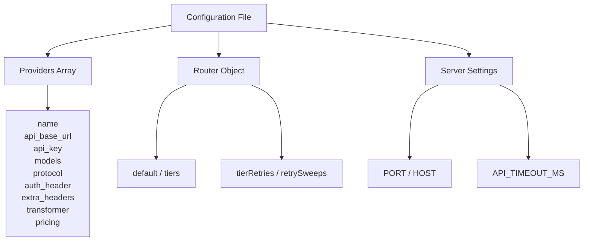
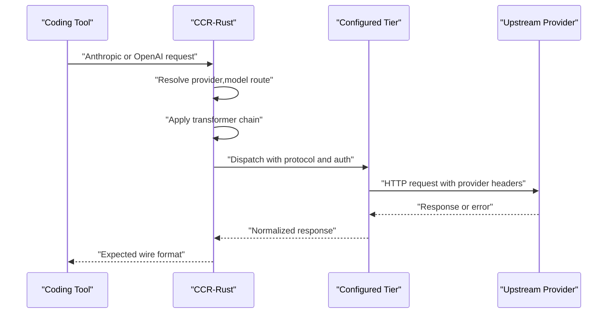
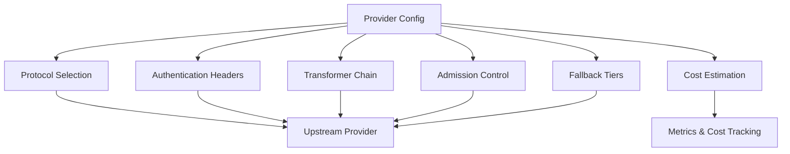
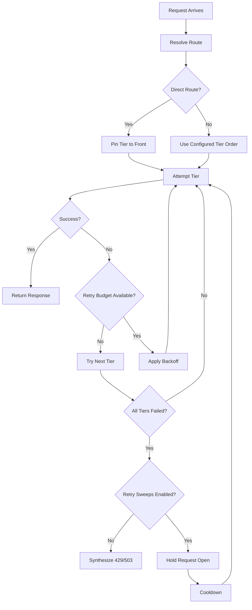

# Provider Configuration

<cite>
**Referenced Files in This Document**
- [types.rs](file://src/config/types.rs)
- [configuration.md](file://docs/configuration.md)
- [README.md](file://README.md)
- [coding-plans.json](file://examples/coding-plans.json)
- [openrouter-free.json](file://examples/openrouter-free.json)
- [sensenova.json](file://examples/sensenova.json)
- [openrouter.md](file://docs/openrouter.md)
- [kimi_setup.md](file://docs/kimi_setup.md)
- [zai_anthropic_endpoint.md](file://docs/zai_anthropic_endpoint.md)
- [minimax.md](file://docs/minimax.md)
- [sensenova-token-plan.md](file://docs/sensenova-token-plan.md)
</cite>

## Table of Contents
1. [Introduction](#introduction)
2. [Project Structure](#project-structure)
3. [Core Components](#core-components)
4. [Architecture Overview](#architecture-overview)
5. [Detailed Component Analysis](#detailed-component-analysis)
6. [Dependency Analysis](#dependency-analysis)
7. [Performance Considerations](#performance-considerations)
8. [Troubleshooting Guide](#troubleshooting-guide)
9. [Conclusion](#conclusion)

## Introduction
This document explains how to configure CCR-Rust providers for Anthropic, OpenAI, GLM (Z.AI), MiniMax, DeepSeek, Kimi, OpenRouter, and SenseNova. It covers configuration fields, authentication methods, endpoint customization, provider-specific parameters, environment variable usage, fallback behavior, health checks, rate limiting, timeouts, and performance tuning.

CCR-Rust is a local LLM router that accepts requests from coding tools and forwards them to one or more upstream providers. A single configuration file declares providers, routes, retries, pricing, transformers, and server settings. Environment variables expand secrets at startup; credentials are never required to be hardcoded.

**Section sources**
- [README.md:1-40](file://README.md#L1-L40)
- [configuration.md:1-35](file://docs/configuration.md#L1-L35)

## Project Structure
Provider configuration lives in the JSON configuration file loaded by CCR-Rust. The most important structure is:

**Diagram sources**
- [types.rs:247-333](file://src/config/types.rs#L247-L333)
- [types.rs:634-718](file://src/config/types.rs#L634-L718)
- [configuration.md:36-116](file://docs/configuration.md#L36-L116)

### Configuration File Location
| Method | Value |
|--------|-------|
| CLI flag | `--config path/to/config.json` |
| Environment | `CCR_CONFIG=path/to/config.json` |
| Default | `~/.claude-code-router/config.json` |

Environment variables in the configuration use `${VAR_NAME}` syntax and are expanded from the router process environment at load time. CCR-Rust does not read `.env` files directly.

**Section sources**
- [configuration.md:10-35](file://docs/configuration.md#L10-L35)
- [configuration.md:36-116](file://docs/configuration.md#L36-L116)

## Core Components
The core provider schema is defined by the `Provider` type. Each entry represents one upstream API account and model catalog.

| Field | Type | Required | Default | Meaning |
|---|---|---:|---|---|
| `name` | string | Yes | — | Unique provider identifier used in routes. |
| `api_base_url` | string | Yes | — | Upstream base URL. The protocol path is appended by CCR. |
| `api_key` | string | Yes | — | Secret credential, normally an environment variable reference. |
| `models` | array of strings | Yes | — | Allowed model identifiers exposed through this provider. |
| `protocol` | enum | No | `openai` | Upstream wire format: `openai`, `anthropic`, or `responses`. |
| `anthropic_version` | string | No | Canonical default | Anthropic API version header when `protocol=anthropic`. |
| `auth_header` | string | No | `x-api-key` | Authentication header name for Anthropic-compatible providers. |
| `transformer` | object | No | None | Request/response transformation chain. |
| `tier_name` | string | No | Provider name | Optional display label for metrics and dashboards. |
| `extra_headers` | map | No | None | Additional HTTP headers sent to this provider. |
| `honor_ratelimit_headers` | bool | No | `true` | Skip tier when upstream reports zero remaining rate-limit capacity. |
| `allow_streaming` | bool | No | `false` | Force streaming even when global non-streaming mode is enabled. |
| `force_reasoning_effort` | string | No | None | Force OpenAI Chat Completions reasoning effort. |
| `force_adaptive_thinking` | bool | No | `false` | Insert adaptive thinking state for providers requiring it. |
| `max_inflight` | number | No | Global default 8 | AIMD admission-control limit per route. |
| `max_inflight_tokens` | number | No | None | Static prefill-token budget for token-volume collision avoidance. |

Provider-level pricing has two required rates plus optional cached-input rates. Model-specific pricing overrides the provider defaults.

**Section sources**
- [types.rs:201-333](file://src/config/types.rs#L201-L333)
- [configuration.md:200-270](file://docs/configuration.md#L200-L270)

## Architecture Overview
A request flows through CCR-Rust as follows:

**Diagram sources**
- [types.rs:247-333](file://src/config/types.rs#L247-L333)
- [configuration.md:36-116](file://docs/configuration.md#L36-L116)

## Detailed Component Analysis

### Anthropic-Compatible Providers
CCR supports native Anthropic `/messages` requests through `protocol: "anthropic"`. This is the expected setup for Z.AI GLM and Kimi Code.

#### Supported Options
- `protocol`: `"anthropic"`
- `anthropic_version`: optional Anthropic API version header
- `auth_header`: defaults to `x-api-key`; change to `authorization` when the provider requires `Authorization: Bearer`
- `extra_headers`: useful for provider identity requirements such as `User-Agent`
- `honor_ratelimit_headers`: set to `false` when the provider sends informational rate-limit headers on every successful response
- `force_reasoning_effort`: valid only on the OpenAI-protocol path; Anthropic-native reasoning controls are preserved separately
- `force_adaptive_thinking`: relevant for providers whose non-thinking mode needs adaptive thinking state

#### Authentication
Most Anthropic-compatible endpoints accept `x-api-key`. Z.AI uses `Authorization: Bearer`, so its provider must set `auth_header: "authorization"`.

#### Health Check Behavior
- `/health` confirms the listener is alive.
- `/v1/models` lists configured models but does not authenticate the upstream.
- Live completion testing is required to confirm quota, model access, and transport behavior.

#### Practical Example Pattern
Use the Z.AI example for an Anthropic-compatible provider that requires bearer authorization and does not honor informational rate-limit headers:

- Provider name: `zai`
- Base URL: `https://api.z.ai/api/anthropic/v1`
- Protocol: `anthropic`
- Auth header: `authorization`
- Models: configured GLM IDs
- Rate-limit behavior: `honor_ratelimit_headers: false`

Kimi Code uses the same Anthropic-compatible pattern without special bearer handling. Its verified setup includes a `maxtoken` transformer because certain clients omit output limits.

**Section sources**
- [types.rs:247-333](file://src/config/types.rs#L247-L333)
- [zai_anthropic_endpoint.md:1-50](file://docs/zai_anthropic_endpoint.md#L1-L50)
- [kimi_setup.md:1-40](file://docs/kimi_setup.md#L1-L40)
- [kimi_setup.md:41-113](file://docs/kimi_setup.md#L41-L113)

### OpenAI-Compatible Providers
OpenAI-compatible providers send requests to `/chat/completions` and use the standard OpenAI JSON shape. This is the default protocol.

#### Supported Options
- `protocol`: `"openai"` (default)
- `api_key`: passed using the upstream's expected bearer scheme
- `extra_headers`: add provider-specific headers such as attribution or client identity
- `force_reasoning_effort`: force reasoning effort for OpenAI Chat Completions
- `force_adaptive_thinking`: enable adaptive thinking state where required
- `allow_streaming`: force streaming when non-streaming mode causes latency problems

#### Practical Examples
SenseNova uses the OpenAI-compatible Chat Completions endpoint. Its example sets `protocol: "openai"`, forces adaptive thinking, and forces reasoning effort to `none`.

GLM also has an OpenAI-compatible sibling endpoint under Z.AI, but the documented CCR configuration prefers the native Anthropic endpoint for GLM-5.3.

**Section sources**
- [sensenova.json:1-29](file://examples/sensenova.json#L1-L29)
- [sensenova-token-plan.md:1-60](file://docs/sensenova-token-plan.md#L1-L60)
- [types.rs:247-333](file://src/config/types.rs#L247-L333)

### GLM via Z.AI
GLM-5.3 is primarily configured through Z.AI's Anthropic-compatible endpoint.

#### Key Configuration
- `name`: e.g., `zai`
- `api_base_url`: `https://api.z.ai/api/anthropic/v1`
- `protocol`: `anthropic`
- `auth_header`: `authorization`
- `models`: `glm-5.3`
- `honor_ratelimit_headers`: `false`

The Z.AI documentation explains that the default Anthropic-style `x-api-key` header is rejected; bearer authorization is required. Vision behavior differs between flash and standard GLM-5.3 variants, so image workloads should be tested against the intended model.

**Section sources**
- [coding-plans.json:1-22](file://examples/coding-plans.json#L1-L22)
- [zai_anthropic_endpoint.md:1-50](file://docs/zai_anthropic_endpoint.md#L1-L50)
- [zai_anthropic_endpoint.md:51-150](file://docs/zai_anthropic_endpoint.md#L51-L150)

### MiniMax
MiniMax requires explicit compatibility handling beyond the provider name.

#### Requirements
- Use the official model ID `MiniMax-M3.1-Flash`.
- Configure `transformer: {use: ["minimax"]}` explicitly.
- Protocol: `anthropic`.
- Auth header: `authorization`.

#### Why the Transformer Is Required
The MiniMax transformer handles:
- Adaptive thinking injection.
- M3.1 thinking normalization.
- M3-family model canonicalization.
- Malformed assistant-history cleanup.
- Streaming transport-corruption cleanup.

Without the explicit transformer, CCR builds an empty chain even if the provider name contains `minimax`.

#### Practical Example Pattern
- Provider name: `minimax`
- Base URL: `https://api.minimax.io/anthropic/v1`
- Protocol: `anthropic`
- Auth header: `authorization`
- Models: `MiniMax-M3.1-Flash`
- Transformer: `["minimax"]`

**Section sources**
- [minimax.md:1-60](file://docs/minimax.md#L1-L60)
- [minimax.md:61-120](file://docs/minimax.md#L61-L120)
- [minimax.md:121-200](file://docs/minimax.md#L121-L200)

### DeepSeek
DeepSeek is typically configured as an OpenAI-compatible provider. The repository examples use `deepseek-chat` under the OpenAI protocol.

#### Typical Configuration
- Provider name: `deepseek`
- Base URL: `https://api.deepseek.com/chat/completions`
- Protocol: `openai` (default)
- Models: `deepseek-chat`, `deepseek-reasoner`
- Transformer: optional, often `["deepseek"]` with model-specific overrides such as tool-use chains

The complete example in the configuration guide shows a typical multi-provider setup including DeepSeek.

**Section sources**
- [README.md:120-170](file://README.md#L120-L170)
- [configuration.md:516-611](file://docs/configuration.md#L516-L611)

### Kimi
Kimi Code is an Anthropic-compatible provider accessed through `https://api.kimi.com/coding/v1`.

#### Key Configuration
- Provider name: `kimi`
- Base URL: `https://api.kimi.com/coding/v1`
- Protocol: `anthropic`
- Models: `kimi-for-coding`, `k3-256k`
- Transformer: `["maxtoken"]` with `max_tokens` set according to the client and provider limits
- Auth header: default `x-api-key`

The verified Kimi setup adds a `maxtoken` transformer because some clients omit output limits, causing HTTP 400 responses.

**Section sources**
- [kimi_setup.md:1-40](file://docs/kimi_setup.md#L1-L40)
- [kimi_setup.md:41-113](file://docs/kimi_setup.md#L41-L113)
- [coding-plans.json:10-22](file://examples/coding-plans.json#L10-L22)

### OpenRouter
OpenRouter is an OpenAI-compatible aggregation layer. Standard Chat models do not require a dedicated CCR adapter.

#### Key Configuration
- Provider name: `openrouter`
- Base URL: `https://openrouter.ai/api/v1`
- Protocol: `openai` (default)
- Models: free-tier model IDs such as `openrouter/free` and other cataloged free models
- Extra headers: `User-Agent` aligned with the coding agent being used
- Transformer: `["anthropic", "openrouter"]` for Anthropic-to-OpenAI conversion and compatibility marking

OpenRouter's free inference allowance is account-wide. A daily 429 from the free tier affects all free models on that account, not just one model ID.

**Section sources**
- [openrouter-free.json:1-54](file://examples/openrouter-free.json#L1-L54)
- [openrouter.md:1-74](file://docs/openrouter.md#L1-L74)

### SenseNova
SenseNova Token Plan uses the OpenAI-compatible Chat Completions endpoint and preserves reasoning content through CCR.

#### Key Configuration
- Provider name: `sensenova`
- Base URL: `https://token.sensenova.ai/v1`
- Protocol: `openai`
- Models: `sensenova-6.8-flash-lite`
- Reasoning: `force_adaptive_thinking: true`, `force_reasoning_effort: "none"`
- Tier name: optional display label

SenseNova documents supported reasoning effort labels. Unsupported forced values can produce deterministic validation errors.

**Section sources**
- [sensenova.json:1-29](file://examples/sensenova.json#L1-L29)
- [sensenova-token-plan.md:1-120](file://docs/sensenova-token-plan.md#L1-L120)

## Dependency Analysis
Provider configuration interacts with several subsystems:

**Diagram sources**
- [types.rs:247-333](file://src/config/types.rs#L247-L333)
- [types.rs:634-718](file://src/config/types.rs#L634-L718)
- [configuration.md:200-270](file://docs/configuration.md#L200-L270)

### Provider Selection Criteria
- Routes use `provider,model` syntax.
- The `Router.default` field defines the primary route.
- `Router.tiers` defines ordered fallback candidates.
- `strictTierOrder` disables EWMA reordering and enforces configured order.
- `ignoreDirect` prevents clients from bypassing the tier list by pinning a specific provider.
- `modelAliases` maps bare model IDs to configured routes.

### Fallback Behavior
- Normal routing cascades through tiers on failures.
- Deterministic rejections (`401`, `402`, `403`, `404`) are attempted once and skipped afterward.
- With `retrySweeps`, exhausted tiers keep the request open and re-cascade after a cooldown instead of immediately returning a synthesized failure.
- Retry sweeps respect `Retry-After` hints and the live rate-limit tracker backoff window.

**Diagram sources**
- [configuration.md:270-430](file://docs/configuration.md#L270-L430)
- [configuration.md:430-516](file://docs/configuration.md#L430-L516)

**Section sources**
- [configuration.md:270-430](file://docs/configuration.md#L270-L430)
- [configuration.md:430-516](file://docs/configuration.md#L430-L516)

## Performance Considerations

### Rate Limiting
- `honor_ratelimit_headers` enables proactive tier skipping when upstream reports zero remaining capacity.
- Set this to `false` for providers like Z.AI that include rate-limit headers on every successful response without rejecting at quota zero.
- CCR tracks upstream 429 responses and applies backoff windows.
- With retry sweeps, raw upstream 429s are cascaded rather than returned directly.

### Timeouts
- `API_TIMEOUT_MS` controls the overall request timeout.
- Per-tier stream timeouts include:
  - First event timeout: maximum time to wait for the first useful SSE frame.
  - Stream idle timeout: maximum idle time between useful frames once streaming started.
- These per-tier values are separate from the global server timeout.

### Admission Control
- `max_inflight` limits concurrent attempts per route using AIMD.
- `max_inflight_tokens` caps concurrent prefill tokens for providers whose 429s arise from token-volume collisions rather than request counts.
- Valid ranges:
  - `max_inflight`: 1–64.
  - `max_inflight_tokens`: 1,000–4,000,000.

### Streaming
- `allow_streaming` forces streaming even when global non-streaming mode is enabled.
- Some providers benefit from streaming to avoid excessive latency.
- SSE buffer size is controlled by `SSE_BUFFER_SIZE`.

### Connection Pooling
- `POOL_MAX_IDLE_PER_HOST` controls idle connection reuse.
- `POOL_IDLE_TIMEOUT_MS` controls idle connection lifetime.

**Section sources**
- [types.rs:247-333](file://src/config/types.rs#L247-L333)
- [types.rs:688-820](file://src/config/types.rs#L688-L820)
- [configuration.md:430-516](file://docs/configuration.md#L430-L516)
- [configuration.md:516-611](file://docs/configuration.md#L516-L611)

## Troubleshooting Guide

### Environment Variables
- Export secrets before starting CCR-Rust.
- Do not rely on `.env` files unless they are sourced into the shell before launch.
- Unexpanded credential placeholders cause startup validation failures.
- Use service managers or governed launchers to inject credentials securely.

### Authentication Failures
- Anthropic-compatible providers usually expect `x-api-key`.
- Z.AI expects `Authorization: Bearer`.
- Kimi Code uses the Anthropic-compatible endpoint with default `x-api-key`.
- OpenRouter and SenseNova use OpenAI-compatible bearer authorization.
- A passing `/v1/models` check does not prove upstream authentication.

### Rate Limits
- Check whether the provider sends informational rate-limit headers on successful responses.
- If so, set `honor_ratelimit_headers: false`.
- Account-wide allowances, such as OpenRouter free inference, cannot be routed around per-model configuration.

### Streaming Problems
- Enable `allow_streaming` for providers where non-streaming mode introduces latency.
- Tune per-tier stream timeouts for slow providers.
- Verify SSE frame delivery and client parsing behavior.

### Health Checks
- Use `/health` to verify the listener is running.
- Use `/v1/models` to verify configured model exposure.
- Always run a real client request to validate authentication, quota, model capability, and transport.

**Section sources**
- [configuration.md:1-35](file://docs/configuration.md#L1-L35)
- [zai_anthropic_endpoint.md:1-50](file://docs/zai_anthropic_endpoint.md#L1-L50)
- [minimax.md:121-200](file://docs/minimax.md#L121-L200)
- [openrouter.md:40-74](file://docs/openrouter.md#L40-L74)
- [sensenova-token-plan.md:100-156](file://docs/sensenova-token-plan.md#L100-L156)

## Conclusion
CCR-Rust provider configuration centers on four decisions:

1. **Wire protocol**: Choose `openai`, `anthropic`, or `responses`.
2. **Authentication**: Select the correct header for the provider.
3. **Endpoint and models**: Set the base URL and exact model IDs.
4. **Behavioral overrides**: Apply transformers, reasoning controls, rate-limit behavior, streaming, admission control, and pricing.

For production deployments:
- Keep secrets in environment variables.
- Validate configuration before starting.
- Test with a live request, not just `/health` or `/v1/models`.
- Configure fallback tiers intentionally.
- Tune retries, streaming, and admission control based on upstream behavior.
- Monitor per-tier metrics to understand which provider actually served each request.