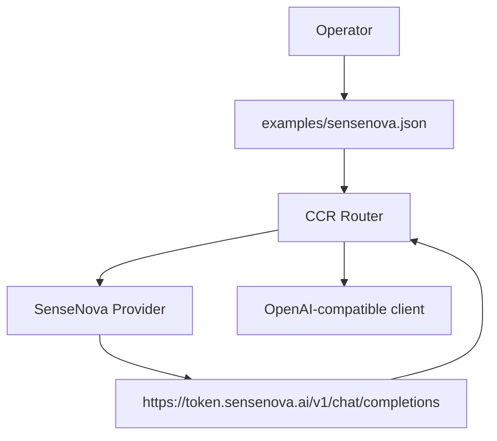
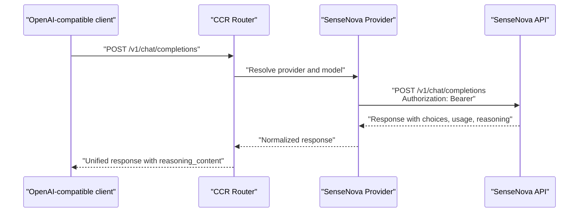
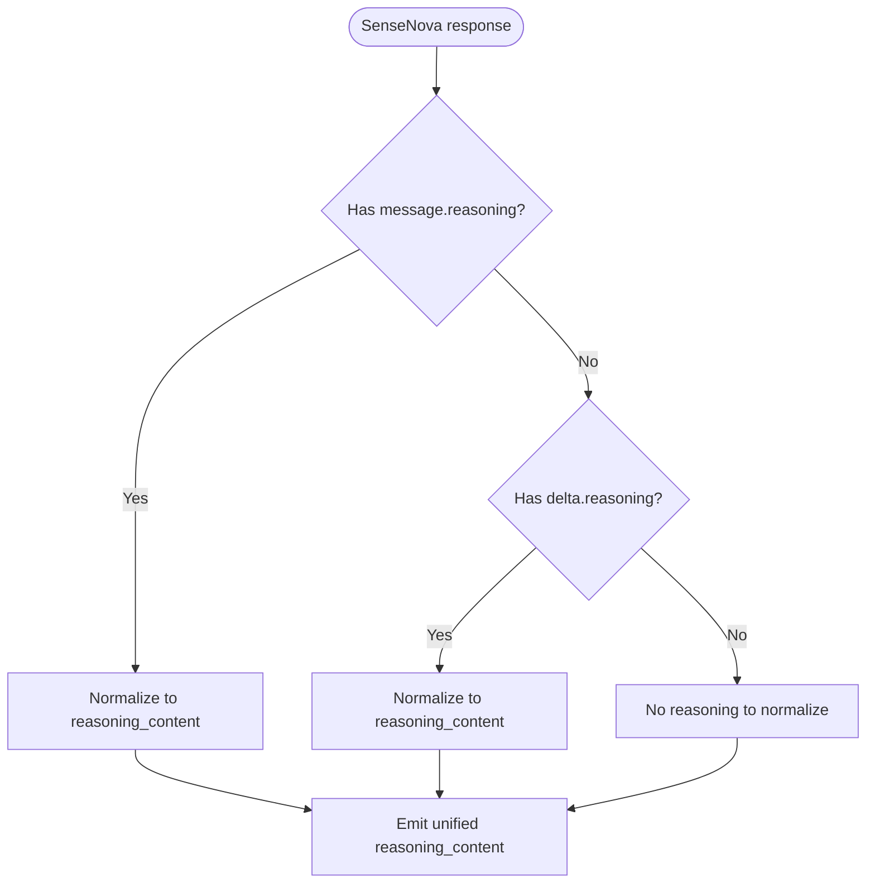
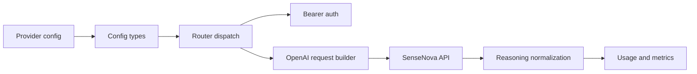

# SenseNova Provider

<cite>
**Referenced Files in This Document**   
- [sensenova-token-plan.md](file://docs/sensenova-token-plan.md)
- [sensenova.json](file://examples/sensenova.json)
- [types.rs](file://src/config/types.rs)
- [reasoning_normalization_test.rs](file://tests/reasoning_normalization_test.rs)
- [anthropic_to_openai.rs](file://src/transform/anthropic_to_openai.rs)
- [glm.rs](file://src/transform/glm.rs)
- [sensenova-provider-20261023.md](file://evidence/sensenova-provider-20261023.md)
</cite>

## Table of Contents
1. [Introduction](#introduction)
2. [Project Structure](#project-structure)
3. [Core Components](#core-components)
4. [Architecture Overview](#architecture-overview)
5. [Detailed Component Analysis](#detailed-component-analysis)
6. [Dependency Analysis](#dependency-analysis)
7. [Performance Considerations](#performance-considerations)
8. [Troubleshooting Guide](#troubleshooting-guide)
9. [Conclusion](#conclusion)
10. [Appendices](#appendices)

## Introduction
This document explains how to configure and operate CCR-Rust as a routing layer for SenseNova's Token Plan. It covers authentication, provider configuration, token plan behavior, reasoning field handling, rate limiting, quota management, monitoring, and common troubleshooting steps.

SenseNova is integrated as an OpenAI-compatible provider. CCR does not require a custom transformer for the base chat path: requests use the standard OpenAI Chat Completions JSON body and `Authorization: Bearer` authentication, while CCR normalizes SenseNova's native `reasoning` alias into its generic `reasoning_content` field for both complete responses and streaming deltas.

**Section sources**
- [sensenova-token-plan.md:1-20](file://docs/sensenova-token-plan.md#L1-L20)
- [sensenova-provider-20261023.md:1-25](file://evidence/sensenova-provider-20261023.md#L1-L25)

## Project Structure
The SenseNova integration is primarily configuration-driven:

| Area | Role |
|---|---|
| `docs/sensenova-token-plan.md` | Runbook describing provider setup, protocol behavior, verification, and limitations. |
| `examples/sensenova.json` | Copy-paste example provider configuration for a single-tier SenseNova route. |
| `src/config/types.rs` | Defines provider configuration fields, including SenseNova-specific reasoning controls. |
| `tests/reasoning_normalization_test.rs` | Test pinning that SenseNova's `reasoning` field maps to CCR's `reasoning_content`. |
| `src/transform/anthropic_to_openai.rs` | Shows how CCR emits `reasoning_content` from other providers; useful context for normalization. |
| `src/transform/glm.rs` | Shows another provider using `reasoning_effort`; helps contrast SenseNova's supported values. |
| `evidence/sensenova-provider-20261023.md` | Evidence record covering public contract, live probes, policy registration, and validation results. |



**Diagram sources**
- [sensenova.json:1-29](file://examples/sensenova.json#L1-L29)
- [sensenova-token-plan.md:1-20](file://docs/sensenova-token-plan.md#L1-L20)

**Section sources**
- [sensenova-token-plan.md:1-20](file://docs/sensenova-token-plan.md#L1-L20)
- [sensenova.json:1-29](file://examples/sensenova.json#L1-L29)

## Core Components
### Provider Configuration Fields
The SenseNova provider is configured through the standard CCR provider object plus a few fields relevant to reasoning control:

| Field | Meaning | Notes |
|---|---|---|
| `name` | Provider identifier used in router selections. | Example uses `sensenova`. |
| `api_base_url` | Base URL for the upstream API. | The documented international host is `https://token.sensenova.ai/v1`. |
| `api_key` | Secret injected at runtime. | Use `${CCR_SENSENOVA_API_KEY}` rather than embedding a key. |
| `protocol` | Wire protocol family. | Set to `openai` because SenseNova speaks OpenAI Chat Completions. |
| `models` | Allowed model identifiers for this provider. | The qualified preview model is `sensenova-6.8-flash-lite`. |
| `tier_name` | Logical grouping for routing tiers. | Example uses `ccr-sensenova`. |
| `force_adaptive_thinking` | Forces adaptive-thinking state when required by a provider. | Enabled for SenseNova to suppress default reasoning output. |
| `force_reasoning_effort` | Overrides the request's reasoning effort. | Set to `none` to match the intended flash-lite text lane. |

These fields are defined in the provider configuration types. The documentation comment explicitly names SenseNova as an example where non-thinking mode requires adaptive thinking state.

**Section sources**
- [sensenova.json:1-29](file://examples/sensenova.json#L1-L29)
- [types.rs:357-363](file://src/config/types.rs#L357-L363)

### Authentication Setup
SenseNova uses bearer-token authentication:

- Header: `Authorization: Bearer <key>`
- Key source: environment variable `CCR_SENSENOVA_API_KEY`
- Credential location: loaded into the router process; never committed to the repository
- Host selection: use the host shown by the console that issued the key. The international host is `https://token.sensenova.ai/v1`; the mainland-China host is `https://token.sensenova.cn/v1`. Keys and hosts must come from the same region.

Before starting CCR, export the credential:

```bash
export CCR_SENSENOVA_API_KEY=sk-your-sensenova-key
```

Unauthenticated access returns a 401 with an error envelope containing code and message fields. Invalid keys also return 401 with a forbidden-style message.

**Section sources**
- [sensenova-token-plan.md:20-40](file://docs/sensenova-token-plan.md#L20-L40)
- [sensenova-provider-20261023.md:26-45](file://evidence/sensenova-provider-20261023.md#L26-L45)

### Basic SenseNova Setup
A minimal configuration registers one provider and one tier:

- Provider name: `sensenova`
- Model: `sensenova-6.8-flash-lite`
- Protocol: `openai`
- Tier name: `ccr-sensenova`
- Default route: `sensenova,sensenova-6.8-flash-lite`
- Tier list: `[sensenova,sensenova-6.8-flash-lite]`
- Reasoning controls: `force_adaptive_thinking: true`, `force_reasoning_effort: none`

The example configuration also disables persistence for scratch runs and binds the local listener to `127.0.0.1:3456`.

**Section sources**
- [sensenova.json:1-29](file://examples/sensenova.json#L1-L29)
- [sensenova-token-plan.md:9-40](file://docs/sensenova-token-plan.md#L9-L40)

## Architecture Overview
SenseNova integrates into CCR-Rust as an OpenAI-compatible endpoint. No provider-specific transformer is required for the base chat flow. The important adaptation is semantic: SenseNova returns reasoning under `choices[0].message.reasoning` and `choices[0].delta.reasoning`, while CCR presents the unified `reasoning_content` field to consumers.



**Diagram sources**
- [sensenova-token-plan.md:41-80](file://docs/sensenova-token-plan.md#L41-L80)
- [reasoning_normalization_test.rs:50-80](file://tests/reasoning_normalization_test.rs#L50-L80)

**Section sources**
- [sensenova-provider-20261023.md:1-25](file://evidence/sensenova-provider-20261023.md#L1-L25)
- [sensenova-token-plan.md:41-80](file://docs/sensenova-token-plan.md#L41-L80)

## Detailed Component Analysis

### Request and Response Protocol
SenseNova follows the OpenAI Chat Completions shape:

| Aspect | Behavior |
|---|---|
| Endpoint | `/v1/chat/completions` |
| Authentication | `Authorization: Bearer <key>` |
| Models | Exact identifiers such as `sensenova-6.8-flash-lite` |
| Streaming | Standard SSE-style chunks |
| Usage | OpenAI-style `usage` object, including `prompt_tokens_details.cached_tokens` |
| Finish reason mapping | `finish_reason: "length"` maps to Anthropic `stop_reason: "max_tokens"` |

Important: although SenseNova documents additional models during discovery, only certain IDs completed successfully in qualification. The governed policy registers only the qualified chat model.

**Section sources**
- [sensenova-token-plan.md:41-70](file://docs/sensenova-token-plan.md#L41-L70)
- [sensenova-provider-20261023.md:46-80](file://evidence/sensenova-provider-20261023.md#L46-L80)

### Reasoning Field Normalization
SenseNova's native reasoning field is `reasoning`. CCR normalizes it to `reasoning_content`:

- Complete responses: `choices[0].message.reasoning` → `reasoning_content`
- Streaming deltas: `choices[0].delta.reasoning` → `reasoning_content`

This normalization is tested explicitly for SenseNova. Other transformers in CCR, such as Anthropic-to-OpenAI conversion and GLM handling, show how `reasoning_content` is emitted or preserved across the pipeline, but SenseNova itself does not receive a dedicated transformer.



**Diagram sources**
- [reasoning_normalization_test.rs:50-80](file://tests/reasoning_normalization_test.rs#L50-L80)
- [anthropic_to_openai.rs:94-111](file://src/transform/anthropic_to_openai.rs#L94-L111)

**Section sources**
- [reasoning_normalization_test.rs:50-80](file://tests/reasoning_normalization_test.rs#L50-L80)
- [anthropic_to_openai.rs:94-111](file://src/transform/anthropic_to_openai.rs#L94-L111)

### Reasoning Controls
SenseNova documents `reasoning_effort` values: `low`, `medium`, `high`, `max`, `none`. Its default is `high`. CCR additionally accepts `minimal` and `xhigh` for other providers, but those are not documented for SenseNova and can produce deterministic validation errors.

To suppress reasoning on the flash-lite text lane:

- Set `force_adaptive_thinking: true`
- Set `force_reasoning_effort: none`

The runbook notes that the string form `thinking: "disabled"` was rejected by the live API, while the object form `thinking: {"type":"adaptive"}` combined with `reasoning_effort: none` suppressed reasoning. CCR's `force_adaptive_thinking` automation handles that pair.

For comparison, GLM has its own set of supported `reasoning_effort` values and injects effort settings through a provider-specific transformer. SenseNova relies on CCR's provider-level overrides rather than a custom transformer.

**Section sources**
- [sensenova-token-plan.md:61-90](file://docs/sensenova-token-plan.md#L61-L90)
- [glm.rs:27-35](file://src/transform/glm.rs#L27-L35)
- [glm.rs:226-235](file://src/transform/glm.rs#L226-L235)

### Token Plan Management
SenseNova's Token Plan has two documented limit surfaces:

| Limit surface | Description | Operational meaning |
|---|---|---|
| Calls per model | Approximately 1,500 calls per model per rolling five hours | Public beta call allowance |
| Points | 60,000 points per rolling five hours and 600,000 points per rolling seven days across General and Flash-Lite point classes | Plan quota accounting |

Key plan behavior:

- Flash-Lite calls drain the dedicated pool first, then spill into the general pool.
- Every dedicated point earns a General-point rebate.
- U-series image generation spends only General points.
- This makes Flash-Lite the economical text and vision lane and reserves U-series capacity for visual deliverables.

Quotas are plan limits, not per-route concurrency limits. No SenseNova rate-limit headers were observed during invalid-key probing, so CCR cannot rely on `X-RateLimit-*` headers from this provider.

**Section sources**
- [sensenova-token-plan.md:91-120](file://docs/sensenova-token-plan.md#L91-L120)
- [sensenova-provider-20261023.md:18-25](file://evidence/sensenova-provider-20261023.md#L18-L25)

### Monitoring and Usage Metrics
Usage data follows the OpenAI shape. For SenseNova specifically:

- Terminal stream events may be usage-only frames before `[DONE]`.
- CCR preserves exact usage when the event shape matches the expected chunk type.
- If the real terminal frame omits required fields such as `id`, `object`, `created`, or `model`, CCR falls back to estimating usage and drops the exact frame.
- Operators should confirm live streaming usage before trusting SenseNova token accounting in metrics and cost estimates.

Recommended monitoring approach:

- Inspect the served model in responses.
- Check CCR tier headers such as `x-ccr-tier` when available.
- Observe listener metrics to prove the explicit SenseNova route served the request.
- Track provider-level latency, failure rates, and usage tokens separately from other tiers.

**Section sources**
- [sensenova-token-plan.md:101-120](file://docs/sensenova-token-plan.md#L101-L120)
- [sensenova-provider-20261023.md:81-110](file://evidence/sensenova-provider-20261023.md#L81-L110)

### Verification Workflow
After loading the credential, validate and start a scratch listener:

1. Validate the configuration.
2. Start CCR with the SenseNova example configuration.
3. Run the provider smoke test against the pinned model.
4. Confirm the response model and tier header.
5. Keep output caps generous because the preview model thinks by default and can consume significant output tokens before emitting text.

The smoke test targets the provider/model pair `sensenova,sensenova-6.8-flash-lite` and prints verbose diagnostics when requested.

**Section sources**
- [sensenova-token-plan.md:121-150](file://docs/sensenova-token-plan.md#L121-L150)

## Dependency Analysis
SenseNova depends on CCR's generic OpenAI provider path rather than a custom transformer. The main dependencies are:

- Provider configuration parsing
- Bearer-token authentication
- OpenAI Chat Completions request serialization
- Reasoning field normalization
- Tier routing
- Usage parsing



**Diagram sources**
- [types.rs:357-363](file://src/config/types.rs#L357-L363)
- [reasoning_normalization_test.rs:50-80](file://tests/reasoning_normalization_test.rs#L50-L80)

**Section sources**
- [sensenova-provider-20261023.md:1-25](file://evidence/sensenova-provider-20261023.md#L1-L25)
- [sensenova-token-plan.md:1-20](file://docs/sensenova-token-plan.md#L1-L20)

## Performance Considerations
- The flash-lite model is positioned as the economical text and vision lane under the Token Plan.
- Output caps should be generous because the preview model thinks by default.
- Tool-bearing Codex worker traffic is a structural mismatch: the upstream accepts only `function` and `custom` tools, while Codex sends built-in tool types, producing deterministic 400 errors.
- Local measurements are not directly comparable to fleet-wide benchmarks; operational decisions should rely on matched SenseNova evidence rather than unrelated model comparisons.
- Quota exhaustion and sustained concurrency remain unmeasured in the referenced qualification.

**Section sources**
- [sensenova-token-plan.md:121-156](file://docs/sensenova-token-plan.md#L121-L156)

## Troubleshooting Guide

### Problem: 401 Authorization Not Found or Forbidden
**Symptoms:**
- Unauthenticated `/v1/models` returns 401.
- Requests with an invalid Bearer token return 401.

**Likely causes:**
- Missing `CCR_SENSENOVA_API_KEY`.
- Wrong host for the issuing console.
- Key created in a different region than the selected base URL.

**Resolution:**
- Export `CCR_SENSENOVA_API_KEY` before starting CCR.
- Match the host (`token.sensenova.ai` vs `token.sensenova.cn`) to the console that issued the key.
- Validate the configuration before starting the listener.

**Section sources**
- [sensenova-provider-2023023.md:26-45](file://evidence/sensenova-provider-20261023.md#L26-L45)
- [sensenova-token-plan.md:20-40](file://docs/sensenova-token-plan.md#L20-L40)

### Problem: Unsupported reasoning_effort Value
**Symptoms:**
- Deterministic upstream validation error when forcing reasoning effort.

**Likely causes:**
- Using CCR-supported values such as `minimal` or `xhigh` that are not documented for SenseNova.
- Sending unsupported forms of `thinking`.

**Resolution:**
- Use documented SenseNova values: `low`, `medium`, `high`, `max`, `none`.
- For the flash-lite text lane, use `force_adaptive_thinking: true` with `force_reasoning_effort: none`.
- Remove overrides only when a lane specifically needs deep reasoning.

**Section sources**
- [sensenova-token-plan.md:61-90](file://docs/sensenova-token-plan.md#L61-L90)

### Problem: Reasoning Still Appears Despite Effort Settings
**Symptoms:**
- Response contains reasoning even when effort is set to `none`.

**Likely causes:**
- The string form `thinking: "disabled"` was rejected by the live API.
- The object form `thinking: {"type":"adaptive"}` is required alongside `reasoning_effort: none`.

**Resolution:**
- Let CCR handle this via `force_adaptive_thinking: true`.
- Verify that the provider configuration includes both `force_adaptive_thinking` and `force_reasoning_effort: none`.

**Section sources**
- [sensenova-token-plan.md:61-90](file://docs/sensenova-token-plan.md#L61-L90)

### Problem: Tool Calls Fail with 400 Errors
**Symptoms:**
- Codex worker requests fail deterministically.

**Likely causes:**
- SenseNova upstream accepts only `function` and `custom` tools.
- Codex sends built-in tool types not accepted by this provider.

**Resolution:**
- Do not treat SenseNova as a replacement for the generic worker fallback chain.
- Reserve it for tool-less extraction, summarization, and image understanding workloads.
- Avoid sending Codex built-in tool types to this provider.

**Section sources**
- [sensenova-token-plan.md:130-156](file://docs/sensenova-token-plan.md#L130-L156)

### Problem: Unexpected Token Accounting
**Symptoms:**
- Metrics do not reflect exact SenseNova usage.

**Likely causes:**
- The terminal stream event shape differs from CCR's expected chunk type.
- Required fields such as `id`, `object`, `created`, or `model` are missing from the usage-only frame.

**Resolution:**
- Run a live streaming call and inspect the final usage frame.
- Treat usage as estimated until the exact frame shape is confirmed.
- Monitor listener metrics and tier headers as additional signals.

**Section sources**
- [sensenova-provider-20261023.md:81-110](file://evidence/sensenova-provider-20261023.md#L81-L110)
- [sensenova-token-plan.md:101-120](file://docs/sensenova-token-plan.md#L101-L120)

### Problem: Rate Limits or Quota Exhaustion
**Symptoms:**
- Increased failures under concurrent load.
- Token plan quotas consumed faster than expected.

**Likely causes:**
- Call-per-model limits (approximately 1,500 per model per rolling five hours).
- Point-based quotas across General and Flash-Lite point classes.
- No observable `X-RateLimit-*` headers from SenseNova.

**Resolution:**
- Treat plan limits as global quota constraints, not per-route concurrency settings.
- Separate Flash-Lite text/vision workloads from U-series image generation.
- Monitor usage tokens and failure rates per provider.
- Adjust concurrency and retry budgets based on observed quota consumption rather than relying on provider rate-limit headers.

**Section sources**
- [sensenova-token-plan.md:91-120](file://docs/sensenova-token-plan.md#L91-L120)
- [sensenova-provider-20261023.md:26-45](file://evidence/sensenova-provider-20261023.md#L26-L45)

## Conclusion
SenseNova integrates into CCR-Rust as an OpenAI-compatible provider with minimal code changes. The critical integration points are:

- Configure the provider with the correct host, bearer token, model, and OpenAI protocol.
- Use `force_adaptive_thinking` and `force_reasoning_effort: none` to control reasoning for the flash-lite lane.
- Normalize SenseNova's `reasoning` field into CCR's `reasoning_content`.
- Treat Token Plan call and point limits as global quotas.
- Verify live streaming usage before trusting exact token accounting.
- Avoid sending Codex built-in tool types to SenseNova.

**Section sources**
- [sensenova-token-plan.md:1-156](file://docs/sensenova-token-plan.md#L1-L156)
- [sensenova-provider-20261023.md:1-110](file://evidence/sensenova-provider-20261023.md#L1-L110)

## Appendices

### Appendix A: Provider Configuration Reference
| Field | Type | Required | Default | Description |
|---|---|---:|---|---|
| `name` | String | Yes | None | Provider name used in router selections. |
| `api_base_url` | String | Yes | None | Upstream base URL ending in `/v1`. |
| `api_key` | String | Yes | None | Runtime secret reference. |
| `protocol` | String | Yes | None | Must be `openai` for SenseNova. |
| `models` | Array | Yes | None | Allowed model identifiers. |
| `tier_name` | String | Recommended | None | Logical tier group. |
| `force_adaptive_thinking` | Boolean | Optional | `false` | Enables adaptive-thinking state for providers requiring it. |
| `force_reasoning_effort` | String | Optional | None | Overrides reasoning effort for providers that support it. |

**Section sources**
- [sensenova.json:1-29](file://examples/sensenova.json#L1-L29)
- [types.rs:357-363](file://src/config/types.rs#L357-L363)

### Appendix B: Supported Reasoning Effort Values
| Provider | Supported values | Default | Notes |
|---|---|---|---|
| SenseNova | `low`, `medium`, `high`, `max`, `none` | `high` | CCR's `minimal` and `xhigh` are not documented here. |
| GLM | Provider-specific transformer logic applies | Transformer-dependent | GLM injects effort through its transformer. |

**Section sources**
- [sensenova-token-plan.md:61-90](file://docs/sensenova-token-plan.md#L61-L90)
- [glm.rs:27-35](file://src/transform/glm.rs#L27-L35)
- [glm.rs:226-235](file://src/transform/glm.rs#L226-L235)