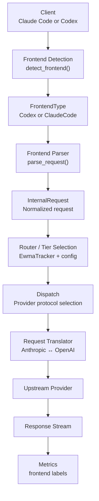
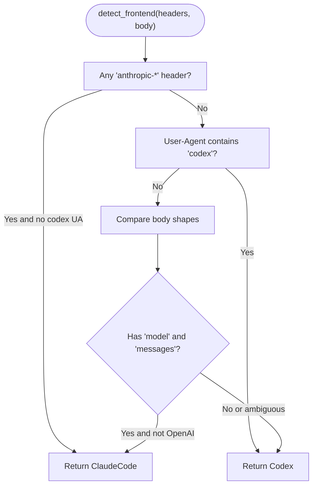
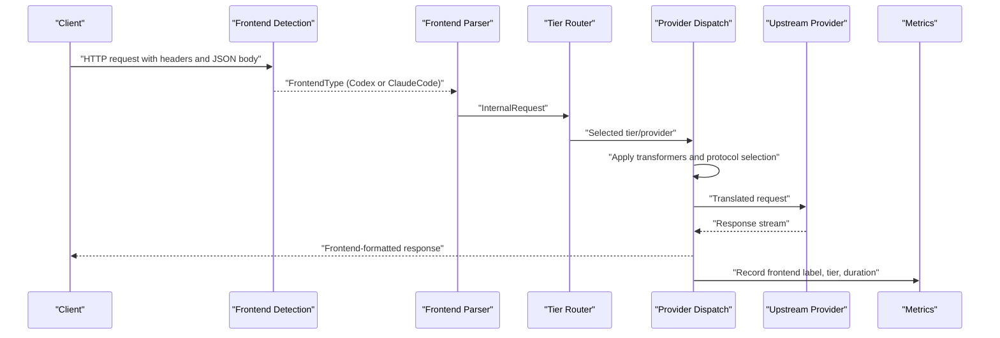
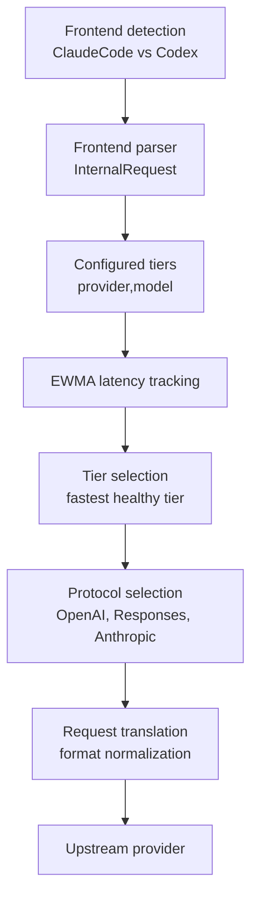
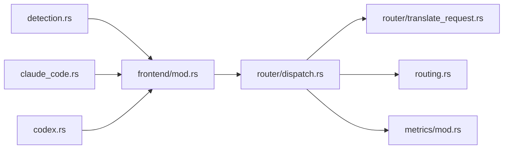

# Client-Specific Routing Rules

<cite>
**Referenced Files in This Document**
- [src/frontend/mod.rs](file://src/frontend/mod.rs)
- [src/frontend/detection.rs](file://src/frontend/detection.rs)
- [src/frontend/claude_code.rs](file://src/frontend/claude_code.rs)
- [src/frontend/codex.rs](file://src/frontend/codex.rs)
- [src/routing.rs](file://src/routing.rs)
- [src/router/dispatch.rs](file://src/router/dispatch.rs)
- [src/router/translate_request.rs](file://src/router/translate_request.rs)
- [src/metrics/mod.rs](file://src/metrics/mod.rs)
</cite>

## Table of Contents
1. [Introduction](#introduction)
2. [Project Structure](#project-structure)
3. [Core Components](#core-components)
4. [Architecture Overview](#architecture-overview)
5. [Detailed Component Analysis](#detailed-component-analysis)
6. [Dependency Analysis](#dependency-analysis)
7. [Performance Considerations](#performance-considerations)
8. [Troubleshooting Guide](#troubleshooting-guide)
9. [Conclusion](#conclusion)

## Introduction
This document explains how CCR-Rust detects frontend clients and how that detection relates to routing. The repository provides a frontend detection system for Claude Code and Codex, normalized internal request/response types, and an EWMA-based tier router. It does not expose a user-facing configuration language for “client-specific routing rules” such as header-match policies. Instead, client detection is used for normalization, protocol selection, metrics labeling, and request translation. Routing itself is driven by configured tiers, provider endpoints, transformers, and latency measurements rather than per-client rule tables.

The practical effect is:
- Frontend detection determines whether the incoming request should be treated as Anthropic-shaped or OpenAI-shaped.
- The selected frontend parser normalizes the request into an internal representation.
- The router selects a provider tier based on configuration and observed latency.
- Request translation may convert between Anthropic and OpenAI formats depending on the target provider.
- Metrics record which frontend was detected so operators can compare behavior across clients.

## Project Structure
The relevant code is split across four areas:

| Area | Responsibility | Key files |
|---|---|---|
| Frontend abstraction | Defines normalized message, content block, tool, request, response, and frontend trait shapes | [src/frontend/mod.rs](file://src/frontend/mod.rs) |
| Frontend implementations | Parses Claude Code and Codex requests; serializes responses back to their API formats | [src/frontend/claude_code.rs](file://src/frontend/claude_code.rs), [src/frontend/codex.rs](file://src/frontend/codex.rs) |
| Frontend detection | Infers `FrontendType` from HTTP headers and body heuristics | [src/frontend/detection.rs](file://src/frontend/detection.rs) |
| Router and dispatch | Chooses providers/tiers, applies transformers, translates requests/responses, streams results | [src/routing.rs](file://src/routing.rs), [src/router/dispatch.rs](file://src/router/dispatch.rs), [src/router/translate_request.rs](file://src/router/translate_request.rs) |
| Metrics | Labels counters and histograms by detected frontend and tier | [src/metrics/mod.rs](file://src/metrics/mod.rs) |

**Diagram sources**
- [src/frontend/detection.rs:1-60](file://src/frontend/detection.rs#L1-L60)
- [src/frontend/mod.rs:1-120](file://src/frontend/mod.rs#L1-L120)
- [src/routing.rs:1-120](file://src/routing.rs#L1-L120)
- [src/router/dispatch.rs:336-454](file://src/router/dispatch.rs#L336-L454)
- [src/metrics/mod.rs:390-450](file://src/metrics/mod.rs#L390-L450)

**Section sources**
- [src/frontend/mod.rs:1-120](file://src/frontend/mod.rs#L1-L120)
- [src/frontend/detection.rs:1-60](file://src/frontend/detection.rs#L1-L60)
- [src/routing.rs:1-120](file://src/routing.rs#L1-L120)
- [src/router/dispatch.rs:336-454](file://src/router/dispatch.rs#L336-L454)

## Core Components

### Frontend Types and Normalized Request Shape
The frontend module defines shared structures used by both Claude Code and Codex handling:

- `Message`: role plus content, with optional tool-call metadata.
- `ContentBlock`: text, image, tool use, tool result, and thinking/reasoning blocks.
- `ImageSource`: base64 or URL image source.
- `Tool`: normalized function-call definition.
- `Usage`: input/output token accounting.
- `InternalRequest`: unified view of chat requests, including model, messages, system prompt, sampling parameters, tools, stop sequences, and extra provider parameters.
- `InternalResponse`: unified response shape with content blocks, usage, and provider-specific extras.

These types decouple frontend parsing from backend routing. A frontend implementation converts its specific API format into `InternalRequest`, and the router works only with this normalized form.

**Section sources**
- [src/frontend/mod.rs:1-200](file://src/frontend/mod.rs#L1-L200)

### Frontend Detection
Detection produces one of two enum values:

| Value | Meaning |
|---|---|
| `Codex` | OpenAI-compatible client, typically the Codex CLI. |
| `ClaudeCode` | Anthropic-shaped client, typically Claude Code. |

Detection priority:

1. Definitive header signals:
   - Any header whose lowercase name starts with `anthropic-` → `ClaudeCode`.
   - `User-Agent` containing the substring `codex` (case-insensitive) → `Codex`.
2. Conflict resolution:
   - If both anthropic headers and a codex User-Agent are present, `Codex` wins.
3. Body-only heuristics when no definitive headers are found:
   - Anthropic-like shape: presence of `model` and `messages`.
   - OpenAI-like shape: non-empty `messages` array where every message has a non-empty `role`.
4. Default: `Codex`.

Important edge case: the Anthropic Messages API includes `role` on every message, which overlaps with OpenAI’s shape. Header signals therefore take precedence over body heuristics.

**Diagram sources**
- [src/frontend/detection.rs:1-60](file://src/frontend/detection.rs#L1-L60)
- [src/frontend/detection.rs:62-177](file://src/frontend/detection.rs#L62-L177)

**Section sources**
- [src/frontend/detection.rs:1-177](file://src/frontend/detection.rs#L1-L177)

### Claude Code Frontend
The Claude Code frontend handles Anthropic-style requests:

- Detection checks for `anthropic-*` headers, `anthropic_version`, top-level `system`, or array-style message content.
- Parsing extracts model, system prompt, messages, max tokens, temperature, stream flag, tools, tool choice, stop sequences, and extra provider fields.
- Serialization converts internal content blocks back to Anthropic text, thinking, tool use, and tool result formats.

This frontend is appropriate when the request is intended for an Anthropic endpoint or when CCR must preserve Anthropic-specific features such as cache control and thinking blocks.

**Section sources**
- [src/frontend/claude_code.rs:1-120](file://src/frontend/claude_code.rs#L1-L120)
- [src/frontend/claude_code.rs:120-240](file://src/frontend/claude_code.rs#L120-L240)

### Codex Frontend
The Codex frontend handles OpenAI-compatible requests:

- Detection checks for a `User-Agent` containing `codex`, or OpenAI-style messages with a `role` field.
- It normalizes roles such as OpenAI Responses API’s `developer` into `system`.
- It converts OpenAI tool calls into Anthropic-style tool-use blocks when needed.
- It supports reasoning content from OpenAI-style fields and maps it into thinking blocks.

This frontend is the default path for most Codex CLI traffic and is also used when the request body clearly matches the OpenAI message contract.

**Section sources**
- [src/frontend/codex.rs:1-120](file://src/frontend/codex.rs#L1-L120)
- [src/frontend/codex.rs:120-240](file://src/frontend/codex.rs#L120-L240)

### Tier Routing and Latency Tracking
Routing is implemented around configured tiers and observed latency:

- `EwmaTracker` tracks per-tier exponential weighted moving average latency.
- Success updates the EWMA with actual duration.
- Failure applies a penalty multiplier instead of using raw failure latency.
- Tiers without enough samples keep their configuration-defined order.
- Measured tiers are sorted by ascending EWMA.

This means CCR’s routing favors faster, healthier tiers over time, but it does not expose a direct “if client is Claude Code then prefer high-latency models” rule table.

**Section sources**
- [src/routing.rs:1-120](file://src/routing.rs#L1-L120)
- [src/routing.rs:120-200](file://src/routing.rs#L120-L200)

## Architecture Overview

**Diagram sources**
- [src/frontend/detection.rs:1-60](file://src/frontend/detection.rs#L1-L60)
- [src/frontend/mod.rs:1-120](file://src/frontend/mod.rs#L1-L120)
- [src/router/dispatch.rs:336-454](file://src/router/dispatch.rs#L336-L454)
- [src/metrics/mod.rs:390-450](file://src/metrics/mod.rs#L390-L450)

## Detailed Component Analysis

### Client Detection Rule Syntax
There is no separate configuration file or rule DSL for client-specific routing. Detection logic is hardcoded in the frontend detection module:

| Signal | Match condition | Result |
|---|---|---|
| `anthropic-*` headers | Any header name starting with `anthropic-` | `ClaudeCode` unless overridden by codex User-Agent |
| `User-Agent` | Contains `codex` (case-insensitive) | `Codex` |
| Body heuristic | Has `model` and `messages` | `ClaudeCode` if not also OpenAI-shaped |
| Body heuristic | Non-empty `messages` with non-empty `role` per message | `Codex` |
| No signal | Missing both definitive headers and clear body shape | `Codex` |

Headers are compared case-insensitively for names, and the codex User-Agent check is case-insensitive.

**Section sources**
- [src/frontend/detection.rs:1-60](file://src/frontend/detection.rs#L1-L60)
- [src/frontend/detection.rs:62-177](file://src/frontend/detection.rs#L62-L177)

### Precedence Rules for Multiple Matching Signals
Precedence is explicit:

1. `anthropic-*` headers alone → `ClaudeCode`.
2. Codex User-Agent alone → `Codex`.
3. Both anthropic headers and codex User-Agent → `Codex` wins.
4. Neither header signal → fall back to body heuristics.
5. Ambiguous body → `Codex`.

This design intentionally avoids misrouting real Claude Code requests that include Anthropic headers even though the Anthropic message format also includes `role`.

**Section sources**
- [src/frontend/detection.rs:12-60](file://src/frontend/detection.rs#L12-L60)
- [src/frontend/detection.rs:120-177](file://src/frontend/detection.rs#L120-L177)

### Interaction Between Client Detection, Traffic Class Routing, and Default Tier Configuration
“Traffic class routing” and “default tier configuration” are not exposed as configurable concepts in the analyzed files. The concrete interaction is:

- Client detection chooses a frontend parser and emits `FrontendType`.
- The frontend parser produces `InternalRequest`.
- The router uses configured tiers and `EwmaTracker` to select a provider.
- Dispatch chooses the provider protocol (`Openai`, `Responses`, or `Anthropic`) and builds the upstream request.
- Metrics label requests by tier and detected frontend.

Therefore, client detection influences normalization and observability more than direct provider selection. If you want Claude Code requests to go to higher-quality, higher-latency models while Codex goes to faster providers, the current codebase achieves that through:

- Provider configuration: put higher-quality models in preferred tiers.
- Transformer configuration: adjust model names, tools, or payloads per provider/model.
- Observed latency: slower tiers naturally drop behind faster ones after enough samples.
- Explicit routing configuration defined elsewhere in the project’s configuration schema, not in the frontend detection module.

**Diagram sources**
- [src/frontend/detection.rs:1-60](file://src/frontend/detection.rs#L1-L60)
- [src/routing.rs:1-120](file://src/routing.rs#L1-L120)
- [src/router/dispatch.rs:336-454](file://src/router/dispatch.rs#L336-L454)

**Section sources**
- [src/routing.rs:1-120](file://src/routing.rs#L1-L120)
- [src/router/dispatch.rs:336-454](file://src/router/dispatch.rs#L336-L454)

### Example Scenarios: Claude Code Versus Codex

#### Claude Code to High-Quality Models
To route Claude Code requests toward higher-quality models:

1. Ensure Claude Code sends Anthropic headers, such as `anthropic-version`, so detection returns `ClaudeCode`.
2. Configure your preferred high-quality model(s) in the highest-priority tier.
3. Allow EWMA to observe performance; if the model is slower, it will still be selected until enough failures or higher-latency samples push it down relative to other tiers.
4. Use transformers to normalize Anthropic payloads when forwarding to providers that require OpenAI or Responses formats.

The key point is that detection identifies Claude Code, but provider selection comes from tier configuration and latency tracking.

#### Codex to Faster, More Cost-Effective Providers
To route Codex requests to faster providers:

1. Send a User-Agent containing `codex`, or send OpenAI-style messages with `role` fields.
2. Put cost-effective, lower-latency providers in early tiers.
3. Rely on EWMA to prefer those tiers once samples are collected.
4. Use transformers to adapt payload shape for the selected provider.

**Section sources**
- [src/frontend/detection.rs:12-60](file://src/frontend/detection.rs#L12-L60)
- [src/routing.rs:1-120](file://src/routing.rs#L1-L120)
- [src/router/dispatch.rs:336-454](file://src/router/dispatch.rs#L336-L454)

### Debugging Techniques for Client Detection and Rule Application
Use these techniques to verify what CCR sees:

| Technique | What it shows | Where it applies |
|---|---|---|
| Enable debug tracing for frontend detection | Logs the detected `FrontendType` | [src/frontend/detection.rs:40-60](file://src/frontend/detection.rs#L40-L60) |
| Inspect outgoing request headers | Confirms whether anthropic headers or codex User-Agent reached CCR | Client configuration |
| Check `x-ccr-tier` response header | Shows which tier/provider was selected | [src/router/dispatch.rs:512-520](file://src/router/dispatch.rs#L512-L520) |
| Observe Prometheus metrics | Compare request counts and durations by frontend and tier | [src/metrics/mod.rs:390-450](file://src/metrics/mod.rs#L390-L450) |
| Review request transformation logs | Confirms whether Anthropic→OpenAI or Responses conversion occurred | [src/router/dispatch.rs:773-804](file://src/router/dispatch.rs#L773-L804), [src/router/dispatch.rs:1180-1188](file://src/router/dispatch.rs#L1180-L1188) |

Example verification steps:

1. Send a request with `anthropic-version: 2023-06-01`.
2. Confirm detection logs show `ClaudeCode`.
3. Confirm the selected tier header indicates the expected provider/model.
4. Confirm metrics have `frontend=claude_code` and the correct tier label.
5. Repeat with a codex User-Agent and confirm detection switches to `Codex`.

**Section sources**
- [src/frontend/detection.rs:40-60](file://src/frontend/detection.rs#L40-L60)
- [src/router/dispatch.rs:503-520](file://src/router/dispatch.rs#L503-L520)
- [src/metrics/mod.rs:390-450](file://src/metrics/mod.rs#L390-L450)

### Troubleshooting Common Client Identification Issues

| Symptom | Likely cause | Resolution |
|---|---|---|
| Claude Code is detected as `Codex` | The request lacks `anthropic-*` headers, or a conflicting codex User-Agent overrides them. | Add Anthropic headers or remove the codex User-Agent if Claude Code is intended. |
| Codex is detected as `ClaudeCode` | The request includes `anthropic-*` headers. | Remove Anthropic headers from Codex requests, or ensure they are not injected by middleware. |
| Both clients behave identically | Headers do not differ and bodies are ambiguous. | Verify User-Agent and Anthropic headers reach CCR unchanged. |
| Requests fail on provider round-trip | Request translation mismatched frontend and provider protocol. | Check whether the provider expects OpenAI, Responses, or Anthropic format and confirm transformers applied correctly. |
| Slow model stays selected | Not enough samples or failures to update EWMA. | Generate enough traffic or allow retry/failure budget to exercise the tier. |
| Metrics missing frontend label | Request did not flow through the frontend-aware metric recording path. | Verify the request reaches the dispatch and metrics recording layers. |

**Section sources**
- [src/frontend/detection.rs:62-177](file://src/frontend/detection.rs#L62-L177)
- [src/routing.rs:120-200](file://src/routing.rs#L120-L200)
- [src/router/dispatch.rs:773-804](file://src/router/dispatch.rs#L773-L804)
- [src/router/dispatch.rs:1180-1188](file://src/router/dispatch.rs#L1180-L1188)

## Dependency Analysis

**Diagram sources**
- [src/frontend/detection.rs:1-60](file://src/frontend/detection.rs#L1-L60)
- [src/frontend/mod.rs:1-60](file://src/frontend/mod.rs#L1-L60)
- [src/router/dispatch.rs:1-20](file://src/router/dispatch.rs#L1-L20)
- [src/routing.rs:1-60](file://src/routing.rs#L1-L60)
- [src/metrics/mod.rs:390-450](file://src/metrics/mod.rs#L390-L450)

Key relationships:

- `FrontendType` flows from detection into frontend parsers and metrics labeling.
- `InternalRequest` is the bridge between frontends and the router.
- `EwmaTracker` affects tier ordering but does not read `FrontendType`.
- Dispatch decides protocol and performs request translation based on provider configuration, not directly on frontend type.

**Section sources**
- [src/frontend/detection.rs:1-60](file://src/frontend/detection.rs#L1-L60)
- [src/router/dispatch.rs:336-454](file://src/router/dispatch.rs#L336-L454)
- [src/routing.rs:1-120](file://src/routing.rs#L1-L120)

## Performance Considerations
- Detection is lightweight: header scans and simple JSON shape checks.
- Frontend parsers parse JSON once into `InternalRequest`; downstream processing reuses that normalized structure.
- EWMA latency tracking avoids expensive per-request model ranking by maintaining running estimates.
- Failed requests apply a bounded penalty rather than wall-clock timeout durations, reducing noise in latency estimates.
- Request translation adds serialization overhead when Anthropic and OpenAI formats differ; native passthrough is avoided when transformers are active.

[No sources needed since this section provides general guidance]

## Troubleshooting Guide

### Verifying Frontend Detection
1. Enable debug tracing to see the logged detection result.
2. Send a request with only Anthropic headers and verify `ClaudeCode`.
3. Send a request with only a codex User-Agent and verify `Codex`.
4. Send a request with both and verify `Codex` wins.
5. Send a request with neither and verify body heuristics decide the result.

**Section sources**
- [src/frontend/detection.rs:40-60](file://src/frontend/detection.rs#L40-L60)
- [src/frontend/detection.rs:120-177](file://src/frontend/detection.rs#L120-L177)

### Verifying Routing Outcome
1. Inspect the `x-ccr-tier` response header to identify the selected tier.
2. Check Prometheus metrics for `requests_total` and `request_duration_seconds` labeled by tier.
3. Check frontend-labeled metrics for `frontend_requests_total` and `frontend_request_duration_seconds`.
4. Compare observed latency trends in EWMA gauges to understand why a slower or faster tier is selected.

**Section sources**
- [src/router/dispatch.rs:503-520](file://src/router/dispatch.rs#L503-L520)
- [src/metrics/mod.rs:390-450](file://src/metrics/mod.rs#L390-L450)
- [src/routing.rs:120-200](file://src/routing.rs#L120-L200)

### Handling Misrouted Requests
- If Claude Code is routed to a low-quality provider, check whether Anthropic headers are stripped before reaching CCR.
- If Codex is routed to an expensive provider, check whether Anthropic headers were accidentally added.
- If provider errors occur after routing, inspect transformer chain and protocol selection in dispatch to confirm the request shape matches the provider’s expectations.

**Section sources**
- [src/router/dispatch.rs:773-804](file://src/router/dispatch.rs#L773-L804)
- [src/router/dispatch.rs:1180-1188](file://src/router/dispatch.rs#L1180-L1188)

## Conclusion
CCR-Rust’s client-specific routing is built around a small, deterministic frontend detection system rather than a flexible rule engine. Claude Code is identified primarily by Anthropic headers; Codex is identified by a codex User-Agent or OpenAI-style messages. When signals conflict, Codex takes precedence. Detection feeds normalized requests into a tier-based router that prefers healthy, fast providers using EWMA latency tracking.

For users who want Claude Code to target high-quality models and Codex to target fast, cost-effective providers, the recommended approach is to configure tiers and providers accordingly and rely on detection plus latency-driven routing. Direct per-client rule syntax for matching arbitrary headers is not present in the analyzed code; instead, operators should adjust client request headers, provider configuration, transformers, and tier priorities.

[No sources needed since this section summarizes without analyzing specific files]