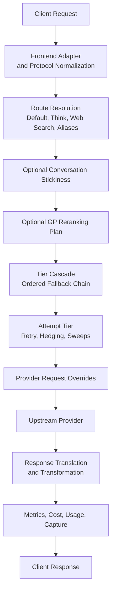
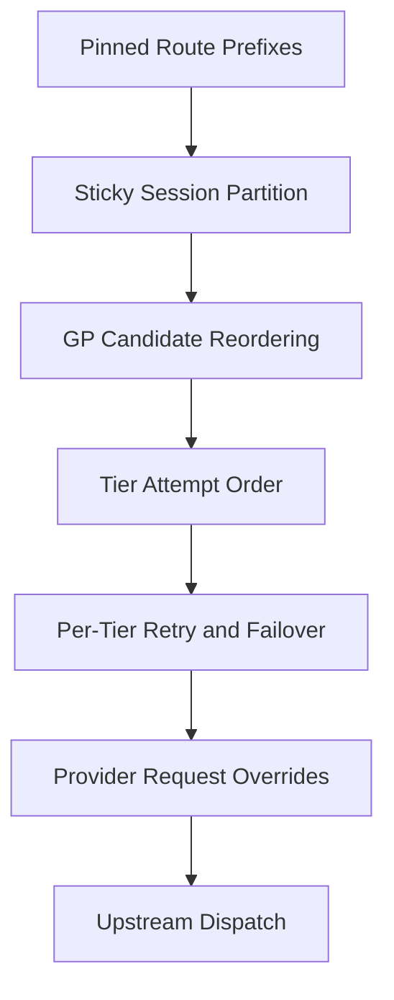
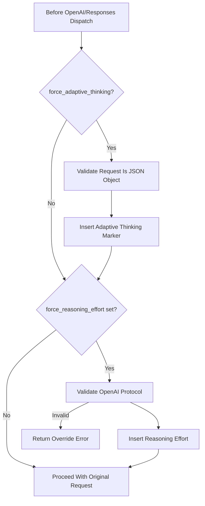
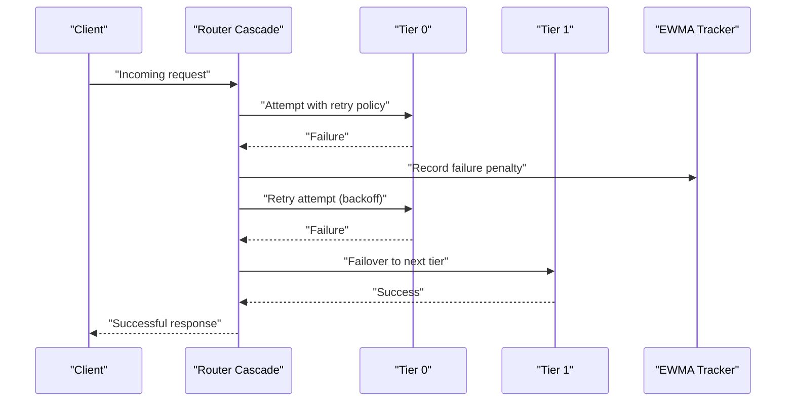
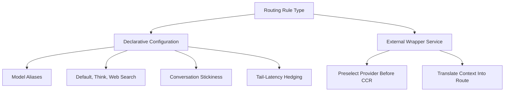
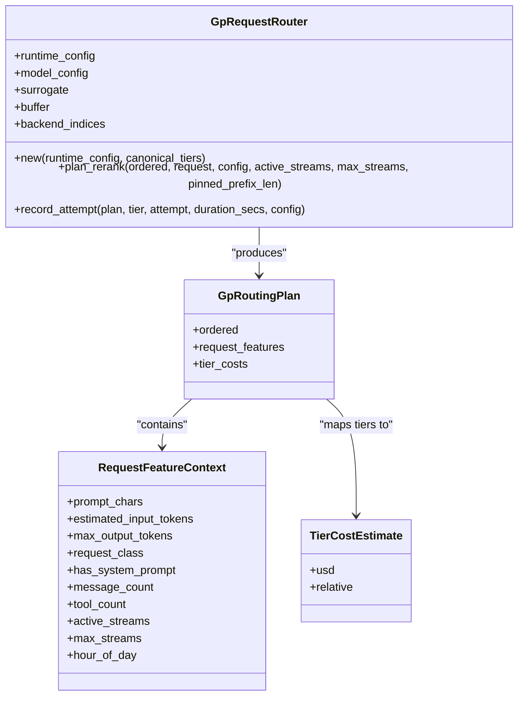
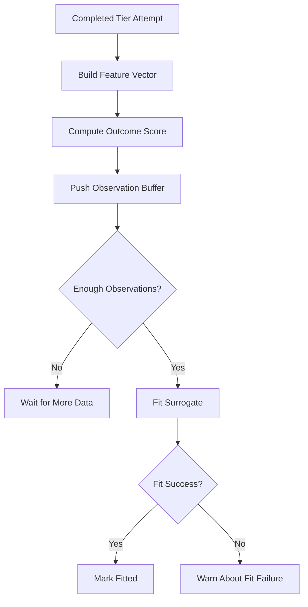
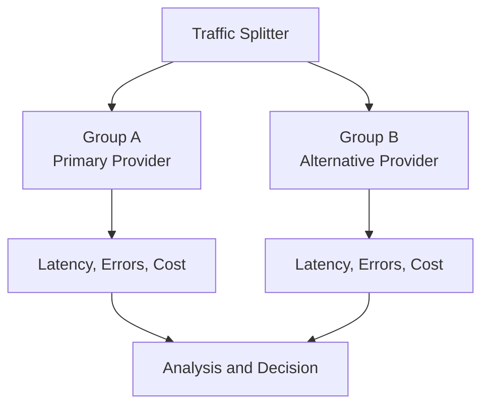
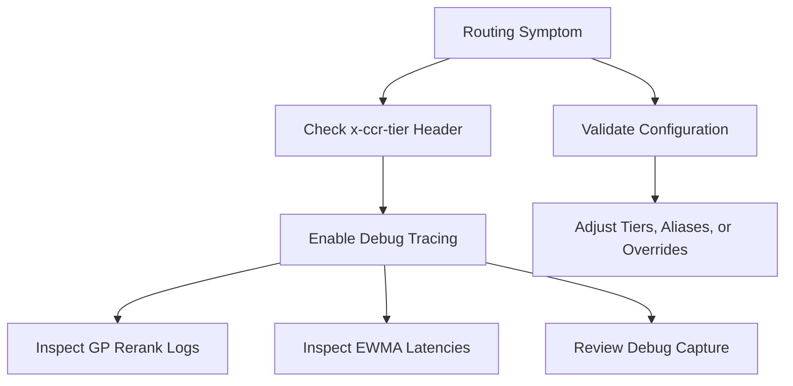
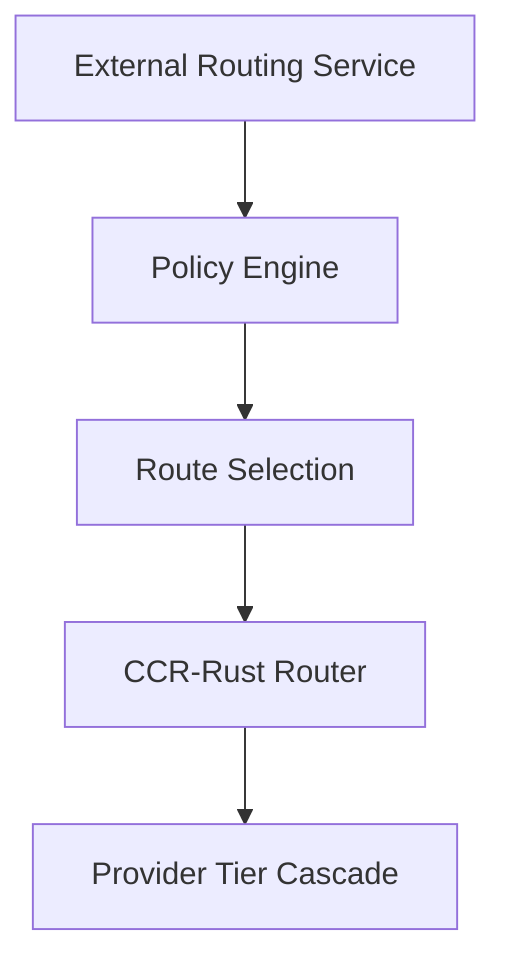

# Provider Overrides and Custom Routing

<cite>
**Referenced Files in This Document**
- [provider_overrides.rs](file://src/router/dispatch/provider_overrides.rs)
- [dispatch.rs](file://src/router/dispatch.rs)
- [mod.rs](file://src/router/mod.rs)
- [types.rs](file://src/router/types.rs)
- [routing.rs](file://src/routing.rs)
- [gp_router.rs](file://src/gp_router.rs)
- [config_types.rs](file://src/config/types.rs)
- [config_mod.rs](file://src/config/mod.rs)
- [main.rs](file://src/main.rs)
- [configuration.md](file://docs/configuration.md)
- [test_routing.rs](file://tests/test_routing.rs)
</cite>

## Table of Contents
1. [Introduction](#introduction)
2. [Routing Architecture Overview](#routing-architecture-overview)
3. [Override Precedence Hierarchy](#override-precedence-hierarchy)
4. [Provider Request Overrides](#provider-request-overrides)
5. [Standard Tier-Based Routing and Failover](#standard-tier-based-routing-and-failover)
6. [Custom Routing Rules and Conditional Routing](#custom-routing-rules-and-conditional-routing)
7. [GP Router Integration](#gp-router-integration)
8. [Advanced Routing Scenarios](#advanced-routing-scenarios)
9. [Performance and Observability](#performance-and-observability)
10. [Extending the Routing System](#extending-the-routing-system)
11. [Troubleshooting Guide](#troubleshooting-guide)
12. [Best Practices](#best-practices)
13. [Conclusion](#conclusion)

## Introduction

CCR-Rust routes incoming model requests through a layered system that combines explicit provider selection, configurable tier fallback, optional latency-aware reordering, optional request-aware reranking, and per-provider request mutation. The routing surface is not limited to “pick one provider.” It supports:

- Explicit provider and model selection through configuration aliases and route definitions.
- Ordered fallback chains called *tiers*.
- Per-attempt retry behavior with exponential backoff.
- EWMA-based latency tracking for probabilistic tier sampling.
- Optional GP-backed reranking that learns from past attempts.
- Provider-level request overrides that mutate normalized request bodies before dispatch.
- Conversation stickiness, tail-latency hedging, retry sweeps, and admission controls that influence which tiers are attempted and when.

This document focuses on how provider overrides interact with custom routing, how conditional routing fits into the standard tier pipeline, and how the optional GP router can rerank candidate tiers based on observed performance, cost, and request characteristics.

## Routing Architecture Overview

At a high level, an incoming request follows this path:

1. A frontend adapter normalizes the client request into CCR’s internal representation.
2. Route resolution selects the initial candidate tier or cascade.
3. Optional conversation stickiness partitions the tier list around a remembered family.
4. Optional GP reranking reshuffles eligible candidates behind a pinned prefix.
5. Each candidate tier is attempted, with retries and failover governed by tier-specific settings.
6. Before an OpenAI/Responses provider is reached, provider request overrides may mutate the normalized request body.
7. Responses are translated, streamed, captured, measured, and recorded.

**Diagram sources**
- [mod.rs:476-565](file://src/router/mod.rs#L476-L565)
- [dispatch.rs:810-810](file://src/router/dispatch.rs#L810-L810)
- [gp_router.rs:81-200](file://src/gp_router.rs#L81-L200)
- [routing.rs:201-450](file://src/routing.rs#L201-L450)

**Section sources**
- [mod.rs:476-565](file://src/router/mod.rs#L476-L565)
- [dispatch.rs:810-810](file://src/router/dispatch.rs#L810-L810)
- [configuration.md:200-591](file://docs/configuration.md#L200-L591)

## Override Precedence Hierarchy

The most important concept for provider overrides and custom routing is precedence. Not all override mechanisms have equal authority.

| Layer | Responsibility | Effective When | Can Be Overridden By |
|---|---|---|---|
| Direct client model target | Selects the requested provider/model pair | Enabled by default; client sends `provider,model` | `ignoreDirect=true`, aliases, strict tier order |
| Model alias mapping | Maps a bare model ID to a configured route | Present in `Router.modelAliases` | Exact alias match only; chained aliases are rejected |
| Pinned route prefixes | Keeps default, think, web-search, and sticky-session segments fixed | Active during cascade construction | Only later cascade segments can be reordered by GP |
| Standard tier ordering | Defines the fallback chain | Configured through `default`, `think`, `webSearch`, and `tiers` | EWMA sampling unless `strictTierOrder=true` |
| GP reranking | Reorders eligible candidates behind the pinned prefix | Enabled and surrogate fitted | None during a single request plan; observations affect future plans |
| Per-tier retry and failover | Retries the same tier before moving down | Configured through `tierRetries` | Deterministic errors, retry budget exhaustion, sweep policy |
| Provider request overrides | Mutates normalized request fields before dispatch | Applied immediately before upstream call | No runtime rule can bypass them once enabled |

The effective precedence can be summarized as:

1. **Configuration-defined route pins** are applied first.
2. **Conversation stickiness** partitions remembered-family tiers.
3. **GP reranking** may reorder eligible candidates behind the pinned prefix.
4. **Tier failure and retry** determine whether the cascade continues.
5. **Provider request overrides** are applied right before the selected provider receives the request.

**Diagram sources**
- [mod.rs:476-565](file://src/router/mod.rs#L476-L565)
- [gp_router.rs:81-200](file://src/gp_router.rs#L81-L200)
- [routing.rs:201-450](file://src/routing.rs#L201-L450)
- [provider_overrides.rs:6-47](file://src/router/dispatch/provider_overrides.rs#L6-L47)

**Section sources**
- [configuration.md:200-591](file://docs/configuration.md#L200-L591)
- [mod.rs:476-565](file://src/router/mod.rs#L476-L565)
- [provider_overrides.rs:6-47](file://src/router/dispatch/provider_overrides.rs#L6-L47)

## Provider Request Overrides

Provider request overrides are applied after protocol normalization and just before the HTTP request is sent to an OpenAI-compatible or Responses provider. They do not change the configured tier order. Instead, they change the normalized request payload that reaches the selected provider.

### Supported Overrides

| Field | Type | Behavior | Constraints |
|---|---|---|---|
| `force_adaptive_thinking` | boolean | Inserts a thinking object with adaptive mode into the normalized request | Applies on the OpenAI-protocol path used for these overrides |
| `force_reasoning_effort` | string | Inserts a reasoning effort field into the normalized request | Must use a valid effort value and only applies to the OpenAI provider protocol |

The implementation validates two conditions:

1. If `force_adaptive_thinking` is set, the normalized request must be a JSON object; otherwise it returns a request override error.
2. If `force_reasoning_effort` is set, the provider protocol must be OpenAI; otherwise configuration validation rejects it at startup.

This means provider request overrides are intentionally narrow: they adjust model-facing behavior such as thinking and reasoning effort rather than acting as a general-purpose request rewrite engine.

**Diagram sources**
- [provider_overrides.rs:6-47](file://src/router/dispatch/provider_overrides.rs#L6-L47)
- [config_mod.rs:237-250](file://src/config/mod.rs#L237-L250)

**Section sources**
- [provider_overrides.rs:6-47](file://src/router/dispatch/provider_overrides.rs#L6-L47)
- [dispatch.rs:810-810](file://src/router/dispatch.rs#L810-L810)
- [config_mod.rs:237-250](file://src/config/mod.rs#L237-L250)
- [configuration.md:1-199](file://docs/configuration.md#L1-L199)

## Standard Tier-Based Routing and Failover

The core routing unit is a *tier*, written as `provider,model`. A cascade is an ordered list of tiers. The standard flow is:

1. Resolve the initial route using default, think, web search, direct targeting, and aliases.
2. Apply conversation stickiness if enabled.
3. Optionally apply GP reranking.
4. Attempt each tier in order.
5. For each tier, apply its retry policy, including exponential backoff.
6. Move to the next tier when retries are exhausted or deterministic errors occur.
7. Return success on the first usable response.

### Tier Ordering Controls

| Option | Effect |
|---|---|
| `ignoreDirect` | Ignores client-selected provider/model targets and enforces configured tier order |
| `strictTierOrder` | Uses the configured tier chain verbatim and disables EWMA reordering and cold-start shuffling |
| `topK` | Limits the number of sampled tiers when EWMA-based weighted sampling is active |
| `routingTemperature` | Controls softmax sharpness; lower values favor the fastest tier, higher values distribute traffic more evenly |

When EWMA samples are available and no strict order is forced, CCR computes logits from EWMA latencies, applies softmax, and draws tiers without replacement. Unmeasured tiers receive a large negative logit so measured tiers are preferred once enough samples exist.

### Per-Tier Retry Behavior

Each tier has a retry configuration containing:

- Maximum retries.
- Base backoff delay.
- Backoff multiplier.
- Maximum backoff delay.
- Stream-first-event timeout.
- Stream-idle timeout.

The default backoff formula is exponential and clamped at the maximum. An EWMA-aware variant scales backoff by observed latency relative to a baseline while still respecting configuration bounds.

**Diagram sources**
- [routing.rs:1-200](file://src/routing.rs#L1-L200)
- [routing.rs:201-450](file://src/routing.rs#L201-L450)
- [test_routing.rs:200-641](file://tests/test_routing.rs#L200-L641)

**Section sources**
- [routing.rs:1-200](file://src/routing.rs#L1-L200)
- [routing.rs:201-450](file://src/routing.rs#L201-L450)
- [configuration.md:200-591](file://docs/configuration.md#L200-L591)
- [test_routing.rs:200-641](file://tests/test_routing.rs#L200-L641)

## Custom Routing Rules and Conditional Routing

CCR-Rust does not expose a general-purpose scriptable routing language. Its built-in conditional routing is defined by configuration and protocol context rather than arbitrary per-request code paths. The main conditional hooks are:

- **Model aliases**: Map a bare model name to a specific `provider,model` route.
- **Route categories**: Separate defaults, thinking, background, and web search routes.
- **Ignore direct routing**: Prevents client-provided model targets from bypassing configured tiers.
- **Strict tier order**: Forces exact cascade order and disables EWMA and GP reordering.
- **Conversation stickiness**: Remembers a successful provider family for a conversation key.
- **Tail-latency hedging**: Launches a parallel fallback attempt after a time-to-first-token threshold.
- **Retry sweeps**: Holds the client request open and re-cascades after cooldown.
- **Provider request overrides**: Mutates normalized request fields before dispatch.

These features allow many practical routing policies without requiring custom code:

| Scenario | Built-In Mechanism |
|---|---|
| Geographic routing | Multiple providers representing regions, combined with aliases and tier ordering |
| Cost optimization | Pricing metadata plus GP credible-set cost preference |
| Model versioning | Aliases and tier ordering over different model names |
| A/B testing between providers | Weighted tier sampling, hedging, or separate alias groups |
| Thinking vs non-thinking workloads | Separate `think` route and `force_adaptive_thinking` |
| Streaming vs batch workloads | Stream timeouts, hedging thresholds, and stream-aware classification in GP |

Conditional routing should therefore be expressed declaratively through configuration. If a business rule requires logic beyond what the configuration surface provides—such as parsing geographic location headers, inspecting user attributes, or calling an external decision service—it should be implemented outside CCR-Rust or integrated through a wrapper that selects among preconfigured routes.

[No sources needed since this diagram shows conceptual workflow, not actual code structure]

**Section sources**
- [configuration.md:200-591](file://docs/configuration.md#L200-L591)
- [mod.rs:476-565](file://src/router/mod.rs#L476-L565)

## GP Router Integration

The GP router is an optional component that reranks candidate tiers based on learned relationships between request features, backend identity, and observed outcomes. It is disabled by default and activated through `Router.gpRouting.enabled`.

### GP Router Responsibilities

The GP router does not replace standard routing. It produces a reranking plan for eligible candidates behind the pinned prefix:

1. Extract request features such as prompt size, estimated input tokens, output token budget, request class, system prompt presence, message count, tool count, active streams, hour of day, and backend identity.
2. Estimate per-tier cost from configured pricing.
3. Skip reranking if the surrogate is not fitted.
4. Limit candidate evaluation to bounded backend slots.
5. Score candidates using an acquisition strategy.
6. Sort candidates by a quality-credible set and then estimated cost.
7. Return a new tier order where only eligible candidates are moved; earlier pinned tiers remain fixed.

### GP Configuration Surface

| Field | Default | Meaning |
|---|---:|---|
| `enabled` | false | Activates GP-backed reranking |
| `maxCandidates` | 32 | Maximum candidates considered for reranking |
| `minObservations` | 40 | Minimum observations before fitting the surrogate |
| `refitInterval` | 200 | Refit interval for the surrogate |
| `ucbKappa` | 2.0 | Exploration parameter for UCB scoring |
| `acquisition` | `ucb` | Acquisition strategy: UCB, Thompson, Greedy, or Epsilon-Greedy |

The encoder supports up to 32 configured provider/model routes. Routes beyond that bound remain available in their configured fallback order but cannot be represented in the bounded feature space.

**Diagram sources**
- [gp_router.rs:1-200](file://src/gp_router.rs#L1-L200)
- [gp_router.rs:201-640](file://src/gp_router.rs#L201-L640)

### Fitness Function and Outcome Scoring

The GP router does not use raw latency alone as fitness. It maps a finite non-negative duration to a score in `[0, 1]` using an inverse sigmoid-like transformation: shorter durations produce higher scores, longer durations produce lower scores, and missing or invalid durations map to zero. Failed attempts therefore contribute low-quality observations until sufficient data accumulates.

The outcome score feeds the observation buffer, which triggers surrogate fitting when the minimum observation threshold is reached and refitting criteria are satisfied.

### Acquisition Strategies

| Strategy | Behavior |
|---|---|
| `ucb` | Scores candidates using upper confidence bound exploration |
| `thompson` | Samples from posterior distributions |
| `greedy` | Uses the predicted mean directly |
| `epsilonGreedy` | Occasionally injects a random candidate with elevated score to encourage exploration |

### Training Data Collection

Training data comes from completed attempt records:

- Features include prompt length, priority class, system prompt flag, dependency count, retry attempt index, backend identity, idle capacity ratio, in-flight ratio, hour of day, loop/tool count, and relative cost.
- Outcomes are derived from attempt duration.
- The buffer stores bounded observations and tracks fit state.
- Fitting logs observation count, fit count, and last fit duration.
- Fit failures are warned but do not stop routing.

**Diagram sources**
- [gp_router.rs:201-640](file://src/gp_router.rs#L201-L640)

**Section sources**
- [gp_router.rs:1-200](file://src/gp_router.rs#L1-L200)
- [gp_router.rs:201-640](file://src/gp_router.rs#L201-L640)
- [main.rs:451-487](file://src/main.rs#L451-L487)
- [config_types.rs:1080-1218](file://src/config/types.rs#L1080-L1218)
- [configuration.md:200-591](file://docs/configuration.md#L200-L591)

## Advanced Routing Scenarios

### Geographic Routing

Geographic routing can be modeled by defining multiple providers in different regions and selecting among them through aliases and tier ordering. For example:

- Configure a US provider, an EU provider, and a fallback global provider.
- Use an external gateway or client layer to select the region-appropriate alias.
- Keep `ignoreDirect=true` if clients must not bypass regional routing.
- Use GP reranking within a region to prefer lower-latency or lower-cost models.

Because CCR-Rust does not parse geographic headers as part of its routing rules, the geographic decision belongs to the caller or a thin proxy.

### Cost Optimization

Cost optimization is supported indirectly:

- Providers and models can declare input/output pricing.
- The GP router estimates pre-dispatch cost and uses a credible set to avoid arbitrary exchange rates between quality and dollars.
- Within the credible set, lower estimated cost is preferred.
- Missing pricing remains unknown and does not make a tier appear free.

For deterministic cost routing without learning, configure cheaper tiers earlier and expensive tiers as fallbacks. For adaptive cost-quality tradeoffs, enable GP reranking and provide accurate pricing metadata.

### Model Versioning

Model versioning works naturally through tier ordering and aliases:

- Define `provider,model-v1` and `provider,model-v2` as separate tiers.
- Route new users to `v2` and existing users to `v1` through aliases or preselection.
- Gradually shift traffic by adjusting tier order or enabling hedging between versions.
- Use GP reranking to learn which version performs better under current load.

### A/B Testing Between Providers

A/B testing can be implemented in several ways:

- **Weighted sampling**: Use EWMA-based weighted tier sampling to distribute traffic across providers.
- **Hedging**: Enable hedging to race primary and secondary providers on slow starts.
- **Separate aliases**: Give different clients different aliases pointing to different provider cascades.
- **GP epsilon exploration**: Use `epsilonGreedy` to periodically try alternative candidates.

A/B test results should be monitored through metrics and logs rather than relying solely on GP reranking, because the GP router optimizes for observed quality and cost signals, not statistical significance of experiment groups.

### Conceptual A/B Flow

[No sources needed since this diagram shows conceptual workflow, not actual code structure]

**Section sources**
- [configuration.md:200-591](file://docs/configuration.md#L200-L591)
- [gp_router.rs:201-640](file://src/gp_router.rs#L201-L640)

## Performance and Observability

### Performance Implications of Custom Routing Logic

Custom routing logic adds overhead at several points:

| Component | Performance Characteristic |
|---|---|
| Route resolution | Constant-time alias lookup and cascade construction |
| Conversation stickiness | Hash-based session partitioning |
| GP reranking | Bounded candidate evaluation and surrogate prediction |
| EWMA sampling | Logit computation, softmax, and weighted sampling |
| Provider request overrides | Lightweight JSON mutation before dispatch |
| Hedging | Additional upstream attempt for latency-sensitive cases |
| Retry sweeps | Extended request lifetime and periodic cascade replay |

GP reranking is intentionally bounded:

- At most 32 backend slots are encoded.
- Candidate positions are limited by `maxCandidates`.
- The surrogate skips reranking until fitted.
- Tail tiers beyond the slot bound remain in configured order.

EWMA sampling adds probability-weighted distribution instead of always picking the fastest known tier. This improves resilience under heterogeneous provider performance but introduces randomness.

### Debugging Routing Decisions

Useful debugging techniques include:

1. Enable debug tracing to observe tier routing order, GP reranking decisions, and override application.
2. Inspect the `x-ccr-tier` header on responses to identify the final provider tier.
3. Review GP rerank logs showing before and after tier orders.
4. Monitor EWMA latencies and sample counts.
5. Use debug capture to record sanitized request/response interactions when enabled.
6. Validate configuration at startup to catch invalid `force_reasoning_effort` values, unsupported protocols, and conflicting routing options.

**Diagram sources**
- [dispatch.rs:500-560](file://src/router/dispatch.rs#L500-L560)
- [gp_router.rs:201-260](file://src/gp_router.rs#L201-L260)
- [routing.rs:201-450](file://src/routing.rs#L201-L450)
- [config_mod.rs:237-300](file://src/config/mod.rs#L237-L300)

**Section sources**
- [gp_router.rs:201-260](file://src/gp_router.rs#L201-L260)
- [routing.rs:201-450](file://src/routing.rs#L201-L450)
- [dispatch.rs:500-560](file://src/router/dispatch.rs#L500-L560)
- [configuration.md:200-591](file://docs/configuration.md#L200-L591)

## Extending the Routing System

### Adding Custom Strategies

The routing system exposes clear extension points, but adding fully custom per-request routing logic requires changes to the router pipeline:

1. Introduce a new routing stage before or after standard tier resolution.
2. Accept request context and return a modified candidate cascade.
3. Respect pinned prefixes so downstream components such as GP reranking remain meaningful.
4. Record telemetry so the custom strategy is observable.
5. Add configuration validation to prevent incompatible combinations.

A safer pattern is to keep custom logic in a thin wrapper that selects among preconfigured routes based on business context, rather than mutating CCR’s internal dispatcher.

### Integrating Third-Party Routing Services

Third-party routing services can integrate by:

- Running alongside CCR-Rust as a sidecar or reverse proxy.
- Evaluating request context against external policies.
- Returning a CCR-compatible `provider,model` route.
- Letting CCR handle failover, streaming, translation, and provider-specific normalization.

This keeps CCR-Rust focused on its strengths: provider routing, protocol adaptation, retry semantics, and observability, while allowing external systems to own domain-specific routing policies.

[No sources needed since this diagram shows conceptual workflow, not actual code structure]

**Section sources**
- [main.rs:451-487](file://src/main.rs#L451-L487)
- [configuration.md:200-591](file://docs/configuration.md#L200-L591)

## Troubleshooting Guide

### Common Issues

| Issue | Likely Cause | Resolution |
|---|---|---|
| Requests ignore client model selection | `ignoreDirect=true` or alias mismatch | Verify `Router.ignoreDirect` and alias mappings |
| Cheaper tier never used | Direct routing or wrong tier order | Disable direct routing or adjust cascade |
| Provider request override fails | Non-OpenAI protocol with `force_reasoning_effort` | Change provider protocol or remove override |
| GP reranking has no effect | Surrogate unfitted or too few observations | Increase traffic or reduce `minObservations` |
| GP reranking moves unexpected tiers | Excessive epsilon or small credible set | Adjust acquisition strategy and kappa |
| EWMA favors one tier too aggressively | Low routing temperature | Raise `routingTemperature` or disable EWMA |
| Strict tier order ignores GP | `strictTierOrder=true` | Disable strict order if GP reranking is required |
| Retry budget saturates | Too many same-tier retries | Reduce retries, increase budget, or improve provider health |

### Validation Errors

Configuration validation rejects several problematic combinations:

- `force_reasoning_effort` on a non-OpenAI provider.
- Invalid `force_reasoning_effort` values.
- `strictTierOrder` combined with `topK`.
- `retrySweeps.sweepCooldownMs=0`.
- `hedging.enabled` with `ttftThresholdMs=0`.
- Chained or invalid model alias targets.

**Section sources**
- [config_mod.rs:237-300](file://src/config/mod.rs#L237-L300)
- [config_types.rs:1080-1218](file://src/config/types.rs#L1080-L1218)
- [test_routing.rs:200-641](file://tests/test_routing.rs#L200-L641)

## Best Practices

1. **Keep routing declarative.** Prefer configuration over custom code for routing decisions.
2. **Use aliases for stable client-facing model names.** Map legacy or opaque model IDs to concrete `provider,model` routes.
3. **Separate concerns.** Put geographic, tenant, or business routing in a wrapper; let CCR handle provider failover.
4. **Start with tier ordering.** Use explicit tier order before enabling EWMA or GP reranking.
5. **Enable GP reranking gradually.** Begin with disabled reranking, collect observations, then tune acquisition parameters.
6. **Provide accurate pricing metadata.** Cost-aware reranking depends on realistic input/output rates.
7. **Monitor override effects.** Logging helps confirm whether `force_adaptive_thinking` and `force_reasoning_effort` are applied.
8. **Avoid contradictory routing options.** Do not combine strict tier order with top-K sampling.
9. **Tune retry budgets carefully.** Saturated budgets protect the system but can suppress retries.
10. **Test A/B experiments with external metrics.** Do not assume GP reranking alone proves experiment validity.

## Conclusion

CCR-Rust’s routing system is layered: explicit route pins and aliases define intent, tier cascades define failover, EWMA sampling distributes load adaptively, and the optional GP router learns to rerank candidates based on request shape, backend identity, and observed outcomes. Provider request overrides sit at the boundary between routing and dispatch, mutating normalized request payloads just before upstream calls.

For most operational needs, the combination of aliases, tier ordering, hedging, retry sweeps, and GP reranking is sufficient. Complex conditional routing should be expressed through configuration whenever possible, with external wrappers handling domain-specific decisions. This preserves CCR-Rust’s reliability guarantees while giving operators fine-grained control over provider selection, failover, cost, latency, and request behavior.