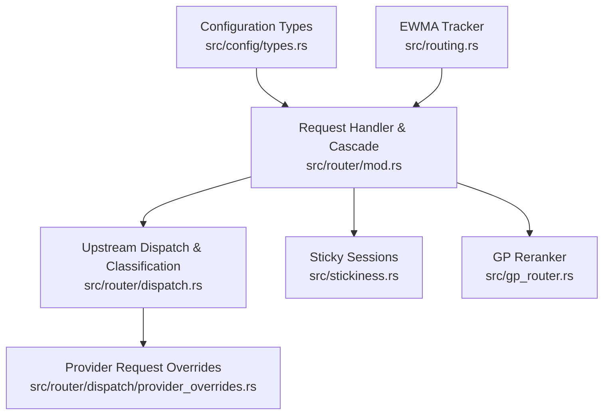
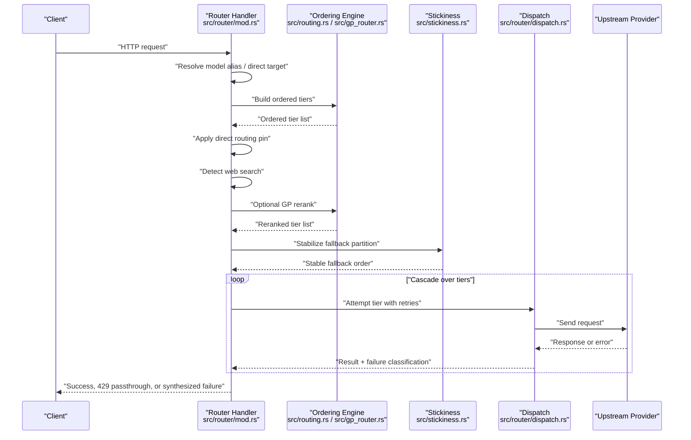
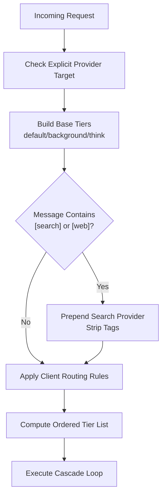
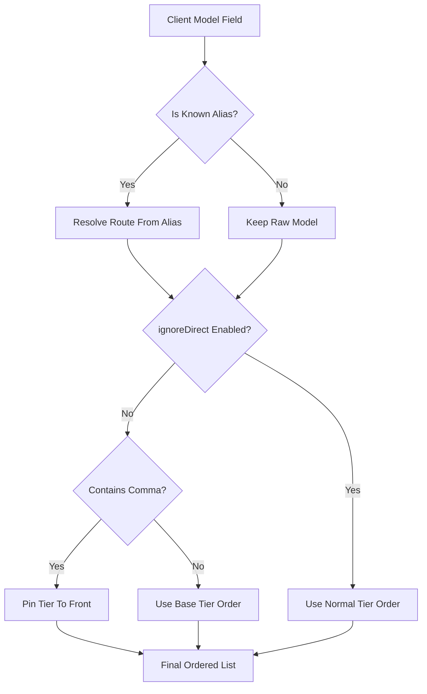
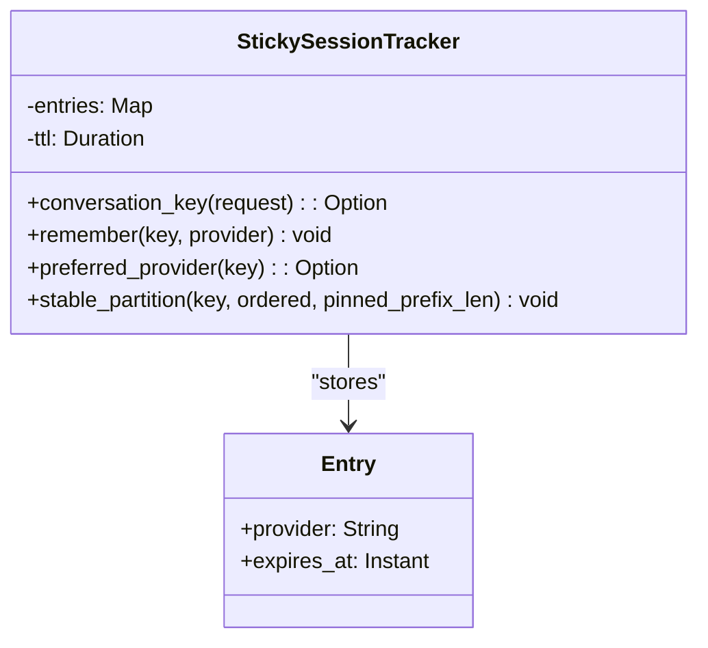
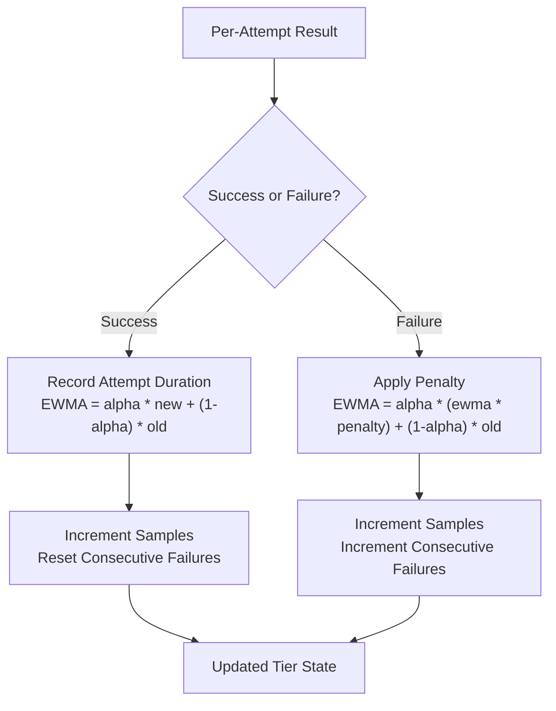
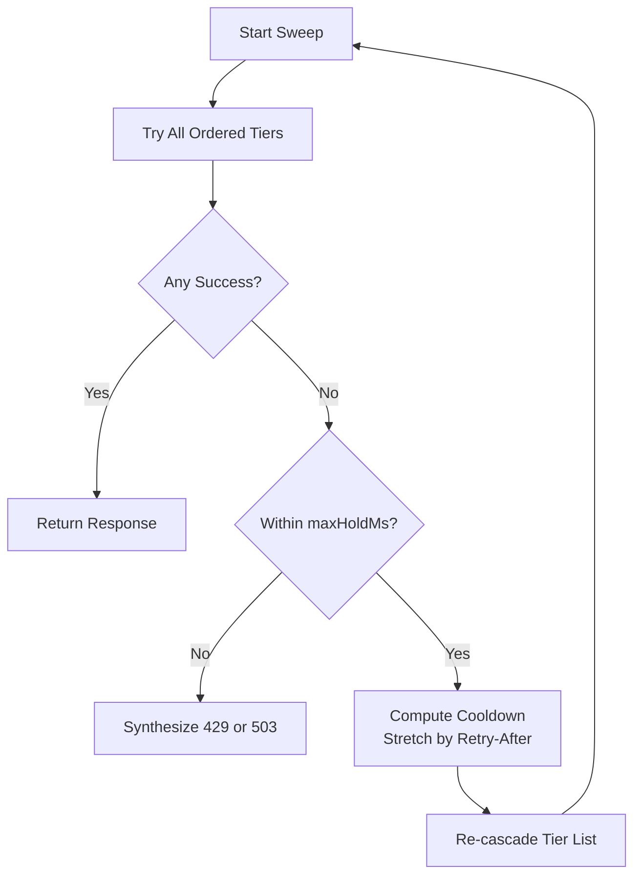
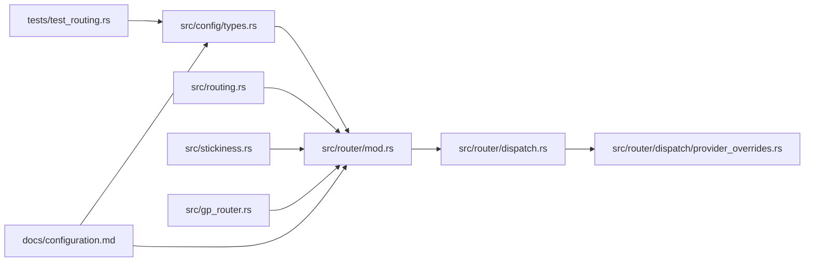

# Routing and Tier Configuration

<cite>
**Referenced Files in This Document**
- [src/routing.rs](file://src/routing.rs)
- [src/router/mod.rs](file://src/router/mod.rs)
- [src/router/dispatch.rs](file://src/router/dispatch.rs)
- [src/router/dispatch/provider_overrides.rs](file://src/router/dispatch/provider_overrides.rs)
- [src/config/types.rs](file://src/config/types.rs)
- [src/stickiness.rs](file://src/stickiness.rs)
- [src/gp_router.rs](file://src/gp_router.rs)
- [tests/test_routing.rs](file://tests/test_routing.rs)
- [docs/configuration.md](file://docs/configuration.md)
- [docs/failover_architecture.md](file://docs/failover_architecture.md)
</cite>

## Table of Contents
1. [Introduction](#introduction)
2. [Project Structure](#project-structure)
3. [Core Components](#core-components)
4. [Architecture Overview](#architecture-overview)
5. [Detailed Component Analysis](#detailed-component-analysis)
6. [Dependency Analysis](#dependency-analysis)
7. [Performance Considerations](#performance-considerations)
8. [Troubleshooting Guide](#troubleshooting-guide)
9. [Conclusion](#conclusion)

## Introduction
This document explains how CCR-Rust selects backend tiers for incoming requests, how tier ordering is configured and computed at runtime, and how traffic classes, client routing rules, stickiness, hedging, EWMA latency tracking, retry sweeps, and failback behavior interact to form the complete routing decision pipeline.

CCR-Rust does not route by provider name alone. It builds an ordered list of candidate tiers, applies direct-routing and web-search pins, optionally reranks using a Gaussian-process model, stabilizes fallback candidates with sticky sessions, and then executes a cascading attempt loop that retries within a tier before falling back to the next tier.

## Project Structure
The routing subsystem is split across several modules:

- `src/config/types.rs` defines configuration structures such as `RouterConfig`, `WebSearchConfig`, `TierRetryConfig`, `RetrySweepConfig`, `StickySessionsConfig`, `HedgingConfig`, and `GpRoutingRuntimeConfig`.
- `src/routing.rs` implements EWMA-based per-tier latency tracking and two ordering strategies: strict config order or weighted sampling based on measured latencies.
- `src/router/mod.rs` is the request handler that constructs the ordered tier list, applies routing overrides, and drives the cascade/sweep loop.
- `src/router/dispatch.rs` performs the actual upstream call, classifies failures, tracks rate limits, and integrates streaming error handling.
- `src/router/dispatch/provider_overrides.rs` applies provider-specific request mutations such as forced reasoning effort or adaptive thinking.
- `src/stickiness.rs` remembers a conversation’s preferred provider family and stabilizes the fallback portion of the tier order.
- `src/gp_router.rs` provides optional GP-based reranking layered on top of EWMA ordering.

**Diagram sources**
- [src/config/types.rs:634-900](file://src/config/types.rs#L634-L900)
- [src/routing.rs:1-200](file://src/routing.rs#L1-L200)
- [src/router/mod.rs:200-850](file://src/router/mod.rs#L200-L850)
- [src/router/dispatch.rs:1-300](file://src/router/dispatch.rs#L1-L300)
- [src/router/dispatch/provider_overrides.rs:1-47](file://src/router/dispatch/provider_overrides.rs#L1-L47)
- [src/stickiness.rs:1-200](file://src/stickiness.rs#L1-L200)
- [src/gp_router.rs:1-200](file://src/gp_router.rs#L1-L200)

**Section sources**
- [src/config/types.rs:634-900](file://src/config/types.rs#L634-L900)
- [src/router/mod.rs:200-850](file://src/router/mod.rs#L200-L850)

## Core Components
The routing system is composed of six primary components:

| Component | Responsibility | Key Configuration | Runtime Behavior |
|---|---|---|---|
| Tier definition | Maps a logical tier string to a concrete provider and display name. | `Providers[]`, `Router.default`, `Router.background`, `Router.think`, `Router.tiers` | Used to build the initial ordered candidate list. |
| Traffic-class router | Routes default, think, background, and web search requests to appropriate providers. | `Router.default`, `Router.background`, `Router.think`, `Router.web_search` | Selects the base tier set and may prepend a search provider. |
| Client routing rules | Honors explicit `provider,model` targets and model aliases. | `Router.ignore_direct`, `Router.model_aliases` | Pins or replaces the candidate chain when the client explicitly names a backend. |
| Ordering engine | Computes final tier priority. | `Router.strict_tier_order`, `Router.top_k`, `Router.routing_temperature`, `Router.gp_routing` | Strict order, EWMA-weighted sampling, or GP reranking. |
| Execution loop | Attempts tiers with retries, hedging, sweep cooldown, and failback. | `Router.tier_retries`, `Router.retry_sweeps`, `Router.hedging`, `Router.retry_budget_percent` | Cascades through ordered tiers until success, exhaustion, or hold timeout. |
| Observability and state | Tracks latency, rate limits, admission, stickiness, and costs. | EWMA defaults, ratelimit settings, persistence config, pricing | Updates EWMA, records 429 backoff, estimates cost, persists state when enabled. |

**Section sources**
- [src/config/types.rs:634-900](file://src/config/types.rs#L634-L900)
- [src/router/mod.rs:200-850](file://src/router/mod.rs#L200-L850)
- [src/routing.rs:1-200](file://src/routing.rs#L1-L200)

## Architecture Overview
The end-to-end routing flow is:

1. The HTTP handler receives an Anthropic-compatible request.
2. The handler resolves the requested model, applying model aliases unless direct routing is ignored.
3. A base ordered tier list is built from configuration.
4. Direct routing pins the explicitly targeted tier.
5. Web search detection prepends a search provider when tags are present.
6. Optional GP reranking may reorder non-pinned candidates.
7. Sticky sessions stabilize the fallback portion of the order.
8. The cascade loop attempts each tier with configured retries.
9. Hedging launches a concurrent fallback attempt after a configurable first-token threshold.
10. Failure classification determines whether to retry the same tier, skip it deterministically, or fall back.
11. Retry sweeps can re-cascade held requests instead of immediately failing.
12. EWMA updates reflect per-attempt outcomes.

**Diagram sources**
- [src/router/mod.rs:200-850](file://src/router/mod.rs#L200-L850)
- [src/routing.rs:200-400](file://src/routing.rs#L200-L400)
- [src/gp_router.rs:1-200](file://src/gp_router.rs#L1-L200)
- [src/stickiness.rs:1-200](file://src/stickiness.rs#L1-L200)
- [src/router/dispatch.rs:1-300](file://src/router/dispatch.rs#L1-L300)

## Detailed Component Analysis

### Tier Definitions and Priority Ordering
Tiers are strings such as `provider,model`. They are resolved into a canonical route and a human-readable tier name through the configuration layer. The effective tier name is used for metrics, headers, and logging, while the full route key is used for rate-limit tracking and deterministic rejection memoization.

Priority ordering has three modes:

| Mode | Configuration | Behavior |
|---|---|---|
| Strict tier order | `Router.strict_tier_order = true` | Tiers are attempted exactly in configured order. This models a deliberate quality or cost hierarchy where a higher-preference tier must be tried before lower ones. |
| EWMA-weighted sampling | `Router.strict_tier_order = false` (default) | Latency observations influence ordering through softmax-weighted sampling. Measured tiers with enough samples move ahead; unmeasured tiers retain their original position. |
| GP reranking | `Router.gp_routing.enabled = true` | An optional Gaussian-process model reranks non-pinned candidates based on estimated cost, request features, and surrogate predictions. |

In all modes, pinned tiers remain at the front:

- Direct routing pins one tier at position zero.
- Web search prepends its provider and grows the pinned prefix.
- GP reranking never moves the pinned prefix.

**Section sources**
- [src/router/mod.rs:200-561](file://src/router/mod.rs#L200-L561)
- [src/gp_router.rs:120-200](file://src/gp_router.rs#L120-L200)
- [docs/failover_architecture.md:80-120](file://docs/failover_architecture.md#L80-L120)

### Traffic Class Routing
CCR-Rust distinguishes four main routing contexts:

| Traffic class | Purpose | Configuration | Routing behavior |
|---|---|---|---|
| Default | Normal user-facing model calls. | `Router.default` | Forms the baseline tier list. |
| Think | Requests requiring extended reasoning or thinking mode. | `Router.think` | Can use a dedicated provider optimized for reasoning. |
| Background | Lower-priority or batch-oriented workloads. | `Router.background` | Can use cheaper or higher-latency providers. |
| Web search | Requests containing search intent markers. | `Router.web_search` | Prepends a search-enabled provider and strips search tags from messages. |

Traffic-class selection is driven by `Router.default`, `Router.background`, and `Router.think` when constructing the base tier list. Web search is detected at request time by scanning message content for `[search]` or `[web]` markers. When enabled, the configured `search_provider` is inserted at the beginning of the ordered tier list, and the markers are removed before dispatch.

**Diagram sources**
- [src/router/mod.rs:200-561](file://src/router/mod.rs#L200-L561)

**Section sources**
- [src/router/mod.rs:200-561](file://src/router/mod.rs#L200-L561)
- [docs/configuration.md:120-200](file://docs/configuration.md#L120-L200)

### Client-Specific Routing Rules
Clients can influence routing through:

1. **Explicit provider targeting:** If the model field contains a comma-separated `provider,model` value, CCR-Rust looks for that exact tier in the ordered list and moves it to the front. If it is not present, CCR-Rust creates a single-tier route for that target.
2. **Model aliases:** For bare model names, `Router.model_aliases` maps the alias to a concrete route.
3. **Ignore direct routing:** When `Router.ignore_direct = true`, explicit `provider,model` requests are ignored and normal tier ordering is used.

These rules apply before web search tagging and before GP reranking.

**Diagram sources**
- [src/router/mod.rs:200-561](file://src/router/mod.rs#L200-L561)

**Section sources**
- [src/router/mod.rs:200-561](file://src/router/mod.rs#L200-L561)

### Sticky Sessions
Sticky sessions keep conversations on a previously successful provider family when possible. This reduces mid-conversation protocol translation and makes fallback less visible.

Key behaviors:

- The sticky key is derived from the normalized Anthropic request’s system prompt and first user message.
- The key is hashed so private prompt text is never logged or exposed in cache keys.
- The tracker enforces a maximum entry count and TTL eviction.
- `stable_partition` preserves the pinned prefix (direct routing and web search) and only reorders the fallback portion so the preferred provider family comes first.
- Sticky sessions are disabled by default and must be explicitly enabled.

**Diagram sources**
- [src/stickiness.rs:1-200](file://src/stickiness.rs#L1-L200)

**Section sources**
- [src/stickiness.rs:1-200](file://src/stickiness.rs#L1-L200)
- [src/router/mod.rs:561-620](file://src/router/mod.rs#L561-L620)

### Provider Overrides
Before dispatch, provider-level request overrides can mutate the request payload:

| Override | Condition | Effect |
|---|---|---|
| `force_adaptive_thinking` | Provider setting enabled | Inserts adaptive thinking metadata for providers that require it. |
| `force_reasoning_effort` | OpenAI protocol provider | Forces a specific reasoning effort level on every request. |

If `force_reasoning_effort` is set on a non-OpenAI protocol provider, the override path rejects the request early because the field is protocol-specific.

**Section sources**
- [src/router/dispatch/provider_overrides.rs:1-47](file://src/router/dispatch/provider_overrides.rs#L1-L47)
- [src/config/types.rs:290-420](file://src/config/types.rs#L290-L420)

### EWMA Latency Tracking
CCR-Rust tracks per-tier exponential weighted moving average latency to inform routing decisions.

| Parameter | Default | Meaning |
|---|---:|---|
| Alpha | `0.3` | Weight given to the newest sample versus historical EWMA. Higher values react faster but are noisier. |
| Minimum samples | `3` | A tier’s EWMA is trusted only after this many samples. Below this threshold, config-defined order dominates. |
| Failure penalty | `2.0` | Failed requests increase the EWMA by multiplying the current estimate rather than recording wall-clock duration. |

Important implementation details:

- Successes record the measured attempt duration.
- Failures apply a penalty multiplier to the current EWMA rather than measuring raw timeout duration.
- Successful attempt durations are clamped to the effective upstream timeout to avoid poisoning gauges with pathological durations.
- The tracker maintains consecutive failure counts and total sample counts.
- Per-tier latency snapshots can be restored at startup when persistence is enabled.

**Diagram sources**
- [src/routing.rs:1-200](file://src/routing.rs#L1-L200)
- [src/routing.rs:360-400](file://src/routing.rs#L360-L400)

**Section sources**
- [src/routing.rs:1-200](file://src/routing.rs#L1-L200)
- [src/routing.rs:200-400](file://src/routing.rs#L200-L400)
- [docs/failover_architecture.md:120-160](file://docs/failover_architecture.md#L120-L160)

### Circuit Breaker and Admission Controls
CCR-Rust uses multiple controls that resemble circuit breaker and admission patterns, though they are not implemented as a single generic circuit breaker:

| Control | Scope | Behavior |
|---|---|---|
| Rate-limit backoff | Per `provider,model` route | Skips tiers while a 429 backoff window is active. Honors server `Retry-After` up to 60 seconds. |
| Deterministic rejection memo | Per request | Tracks tiers returning `Rejected` status codes and skips them in later sweeps. |
| AIMD admission | Per tier | Limits in-flight attempts; halved on rejection and grown on clean completion. |
| In-flight token budget | Per tier | Defers requests whose estimated input tokens would exceed a static token budget. |
| Retry budget | Global | Bounds retry amplification across repeated attempts on the same tier. |

Deterministic rejections are distinct from transient failures:

- `RateLimited`: 429 responses intercepted before classification.
- `Rejected`: 401-404 and similar deterministic client errors; retried at most once per request.
- `Other`: Transient or retryable failures such as timeouts and connection errors; eligible for retries and sweep re-cascading.

**Section sources**
- [src/router/dispatch.rs:1-300](file://src/router/dispatch.rs#L1-L300)
- [docs/failover_architecture.md:120-200](file://docs/failover_architecture.md#L120-L200)
- [src/router/mod.rs:561-850](file://src/router/mod.rs#L561-L850)

### Failback and Retry Sweeps
By default, once every tier in the cascade fails, CCR-Rust synthesizes either:

- A 429 response when the final sweep observed exclusively rate limiting.
- A 503 response for other exhausted cascades.

When `Router.retry_sweeps.enabled = true`, CCR-Rust keeps the client request open and re-cascades the entire tier list after a cooldown period. This trades fail-fast semantics for message survival during long-lived agent sessions.

Key sweep parameters:

| Parameter | Default | Meaning |
|---|---:|---|
| `enabled` | `false` | Enables held-request re-cascading. |
| `max_sweeps` | `0` | Zero means unlimited sweeps until success, deterministic rejection of every tier, or hold timeout. |
| `sweep_cooldown_ms` | `2000` | Minimum cooldown between sweeps; stretched by rate-limit hints up to 60 seconds. |
| `max_hold_ms` | `60000` | Wall-clock cap on how long a request may be held open. Zero means unlimited opt-in. |

Cooldown stretching respects the largest observed rate-limit backoff hint and is clamped to the remaining hold budget.

**Diagram sources**
- [src/router/mod.rs:561-850](file://src/router/mod.rs#L561-L850)
- [src/config/types.rs:700-820](file://src/config/types.rs#L700-L820)

**Section sources**
- [src/router/mod.rs:561-850](file://src/router/mod.rs#L561-L850)
- [src/config/types.rs:700-820](file://src/config/types.rs#L700-L820)
- [docs/failover_architecture.md:80-160](file://docs/failover_architecture.md#L80-L160)

### Tail-Latency Hedging
Hedging is optional and disabled by default. When enabled, if the primary tier does not produce a usable result before `ttft_threshold_ms`, CCR-Raw launches a concurrent hedge attempt against the next eligible tier.

Hedging behavior includes:

- Budget gating: the hedge requires a retry permit.
- Admission gating: the hedge must acquire admission permits.
- Biased selection: if both primary and hedge become ready together, the primary wins.
- Resilience: hedge failure does not cancel a still-running primary, and primary failure does not cancel a useful hedge.
- Metrics: separate counters distinguish primary wins, hedge wins, and hedge launch events.

**Section sources**
- [src/router/mod.rs:200-561](file://src/router/mod.rs#L200-L561)
- [src/config/types.rs:820-880](file://src/config/types.rs#L820-L880)

### Complex Routing Scenarios

#### Scenario 1: Quality-Ordered Fallback Chain
Use strict tier order when you need a guaranteed preference chain:

- Tier 0: High-quality model for important tasks.
- Tier 1: Mid-cost model for routine tasks.
- Tier 2: Lowest-cost model as last resort.

Configure `strict_tier_order = true` so EWMA weighting cannot preempt the intended quality hierarchy.

#### Scenario 2: Fast Path With Dedicated Thinking Provider
Route ordinary requests to a fast general-purpose provider and thinking-heavy requests to a specialized reasoning provider:

- Set `Router.default` to a balanced provider.
- Set `Router.think` to a reasoning-capable provider.
- Keep `strict_tier_order = false` so measured latency distributes ordinary traffic.

#### Scenario 3: Web Search With Conditional Routing
Enable web search so requests containing `[search]` or `[web]` are routed to a search-enabled provider:

- Enable `Router.web_search.enabled`.
- Set `Router.web_search.search_provider` to a provider that supports search.
- Keep direct routing enabled unless you want to ignore client-supplied provider targets.

#### Scenario 4: Sticky Conversations Across Protocol Families
Enable sticky sessions to keep a multi-turn conversation on the same provider family:

- Enable `Router.sticky_sessions.enabled`.
- Tune `ttl_ms` to match expected conversation lifetime.
- Combine with strict tier order if you also need a fixed preference chain.

#### Scenario 5: GP-Reranked Cost-Aware Routing
Enable GP reranking for cost-aware candidate selection:

- Enable `Router.gp_routing.enabled`.
- Provide provider/model pricing information so the model can estimate relative costs.
- Choose an acquisition strategy such as UCB, Thompson sampling, greedy, or epsilon-greedy.
- Remember that GP reranking does not move pinned prefixes.

**Section sources**
- [src/config/types.rs:634-900](file://src/config/types.rs#L634-L900)
- [src/router/mod.rs:200-850](file://src/router/mod.rs#L200-L850)
- [src/gp_router.rs:1-200](file://src/gp_router.rs#L1-L200)
- [docs/configuration.md:120-260](file://docs/configuration.md#L120-L260)

## Dependency Analysis
The routing system has clear dependency boundaries:

**Diagram sources**
- [src/config/types.rs:634-900](file://src/config/types.rs#L634-L900)
- [src/routing.rs:1-200](file://src/routing.rs#L1-L200)
- [src/router/mod.rs:200-850](file://src/router/mod.rs#L200-L850)
- [src/router/dispatch.rs:1-300](file://src/router/dispatch.rs#L1-L300)
- [src/router/dispatch/provider_overrides.rs:1-47](file://src/router/dispatch/provider_overrides.rs#L1-L47)
- [src/stickiness.rs:1-200](file://src/stickiness.rs#L1-L200)
- [src/gp_router.rs:1-200](file://src/gp_router.rs#L1-L200)
- [tests/test_routing.rs:1-220](file://tests/test_routing.rs#L1-L220)
- [docs/configuration.md:1-260](file://docs/configuration.md#L1-L260)

Coupling notes:

- `router/mod.rs` is the central orchestrator and depends on configuration, EWMA ordering, stickiness, GP reranking, and dispatch.
- `routing.rs` is loosely coupled: it exposes EWMA operations and ordering functions consumed by the router.
- `dispatch.rs` depends on configuration protocols and streaming helpers but does not depend on the higher-level ordering logic.
- `stickiness.rs` is independent except for the request shape it hashes.
- `gp_router.rs` consumes configuration and request features but returns a reranked plan rather than mutating shared state directly.

**Section sources**
- [src/router/mod.rs:200-850](file://src/router/mod.rs#L200-L850)
- [src/routing.rs:1-200](file://src/routing.rs#L1-L200)
- [src/router/dispatch.rs:1-300](file://src/router/dispatch.rs#L1-L300)

## Performance Considerations
- EWMA alpha controls responsiveness: higher alpha adapts faster but can amplify noise; lower alpha smooths more slowly.
- Minimum samples prevent cold-tier EWMA from dominating routing prematurely.
- Failure penalties avoid treating timeouts as representative backend speed.
- Softmax sampling distributes load rather than funneling everything to the fastest tier, which is useful for capacity sharing.
- `top_k` limits how many sampled tiers participate in the weighted draw.
- `routing_temperature` flattens or sharpens the distribution.
- GP reranking adds computation and should be enabled only when sufficient observations exist.
- Hedging increases upstream load and should be tuned carefully with `ttft_threshold_ms`.
- Retry sweeps keep requests alive longer; ensure `max_hold_ms` matches session expectations.
- Per-tier backoff and sweep cooldown prevent amplification under rate-limited providers.

[No sources needed since this section provides general guidance]

## Troubleshooting Guide

### Symptom: Tiers Always Hit the Same Backend
Possible causes:

- `strict_tier_order = true` forces configured precedence.
- Only one tier has enough EWMA samples.
- `routing_temperature` is low, making sampling nearly deterministic.
- `top_k` is one.
- Direct routing pins a specific provider.

Actions:

- Disable strict tier order if you want latency-driven distribution.
- Inspect EWMA samples through observability endpoints.
- Increase temperature temporarily for diagnostics.
- Verify whether the request uses an explicit `provider,model` target.

**Section sources**
- [src/routing.rs:200-400](file://src/routing.rs#L200-L400)
- [src/router/mod.rs:200-561](file://src/router/mod.rs#L200-L561)

### Symptom: 429 Responses Are Not Propagated Correctly
Possible causes:

- The upstream returns 429 inside a 200 stream body, which is classified as `Other` rather than `RateLimited`.
- The provider disables honor of rate-limit headers.
- Retry sweeps are enabled, so the router keeps cascading instead of returning immediately.

Actions:

- Check whether the provider wraps 429 in a 200 SSE body.
- Review `honor_ratelimit_headers` per provider.
- Inspect `retry_sweeps.enabled` and `max_hold_ms`.

**Section sources**
- [src/router/dispatch.rs:1-300](file://src/router/dispatch.rs#L1-L300)
- [src/router/mod.rs:561-850](file://src/router/mod.rs#L561-L850)

### Symptom: Conversations Jump Providers During Fallback
Possible causes:

- Sticky sessions are disabled by default.
- The sticky TTL expired.
- The conversation key could not be derived.

Actions:

- Enable `sticky_sessions.enabled`.
- Adjust `ttl_ms`.
- Verify that the request contains a system prompt and a user message.

**Section sources**
- [src/stickiness.rs:1-200](file://src/stickiness.rs#L1-L200)

### Symptom: Hedging Launches Too Often or Never Helps
Possible causes:

- `ttft_threshold_ms` is too low, launching hedges for slow-start legitimate streams.
- Retry budget is exhausted, preventing hedge permits.
- The next tier is already rejected or rate-limited.

Actions:

- Raise `ttft_threshold_ms`.
- Check global retry budget usage.
- Inspect tier eligibility and deterministic rejection state.

**Section sources**
- [src/router/mod.rs:200-561](file://src/router/mod.rs#L200-L561)
- [src/config/types.rs:820-880](file://src/config/types.rs#L820-L880)

### Symptom: Backoff Between Retries Is Unpredictable
Possible causes:

- Per-tier backoff is scaled by EWMA latency for non-transient failures.
- Exponential backoff is clamped by `max_backoff_ms`.
- Sweep cooldown stretches based on rate-limit hints.

Actions:

- Inspect per-tier `tierRetries` configuration.
- Compare observed EWMA latency.
- Check rate-limit backoff windows.

**Section sources**
- [tests/test_routing.rs:1-220](file://tests/test_routing.rs#L1-L220)
- [src/router/mod.rs:561-850](file://src/router/mod.rs#L561-L850)

## Conclusion
CCR-Rust’s routing system separates configuration from runtime decision-making cleanly. Configuration defines tiers, traffic classes, retry behavior, sweep policy, stickiness, hedging, and optional GP reranking. At runtime, the handler builds a pinned and ordered tier list, applies sticky stabilization, executes a cascading attempt loop with retries and hedging, classifies failures, and either succeeds, falls back, or synthesizes a terminal response.

For predictable quality chains, use strict tier order. For latency-driven load distribution, rely on EWMA sampling. For cost-aware exploration, enable GP reranking. For resilient long-lived sessions, combine retry sweeps, admission control, and sticky sessions. Always validate the relationship between configuration and runtime state through observability, tests, and controlled integration scenarios.

[No sources needed since this section summarizes without analyzing specific files]