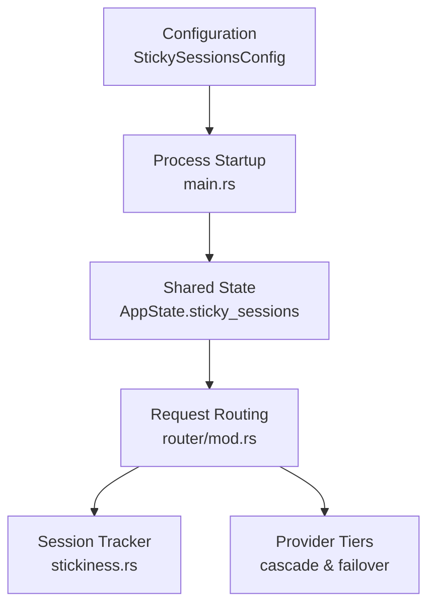
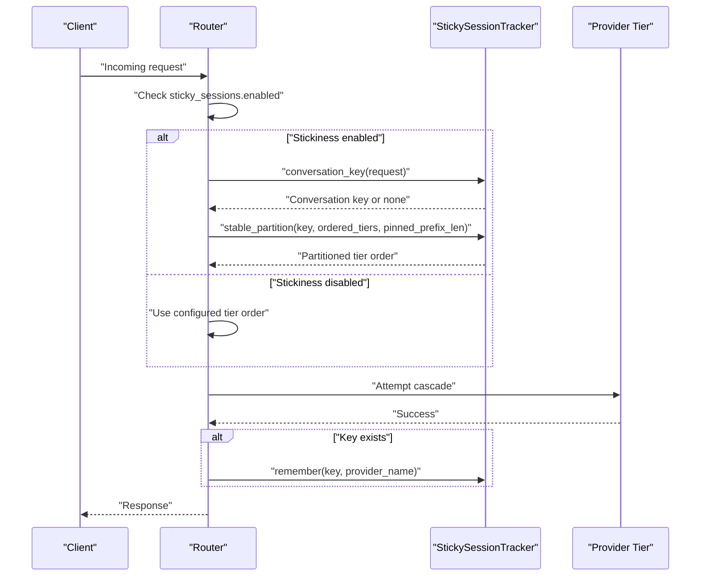
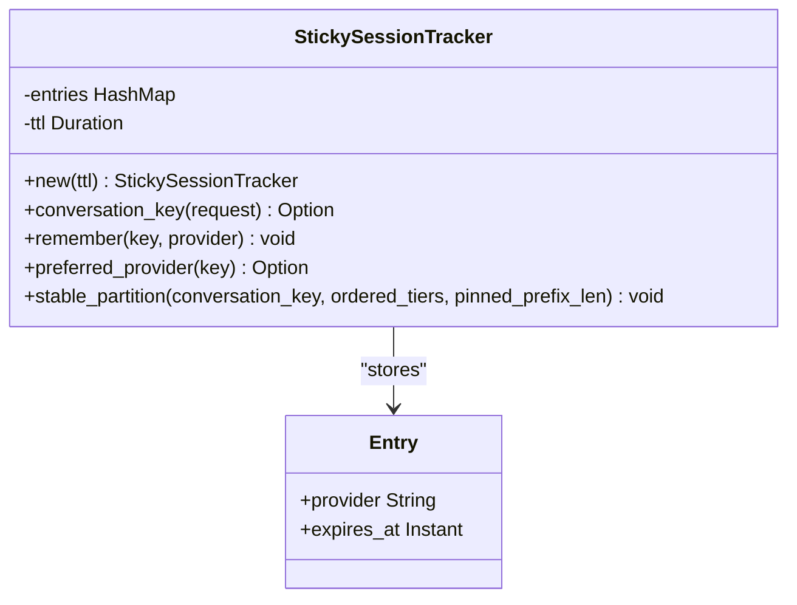
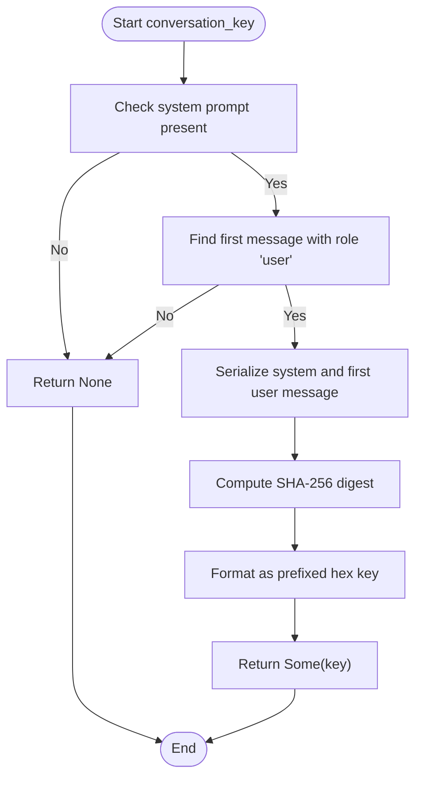
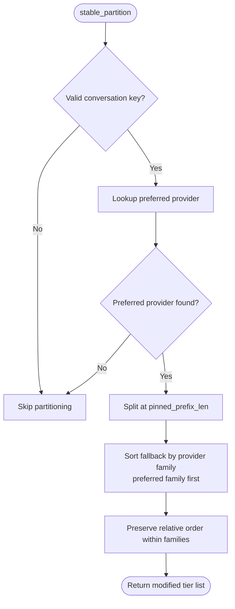
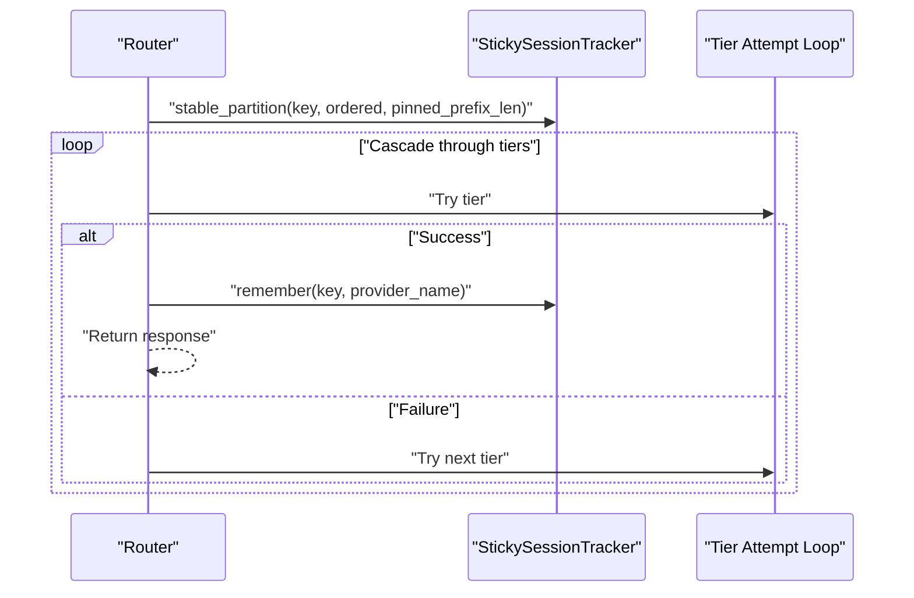
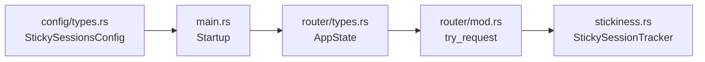

# Stickiness and Session Management

<cite>
**Referenced Files in This Document**
- [src/stickiness.rs](file://src/stickiness.rs)
- [src/router/mod.rs](file://src/router/mod.rs)
- [src/router/types.rs](file://src/router/types.rs)
- [src/config/types.rs](file://src/config/types.rs)
- [src/main.rs](file://src/main.rs)
- [docs/configuration.md](file://docs/configuration.md)
- [docs/failover_architecture.md](file://docs/failover_architecture.md)
</cite>

## Table of Contents
1. [Introduction](#introduction)
2. [Project Structure](#project-structure)
3. [Core Components](#core-components)
4. [Architecture Overview](#architecture-overview)
5. [Detailed Component Analysis](#detailed-component-analysis)
6. [Dependency Analysis](#dependency-analysis)
7. [Performance Considerations](#performance-considerations)
8. [Troubleshooting Guide](#troubleshooting-guide)
9. [Conclusion](#conclusion)

## Introduction
Stickiness in CCR-Rust is a routing preference mechanism that tries to keep requests belonging to the same conversation on the same provider family for as long as that preference remains eligible. The primary goals are:

- Reduce mid-conversation protocol translation by avoiding unnecessary cross-family moves.
- Make fallback less visible when a preferred provider experiences transient issues.
- Preserve state consistency across conversation turns where provider or protocol behavior matters.

Stickiness does not make routing strictly immutable. It operates as a stable partition over the configured tier list, so direct-routing and web-search pinned tiers remain fixed while remembered-provider families are moved toward the front of the fallback portion. If the preferred family becomes exhausted or repeatedly fails, normal cross-family movement still occurs.

## Project Structure
The stickiness feature spans configuration, shared application state, request routing, and the session tracker itself:

**Diagram sources**
- [src/config/types.rs:799-830](file://src/config/types.rs#L799-L830)
- [src/main.rs:482-494](file://src/main.rs#L482-L494)
- [src/router/types.rs:60-82](file://src/router/types.rs#L60-L82)
- [src/router/mod.rs:572-580](file://src/router/mod.rs#L572-L580)
- [src/stickiness.rs:38-48](file://src/stickiness.rs#L38-L48)

**Section sources**
- [src/stickiness.rs:1-48](file://src/stickiness.rs#L1-L48)
- [src/config/types.rs:799-830](file://src/config/types.rs#L799-L830)
- [src/router/types.rs:60-82](file://src/router/types.rs#L60-L82)
- [src/router/mod.rs:572-580](file://src/router/mod.rs#L572-L580)
- [src/main.rs:482-494](file://src/main.rs#L482-L494)

## Core Components
The core components are:

| Component | Responsibility | Key Behavior |
|---|---|---|
| `StickySessionsConfig` | Declares whether stickiness is enabled and how long preferences last | Defaults disabled; default TTL is 3,600,000 milliseconds (one hour) |
| `StickySessionTracker` | Stores and queries conversation-to-provider preferences | Uses an in-memory map with TTL expiry and a hard entry cap |
| Conversation key extraction | Identifies related requests without leaking prompt content | Combines system prompt and first user message, then hashes the payload |
| Stable partitioning | Reorders the fallback tier list while preserving pinned prefixes | Moves remembered-family tiers first, keeping relative order within each group |
| Router integration | Applies stickiness only when enabled and records successful providers | Computes the key before routing and stores it after success |

**Section sources**
- [src/config/types.rs:799-830](file://src/config/types.rs#L799-L830)
- [src/stickiness.rs:38-164](file://src/stickiness.rs#L38-L164)
- [src/router/mod.rs:572-580](file://src/router/mod.rs#L572-L580)

## Architecture Overview
The end-to-end flow for a routed request with stickiness enabled is:

**Diagram sources**
- [src/router/mod.rs:572-580](file://src/router/mod.rs#L572-L580)
- [src/router/mod.rs:887-905](file://src/router/mod.rs#L887-L905)
- [src/stickiness.rs:57-164](file://src/stickiness.rs#L57-L164)

## Detailed Component Analysis

### Sticky Session Tracker
`StickySessionTracker` is the central state object for conversation stickiness. It holds a hash map from conversation keys to provider entries, each containing the remembered provider name and its expiration time.

Key behaviors:

- **Default TTL:** One hour.
- **Hard capacity limit:** 10,000 entries. When this limit is reached, expired entries are removed first, then the oldest non-expired entry is evicted until the map fits.
- **TTL-based expiry:** Preferences are checked against wall-clock time at read time. Expired entries are removed and treated as absent.
- **Safe hashing:** Conversation keys are derived from serialized request data but hashed before being stored or used, so private prompt content does not appear in logs or cache keys.

**Diagram sources**
- [src/stickiness.rs:38-164](file://src/stickiness.rs#L38-L164)

**Section sources**
- [src/stickiness.rs:1-164](file://src/stickiness.rs#L1-L164)

### Conversation Key Generation
A conversation key identifies requests that belong to the same logical conversation. The current implementation uses:

1. The normalized Anthropic request's system prompt.
2. The first message whose role is `"user"`.
3. Serialization of both fields into a structured input.
4. SHA-256 hashing of that serialization.
5. A prefixed string representation of the digest.

If either the system prompt or the first user message is missing, no key is produced, and stickiness falls back to standard per-request routing.

Important design points:

- Different conversations sharing a common system prompt do not collide because the first user message is also part of the key.
- Prompts are never exposed through the key format.
- Missing conversation signals preserve existing routing behavior rather than forcing stickiness.

**Diagram sources**
- [src/stickiness.rs:57-92](file://src/stickiness.rs#L57-L92)

**Section sources**
- [src/stickiness.rs:57-92](file://src/stickiness.rs#L57-L92)

### Stable Partitioning
When a valid conversation key exists, the router asks the tracker to partition the ordered tier list. The algorithm:

1. Looks up the remembered provider for the conversation key.
2. Splits the tier list at the pinned prefix length.
3. Sorts the fallback portion so that tiers belonging to the remembered provider family come before other families.
4. Preserves relative order within each family.
5. Leaves the pinned prefix untouched.

This ensures direct-routing and web-search invariants remain intact while giving the remembered family priority among eligible fallback tiers.

**Diagram sources**
- [src/stickiness.rs:131-164](file://src/stickiness.rs#L131-L164)

**Section sources**
- [src/stickiness.rs:131-164](file://src/stickiness.rs#L131-L164)

### Router Integration
The router integrates stickiness around the normal cascade:

- Before attempting tiers, it computes a sticky key when `sticky_sessions.enabled` is true.
- It applies `stable_partition` to the ordered tier list.
- After a successful response, if a sticky key exists, it resolves the provider name and records it under that key.
- Failure paths do not record a preference, allowing later attempts or subsequent conversations to choose differently.

**Diagram sources**
- [src/router/mod.rs:572-580](file://src/router/mod.rs#L572-L580)
- [src/router/mod.rs:887-905](file://src/router/mod.rs#L887-L905)

**Section sources**
- [src/router/mod.rs:572-580](file://src/router/mod.rs#L572-L580)
- [src/router/mod.rs:887-905](file://src/router/mod.rs#L887-L905)

### Configuration Options
Stickiness is controlled through `Router.stickySessions`:

| Field | Type | Default | Description |
|---|---|---:|---|
| `enabled` | boolean | `false` | Enables conversation-provider stickiness. Disabled by default pending live verification. |
| `ttlMs` | number | `3600000` | Time-to-live for a remembered provider family, in milliseconds. |

At startup, the process reads `ttl_ms` from the router configuration and constructs a `StickySessionTracker` with that duration.

**Section sources**
- [src/config/types.rs:799-830](file://src/config/types.rs#L799-L830)
- [src/main.rs:482-494](file://src/main.rs#L482-L494)
- [docs/configuration.md:470-505](file://docs/configuration.md#L470-L505)

## Dependency Analysis
The following diagram shows how stickiness depends on configuration, shared state, and routing:

**Diagram sources**
- [src/config/types.rs:799-830](file://src/config/types.rs#L799-L830)
- [src/main.rs:482-494](file://src/main.rs#L482-L494)
- [src/router/types.rs:60-82](file://src/router/types.rs#L60-L82)
- [src/router/mod.rs:572-580](file://src/router/mod.rs#L572-L580)
- [src/stickiness.rs:38-164](file://src/stickiness.rs#L38-L164)

Coupling observations:

- The tracker is lightweight and isolated: it owns its own mutex-protected map and exposes simple methods.
- The router is the main integration point; it decides when to compute keys, apply partitioning, and persist preferences.
- Configuration is decoupled from runtime behavior through `StickySessionsConfig`, allowing stickiness to be toggled without changing routing logic.
- There is no circular dependency between the tracker and the router.

**Section sources**
- [src/router/types.rs:60-82](file://src/router/types.rs#L60-L82)
- [src/router/mod.rs:572-580](file://src/router/mod.rs#L572-L580)
- [src/stickiness.rs:38-164](file://src/stickiness.rs#L38-L164)

## Performance Considerations

### Memory Usage
- Each conversation preference occupies one map entry containing a string key, provider name, and expiration timestamp.
- The map has a hard ceiling of 10,000 entries.
- When the ceiling is reached, expired entries are pruned first. If the map is still full, the oldest entry by expiration time is removed iteratively until the limit is satisfied.
- This makes stale entries harmless to evict and prevents unbounded growth.

### CPU and Locking
- Every request that enables stickiness performs:
  - Optional conversation key computation involving JSON serialization and hashing.
  - Optional lookup and sorting of the fallback tier list.
  - Optional write of a successful provider preference.
- All map access is protected by a single mutex. For high-throughput deployments, monitor contention if many concurrent requests exercise stickiness.

### Key Computation Cost
- Conversation key generation serializes the system prompt and first user message. Long prompts increase memory allocation and hashing cost.
- The hash output is short and reused, so repeated requests for the same conversation reuse the same key without re-hashing.

### Load Distribution Trade-offs
- Stickiness improves conversation continuity but can bias traffic toward a specific provider family.
- It should be balanced against load distribution requirements, especially when one family becomes hot due to historical preference retention.
- Use shorter TTLs when conversations are short or when rapid rebalancing is more important than strict stickiness.
- Keep TTLs longer when conversation state or provider-specific behavior requires stability across many turns.

[No sources needed since this section provides general guidance]

## Troubleshooting Guide

### Stickiness Is Not Applied
Check the following:

1. Confirm `Router.stickySessions.enabled` is set to `true`.
2. Verify the request contains both a system prompt and a first user message; otherwise, no conversation key is produced.
3. Confirm the provider family is eligible in the configured tier list.
4. Inspect whether the TTL has expired; expired preferences are treated as absent.

**Section sources**
- [src/stickiness.rs:57-92](file://src/stickiness.rs#L57-L92)
- [src/config/types.rs:799-830](file://src/config/types.rs#L799-L830)

### Conversations Keep Switching Families
Possible causes:

- TTL is too short for the expected conversation lifetime.
- The preferred family is failing repeatedly, causing normal cross-family movement.
- Direct-routing or web-search pinned tiers may dominate the prefix and prevent the remembered family from appearing near the top.
- Different conversations share the same system prompt but have different first user messages; these should remain separate keys, but verify the prompt shape matches expectations.

**Section sources**
- [src/stickiness.rs:131-164](file://src/stickiness.rs#L131-L164)
- [docs/configuration.md:470-505](file://docs/configuration.md#L470-L505)

### High Memory Usage with Stickiness Enabled
Likely explanations:

- Very large numbers of active conversations exceed practical memory expectations.
- TTL is very large or effectively infinite, retaining preferences longer than necessary.
- Short-lived conversations generate many unique keys without expiring quickly enough.

Recommended actions:

- Reduce `ttlMs` to match typical conversation lifetimes.
- Monitor the number of active sessions if metrics expose tracker size.
- Review workload patterns to determine whether stickiness is appropriate for all conversation types.

**Section sources**
- [src/stickiness.rs:15-16](file://src/stickiness.rs#L15-L16)
- [src/stickiness.rs:93-130](file://src/stickiness.rs#L93-L130)

### Monitoring Stickiness Effectiveness
Useful indicators include:

- Whether responses are consistently served by the remembered provider family during a conversation.
- Frequency of family switches compared to configurations with stickiness disabled.
- Rate-limit or failure behavior: stickiness should make failures less visible when the preferred family recovers.
- Interaction with retry sweeps: stickiness prefers a family, but sweep-driven cascading still handles rate limits and transient failures.

Operational checks:

- Compare routing logs with and without stickiness enabled.
- Validate that pinned prefixes are preserved while fallback ordering changes.
- Confirm that TTL expiry allows rebalancing after a period of inactivity.

**Section sources**
- [docs/failover_architecture.md:300-360](file://docs/failover_architecture.md#L300-L360)
- [docs/configuration.md:470-505](file://docs/configuration.md#L470-L505)

## Conclusion
CCR-Rust’s stickiness feature adds a lightweight, TTL-bounded preference layer over the existing provider cascade. It is designed to improve conversation continuity and reduce mid-conversation protocol transitions without making routing rigid. By combining stable partitioning, TTL expiry, and a bounded in-memory map, it balances consistency against operational safety.

For production use:

- Enable stickiness only when conversation continuity or provider-state preservation is valuable.
- Choose a TTL aligned with typical conversation lifetimes.
- Combine stickiness with retry sweeps, admission control, and rate limiting to handle failover gracefully.
- Monitor traffic distribution, memory usage, and conversation stability to validate that stickiness delivers benefits without degrading load balance.

[No sources needed since this section summarizes without analyzing specific files]