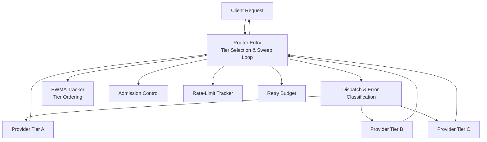
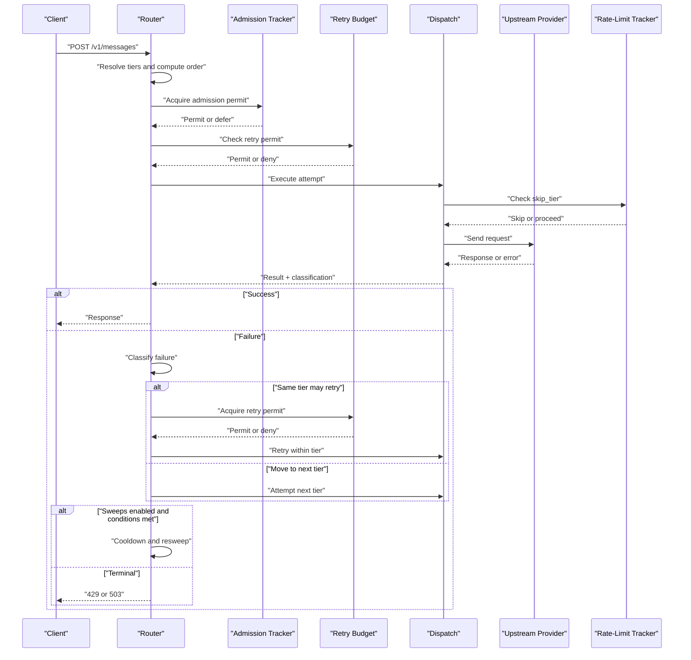
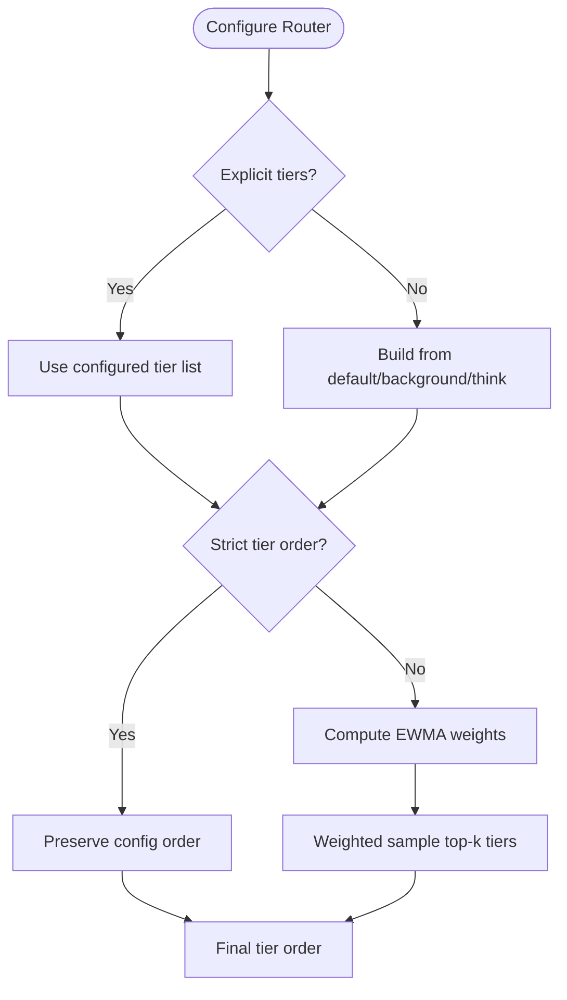
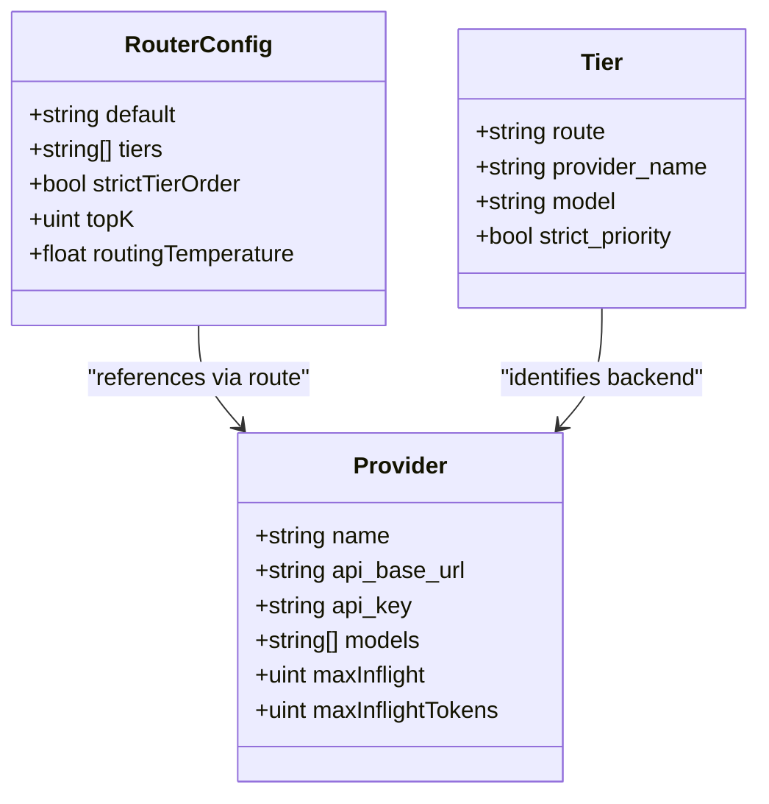
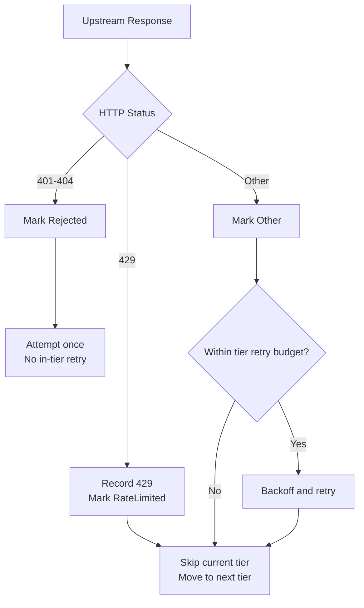
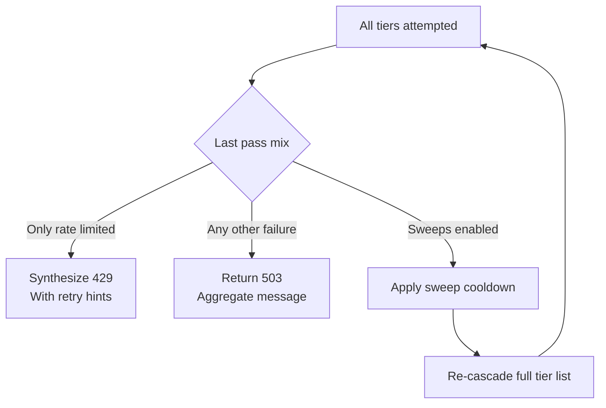
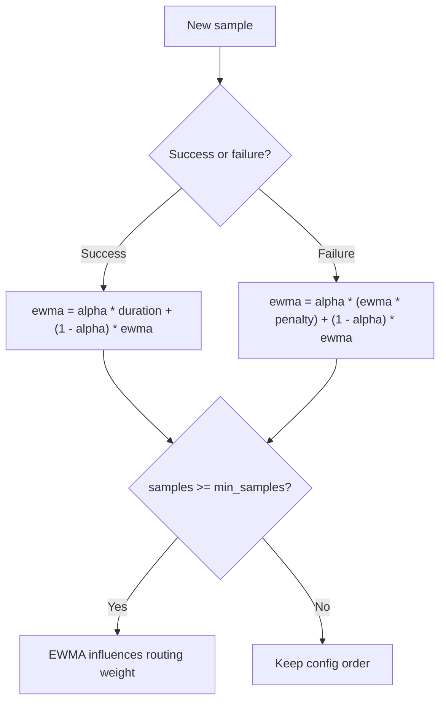
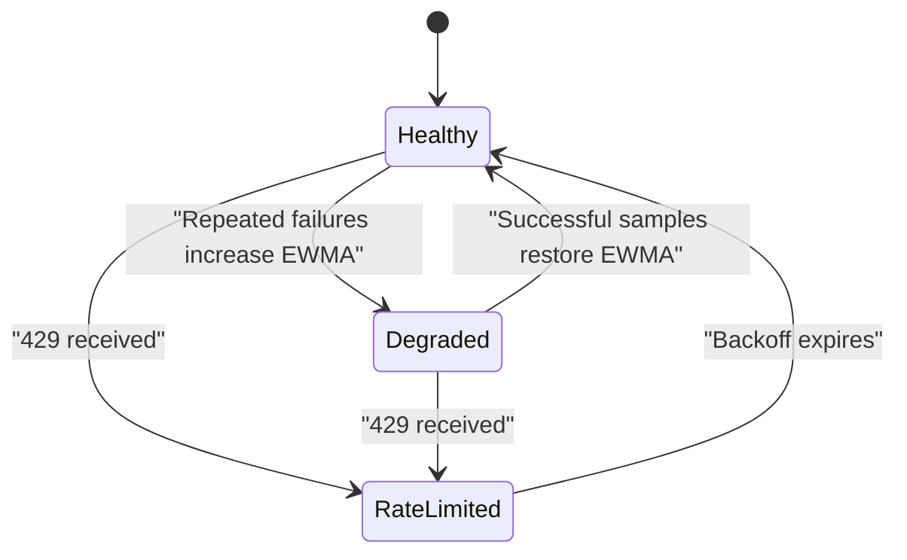
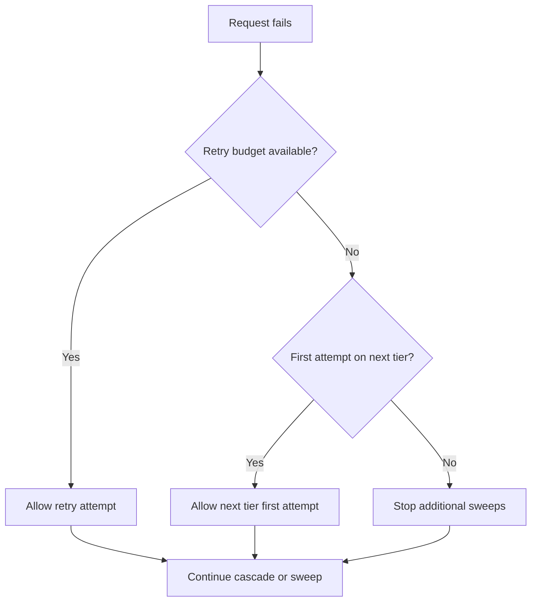
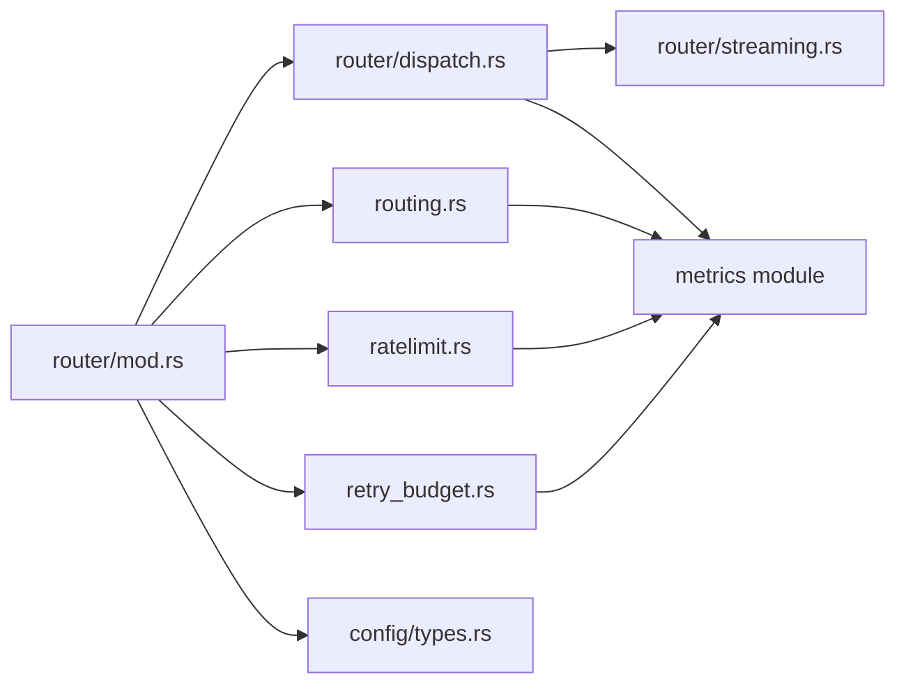

# Tier-Based Failover Configuration

<cite>
**Referenced Files in This Document**   
- [failover_architecture.md](file://docs/failover_architecture.md)
- [configuration.md](file://docs/configuration.md)
- [retry_budget_and_429_provenance_20261019.md](file://evidence/retry-budget-and-429-provenance-20261019.md)
- [dispatch.rs](file://src/router/dispatch.rs)
- [mod.rs](file://src/router/mod.rs)
- [types.rs](file://src/config/types.rs)
- [routing.rs](file://src/routing.rs)
- [ratelimit.rs](file://src/ratelimit.rs)
- [test_failover_controls.rs](file://tests/test_failover_controls.rs)
</cite>

## Table of Contents
1. [Introduction](#introduction)
2. [Project Structure](#project-structure)
3. [Core Components](#core-components)
4. [Architecture Overview](#architecture-overview)
5. [Detailed Component Analysis](#detailed-component-analysis)
6. [Dependency Analysis](#dependency-analysis)
7. [Performance Considerations](#performance-considerations)
8. [Troubleshooting Guide](#troubleshooting-guide)
9. [Conclusion](#conclusion)
10. [Appendices](#appendices)

## Introduction
This document explains how CCR-Rust implements tier-based failover for routing model requests across multiple provider backends. It focuses on:

- Defining tiers with explicit priority ordering or EWMA-driven weighted sampling.
- Assigning providers and models to each tier.
- Cascading failures when a provider becomes unavailable, rate-limited, or rejects a request deterministically.
- EWMA latency tracking parameters: smoothing factor, minimum samples, failure penalty, and temperature.
- Circuit-breaker-like behavior through per-tier retry limits, sweep cooldowns, and rate-limit backoff skipping.
- Failback behavior when previously failed or rate-limited providers recover.
- Retry budget management that bounds aggregate retry amplification across concurrent requests.
- Practical multi-tier configuration patterns ranging from simple two-tier fallbacks to complex provider hierarchies.

The goal is to make these mechanisms understandable for operators tuning reliability without requiring deep knowledge of the Rust implementation.

## Project Structure
The relevant code for tier-based failover spans several modules:

| Area | Responsibility |
|---|---|
| `src/config/types.rs` | Declares router configuration fields such as tier lists, strict ordering, per-tier retries, retry sweeps, retry budget percentage, hedging, top-K, and routing temperature. |
| `src/router/mod.rs` | Implements the main request handling loop, tier selection, per-attempt execution, sweep loop, terminal response synthesis, and interaction with admission control, retry budget, and rate-limit state. |
| `src/router/dispatch.rs` | Classifies upstream errors into deterministic rejections, rate limits, or other failures; handles streaming error detection; constructs provider requests and responses. |
| `src/routing.rs` | Tracks per-tier EWMA latency, computes ordered tier candidates, and exposes both strict sorting and softmax-weighted sampling. |
| `src/ratelimit.rs` | Maintains per-route 429 backoff state, honors server-supplied retry hints, and decides whether a tier should be skipped before an attempt. |
| `src/retry_budget.rs` | Provides a process-wide atomic budget limiting aggregate retry attempts based on active client requests. |
| `tests/test_failover_controls.rs` | Integration tests validating deterministic rejection behavior, cascade semantics, admission deferral, retry budget exhaustion, terminal 429 provenance, and sweep hold behavior. |
| `docs/failover_architecture.md` | Authoritative design summary covering phases, invariants, sweep behavior, failure classification, streaming rules, EWMA behavior, and concurrency/identity properties. |
| `docs/configuration.md` | User-facing schema and provider/router configuration documentation. |
| `evidence/retry-budget-and-429-provenance-20261019.md` | Incident and repair record explaining why retry budgets must not suppress first attempts on later fallback tiers and why terminal 429 responses need full route provenance. |

**Diagram sources**
- [mod.rs:1-200](file://src/router/mod.rs#L1-L200)
- [dispatch.rs:1-200](file://src/router/dispatch.rs#L1-L200)
- [routing.rs:1-200](file://src/routing.rs#L1-L200)
- [ratelimit.rs:45-141](file://src/ratelimit.rs#L45-L141)
- [retry_budget.rs:1-181](file://src/retry_budget.rs#L1-L181)

**Section sources**
- [failover_architecture.md:1-120](file://docs/failover_architecture.md#L1-L120)
- [configuration.md:1-120](file://docs/configuration.md#L1-L120)
- [mod.rs:1-200](file://src/router/mod.rs#L1-L200)
- [types.rs:550-750](file://src/config/types.rs#L550-L750)

## Core Components
CCR-Rust’s tier-based failover is built around five cooperating components:

1. **Tier definition and ordering**
   - Tiers can be explicitly declared or constructed from default/background/think routes.
   - Order can be strict (config order) or EWMA-weighted.
   - Direct routing and web-search prefixes can pin tiers at the front.

2. **Per-tier retry and backoff**
   - Each tier has configurable maximum retries and exponential backoff parameters.
   - Backoff is scaled by EWMA for non-rate-limited failures.
   - Rate-limited and rejected failures move immediately to the next tier.

3. **Failure classification**
   - Deterministic provider errors are classified separately from transient failures.
   - 429 responses are captured before classification and tracked for backoff.
   - Streaming pre-first-token failures cascade; post-first-token failures do not.

4. **EWMA latency tracking**
   - Tracks smoothed latency per tier using alpha, minimum samples, and failure penalties.
   - Influences routing weight and per-attempt backoff scaling when not in strict mode.

5. **Retry budget and sweep controls**
   - Process-wide retry budget prevents aggregate retry amplification.
   - Retry sweeps keep requests open and re-cascade after cooldowns.
   - Hold time is bounded by configuration.

**Section sources**
- [failover_architecture.md:60-180](file://docs/failover_architecture.md#L60-L180)
- [types.rs:600-750](file://src/config/types.rs#L600-L750)
- [routing.rs:1-120](file://src/routing.rs#L1-L120)
- [dispatch.rs:657-681](file://src/router/dispatch.rs#L657-L681)
- [test_failover_controls.rs:1-120](file://tests/test_failover_controls.rs#L1-L120)

## Architecture Overview
The failover flow begins when a request arrives at the router. The router resolves the configured tier list, applies direct-routing pins, computes or preserves tier order, and then executes attempts with admission control, retry permits, and rate-limit checks. On failure, it classifies the error and either retries within the same tier, moves to the next tier, or enters a sweep loop if sweeps are enabled.

**Diagram sources**
- [mod.rs:150-220](file://src/router/mod.rs#L150-L220)
- [dispatch.rs:657-681](file://src/router/dispatch.rs#L657-L681)
- [ratelimit.rs:45-141](file://src/ratelimit.rs#L45-L141)
- [retry_budget.rs:60-140](file://src/retry_budget.rs#L60-L140)

**Section sources**
- [failover_architecture.md:80-160](file://docs/failover_architecture.md#L80-L160)
- [mod.rs:150-220](file://src/router/mod.rs#L150-L220)

## Detailed Component Analysis

### Tier Definition and Priority Ordering
Tiers are expressed as provider-model combinations and form the backbone of failover. The router supports two ordering modes:

| Mode | Behavior |
|---|---|
| Strict tier order | Tries tiers exactly in configured order. Best for predictable cascades where higher-priority tiers must always run first. |
| EWMA-weighted ordering | Computes a probability distribution from EWMA latencies and samples tiers proportionally. Useful for load balancing across healthy providers while preferring faster ones. |

Key configuration fields include:

| Field | Purpose |
|---|---|
| `tiers` | Explicit tier chain overriding automatic construction from default/background/think. |
| `strictTierOrder` | Forces strict preference chaining instead of EWMA reordering. |
| `topK` | Limits the number of top-performing providers considered for routing. |
| `routingTemperature` | Controls softmax sharpness; lower values favor the fastest measured tier more aggressively. |
| `ignoreDirect` | Ignores client-direct routing and forces tier order. |
| `webSearch` | Prepends a web-search tier prefix when present. |

**Diagram sources**
- [types.rs:600-750](file://src/config/types.rs#L600-L750)
- [routing.rs:200-339](file://src/routing.rs#L200-L339)

Practical examples:

- **Simple two-tier setup:** Primary provider for normal traffic, backup provider for fallback. Use `strictTierOrder: true` so the primary always runs first.
- **Multi-provider hierarchy:** Multiple providers with different capabilities or cost levels, ordered by business priority.
- **Latency-aware routing:** Disable strict ordering and tune `routingTemperature` and `topK` to distribute load across healthy providers while preferring lower-latency ones.
- **Web-search prefix:** Add a web-search provider tier before the normal tier chain so search-capable endpoints are tried first when applicable.

**Section sources**
- [types.rs:600-750](file://src/config/types.rs#L600-L750)
- [routing.rs:200-339](file://src/routing.rs#L200-L339)
- [configuration.md:100-180](file://docs/configuration.md#L100-L180)

### Provider Assignments Within Each Tier
Each tier identifies a specific provider and model combination. Providers are defined under `Providers`, and each entry includes:

| Field | Description |
|---|---|
| `name` | Unique provider identifier used in routes. |
| `api_base_url` | Full upstream endpoint URL. |
| `api_key` | Authentication credential. |
| `models` | Models exposed by this provider. |
| `maxInflight` | Per-route admission limit for AIMD-style concurrency control. |
| `maxInflightTokens` | Optional token-volume admission budget for providers whose rate limits are driven by token volume rather than request count. |

A tier string typically combines provider and model, such as `provider,model`. Direct routing allows clients to target a specific provider-model pair unless `ignoreDirect` is set.

**Diagram sources**
- [configuration.md:120-200](file://docs/configuration.md#L120-L200)
- [types.rs:600-750](file://src/config/types.rs#L600-L750)

**Section sources**
- [configuration.md:120-200](file://docs/configuration.md#L120-L200)
- [types.rs:600-750](file://src/config/types.rs#L600-L750)

### Cascading Failure Logic
Failover is not a single retry mechanism; it combines per-tier retries, inter-tier cascading, sweep loops, and rate-limit skipping.

#### Failure Classification
Errors returned by upstream providers are classified as:

| Classification | Meaning | Behavior |
|---|---|---|
| `Rejected` | Deterministic provider error such as authentication or validation failures. | Attempted once per tier; never retried in-tier; never enters retry budget. |
| `RateLimited` | HTTP 429 intercepted before classification. | Moves to next tier immediately; tracks local backoff; may skip tier until cooldown expires. |
| `Other` | Transient or unknown failures including timeouts and connection errors. | May retry within tier; may cascade to next tier; may enter sweep loop. |

**Diagram sources**
- [dispatch.rs:657-681](file://src/router/dispatch.rs#L657-L681)
- [failover_architecture.md:120-180](file://docs/failover_architecture.md#L120-L180)

#### Sweep Loop and Terminal Responses
When all tiers have been attempted, the router can synthesize a terminal response or enter a sweep loop:

- If every last pass saw only rate limiting, the router synthesizes a 429 with retry hints and provenance.
- Otherwise, it returns 503 with an aggregate message.
- When sweeps are enabled, the router holds the client request open, waits for a cooldown, and re-cascades the full tier list.
- Hold time is bounded by `maxHoldMs`; unlimited holds are possible only when explicitly configured.

**Diagram sources**
- [failover_architecture.md:90-150](file://docs/failover_architecture.md#L90-L150)
- [test_failover_controls.rs:300-470](file://tests/test_failover_controls.rs#L300-L470)

**Section sources**
- [dispatch.rs:657-681](file://src/router/dispatch.rs#L657-L681)
- [failover_architecture.md:90-180](file://docs/failover_architecture.md#L90-L180)
- [test_failover_controls.rs:1-120](file://tests/test_failover_controls.rs#L1-L120)

### EWMA Latency Tracking Configuration
EWMA tracking smooths observed latencies per tier so routing decisions can react to changing upstream performance.

| Parameter | Default | Meaning | Tuning Guidance |
|---|---:|---|---|
| `alpha` | `0.3` | Weight given to the newest sample; older history gets `1 - alpha`. | Higher values react faster but are noisier; lower values are smoother but slower to adapt. |
| `min_samples` | `3` | Minimum successful or failed samples before EWMA influences routing. | Increase to stabilize routing during cold start; decrease to react sooner. |
| `failure_penalty` | `2.0` | Multiplier applied to current EWMA when a failure occurs. | Larger penalties push unhealthy tiers down faster; smaller penalties allow recovery sooner. |
| `routing_temperature` | `1.0` | Softmax temperature for weighted sampling. | Lower temperatures favor the fastest tier more strongly; higher temperatures flatten the distribution. |
| `top_k` | All tiers | Number of top-ranked tiers sampled. | Reduce to limit fan-out across many providers. |

Important behavioral notes:

- Successes update EWMA with actual duration.
- Failures apply a penalty rather than recording wall-clock failure duration.
- EWMA values influence softmax weighting only when enough samples exist.
- Before enough samples are recorded, unmeasured tiers retain config-defined position or are shuffled for cold-start distribution.

**Diagram sources**
- [routing.rs:1-120](file://src/routing.rs#L1-L120)
- [routing.rs:200-339](file://src/routing.rs#L200-L339)

**Section sources**
- [routing.rs:1-120](file://src/routing.rs#L1-L120)
- [routing.rs:200-339](file://src/routing.rs#L200-L339)
- [failover_architecture.md:160-200](file://docs/failover_architecture.md#L160-L200)

### Circuit Breaker Patterns and Health Thresholds
CCR-Rust does not expose a traditional health-check circuit breaker with a fixed timeout threshold. Instead, health signaling emerges from three mechanisms:

1. **Rate-limit backoff**
   - Per-route keys track 429 backoff windows.
   - Tiers are skipped while backoff is active.
   - Server-supplied `Retry-After` is honored up to a cap.
   - Local generation guards ensure success clearing matches the most recent 429 context.

2. **Deterministic rejection memoization**
   - Deterministic rejections are recorded per tier and skipped for the remainder of the request.
   - This prevents repeated attempts against a provider that will reject the same request shape.

3. **EWMA-driven soft de-prioritization**
   - Repeated failures raise EWMA, lowering a tier’s routing weight in non-strict mode.
   - Recovery requires successful samples to pull EWMA back down.

There is no explicit numeric “unhealthy” threshold that ejects a tier permanently. Instead, unhealthy behavior is reflected in:

- Immediate tier skipping due to rate-limit backoff.
- One-attempt deterministic rejections.
- Reduced routing weight under EWMA sampling.
- Increased backoff scaling when EWMA is used to stretch delays.

**Diagram sources**
- [ratelimit.rs:45-141](file://src/ratelimit.rs#L45-L141)
- [routing.rs:1-120](file://src/routing.rs#L1-L120)
- [failover_architecture.md:120-200](file://docs/failover_architecture.md#L120-L200)

**Section sources**
- [ratelimit.rs:45-141](file://src/ratelimit.rs#L45-L141)
- [failover_architecture.md:120-200](file://docs/failover_architecture.md#L120-L200)

### Failback Behavior
Failback is implicit rather than hard-reset:

- **Rate-limit recovery:** Once the local backoff window expires, the tier becomes eligible again. Successful completions clear the backoff guard when the stream completes normally.
- **EWMA recovery:** After failures raise EWMA, successive successful measurements reduce it. With enough samples above `min_samples`, the tier regains routing weight.
- **Deterministic rejections:** These remain excluded for the lifetime of the request, not necessarily forever.
- **Sweeps:** When sweeps are enabled, a previously failed tier may succeed on a later sweep if the underlying condition improves.

Failback is therefore a gradual restoration of eligibility and routing weight, not an immediate return to the original position.

**Section sources**
- [ratelimit.rs:116-178](file://src/ratelimit.rs#L116-L178)
- [routing.rs:60-120](file://src/routing.rs#L60-L120)
- [failover_architecture.md:140-200](file://docs/failover_architecture.md#L140-L200)

### Retry Budget Management
The retry budget bounds aggregate retry amplification across the whole process. It is especially important because per-request retry limits cannot prevent many concurrent failing requests from multiplying load.

| Setting | Default | Meaning |
|---:|---:|---|
| `retryBudgetPercent` | `20` | Percentage of active client requests allowed as in-flight retries. |
| Floor | `3` | Even with low percentages, at least three retries are permitted when there is one active request. |
| Zero percent | `0` | Disables retry attempts entirely. |

Critical contracts:

- Budget exhaustion stops retries on a tier but does not block the first attempt on a later fallback tier.
- Sweeps are also bounded: when the budget is exhausted, the cascade completes once but does not start additional exempt sweeps indefinitely.
- Active requests and admitted retries are packed into a single atomic counter to minimize contention.

**Diagram sources**
- [retry_budget.rs:1-181](file://src/retry_budget.rs#L1-L181)
- [test_failover_controls.rs:250-470](file://tests/test_failover_controls.rs#L250-L470)
- [retry_budget_and_429_provenance_20261019.md:1-80](file://evidence/retry-budget-and-429-provenance-20261019.md#L1-L80)

**Section sources**
- [retry_budget.rs:1-181](file://src/retry_budget.rs#L1-L181)
- [test_failover_controls.rs:250-470](file://tests/test_failover_controls.rs#L250-L470)
- [retry_budget_and_429_provenance-20261019.md:1-80](file://evidence/retry-budget-and-429-provenance-20261019.md#L1-L80)

### Streaming Failover Semantics
Streaming changes failover boundaries:

- **Pre-first-token failures:** Embedded errors, transport errors, or peek timeouts are treated as failures and may cascade to the next tier.
- **Post-first-token failures:** Once any byte has streamed, failures surface as in-stream error events. There is no cascade after the first token.
- **Idle timeouts:** Emit in-stream error events rather than cascading.
- **Upstream chunk errors:** Forward as body errors.

This distinction is critical for long-running agent sessions: partial progress should not silently disappear by falling back mid-stream.

**Section sources**
- [failover_architecture.md:130-170](file://docs/failover_architecture.md#L130-L170)
- [dispatch.rs:147-238](file://src/router/dispatch.rs#L147-L238)

### Practical Multi-Tier Configuration Examples

#### Two-Tier Reliability Setup
Useful when you want a fast primary and a resilient backup.

- Primary provider: preferred for normal requests.
- Backup provider: used when the primary returns deterministic rejections, rate limits, or other failures.
- Enable `strictTierOrder: true`.
- Set modest per-tier retries so the cascade moves quickly.

#### Three-Tier Quality and Cost Hierarchy
Useful when providers differ in quality, cost, or capability.

- Tier 0: High-quality, possibly expensive provider.
- Tier 1: Mid-tier provider for degraded capacity.
- Tier 2: Low-cost or high-capacity fallback.
- Keep strict ordering if business policy requires quality-first routing.
- Use `tierRetries` to limit retries on expensive tiers and allow more on cheaper tiers.

#### Latency-Aware Multi-Provider Pool
Useful when multiple providers offer similar models and you want dynamic load distribution.

- Disable `strictTierOrder`.
- Tune `routingTemperature` to balance exploration and exploitation.
- Use `topK` to avoid sending too much traffic to rarely measured providers.
- Monitor EWMA gauges to detect slow providers before they become fully rate-limited.

#### Web-Search Prefixed Chain
Useful when some providers support web search and others do not.

- Configure a web-search provider as a prefixed tier.
- Normal model providers follow in the main tier chain.
- Direct routing still respects pinned prefixes.

[No sources needed since this section provides practical configuration patterns derived from earlier analyzed files]

## Dependency Analysis
The failover system has layered dependencies:

**Diagram sources**
- [mod.rs:1-200](file://src/router/mod.rs#L1-L200)
- [dispatch.rs:1-200](file://src/router/dispatch.rs#L1-L200)
- [routing.rs:1-200](file://src/routing.rs#L1-L200)
- [ratelimit.rs:1-181](file://src/ratelimit.rs#L1-L181)
- [retry_budget.rs:1-181](file://src/retry_budget.rs#L1-L181)
- [types.rs:550-750](file://src/config/types.rs#L550-L750)

Coupling observations:

- `router/mod.rs` is the central orchestrator and depends on almost every subsystem.
- `dispatch.rs` encapsulates protocol translation, header building, and error classification.
- `routing.rs` is mostly self-contained except for integration with metrics and config abbreviations.
- `ratelimit.rs` maintains per-route backoff state independent of tier ordering.
- `retry_budget.rs` is a lightweight atomic process-wide controller.

Potential circular dependencies are avoided by keeping retry budget, rate-limit tracking, and EWMA tracking as separate services referenced by the router.

**Section sources**
- [mod.rs:1-200](file://src/router/mod.rs#L1-L200)
- [dispatch.rs:1-200](file://src/router/dispatch.rs#L1-L200)
- [routing.rs:1-200](file://src/routing.rs#L1-L200)
- [ratelimit.rs:1-181](file://src/ratelimit.rs#L1-L181)
- [retry_budget.rs:1-181](file://src/retry_budget.rs#L1-L181)

## Performance Considerations
Different EWMA and routing parameters have distinct performance implications:

| Configuration | Impact | Recommendation |
|---|---|---|
| High `alpha` | Faster reaction to latency spikes; more sensitivity to noise. | Use when upstreams change rapidly and you want quick de-prioritization. |
| Low `alpha` | Smoother estimates; slower adaptation. | Use for stable upstreams where noisy spikes should not dominate routing. |
| High `min_samples` | More stable early routing; longer cold-start phase. | Use when you have enough historical data and want reliable ordering. |
| Low `min_samples` | Earlier EWMA influence; risk of premature routing decisions. | Use when you need to exit cold start quickly. |
| High `failure_penalty` | Stronger punishment for failures; slower recovery. | Use when transient failures should strongly discourage a tier. |
| Low `failure_penalty` | Softer failure signal; quicker return to previous weight. | Use when occasional failures should not permanently degrade a tier. |
| Low `routing_temperature` | Near-deterministic selection of fastest tier. | Use when consistent lowest-latency routing is preferred. |
| High `routing_temperature` | Flatter distribution; more exploration. | Use when load spreading matters more than strict latency optimization. |
| Small `top_k` | Less fan-out; faster decision-making. | Use when many providers would otherwise cause excessive sampling overhead. |
| Large `top_k` | More candidate tiers; potentially more work per request. | Use when diversity and redundancy matter. |

Additional performance considerations:

- EWMA updates occur per attempt, not per entire request, so retries do not unfairly inflate latency estimates.
- Unmeasured tiers are shuffled at cold start to avoid hammering the first provider.
- Retry sweeps trade client-visible latency for message survival; enable them only for long-lived agent workflows.
- Rate-limit backoff caps server retry hints to prevent excessive hold times.
- Concurrency limits (`maxInflight`) defer excess requests to fallback tiers rather than queuing them behind a saturated upstream.

**Section sources**
- [routing.rs:1-120](file://src/routing.rs#L1-L120)
- [routing.rs:200-339](file://src/routing.rs#L200-L339)
- [failover_architecture.md:160-200](file://docs/failover_architecture.md#L160-L200)
- [test_failover_controls.rs:200-290](file://tests/test_failover_controls.rs#L200-L290)

## Troubleshooting Guide

### Symptoms and Likely Causes

| Symptom | Likely Cause | Investigation Steps |
|---|---|---|
| Requests always hit the same tier even when it is slow | Strict tier order or insufficient EWMA samples | Check `strictTierOrder`, `min_samples`, and EWMA gauges. |
| Tiers flip unpredictably | Too high `alpha` or too low `min_samples` | Increase `min_samples` or lower `alpha`. |
| Fallback tier is never reached | Retry budget exhausted or deterministic rejection path | Inspect retry budget settings and failure classification logs. |
| Terminal response says all tiers are rate limited but only one was tried | Terminal 429 provenance issue or admission-deferred tier not recorded | Review terminal 429 details and `x-ccr-rate-limited-tiers`. |
| Long-held requests without progress | Enabled sweeps with slow recovery | Check `retrySweeps.maxHoldMs` and upstream recovery time. |
| Partial streaming output followed by failure | Post-first-token failure rule | Accept that failover does not occur after the first token. |

### Diagnostic Checks

1. **Verify tier resolution**
   - Use `/health?details=1` to inspect configured tiers and default route.

2. **Inspect terminal 429 provenance**
   - Look at `x-ccr-tier` and `x-ccr-rate-limited-tiers`.
   - Examine the `error.details` array for per-route reasons and retry hints.

3. **Confirm retry budget behavior**
   - Set `retryBudgetPercent: 0` to disable retries temporarily.
   - Verify that first attempts on later fallback tiers still execute.

4. **Validate sweep hold bounds**
   - Ensure `retrySweeps.enabled` is intentional.
   - Confirm `maxHoldMs` prevents indefinite hold-open amplification.

5. **Check rate-limit backoff**
   - Confirm server `Retry-After` headers are being honored.
   - Verify that backoff keys use full provider-model routes.

**Section sources**
- [test_failover_controls.rs:470-751](file://tests/test_failover_controls.rs#L470-L751)
- [retry_budget_and_429_provenance-20261019.md:1-80](file://evidence/retry-budget-and-429-provenance-20261019.md#L1-L80)
- [failover_architecture.md:120-200](file://docs/failover_architecture.md#L120-L200)

## Conclusion
CCR-Rust’s tier-based failover combines explicit tier ordering, per-tier retry policies, sweep loops, rate-limit backoff, EWMA latency tracking, admission control, and a process-wide retry budget. Operators should choose between strict tier chains for predictable cascades and EWMA-weighted routing for adaptive load distribution. Important tuning dimensions are EWMA alpha, minimum samples, failure penalty, routing temperature, top-K, retry budget percentage, and sweep hold bounds.

For reliability, prefer:

- Explicit tier chains for mission-critical fallback paths.
- Conservative retry budgets to prevent amplification.
- Moderate EWMA parameters that balance responsiveness and stability.
- Enabled sweeps only for long-lived agent sessions where message survival outweighs latency.
- Careful monitoring of terminal 429 provenance and EWMA gauges.

[No sources needed since this section summarizes without analyzing specific files]

## Appendices

### Key Configuration Fields Reference

| Category | Field | Type | Default | Notes |
|---|---|---|---:|---|
| Router | `default` | String | Required | Default provider-model route. |
| Router | `tiers` | Array of strings | None | Explicit tier chain. |
| Router | `strictTierOrder` | Boolean | `false` | Enforce config order. |
| Router | `tierRetries` | Map | None | Per-tier retry and backoff configuration. |
| Router | `retrySweeps` | Object | Disabled | Hold-open re-cascade configuration. |
| Router | `retryBudgetPercent` | Unsigned integer | `20` | Aggregate retry budget percentage. |
| Router | `topK` | Integer | All tiers | Limit ranked candidates. |
| Router | `routingTemperature` | Float | `1.0` | Softmax routing sharpness. |
| Provider | `maxInflight` | Integer | Varies | Per-route admission limit. |
| Provider | `maxInflightTokens` | Integer | None | Token-volume admission budget. |

**Section sources**
- [types.rs:600-750](file://src/config/types.rs#L600-L750)
- [configuration.md:100-180](file://docs/configuration.md#L100-L180)