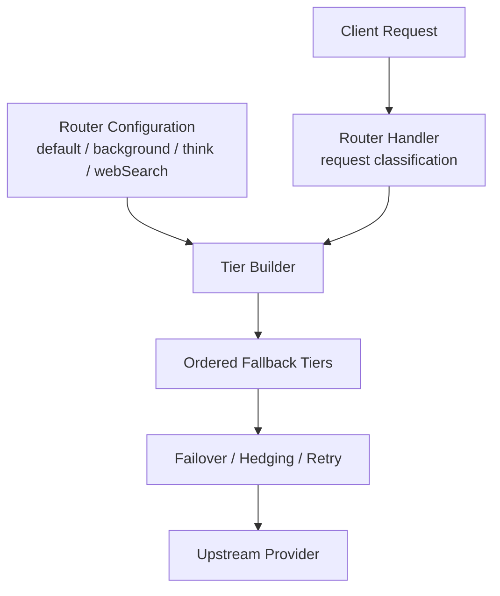
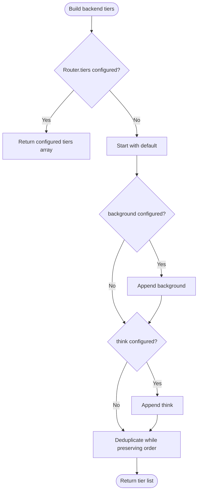
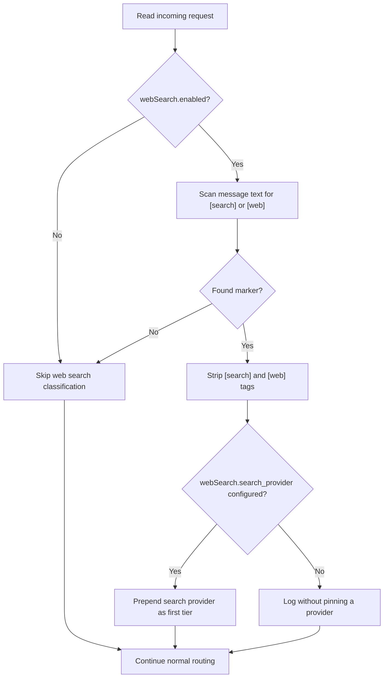
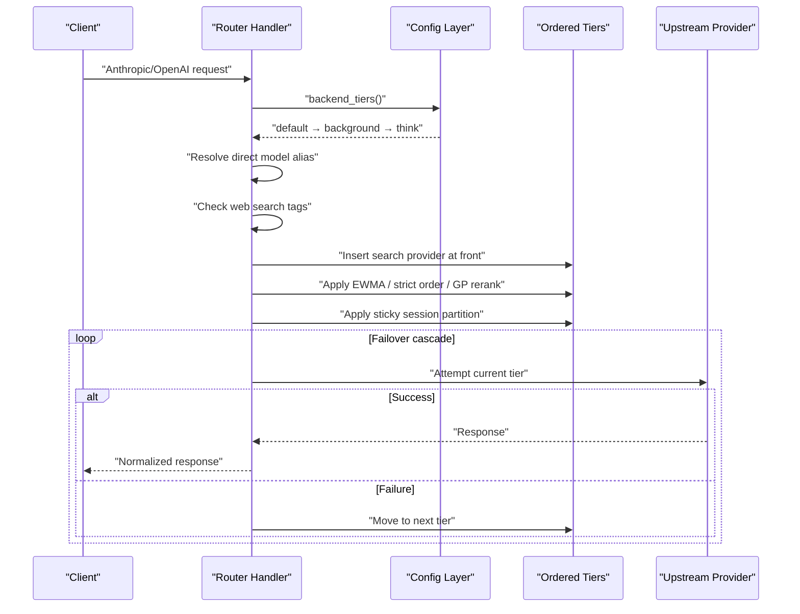
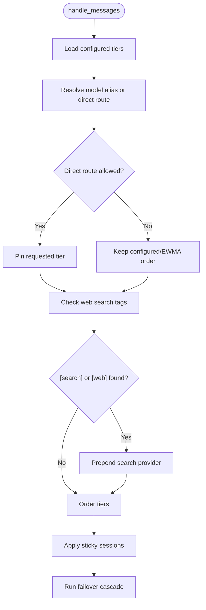
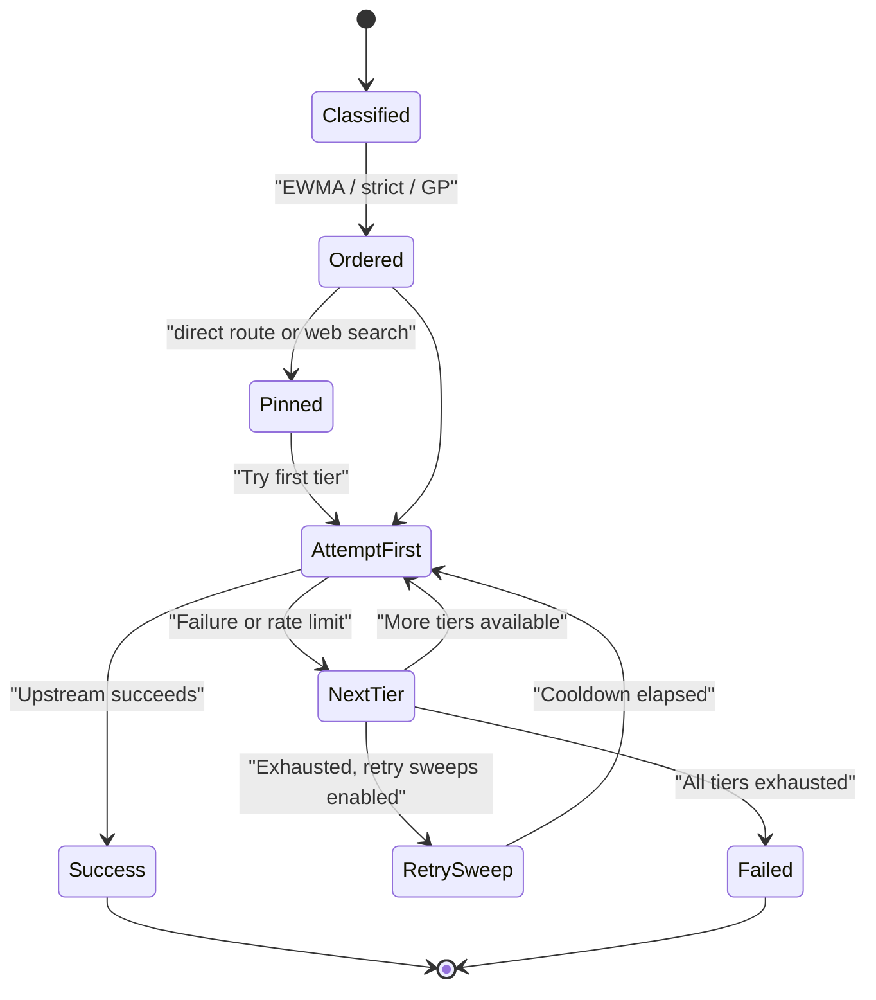
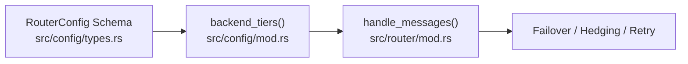

# Traffic Class Routing

<cite>
**Referenced Files in This Document**
- [README.md](file://README.md)
- [configuration.md](file://docs/configuration.md)
- [types.rs](file://src/config/types.rs)
- [mod.rs (config loader)](file://src/config/mod.rs)
- [mod.rs (router handler)](file://src/router/mod.rs)
</cite>

## Table of Contents
1. [Introduction](#introduction)
2. [Project Structure](#project-structure)
3. [Core Components](#core-components)
4. [Architecture Overview](#architecture-overview)
5. [Detailed Component Analysis](#detailed-component-analysis)
6. [Dependency Analysis](#dependency-analysis)
7. [Performance Considerations](#performance-considerations)
8. [Troubleshooting Guide](#troubleshooting-guide)
9. [Conclusion](#conclusion)

## Introduction
This document explains how CCR-Rust routes traffic by class and how that routing integrates with the broader tier-based failover system. In CCR-Rust, a “traffic class” is not an independent runtime subsystem; it is a configuration-driven classification applied early in request handling. The built-in classes are:

| Built-in traffic class | Configuration field | Intended use case |
|---|---|---|
| Default | `Router.default` | Interactive chat, coding agent requests, and any request that does not match another class. |
| Think | `Router.think` | Reasoning-heavy or “think” workloads when you want to isolate them from interactive chat. |
| Background | `Router.background` | Low-priority, non-interactive, batch, or deferred work. |
| Web search | `Router.webSearch` | Requests whose message content contains `[search]` or `[web]` markers when web search routing is enabled. |

The documentation objective also asks about custom traffic classification logic. At present, CCR-Rust exposes the four built-in classes through configuration. It does not expose a pluggable classifier API for arbitrary payload inspection beyond the web search tag detection described below. Customization therefore happens at the configuration layer (choosing different tiers per class) rather than through extensible classification code.

**Section sources**
- [README.md:24-30](file://README.md#L24-L30)
- [README.md:270-276](file://README.md#L270-L276)

## Project Structure
Traffic class routing touches three main areas:

1. **Configuration schema**: `Router.default`, `Router.background`, `Router.think`, and `Router.webSearch` live in the router configuration type.
2. **Tier construction**: The config loader builds the final ordered fallback chain from these fields unless an explicit `Router.tiers` array is provided.
3. **Request-time routing**: The router handler inspects the incoming Anthropic-style request, applies web search classification, resolves direct model aliases, orders tiers, and then runs the failover/hedging/retry pipeline.

**Diagram sources**
- [types.rs:580-680](file://src/config/types.rs#L580-L680)
- [mod.rs (config loader):695-730](file://src/config/mod.rs#L695-L730)
- [mod.rs (router handler):460-560](file://src/router/mod.rs#L460-L560)

**Section sources**
- [types.rs:580-680](file://src/config/types.rs#L580-L680)
- [mod.rs (config loader):695-730](file://src/config/mod.rs#L695-L730)
- [mod.rs (router handler):460-560](file://src/router/mod.rs#L460-L560)

## Core Components
### Built-in Traffic Classes
CCR-Rust defines four routing entry points under `Router`:

| Field | Type | Meaning |
|---|---|---|
| `default` | string | Required route used as the first tier when no other class applies. |
| `background` | optional string | Optional second-tier candidate added after default. |
| `think` | optional string | Optional third-tier candidate added after background. |
| `webSearch` | object | Enables web search detection and pins a dedicated provider for matching requests. |

The configuration documentation shows all four fields together in its example, and the schema declares each field explicitly.

**Section sources**
- [configuration.md:90-110](file://docs/configuration.md#L90-L110)
- [types.rs:580-680](file://src/config/types.rs#L580-L680)

### Tier Construction Rules
If `Router.tiers` is absent, CCR-Rust constructs the fallback chain automatically:

1. Start with `default`.
2. Append `background`, if configured.
3. Append `think`, if configured.
4. Remove duplicates while preserving order.

If `Router.tiers` is present, it completely overrides this automatic construction. That means operators can define a strict quality-ordered cascade, but they must include every intended tier themselves.

**Diagram sources**
- [mod.rs (config loader):695-730](file://src/config/mod.rs#L695-L730)

**Section sources**
- [mod.rs (config loader):695-730](file://src/config/mod.rs#L695-L730)

### Web Search Classification
Web search is the only active classification path implemented in request handling. When `Router.webSearch.enabled` is true, the router scans the messages in the incoming Anthropic-style request. If any text message contains `[search]` or `[web]`, the request is classified as a web search request.

When classified:

- The `[search]` and `[web]` tags are stripped from the request body before dispatch.
- If `Router.webSearch.search_provider` is configured, that provider is inserted at position zero in the ordered tier list.
- The pinned prefix length is increased so the web search tier remains at the front even if sticky sessions later partition the list.

This behavior is intentionally narrow: it looks for substring matches in message text content. It does not inspect headers, tool definitions, model names, or arbitrary structured payload fields.

**Diagram sources**
- [mod.rs (router handler):350-380](file://src/router/mod.rs#L350-L380)
- [mod.rs (router handler):530-560](file://src/router/mod.rs#L530-L560)

**Section sources**
- [mod.rs (router handler):350-380](file://src/router/mod.rs#L350-L380)
- [mod.rs (router handler):530-560](file://src/router/mod.rs#L530-L560)

### Direct Model Routing and Aliases
Before classifying web search, the router resolves the effective model name. A bare model name can be expanded through `Router.modelAliases`; a `provider,model` string is treated as an explicit target.

Important implications for traffic classes:

- Explicit `provider,model` requests move the matching tier to the front unless `ignoreDirect` is enabled.
- If the requested tier is not in the configured fallback chain, the router uses it as a single-tier direct route.
- Direct routes increase the pinned prefix length, protecting the chosen tier from EWMA reordering and sticky-session repartitioning.

This mechanism lets clients bypass class-based tier ordering when necessary, which is relevant when configuring separate interactive versus background providers.

**Section sources**
- [mod.rs (router handler):460-530](file://src/router/mod.rs#L460-L530)

## Architecture Overview
The traffic class routing layer sits between client request parsing and the unified failover pipeline. Its role is to produce an ordered list of candidate tiers, where earlier candidates have priority.

**Diagram sources**
- [mod.rs (router handler):460-620](file://src/router/mod.rs#L460-L620)
- [mod.rs (config loader):695-730](file://src/config/mod.rs#L695-L730)

## Detailed Component Analysis

### Built-in Traffic Class Definitions
The schema lives in the router configuration type:

- `default`: required route.
- `background`: optional route appended after default.
- `think`: optional route appended after background.
- `tiers`: optional explicit override of the auto-built chain.
- `strict_tier_order`: optional strict preference chain instead of EWMA latency-weighted ordering.
- `web_search`: enables web search detection and pins a search provider.

These fields collectively define the baseline workload separation. They do not enforce isolation by themselves; isolation comes from process boundaries, quota windows, or operator-chosen provider assignments.

**Section sources**
- [types.rs:580-680](file://src/config/types.rs#L580-L680)

### Web Search Configuration
The web search feature is modeled as a separate configuration object with two fields:

| Field | Purpose |
|---|---|
| `enabled` | Turns on detection of `[search]` and `[web]` markers in message text. |
| `search_provider` | Pins the first tier for matching requests. |

When disabled, web search classification has no effect. When enabled without `search_provider`, the router logs that web search was detected but does not change the tier order.

**Section sources**
- [types.rs:434-448](file://src/config/types.rs#L434-L448)
- [mod.rs (router handler):530-560](file://src/router/mod.rs#L530-L560)

### Request Classification Flow
Classification is sequential:

1. Load the configured fallback tiers.
2. Resolve the effective model name using direct routing or aliases.
3. Apply direct routing rules based on `ignoreDirect`.
4. Optionally detect web search and prepend the search provider.
5. Order tiers using EWMA latency measurements, strict tier order, or GP reranking.
6. Apply sticky sessions.
7. Run the failover pipeline.

**Diagram sources**
- [mod.rs (router handler):460-620](file://src/router/mod.rs#L460-L620)

**Section sources**
- [mod.rs (router handler):460-620](file://src/router/mod.rs#L460-L620)

### Integration with Failover and Retries
Traffic class routing produces the ordered candidate list; failover consumes it. The key integration points are:

- **EWMA ordering**: Without `strict_tier_order`, the router reorders tiers based on measured latency. This favors faster backends but can reorder intentional quality chains.
- **Strict tier order**: When enabled, the configured tier list becomes a strict preference chain. This is recommended when `default`, `background`, and `think` represent deliberate quality tiers.
- **GP reranking**: The optional Gaussian process reranker can reorder candidates, but it respects `strict_tier_order` and cannot break the pinned prefix established by direct routing or web search.
- **Sticky sessions**: Conversation stickiness partitions the tier list around a stable prefix, protecting direct and web-search pinned tiers.
- **Retry sweeps**: Exhausted requests can be held open and cascaded again after cooldown, allowing transient 429 storms to recover without immediate client failure.

**Diagram sources**
- [mod.rs (router handler):460-620](file://src/router/mod.rs#L460-L620)

**Section sources**
- [mod.rs (router handler):460-620](file://src/router/mod.rs#L460-L620)

### Examples: Separate Tiers for Interactive Chat and Background Work
The built-in class support is best understood through concrete configuration shapes. These examples describe structure rather than reproducing source files.

#### Example 1: Interactive Chat Gets a Premium Tier, Background Gets a Cheaper Tier
Configure:

- `Router.default` to point at a premium interactive provider/model.
- `Router.background` to point at a cheaper or higher-capacity provider/model.
- `Router.strict_tier_order` set to true if the quality order matters more than EWMA latency balancing.

Result:

- Ordinary interactive requests start with the premium tier.
- If you configure a separate process or preset for background tasks, those requests can be routed to a different instance or preset where `default` points at the background provider.
- Failover still follows the configured tier chain.

#### Example 2: Think Workflows Isolated from Chat
Configure:

- `Router.default` for ordinary chat.
- `Router.think` for reasoning-heavy workflows.
- `Router.background` for low-priority work.

To keep interactive chat from being preempted by faster but lower-quality models, enable `strict_tier_order`. This makes the configured chain a preference chain rather than a load-balanced latency ranking.

#### Example 3: Web Search Isolation
Enable `Router.webSearch.enabled` and set `Router.webSearch.search_provider` to a provider optimized for search. Any request containing `[search]` or `[web]` will send the cleaned request to that provider first.

#### Example 4: Using Presets for Workload Profiles
Presets provide named routes with parameter and routing overrides. You can create one preset for interactive chat and another for background processing, then reach them through `/preset/{name}/v1/messages`. This is useful when you want multiple routing profiles in one router instance without running separate processes.

**Section sources**
- [configuration.md:90-110](file://docs/configuration.md#L90-L110)
- [README.md:270-276](file://README.md#L270-L276)
- [mod.rs (config loader):695-730](file://src/config/mod.rs#L695-L730)
- [mod.rs (router handler):460-620](file://src/router/mod.rs#L460-L620)

## Dependency Analysis
The dependency chain for traffic class routing is shallow and focused:

- `RouterConfig` defines the fields that express traffic classes.
- `backend_tiers()` converts those fields into the runtime fallback chain.
- `handle_messages()` reads the chain and applies classification, ordering, and failover.
- External dependencies such as EWMA tracking, sticky sessions, and GP reranking operate on the resulting ordered tier list.

There is no circular dependency among these three layers. The router handler depends on the config layer, but not vice versa.

**Diagram sources**
- [types.rs:580-680](file://src/config/types.rs#L580-L680)
- [mod.rs (config loader):695-730](file://src/config/mod.rs#L695-L730)
- [mod.rs (router handler):460-620](file://src/router/mod.rs#L460-L620)

**Section sources**
- [types.rs:580-680](file://src/config/types.rs#L580-L680)
- [mod.rs (config loader):695-730](file://src/config/mod.rs#L695-L730)
- [mod.rs (router handler):460-620](file://src/router/mod.rs#L460-L620)

## Performance Considerations
Traffic class routing itself is lightweight compared to upstream network calls. Its main performance-relevant interactions are:

- **Classification cost**: Web search scanning iterates message text looking for `[search]` and `[web]`. This is proportional to total message text size and is negligible relative to LLM latency.
- **Tier ordering**: EWMA ordering sorts configured tiers. With a small number of providers, this is fast.
- **Pinned prefixes**: Direct routing and web search protect their prefixes from reordering, sticky sessions, and GP reranking. This avoids unnecessary failover churn for pinned workloads.
- **Strict tier order**: Prefer this when workload quality ordering is important. It disables EWMA reordering, making the configured chain deterministic.
- **Process-level isolation**: For strong resource isolation between interactive chat and background work, run separate router instances. The README notes that separate instances can isolate quota windows so one workload does not consume another’s quota period.

**Section sources**
- [README.md:12-22](file://README.md#L12-L22)
- [mod.rs (router handler):530-620](file://src/router/mod.rs#L530-L620)

## Troubleshooting Guide

### All Requests Go to One Tier
Symptoms:

- Interactive requests always hit the same provider.
- Background requests unexpectedly share the same tier as chat.

Checks:

1. Verify `Router.default`, `Router.background`, and `Router.think` are configured as expected.
2. If `Router.tiers` is set, remember it overrides the automatic `default → background → think` chain.
3. Check whether clients are sending explicit `provider,model` model names. Direct routing moves the matching tier to the front unless `ignoreDirect` is enabled.
4. If quality order matters, enable `strict_tier_order`.

**Section sources**
- [mod.rs (config loader):695-730](file://src/config/mod.rs#L695-L730)
- [mod.rs (router handler):460-530](file://src/router/mod.rs#L460-L530)

### Web Search Requests Are Not Routed Separately
Symptoms:

- `[search]` or `[web]` markers do not change routing.
- Search requests fall through to the default tier.

Checks:

1. Ensure `Router.webSearch.enabled` is true.
2. Ensure `Router.webSearch.search_provider` is configured.
3. Confirm the markers appear in message text content.
4. Remember the tags are stripped before the upstream request.

**Section sources**
- [mod.rs (router handler):350-380](file://src/router/mod.rs#L350-L380)
- [mod.rs (router handler):530-560](file://src/router/mod.rs#L530-L560)

### Background or Think Work Is Being Preempted
Symptoms:

- A faster cheap model receives more traffic than the configured default.
- Background work competes with interactive chat.

Checks:

1. Enable `strict_tier_order` to make the configured chain a strict preference order.
2. Use separate router instances for strongly isolated workloads.
3. Use presets to group parameters and routing for distinct workflows.

**Section sources**
- [types.rs:600-680](file://src/config/types.rs#L600-L680)
- [README.md:12-22](file://README.md#L12-L22)

## Conclusion
CCR-Rust’s traffic class routing is a configuration-first design. The built-in classes—default, think, background, and web search—let operators assign different provider tiers to different kinds of work. Only web search includes active runtime classification; the other classes are expressed declaratively through configuration and materialized into the fallback tier chain.

For most teams, the practical pattern is:

- Use `default` for interactive chat.
- Use `background` and `think` to separate lower-priority or reasoning-heavy work.
- Use `strict_tier_order` when quality precedence matters more than latency-based load balancing.
- Use `webSearch` to isolate search-oriented requests.
- Use presets or separate router instances to scale isolation across workloads.
- Rely on the existing failover, hedging, and retry sweep mechanisms for reliability.

Custom traffic classification beyond web search tags is not exposed as an extension point. Operators who need richer classification should implement it at the client layer—for example, by routing different applications to different presets or router instances—rather than expecting CCR-Rust to parse arbitrary business logic from request payloads.