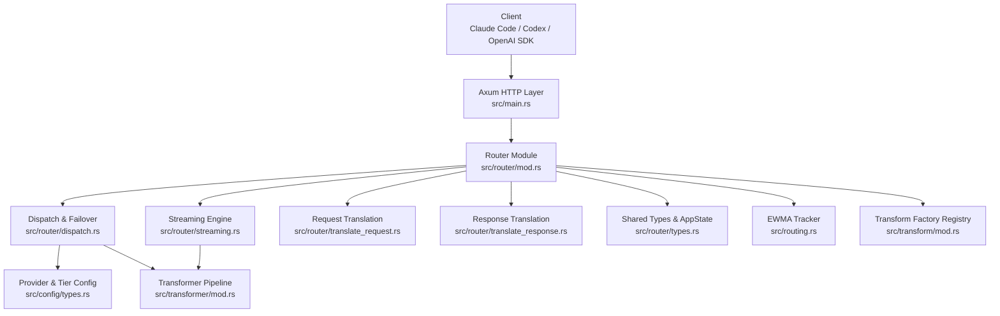
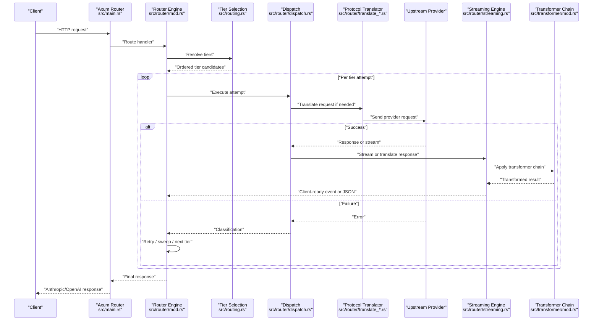
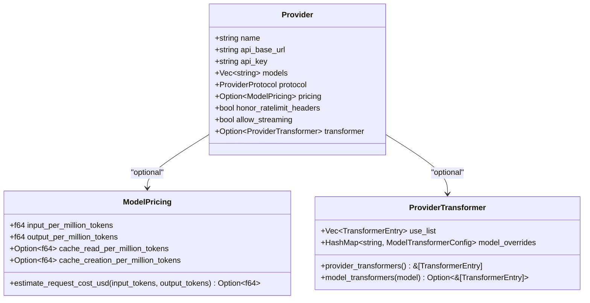
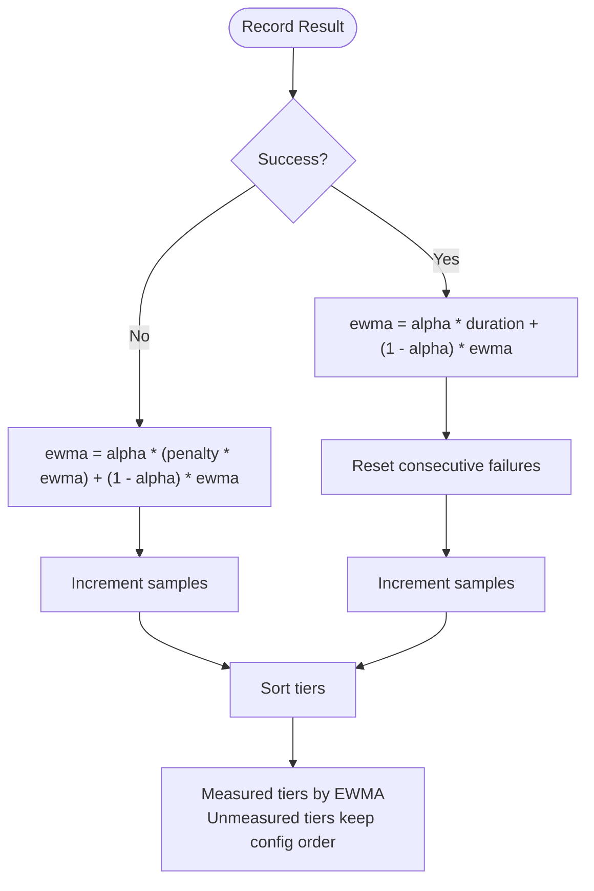
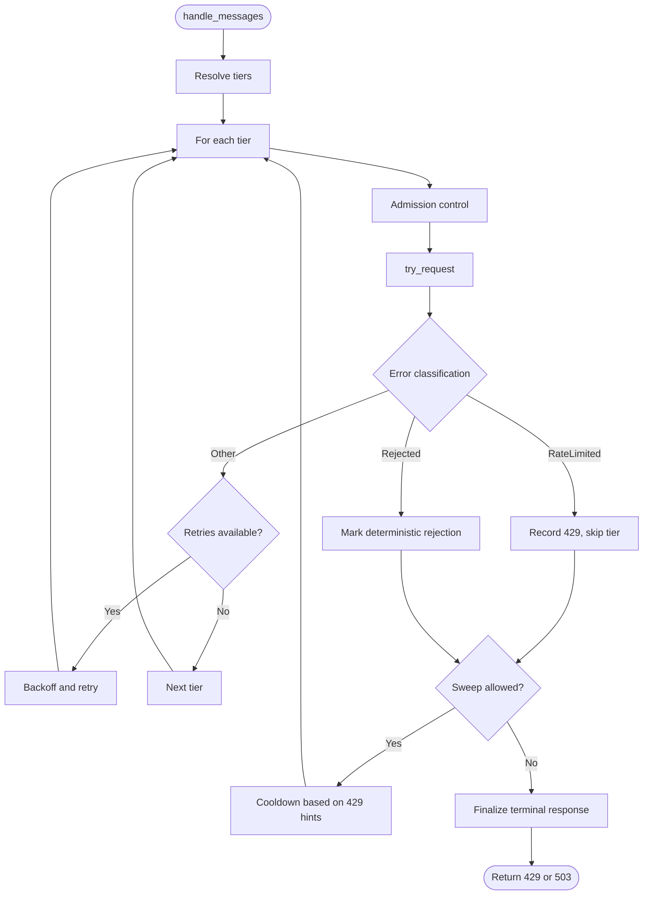
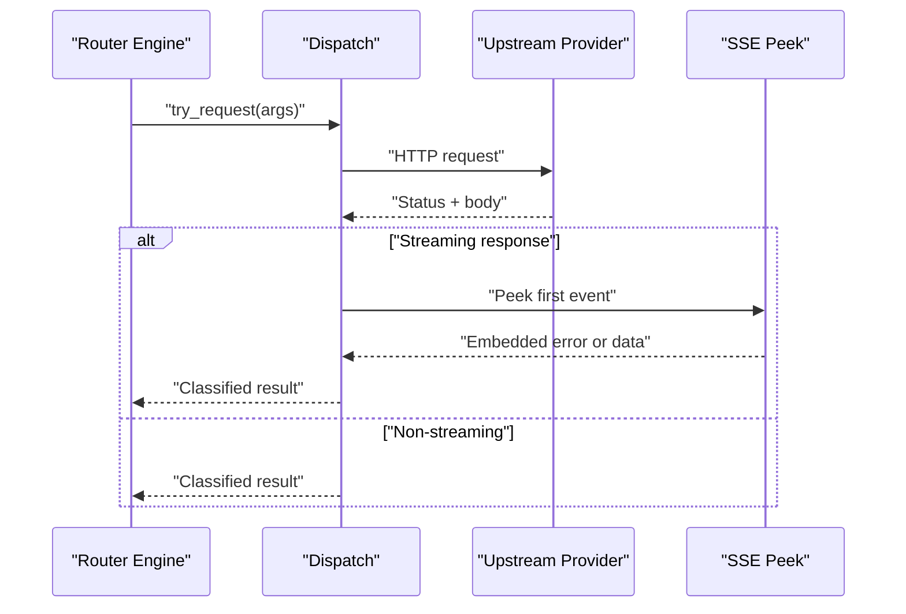
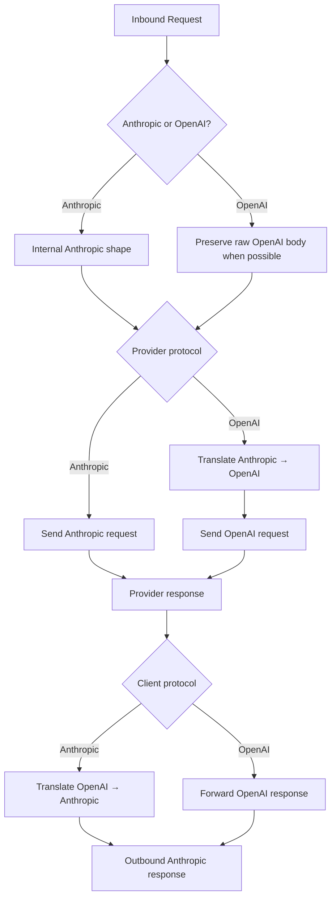
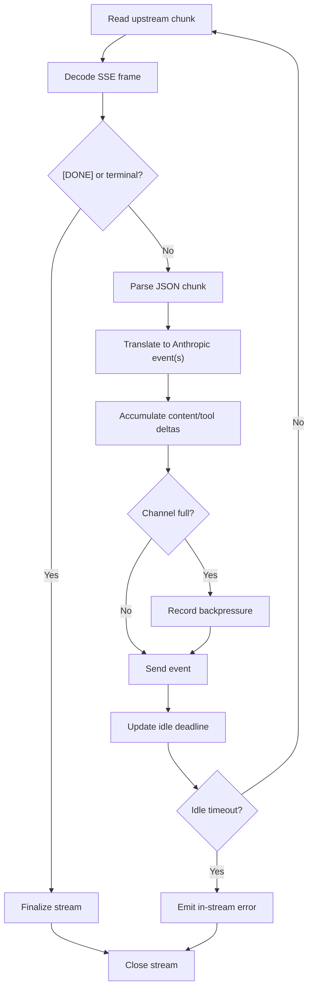
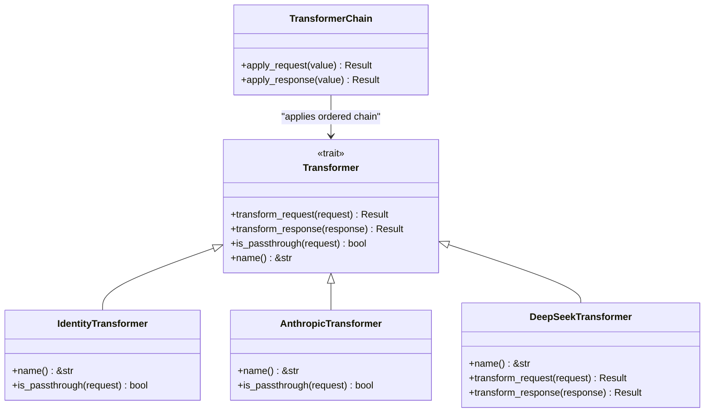
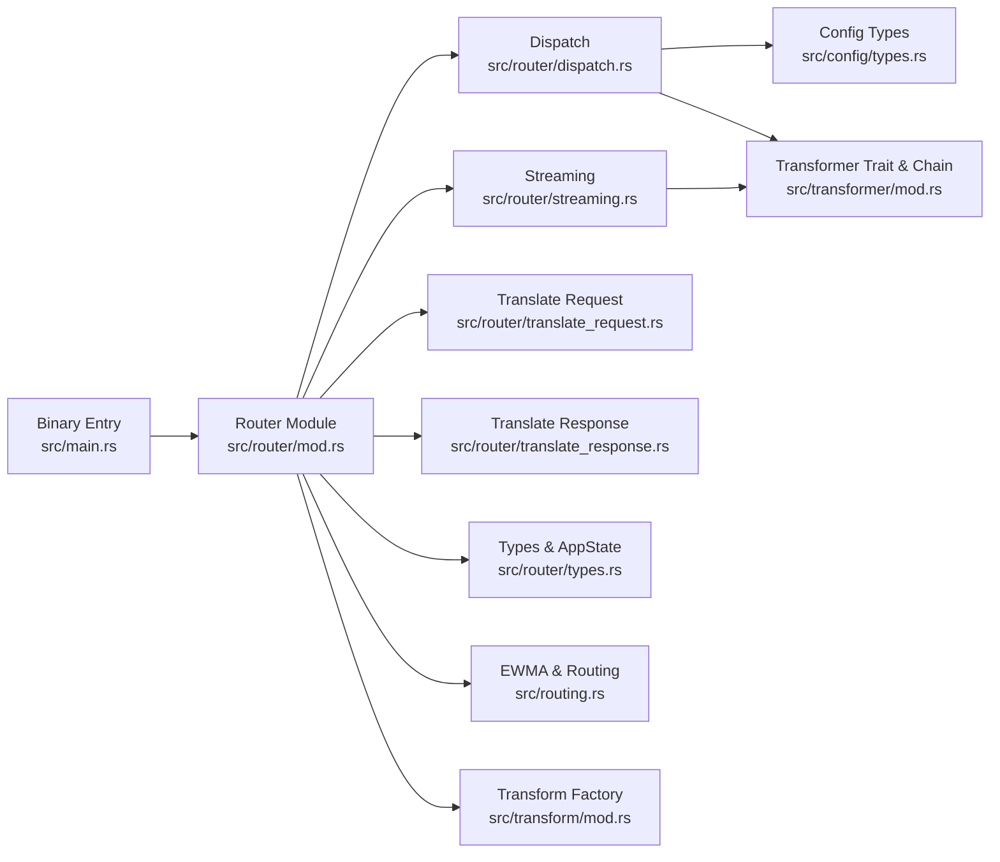

# Core Concepts

<cite>
**Referenced Files in This Document**
- [README.md](file://README.md)
- [src/lib.rs](file://src/lib.rs)
- [src/main.rs](file://src/main.rs)
- [src/routing.rs](file://src/routing.rs)
- [src/router/mod.rs](file://src/router/mod.rs)
- [src/router/dispatch.rs](file://src/router/dispatch.rs)
- [src/router/streaming.rs](file://src/router/streaming.rs)
- [src/router/translate_request.rs](file://src/router/translate_request.rs)
- [src/router/translate_response.rs](file://src/router/translate_response.rs)
- [src/router/types.rs](file://src/router/types.rs)
- [src/config/types.rs](file://src/config/types.rs)
- [src/transformer/mod.rs](file://src/transformer/mod.rs)
- [src/transformer/builtin.rs](file://src/transformer/builtin.rs)
- [src/transform/mod.rs](file://src/transform/mod.rs)
- [docs/failover_architecture.md](file://docs/failover_architecture.md)
- [docs/streaming_incremental_design.md](file://docs/streaming_incremental_design.md)
</cite>

## Table of Contents
1. [Introduction](#introduction)
2. [Project Structure](#project-structure)
3. [Core Components](#core-components)
4. [Architecture Overview](#architecture-overview)
5. [Detailed Component Analysis](#detailed-component-analysis)
6. [Dependency Analysis](#dependency-analysis)
7. [Performance Considerations](#performance-considerations)
8. [Troubleshooting Guide](#troubleshooting-guide)
9. [Conclusion](#conclusion)

## Introduction
CCR-Rust is a self-hosted LLM router that sits between coding tools and model providers. A client calls one local endpoint; CCR-Rust chooses a provider tier, translates API formats when necessary, dispatches the request, streams the response back to the client, and handles failures through retries, failover, and optional retry sweeps.

At a high level:
- **Providers** are configured upstream backends such as Anthropic, OpenAI-compatible gateways, or other supported services.
- **Tiers** are ordered provider-model combinations used for failover.
- The **router engine** selects a tier using configuration order, direct routing, optional GP reranking, and EWMA-based latency tracking.
- **Protocol translation** converts between Anthropic and OpenAI request/response shapes.
- The **transformer pipeline** applies provider-specific, model-specific, and output-processing transformations before requests reach providers and after responses return from them.

The README summarizes the user-facing flow: clients send an Anthropic-style or OpenAI-style request, CCR-Rust picks a tier, translates if needed, streams the response, and returns it in the protocol the client expects.

**Section sources**
- [README.md:1-90](file://README.md#L1-L90)

## Project Structure
The Rust library exposes modules for configuration, routing, streaming, transformers, admission control, metrics, MCP, and frontend detection. The binary entry point wires Axum routes around shared `AppState`, which holds the configuration, EWMA tracker, transformer registry, rate-limit tracker, retry budget, admission tracker, and stream counters.

**Diagram sources**
- [src/main.rs:1-90](file://src/main.rs#L1-L90)
- [src/router/mod.rs:1-120](file://src/router/mod.rs#L1-L120)
- [src/router/dispatch.rs:1-80](file://src/router/dispatch.rs#L1-L80)
- [src/router/streaming.rs:1-60](file://src/router/streaming.rs#L1-L60)
- [src/router/translate_request.rs:1-40](file://src/router/translate_request.rs#L1-L40)
- [src/router/translate_response.rs:1-40](file://src/router/translate_response.rs#L1-L40)
- [src/router/types.rs:1-80](file://src/router/types.rs#L1-L80)
- [src/routing.rs:1-60](file://src/routing.rs#L1-L60)
- [src/config/types.rs:280-420](file://src/config/types.rs#L280-L420)
- [src/transformer/mod.rs:1-60](file://src/transformer/mod.rs#L1-L60)
- [src/transform/mod.rs:1-41](file://src/transform/mod.rs#L1-L41)

**Section sources**
- [src/lib.rs:1-27](file://src/lib.rs#L1-L27)
- [src/main.rs:1-120](file://src/main.rs#L1-L120)

## Core Components
This section maps the conceptual building blocks to their primary implementation locations.

| Concept | Responsibility | Primary Files |
|---|---|---|
| Provider | An upstream backend with base URL, authentication, models, protocol, pricing, headers, streaming policy, and optional transformer chain. | [src/config/types.rs:280-420](file://src/config/types.rs#L280-L420) |
| Tier | A resolved provider-model route used by the failover hierarchy. Tiers may be strict, pinned, or reordered by EWMA/GP. | [src/config/types.rs:500-700](file://src/config/types.rs#L500-L700), [src/routing.rs:140-220](file://src/routing.rs#L140-L220) |
| EWMA Latency Tracker | Tracks per-tier smoothed latency and consecutive failures; reorders tiers below the configured pinned prefix. | [src/routing.rs:1-220](file://src/routing.rs#L1-L220) |
| Router Engine | Selects tiers, executes attempts, manages retries, sweep loops, hedging, and terminal response synthesis. | [src/router/mod.rs:1-200](file://src/router/mod.rs#L1-L200) |
| Protocol Translator | Converts Anthropic ↔ OpenAI requests and responses, including multimodal content, tools, thinking/reasoning fields, and usage. | [src/router/translate_request.rs](file://src/router/translate_request.rs), [src/router/translate_response.rs](file://src/router/translate_response.rs) |
| Streaming Engine | Reads provider SSE frames, translates chunks, tracks TTFT/idle timeouts, accumulates tool deltas, and emits backpressure-aware events. | [src/router/streaming.rs:1-200](file://src/router/streaming.rs#L1-L200) |
| Transformer Pipeline | Applies configurable request/response transformations via a trait-based registry. | [src/transformer/mod.rs:1-120](file://src/transformer/mod.rs#L1-L120), [src/transformer/builtin.rs](file://src/transformer/builtin.rs) |
| Shared Application State | Holds configuration, trackers, registries, and stream limits passed through handlers. | [src/router/types.rs:60-120](file://src/router/types.rs#L60-L120) |

**Section sources**
- [src/config/types.rs:280-700](file://src/config/types.rs#L280-L700)
- [src/routing.rs:1-220](file://src/routing.rs#L1-L220)
- [src/router/mod.rs:1-200](file://src/router/mod.rs#L1-L200)
- [src/router/translate_request.rs:1-120](file://src/router/translate_request.rs#L1-L120)
- [src/router/translate_response.rs:1-120](file://src/router/translate_response.rs#L1-L120)
- [src/router/streaming.rs:1-200](file://src/router/streaming.rs#L1-L200)
- [src/transformer/mod.rs:1-120](file://src/transformer/mod.rs#L1-L120)
- [src/router/types.rs:60-120](file://src/router/types.rs#L60-L120)

## Architecture Overview
The request lifecycle crosses several boundaries:

1. **HTTP entry**: The Axum layer in the binary receives `/v1/messages`, `/v1/chat/completions`, `/v1/responses`, health, and diagnostic endpoints.
2. **Frontend detection**: The router detects whether the caller is Claude Code, Codex, or another OpenAI-compatible client.
3. **Tier selection**: The router resolves the default, web-search, direct-route, and tier list, then optionally reorders measured tiers with EWMA.
4. **Attempt execution**: For each tier, the router performs admission control, builds provider headers, translates the request if needed, and sends it upstream.
5. **Failover**: Deterministic rejections are attempted once; rate-limited responses skip tiers according to rate-limit state; transient failures trigger retries and sweeps.
6. **Streaming or non-streaming dispatch**: Successful responses are streamed when possible; otherwise they are translated and returned as JSON.
7. **Response translation and transformation**: Upstream responses are converted back to the client's expected format, then transformed by the configured transformer chain.
8. **Metrics and observability**: Per-tier latency, usage, cost, active streams, backpressure, and failure reasons are recorded.

**Diagram sources**
- [src/main.rs:1-120](file://src/main.rs#L1-L120)
- [src/router/mod.rs:1-200](file://src/router/mod.rs#L1-L200)
- [src/routing.rs:140-220](file://src/routing.rs#L140-L220)
- [src/router/dispatch.rs:1-120](file://src/router/dispatch.rs#L1-L120)
- [src/router/translate_request.rs:1-80](file://src/router/translate_request.rs#L1-L80)
- [src/router/translate_response.rs:1-80](file://src/router/translate_response.rs#L1-L80)
- [src/router/streaming.rs:1-120](file://src/router/streaming.rs#L1-L120)
- [src/transformer/mod.rs:1-80](file://src/transformer/mod.rs#L1-L80)

**Section sources**
- [README.md:60-90](file://README.md#L60-L90)
- [docs/failover_architecture.md:1-120](file://docs/failover_architecture.md#L1-L120)

## Detailed Component Analysis

### Providers and Tiers
A **provider** defines how CCR-Rust talks to an upstream service: its name, base URL, API key, supported models, protocol (`openai`, `anthropic`, or `responses`), pricing, extra headers, streaming policy, rate-limit behavior, and optional transformer configuration.

A **tier** is a concrete provider-model route. Tiers can be:
- Strictly ordered when `strictTierOrder` is enabled.
- Pinned at the front for direct routing or web-search routing.
- Reordered by EWMA latency when dynamic ordering is allowed.
- Optionally reranked by the experimental Gaussian-process router on top of EWMA.

Provider configuration also exposes model-level pricing overrides, allowing cost estimation from token counts reported by providers.

**Diagram sources**
- [src/config/types.rs:280-420](file://src/config/types.rs#L280-L420)
- [src/config/types.rs:200-340](file://src/config/types.rs#L200-L340)
- [src/config/types.rs:340-420](file://src/config/types.rs#L340-L420)

**Section sources**
- [src/config/types.rs:200-420](file://src/config/types.rs#L200-L420)

### EWMA-Based Latency Tracking and Tier Ordering
The EWMA tracker maintains per-tier state: current smoothed latency, total samples, and consecutive failures. On success, it updates the EWMA with a weighted average. On failure, it applies a penalty multiplier instead of recording wall-clock timeout durations, because timeouts do not reflect true backend speed.

Key design decisions:
- **Alpha 0.3**: gives 30% weight to the latest sample and 70% to history. Higher values react faster but are noisier.
- **Minimum samples**: tiers without enough samples keep their config-defined position.
- **Failure penalty**: multiplies the current EWMA rather than inflating it with arbitrary timeout durations.
- **Stable sort**: measured tiers are sorted by EWMA ascending; unmeasured tiers preserve original configuration order.

**Diagram sources**
- [src/routing.rs:1-160](file://src/routing.rs#L1-L160)
- [src/routing.rs:160-220](file://src/routing.rs#L160-L220)

**Section sources**
- [src/routing.rs:1-220](file://src/routing.rs#L1-L220)
- [docs/failover_architecture.md:120-170](file://docs/failover_architecture.md#L120-L170)

### Router Engine: Request Lifecycle and Failover
The router engine is responsible for:
- Resolving the effective tier list.
- Detecting the frontend type.
- Executing attempts against each tier.
- Managing retries, sweep cooldowns, deterministic rejection memoization, and optional hedging.
- Synthesizing terminal responses: a synthetic 429 when all exhausted attempts were rate-limited, otherwise a 503.

**Diagram sources**
- [src/router/mod.rs:120-220](file://src/router/mod.rs#L120-L220)
- [src/router/types.rs:1-60](file://src/router/types.rs#L1-L60)
- [docs/failover_architecture.md:120-220](file://docs/failover_architecture.md#L120-L220)

**Section sources**
- [src/router/mod.rs:1-200](file://src/router/mod.rs#L1-L200)
- [src/router/types.rs:1-60](file://src/router/types.rs#L1-L60)
- [docs/failover_architecture.md:120-220](file://docs/failover_architecture.md#L120-L220)

### Dispatch: Provider Communication and Error Classification
Dispatch constructs provider headers, decides whether to call the Anthropic, OpenAI, or Responses protocol path, normalizes some gateway envelopes, peeks early into streaming responses for embedded errors, and classifies errors:
- `RateLimited`: 429 responses, possibly with a server-provided `Retry-After`.
- `Rejected`: deterministic 401–404 errors; these are retried at most once.
- `Other`: transport errors, timeouts, and other failures eligible for retries and sweep cascades.

**Diagram sources**
- [src/router/dispatch.rs:1-120](file://src/router/dispatch.rs#L1-L120)
- [src/router/dispatch.rs:120-240](file://src/router/dispatch.rs#L120-L240)
- [src/router/types.rs:1-60](file://src/router/types.rs#L1-L60)

**Section sources**
- [src/router/dispatch.rs:1-240](file://src/router/dispatch.rs#L1-L240)
- [src/router/types.rs:1-60](file://src/router/types.rs#L1-L60)

### Protocol Translation: Anthropic and OpenAI Formats
CCR-Rust supports two primary wire formats:
- **Anthropic**: `/v1/messages`, content blocks, native thinking/output controls, tool definitions with `input_schema`.
- **OpenAI**: `/v1/chat/completions`, messages with string or array content, function-call tools, reasoning fields, and OpenAI streaming chunk semantics.

#### Request Translation
When sending to an OpenAI-compatible provider, CCR-Rust can convert Anthropic message content into OpenAI form, preserving multimodal blocks where possible. It also converts Anthropic tool definitions into OpenAI function-call shape.

#### Response Translation
When returning to an Anthropic client from an OpenAI provider, CCR-Rust converts non-streaming and streaming OpenAI responses into Anthropic events. Streaming translation must maintain block lifecycle state because Anthropic requires matching start/stop pairs for content blocks.

**Diagram sources**
- [src/router/translate_request.rs:1-120](file://src/router/translate_request.rs#L1-L120)
- [src/router/translate_response.rs:1-120](file://src/router/translate_response.rs#L1-L120)
- [src/router/types.rs:120-220](file://src/router/types.rs#L120-L220)

**Section sources**
- [src/router/translate_request.rs:1-120](file://src/router/translate_request.rs#L1-L120)
- [src/router/translate_response.rs:1-120](file://src/router/translate_response.rs#L1-L120)
- [src/router/types.rs:120-220](file://src/router/types.rs#L120-L220)

### Streaming Engine and Backpressure
The streaming engine reads upstream provider bytes, decodes SSE frames incrementally, translates OpenAI chunks into Anthropic events, accumulates tool-call deltas across chunks, tracks time-to-first-token, enforces idle timeouts, and records metrics.

Important behaviors:
- **Bounded channel**: downstream events are sent through a bounded `tokio::sync::mpsc` channel.
- **Backpressure metric**: when the channel has no capacity, backpressure is recorded.
- **Idle timeout**: if no upstream chunk arrives before the deadline, the engine emits an in-stream error event.
- **Post-first-token rule**: once any byte has been streamed, failures are surfaced as in-stream error events rather than triggering tier fallback.
- **Token accumulation**: input, output, cached, and reasoning tokens are accumulated from usage metadata when present.

**Diagram sources**
- [src/router/streaming.rs:1-200](file://src/router/streaming.rs#L1-L200)
- [docs/streaming_incremental_design.md:1-120](file://docs/streaming_incremental_design.md#L1-L120)

**Section sources**
- [src/router/streaming.rs:1-200](file://src/router/streaming.rs#L1-L200)
- [docs/streaming_incremental_design.md:1-120](file://docs/streaming_incremental_design.md#L1-L120)

### Transformer Pipeline
The transformer system provides a trait-based plugin architecture for modifying requests and responses. Built-in transformers include:
- Identity passthrough.
- Anthropic-format handling.
- DeepSeek-specific request repair and response normalization.
- Anthropic ↔ OpenAI conversion helpers.
- Output compression and tool-output compression.
- Thinking-tag handling and token-limit enforcement.

Transformers are configured per provider and per model. A provider-level `use` list is applied broadly, while model-specific overrides can narrow or replace behavior. The configuration supports bare names and named entries with options.

**Diagram sources**
- [src/transformer/mod.rs:1-120](file://src/transformer/mod.rs#L1-L120)
- [src/transformer/builtin.rs:1-120](file://src/transformer/builtin.rs#L1-L120)

**Section sources**
- [src/transformer/mod.rs:1-120](file://src/transformer/mod.rs#L1-L120)
- [src/transformer/builtin.rs:1-200](file://src/transformer/builtin.rs#L1-L200)
- [src/config/types.rs:1-200](file://src/config/types.rs#L1-L200)
- [src/transform/mod.rs:1-41](file://src/transform/mod.rs#L1-L41)

## Dependency Analysis
The following diagram shows how major subsystems depend on each other during request processing.

**Diagram sources**
- [src/main.rs:1-120](file://src/main.rs#L1-L120)
- [src/router/mod.rs:1-120](file://src/router/mod.rs#L1-L120)
- [src/router/dispatch.rs:1-80](file://src/router/dispatch.rs#L1-L80)
- [src/router/streaming.rs:1-80](file://src/router/streaming.rs#L1-L80)
- [src/router/translate_request.rs:1-40](file://src/router/translate_request.rs#L1-L40)
- [src/router/translate_response.rs:1-40](file://src/router/translate_response.rs#L1-L40)
- [src/router/types.rs:1-80](file://src/router/types.rs#L1-L80)
- [src/routing.rs:1-60](file://src/routing.rs#L1-L60)
- [src/config/types.rs:280-420](file://src/config/types.rs#L280-L420)
- [src/transformer/mod.rs:1-80](file://src/transformer/mod.rs#L1-L80)
- [src/transform/mod.rs:1-41](file://src/transform/mod.rs#L1-L41)

Coupling summary:
- The router module is the central orchestrator and depends on dispatch, streaming, translation, types, and routing.
- Dispatch depends on configuration, transformers, metrics, and SSE decoding utilities.
- Streaming depends on response translation state and the transformer chain.
- Configuration types define provider behavior and feed both tier resolution and dispatch decisions.
- The transformer trait is intentionally small and composable so new plugins can modify requests, responses, or streaming behavior without changing the core router.

Potential risks visible in the codebase:
- Translation logic spans multiple files and must remain consistent between request and response paths.
- Streaming state must correctly close every opened content block when the upstream terminates.
- EWMA parameters affect retry backoff scaling and tier ordering; changes should preserve stability under noisy or failing providers.

**Section sources**
- [src/router/mod.rs:1-120](file://src/router/mod.rs#L1-L120)
- [src/router/dispatch.rs:1-120](file://src/router/dispatch.rs#L1-L120)
- [src/router/streaming.rs:1-120](file://src/router/streaming.rs#L1-L120)
- [src/router/translate_request.rs:1-80](file://src/router/translate_request.rs#L1-L80)
- [src/router/translate_response.rs:1-80](file://src/router/translate_response.rs#L1-L80)
- [src/routing.rs:1-120](file://src/routing.rs#L1-L120)
- [src/config/types.rs:280-420](file://src/config/types.rs#L280-L420)
- [src/transformer/mod.rs:1-80](file://src/transformer/mod.rs#L1-L80)

## Performance Considerations
- **Routing overhead**: The README states roughly 15 MB binary size and less than 50 ms P99 routing overhead, indicating the router is designed to stay out of the critical path.
- **EWMA smoothing**: Alpha 0.3 balances responsiveness and noise; minimum samples prevent premature reordering of unmeasured tiers.
- **Streaming buffer**: The incremental design uses a bounded channel to avoid unbounded memory growth while translating and forwarding events.
- **Backpressure signaling**: When the downstream channel is full, backpressure is recorded. The streaming design document describes coalescing delta events and aborting persistent stalls.
- **Idempotent transformations**: Many transformers are identity passthroughs when conditions match, avoiding unnecessary work.
- **Direct OpenAI passthrough**: When the inbound request is already OpenAI-formatted, CCR-Rust preserves the raw body for OpenAI-compatible providers to avoid an Anthropic round-trip translation.

[No sources needed since this section provides general guidance]

## Troubleshooting Guide
Common operational issues and where to look:

| Symptom | Likely Area | What to Check |
|---|---|---|
| All tiers return 429 | Rate-limit tracking and sweep cooldown | Per-route 429 backoff, `Retry-After` handling, generation guard, and sweep cooldown stretch capped at 60 seconds. |
| Deterministic 400s repeat unnecessarily | Error classification | Ensure 401–404 are classified as `Rejected` and memoized so they are attempted once. |
| Stream stalls after first token | Streaming engine | Post-first-token failures emit in-stream error events; check idle timeout, channel capacity, and upstream disconnect behavior. |
| Tool calls appear incomplete | Streaming translation state | Verify tool delta accumulation across chunks and final `done` emission. |
| Provider rejects thinking-related requests | Transformer pipeline | DeepSeek requires a leading thinking block in certain assistant turns after tool interactions. |
| Unexpected non-streaming responses | Router engine and provider policy | Global `forceNonStreaming`, provider `allow_streaming`, and Responses protocol behavior can force non-streaming. |

Operational references:
- Failure classification, tier cascade, sweep loop, and streaming rules are documented in the failover architecture document.
- Streaming incremental design documents buffering points, backpressure strategy, and test scenarios.
- Configuration types describe provider protocol, streaming policy, and transformer configuration.

**Section sources**
- [docs/failover_architecture.md:120-220](file://docs/failover_architecture.md#L120-L220)
- [docs/streaming_incremental_design.md:1-177](file://docs/streaming_incremental_design.md#L1-L177)
- [src/router/dispatch.rs:120-240](file://src/router/dispatch.rs#L120-L240)
- [src/router/streaming.rs:1-200](file://src/router/streaming.rs#L1-L200)
- [src/transformer/mod.rs:60-160](file://src/transformer/mod.rs#L60-L160)
- [src/config/types.rs:280-420](file://src/config/types.rs#L280-L420)

## Conclusion
CCR-Rust’s core architecture separates concerns cleanly:
- **Providers** encapsulate upstream connectivity and protocol details.
- **Tiers** express the failover hierarchy.
- **EWMA tracking** provides lightweight, adaptive latency signals without complex circuit breakers.
- **The router engine** coordinates tier selection, admission, retries, sweeps, and terminal response synthesis.
- **Protocol translators** isolate Anthropic and OpenAI differences so clients and providers evolve independently.
- **The streaming engine** preserves low-latency delivery while enforcing backpressure and protocol-native error events.
- **The transformer pipeline** offers a composable plugin interface for provider quirks, token management, and output optimization.

Together, these components make CCR-Rust resilient to quota exhaustion, regional outages, provider deprecations, and format incompatibilities while keeping the client experience stable.

[No sources needed since this section summarizes without analyzing specific files]