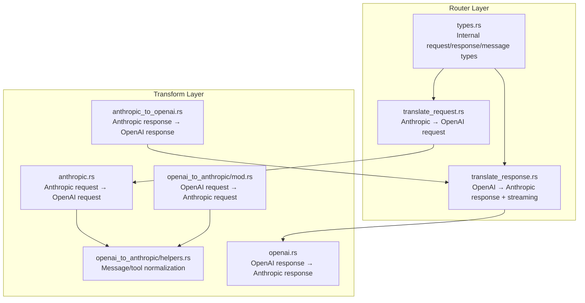
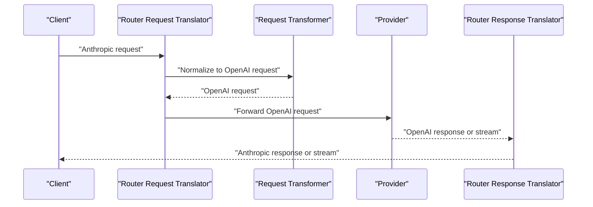
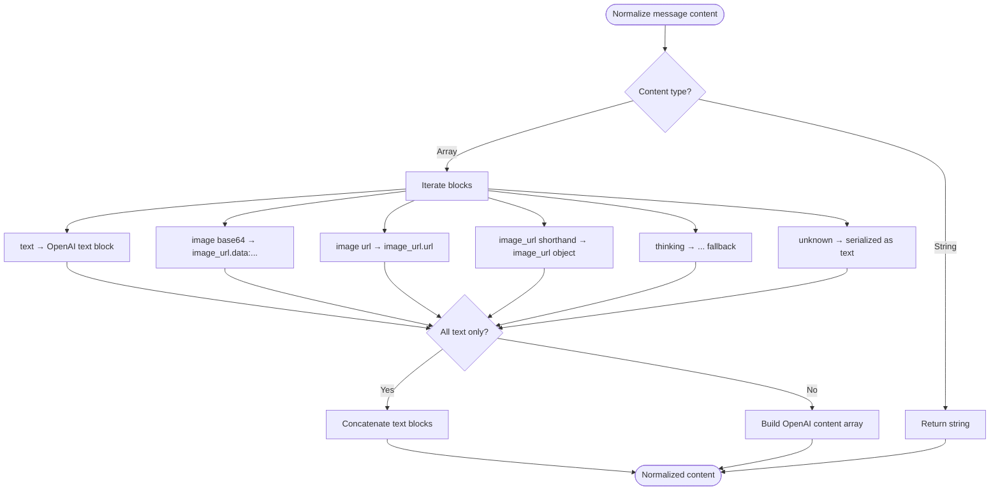
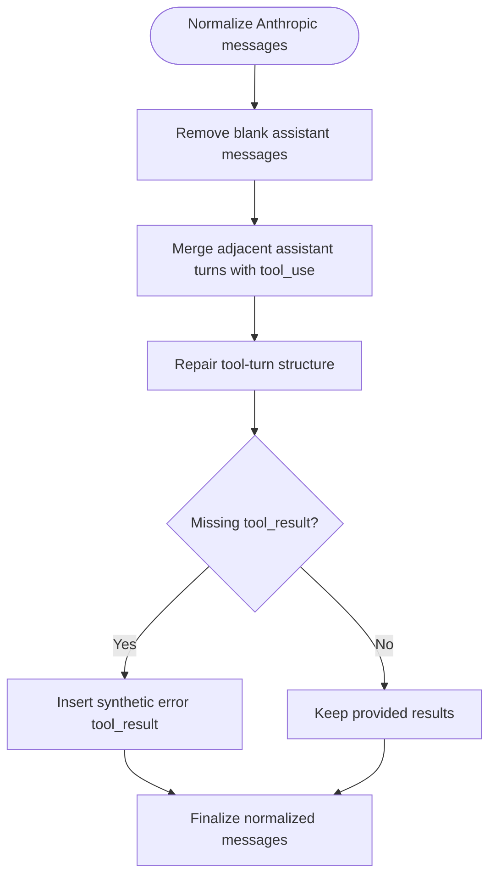
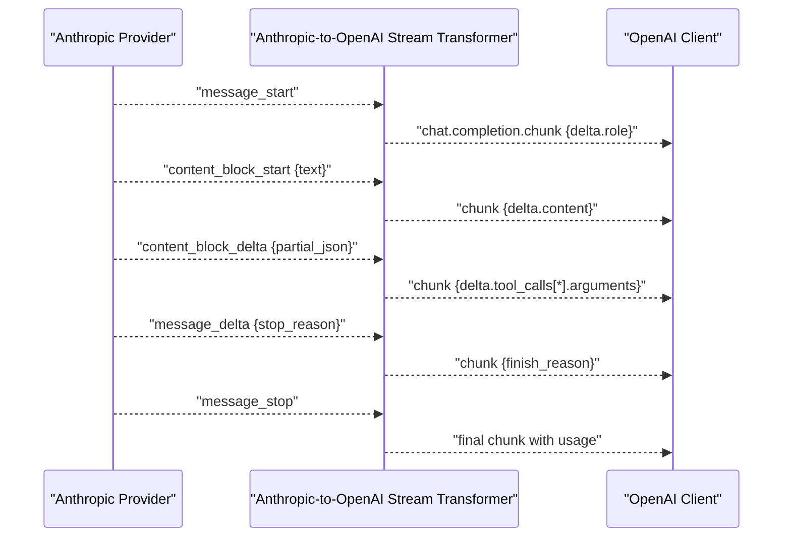
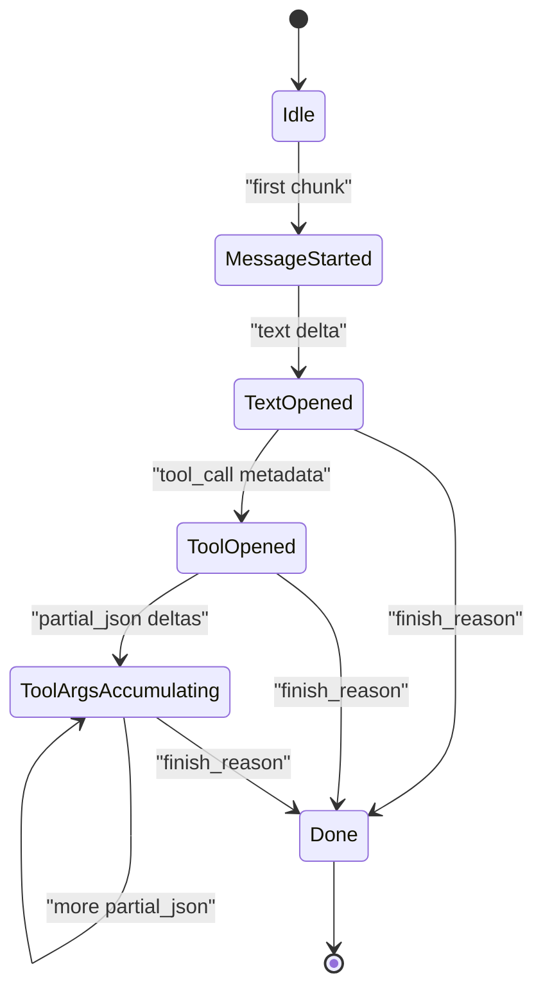
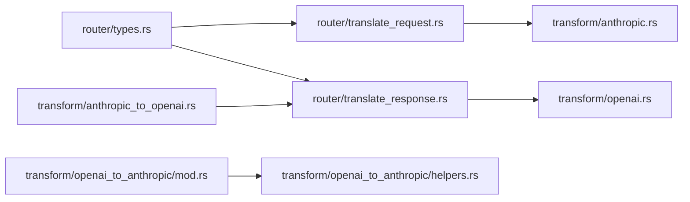

# Anthropic-OpenAI Format Conversion

<cite>
**Referenced Files in This Document**
- [anthropic.rs](file://src/transform/anthropic.rs)
- [anthropic_to_openai.rs](file://src/transform/anthropic_to_openai.rs)
- [openai.rs](file://src/transform/openai.rs)
- [openai_to_anthropic/mod.rs](file://src/transform/openai_to_anthropic/mod.rs)
- [openai_to_anthropic/helpers.rs](file://src/transform/openai_to_anthropic/helpers.rs)
- [translate_request.rs](file://src/router/translate_request.rs)
- [translate_response.rs](file://src/router/translate_response.rs)
- [types.rs](file://src/router/types.rs)
</cite>

## Table of Contents
1. [Introduction](#introduction)
2. [Project Structure](#project-structure)
3. [Core Components](#core-components)
4. [Architecture Overview](#architecture-overview)
5. [Detailed Component Analysis](#detailed-component-analysis)
6. [Dependency Analysis](#dependency-analysis)
7. [Performance Considerations](#performance-considerations)
8. [Troubleshooting Guide](#troubleshooting-guide)
9. [Conclusion](#conclusion)
10. [Appendices](#appendices)

## Introduction
This document explains how the codebase converts requests and responses between the Anthropic Messages API and the OpenAI Chat Completions API. It covers field-by-field mapping for messages, tools, function calls, response formats, thinking blocks, system prompts, streaming events, version compatibility, and testing guidance. The implementation lives primarily under `src/transform` for reusable transformers and `src/router` for request/response translation used by the routing layer.

## Project Structure
The conversion logic is split into two layers:

- **Reusable transformers** (`src/transform`) provide protocol-agnostic conversions between JSON payloads.
- **Router translation helpers** (`src/router`) normalize content, map internal types, and handle provider-specific behavior such as reasoning models, tool result repair, and streaming event sequencing.

**Diagram sources**
- [translate_request.rs:1-200](file://src/router/translate_request.rs#L1-L200)
- [translate_response.rs:1-200](file://src/router/translate_response.rs#L1-L200)
- [types.rs:1-200](file://src/router/types.rs#L1-L200)
- [anthropic.rs:1-200](file://src/transform/anthropic.rs#L1-L200)
- [openai_to_anthropic/mod.rs:1-200](file://src/transform/openai_to_anthropic/mod.rs#L1-L200)
- [openai_to_anthropic/helpers.rs:1-200](file://src/transform/openai_to_anthropic/helpers.rs#L1-L200)
- [anthropic_to_openai.rs:1-200](file://src/transform/anthropic_to_openai.rs#L1-L200)
- [openai.rs:1-200](file://src/transform/openai.rs#L1-L200)

**Section sources**
- [translate_request.rs:1-200](file://src/router/translate_request.rs#L1-L200)
- [translate_response.rs:1-200](file://src/router/translate_response.rs#L1-L200)
- [types.rs:1-200](file://src/router/types.rs#L1-L200)

## Core Components
- **Anthropic request transformer**: Converts Anthropic request fields to OpenAI request fields.
- **OpenAI request transformer**: Converts OpenAI request fields to Anthropic request fields.
- **Anthropic-to-OpenAI response transformer**: Converts non-streaming Anthropic responses to OpenAI format and translates streaming events.
- **OpenAI-to-Anthropic response transformer**: Converts non-streaming OpenAI responses to Anthropic format.
- **Router request translator**: Normalizes message content, maps Anthropic assistant tool-use and thinking blocks to OpenAI `tool_calls` and reasoning fields, and handles provider-specific model behavior.
- **Router response translator**: Converts OpenAI responses to Anthropic responses and translates streaming chunks into Anthropic event sequences.

Key responsibilities:
- System prompt ↔ top-level system field.
- Message content: string vs array of blocks; text-only optimization.
- Images: Anthropic `image` source vs OpenAI `image_url`.
- Tools: `input_schema` ↔ `function.parameters`; explicit tool choice mapping.
- Function calls: `tool_use` ↔ `tool_calls`.
- Thinking/reasoning: Anthropic `thinking` blocks ↔ OpenAI `reasoning_content`/`reasoning_blocks`.
- Streaming: Anthropic SSE-style events ↔ OpenAI completion chunks.
- Tool-result repair: Ensures complete and ordered `tool_result` blocks when sending to Anthropic-compatible providers.

**Section sources**
- [anthropic.rs:1-200](file://src/transform/anthropic.rs#L1-L200)
- [openai_to_anthropic/mod.rs:1-200](file://src/transform/openai_to_anthropic/mod.rs#L1-L200)
- [anthropic_to_openai.rs:1-200](file://src/transform/anthropic_to_openai.rs#L1-L200)
- [openai.rs:1-200](file://src/transform/openai.rs#L1-L200)
- [translate_request.rs:1-200](file://src/router/translate_request.rs#L1-L200)
- [translate_response.rs:1-200](file://src/router/translate_response.rs#L1-L200)

## Architecture Overview
The router first normalizes inbound Anthropic requests into an internal OpenAI-shaped representation, then invokes a reusable transformer if needed. Outbound responses from OpenAI-compatible providers are translated back to Anthropic format. Streaming follows a similar path but tracks state across chunks to emit correct Anthropic event pairs.

**Diagram sources**
- [translate_request.rs:201-580](file://src/router/translate_request.rs#L201-L580)
- [anthropic.rs:1-200](file://src/transform/anthropic.rs#L1-L200)
- [openai_to_anthropic/mod.rs:1-200](file://src/transform/openai_to_anthropic/mod.rs#L1-L200)
- [translate_response.rs:1-200](file://src/router/translate_response.rs#L1-L200)
- [anthropic_to_openai.rs:1-200](file://src/transform/anthropic_to_openai.rs#L1-L200)

## Detailed Component Analysis

### Request Mapping: Anthropic → OpenAI
#### Field-by-field rules
| Anthropic request field | OpenAI request mapping | Notes |
|---|---|---|
| `system` (string or block array) | Prepend a `role: "system"` message with combined text | Block arrays are joined into one string. |
| `messages[].content` | Normalize per block type | Text-only arrays become a single string; mixed multimodal stays an array. |
| `messages[].content` image blocks | `type: "image_url", image_url.url` | Base64 data becomes `data:<media>;base64,...`; URL sources remain URLs. |
| `messages[].content` thinking blocks | Not forwarded as text in main content during Anthropic→OpenAI request normalization | They are treated specially downstream in the router’s Anthropic→OpenAI request translation. |
| Assistant `tool_use` blocks | `tool_calls` array with `id`, `function.name`, `function.arguments` (JSON string) | Missing IDs default to `toolu_unknown`; missing input defaults to `{}`. |
| `tools[]` | `type: "function", function.{name, description, parameters}` | Uses `input_schema` as `parameters`; defaults to an empty object schema if absent. |
| `tool_choice` | Explicit function form or `"required"` | `"any"` becomes `"required"`; already OpenAI shape passes through. |
| `max_tokens` | `max_completion_tokens` for reasoning models; otherwise `max_tokens` | Reasoning models avoid setting `max_tokens` directly. |
| `output_config.effort` | `reasoning_effort` | Only effort is mapped; structured output schemas are not converted to OpenAI `response_format`. |
| `thinking` | Provider-specific control | For DeepSeek non-reasoner models, sets `thinking.disabled`. |

#### Content normalization flow

**Diagram sources**
- [translate_request.rs:1-200](file://src/router/translate_request.rs#L1-L200)

#### Anthropic assistant turn handling
Assistant messages may contain mixed content blocks. The router separates:
- Non-tool content blocks, which remain in `content`.
- `tool_use` blocks, which become `tool_calls`.
- `thinking` blocks, which populate `reasoning_content` and optionally `reasoning_blocks` with signatures.

For reasoning models, if no reasoning content is present on an assistant turn that participates in tool calling, an empty `reasoning_content` string is set so downstream providers accept the turn.

**Section sources**
- [translate_request.rs:201-580](file://src/router/translate_request.rs#L201-L580)
- [anthropic.rs:1-200](file://src/transform/anthropic.rs#L1-L200)

### Request Mapping: OpenAI → Anthropic
#### Field-by-field rules
| OpenAI request field | Anthropic request mapping | Notes |
|---|---|---|
| `messages[].role == "system"` | Top-level `system` string | Multiple system messages are joined with double newlines. |
| `messages[].content` string | Single `text` block | Empty strings become an empty content array. |
| `messages[].content` array | Convert OpenAI parts to Anthropic blocks | `text` and `image_url` are recognized; unknown parts are kept or rendered. |
| `messages[].tool_calls` | Append `tool_use` blocks after content | Generates ordinal IDs when none exist; preserves ordering. |
| `tools[].function.*` | `name`, `description`, `input_schema` | `parameters` becomes `input_schema`; defaults to an empty object schema. |
| `tool_choice` | `type: "tool", name` or `"any"` | `"required"` → `"any"`; `"none"` is removed; function-object form → tool-object form. |
| `stop` | `stop_sequences` | Removes OpenAI-only fields like `n`, `logprobs`, `top_logprobs`, `logit_bias`, `seed`, `response_format`. |
| `max_completion_tokens` | `max_tokens` | Avoids duplication if both fields are present. |

#### Message normalization and tool-turn repair
The helper layer performs important structural work:
- Merges adjacent assistant turns containing tool calls.
- Converts OpenAI `role: "tool"` messages into Anthropic `tool_result` blocks.
- Repairs incomplete tool turns by inserting synthetic error results when client continuations omit outputs.
- Neutralizes unmatched tool results by converting them to readable text rather than silently dropping them.

**Diagram sources**
- [openai_to_anthropic/helpers.rs:201-650](file://src/transform/openai_to_anthropic/helpers.rs#L201-L650)

**Section sources**
- [openai_to_anthropic/mod.rs:1-200](file://src/transform/openai_to_anthropic/mod.rs#L1-L200)
- [openai_to_anthropic/helpers.rs:201-650](file://src/transform/openai_to_anthropic/helpers.rs#L201-L650)

### Response Mapping: Anthropic → OpenAI
#### Non-streaming response mapping
| Anthropic response field | OpenAI response mapping | Notes |
|---|---|---|
| `message` fields | `choices[0].message` | Role becomes `assistant`. |
| `content` blocks | `choices[0].message.content` | Text-only blocks become a string; multimodal remains an array. |
| `tool_use` blocks | `tool_calls` array | Input objects are serialized to JSON strings. |
| `stop_reason` | `finish_reason` | `end_turn` → `stop`, `max_tokens` → `length`, `tool_use` → `tool_calls`, `stop_sequence` → `stop`. |
| `usage` | `usage` | Maps input/output tokens and optional cached/reasoning token details. |
| `thinking` blocks | Optional `reasoning_content` and `reasoning_blocks` | Concatenated reasoning text and preserved signatures. |

#### Streaming event mapping
| Anthropic event | OpenAI chunk delta | Timing notes |
|---|---|---|
| `message_start` | `delta.role = "assistant"` plus refusal/status/incomplete metadata | Sets initial chunk. |
| `content_block_start` (text) | `delta.content` | Starts first text block. |
| `content_block_start` (tool_use) | `delta.tool_calls[{index, id, function.name}]` | Initializes parallel tool call deltas. |
| `content_block_start` (thinking) | `delta.reasoning_block_index` | Preserves block index for signature pairing. |
| `content_block_delta` (text/thinking/signature/partial_json) | `delta.content`, `delta.reasoning_content`, `delta.reasoning_signature`, or `delta.tool_calls[*].function.arguments` | Partial JSON arguments accumulate. |
| `content_block_stop` | Empty delta | No-op chunk. |
| `message_delta` | `finish_reason` mapped from Anthropic stop reason | Terminal finish reason for the stream. |
| `message_stop` | Empty choices | Adapter attaches collected usage here. |

**Diagram sources**
- [anthropic_to_openai.rs:201-645](file://src/transform/anthropic_to_openai.rs#L201-L645)

**Section sources**
- [anthropic_to_openai.rs:1-645](file://src/transform/anthropic_to_openai.rs#L1-L645)

### Response Mapping: OpenAI → Anthropic
#### Non-streaming response mapping
| OpenAI response field | Anthropic response mapping | Notes |
|---|---|---|
| `choices[0].message.content` | `content` blocks | String becomes a single text block; array is normalized. |
| `choices[0].message.tool_calls` | `tool_use` blocks | Arguments are parsed to JSON; malformed arguments use a raw fallback. |
| `choices[0].finish_reason` | `stop_reason` | `stop` → `end_turn`, `length` → `max_tokens`, `tool_calls` → `tool_use`, `content_filter` → `stop_sequence`. |
| `usage` | `usage` | Maps prompt/completion tokens and optional cache/reasoning details. |
| `reasoning_content` | Preserved separately | Not emitted as thinking blocks for non-Anthropic providers because missing signatures break clients. |

#### Streaming chunk translation
The router maintains a `StreamTranslationState`:
- Emits `message_start` once.
- Opens a text block on first content delta.
- Opens a `tool_use` block when tool call metadata arrives.
- Emits `input_json_delta` chunks for partial function arguments.
- Closes all opened blocks when `finish_reason` arrives.
- Emits final `message_delta` and `message_stop` events with mapped stop reasons.

**Diagram sources**
- [translate_response.rs:1-399](file://src/router/translate_response.rs#L1-L399)

**Section sources**
- [openai.rs:1-200](file://src/transform/openai.rs#L1-L200)
- [translate_response.rs:1-399](file://src/router/translate_response.rs#L1-L399)

### Protocol-Specific Features

#### Thinking blocks and reasoning
- **Anthropic request to OpenAI**: Assistant `thinking` blocks are extracted into `reasoning_content` and optionally `reasoning_blocks` with signatures. Mixed content keeps non-tool blocks in `content`.
- **OpenAI request to Anthropic**: `reasoning_blocks` are transformed into `thinking` blocks inserted at the beginning of the message content.
- **Response direction**: Anthropic thinking blocks can produce `reasoning_content` and `reasoning_blocks` in OpenAI responses. OpenAI `reasoning_content` is preserved but not emitted as thinking blocks for non-Anthropic providers to avoid parsing failures.
- **Streaming**: Anthropic thinking deltas are mapped to `reasoning_content` and `reasoning_signature`; OpenAI-to-Anthropic streaming skips emitting thinking deltas for non-Anthropic providers.

#### System prompts
- **Anthropic → OpenAI**: Top-level `system` becomes the first `role: "system"` message.
- **OpenAI → Anthropic**: All `role: "system"` messages are extracted and joined into a top-level `system` string.

#### Tool definitions and function calls
- **Tool definitions**: Anthropic `input_schema` maps to OpenAI `function.parameters`; OpenAI `function.parameters` maps to Anthropic `input_schema`.
- **Function calls**: Anthropic `tool_use` blocks map to OpenAI `tool_calls`; OpenAI `tool_calls` map to Anthropic `tool_use` blocks.
- **Tool choice**: Anthropic `tool` → OpenAI `function`; `"any"` → `"required"`; OpenAI `"none"` is dropped.

#### Multimodal images
- **Anthropic → OpenAI**: `image` blocks with base64 data become `image_url.data:...`; URL sources become `image_url.url`.
- **OpenAI → Anthropic**: `image_url` strings or objects become Anthropic `image.source.base64` or `image.source.url`. Media types are normalized; `image/jpg` becomes `image/jpeg`.

**Section sources**
- [translate_request.rs:1-200](file://src/router/translate_request.rs#L1-L200)
- [openai_to_anthropic/helpers.rs:1-200](file://src/transform/openai_to_anthropic/helpers.rs#L1-L200)
- [anthropic_to_openai.rs:201-645](file://src/transform/anthropic_to_openai.rs#L201-L645)
- [translate_response.rs:1-399](file://src/router/translate_response.rs#L1-L399)

### Complex Scenarios

#### Multi-turn conversations with tool usage
- Anthropic assistant messages containing both text and `tool_use` blocks are split into OpenAI `content` and `tool_calls`.
- Client-supplied `tool_result` blocks in user messages become OpenAI `role: "tool"` messages.
- When sending to Anthropic-compatible providers, the helper layer merges assistant turns with tool calls and repairs missing or unordered tool results.

#### Parallel function calls
- Anthropic `tool_use` blocks are converted to multiple OpenAI `tool_calls`.
- Streaming uses indices to associate each tool call’s start, argument deltas, and stop events.
- If OpenAI returns multiple tool calls, the Anthropic-side transformer appends corresponding `tool_use` blocks in order.

#### Mixed content types
- Text-only Anthropic content arrays are collapsed into a single OpenAI string.
- Mixed text/image content remains an array.
- Unknown blocks are either preserved as-is or serialized to text depending on direction and context.

**Section sources**
- [translate_request.rs:201-580](file://src/router/translate_request.rs#L201-L580)
- [openai_to_anthropic/helpers.rs:201-650](file://src/transform/openai_to_anthropic/helpers.rs#L201-L650)
- [anthropic_to_openai.rs:201-645](file://src/transform/anthropic_to_openai.rs#L201-L645)

## Dependency Analysis
The following diagram shows module relationships relevant to conversion:

**Diagram sources**
- [types.rs:1-200](file://src/router/types.rs#L1-L200)
- [translate_request.rs:1-200](file://src/router/translate_request.rs#L1-L200)
- [translate_response.rs:1-200](file://src/router/translate_response.rs#L1-L200)
- [anthropic.rs:1-200](file://src/transform/anthropic.rs#L1-L200)
- [openai_to_anthropic/mod.rs:1-200](file://src/transform/openai_to_anthropic/mod.rs#L1-L200)
- [openai_to_anthropic/helpers.rs:1-200](file://src/transform/openai_to_anthropic/helpers.rs#L1-L200)
- [anthropic_to_openai.rs:1-200](file://src/transform/anthropic_to_openai.rs#L1-L200)
- [openai.rs:1-200](file://src/transform/openai.rs#L1-L200)

**Section sources**
- [types.rs:1-200](file://src/router/types.rs#L1-L200)
- [translate_request.rs:1-200](file://src/router/translate_request.rs#L1-L200)
- [translate_response.rs:1-200](file://src/router/translate_response.rs#L1-L200)
- [anthropic.rs:1-200](file://src/transform/anthropic.rs#L1-L200)
- [openai_to_anthropic/mod.rs:1-200](file://src/transform/openai_to_anthropic/mod.rs#L1-L200)
- [openai_to_anthropic/helpers.rs:1-200](file://src/transform/openai_to_anthropic/helpers.rs#L1-L200)
- [anthropic_to_openai.rs:1-200](file://src/transform/anthropic_to_openai.rs#L1-L200)
- [openai.rs:1-200](file://src/transform/openai.rs#L1-L200)

## Performance Considerations
- **Text-only optimization**: Anthropic content arrays composed solely of text blocks are collapsed to a single string in OpenAI requests, reducing payload size.
- **Streaming efficiency**: Anthropic-to-OpenAI streaming emits minimal deltas and avoids unnecessary structure where possible; tool argument deltas are streamed incrementally.
- **Avoiding redundant round-trips**: Internal types preserve original OpenAI payloads when the inbound request was already OpenAI-formatted, preventing wasteful OpenAI → Anthropic → OpenAI conversions.
- **Field removal**: Unnecessary OpenAI fields are removed when translating to Anthropic to reduce request size and avoid unsupported parameters.

[No sources needed since this section provides general guidance]

## Troubleshooting Guide
Common issues and their causes:

- **Missing `content` array in Anthropic responses**: The Anthropic-to-OpenAI transformer requires a `content` array; absence raises an error. Ensure upstream responses include content blocks.
- **Invalid content block type**: Both directions validate block types; unknown blocks may be skipped or rendered as text. Verify content schema before conversion.
- **Malformed tool arguments**: When parsing OpenAI tool call arguments fails, the converter stores raw arguments in a fallback field. Validate JSON before relying on structured inputs.
- **Thinking signature mismatches**: Emitting thinking deltas without signatures for non-Anthropic providers breaks SDK parsing. The router skips these deltas to prevent errors.
- **Incomplete tool turns**: If client continuations omit tool results, the helper layer inserts synthetic error results. Check logs for synthetic markers and ensure clients return ordered results.
- **Image media type issues**: Base64 images must have valid media types; `image/jpg` is normalized to `image/jpeg`. Data URLs with extra parameters are trimmed to the bare media type.
- **Finish reason mismatch**: Ensure downstream clients expect mapped finish reasons; Anthropic `tool_use` maps to OpenAI `tool_calls`, and vice versa.

**Section sources**
- [anthropic_to_openai.rs:1-200](file://src/transform/anthropic_to_openai.rs#L1-L200)
- [openai.rs:1-200](file://src/transform/openai.rs#L1-L200)
- [openai_to_anthropic/helpers.rs:201-650](file://src/transform/openai_to_anthropic/helpers.rs#L201-L650)
- [translate_response.rs:1-399](file://src/router/translate_response.rs#L1-L399)

## Conclusion
The conversion layer provides comprehensive support for exchanging Anthropic and OpenAI chat payloads. It handles message content, images, tools, function calls, thinking blocks, system prompts, and streaming differences while repairing structurally incomplete tool turns. For accurate behavior, test across multi-turn conversations, parallel tool calls, and mixed content scenarios, and validate streaming event timing and finish reason mappings against provider expectations.

[No sources needed since this section summarizes without analyzing specific files]

## Appendices

### Version Compatibility Guidance
- **OpenAI field removal**: Fields such as `n`, `logprobs`, `top_logprobs`, `logit_bias`, `seed`, and `response_format` are removed when converting to Anthropic because they are unsupported.
- **Token limits**: `max_completion_tokens` is translated to `max_tokens` for Anthropic; reasoning models receive special handling to avoid forcing `max_tokens`.
- **Structured output**: The current Anthropic→OpenAI request path does not translate `output_config.format` into OpenAI `response_format`. See configuration documentation for supported limitations.
- **Reasoning models**: Model names containing reasoning-related substrings trigger reasoning-specific behavior, including `reasoning_effort` mapping and `reasoning_content` requirements.

**Section sources**
- [openai_to_anthropic/mod.rs:1-200](file://src/transform/openai_to_anthropic/mod.rs#L1-L200)
- [translate_request.rs:201-580](file://src/router/translate_request.rs#L201-L580)

### Testing Conversion Accuracy
Recommended test cases:
- **System prompt preservation**: Send multiple system messages and verify joining and position.
- **Simple text round-trip**: Confirm string ↔ single text block conversion.
- **Multimodal round-trip**: Validate base64 and URL images across both directions.
- **Single tool call**: Verify `tool_use` ↔ `tool_calls` mapping and argument serialization.
- **Parallel tool calls**: Ensure indices, IDs, and argument deltas align.
- **Tool result repair**: Provide partial or unordered tool results and verify synthetic repairs.
- **Thinking blocks**: Test signed and unsigned reasoning content, including streaming deltas.
- **Finish reason mapping**: Verify `stop`, `length`, `tool_calls`, and filter-related reasons.
- **Streaming completeness**: Ensure every opened content block is closed and final events carry usage and stop reasons.

[No sources needed since this section provides general guidance]