# Protocol Translation

<cite>
**Referenced Files in This Document**   
- [src/lib.rs](file://src/lib.rs)
- [src/main.rs](file://src/main.rs)
- [src/transform/mod.rs](file://src/transform/mod.rs)
- [src/transformer/mod.rs](file://src/transformer/mod.rs)
- [src/transformer/builtin.rs](file://src/transformer/builtin.rs)
- [src/router/mod.rs](file://src/router/mod.rs)
- [src/router/dispatch.rs](file://src/router/dispatch.rs)
- [src/router/streaming.rs](file://src/router/streaming.rs)
- [src/router/translate_request.rs](file://src/router/translate_request.rs)
- [src/router/translate_response.rs](file://src/router/translate_response.rs)
- [src/router/responses_api.rs](file://src/router/responses_api.rs)
- [src/transform/openai_to_anthropic/mod.rs](file://src/transform/openai_to_anthropic/mod.rs)
- [src/transform/openai_to_anthropic/helpers.rs](file://src/transform/openai_to_anthropic/helpers.rs)
- [src/transform/anthropic_to_openai.rs](file://src/transform/anthropic_to_openai.rs)
</cite>

## Table of Contents
1. [Introduction](#introduction)
2. [Project Structure](#project-structure)
3. [Core Components](#core-components)
4. [Architecture Overview](#architecture-overview)
5. [Detailed Component Analysis](#detailed-component-analysis)
6. [Dependency Analysis](#dependency-analysis)
7. [Performance Considerations](#performance-considerations)
8. [Troubleshooting Guide](#troubleshooting-guide)
9. [Conclusion](#conclusion)

## Introduction
This document explains how CCR-Rust translates between Anthropic, OpenAI Chat Completions, and OpenAI Responses API formats. The system uses two complementary translation layers:

- **Router-level translation**: Lightweight request/response shape conversion for the common Anthropic ↔ OpenAI path used by most providers.
- **Transformer pipeline**: A configurable chain of reusable transformers that can modify requests or responses before they reach a provider or before they are returned to a client.

The router normalizes incoming Anthropic-style requests into an internal `AnthropicRequest` representation, applies provider-specific transformers, then routes them to either:

- The native Anthropic Messages protocol.
- An OpenAI-compatible endpoint (`chat/completions`).
- An OpenAI Responses-compatible endpoint (`/v1/responses`).

Responses are translated back to the protocol expected by the client. Streaming is preserved end-to-end through per-chunk translation and stateful event sequencing.

## Project Structure
The protocol translation logic is split across several modules:

| Area | Responsibility |
|---|---|
| `src/transformer` | Core `Transformer` trait, built-in transformers, registry, and chain execution. |
| `src/transform` | Factory-based transformer registry and specialized transformers for providers such as DeepSeek, GLM, Kimi, Minimax, and output compression. |
| `src/router` | Request routing, header construction, streaming, response translation, and protocol dispatch. |
| `src/router/translate_request.rs` | Anthropic → OpenAI message, tool, reasoning, and image normalization. |
| `src/router/translate_response.rs` | OpenAI → Anthropic non-streaming response and streaming chunk translation. |
| `src/router/responses_api.rs` | OpenAI Responses API compatibility layer. |
| `src/transform/openai_to_anthropic` | Full OpenAI → Anthropic transformer implementation. |
| `src/transform/anthropic_to_openai.rs` | Full Anthropic → OpenAI response and streaming transformer implementation. |

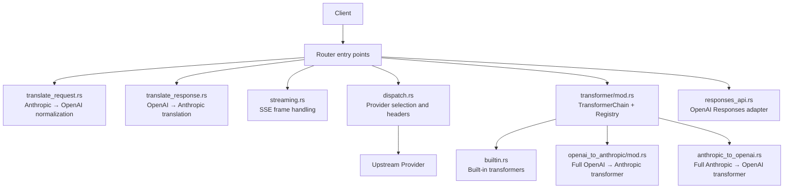

**Diagram sources**
- [src/router/mod.rs:1-40](file://src/router/mod.rs#L1-L40)
- [src/router/dispatch.rs:1-60](file://src/router/dispatch.rs#L1-L60)
- [src/router/translate_request.rs:1-60](file://src/router/translate_request.rs#L1-L60)
- [src/router/translate_response.rs:1-40](file://src/router/translate_response.rs#L1-L40)
- [src/router/streaming.rs:1-40](file://src/router/streaming.rs#L1-L40)
- [src/transform/mod.rs:1-41](file://src/transform/mod.rs#L1-L41)
- [src/transformer/mod.rs:1-30](file://src/transformer/mod.rs#L1-L30)
- [src/transformer/builtin.rs:1-30](file://src/transformer/builtin.rs#L1-L30)
- [src/transform/openai_to_anthropic/mod.rs:1-40](file://src/transform/openai_to_anthropic/mod.rs#L1-L40)
- [src/transform/anthropic_to_openai.rs:1-40](file://src/transform/anthropic_to_openai.rs#L1-L40)
- [src/router/responses_api.rs:1-30](file://src/router/responses_api.rs#L1-L30)

**Section sources**
- [src/lib.rs:1-27](file://src/lib.rs#L1-L27)
- [src/main.rs:1-60](file://src/main.rs#L1-L60)

## Core Components
The protocol translation system has four main responsibilities:

1. **Normalize messages, tools, images, and reasoning blocks** between Anthropic content-block format and OpenAI string/array/chat-completion format.
2. **Build a transformer chain** from configuration, applying provider-level and model-specific transformations.
3. **Dispatch to the correct upstream protocol**, constructing headers and URLs per provider.
4. **Translate streaming events** so clients see Anthropic-style SSE events regardless of whether the upstream is Anthropic, OpenAI, or another compatible provider.

### Internal Normalization Model
The router treats the normalized Anthropic request as the primary internal representation. When sending to OpenAI-compatible endpoints, it converts this representation into an OpenAI Chat Completions request. When receiving from OpenAI-compatible endpoints, it converts the response back to Anthropic format.

Key fields handled during normalization include:

| Field | Anthropic form | OpenAI form | Translation rule |
|---|---|---|---|
| System prompt | Top-level `system` string or block array | First `role: "system"` message | Extracted and prepended as a system message. |
| Message content | Array of content blocks | String or array of parts | Text-only arrays may be collapsed to a string; multimodal arrays are preserved. |
| Images | `type: "image"`, source base64 or URL | `type: "image_url"`, string or object with `url` | Data URLs are converted to base64 sources; URLs become URL sources. |
| Tool definitions | `{name, description, input_schema}` | `{type: "function", function: {name, description, parameters}}` | Schema wrapper is unwrapped or wrapped accordingly. |
| Tool calls | Assistant `tool_use` blocks | `tool_calls` array | Arguments are serialized as JSON strings on the wire. |
| Reasoning | `thinking` blocks with optional signature | `reasoning_content`, `reasoning_blocks` | Thinking text is joined into a string; signed blocks are preserved where supported. |
| Finish reason | `end_turn`, `max_tokens`, `tool_use`, `stop_sequence` | `stop`, `length`, `tool_calls`, `content_filter` | Mapped bidirectionally. |

**Section sources**
- [src/router/translate_request.rs:1-120](file://src/router/translate_request.rs#L1-L120)
- [src/router/translate_request.rs:200-577](file://src/router/translate_request.rs#L200-L577)
- [src/router/translate_response.rs:1-120](file://src/router/translate_response.rs#L1-L120)
- [src/transform/openai_to_anthropic/mod.rs:1-200](file://src/transform/openai_to_anthropic/mod.rs#L1-L200)
- [src/transform/openai_to_anthropic/helpers.rs:1-120](file://src/transform/openai_to_anthropic/helpers.rs#L1-L120)
- [src/transform/anthropic_to_openai.rs:1-120](file://src/transform/anthropic_to_openai.rs#L1-L120)

## Architecture Overview
At runtime, an incoming request follows one of these paths depending on its origin and configured target:

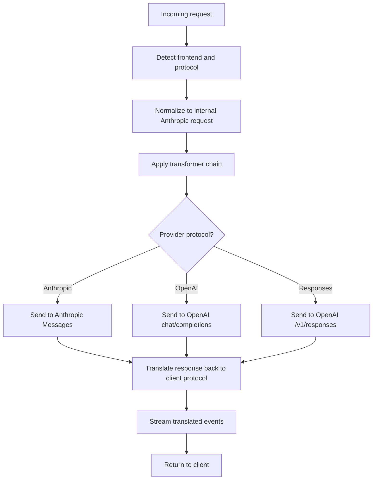

**Diagram sources**
- [src/router/mod.rs:1-40](file://src/router/mod.rs#L1-L40)
- [src/router/dispatch.rs:200-360](file://src/router/dispatch.rs#L200-L360)
- [src/router/streaming.rs:1-80](file://src/router/streaming.rs#L1-L80)
- [src/router/translate_response.rs:1-60](file://src/router/translate_response.rs#L1-L60)

### Entry Points
The application exposes CLI commands and HTTP routes. The Rust library re-exports the router, transformer, transform, and other subsystems so the binary can compose them.

- Library entry point: `src/lib.rs`
- Binary entry point: `src/main.rs`

**Section sources**
- [src/lib.rs:1-27](file://src/lib.rs#L1-L27)
- [src/main.rs:1-60](file://src/main.rs#L1-L60)

## Detailed Component Analysis

### Transformer Pipeline Architecture
The transformer pipeline is built around a trait-based interface:

```mermaid
classDiagram
    class Transformer {
        +transform_request(request) Result<Value>
        +transform_response(response) Result<Value>
        +is_passthrough(request) bool
        +name() &str
    }

    class IdentityTransformer {
        +name() &str
        +is_passthrough(request) bool
    }

    class AnthropicTransformer {
        +name() &str
        +is_passthrough(request) bool
    }

    class AnthropicToOpenaiTransformer {
        +<docs>
# Protocol Translation

<cite>
**Referenced Files in This Document**   
- [lib.rs](file://src/lib.rs)
- [main.rs](file://src/main.rs)
- [transform/mod.rs](file://src/transform/mod.rs)
- [transformer/mod.rs](file://src/transformer/mod.rs)
- [transformer/builtin.rs](file://src/transformer/builtin.rs)
- [router/mod.rs](file://src/router/mod.rs)
- [router/dispatch.rs](file://src/router/dispatch.rs)
- [router/translate_request.rs](file://src/router/translate_request.rs)
- [router/translate_response.rs](file://src/router/translate_response.rs)
- [router/streaming.rs](file://src/router/streaming.rs)
- [router/responses_api.rs](file://src/router/responses_api.rs)
- [transform/openai_to_anthropic/mod.rs](file://src/transform/openai_to_anthropic/mod.rs)
- [transform/openai_to_anthropic/helpers.rs](file://src/transform/openai_to_anthropic/helpers.rs)
- [transform/anthropic_to_openai.rs](file://src/transform/anthropic_to_openai.rs)
</cite>

## Table of Contents
1. [Introduction](#introduction)
2. [Project Structure](#project-structure)
3. [Core Components](#core-components)
4. [Architecture Overview](#architecture-overview)
5. [Detailed Component Analysis](#detailed-component-analysis)
6. [Dependency Analysis](#dependency-analysis)
7. [Performance Considerations](#performance-considerations)
8. [Troubleshooting Guide](#troubleshooting-guide)
9. [Conclusion](#conclusion)

## Introduction
This document explains how CCR-Rust translates between Anthropic, OpenAI Chat Completions, and OpenAI Responses API formats. Internally, the router normalizes incoming requests into a shared representation, applies a configurable transformer pipeline, forwards them to upstream providers, and then converts provider responses back into the protocol expected by the client. The system supports non-streaming and streaming paths, reasoning blocks, tool calls, image content, provider-specific headers, and version compatibility logic.

## Project Structure
The translation system is split across two complementary layers:

- **Transformer trait layer** (`src/transformer`): A generic request/response transformation interface with built-in transformers for format conversion, token limiting, reasoning normalization, and tool metadata.
- **Protocol translation layer** (`src/router`, `src/transform`): Concrete translation functions and transformers that convert between Anthropic messages, OpenAI chat completions, and OpenAI Responses payloads.

```mermaid
graph TB
    Client["Client<br/>Anthropic / OpenAI / Responses"] --> Router["Axum Router<br/>src/router/mod.rs"]
    Router --> Dispatch["Dispatch & Provider Selection<br/>src/router/dispatch.rs"]
    Dispatch --> RequestTranslator["Request Translator<br/>src/router/translate_request.rs"]
    Dispatch --> TransformerChain["Transformer Chain<br/>src/transformer/mod.rs"]
    TransformerChain --> Builtins["Built-in Transformers<br/>src/transformer/builtin.rs"]
    TransformerChain --> ProtocolTransformers["Protocol Transformers<br/>src/transform/*"]
    Dispatch --> Provider["Upstream Provider"]
    Provider --> Streaming["Streaming Translator<br/>src/router/streaming.rs"]
    Streaming --> ResponseTranslator["Response Translator<br/>src/router/translate_response.rs"]
    ResponseTranslator --> ProtocolTransformers
    Router --> ResponsesApi["OpenAI Responses Adapter<br/>src/router/responses_api.rs"]
```

**Diagram sources**
- [router/mod.rs:1-60](file://src/router/mod.rs#L1-L60)
- [router/dispatch.rs:200-360](file://src/router/dispatch.rs#L200-L360)
- [router/translate_request.rs:200-360](file://src/router/translate_request.rs#L200-L360)
- [router/translate_response.rs:1-120](file://src/router/translate_response.rs#L1-L120)
- [router/streaming.rs:1-120](file://src/router/streaming.rs#L1-L120)
- [transform/openai_to_anthropic/mod.rs:1-80](file://src/transform/openai_to_anthropic/mod.rs#L1-L80)
- [transform/anthropic_to_openai.rs:1-60](file://src/transform/anthropic_to_openai.rs#L1-L60)

**Section sources**
- [lib.rs:1-27](file://src/lib.rs#L1-L27)
- [main.rs:1-60](file://src/main.rs#L1-L60)
- [transform/mod.rs:1-41](file://src/transform/mod.rs#L1-L41)

## Core Components
| Component | Responsibility | Key Location |
|---|---|---|
| `Transformer` trait | Defines `transform_request`, `transform_response`, passthrough detection, and naming for pluggable transformations. | [src/transformer/mod.rs:1-120](file://src/transformer/mod.rs#L1-L120) |
| Built-in transformers | Anthropic ↔ OpenAI conversions, max-token enforcement, reasoning handling, tool enhancement, thinking-tag stripping, LongCat thinking normalization. | [src/transformer/builtin.rs:1-512](file://src/transformer/builtin.rs#L1-L512) |
| Request translator | Converts Anthropic message structures to OpenAI Chat Completions format, including system prompts, tool results, tool calls, and reasoning fields. | [src/router/translate_request.rs:200-577](file://src/router/translate_request.rs#L200-L577) |
| Response translator | Converts OpenAI responses and streaming chunks to Anthropic format, mapping finish reasons, tool calls, usage, and reasoning content. | [src/router/translate_response.rs:1-399](file://src/router/translate_response.rs#L1-L399) |
| Streaming translator | Accumulates OpenAI stream chunks, tracks text/tool/reasoning state, emits properly paired Anthropic events, and handles idle timeouts. | [src/router/streaming.rs:1-200](file://src/router/streaming.rs#L1-L200) |
| OpenAI → Anthropic transformer | Factory-based transformer for converting OpenAI requests and responses to Anthropic format. | [src/transform/openai_to_anthropic/mod.rs:1-200](file://src/transform/openai_to_anthropic/mod.rs#L1-L200) |
| Anthropic → OpenAI response transformer | Converts Anthropic responses and streaming events to OpenAI Chat Completions format. | [src/transform/anthropic_to_openai.rs:1-200](file://src/transform/anthropic_to_openai.rs#L1-L200) |
| Responses API adapter | Bridges OpenAI `/v1/responses` to internal routing, decoding zstd bodies, SSE frames, and integrating with streaming converters. | [src/router/responses_api.rs:1-200](file://src/router/responses_api.rs#L1-L200) |
| Dispatch | Routes normalized requests to Anthropic, OpenAI, or Responses providers; builds headers; applies transformers; handles passthrough behavior. | [src/router/dispatch.rs:200-600](file://src/router/dispatch.rs#L200-L600) |

**Section sources**
- [transformer/mod.rs:1-120](file://src/transformer/mod.rs#L1-L120)
- [transformer/builtin.rs:<docs>
# Protocol Translation

<cite>
**Referenced Files in This Document**   
- [lib.rs](file://src/lib.rs)
- [main.rs](file://src/main.rs)
- [transform/mod.rs](file://src/transform/mod.rs)
- [transformer/mod.rs](file://src/transformer/mod.rs)
- [transformer/builtin.rs](file://src/transformer/builtin.rs)
- [router/mod.rs](file://src/router/mod.rs)
- [router/dispatch.rs](file://src/router/dispatch.rs)
- [router/streaming.rs](file://src/router/streaming.rs)
- [router/translate_request.rs](file://src/router/translate_request.rs)
- [router/translate_response.rs](file://src/router/translate_response.rs)
- [router/responses_api.rs](file://src/router/responses_api.rs)
- [transform/openai_to_anthropic/mod.rs](file://src/transform/openai_to_anthropic/mod.rs)
- [transform/openai_to_anthropic/helpers.rs](file://src/transform/openai_to_anthropic/helpers.rs)
- [transform/anthropic_to_openai.rs](file://src/transform/anthropic_to_openai.rs)
</cite>

## Table of Contents
1. [Introduction](#introduction)
2. [Project Structure](#project-structure)
3. [Core Components](#core-components)
4. [Architecture Overview](#architecture-overview)
5. [Detailed Component Analysis](#detailed-component-analysis)
6. [Dependency Analysis](#dependency-analysis)
7. [Performance Considerations](#performance-considerations)
8. [Troubleshooting Guide](#troubleshooting-guide)
9. [Conclusion](#conclusion)
10. [Appendices](#appendices)

## Introduction
This document explains how CCR-Rust translates between Anthropic, OpenAI Chat Completions, and OpenAI Responses protocol formats. Internally, the router normalizes requests to a stable shape, applies a configurable transformer pipeline, sends them to upstream providers, and then converts provider responses back to the requested client protocol. The system supports:

- Anthropic Messages API
- OpenAI Chat Completions API
- OpenAI Responses API
- Streaming translation for both directions
- Tool calls, reasoning blocks, multimodal images, and metadata handling
- Provider-specific header injection and normalization

The documentation is organized for readers who need to understand request/response normalization, streaming event conversion, custom transformer development, debugging strategies, and version compatibility across API versions.

## Project Structure
The protocol translation system lives primarily under three modules:

- `transform` — Factory-based registry of format transformers (e.g., OpenAI ↔ Anthropic).
- `transformer` — Core trait, built-in concrete transformers, and chain execution.
- `router` — HTTP entry points, dispatch logic, request/response translation helpers, streaming adapters, and protocol-specific header builders.

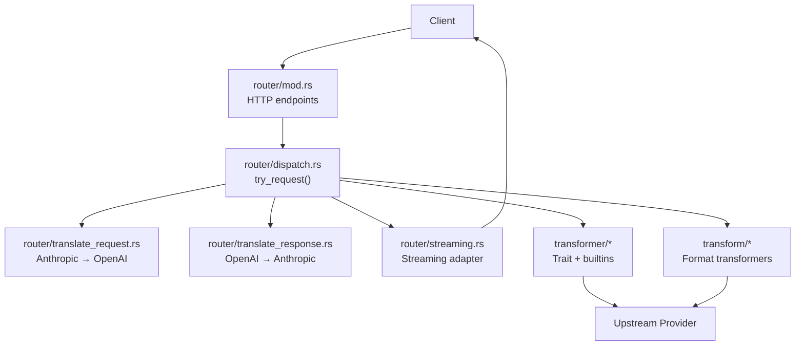

**Diagram sources**
- [router/mod.rs:1-60](file://src/router/mod.rs#L1-L60)
- [router/dispatch.rs:200-420](file://src/router/dispatch.rs#L200-L420)
- [router/translate_request.rs:200-577](file://src/router/translate_request.rs#L200-L577)
- [router/translate_response.rs:1-200](file://src/router/translate_response.rs#L1-L200)
- [router/streaming.rs:1-120](file://src/router/streaming.rs#L1-L120)
- [transformer/mod.rs:1-60](file://src/transformer/mod.rs#L1-L60)
- [transform/mod.rs:1-41](file://src/transform/mod.rs#L1-L41)

**Section sources**
- [lib.rs:1-27](file://src/lib.rs#L1-L27)
- [main.rs:1-120](file://src/main.rs#L1-L120)
- [transform/mod.rs:1-41](file://src/transform/mod.rs#L1-L41)

## Core Components
The translation system has two complementary layers:

1. **Transformer layer**: A trait-based pipeline that can mutate JSON-shaped requests and responses. Built-ins include identity passthrough, Anthropic/OpenAI conversions, token limiting, tool enhancement, reasoning normalization, and tag stripping.
2. **Router layer**: Protocol-aware HTTP routing that selects the target provider protocol, builds headers, applies the transformer chain, and translates streaming or non-streaming payloads.

Key responsibilities:

| Component | Responsibility |
|---|---|
| `Transformer` trait | Define uniform request/response transformation hooks. |
| `TransformerChain` / `TransformerRegistry` | Build ordered transformation pipelines from configuration. |
| `translate_request_anthropic_to_openai` | Convert Anthropic messages, tools, thinking, and output config into OpenAI Chat Completions shape. |
| `translate_response_openai_to_anthropic` | Convert OpenAI Chat Completions response into Anthropic message shape. |
| `OpenAiToAnthropicTransformer` | Full-format OpenAI request/response transformer used by factory path. |
| `AnthropicToOpenAiResponseTransformer` | Full-format Anthropic response transformer used by factory path. |
| `stream_response_translated` | OpenAI stream → Anthropic SSE adapter with state tracking. |
| `build_anthropic_headers` / `build_openai_headers` | Inject provider credentials, attribution, and extra headers. |
| `responses_api` | OpenAI Responses API compatibility layer, including zstd decoding and SSE parsing. |

**Section sources**
- [transformer/mod.rs:1-120](file://src/transformer/mod.rs#L1-L120)
- [transformer/builtin.rs:1-120](file://src/transformer/builtin.rs#L1-L120)
- [router/translate_request.rs:200-577](file://src/router/translate_request.rs#L200-L577)
- [router/translate_response.rs:1-200](file://src/router/translate_response.rs#L1-L200)
- [transform/openai_to_anthropic/mod.rs:1-120](file://src/transform/openai_to_anthropic/mod.rs#L1-L120)
- [transform/anthropic_to_openai.rs:1-120](file://src/transform/anthropic_to_openai.rs#L1-L120)
- [router/dispatch.rs:200-420](file://src/router/dispatch.rs#L200-L420)

## Architecture Overview
At runtime, an incoming request follows one of these paths:

1. HTTP handler receives a request.
2. Router resolves the target tier/provider and protocol (`Anthropic`, `Openai`, or `Responses`).
3. Request transformers are applied to normalize the payload.
4. Headers are built using the provider’s authentication scheme.
5. The request is sent upstream.
6. Response translation adapts the upstream payload to the client’s expected protocol.
7. Streaming events are translated through a stateful adapter when needed.

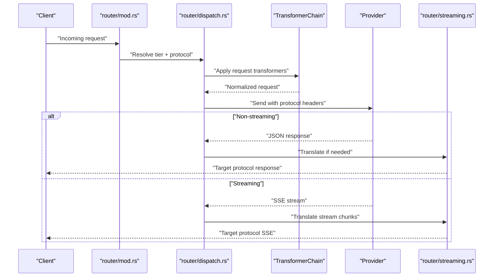

**Diagram sources**
- [router/mod.rs:1-60](file://src/router/mod.rs#L1-L60)
- [router/dispatch.rs:200-420](file://src/router/dispatch.rs#L200-L420)
- [router/streaming.rs:1-120](file://src/router/streaming.rs#L1-L120)

## Detailed Component Analysis

### Transformer Trait and Pipeline
The transformer pipeline is defined by a trait with request and response hooks, plus optional passthrough detection and naming. Built-in implementations include:

- Identity passthrough
- Anthropic passthrough when the request already matches Anthropic expectations
- DeepSeek-specific leading-thinking injection
- Anthropic ↔ OpenAI conversions
- Tool-use normalization
- Max token enforcement
- Reasoning block normalization
- Think-tag stripping
- LongCat thinking fallback

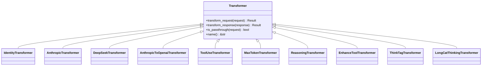

**Diagram sources**
- [transformer/mod.rs:1-120](file://src/transformer/mod.rs#L1-L120)
- [transformer/builtin.rs:1-120](file://src/transformer/builtin.rs#L1-L120)

#### Key Implementation Details
- `DeepSeekTransformer.transform_request` injects a placeholder `thinking` block when a DeepSeek assistant turn follows a user turn containing `tool_result`, or contains `tool_use`, unless the assistant turn already starts with `thinking` or `redacted_thinking`.
- `AnthropicToOpenaiTransformer` converts Anthropic content blocks to OpenAI string/array form, maps tool definitions from `input_schema` to OpenAI `parameters`, and adjusts `tool_choice`.
- `ToolUseTransformer` ensures `input_schema` exists on tools and assigns missing `id` values to `tool_use` response blocks.
- `ReasoningTransformer` inserts a `thinking` content block when a provider returns top-level reasoning text without an explicit thinking block.
- `ThinkTagTransformer` strips `<think>`, `<thinking>`, and `<reasoning>` tags from text blocks.
- `LongCatThinkingTransformer` converts unsigned thinking-only outputs to plain text when no other useful content is present.

**Section sources**
- [transformer/mod.rs:60-200](file://src/transformer/mod.rs#L60-L200)
- [transformer/builtin.rs:120-512](file://src/transformer/builtin.rs#L120-L512)

### Request Normalization: Anthropic to OpenAI
The router provides a dedicated translation function for converting Anthropic requests into OpenAI Chat Completions requests. It handles:

- System prompt extraction into the first `system` message
- Message role normalization (`human`/`user` → `user`)
- `tool_result` blocks in user messages → OpenAI `tool` messages
- Assistant `tool_use` blocks → OpenAI `tool_calls`
- Assistant `thinking` blocks → `reasoning_content` and signed `reasoning_blocks`
- Multimodal content normalization
- Tool definition conversion
- Output config mapping to OpenAI fields like `max_completion_tokens` and `reasoning_effort`
- DeepSeek-specific `thinking.disabled` behavior

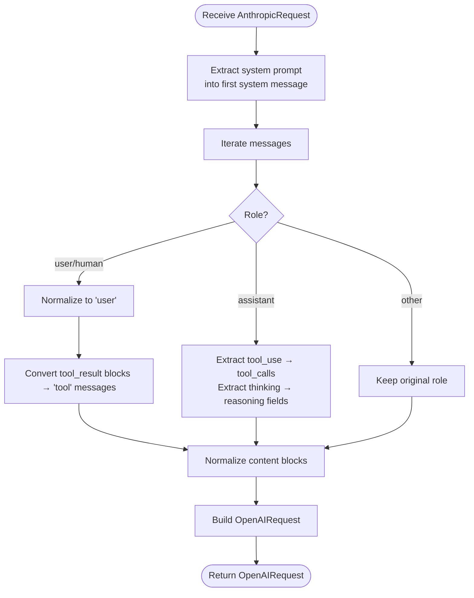

**Diagram sources**
- [router/translate_request.rs:200-577](file://src/router/translate_request.rs#L200-L577)

#### Important Translation Rules
- `tool_result` blocks inside user messages become separate `role: "tool"` messages carrying the extracted text and `tool_call_id`.
- Assistant `thinking` blocks are preserved as both concatenated reasoning text and per<docs>
# Protocol Translation

<cite>
**Referenced Files in This Document**
- [lib.rs](file://src/lib.rs)
- [main.rs](file://src/main.rs)
- [transform/mod.rs](file://src/transform/mod.rs)
- [transformer/mod.rs](file://src/transformer/mod.rs)
- [transformer/builtin.rs](file://src/transformer/builtin.rs)
- [router/mod.rs](file://src/router/mod.rs)
- [router/dispatch.rs](file://src/router/dispatch.rs)
- [router/streaming.rs](file://src/router/streaming.rs)
- [router/translate_request.rs](file://src/router/translate_request.rs)
- [router/translate_response.rs](file://src/router/translate_response.rs)
- [transform/openai_to_anthropic/mod.rs](file://src/transform/openai_to_anthropic/mod.rs)
- [transform/openai_to_anthropic/helpers.rs](file://src/transform/openai_to_anthropic/helpers.rs)
- [transform/anthropic_to_openai.rs](file://src/transform/anthropic_to_openai.rs)
- [router/responses_api.rs](file://src/router/responses_api.rs)
</cite>

## Table of Contents
1. [Introduction](#introduction)
2. [Project Structure](#project-structure)
3. [Core Components](#core-components)
4. [Architecture Overview](#architecture-overview)
5. [Detailed Component Analysis](#detailed-component-analysis)
6. [Dependency Analysis](#dependency-analysis)
7. [Performance Considerations](#performance-considerations)
8. [Troubleshooting Guide](#troubleshooting-guide)
9. [Conclusion](#conclusion)

## Introduction
This document explains CCR-Rust’s protocol translation system: how Anthropic, OpenAI Chat Completions, and OpenAI Responses payloads are normalized, transformed, routed to providers, and converted back to the requesting client protocol. It focuses on the transformer pipeline that processes requests and responses through configurable transformation chains, the concrete translation rules for messages, tools, reasoning blocks, and streaming events, header/metadata handling, custom transformer development, debugging, and version compatibility considerations.

The internal request shape is primarily Anthropic-like. Providers may be Anthropic, OpenAI Chat Completions, or OpenAI Responses; the router normalizes incoming requests into the internal representation, applies provider/model-specific transformers, forwards the payload using the correct wire protocol, and translates provider responses back to the original client protocol.

## Project Structure
The translation system is split across two closely related subsystems:

- `src/transform` — factory-based registry of protocol transformers used by provider-specific code paths.
- `src/transformer` — core trait, built-in transformers, chain execution, and the runtime transformer registry consumed by the router.
- `src/router` — HTTP entry points, dispatch logic, protocol-specific request/response translation helpers, streaming event conversion, and header construction.

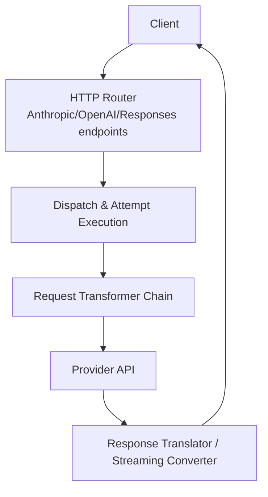

**Diagram sources**
- [router/mod.rs:1-80](file://src/router/mod.rs#L1-L80)
- [router/dispatch.rs:200-380](file://src/router/dispatch.rs#L200-L380)
- [router/streaming.rs:1-120](file://src/router/streaming.rs#L1-L120)
- [transformer/mod.rs:1-60](file://src/transformer/mod.rs#L1-L60)

**Section sources**
- [lib.rs:1-27](file://src/lib.rs#L1-L27)
- [main.rs:1-120](file://src/main.rs#L1-L120)
- [transform/mod.rs:1-41](file://src/transform/mod.rs#L1-L41)
- [transformer/mod.rs:1-60](file://src/transformer/mod.rs#L1-L60)

## Core Components
The protocol translation system is composed of these key components:

| Component | Responsibility |
|---|---|
| `Transformer` trait | Defines request/response transformation hooks with names, passthrough checks, and default no-op behavior. |
| Built-in transformers | Concrete implementations for Anthropic↔OpenAI format conversions, tool normalization, token limits, reasoning block handling, thinking-tag stripping, and model-specific repairs. |
| `TransformerChain` / `TransformerRegistry` | Builds ordered chains from provider-level and model-specific configuration and executes them. |
| Request translators | Convert Anthropic→OpenAI messages, content blocks, tools, reasoning fields, and output config for OpenAI-compatible providers. |
| Response translators | Convert OpenAI→Anthropic non-streaming and streaming responses, including finish reason mapping, tool calls, usage, refusal, and incomplete details. |
| Streaming converter | Maintains state across OpenAI stream chunks to emit correctly paired Anthropic `content_block_start`/`delta`/`stop` events. |
| Header builders | Construct provider-specific authentication, attribution, and extra headers while redacting sensitive debug metadata. |
| Responses adapter | Converts between OpenAI Responses API and OpenAI Chat Completions for the `/v1/responses` endpoint. |

**Section sources**
- [transformer/mod.rs:20-80](file://src/transformer/mod.rs#L20-L80)
- [transformer/builtin.rs:1-60](file://src/transformer/builtin.rs#L1-L60)
- [router/translate_request.rs:1-80](file://src/router/translate_request.rs#L1-L80)
- [router/translate_response.rs:1-60](file://src/router/translate_response.rs#L1-L60)
- [router/streaming.rs:1-60](file://src/router/streaming.rs#L1-L60)
- [router/dispatch.rs:520-600](file://src/router/dispatch.rs#L520-L600)
- [router/responses_api.rs:1-60](file://src/router/responses_api.rs#L1-L60)

## Architecture Overview
At a high level, every request follows one of these paths:

1. The HTTP router receives an Anthropic-style request, an OpenAI Chat Completions request, or an OpenAI Responses request.
2. The request is converted into the internal Anthropic-shaped representation when needed.
3. A configured transformer chain is applied to normalize, enrich, or repair the request for the selected provider.
4. The request is sent over the appropriate wire protocol (Anthropic Messages, OpenAI Chat Completions, or OpenAI Responses).
5. The response is translated back to the client’s expected protocol, including streaming event normalization.

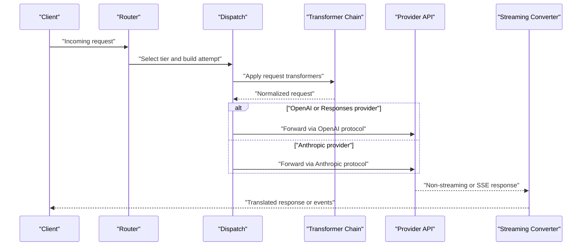

**Diagram sources**
- [router/mod.rs:60-120](file://src/router/mod.rs#L60-L120)
- [router/dispatch.rs:200-380](file://src/router/dispatch.rs#L200-L380)
- [router/streaming.rs:1-120](file://src/router/streaming.rs#L1-L120)

## Detailed Component Analysis

### Transformer Trait and Pipeline
The `Transformer` trait is the central abstraction. Each transformer can:

- Transform an incoming request JSON value.
- Transform an outgoing response JSON value.
- Report whether it is effectively a passthrough for a given request.
- Provide a stable name used in logging and debugging.

Built-in transformers include identity, Anthropic passthrough, DeepSeek, Anthropic-to-OpenAI, tool-use normalization, max-token capping, reasoning handling, tool enhancement, thinking-tag stripping, and LongCat thinking normalization.

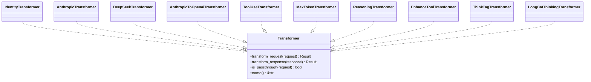

**Diagram sources**
- [transformer/mod.rs:20-80](file://src/transformer/mod.rs#L20-L80)
- [transformer/builtin.rs:1-120](file://src/transformer/builtin.rs#L1-L120)

**Section sources**
- [transformer/mod.rs:20-80](file://src/transformer/mod.rs#L20-L80)
- [transformer/builtin.rs:1-120](file://src/transformer/builtin.rs#L1-L120)

### Request Translation: Anthropic → OpenAI
When routing to an OpenAI-compatible provider, CCR-Rust converts the internal Anthropic-shaped request into an OpenAI Chat Completions request.

Key translation rules:

| Source field | Target field | Rule |
|---|---|---|
| Anthropic top-level `system` | OpenAI first message with `role: "system"` | System text or text blocks are joined into one system message. |
| Anthropic `messages[].content` string | OpenAI `messages[].content` string | Preserved directly. |
| Anthropic `messages[].content` array | OpenAI multimodal content array | Text blocks become OpenAI text parts; image blocks become `image_url`; unknown blocks are rendered defensively. |
| Anthropic `tool_result` blocks in user messages | OpenAI `role: "tool"` messages | Extracted content and `tool_use_id` become the tool message body and ID. |
| Anthropic assistant `tool_use` blocks | OpenAI `tool_calls` | Converted to function tool calls with serialized arguments. |
| Anthropic assistant `thinking` blocks | OpenAI `reasoning_content` and `reasoning_blocks` | Thinking text is preserved; signed blocks carry signatures. |
| Anthropic `tools` | OpenAI `tools` | `input_schema` becomes OpenAI `function.parameters`. |
| Anthropic `tool_choice` | OpenAI `tool_choice` | `any` maps to `required`; `auto` passes through; object form is adapted. |
| Anthropic `max_tokens` | OpenAI `max_completion_tokens` for reasoning models | Non-reasoning models keep `max_tokens`. |
| Anthropic `output_config.effort` | OpenAI `reasoning_effort` | Only string effort values are mapped. |
| Anthropic `thinking` | OpenAI `thinking` | Disabled for DeepSeek non-reasoning models where required. |

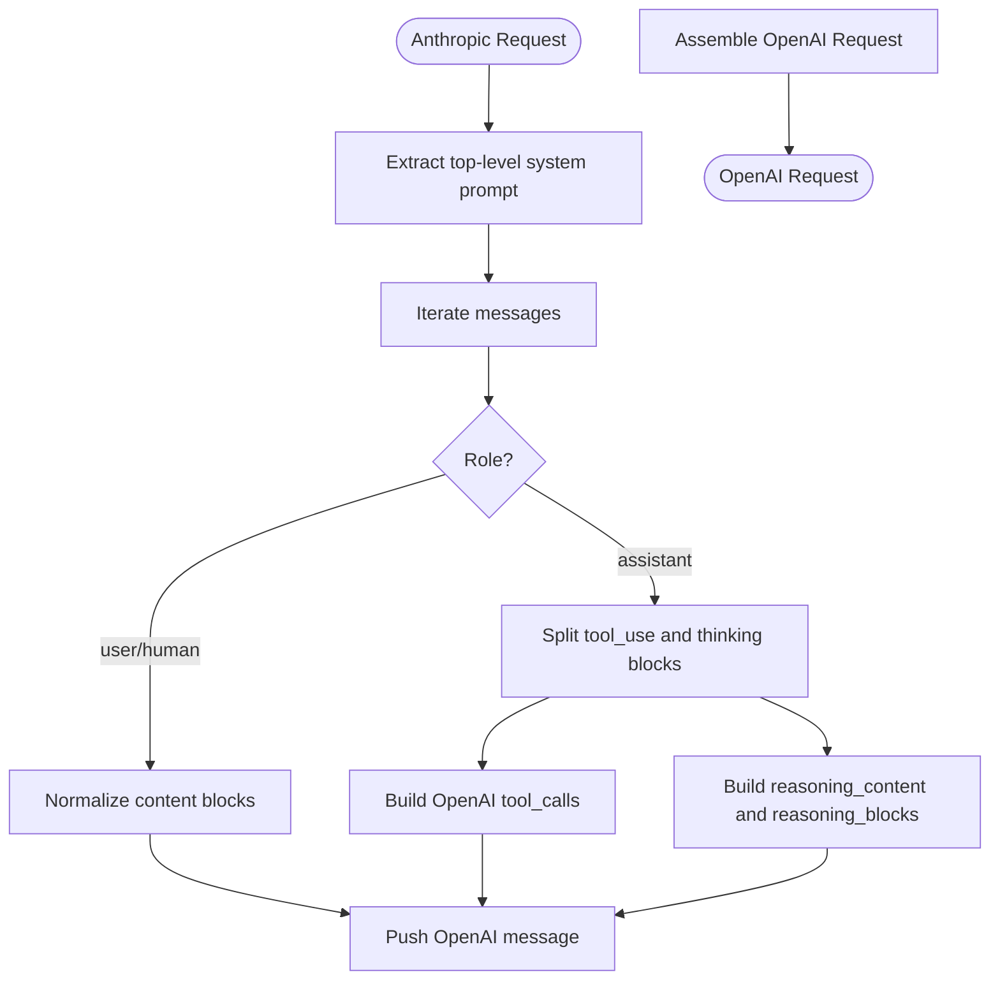

**Diagram sources**
- [router/translate_request.rs:200-577](file://src/router/translate_request.rs#L200-L577)

**Section sources**
- [router/translate_request.rs:1-200](file://src/router/translate_request.rs#L1-L200)
- [router/translate_request.rs:200-577](file://src/router/translate_request.rs#L200-L577)

### Request Translation: OpenAI → Anthropic
For providers that accept Anthropic-format requests, the `OpenAiToAnthropicTransformer` performs the reverse normalization.

Key translation rules:

| Source field | Target field | Rule |
|---|---|---|
| OpenAI `messages[]` with `role: "system"` | Anthropic top-level `system` | Multiple system messages are combined. |
| OpenAI `tool` role messages | Anthropic `tool_result` blocks | Converted into tool-result content blocks. |
| OpenAI content string/array | Anthropic `content` array | String becomes a single text block; arrays are normalized to Anthropic blocks. |
| OpenAI `image_url` | Anthropic `image` source | Base64 data URLs become base64 sources; other URLs become URL sources. |
| OpenAI `tools[*].function` | Anthropic `tools[*]` | Function parameters become `input_schema`. |
| OpenAI `tool_choice` | Anthropic `tool_choice` | `required` becomes `any`; `none` is removed; object form becomes `type: "tool"`. |
| OpenAI `stop` | Anthropic `stop_sequences` | Renamed field. |
| OpenAI `max_completion_tokens` | Anthropic `max_tokens` | Backward-compatible normalization. |
| OpenAI-specific fields | Removed | Fields like `n`, `logprobs`, `logit_bias`, `response_format`, and `seed` are dropped. |

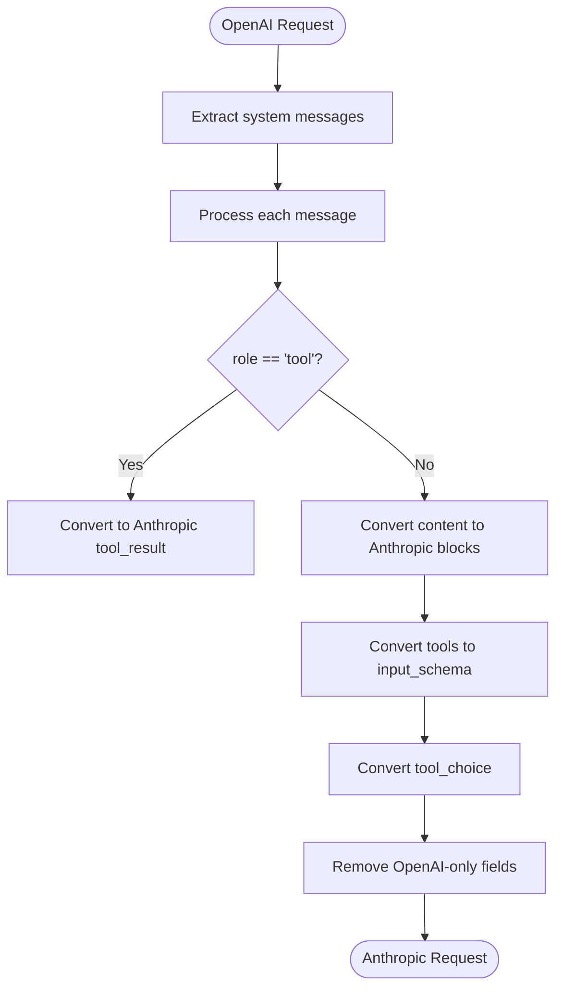

**Diagram sources**
- [transform/openai_to_anthropic/mod.rs:1-200](file://src/transform/openai_to_anthropic/mod.rs#L1-L200)
- [transform/openai_to_anthropic/helpers.rs:1-120](file://src/transform/openai_to_anthropic/helpers.rs#L1-L120)

**Section sources**
- [transform/openai_to_anthropic/mod.rs:1-200](file://src/transform/openai_to_anthropic/mod.rs#L1-L200)
- [transform/openai_to_anthropic/helpers.rs:1-120](file://src/transform/openai_to_anthropic/helpers.rs#L1-L120)

### Response Translation: OpenAI → Anthropic
Non-streaming OpenAI responses are converted into Anthropic messages.

Important behaviors:

- The first OpenAI choice becomes the Anthropic assistant message.
- `finish_reason` is mapped to Anthropic `stop_reason`: `stop` → `end_turn`, `length` → `max_tokens`, `tool_calls` → `tool_use`, `content_filter` → `stop_sequence`.
- OpenAI `content` strings and text arrays become Anthropic text blocks.
- OpenAI `tool_calls` become Anthropic `tool_use` blocks.
- `reasoning_content` is preserved but not emitted as a thinking block unless the upstream is native Anthropic.
- Usage fields are mapped to Anthropic usage structure, including optional cached and reasoning token counts.

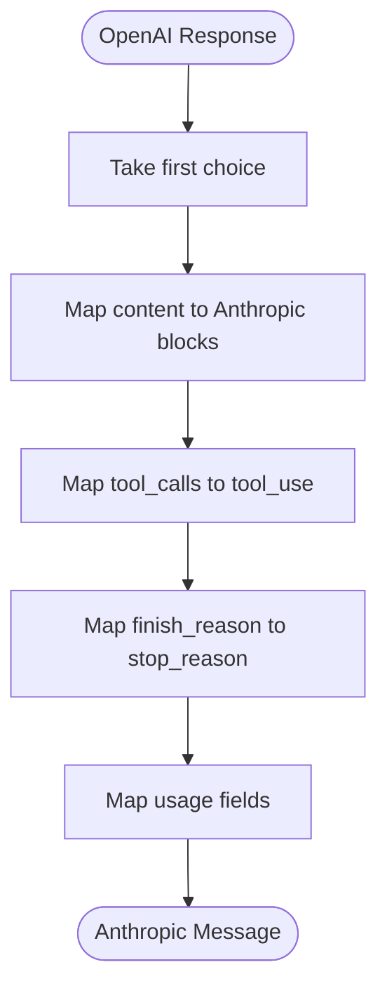

**Diagram sources**
- [router/translate_response.rs:1-160](file://src/router/translate_response.rs#L1-L160)

**Section sources**
- [router/translate_response.rs:1-160](file://src/router/translate_response.rs#L1-L160)

### Streaming Event Translation: OpenAI → Anthropic
Streaming requires stateful conversion because OpenAI SSE chunks are per-chunk, whereas Anthropic expects paired block lifecycle events.

State tracking includes:

- Whether this is the first chunk.
- Whether a text block has been started.
- Indices of active tool-use blocks.
- The terminal `finish_reason`.

Translation rules:

| OpenAI chunk feature | Anthropic event(s) |
|---|---|
| First chunk | `message_start` |
| Delta content | `content_block_delta` with `text` |
| First `tool_calls` fragment | `content_block_start` with `tool_use` schema |
| Incremental tool call arguments | `content_block_delta` with `partial_json` |
| Terminal chunk | `content_block_stop` for all opened blocks, then `message_delta` and `message_stop` |

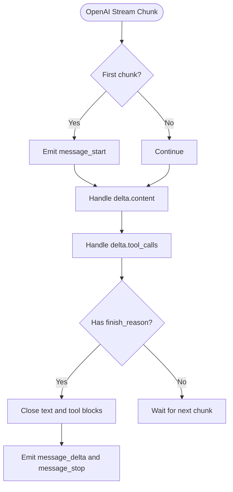

**Diagram sources**
- [router/translate_response.rs:160-399](file://src/router/translate_response.rs#L160-L399)
- [router/streaming.rs:1-200](file://src/router/streaming.rs#L1-L200)

**Section sources**
- [router/translate_response.rs:160-399](file://src/router/translate_response.rs#L160-L399)
- [router/streaming.rs:1-200](file://src/router/streaming.rs#L1-L200)

### Streaming Event Translation: Anthropic → OpenAI
The `AnthropicToOpenAiResponseTransformer` adapts Anthropic streaming events to OpenAI Chat Completions SSE chunks.

Event mappings:

| Anthropic event | OpenAI chunk behavior |
|---|---|
| `message_start` | Initial chunk with assistant role, refusal, response status, and incomplete details. |
| `content_block_start` with `text` | Delta containing content text. |
| `content_block_start` with `tool_use` | Delta with initial `tool_calls` array and empty argument string. |
| `content_block_start` with `thinking` | Delta carrying `reasoning_block_index` so downstream adapters can pair signatures. |
| `content_block_delta` with `text` | Delta content. |
| `content_block_delta` with `thinking` | Delta `reasoning_content`. |
| `content_block_delta` with `signature` | Delta `reasoning_signature` for opaque signature accumulation. |
| `content_block_delta` with `partial_json` | Delta tool call argument fragment. |
| `message_stop` | Finalized completion chunk. |

**Section sources**
- [transform/anthropic_to_openai.rs:1-200](file://src/transform/anthropic_to_openai.rs#L1-L200)
- [transform/anthropic_to_openai.rs:200-500](file://src/transform/anthropic_to_openai.rs#L200-L500)

### OpenAI Responses API Compatibility
The Responses API layer handles `/v1/responses`. It converts between OpenAI Responses and OpenAI Chat Completions, rather than directly converting to Anthropic. This allows clients to use the newer Responses contract while CCR-Rust continues routing through its existing provider and translator stack.

Important behaviors:

- Requests may be zstd-compressed and are decoded with bounded window size.
- JSON payloads tolerate double-encoded strings and embedded JSON spans.
- SSE payloads are parsed into frames before further processing.
- Native Responses payloads bypass request transformers when combined with a Responses provider to avoid lossy reconstruction of fields like files, hosted tools, and structured outputs.

**Section sources**
- [router/responses_api.rs:1-120](file://src/router/responses_api.rs#L1-L120)
- [router/dispatch.rs:240-320](file://src/router/dispatch.rs#L240-L320)

### Header and Metadata Handling
Headers are constructed per provider type:

- **OpenAI-compatible providers**: Authorization bearer, content type, optional OpenRouter attribution headers, and provider-level extra headers.
- **Anthropic providers**: Supports configurable auth header (`x-api-key`, `Authorization`, `Bearer`, `authorization-bearer`), plus provider-level extra headers.
- **Debug capture**: Sensitive headers such as authorization, cookies, API keys, and credential-like tokens are redacted before being recorded.
- **Client-facing headers**: CCR adds `x-ccr-tier` to responses for observability.

Version compatibility:

- Anthropic requests use a default Anthropic API version constant.
- Provider endpoints are resolved through a shared helper that avoids duplicate path segments.
- Model names may be canonicalized for specific providers (for example, MiniMax M3-family aliases are pinned to the official M3.1 Flash deployment).

**Section sources**
- [router/dispatch.rs:520-600](file://src/router/dispatch.rs#L520-L600)
- [router/dispatch.rs:600-900](file://src/router/dispatch.rs#L600-L900)
- [router/dispatch.rs:1-120](file://src/router/dispatch.rs#L1-L120)

### Version Compatibility Rules
The translation system handles several API-version-related compatibilities:

| Area | Behavior |
|---|---|
| Anthropic API version | Uses a default version constant when constructing Anthropic requests. |
| OpenAI `max_completion_tokens` vs `max_tokens` | Normalized bidirectionally depending on protocol direction. |
| OpenAI `reasoning_effort` | Only string values are forwarded; non-string values are omitted rather than synthesized. |
| OpenAI `stop` vs Anthropic `stop_sequences` | Field renamed during translation. |
| OpenAI `tool_choice` vs Anthropic `tool_choice` | `required` ↔ `any`, `none` removal, object-form adaptation. |
| MiniMax model aliases | Canonicalized to the official non-preview M3.1 Flash ID. |
| Responses provider request transformers | Blocked for native Responses passthrough payloads to prevent lossy transformation. |

**Section sources**
- [router/dispatch.rs:300-380](file://src/router/dispatch.rs#L300-L380)
- [router/dispatch.rs:520-600](file://src/router/dispatch.rs#L520-L600)
- [router/translate_request.rs:200-577](file://src/router/translate_request.rs#L200-L577)
- [transform/openai_to_anthropic/mod.rs:200-500](file://src/transform/openai_to_anthropic/mod.rs#L200-L500)

## Dependency Analysis
The translation system has layered dependencies:

- `src/router` depends on translation helpers and streaming converters.
- `router/dispatch.rs` builds the transformer chain and selects the provider protocol path.
- `transformer/mod.rs` exposes the `Transformer` trait and built-in implementations.
- `transform/openai_to_anthropic` and `transform/anthropic_to_openai.rs` provide additional transformer implementations used elsewhere in the codebase.
- `transform/mod.rs` re-exports factory-based transformers and registries.

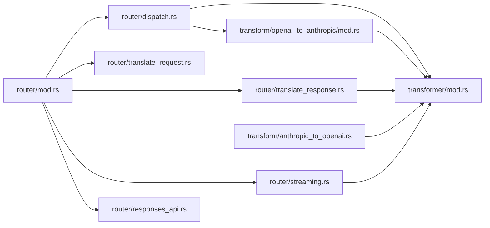

**Diagram sources**
- [router/mod.rs:1-80](file://src/router/mod.rs#L1-L80)
- [router/dispatch.rs:1-60](file://src/router/dispatch.rs#L1-L60)
- [router/translate_request.rs:1-40](file://src/router/translate_request.rs#L1-L40)
- [router/translate_response.rs:1-40](file://src/router/translate_response.rs#L1-L40)
- [router/streaming.rs:1-40](file://src/router/streaming.rs#L1-L40)
- [router/responses_api.rs:1-40](file://src/router/responses_api.rs#L1-L40)
- [transformer/mod.rs:1-40](file://src/transformer/mod.rs#L1-L40)
- [transform/openai_to_anthropic/mod.rs:1-40](file://src/transform/openai_to_anthropic/mod.rs#L1-L40)
- [transform/anthropic_to_openai.rs:1-40](file://src/transform/anthropic_to_openai.rs#L1-L40)

**Section sources**
- [router/mod.rs:1-80](file://src/router/mod.rs#L1-L80)
- [router/dispatch.rs:1-60](file://src/router/dispatch.rs#L1-L60)
- [transformer/mod.rs:1-40](file://src/transformer/mod.rs#L1-L40)

## Performance Considerations
- Streaming translation maintains minimal state per connection: first-chunk flag, text-block flag, active tool indices, accumulated reasoning, and accumulated tool-call fragments.
- Idle timeouts protect long-lived streams; idle timeout errors are emitted as SSE error events.
- Embedded error detection peeks at early stream bytes to detect error payloads wrapped in HTTP 200 responses.
- Debug header capture is capped to the first 64 headers and truncates sensitive values.
- Transformer chains are only applied when configured; identity or passthrough transformers reduce overhead.

[No sources needed since this section provides general guidance]

## Troubleshooting Guide

### Common Translation Issues

| Symptom | Likely Cause | Investigation Steps |
|---|---|---|
| Missing tool calls after OpenAI→Anthropic conversion | OpenAI response did not include valid `tool_calls` or arguments failed to parse | Check the translated response blocks and fallback raw arguments. |
| Empty thinking blocks causing SDK failures | Non-Anthropic providers returned thinking without signatures | Verify reasoning-content preservation and avoid emitting unsigned thinking blocks. |
| DeepSeek assistant turn rejected after tool results | Missing leading thinking block after tool-result history | Confirm DeepSeek-specific thinking injection logic is applied. |
| OpenAI `tool_choice: none` reaches provider | Transformation should remove unsupported values | Ensure the OpenAI→Anthropic transformer removes `none`. |
| Responses provider rejects native payload | Native Responses payload cannot safely pass through request transformers | Disable request transformers or route through Chat Completions instead. |
| Streaming ends without proper Anthropic stop events | OpenAI stream did not emit terminal `finish_reason` or `[DONE]` | Inspect streaming state and upstream termination behavior. |
| Headers contain secrets in debug logs | Debug capture captured sensitive headers | Review redaction rules and log sanitization. |

### Custom Transformer Development
To add a custom transformer:

1. Implement the `Transformer` trait in `src/transformer/builtin.rs` or a dedicated module.
2. Provide a meaningful `name()` for logging.
3. Override `transform_request` and/or `transform_response` as needed.
4. Optionally implement `is_passthrough` to skip expensive work when conditions match.
5. Register the transformer through the configured transformer entries so the registry can construct the chain.
6. Use tracing logs around transformation steps to identify failure points.

Recommended patterns:

- Mutate JSON values conservatively; clone or extract needed fields before mutation.
- Preserve unknown fields unless they are explicitly known to be incompatible.
- Map missing identifiers deterministically (for example, generating tool IDs when upstream does not provide them).
- Avoid mutating reasoning blocks unless the provider explicitly requires them.

**Section sources**
- [transformer/mod.rs:20-80](file://src/transformer/mod.rs#L20-L80)
- [transformer/builtin.rs:120-512](file://src/transformer/builtin.rs#L120-L512)
- [router/translate_response.rs:340-399](file://src/router/translate_response.rs#L340-L399)

### Debugging Translation Issues
Useful inspection points:

- Request transformation: inspect the JSON value after the transformer chain is applied.
- Provider selection: verify the tier name, canonical model name, and protocol.
- Headers: check sanitized debug captures for provider-specific headers.
- Streaming: observe whether `message_start`, `content_block_start`, deltas, and `content_block_stop` are emitted in order.
- Responses adapter: confirm whether the request was treated as a native Responses payload.

Relevant implementation areas:

- Sanitized header capture and embedded error detection.
- Model canonicalization and transformer chain construction.
- Streaming state transitions and idle timeout handling.
- Responses request decoding and SSE parsing.

**Section sources**
- [router/dispatch.rs:1-120](file://src/router/dispatch.rs#L1-L120)
- [router/dispatch.rs:200-380](file://src/router/dispatch.rs#L200-L380)
- [router/streaming.rs:1-200](file://src/router/streaming.rs#L1-L200)
- [router/responses_api.rs:1-120](file://src/router/responses_api.rs#L1-L120)

## Conclusion
CCR-Rust’s protocol translation system centers on a configurable transformer pipeline that normalizes heterogeneous LLM API formats into a consistent internal representation. Anthropic requests are largely passed through, OpenAI requests are converted into Anthropic-like shapes, and provider responses are converted back to the client’s expected protocol. The streaming layer adds stateful event sequencing to reconcile differences between OpenAI and Anthropic streaming contracts. Provider-specific rules cover messages, multimodal content, tool calls, reasoning blocks, headers, model naming, and Responses API compatibility. Extending the system typically involves adding a `Transformer` implementation and wiring it into the configured chain.