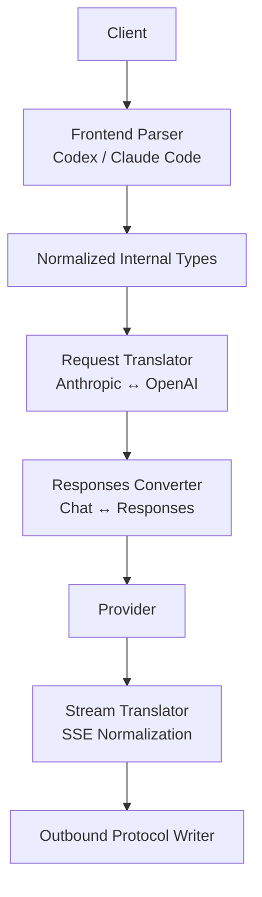
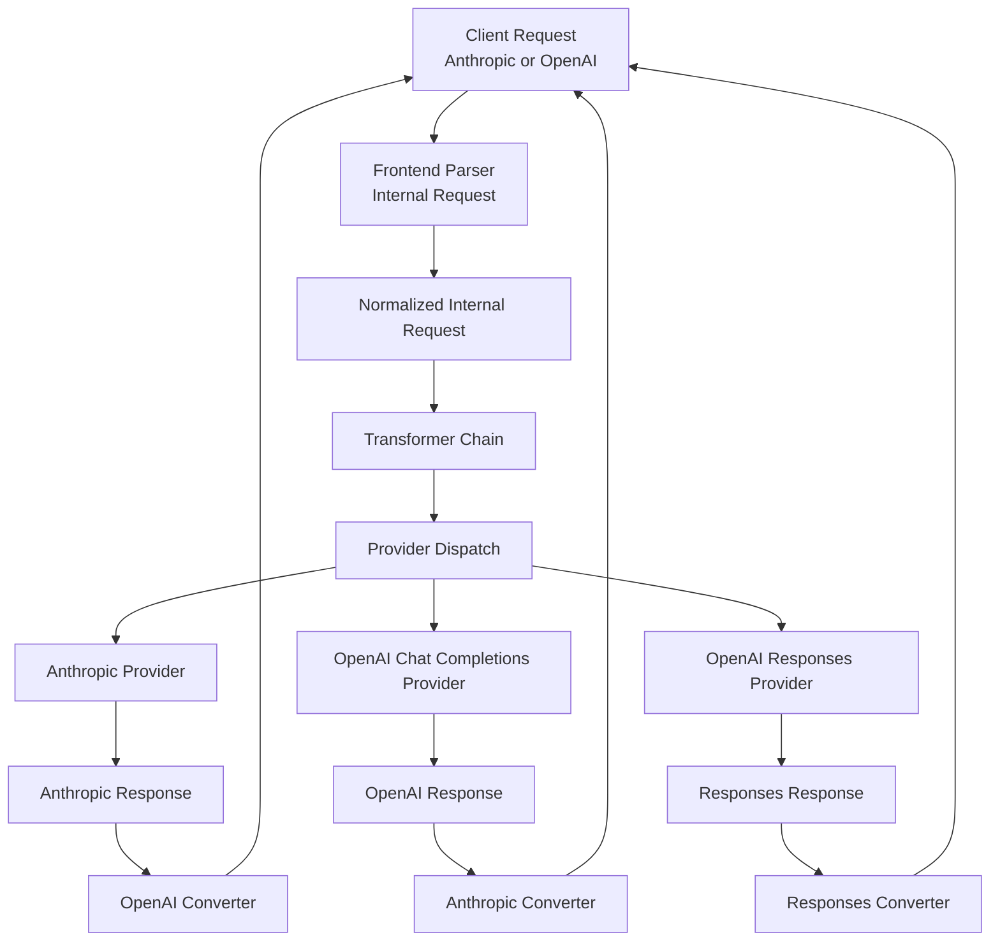
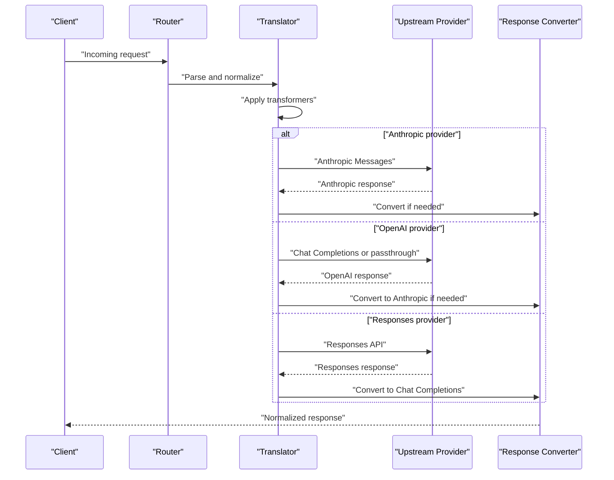
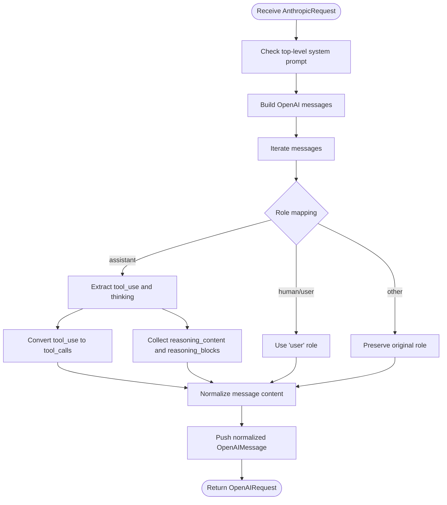
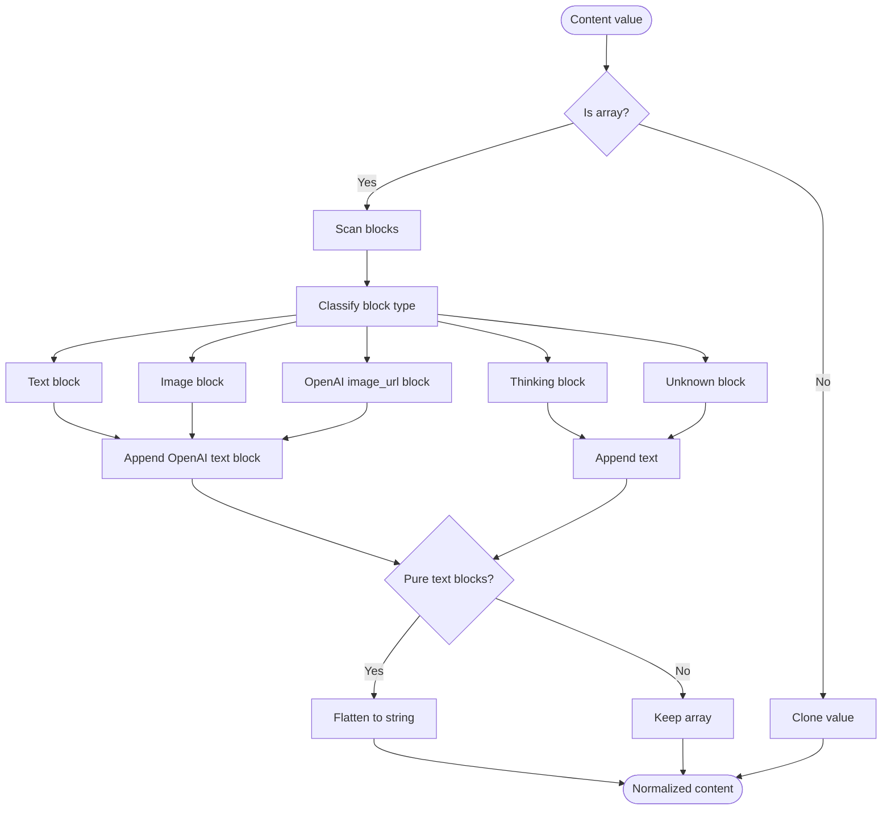
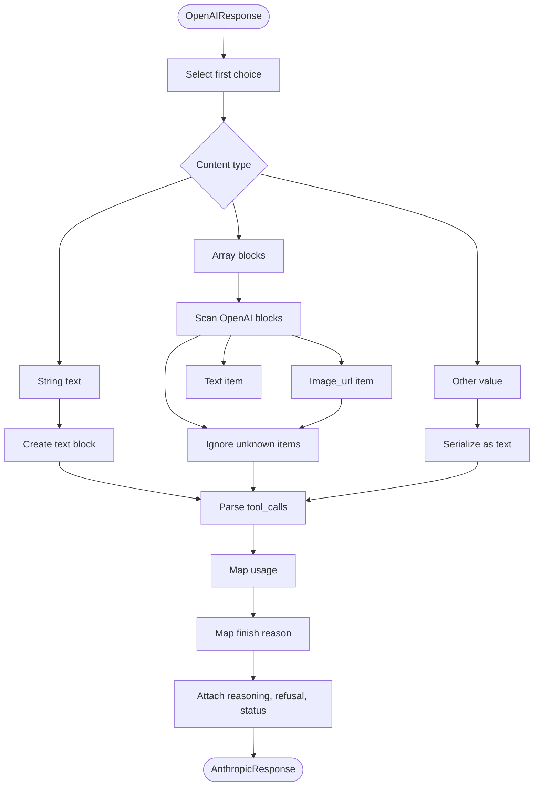
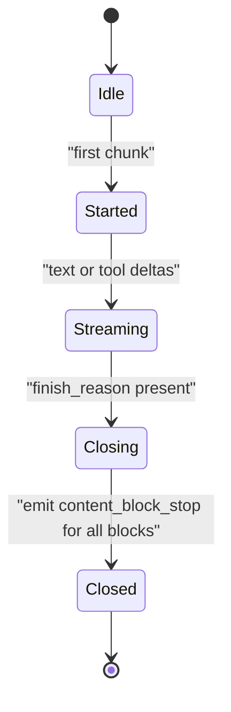
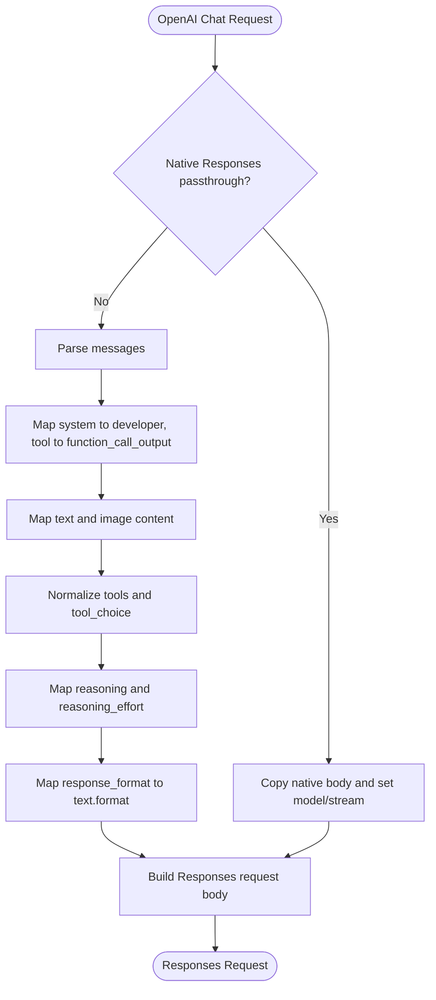
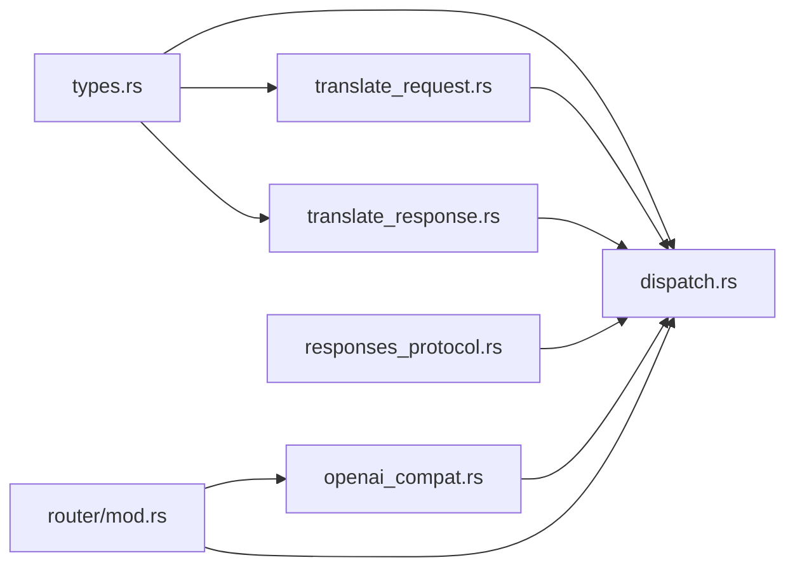

# Request and Response Normalization

<cite>
**Referenced Files in This Document**   
- [mod.rs](file://src/router/mod.rs)
- [types.rs](file://src/router/types.rs)
- [translate_request.rs](file://src/router/translate_request.rs)
- [translate_response.rs](file://src/router/translate_response.rs)
- [openai_compat.rs](file://src/router/openai_compat.rs)
- [responses_protocol.rs](file://src/router/responses_protocol.rs)
- [dispatch.rs](file://src/router/dispatch.rs)
</cite>

## Table of Contents
1. [Introduction](#introduction)
2. [Project Structure](#project-structure)
3. [Core Components](#core-components)
4. [Architecture Overview](#architecture-overview)
5. [Detailed Component Analysis](#detailed-component-analysis)
6. [Dependency Analysis](#dependency-analysis)
7. [Performance Considerations](#performance-considerations)
8. [Troubleshooting Guide](#troubleshooting-guide)
9. [Conclusion](#conclusion)

## Introduction
This document explains CCR-Rust’s request and response normalization layer. It covers how incoming Anthropic and OpenAI API requests are parsed, converted into a unified internal representation, forwarded to providers, and then converted back to the client-facing protocol. It also documents the normalized data structures for messages, tools, reasoning content, streaming events, and metadata handling, and it provides concrete before-and-after examples plus error-handling guidance.

The normalization layer is centered on three translation paths:
- Anthropic requests sent to OpenAI-compatible or Responses providers.
- OpenAI Chat Completions requests sent to Anthropic or other providers.
- Responses API payloads exchanged with native Responses providers.

The router preserves important fields such as authentication headers, provider-specific configuration, tool call identifiers, reasoning blocks, refusal text, usage metrics, and optional native Responses envelopes while normalizing only the protocol differences that matter for interoperability.

## Project Structure
The normalization logic lives under `src/router` and is organized by responsibility rather than by protocol alone:

| Area | Responsibility | Key files |
|---|---|---|
| Shared types | Internal request/response models, streaming chunks, and enum definitions | `types.rs` |
| Request translation | Anthropic-to-OpenAI message, tool, thinking, and output-config conversion | `translate_request.rs` |
| Response translation | OpenAI-to-Anthropic non-streaming and streaming event translation | `translate_response.rs` |
| OpenAI compatibility | `/v1/chat/completions` handler, Anthropic-to-OpenAI stream/json conversion, header/content rewriting | `openai_compat.rs` |
| Responses protocol | OpenAI Chat Requests-to-Responses and Responses-to-Chat conversions | `responses_protocol.rs` |
| Dispatch and transport | Provider selection, transformers, headers, rate limits, embedded error detection, streaming tracking | `dispatch.rs` |
| Router entry points | Public handlers, passthrough keys, and routing helpers | `mod.rs` |



**Diagram sources**
- [mod.rs:24-35](file://src/router/mod.rs#L24-L35)
- [openai_compat.rs:549-762](file://src/router/openai_compat.rs#L549-L762)
- [translate_request.rs:201-580](file://src/router/translate_request.rs#L201-L580)
- [translate_response.rs:1-399](file://src/router/translate_response.rs#L1-L399)
- [responses_protocol.rs:1-862](file://src/router/responses_protocol.rs#L1-L862)
- [dispatch.rs:627-1042](file://src/router/dispatch.rs#L627-L1042)

**Section sources**
- [mod.rs:24-35](file://src/router/mod.rs#L24-L35)
- [dispatch.rs:1-120](file://src/router/dispatch.rs#L1-L120)

## Core Components
The normalization layer revolves around shared internal types and four transformation functions:

| Component | Purpose | Notes |
|---|---|---|
| `AnthropicRequest`, `Message` | Canonical Anthropic-shaped request model | Carries system prompt, tools, thinking, output config, and an optional OpenAI passthrough body |
| `OpenAIRequest`, `OpenAIMessage` | Canonical OpenAI Chat Completions model | Carries `reasoning_content`, `reasoning_blocks`, tool calls, and optional OpenAI-native features |
| `OpenAIResponse`, `OpenAIChoice`, `OpenAIUsage` | Non-streaming OpenAI response envelope | Used when reading upstream JSON responses |
| `OpenAIStreamChunk`, `OpenAIDelta`, `OpenAIStreamToolCall` | Streaming OpenAI chunk model | Used during SSE normalization |
| `AnthropicResponse`, `AnthropicContentBlock`, `AnthropicUsage`, `AnthropicStreamEvent` | Canonical Anthropic response/event model | Used internally and when writing Anthropic-compatible output |

Key behaviors:
- Messages can be strings, arrays of multimodal blocks, or null.
- Tool use is represented as structured tool calls in OpenAI and as typed blocks in Anthropic; both directions normalize between them.
- Reasoning/thinking content is preserved either as flattened text (`reasoning_content`) or as signed blocks (`reasoning_blocks`) depending on the source protocol.
- The internal Anthropic shape carries extra metadata like refusal text, original Responses status, and incomplete details so downstream serialization can reconstruct the target protocol faithfully.

**Section sources**
- [types.rs:1-200](file://src/router/types.rs#L1-L200)
- [types.rs:201-378](file://src/router/types.rs#L201-L378)

## Architecture Overview
The end-to-end flow differs slightly depending on whether the inbound request is Anthropic-shaped or OpenAI-shaped, and whether the selected provider speaks Anthropic, OpenAI Chat Completions, or the Responses API.

```mermaid
sequenceDiagram
    participant Client as "Client"
    participant OpenAIHandler as "OpenAI Handler"
    participant Frontend as "Frontend Parser"
    participant Internal as "Internal Request"
    participant Translator as "Request Translator"
    participant Responses as "Responses Converter"
    participant Provider as "Provider"
    participant Stream as "Stream Translator"

    Client->>OpenAIHandler: "POST /v1/chat/completions"
    OpenAIHandler->>Frontend: "Parse OpenAI request"
    Frontend-->>OpenAIHandler: "InternalRequest"
    OpenAIHandler->>Internal: "internal_request_to_anthropic_request"
    Internal->>Translator: "translate_request_anthropic_to_openai"
    Translator-->>OpenAIHandler: "OpenAIRequest"
    alt Provider is Responses
        OpenAIHandler->>Responses: "openai_chat_request_to_responses"
        Responses-->>OpenAIHandler: "Responses payload"
    else Provider is OpenAI
        OpenAIHandler-->>OpenAIHandler: "Use OpenAIRequest directly"
    end
    OpenAIHandler->>Provider: "HTTP request"
    Provider-->>OpenAIHandler: "JSON or SSE response"
    opt Streaming
        OpenAIHandler->>Stream: "convert_anthropic_stream_response_to_openai"
        Stream-->>Client: "OpenAI SSE"
    else Non-streaming
        OpenAIHandler-->>Client: "OpenAI JSON"
    end
```

**Diagram sources**
- [openai_compat.rs:549-762](file://src/router/openai_compat.rs#L549-L762)
- [translate_request.rs:201-580](file://src/router/translate_request.rs#L201-L580)
- [responses_protocol.rs:1-200](file://src/router/responses_protocol.rs#L1-L200)
- [dispatch.rs:627-1042](file://src/router/dispatch.rs#L627-L1042)

### Two Main Inbound Paths

| Inbound protocol | Internal handling | Target protocol path |
|---|---|---|
| Anthropic | Parsed as `AnthropicRequest`; forwarded through the Anthropic route or translated if needed | Direct Anthropic provider, or translated to OpenAI/Responses via dispatch |
| OpenAI Chat Completions | Parsed by<docs>
# Request and Response Normalization

<cite>
**Referenced Files in This Document**   
- [mod.rs](file://src/router/mod.rs)
- [types.rs](file://src/router/types.rs)
- [translate_request.rs](file://src/router/translate_request.rs)
- [translate_response.rs](file://src/router/translate_response.rs)
- [responses_protocol.rs](file://src/router/responses_protocol.rs)
- [openai_compat.rs](file://src/router/openai_compat.rs)
- [dispatch.rs](file://src/router/dispatch.rs)
</cite>

## Table of Contents
1. [Introduction](#introduction)
2. [Project Structure](#project-structure)
3. [Core Components](#core-components)
4. [Architecture Overview](#architecture-overview)
5. [Detailed Component Analysis](#detailed-component-analysis)
6. [Dependency Analysis](#dependency-analysis)
7. [Performance Considerations](#performance-considerations)
8. [Troubleshooting Guide](#troubleshooting-guide)
9. [Conclusion](#conclusion)

## Introduction
This document explains CCR-Rust’s request and response normalization layer that sits between client-facing API protocols and upstream provider backends. Its primary responsibilities are:

- Parsing incoming Anthropic Messages and OpenAI Chat Completions requests into a unified internal representation.
- Converting normalized requests to the target protocol used by each provider: Anthropic Messages, OpenAI Chat Completions, or OpenAI Responses.
- Converting provider responses back to the requested client format.
- Preserving or transforming protocol-specific metadata such as headers, authentication, tool schemas, reasoning content, refusal text, streaming event structure, and usage metrics.
- Handling malformed input, unsupported features, and protocol mismatches with explicit errors rather than silently dropping data.

The normalization layer is centered on a small set of shared types and focused translation functions rather than one monolithic adapter. Requests flow through frontend parsing, optional transformer application, protocol dispatch, and then either direct passthrough, Anthropic conversion, or Responses conversion depending on the selected provider.

## Project Structure
The normalization logic lives under `src/router` and is composed of several cooperating modules:

| Module | Responsibility |
|---|---|
| `types.rs` | Shared request, response, message, tool, usage, and streaming event structures for both Anthropic and OpenAI formats. |
| `translate_request.rs` | Converts Anthropic messages, tools, thinking blocks, and image blocks into OpenAI-compatible shapes. |
| `translate_response.rs` | Converts non-streaming and streaming OpenAI responses back into Anthropic-shaped events and carries reasoning/refusal metadata. |
| `responses_protocol.rs` | Converts OpenAI Chat Completions requests and responses to/from the OpenAI Responses API shape. |
| `openai_compat.rs` | Handles `/v1/chat/completions`, normalizes Anthropic JSON and SSE responses into OpenAI Chat Completions, and forwards native OpenAI bodies when possible. |
| `dispatch.rs` | Applies transformers, selects providers, builds headers, performs HTTP calls, detects embedded errors, and routes streaming vs non-streaming responses. |
| `mod.rs` | Exposes router entry points, pass-through keys, and shared helpers used across normalization paths. |



**Diagram sources**
- [mod.rs:1-30](file://src/router/mod.rs#L1-L30)
- [openai_compat.rs:549-762](file://src/router/openai_compat.rs#L549-L762)
- [dispatch.rs:900-1042](file://src/router/dispatch.rs#L900-L1042)
- [responses_protocol.rs:1-120](file://src/router/responses_protocol.rs#L1-L120)

**Section sources**
- [mod.rs:1-30](file://src/router/mod.rs#L1-L30)
- [types.rs:1-120](file://src/router/types.rs#L1-L120)

## Core Components
The normalization layer is built around three core data families:

### Normalized Request Types
- `AnthropicRequest`: Represents an incoming Anthropic Messages request, including messages, system prompt, token limits, temperature, stream flag, tools, thinking controls, output configuration, and an optional passthrough body for already OpenAI-formatted requests.
- `Message`: A single message carrying role, content, and optional tool call identifier.
- `OpenAIRequest`: The OpenAI Chat Completions request shape, including messages, token limits, temperature, stream flag, tools, reasoning effort, thinking control, and reasoning blocks.
- `OpenAIMessage`: An OpenAI message supporting plain content, reasoning content, reasoning blocks, tool calls, and tool call identifiers.

Key design decisions:
- Anthropic top-level `system` is converted into an OpenAI `system` message.
- Anthropic assistant `tool_use` blocks become OpenAI `tool_calls`.
- Anthropic `thinking` blocks produce both flattened `reasoning_content` and structured `reasoning_blocks` so signed reasoning can round-trip safely.
- Image handling supports both Anthropic `image` blocks and OpenAI `image_url` blocks in string and object form.

### Normalized Response Types
- `AnthropicResponse`: The canonical internal response shape used when routing to Anthropic-native providers, extended with optional `reasoning_content`, `refusal`, `response_status`, and `incomplete_details`.
- `AnthropicContentBlock`: Enumerates `text`, `thinking`, redacted reasoning, and `tool_use` blocks.
- `AnthropicUsage`: Token accounting including input/output tokens, cache reads, cache creation, and reasoning tokens.
- `OpenAIResponse`, `OpenAIChoice`, `OpenAIResponseMessage`: Incoming OpenAI chat completion response fields, including reasoning aliases and tool calls.
- `OpenAIStreamChunk`, `OpenAIStreamChoice`, `OpenAIDelta`, `OpenAIStreamToolCall`, `OpenAIStreamToolFunction`: Streaming chunk fields used when translating OpenAI SSE events.

### Streaming Event Structures
- `AnthropicStreamEvent`: The normalized Anthropic server-sent event shape carrying event type, message metadata, block index, content block definition, delta payload, usage, and stop reason.
- `StreamTranslationState`: Tracks first-chunk state, whether a text block has been opened, active tool-use indices, and the terminal finish reason while translating OpenAI chunks to Anthropic events.

**Section sources**
- [types.rs:60-180](file://src/router/types.rs#L60-L180)
- [types.rs:201-378](file://src/router/types.rs#L201-L378)
- [translate_response.rs:1-120](file://src/router/translate_response.rs#L1-L120)

## Architecture Overview
There are three main request paths:

1. **Anthropic Messages path**: Incoming Anthropic requests are transformed through the transformer chain and sent directly to Anthropic-shaped providers. Responses may be passed through or converted to OpenAI Chat Completions when the client expects that format.
2. **OpenAI Chat Completions path**: OpenAI requests are parsed into an internal request, optionally forwarded as a native OpenAI body, otherwise translated to Anthropic, dispatched, and then converted back to OpenAI.
3. **OpenAI Responses path**: OpenAI Chat Completions requests are converted to the Responses API shape before being sent to Responses-capable providers; Responses responses are then converted back to OpenAI Chat Completions.



**Diagram sources**
- [openai_compat.rs:549-762](file://src/router/openai_compat.rs#L549-L762)
- [dispatch.rs:900-1042](file://src/router/dispatch.rs#L900-L1042)
- [responses_protocol.rs:1-120](file://src/router/responses_protocol.rs#L1-L120)

**Section sources**
- [dispatch.rs:900-1042](file://src/router/dispatch.rs#L900-L1042)
- [openai_compat.rs:549-762](file://src/router/openai_compat.rs#L549-L762)

## Detailed Component Analysis

### Incoming Request Normalization

#### Anthropic-to-OpenAI Message Translation
When an Anthropic request needs to reach an OpenAI-compatible backend, `translate_request_anthropic_to_openai` performs these conversions:

- System prompts move from top-level `system` into the first `role: "system"` message.
- Human/user roles map to OpenAI `user`.
- Assistant messages have their `tool_use` blocks extracted into OpenAI `tool_calls`.
- `thinking` blocks are separated from regular content and placed into `reasoning_content` and `reasoning_blocks`.
- Unknown assistant blocks remain in the content array.
- Tool result blocks in user messages become OpenAI `tool` role messages with `tool_call_id`.
- Content is normalized via `normalize_message_content`, which flattens pure text arrays into strings and preserves multimodal blocks.



**Diagram sources**
- [translate_request.rs:218-390](file://src/router/translate_request.rs#L218-L390)

**Section sources**
- [translate_request.rs:218-390](file://src/router/translate_request.rs#L218-L390)

#### Content Block Normalization
`normalize_message_content` handles:

- Plain strings remain strings.
- Arrays of blocks are scanned for known block types.
- Anthropic `text` becomes OpenAI `text`.
- Anthropic `image` becomes OpenAI `image_url` using base64 or URL sources.
- Already OpenAI-style `image_url` blocks are preserved and normalized from shorthand string form to the required object form.
- `thinking` blocks are collapsed into a fallback text section wrapped in `<thinking>` markers when mixed with other content.
- Pure text-only arrays are flattened into a single string to avoid unnecessary payloads.
- Unknown blocks are serialized as text rather than dropped.



**Diagram sources**
- [translate_request.rs:12-120](file://src/router/translate_request.rs#L12-L120)

**Section sources**
- [translate_request.rs:12-120](file://src/router/translate_request.rs#L12-L120)

#### Image Block Conversion
`openai_image_block_to_anthropic` converts OpenAI `image_url` blocks into Anthropic `image` blocks:

- Data URLs are split into media type and base64 payload.
- Media types are normalized; `image/jpg` becomes `image/jpeg`; parameters like charset are stripped.
- Non-data URLs become Anthropic URL sources.
- Non-image blocks return `None`.

**Section sources**
- [translate_request.rs:120-218](file://src/router/translate_request.rs#L120-L218)

#### Tool Schema Normalization
`convert_anthropic_tools_to_openai` maps Anthropic tool definitions to OpenAI function tools:

- If a tool already has `type: "function"`, it is preserved.
- Otherwise, `name`, `description`, and `input_schema` are mapped into OpenAI’s nested `function` shape.
- Missing schemas default to an empty object schema.

**Section sources**
- [translate_request.rs:218-390](file://src/router/translate_request.rs#L218-L390)

#### Reasoning and Output Controls
- Reasoning models are detected by model name patterns such as `reasoner`, `r1`, or `thinking`.
- For reasoning models, `max_tokens` is moved to `max_completion_tokens`.
- DeepSeek models without reasoning receive explicit thinking disabled flags where appropriate.
- Anthropic `output_config.effort` is translated to OpenAI `reasoning_effort`; other output config members are intentionally omitted because they do not have a lossless OpenAI Chat Completions representation.
- Signed reasoning blocks preserve both flattened text and signature-carrying block objects.

**Section sources**
- [translate_request.rs:218-390](file://src/router/translate_request.rs#L218-L390)

### Outgoing Response Normalization

#### Non-Streaming OpenAI-to-Anthropic Response Translation
`translate_response_openai_to_anthropic` converts an OpenAI chat completion response into an Anthropic-shaped response:

- Main text content becomes `AnthropicContentBlock::Text`.
- OpenAI `image_url` blocks are not emitted as images downstream; they are serialized as text to avoid SDK failures.
- `tool_calls` become `AnthropicContentBlock::ToolUse`, with id generation and argument parsing.
- Usage is mapped from OpenAI token counts, cached tokens, and reasoning tokens.
- Finish reasons are remapped: `stop` → `end_turn`, `length` → `max_tokens`, `tool_calls` → `tool_use`, `content_filter` → `stop_sequence`.
- Optional `reasoning_content`, `refusal`, `response_status`, and `incomplete_details` are carried forward.



**Diagram sources**
- [translate_response.rs:1-120](file://src/router/translate_response.rs#L1-L120)
- [types.rs:201-378](file://src/router/types.rs#L201-L378)

**Section sources**
- [translate_response.rs:1-120](file://src/router/translate_response.rs#L1-L120)
- [types.rs:201-378](file://src/router/types.rs#L201-L378)

#### Streaming Chunk Translation
`translate_stream_chunk_to_anthropic` translates OpenAI SSE chunks into Anthropic events while maintaining state:

- On the first chunk, it emits `message_start` and opens a text content block.
- Text deltas become `content_block_delta` events.
- Tool-call deltas open `tool_use` content blocks and emit incremental `partial_json` deltas.
- Active tool indices are tracked so every opened tool block receives a matching `content_block_stop`.
- Terminal `finish_reason` closes all open blocks and records the final reason.



**Diagram sources**
- [translate_response.rs:120-320](file://src/router/translate_response.rs#L120-L320)

**Section sources**
- [translate_response.rs:120-320](file://src/router/translate_response.rs#L120-L320)

#### OpenAI-Compatible Response Conversion
`openai_compat.rs` provides two important converters:

- `convert_anthropic_json_response_to_openai`: Reads an Anthropic JSON response, extracts reasoning, refusal, usage, and content, and serializes it as an OpenAI Chat Completions response. It also normalizes 429 responses into OpenAI-style rate limit error envelopes.
- `convert_anthropic_stream_response_to_openai`: Parses Anthropic SSE frames, reindexes tool call indices into dense OpenAI indices, propagates `id` and `model`, aggregates usage, and emits `[DONE]` exactly once.

**Section sources**
- [openai_compat.rs:201-548](file://src/router/openai_compat.rs#L201-L548)

### OpenAI Responses Protocol Conversion

#### Request Conversion
`openai_chat_request_to_responses` transforms an OpenAI Chat Completions request into an upstream Responses request:

- Messages are converted into Responses `input` items.
- `system` role becomes `developer`.
- `tool` role messages become `function_call_output`.
- Text and image content are mapped to `input_text`, `output_text`, `input_image`, and related fields.
- Tools and tool choice are normalized to Responses shapes, rejecting invalid entries.
- `reasoning_effort` is wrapped into a `reasoning` object.
- `response_format.json_schema` is preserved under Responses `text.format`.
- Native Responses passthrough payloads bypass conversion when configured.



**Diagram sources**
- [responses_protocol.rs:1-120](file://src/router/responses_protocol.rs#L1-L120)
- [responses_protocol.rs:120-300](file://src/router/responses_protocol.rs#L120-L300)

**Section sources**
- [responses_protocol.rs:1-120](file://src/router/responses_protocol.rs#L1-L120)
- [responses_protocol.rs:120-300](file://src/router/responses_protocol.rs#L120-L300)

#### Response Conversion
`responses_response_to_openai_chat` converts a Responses response into an OpenAI Chat Completions response:

- Text is extracted from `output_text` or message content.
- Refusal text is extracted from refusal blocks.
- Reasoning text is joined from summary/content parts.
- Function calls are converted to OpenAI `tool_calls`.
- Finish reason is derived from tool calls, incomplete details, or defaults to `stop`.
- Usage is mapped to OpenAI usage shape, including detail fields.
- `status` and `incomplete_details` are preserved as optional envelope fields.
- When not preserving native Responses envelopes, missing output, null errors, and empty outputs are treated as errors.

**Section sources**
- [responses_protocol.rs:300-862](file://src/router/responses_protocol.rs#L300-L862)

### Header, Authentication, and Metadata Handling

#### Request Headers
Headers are constructed per protocol:

- OpenAI-compatible providers use `Authorization: Bearer` and `Content-Type: application/json`.
- Anthropic providers support configurable auth header modes: `x-api-key`, `authorization`, `bearer`, or `authorization-bearer`.
- Anthropic requests always include `anthropic-version`, defaulting to a constant unless overridden.
- Provider-specific extra headers are merged from configuration.
- OpenRouter attribution headers are added automatically for OpenRouter-named or OpenRouter-hosted providers.

#### Sensitive Header Redaction
Debug capture sanitizes outgoing and incoming headers by redacting authorization, proxy authorization, cookies, API keys, credential-like names, and token-like suffixes.

#### Passthrough and Metadata Preservation
- When an inbound request is already OpenAI-formatted and no transformers modify it, the original body is reused to avoid an unnecessary OpenAI → Anthropic → OpenAI round trip.
- Native Responses passthrough payloads are preserved when there is no request transformer chain, preventing loss of file inputs, hosted tools, and structured output fields.
- Responses response envelopes can be preserved for ProvidersProtocol Responses when explicitly requested, allowing status, incomplete details, and raw metadata to surface to clients.

**Section sources**
- [dispatch.rs:1042-1917](file://src/router/dispatch.rs#L1042-L1917)
- [openai_compat.rs:549-762](file://src/router/openai_compat.rs#L549-L762)
- [mod.rs:1-30](file://src/router/mod.rs#L1-L30)

## Dependency Analysis



**Diagram sources**
- [mod.rs:1-30](file://src/router/mod.rs#L1-L30)
- [dispatch.rs:1-120](file://src/router/dispatch.rs#L1-L120)
- [translate_request.rs:1-20](file://src/router/translate_request.rs#L1-L20)
- [translate_response.rs:1-20](file://src/router/translate_response.rs#L1-L20)
- [responses_protocol.rs:1-20](file://src/router/responses_protocol.rs#L1-L20)
- [openai_compat.rs:1-20](file://src/router/openai_compat.rs#L1-L20)

### Coupling and Cohesion
- `types.rs` is the central contract and is imported by most translation and dispatch code.
- `translate_request.rs` and `translate_response.rs` are narrowly focused on format conversion and depend primarily on `types.rs` and JSON values.
- `responses_protocol.rs` depends only on JSON manipulation and shared constants, making it reusable for both request and response conversion.
- `dispatch.rs` coordinates transformation, headers, HTTP I/O, streaming detection, and error classification.
- `openai_compat.rs` bridges Anthropic and OpenAI Chat Completions at the HTTP handler level.

### Potential Circular Dependencies
The visible dependencies form a directed graph without obvious cycles: handlers and dispatch depend on translators and types; translators depend on types; the protocol converter is independent except for shared constants.

**Section sources**
- [types.rs:1-120](file://src/router/types.rs#L1-L120)
- [translate_request.rs:1-20](file://src/router/translate_request.rs#L1-L20)
- [translate_response.rs:1-20](file://src/router/translate_response.rs#L1-L20)
- [responses_protocol.rs:1-20](file://src/router/responses_protocol.rs#L1-L20)
- [dispatch.rs:1-120](file://src/router/dispatch.rs#L1-L120)
- [openai_compat.rs:1-20](file://src/router/openai_compat.rs#L1-L20)

## Performance Considerations

- **Passthrough optimization**: When the inbound request is already OpenAI-formatted and no transformers apply, CCR forwards the original body directly. This avoids deserialization, translation, and re-serialization overhead.
- **Streaming state machine**: OpenAI-to-Anthropic streaming uses a lightweight state tracker instead of full-buffer aggregation. Only necessary deltas and closing events are produced.
- **First-event peek timeout**: Streaming error detection peeks a bounded number of bytes with a short timeout, reducing latency impact on legitimate slow-start streams.
- **Dense tool indices**: Anthropic tool call indices are remapped to dense OpenAI indices during streaming, avoiding gaps that downstream SDKs may reject.
- **Token aggregation**: Usage is accumulated across `message_start`, `message_delta`, and `message_stop` events, ensuring a single accurate usage object in the final OpenAI stream termination.

[No sources needed since this section provides general guidance]

## Troubleshooting Guide

### Unsupported or Malformed Input

| Symptom | Likely Cause | Resolution |
|---|---|---|
| OpenAI request rejected during Responses conversion | `reasoning_effort` is not a string | Ensure `reasoning_effort` is a string value or remove it. |
| Responses text block validation fails | Text content is not a string | Provide plain string text or wrap content correctly. |
| Invalid tool or tool_choice entries dropped | Tool schema does not match expected shape | Use valid function tools or omit unsupported custom tool types. |
| Empty Responses output causes error | Normal conversion expects at least some output | Use native Responses passthrough if background or status-only envelopes are required. |
| Anthropic `redacted_thinking` leaks to OpenAI clients | Typed parsing rejects opaque blocks | The OpenAI converter handles redacted thinking by filtering it out and preserving readable content. |
| Tool call index mismatch in streaming | Anthropic indices are not dense | CCR remaps tool indices; ensure client tolerates reconstructed indices. |

### Error Classification
Errors from upstream providers are classified to decide retry behavior:

- Rate-limited responses (429) are returned as `RateLimited` with optional retry-after duration.
- Deterministic client errors (400, 401-404, 422) are returned as `Rejected` unless they match context-window rejection signatures.
- Context-window-related errors are allowed to retry because larger-context tiers may succeed.
- Embedded JSON errors inside HTTP 200 streaming or non-streaming responses are detected and surfaced as transport-like errors.

**Section sources**
- [dispatch.rs:201-360](file://src/router/dispatch.rs#L201-L360)
- [dispatch.rs:627-720](file://src/router/dispatch.rs#L627-L720)
- [responses_protocol.rs:700-862](file://src/router/responses_protocol.rs#L700-L862)

### Concrete Before-and-After Examples

#### Example 1: Anthropic Assistant with Tool Use and Thinking
Before: Anthropic assistant message containing a `thinking` block and a `tool_use` block.

After: OpenAI assistant message with:
- `content` containing only non-tool, non-thinking blocks.
- `tool_calls` derived from the `tool_use` block.
- `reasoning_content` containing joined thinking text.
- `reasoning_blocks` preserving signed thinking data when available.

**Section sources**
- [translate_request.rs:218-390](file://src/router/translate_request.rs#L218-L390)

#### Example 2: OpenAI Image URL to Anthropic Image
Before: OpenAI `image_url` block with a base64 data URL.

After: Anthropic `image` block with:
- `source.type` set to `base64`.
- `media_type` normalized to a bare image MIME type.
- `data` set to the base64 payload.

**Section sources**
- [translate_request.rs:120-218](file://src/router/translate_request.rs#L120-L218)

#### Example 3: OpenAI Chat Completion to Responses Request
Before: OpenAI Chat Completions request with `messages`, `max_completion_tokens`, `reasoning_effort`, and `tools`.

After: Responses request with:
- `input` derived from messages.
- `max_output_tokens` derived from token limits.
- `reasoning` wrapping `effort`.
- Normalized `tools` and `tool_choice`.

**Section sources**
- [responses_protocol.rs:120-300](file://src/router/responses_protocol.rs#L120-L300)

#### Example 4: Responses Response to OpenAI Chat Completion
Before: Responses response with `output` containing reasoning, message text, and function calls.

After: OpenAI Chat Completions response with:
- Flattened text content.
- `reasoning_content` joining reasoning summaries.
- `tool_calls` reconstructed from function calls.
- Proper `finish_reason` and usage mapping.

**Section sources**
- [responses_protocol.rs:300-862](file://src/router/responses_protocol.rs#L300-L862)

## Conclusion
CCR-Rust’s normalization layer provides a disciplined boundary between heterogeneous API protocols and provider backends. Its strengths are:

- Clear separation between request translation, response translation, protocol conversion, and dispatch.
- Explicit handling of multimodal content, tool calls, reasoning blocks, refusal text, and streaming events.
- Careful preservation of metadata and identity fields where possible, and explicit omission where no lossless mapping exists.
- Strong error classification for unsupported features, malformed input, and upstream failures.

For future maintenance, the most valuable principle is to keep conversions close to the protocol boundaries: prefer dedicated translators for Anthropic↔OpenAI and Chat Completions↔Responses, and reserve dispatch for provider selection, headers, streaming, and error handling. This keeps the normalization layer testable, auditable, and extensible as new providers and protocols appear.