# Transformer Pipeline Architecture

<cite>
**Referenced Files in This Document**
- [src/transformer/mod.rs](file://src/transformer/mod.rs)
- [src/transformer/builtin.rs](file://src/transformer/builtin.rs)
- [src/transform/maxtoken.rs](file://src/transform/maxtoken.rs)
- [src/transform/toolcompress.rs](file://src/transform/toolcompress.rs)
- [src/transform/output_compress/mod.rs](file://src/transform/output_compress/mod.rs)
- [src/transform/openai_to_anthropic/mod.rs](file://src/transform/openai_to_anthropic/mod.rs)
- [src/transform/registry.rs](file://src/transform/registry.rs)
- [src/config/types.rs](file://src/config/types.rs)
- [src/router/translate_request.rs](file://src/router/translate_request.rs)
- [src/router/translate_response.rs](file://src/router/translate_response.rs)
</cite>

## Table of Contents
1. [Introduction](#introduction)
2. [Project Structure](#project-structure)
3. [Core Components](#core-components)
4. [Architecture Overview](#architecture-overview)
5. [Detailed Component Analysis](#detailed-component-analysis)
6. [Dependency Analysis](#dependency-analysis)
7. [Performance Considerations](#performance-considerations)
8. [Troubleshooting Guide](#troubleshooting-guide)
9. [Conclusion](#conclusion)
10. [Appendices](#appendices)

## Introduction
This document explains CCR-Rust’s pluggable transformer pipeline that processes requests before they reach upstream providers and responses before they are returned to clients. Transformers implement a common trait, are registered by name, composed into ordered chains, and applied with request transformers running forward while response transformers run in reverse order. The system supports built-in transformers for Anthropic compatibility, OpenAI compatibility, token optimization, tool-catalog compression, output compression, reasoning handling, and provider-specific normalization. Configuration is driven by JSON entries that can be scoped at the provider level or overridden per model.

## Project Structure
The transformer system spans two related layers:

- **Runtime pipeline layer**: defines the `Transformer` trait, the `TransformerChain`, and a static registry used by the router during request/response processing.
- **Factory-based registry layer**: provides named factory functions that construct transformers from optional configuration, allowing dynamic chain construction from configuration.

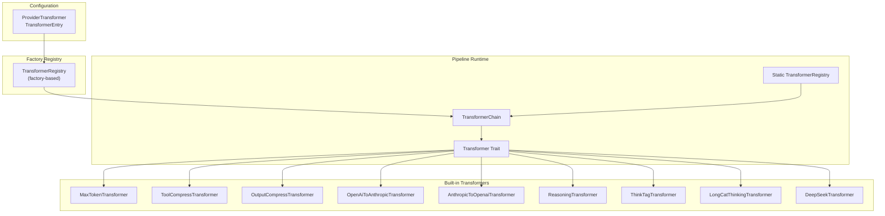

**Diagram sources**
- [src/transformer/mod.rs:230-360](file://src/transformer/mod.rs#L230-L360)
- [src/transform/registry.rs:1-120](file://src/transform/registry.rs#L1-L120)
- [src/config/types.rs:1-120](file://src/config/types.rs#L1-L120)

**Section sources**
- [src/transformer/mod.rs:1-250](file://src/transformer/mod.rs#L1-L250)
- [src/transform/registry.rs:1-120](file://src/transform/registry.rs#L1-L120)
- [src/config/types.rs:1-120](file://src/config/types.rs#L1-L120)

## Core Components
The core runtime abstractions live in the transformer module:

| Component | Responsibility | Key Behavior |
|---|---|---|
| `Transformer` trait | Interface for inspecting and mutating requests and responses | Defines `transform_request`, `transform_response`, optional `is_passthrough`, and `name` |
| `TransformerChain` | Ordered sequence of transformers | Applies request transformers forward; applies response transformers in reverse |
| Static `TransformerRegistry` | Lookup and optional option-aware construction of prebuilt instances | Registers default transformers and builds chains from `TransformerEntry` values |
| Factory `TransformerRegistry` | Dynamic instantiation from named factories | Supports configurable options via JSON and skips unknown entries |
| `TransformerEntry` | Serialized configuration entry | Represents either a bare name or `[name, options]` tuple |
| `ProviderTransformer` | Provider-level and model-specific transformer configuration | Exposes provider-level use list and model overrides |

**Section sources**
- [src/transformer/mod.rs:25-120](file://src/transformer/mod.rs#L25-L120)
- [src/transformer/mod.rs:230-360](file://src/transformer/mod.rs#L230-L360)
- [src/transformer/mod.rs:360-520](file://src/transformer/mod.rs#L360-L520)
- [src/transform/registry.rs:1-120](file://src/transform/registry.rs#L1-L120)
- [src/config/types.rs:1-120](file://src/config/types.rs#L1-L120)
- [src/config/types.rs:320-420](file://src/config/types.rs#L320-L420)

## Architecture Overview
A typical request flows through the following stages:

1. A client request arrives at the router.
2. The router resolves the target provider and model.
3. It reads provider-level transformers and model-specific overrides.
4. It builds a `TransformerChain`.
5. Request transformers run in configured order.
6. The normalized request is sent to the upstream provider.
7. The upstream response is translated if needed.
8. Response transformers run in reverse order.
9. The final response is returned to the client.

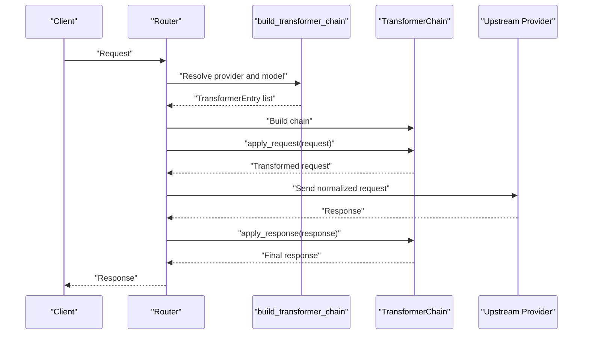

**Diagram sources**
- [src/router/translate_request.rs:382-399](file://src/router/translate_request.rs#L382-L399)
- [src/router/translate_response.rs:380-399](file://src/router/translate_response.rs#L380-L399)
- [src/transformer/mod.rs:230-310](file://src/transformer/mod.rs#L230-L310)

**Section sources**
- [src/router/translate_request.rs:382-399](file://src/router/translate_request.rs#L382-L399)
- [src/router/translate_response.rs:380-399](file://src/router/translate_response.rs#L380-L399)

## Detailed Component Analysis

### Transformer Trait and Lifecycle
The `Transformer` trait is the single extension point for all pipeline stages. Implementers may:

- Mutate the request before it reaches the provider.
- Mutate the response before it reaches the client.
- Optimize execution by reporting passthrough behavior when no meaningful work will occur.
- Provide a stable name for logging and diagnostics.

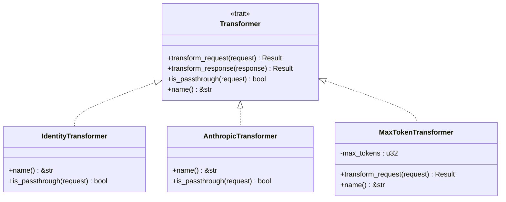

**Diagram sources**
- [src/transformer/mod.rs:25-120](file://src/transformer/mod.rs#L25-L120)
- [src/transformer/builtin.rs:1-120](file://src/transformer/builtin.rs#L1-L120)
- [src/transform/maxtoken.rs:1-80](file://src/transform/maxtoken.rs#L1-L80)

**Section sources**
- [src/transformer/mod.rs:25-120](file://src/transformer/mod.rs#L25-L120)

### Transformer Chain Execution
`TransformerChain` stores an ordered vector of boxed `Transformer` implementations. Its execution rules are important:

- **Requests**: transformers are applied in registration order.
- **Responses**: transformers are applied in reverse registration order.
- **Passthrough shortcut**: the chain can report whether every transformer considers itself a passthrough for the current request.
- **Debugging**: each application logs transformer names and serialized payloads.

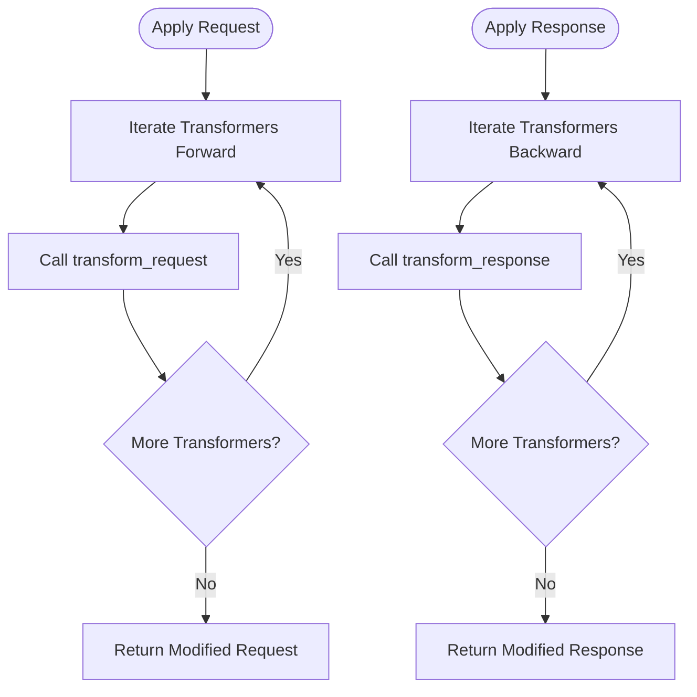

**Diagram sources**
- [src/transformer/mod.rs:230-310](file://src/transformer/mod.rs#L230-L310)

**Section sources**
- [src/transformer/mod.rs:230-310](file://src/transformer/mod.rs#L230-L310)

### Built-in Transformers

#### Anthropic Compatibility
Two directions exist:

- `AnthropicToOpenaiTransformer`: converts Anthropic-style requests to OpenAI format, including system prompts, message content blocks, tools, and tool choice.
- `OpenAiToAnthropicTransformer`: converts OpenAI-style requests to Anthropic format, including system messages, content blocks, tools, tool choice, stop fields, and token limits.

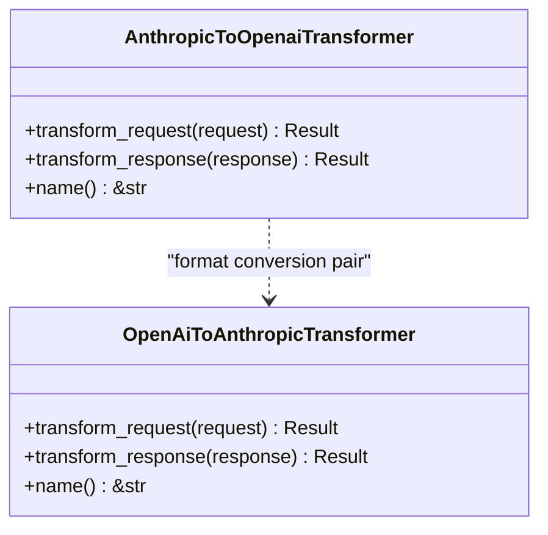

**Diagram sources**
- [src/transformer/builtin.rs:1-200](file://src/transformer/builtin.rs#L1-L200)
- [src/transform/openai_to_anthropic/mod.rs:1-120](file://src/transform/openai_to_anthropic/mod.rs#L1-L120)

**Section sources**
- [src/transformer/builtin.rs:1-200](file://src/transformer/builtin.rs#L1-L200)
- [src/transform/openai_to_anthropic/mod.rs:1-200](file://src/transform/openai_to_anthropic/mod.rs#L1-L200)

#### Token Optimization
The primary token optimizer is `MaxTokenTransformer`. It ensures requests respect a configured maximum number of tokens.

Supported behaviors include:

| Option | Default | Meaning |
|---|---:|---|
| `max_tokens` | Required by factory parser | Target maximum token limit |
| `override_if_higher` | `true` | Only replace the existing value if the configured limit is higher |
| `only_if_missing` | `false` | Add a limit only when the request does not already contain one |

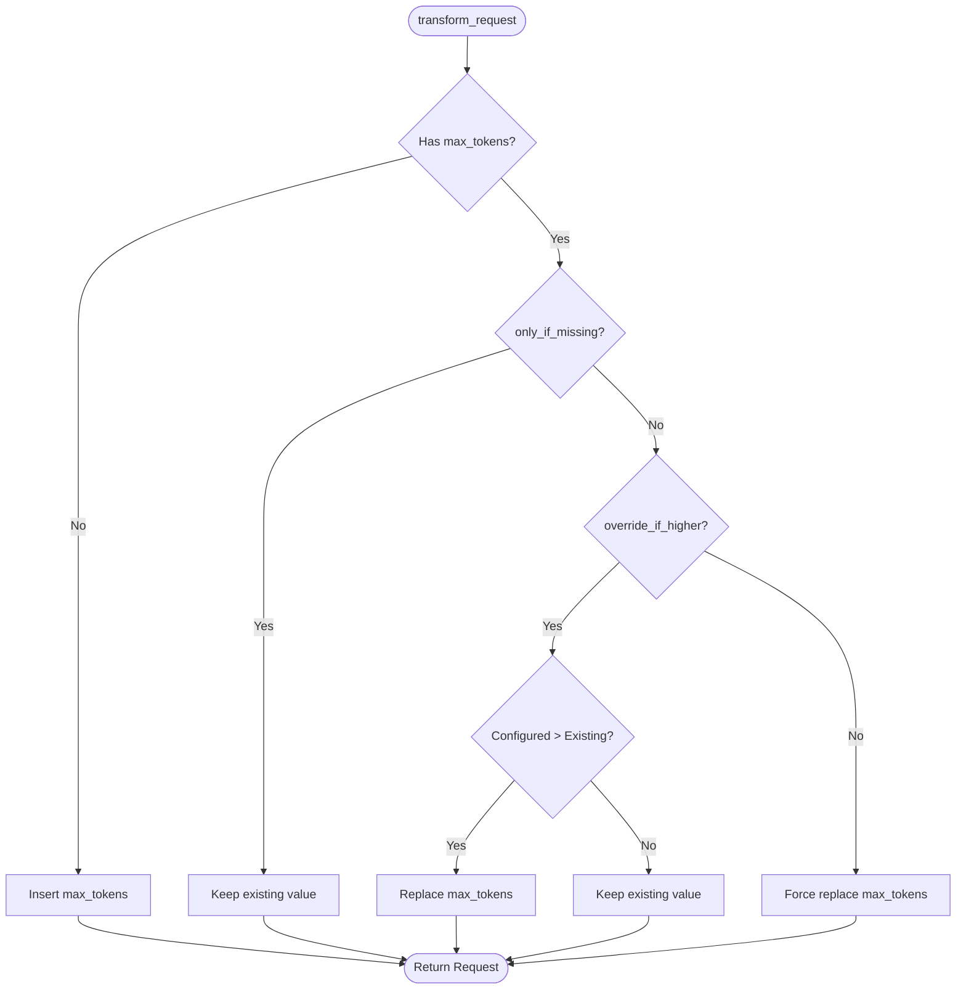

**Diagram sources**
- [src/transform/maxtoken.rs:1-120](file://src/transform/maxtoken.rs#L1-L120)

**Section sources**
- [src/transform/maxtoken.rs:1-120](file://src/transform/maxtoken.rs#L1-L120)

#### Tool Catalog Compression
`ToolCompressTransformer` reduces prompt size by compressing tool definitions in requests. It supports three levels:

| Level | Behavior |
|---|---|
| Low | No changes |
| Medium | Truncates tool descriptions and removes property descriptions |
| High | Removes tool descriptions entirely and strips properties to only their types |

Configuration uses a string level such as `"low"`, `"medium"`, or `"high"`.

**Section sources**
- [src/transform/toolcompress.rs:1-120](file://src/transform/toolcompress.rs#L1-L120)
- [src/transform/toolcompress.rs:120-200](file://src/transform/toolcompress.rs#L120-L200)

#### Output Compression
`OutputCompressTransformer` compresses verbose text inside `tool_result` response blocks. It:

- Skips short inputs below a minimum length.
- Compresses both direct text fields and nested content arrays.
- Uses a compression-ratio guard to avoid transforming content that would lose too much information.
- Applies pattern-based rules through a dedicated patterns submodule.

**Section sources**
- [src/transform/output_compress/mod.rs:1-120](file://src/transform/output_compress/mod.rs#L1-L120)
- [src/transform/output_compress/mod.rs:120-194](file://src/transform/output_compress/mod.rs#L120-L194)

#### Reasoning and Thinking Handling
Several transformers address reasoning and thinking content:

| Transformer | Direction | Purpose |
|---|---|---|
| `ReasoningTransformer` | Response | Normalizes reasoning/thinking content into proper content blocks |
| `ThinkTagTransformer` | Response | Strips `<think>`, `<thinking>`, and `<reasoning>` tags from text |
| `LongCatThinkingTransformer` | Response | Normalizes unsigned thinking blocks from specific providers |
| `DeepSeekTransformer` | Request and Response | Injects required thinking placeholders and normalizes tool-use IDs |

**Section sources**
- [src/transformer/builtin.rs:200-512](file://src/transformer/builtin.rs#L200-L512)
- [src/transformer/mod.rs:120-230](file://src/transformer/mod.rs#L120-L230)

### Registration and Ordering

#### Static Registry
The static `TransformerRegistry` in `src/transformer/mod.rs` registers default transformers and supports option-aware creation for `maxtoken` and `toolcompress`. Chains are built by iterating entries in order and skipping unknown names with warnings.

Key behaviors:

- Default transformers include identity, Anthropic, OpenAI compatibility, token limiting, tool enhancement, reasoning, thinking tag stripping, provider-specific normalization, and compression transformers.
- Unknown transformer names produce warnings but do not fail chain construction.
-<docs>
# Transformer Pipeline Architecture

<cite>
**Referenced Files in This Document**
- [src/transformer/mod.rs](file://src/transformer/mod.rs)
- [src/transformer/builtin.rs](file://src/transformer/builtin.rs)
- [src/transform/maxtoken.rs](file://src/transform/maxtoken.rs)
- [src/transform/toolcompress.rs](file://src/transform/toolcompress.rs)
- [src/transform/output_compress/mod.rs](file://src/transform/output_compress/mod.rs)
- [src/transform/openai_to_anthropic/mod.rs](file://src/transform/openai_to_anthropic/mod.rs)
- [src/transform/registry.rs](file://src/transform/registry.rs)
- [src/config/types.rs](file://src/config/types.rs)
- [src/router/dispatch.rs](file://src/router/dispatch.rs)
- [src/router/translate_response.rs](file://src/router/translate_response.rs)
</cite>

## Table of Contents
1. [Introduction](#introduction)
2. [Project Structure](#project-structure)
3. [Core Components](#core-components)
4. [Architecture Overview](#architecture-overview)
5. [Detailed Component Analysis](#detailed-component-analysis)
6. [Dependency Analysis](#dependency-analysis)
7. [Performance Considerations](#performance-considerations)
8. [Troubleshooting Guide](#troubleshooting-guide)
9. [Conclusion](#conclusion)

## Introduction
This document explains CCR-Rust’s pluggable transformer pipeline system: how transformers are defined, registered, ordered, and executed for requests flowing to upstream providers and responses returning to clients. It covers the core `Transformer` trait, request/response lifecycle, built-in transformers for Anthropic/OpenAI compatibility, token limits, tool compression, and output compression, as well as configuration through provider-level and model-specific chains. It also provides guidance for writing custom transformers and debugging their execution.

## Project Structure
The transformer subsystem is split across two related areas:

- **Runtime transformer pipeline**: traits, chain, registry, and built-in implementations under `src/transformer`.
- **Factory-based registry and additional transformers** under `src/transform`, used when building chains from configuration entries.

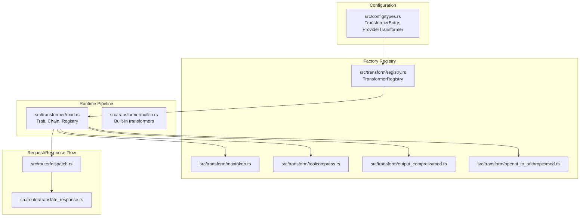

**Diagram sources**
- [src/transformer/mod.rs:1-853](file://src/transformer/mod.rs#L1-L853)
- [src/transformer/builtin.rs:1-512](file://src/transformer/builtin.rs#L1-L512)
- [src/transform/registry.rs:1-266](file://src/transform/registry.rs#L1-L266)
- [src/transform/maxtoken.rs:1-256](file://src/transform/maxtoken.rs#L1-L256)
- [src/transform/toolcompress.rs:1-312](file://src/transform/toolcompress.rs#L1-L312)
- [src/transform/output_compress/mod.rs:1-194](file://src/transform/output_compress/mod.rs#L1-L194)
- [src/transform/openai_to_anthropic/mod.rs:1-200](file://src/transform/openai_to_anthropic/mod.rs#L1-L200)
- [src/config/types.rs:1-200](file://src/config/types.rs#L1-L200)
- [src/router/dispatch.rs:1-200](file://src/router/dispatch.rs#L1-L200)
- [src/router/translate_response.rs:1-200](file://src/router/translate_response.rs#L1-L200)

**Section sources**
- [src/transformer/mod.rs:1-853](file://src/transformer/mod.rs#L1-L853)
- [src/transform/registry.rs:1-266](file://src/transform/registry.rs#L1-L266)
- [src/config/types.rs:1-200](file://src/config/types.rs#L1-L200)

## Core Components
At the center of the pipeline is a small set of abstractions:

| Component | Purpose | Key Behavior |
|---|---|---|
| `Transformer` trait | Defines the interface every transformer implements | Provides `transform_request`, `transform_response`, optional `is_passthrough`, and `name` |
| `TransformerChain` | Ordered list of transformers | Applies request transformers in forward order; applies response transformers in reverse order |
| Runtime `TransformerRegistry` | Static lookup for built-in transformers | Maps names such as `anthropic`, `deepseek`, `tooluse`, `identity`, `thinktag`, `longcat-thinking`, `glm`, `kimi`, `toolcompress`, `output_compress` to shared instances |
| Factory `TransformerRegistry` (`src/transform/registry.rs`) | Builds transformers from configuration entries | Supports optional JSON options and constructs chains from `TransformerEntry` lists |
| Configuration types | Describe which transformers to use | `TransformerEntry` (name or name+options), `ProviderTransformer` (provider-level + model overrides) |

```mermaid
classDiagram
  class Transformer {
    <<trait>>
    +transform_request(request) Result<Value>
    +transform_response(response) Result<Value>
    +is_passthrough(request) bool
    +name() &str
  }

  class TransformerChain {
    -transformers Vec<Arc<dyn Transformer>>
    +apply_request(request) Result<Value>
    +apply_response(response) Result<Value>
    +is_passthrough(request) bool
    +len() usize
    +is_empty() bool
  }

  class RuntimeRegistry {
    -transformers HashMap<String,Arc<dyn Transformer>>
    +register(name, Arc<dyn Transformer>) void
    +get(name) Option<Arc<dyn Transformer>>
    +create_with_options(name, options) Option<Arc<dyn Transformer>>
    +build_chain(entries) TransformerChain
  }

  class FactoryRegistry {
    -factories HashMap<&'static str,Fn(Option<Value>) -> Box<dyn Transformer>>
    +register(name, factory) void
    +build(entry) Option<Box<dyn Transformer>>
    +build_chain(entries) TransformerChain
    +has(name) bool
    +len() usize
    +is_empty() bool
  }

  class MaxTokenTransformer
  class ToolCompressTransformer
  class OutputCompressTransformer
  class OpenAiToAnthropicTransformer
  class AnthropicToOpenaiTransformer
  class IdentityTransformer
  class AnthropicTransformer
  class DeepSeekTransformer
  class ThinkTagTransformer
  class LongCatThinkingTransformer

  TransformerChain --> Transformer : "holds"
  RuntimeRegistry --> Transformer : "creates by name"
  FactoryRegistry --> Transformer : "factory creates"
  MaxTokenTransformer ..|> Transformer
  ToolCompressTransformer ..|> Transformer
  OutputCompressTransformer ..|> Transformer
  OpenAiToAnthropicTransformer ..|> Transformer
  AnthropicToOpenaiTransformer ..|> Transformer
  IdentityTransformer ..|> Transformer
  AnthropicTransformer ..|> Transformer
  DeepSeekTransformer ..|> Transformer
  ThinkTagTransformer ..|> Transformer
  LongCatThinkingTransformer ..|> Transformer
```

**Diagram sources**
- [src/transformer/mod.rs:1-853](file://src/transformer/mod.rs#L1-L853)
- [src/transform/registry.rs:1-266](file://src/transform/registry.rs#L1-L266)
- [src/transform/maxtoken.rs:1-256](file://src/transform/maxtoken.rs#L1-L256)
- [src/transform/toolcompress.rs:1-312](file://src/transform/toolcompress.rs#L1-L312)
- [src/transform/output_compress/mod.rs:1-194](file://src/transform/output_compress/mod.rs#L1-L194)
- [src/transform/openai_to_anthropic/mod.rs:1-200](file://src/transform/openai_to_anthropic/mod.rs#L1-L200)

**Section sources**
- [src/transformer/mod.rs:1-853](file://src/transformer/mod.rs#L1-L853)
- [src/transform/registry.rs:1-266](file://src/transform/registry.rs#L1-L266)

## Architecture Overview
The transformer pipeline participates in two directions:

1. **Outbound request path**: A normalized internal request is transformed according to the selected provider and model before being sent upstream.
2. **Inbound response path**: The upstream response is transformed back into the expected client-facing format and then returned.

```mermaid
sequenceDiagram
  participant Client as "Client"
  participant Router as "Router"
  participant ReqTransform as "Request Transformers"
  participant Upstream as "Upstream Provider"
  participant RespTransform as "Response<docs>
# Transformer Pipeline Architecture

<cite>
**Referenced Files in This Document**
- [src/transformer/mod.rs](file://src/transformer/mod.rs)
- [src/transformer/builtin.rs](file://src/transformer/builtin.rs)
- [src/transform/mod.rs](file://src/transform/mod.rs)
- [src/transform/registry.rs](file://src/transform/registry.rs)
- [src/config/types.rs](file://src/config/types.rs)
- [src/router/translate_request.rs](file://src/router/translate_request.rs)
- [src/router/translate_response.rs](file://src/router/translate_response.rs)
- [src/router/dispatch.rs](file://src/router/dispatch.rs)
- [src/transform/maxtoken.rs](file://src/transform/maxtoken.rs)
- [src/transform/toolcompress.rs](file://src/transform/toolcompress.rs)
- [src/transform/output_compress/mod.rs](file://src/transform/output_compress/mod.rs)
- [src/transform/openai_to_anthropic/mod.rs](file://src/transform/openai_to_anthropic/mod.rs)
</cite>

## Table of Contents
1. [Introduction](#introduction)
2. [Project Structure](#project-structure)
3. [Core Components](#core-components)
4. [Architecture Overview](#architecture-overview)
5. [Detailed Component Analysis](#detailed-component-analysis)
6. [Dependency Analysis](#dependency-analysis)
7. [Performance Considerations](#performance-considerations)
8. [Troubleshooting Guide](#troubleshooting-guide)
9. [Conclusion](#conclusion)

## Introduction
This document explains CCR-Rust’s pluggable transformer pipeline. Transformers are small, ordered transformations applied to JSON request and response payloads as they pass through the router before reaching upstream providers and after returning from them. The system supports:

- A core `Transformer` trait with request and response hooks.
- Two registries: a static registry for built-in transformers and a factory-based registry for configuration-driven instantiation.
- Ordered chains that apply transformers forward on requests and reverse-order on responses.
- Built-in transformers for Anthropic compatibility, OpenAI compatibility, token optimization, tool catalog compression, output compression, reasoning normalization, and provider-specific adapters.
- Configuration through provider-level and model-level transformer lists.

## Project Structure
The transformer system is split across several modules:

| Area | Responsibility |
|---|---|
| `src/transformer/mod.rs` | Core `Transformer` trait, `TransformerChain`, and the static `TransformerRegistry`. |
| `src/transformer/builtin.rs` | Built-in implementations such as format conversion, token limiting, thinking tag stripping, and provider-specific normalization. |
| `src/transform/mod.rs` | Module declarations and re-exports for additional transformers. |
| `src/transform/registry.rs` | Factory-based `TransformerRegistry` used to build chains from configuration entries. |
| `src/config/types.rs` | Configuration types for transformer entries, use lists, provider-level chains, and model overrides. |
| `src/router/*.rs` | Integration points where chains are built and executed during request dispatch and response translation. |
| `src/transform/*` | Additional transformers: token limits, tool compression, output compression, OpenAI ↔ Anthropic translation, and provider-specific logic. |

```mermaid
graph TB
  Client["Client Request"] --> Dispatch["Router Dispatcher"]
  Dispatch --> TranslateRequest["Translate Request"]
  TranslateRequest --> BuildChain["Build Transformer Chain"]
  BuildChain --> StaticRegistry["Static Registry"]
  BuildChain --> FactoryRegistry["Factory Registry"]
  BuildChain --> Chain["TransformerChain"]
  Chain --> Provider["Upstream Provider"]
  Provider --> Response["Provider Response"]
  Response --> TranslateResponse["Translate Response"]
  TranslateResponse --> Chain
  Chain --> Client
```

**Diagram sources**
- [src/router/dispatch.rs:1-80](file://src/router/dispatch.rs#L1-L80)
- [src/router/translate_request.rs:1-40](file://src/router/translate_request.rs#L1-L40)
- [src/router/translate_response.rs:1-20](file://src/router/translate_response.rs#L1-L20)
- [src/transformer/mod.rs:230-310](file://src/transformer/mod.rs#L230-L310)
- [src/transform/registry.rs:1-60](file://src/transform/registry.rs#L1-L60)

**Section sources**
- [src/transformer/mod.rs:1-40](file://src/transformer/mod.rs#L1-L40)
- [src/transform/mod.rs:1-41](file://src/transform/mod.rs#L1-L41)
- [src/config/types.rs:1-40](file://src/config/types.rs#L1-L40)

## Core Components

### Transformer Trait
The `Transformer` trait defines the contract for every transformation step. It supports three operations:

| Method | Purpose | Default Behavior |
|---|---|---|
| `transform_request` | Modify an incoming request before sending it upstream. | Returns the request unchanged. |
| `transform_response` | Modify an outgoing response before returning it to the client. | Returns the response unchanged. |
| `is_passthrough` | Indicate whether the transformer can be skipped when its conditions are already satisfied. | Returns `false`. |
| `name` | Human-readable identifier used for logging and debugging. | Returns `"unknown"`. |

Transformers receive and return `serde_json::Value`, so they operate directly on JSON objects without requiring domain structs. Implementations may mutate the payload in place or construct new values.

**Section sources**
- [src/transformer/mod.rs:23-70](file://src/transformer/mod.rs#L23-L70)

### TransformerChain
A `TransformerChain` holds an ordered list of `Arc<dyn Transformer>` instances. Its execution semantics are:

- **Requests:** transformers run in registration order.
- **Responses:** transformers run in reverse registration order.
- **Passthrough check:** the chain reports passthrough only if every transformer reports passthrough for the given request.
- **Logging:** each step logs its name and the resulting payload at debug/trace levels.

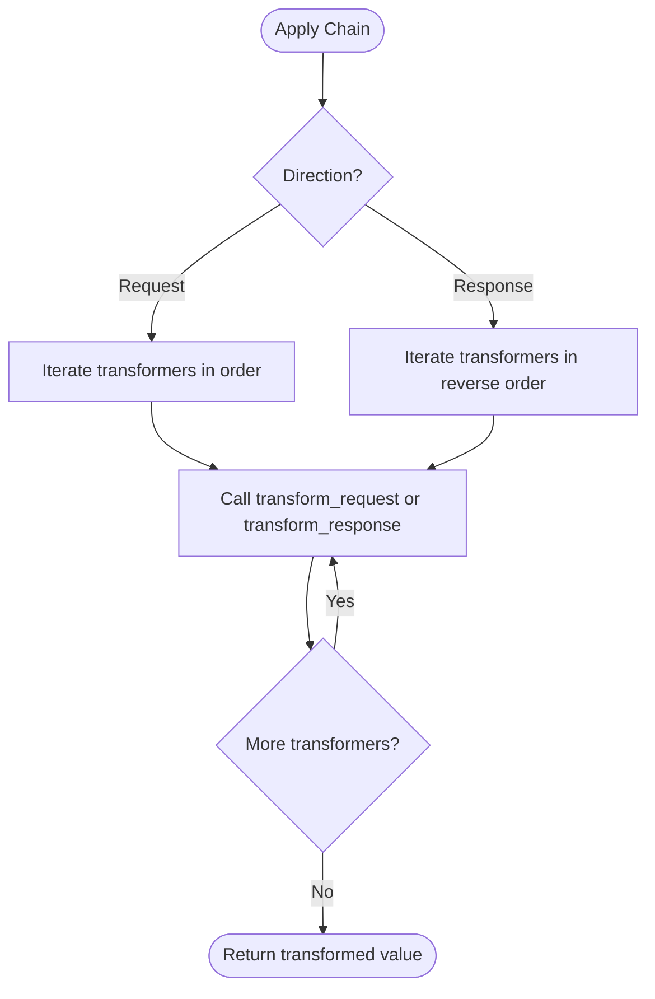

**Diagram sources**
- [src/transformer/mod.rs:230-310](file://src/transformer/mod.rs#L230-L310)

**Section sources**
- [src/transformer/mod.rs:230-310](file://src/transformer/mod.rs#L230-L310)

### Static TransformerRegistry
The static registry maps string names to shared `Arc<dyn Transformer>` instances. It registers built-in transformers such as `anthropic`, `anthropic-to-openai`, `deepseek`, `openai-to-anthropic`, `minimax`, `openrouter`, `tooluse`, `identity`, `reasoning`, `enhancetool`, `thinktag`, `longcat-thinking`, `glm`, `kimi`, `toolcompress`, and `output_compress`.

It also provides:

- `register`: add a named transformer.
- `get`: look up a transformer by name.
- `create_with_options`: create parameterized transformers, notably `maxtoken` and `toolcompress`.
- `build_chain`: convert a list of `TransformerEntry` values into a `TransformerChain`.
- `validate_entries`: report unknown transformer names.

**Section sources**
- [src/transformer/mod.rs:312-430](file://src/transformer/mod.rs#L312-L430)

### Factory-Based TransformerRegistry
The factory-based registry in `src/transform/registry.rs` builds transformers from `TransformerEntry` configuration. Its key responsibilities are:

- Mapping provider names such as `zai`, `minimax`, `moonshot`, `kimi`, and `deepseek` to provider-specific transformers.
- Mapping format-conversion transformers such as `anthropic` and `openai-to-anthropic`.
- Mapping utility transformers such as `maxtoken`, `thinktag`, and `longcat-thinking`.
- Mapping compression transformers such as `toolcompress` and `output_compress`.
- Building single transformers via `build`.
- Building ordered chains via `build_chain`.
- Logging skipped unregistered entries.

**Section sources**
- [src/transform/registry.rs:1-120](file://src/transform/registry.rs#L1-L120)
- [src/transform/registry.rs:201-266](file://src/transform/registry.rs#L201-L266)

### Configuration Model
Configuration uses `TransformerEntry`, which represents either:

- A bare name such as `"deepseek"`.
- A tuple-like entry such as `["maxtoken", {"max_tokens": 65536}]`.

Provider configuration groups these entries under:

- `transformer.use_list`: provider-level chain applied to all models.
- `transformer.<model-name>.use_list`: model-specific override chain.

The `ProviderTransformer` type exposes helpers for reading both provider-level and model-level entries, and includes bypass helpers mirroring the Node.js behavior.

**Section sources**
- [src/config/types.rs:1-120](file://src/config/types.rs#L1-L120)
- [src/config/types.rs:121-200](file://src/config/types.rs#L121-L200)
- [src/config/types.rs:300-420](file://src/config/types.rs#L300-L420)

## Architecture Overview

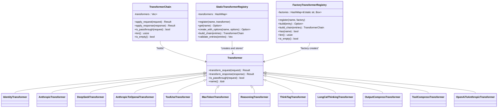

**Diagram sources**
- [src/transformer/mod.rs:23-70](file://src/transformer/mod.rs#L23-L70)
- [src/transformer/mod.rs:230-430](file://src/transformer/mod.rs#L230-L430)
- [src/transformer/builtin.rs:1-120](file://src/transformer/builtin.rs#L1-L120)
- [src/transform/registry.rs:1-120](file://src/transform/registry.rs#L1-L120)

## Detailed Component Analysis

### Request Processing Flow
When a request enters the router:

1. The dispatcher loads provider configuration and routes the request.
2. The request translation layer builds a transformer chain from provider-level and model-level entries.
3. The chain applies `transform_request` in order.
4. The modified request is sent to the upstream provider.
5. On success, the provider response flows back through the same chain in reverse order using `transform_response`.

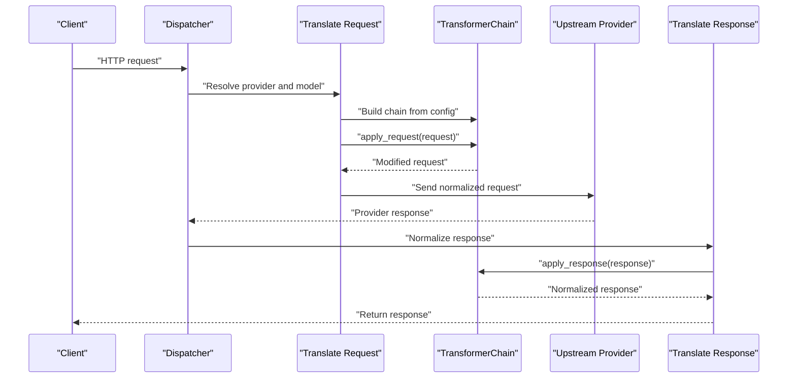

**Diagram sources**
- [src/router/dispatch.rs:1-80](file://src/router/dispatch.rs#L1-L80)
- [src/router/translate_response.rs:382-399](file://src/router/translate_response.rs#L382-L399)
- [src/transformer/mod.rs:230-310](file://src/transformer/mod.rs#L230-L310)

**Section sources**
- [src/router/translate_response.rs:382-399](file://src/router/translate_response.rs#L382-L399)
- [src/router/dispatch.rs:1-80](file://src/router/dispatch.rs#L1-L80)

### Built-In Transformers

#### Anthropic Compatibility Transformer
The `AnthropicTransformer` is primarily a passthrough for Anthropic-format requests. It identifies itself by the presence of a `model` field and reports passthrough when the request already looks like an Anthropic request. This allows the pipeline to skip unnecessary work when the internal format matches the provider format.

**Section sources**
- [src/transformer/mod.rs:72-100](file://src/transformer/mod.rs#L72-L100)

#### OpenAI Compatibility Transformers
Two complementary transformers bridge OpenAI and Anthropic formats:

| Transformer | Direction | Main Behavior |
|---|---|---|
| `AnthropicToOpenaiTransformer` | Request | Converts Anthropic `system`, content blocks, tools, and tool choice to OpenAI format. Removes Anthropic-only fields and adjusts stop sequences. |
| `OpenAiToAnthropicTransformer` | Request and Response | Converts OpenAI `/v1/chat/completions` requests to Anthropic `/v1/messages` format and converts OpenAI responses to Anthropic message format. Handles system messages, content arrays, function tools, tool choice, finish reasons, and tool calls. |

These transformers preserve multimodal content, normalize tool schemas, and remove fields unsupported by the target API.

**Section sources**
- [src/transformer/builtin.rs:1-180](file://src/transformer/builtin.rs#L1-L180)
- [src/transform/openai_to_anthropic/mod.rs:1-120](file://src/transform/openai_to_anthropic/mod.rs#L1-L120)

#### Token Optimization Transformer
The token optimizer controls the `max_tokens` field:

| Option | Meaning |
|---|---|
| `max_tokens` | Required target token limit. |
| `override_if_higher` | When true, only raise `max_tokens`; when false, always set it. |
| `only_if_missing` | When true, do not replace an existing `max_tokens` value. |

The factory-based registry supplies a default of `65536` when options are missing, while the static registry defaults to the same value when constructed via `create_with_options`.

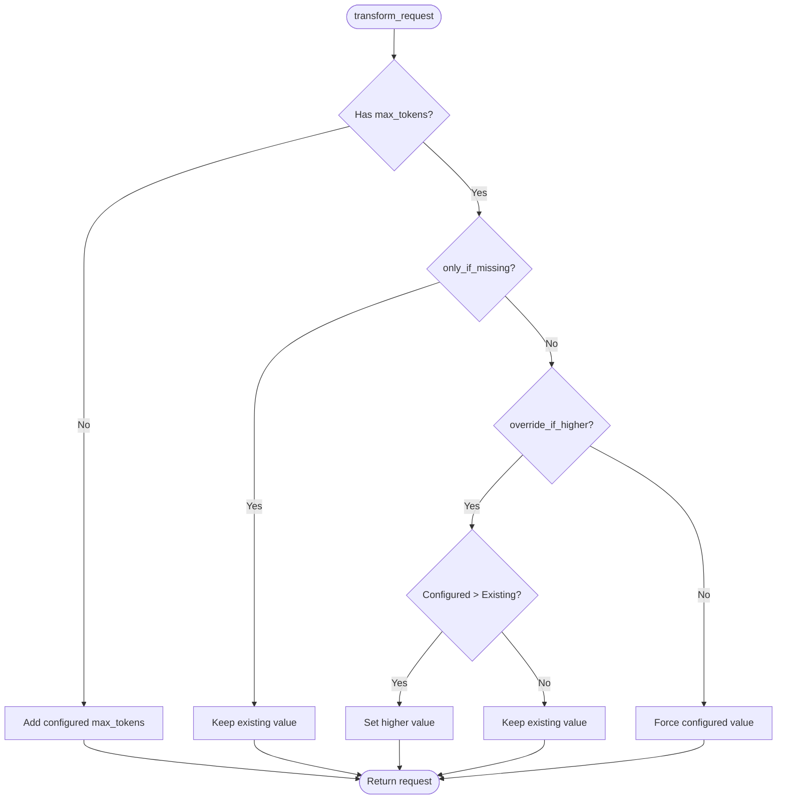

**Diagram sources**
- [src/transform/maxtoken.rs:1-160](file://src/transform/maxtoken.rs#L1-L160)

**Section sources**
- [src/transform/maxtoken.rs:1-160](file://src/transform/maxtoken.rs#L1-L160)
- [src/transformer/mod.rs:360-400](file://src/transformer/mod.rs#L360-L400)

#### Tool Catalog Compression Transformer
The `ToolCompressTransformer` reduces prompt size by compressing tool definitions in requests. It supports three compression levels:

| Level | Behavior |
|---|---|
| Low | No changes. |
| Medium | Truncates tool descriptions and removes property descriptions inside `input_schema.properties`. |
| High | Removes tool descriptions entirely and strips properties to only their `type` field. |

Configuration uses `{ "level": "low" | "medium" | "high" }`, defaulting to low.

**Section sources**
- [src/transform/toolcompress.rs:1-140](file://src/transform/toolcompress.rs#L1-L140)
- [src/transform/registry.rs:60-100](file://src/transform/registry.rs#L60-L100)

#### Output Compression Transformer
The `OutputCompressTransformer` runs on responses and targets verbose `tool_result` text. It:

- Skips non-`tool_result` blocks.
- Handles nested `content` arrays and direct `text` fields.
- Applies pattern-based compression only to strings longer than 200 characters.
- Rejects compression if the compressed length is more than 85% of the original length.

This makes it safe for large log-like outputs while avoiding expensive transformations that produce little savings.

**Section sources**
- [src/transform/output_compress/mod.rs:1-120](file://src/transform/output_compress/mod.rs#L1-L120)

#### Additional Built-In Transformers
| Transformer | Role |
|---|---|
| `IdentityTransformer` | No-op passthrough; useful as a placeholder or fallback. |
| `DeepSeekTransformer` | Injects leading thinking blocks for DeepSeek’s Anthropic-compatible endpoint and normalizes tool-use response IDs. |
| `ToolUseTransformer` | Ensures tool definitions have required fields and adds deterministic IDs to `tool_use` response blocks. |
| `ReasoningTransformer` | Normalizes reasoning/thinking output into proper Anthropic-style thinking blocks when needed. |
| `ThinkTagTransformer` | Strips `<think>`, `<thinking>`, and `<reasoning>` tags and their content from response text. |
| `LongCatThinkingTransformer` | Converts unsigned LongCat thinking-only responses into plain text and drops unsigned thinking blocks when real output exists. |

**Section sources**
- [src/transformer/mod.rs:100-220](file://src/transformer/mod.rs#L100-L220)
- [src/transformer/builtin.rs:180-512](file://src/transformer/builtin.rs#L180-L512)

### Transformer Registration and Ordering

#### Static Registry Registration
The static registry registers transformers eagerly at startup. Names include provider aliases, format converters, utilities, and compression transformers. Unknown names are logged and skipped when building chains.

#### Factory Registry Registration
The factory registry registers transformer factories keyed by static string names. Providers map to provider-specific transformers, and utility/format/conpression transformers are registered with optional JSON configuration. Unregistered entries are skipped with a warning.

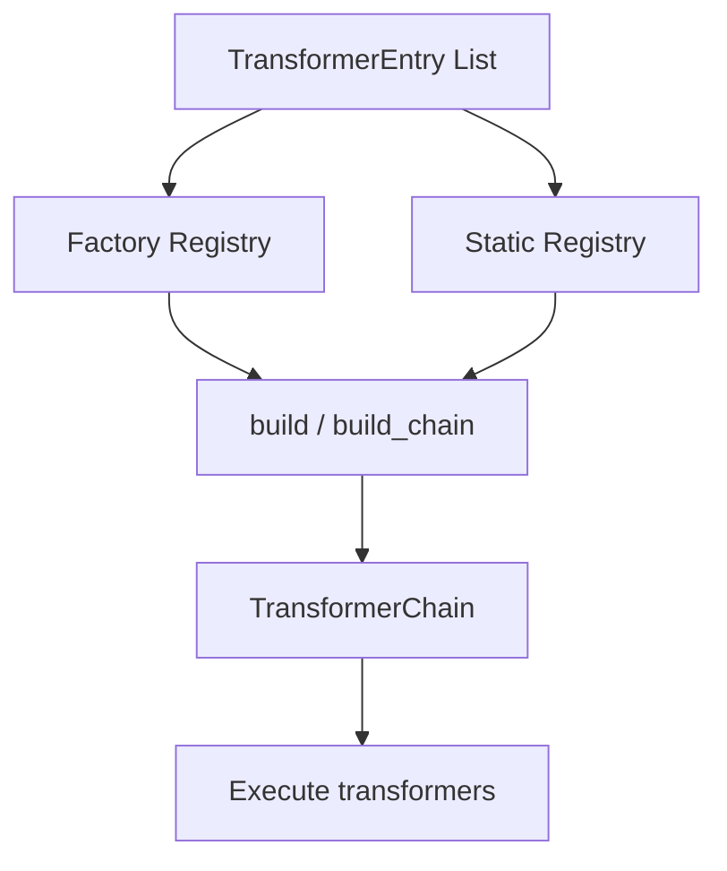

**Diagram sources**
- [src/transform/registry.rs:1-120](file://src/transform/registry.rs#L1-L120)
- [src/transformer/mod.rs:312-430](file://src/transformer/mod.rs#L312-L430)

**Section sources**
- [src/transform/registry.rs:1-120](file://src/transform/registry.rs#L1-L120)
- [src/transformer/mod.rs:312-430](file://src/transformer/mod.rs#L312-L430)

### Configuration Options

#### Basic Entry Formats
| Format | Example Meaning |
|---|---|
| `"deepseek"` | Register the deepseek transformer with no options. |
| `["maxtoken", {"max_tokens": 65536}]` | Register `maxtoken` with a custom token limit. |
| `["toolcompress", {"level": "high"}]` | Register tool compression at high intensity. |

#### Provider-Level Configuration
Under `provider.transformer.use_list`, configure transformers that apply to every model routed through that provider.

#### Model-Specific Overrides
Under `provider.transformer.<model-name>.use_list`, override or extend behavior for a specific model. The builder combines provider-level entries first, then appends model-specific entries.

#### Bypass Logic
The configuration supports bypass checks that mirror the Node.js implementation: if a provider has exactly one transformer matching a given name and the model either has no override or a single override with the same name, the pipeline can treat the chain as effectively bypassed.

**Section sources**
- [src/config/types.rs:1-120](file://src/config/types.rs#L1-L120)
- [src/config/types.rs:121-200](file://src/config/types.rs#L121-L200)
- [src/router/translate_response.rs:382-399](file://src/router/translate_response.rs#L382-L399)

### Writing Custom Transformers

#### Step-by-Step Guide
1. Create a struct implementing `Transformer`.
2. Provide a stable `name()` for logging.
3. Implement `transform_request` if you need to modify prompts before they reach the provider.
4. Implement `transform_response` if you need to normalize or optimize provider responses.
5. Optionally implement `is_passthrough` to allow the chain to skip work when conditions are already satisfied.
6. Register your transformer:
   - Use the static registry’s `register` method for shared stateless instances.
   - Use the factory registry’s `register` method for configuration-driven construction.
7. Reference it in configuration using `TransformerEntry::Name` or `TransformerEntry::WithOptions`.

#### Example Patterns

##### Request Sanitizer
A sanitizer could validate required fields, redact secrets, or enforce policy constraints before the request leaves CCR-Rust. It should return an error rather than silently dropping data when validation fails.

##### Response Normalizer
A normalizer could ensure downstream clients receive consistent content block shapes, inject missing identifiers, or strip provider-specific metadata.

##### Conditional Passthrough
If a transformer only needs to act on specific models or providers, implement `is_passthrough` to avoid unnecessary JSON cloning and processing.

**Section sources**
- [src/transformer/mod.rs:23-70](file://src/transformer/mod.rs#L23-L70)
- [src/transformer/mod.rs:312-430](file://src/transformer/mod.rs#L312-L430)
- [src/transform/registry.rs:1-120](file://src/transform/registry.rs#L1-L120)

## Dependency Analysis

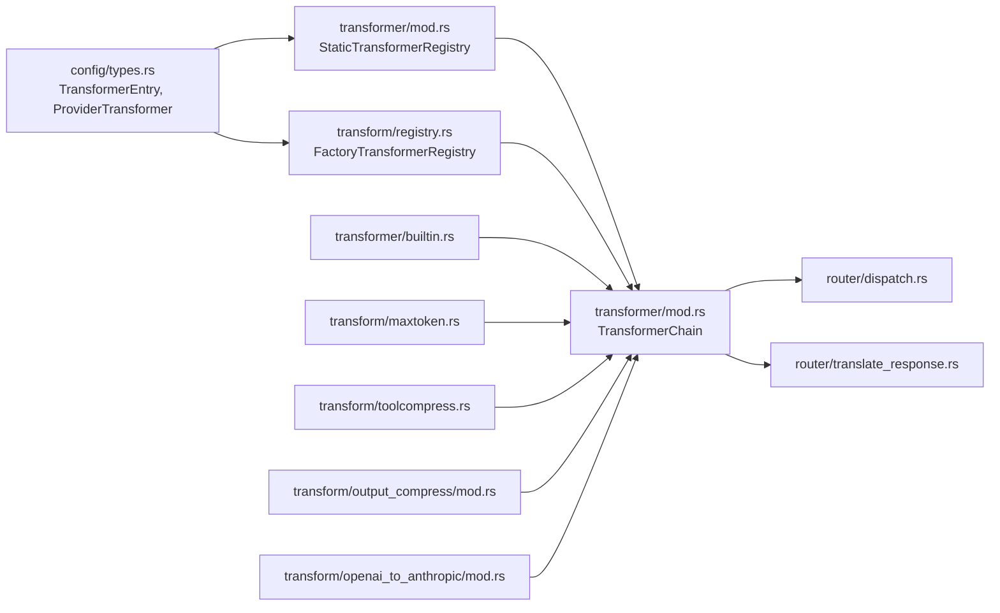

**Diagram sources**
- [src/config/types.rs:1-120](file://src/config/types.rs#L1-L120)
- [src/transformer/mod.rs:230-430](file://src/transformer/mod.rs#L230-L430)
- [src/transform/registry.rs:1-120](file://src/transform/registry.rs#L1-L120)
- [src/router/dispatch.rs:1-80](file://src/router/dispatch.rs#L1-L80)
- [src/router/translate_response.rs:382-399](file://src/router/translate_response.rs#L382-L399)

### Coupling Observations
- The chain is decoupled from the registry: registries only construct transformers; execution happens in `TransformerChain`.
- The static and factory registries serve different purposes: the static registry is convenient for built-ins and tests, while the factory registry aligns better with JSON configuration.
- Configuration types are consumed by both registries indirectly through `TransformerEntry`.
- Router code depends on the chain and registry abstractions rather than concrete transformers, making it possible to swap or extend pipelines without changing routing logic.

**Section sources**
- [src/transformer/mod.rs:230-430](file://src/transformer/mod.rs#L230-L430)
- [src/transform/registry.rs:1-120](file://src/transform/registry.rs#L1-L120)
- [src/config/types.rs:1-120](file://src/config/types.rs#L1-L120)

## Performance Considerations

### Order Matters
Because responses traverse the chain in reverse order, transformer order must be chosen carefully. For example, a response formatter should generally run before a compressor that assumes a particular shape, unless the compressor is designed to handle multiple formats.

### Passthrough Optimization
Transformers that implement `is_passthrough` can reduce overhead when the request or response already satisfies their expectations. The chain’s passthrough helper checks every transformer, so identity-heavy chains can be fast-pathed.

### JSON Copy Cost
Every transformer receives and returns a `serde_json::Value`. Expensive transformers should:

- Mutate in place when possible.
- Avoid unnecessary cloning.
- Skip early when input does not match expected patterns.
- Use guards such as minimum length or ratio thresholds.

### Debug and Trace Overhead
The chain logs transformed payloads at trace level. In production, keep trace logging disabled unless diagnosing a transformer issue, because serializing full JSON responses can be costly.

### Compression Trade-offs
Tool and output compression reduce prompt/response size but add CPU cost. Prefer:

- Low compression for safety.
- Medium compression for moderate savings.
- High compression only when prompt size is critical and provider schema tolerance is known.
- Output compression only when tool results are large and repetitive.

[No sources needed since this section provides general guidance]

## Troubleshooting Guide

### Symptom: Unknown Transformer Name
**Likely cause:** The transformer name is not registered in the active registry.

**What to check:**
- Verify the name used in configuration matches a registered static or factory name.
- Confirm the registry being used actually registers the transformer.
- Look for warnings about skipping unregistered transformers.

**Relevant paths:**
- [src/transformer/mod.rs:312-430](file://src/transformer/mod.rs#L312-L430)
- [src/transform/registry.rs:80-120](file://src/transform/registry.rs#L80-L120)

### Symptom: Request Is Not Modified
**Likely causes:**
- The transformer implements identity behavior or passthrough.
- The transformer expects a different request shape.
- The transformer is not included in the chain.

**What to check:**
- Enable debug logging to see each transformer’s `name()` and request transformation steps.
- Inspect `is_passthrough` behavior.
- Confirm provider-level and model-level configuration includes the transformer.

**Relevant paths:**
- [src/transformer/mod.rs:230-310](file://src/transformer/mod.rs#L230-L310)
- [src/config/types.rs:300-420](file://src/config/types.rs#L300-L420)

### Symptom: Response Shape Is Incorrect
**Likely causes:**
- A response transformer assumed a different block type.
- Another transformer ran earlier or later than intended.
- A provider-specific adapter did not normalize the response before a generic formatter.

**What to check:**
- Review response chain order.
- Inspect whether provider-specific transformers such as `deepseek`, `glm`, or `kimi` run before generic formatters.
- Check transformers that add or normalize `tool_use` IDs and thinking blocks.

**Relevant paths:**
- [src/transformer/mod.rs:100-220](file://src/transformer/mod.rs#L100-L220)
- [src/transformer/builtin.rs:180-512](file://src/transformer/builtin.rs#L180-L512)

### Symptom: Token Limit Is Not Applied
**Likely causes:**
- `max_tokens` was present and `only_if_missing` prevented replacement.
- `override_if_higher` was enabled and the existing value was already higher.
- The wrong registry path constructed the transformer.

**What to check:**
- Inspect `maxtoken` options in configuration.
- Confirm the effective chain includes `maxtoken`.
- Check debug logs emitted by the token transformer.

**Relevant paths:**
- [src/transform/maxtoken.rs:1-160](file://src/transform/maxtoken.rs#L1-L160)
- [src/transform/registry.rs:60-100](file://src/transform/registry.rs#L60-L100)

### Symptom: Thinking Blocks Are Missing or Invalid
**Likely causes:**
- Provider returned unsigned thinking blocks incompatible with Anthropic clients.
- A thinking-only response was mixed with other content.
- Think tags were stripped by the think-tag transformer.

**What to check:**
- Review `LongCatThinkingTransformer` behavior.
- Review `ThinkTagTransformer` behavior.
- Review `DeepSeekTransformer` leading-thinking injection.

**Relevant paths:**
- [src/transformer/builtin.rs:360-512](file://src/transformer/builtin.rs#L360-L512)
- [src/transformer/mod.rs:100-220](file://src/transformer/mod.rs#L100-L220)

**Section sources**
- [src/transformer/mod.rs:230-430](file://src/transformer/mod.rs#L230-L430)
- [src/transform/registry.rs:80-120](file://src/transform/registry.rs#L80-L120)
- [src/transform/maxtoken.rs:1-160](file://src/transform/maxtoken.rs#L1-L160)
- [src/transformer/builtin.rs:180-512](file://src/transformer/builtin.rs#L180-L512)

## Conclusion
CCR-Rust’s transformer pipeline is a layered, configurable system. At its center is the `Transformer` trait and `TransformerChain`, which provide a simple, extensible interface for modifying requests and responses. Two registries support different usage patterns: the static registry for built-in shared transformers and the factory registry for configuration-driven construction. Built-in transformers cover Anthropic and OpenAI compatibility, token limits, tool catalog compression, output compression, reasoning normalization, and provider-specific adapters.

For most users, the practical model is:

1. Choose provider-level transformers for global behavior.
2. Add model-specific overrides for special cases.
3. Use `maxtoken`, `toolcompress`, and `output_compress` to control performance and payload size.
4. Use Anthropic/OpenAI compatibility transformers when routing between formats.
5. Write custom transformers for specialized validation, normalization, or enrichment tasks.
6. Use debug logging and passthrough behavior to diagnose ordering and performance issues.

[No sources needed since this section summarizes without analyzing specific files]