# Provider Architecture

<cite>
**Referenced Files in This Document**
- [lib.rs](file://src/lib.rs)
- [config/mod.rs](file://src/config/mod.rs)
- [config/types.rs](file://src/config/types.rs)
- [transformer/mod.rs](file://src/transformer/mod.rs)
- [transformer/builtin.rs](file://src/transformer/builtin.rs)
- [transform/mod.rs](file://src/transform/mod.rs)
- [transform/registry.rs](file://src/transform/registry.rs)
- [transform/deepseek.rs](file://src/transform/deepseek.rs)
- [transform/glm.rs](file://src/transform/glm.rs)
- [transform/kimi.rs](file://src/transform/kimi.rs)
- [transform/minimax.rs](file://src/transform/minimax.rs)
- [transform/anthropic_to_openai.rs](file://src/transform/anthropic_to_openai.rs)
- [router/dispatch.rs](file://src/router/dispatch.rs)
- [router/dispatch/provider_overrides.rs](file://src/router/dispatch/provider_overrides.rs)
</cite>

## Table of Contents
1. [Introduction](#introduction)
2. [Project Structure](#project-structure)
3. [Core Components](#core-components)
4. [Architecture Overview](#architecture-overview)
5. [Detailed Component Analysis](#detailed-component-analysis)
6. [Dependency Analysis](#dependency-analysis)
7. [Performance Considerations](#performance-considerations)
8. [Troubleshooting Guide](#troubleshooting-guide)
9. [Security Considerations](#security-considerations)
10. [Conclusion](#conclusion)

## Introduction
This document explains how CCR-Rust models LLM providers as pluggable backends behind a common provider configuration and transformer interface. Providers such as Anthropic, OpenAI-compatible gateways, GLM (Z.AI), MiniMax, DeepSeek, Kimi/Moonshot, and others are not hard-coded into request construction; instead, they are selected from configuration, validated at startup, and adapted through protocol-specific transformers.

At runtime:
- The `Provider` configuration describes authentication, upstream endpoint, protocol, capabilities, and per-model transformer overrides.
- A registry builds chains of transformers that normalize requests and responses across Anthropic, OpenAI Chat Completions, and OpenAI Responses protocols.
- The router dispatches normalized requests to the chosen provider and translates responses back into the client-facing protocol.
- Error handling, streaming inspection, rate-limit awareness, and forced protocol-level fields are applied around this core flow.

## Project Structure
The provider architecture spans several modules:

| Area | Responsibility | Key Files |
|---|---|---|
| Library surface | Declares public subsystems including config, transform, transformer, and router | [lib.rs](file://src/lib.rs) |
| Configuration | Parses providers, validates credentials, resolves protocols, pricing, and capabilities | [config/mod.rs](file://src/config/mod.rs), [config/types.rs](file://src/config/types.rs) |
| Transformer trait | Defines the generic request/response transformation contract | [transformer/mod.rs](file://src/transformer/mod.rs) |
| Built-in transformers | Implements format conversions and provider-specific logic | [transformer/builtin.rs](file://src/transformer/builtin.rs) |
| Transform module | Exposes provider-specific transformers and the factory-based registry | [transform/mod.rs](file://src/transform/mod.rs), [transform/registry.rs](file://src/transform/registry.rs) |
| Provider transformers | Implements concrete adaptation for each backend | [transform/deepseek.rs](file://src/transform/deepseek.rs), [transform/glm.rs](file://src/transform/glm.rs), [transform/kimi.rs](file://src/transform/kimi.rs), [transform/minimax.rs](file://src/transform/minimax.rs) |
| Router dispatch | Chooses provider, applies overrides, handles streaming, errors, metrics, and translation | [router/dispatch.rs](file://src/router/dispatch.rs), [router/dispatch/provider_overrides.rs](file://src/router/dispatch/provider_overrides.rs) |

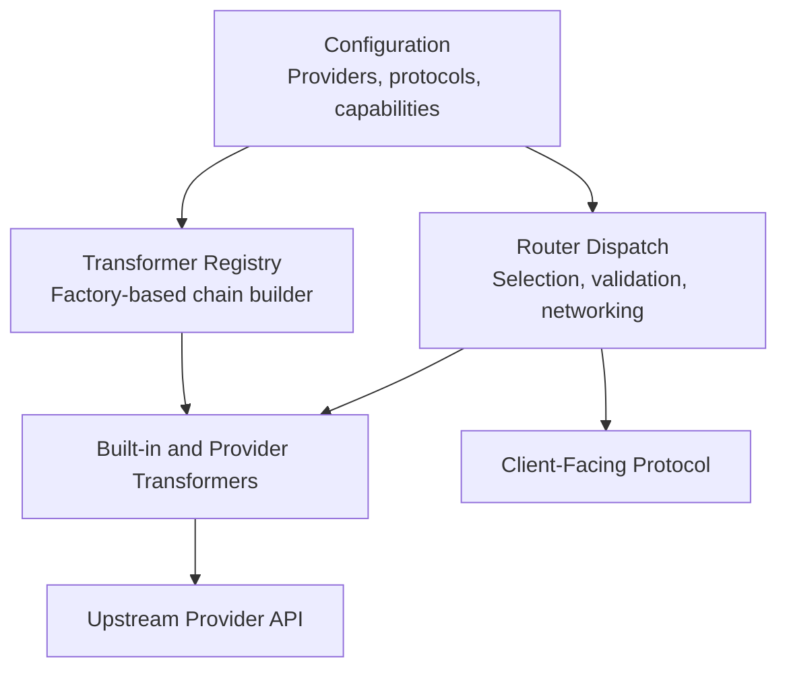

**Diagram sources**
- [config/types.rs:201-633](file://src/config/types.rs#L201-L633)
- [transform/registry.rs:1-120](file://src/transform/registry.rs#L1-L120)
- [transformer/mod.rs:1-120](file://src/transformer/mod.rs#L1-L120)
- [router/dispatch.rs:1-120](file://src/router/dispatch.rs#L1-L120)

**Section sources**
- [lib.rs:1-27](file://src/lib.rs#L1-L27)

## Core Components
### Provider Configuration Model
A provider is defined by a configuration object containing:
- Identifier and endpoint metadata: `name`, `api_base_url`.
- Authentication: `api_key`, optional `auth_header`, optional `anthropic_version`.
- Supported models: `models`.
- Protocol selection: `protocol` can be `openai`, `anthropic`, or `responses`.
- Transformer pipeline: provider-level and model-specific transformer lists.
- Observability and routing controls: `tier_name`, `honor_ratelimit_headers`, `allow_streaming`, admission limits, and forced reasoning behavior.

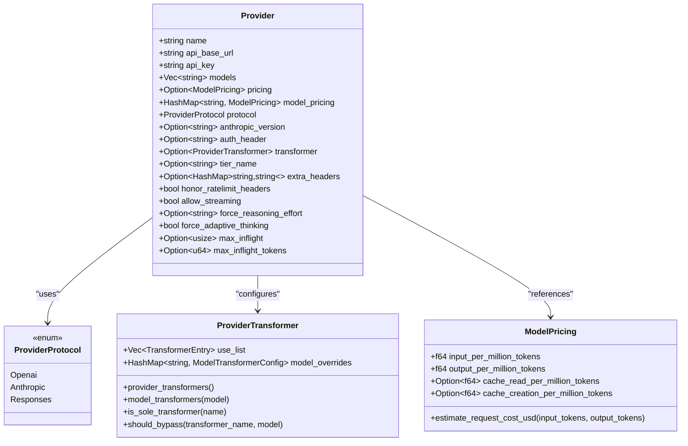

**Diagram sources**
- [config/types.rs:201-633](file://src/config/types.rs#L201-L633)

Key behaviors derived from the configuration:
- Pricing resolution supports provider defaults and model-specific overrides, with special alias handling for MiniMax M3 model identifiers.
- Extra headers enable provider identity requirements such as custom user agents.
- Rate-limit header honoring can be disabled for providers that report informational warnings even on successful responses.
- Forced reasoning effort and adaptive thinking let operators override caller-supplied defaults when a provider requires specific protocol fields.

**Section sources**
- [config/types.rs:201-633](file://src/config/types.rs#L201-L633)

### Transformer Trait and Chain
All transformations implement a common `Transformer` trait. Each transformer can:
- Mutate incoming requests before sending them to an upstream provider.
- Mutate outgoing responses before returning them to clients.
- Optimize hot paths via passthrough detection.
- Identify itself for logging and debugging.

Transformers are composed into chains. A chain allows multiple adaptations, such as:
- Converting Anthropic-format requests to OpenAI format.
- Injecting provider-specific thinking blocks.
- Compressing tool-use payloads.
- Normalizing Unicode thinking markers into standardized reasoning fields.

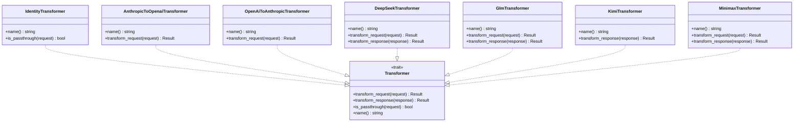

**Diagram sources**
- [transformer/mod.rs:1-120](file://src/transformer/mod.rs#L1-L120)
- [transformer/builtin.rs:1-120](file://src/transformer/builtin.rs#L1-L120)
- [transform/deepseek.rs:1-120](file://src/transform/deepseek.rs#L1-L120)
- [transform/glm.rs:1-120](file://src/transform/glm.rs#L1-L120)
- [transform/kimi.rs:1-80](file://src/transform/kimi.rs#L1-L80)
- [transform/minimax.rs:1-120](file://src/transform/minimax.rs#L1-L120)

**Section sources**
- [transformer/mod.rs:1-120](file://src/transformer/mod.rs#L1-L120)
- [transformer/builtin.rs:1-120](file://src/transformer/builtin.rs#L1-L120)

### Transformer Registry
The registry provides a factory-based system for building transformers from configuration entries. It supports:
- Provider-specific transformers such as `zai`, `minimax`, `moonshot`, `kimi`, `deepseek`.
- Format converters such as `anthropic` and `openai-to-anthropic`.
- Utility transformers such as `maxtoken`, `thinktag`, `toolcompress`, `output_compress`.
- LongCat thinking normalization through `longcat-thinking`.

Registry operations include:
- Registering new factories under static names.
- Building a single transformer from a configuration entry.
- Building a chain from a list of entries.
- Checking whether a transformer name is registered.

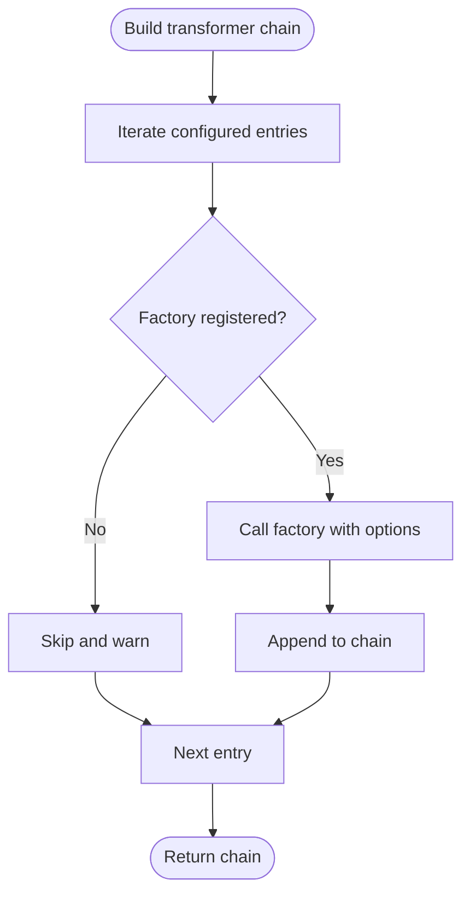

**Diagram sources**
- [transform/registry.rs:1-120](file://src/transform/registry.rs#L1-L120)

**Section sources**
- [transform/mod.rs:1-41](file://src/transform/mod.rs#L1-L41)
- [transform/registry.rs:1-120](file://src/transform/registry.rs#L1-L120)

## Architecture Overview
The provider architecture separates concerns between configuration, transformation, and dispatch:

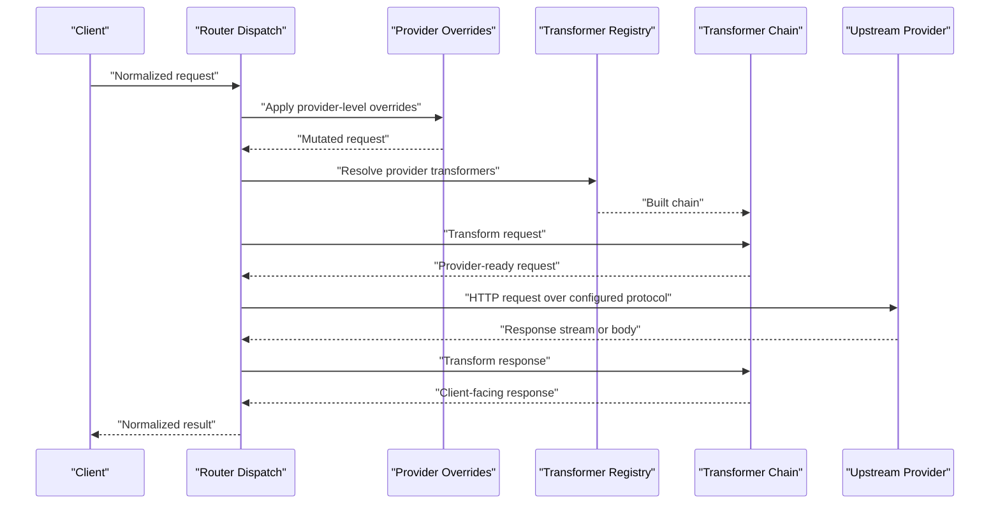

**Diagram sources**
- [router/dispatch.rs:1-120](file://src/router/dispatch.rs#L1-L120)
- [router/dispatch/provider_overrides.rs:1-47](file://src/router/dispatch/provider_overrides.rs#L1-L47)
- [transform/registry.rs:1-120](file://src/transform/registry.rs#L1-L120)

The dispatcher normalizes success envelopes, inspects early streaming events for embedded error payloads, redacts sensitive headers in debug captures, and coordinates retry, rate limiting, usage recording, and cost estimation.

**Section sources**
- [router/dispatch.rs:1-120](file://src/router/dispatch.rs#L1-L120)

## Detailed Component Analysis

### Provider Discovery, Validation, and Selection
Discovery and validation occur during configuration loading:
- Environment variable references in provider configuration are expanded recursively.
- Unexpanded credential placeholders in `api_key` and `extra_headers` cause startup failure unless explicitly allowed.
- Extra headers are validated as valid HTTP header names and values.
- Client credentials receive similar expansion and validation checks.

Provider selection is driven by:
- The configured default route.
- Optional background and think routes.
- Explicit model aliases.
- Direct model targeting unless `ignore_direct` is enabled.
- Tier ordering and EWMA-based latency reordering.
- Optional GP reranking.

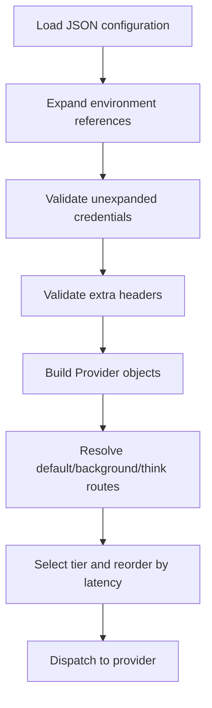

**Diagram sources**
- [config/mod.rs:1-120](file://src/config/mod.rs#L1-L120)
- [config/types.rs:633-1218](file://src/config/types.rs#L633-L1218)

**Section sources**
- [config/mod.rs:1-120](file://src/config/mod.rs#L1-L120)
- [config/types.rs:633-1218](file://src/config/types.rs#L633-L1218)

### Authentication Mechanisms
Authentication is primarily modeled through:
- `api_key`: the primary secret for provider authentication.
- `auth_header`: lets providers using non-Anthropic header styles still authenticate, for example by switching to `Authorization: Bearer`.
- `anthropic_version`: sets the canonical Anthropic API version header when using `protocol=anthropic`.
- `extra_headers`: adds arbitrary headers required by some providers.

Credential handling also includes:
- Environment expansion so secrets can be injected securely from the process environment.
- Startup validation that refuses to run with literal placeholder credentials, reducing confusing 401 diagnostics.
- Redaction of sensitive header values in debug capture logs.

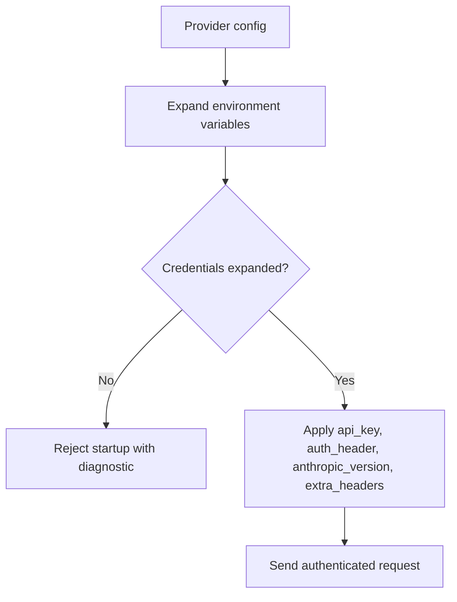

**Diagram sources**
- [config/mod.rs:1-120](file://src/config/mod.rs#L1-L120)
- [config/types.rs:201-633](file://src/config/types.rs#L201-L633)
- [router/dispatch.rs:1-80](file://src/router/dispatch.rs#L1-L80)

**Section sources**
- [config/mod.rs:1-120](file://src/config/mod.rs#L1-L120)
- [config/types.rs:201-633](file://src/config/types.rs#L201-L633)
- [router/dispatch.rs:1-80](file://src/router/dispatch.rs#L1-L80)

### Connection Management and Streaming
Connection management is handled by the dispatcher around the network call:
- Streaming responses are inspected for embedded error payloads inside HTTP 200 bodies.
- Early stream peeking avoids long waits while still allowing slow-start inference.
- SSE frames are decoded and checked for structured error objects.
- Success envelopes from some OpenAI-compatible gateways are normalized.

Provider-level connection behavior includes:
- `allow_streaming`: forces streaming for providers where non-streaming mode is excessively slow.
- `honor_ratelimit_headers`: proactively skips tiers reporting zero remaining quota on successful responses.
- `max_inflight` and `max_inflight_tokens`: admission control for providers sensitive to concurrent prefill volume.

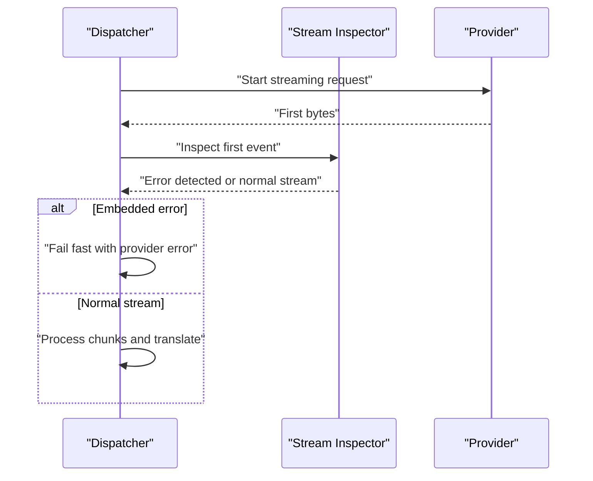

**Diagram sources**
- [router/dispatch.rs:1-1917](file://src/router/dispatch.rs#L1-L1917)

**Section sources**
- [config/types.rs:201-633](file://src/config/types.rs#L201-L633)
- [router/dispatch.rs:1-1917](file://src/router/dispatch.rs#L1-L1917)

### Error Handling Patterns
Error handling combines several layers:
- Transformer errors propagate through the chain.
- Provider override mutations validate that the request is a JSON object before inserting forced fields.
- Dispatcher-level streaming inspection detects provider errors returned inside HTTP 200 streams.
- Debug captures record status, sanitized headers, response body, and error messages without leaking secrets.

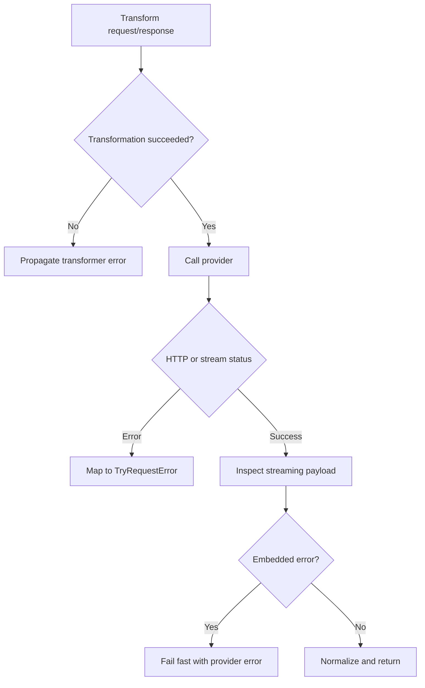

**Diagram sources**
- [router/dispatch/provider_overrides.rs:1-47](file://src/router/dispatch/provider_overrides.rs#L1-L47)
- [router/dispatch.rs:1-1917](file://src/router/dispatch.rs#L1-L1917)

**Section sources**
- [router/dispatch/provider_overrides.rs:1-47](file://src/router/dispatch/provider_overrides.rs#L1-L47)
- [router/dispatch.rs:1-1917](file://src/router/dispatch.rs#L1-L1917)

### Provider-Specific Transformers

#### DeepSeek Transformer
Responsibilities:
- Strip Anthropic-specific fields such as metadata.
- Detect reasoning models and apply leading-thinking repair for tool-loop continuation.
- Map `reasoning_content` into a normalized thinking block.
- Ensure tool-use blocks have stable identifiers.

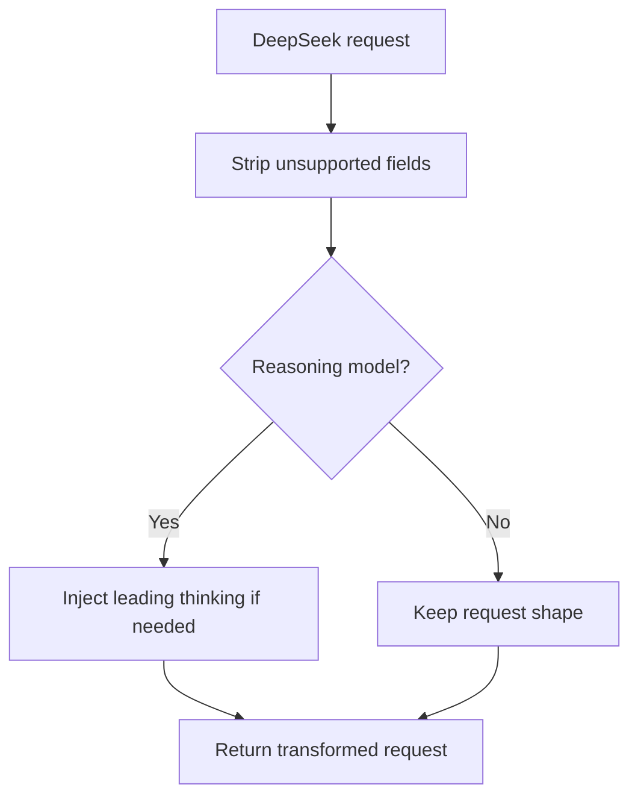

**Diagram sources**
- [transform/deepseek.rs:1-120](file://src/transform/deepseek.rs#L1-L120)
- [transformer/mod.rs:120-220](file://src/transformer/mod.rs#L120-L220)

**Section sources**
- [transform/deepseek.rs:1-120](file://src/transform/deepseek.rs#L1-L120)
- [transformer/mod.rs:120-220](file://src/transformer/mod.rs#L120-L220)

#### GLM Transformer
Responsibilities:
- Inject `reasoning_effort` for supported GLM-5.x models.
- Strip Anthropic-specific passthrough fields.
- Extract legacy `<think>` tags into `reasoning_content`.
- Preserve modern native `reasoning_content` responses.
- Handle streaming partial tag boundaries safely.

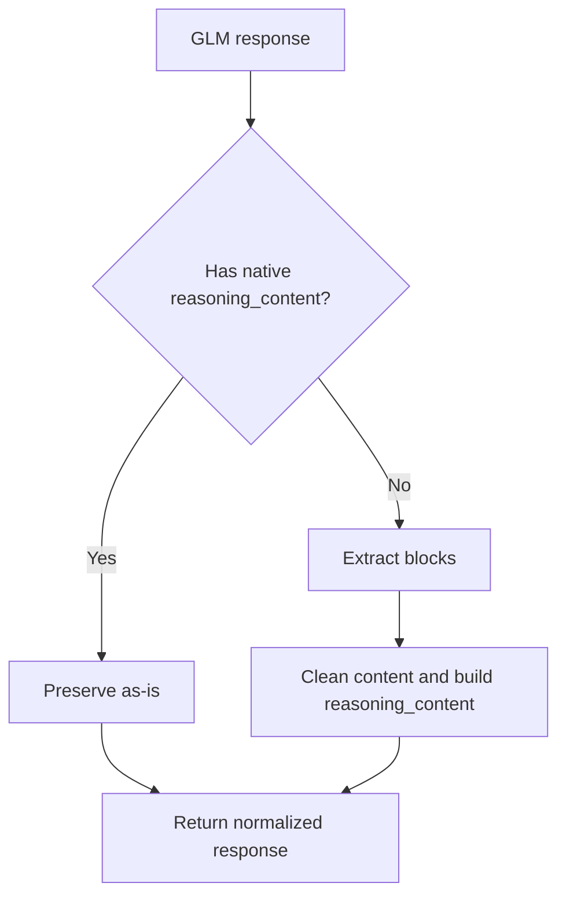

**Diagram sources**
- [transform/glm.rs:1-120](file://src/transform/glm.rs#L1-L120)

**Section sources**
- [transform/glm.rs:1-120](file://src/transform/glm.rs#L1-L120)

#### Kimi Transformer
Responsibilities:
- Extract Unicode think tokens from Kimi/Moonshot responses.
- Split content and reasoning content.
- Support both message and delta structures.
- Preserve multibyte UTF-8 correctly.

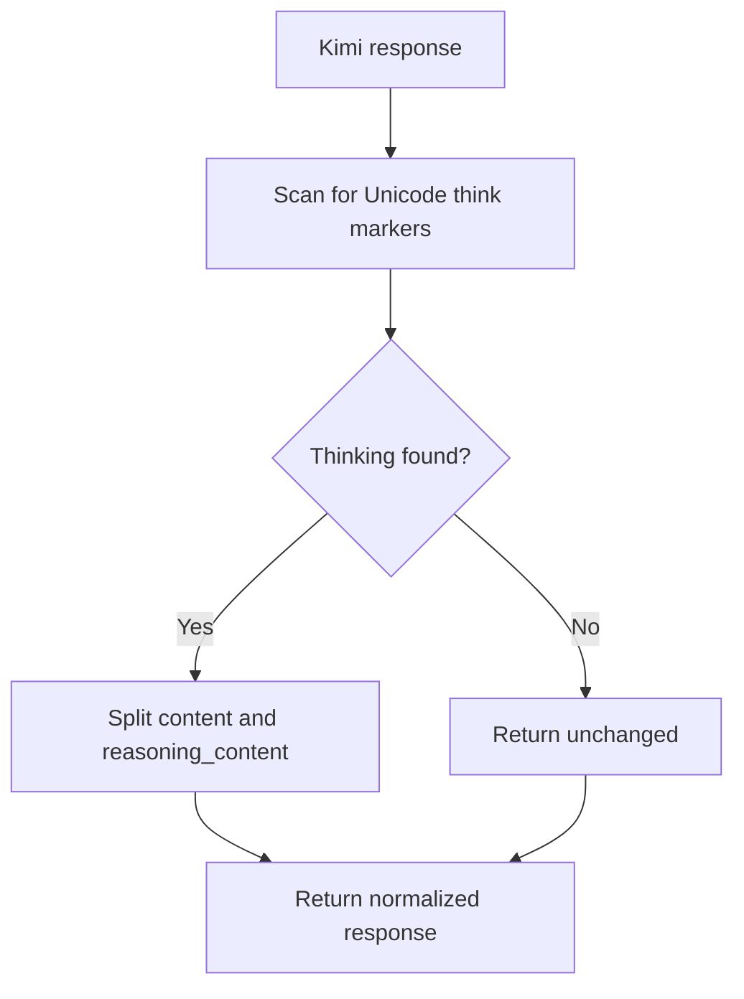

**Diagram sources**
- [transform/kimi.rs:1-120](file://src/transform/kimi.rs#L1-L120)

**Section sources**
- [transform/kimi.rs:1-120](file://src/transform/kimi.rs#L1-L120)

#### MiniMax Transformer
Responsibilities:
- Distinguish M3 models with native Anthropic-style thinking from M2.x models using `reasoning_split`.
- Inject appropriate thinking parameters based on transport and model family.
- Sanitize malformed assistant history caused by transport artifacts.
- Preserve cache token usage fields for accurate cost accounting.

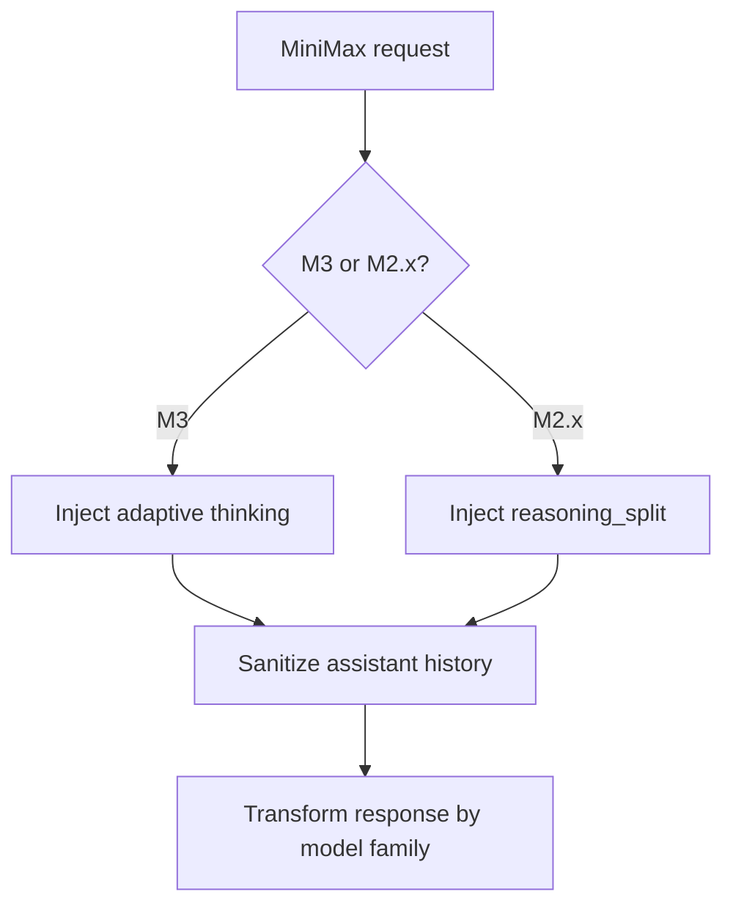

**Diagram sources**
- [transform/minimax.rs:1-120](file://src/transform/minimax.rs#L1-L120)

**Section sources**
- [transform/minimax.rs:1-120](file://src/transform/minimax.rs#L1-L120)

#### Anthropic and OpenAI Protocol Converters
Responsibilities:
- Convert Anthropic request format to OpenAI request format when needed.
- Convert OpenAI request format to Anthropic request format when dispatching through Anthropic-compatible endpoints.
- Convert Anthropic responses to OpenAI Chat Completions format.
- Map stop reasons, tool calls, thinking blocks, and usage information.

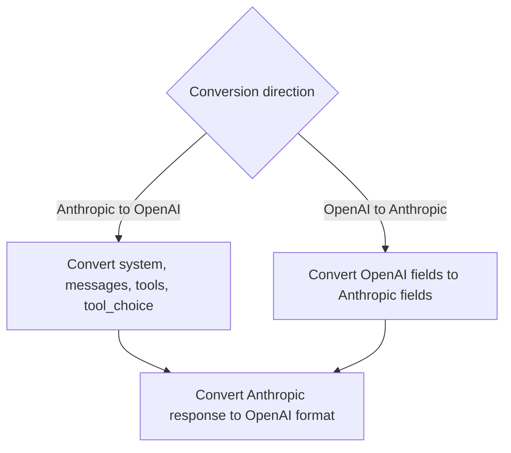

**Diagram sources**
- [transformer/builtin.rs:1-200](file://src/transformer/builtin.rs#L1-L200)
- [transform/anthropic_to_openai.rs:1-200](file://src/transform/anthropic_to_openai.rs#L1-L200)

**Section sources**
- [transformer/builtin.rs:1-200](file://src/transformer/builtin.rs#L1-L200)
- [transform/anthropic_to_openai.rs:1-200](file://src/transform/anthropic_to_openai.rs#L1-L200)

## Dependency Analysis
The provider architecture has clear layering:

- `src/config/types.rs` defines `Provider`, `ProviderProtocol`, `ProviderTransformer`, and related types used throughout the system.
- `src/transformer/mod.rs` defines the shared `Transformer` trait and built-in implementations.
- `src/transform/*` contains provider-specific transformers and the registry.
- `src/router/dispatch.rs` depends on configuration, transformer chains, streaming utilities, metrics, and rate limiting.

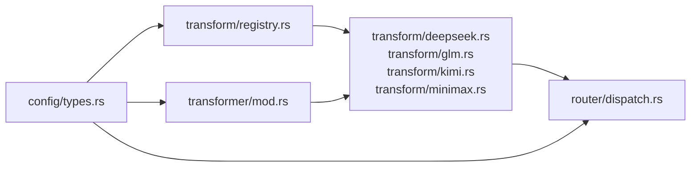

**Diagram sources**
- [config/types.rs:201-633](file://src/config/types.rs#L201-L633)
- [transformer/mod.rs:1-120](file://src/transformer/mod.rs#L1-L120)
- [transform/registry.rs:1-120](file://src/transform/registry.rs#L1-L120)
- [router/dispatch.rs:1-120](file://src/router/dispatch.rs#L1-L120)

Potential coupling points:
- Provider identity predicates, such as MiniMax detection, must stay consistent between configuration resolution and transformer logic.
- Protocol selection affects which transformers are applied and how authentication headers are constructed.
- Transformer chains must remain idempotent enough to survive retries and fallbacks.

**Section sources**
- [config/types.rs:201-633](file://src/config/types.rs#L201-L633)
- [transform/minimax.rs:1-120](file://src/transform/minimax.rs#L1-L120)
- [router/dispatch.rs:1-120](file://src/router/dispatch.rs#L1-L120)

## Performance Considerations
- EWMA latency tracking helps reorder tiers by measured responsiveness rather than static priority alone.
- Failure penalties prevent catastrophic inflation of EWMA estimates for timeouts or connection failures.
- Minimum sample thresholds keep unmeasured tiers in their configured order until sufficient data exists.
- Admission controls (`max_inflight`, `max_inflight_tokens`) reduce collision risk on providers sensitive to concurrent prefill volume.
- Streaming-first design avoids waiting for full responses when early errors or useful tokens are available.
- Transformer chains should avoid unnecessary allocations; many transformers operate in place on `serde_json::Value`.

[No sources needed since this section provides general guidance]

## Troubleshooting Guide

### Common Connectivity Issues
| Symptom | Likely Cause | Resolution |
|---|---|---|
| Immediate 401 on every provider | Unexpanded credential placeholder remains in `api_key` or `extra_headers` | Start via the credential launcher or export referenced variables; do not rely on literal `${VAR}` text |
| Provider returns 400 on tool-loop continuation | Missing required thinking block for providers like DeepSeek | Ensure leading-thinking injection is active; verify transformer chain includes provider-specific logic |
| Streaming response appears empty but HTTP 200 succeeds | Provider embedded error in stream body | Check dispatcher’s embedded error inspection and logs for error code and message |
| Rate-limited despite quota headers present | Provider reports informational rate-limit headers without rejecting | Disable `honor_ratelimit_headers` only for providers known to send warnings on 200 responses |
| Unexpected non-streaming latency | Provider performs poorly in non-streaming mode | Enable `allow_streaming` for the provider |
| Custom user agent or identity header missing | Provider requires extra headers | Add required headers through `extra_headers` |

### Diagnostic Steps
1. Inspect provider configuration for `protocol`, `auth_header`, and `anthropic_version`.
2. Verify environment expansion did not leave literal placeholders.
3. Confirm transformer chain includes the expected provider transformer.
4. Review debug captures for sanitized headers and response status.
5. Check whether forced reasoning effort or adaptive thinking is overriding caller defaults.
6. Reduce concurrency using `max_inflight` or `max_inflight_tokens` for providers with prefill-sensitive 429 behavior.

**Section sources**
- [config/mod.rs:1-120](file://src/config/mod.rs#L1-L120)
- [config/types.rs:201-633](file://src/config/types.rs#L201-L633)
- [router/dispatch.rs:1-1917](file://src/router/dispatch.rs#L1-L1917)

## Security Considerations
API key and network configuration security should follow these practices:

- Never commit raw provider API keys to source control.
- Prefer environment variables or a credential launcher for secret injection.
- Use `CCR_ALLOW_UNEXPANDED_CREDENTIALS` only for intentionally local setups; it bypasses the safety check against literal placeholder credentials.
- Restrict `extra_headers` to necessary values; invalid header names or values fail configuration validation.
- Avoid exposing debug captures publicly because they may contain sensitive request/response context; captured headers are redacted, but callers must still treat logs carefully.
- Limit network access so the CCR-Rust process can reach only intended provider endpoints.
- Treat `force_reasoning_effort` and `force_adaptive_thinking` as policy controls that can alter model behavior and potentially affect cost or compliance.

**Section sources**
- [config/mod.rs:1-120](file://src/config/mod.rs#L1-L120)
- [router/dispatch.rs:1-80](file://src/router/dispatch.rs#L1-L80)
- [config/types.rs:201-633](file://src/config/types.rs#L201-L633)

## Conclusion
CCR-Rust models LLM providers as configuration-driven backends rather than hard-coded integrations. The `Provider` structure centralizes authentication, protocol selection, capabilities, and transformation configuration. The `Transformer` trait and registry provide a flexible, composable mechanism for adapting requests and responses across Anthropic, OpenAI, and provider-specific formats. The router dispatch ties everything together with validation, streaming inspection, error handling, and observability.

For new providers, the recommended approach is:
1. Add provider configuration with protocol, authentication, and capability flags.
2. Implement a provider-specific transformer when request or response shapes differ from the normalized internal format.
3. Register the transformer in the factory registry if it needs dynamic instantiation.
4. Wire provider identity detection consistently across configuration and transformation logic.
5. Validate credentials, test streaming error detection, and monitor rate-limit and admission-control behavior.