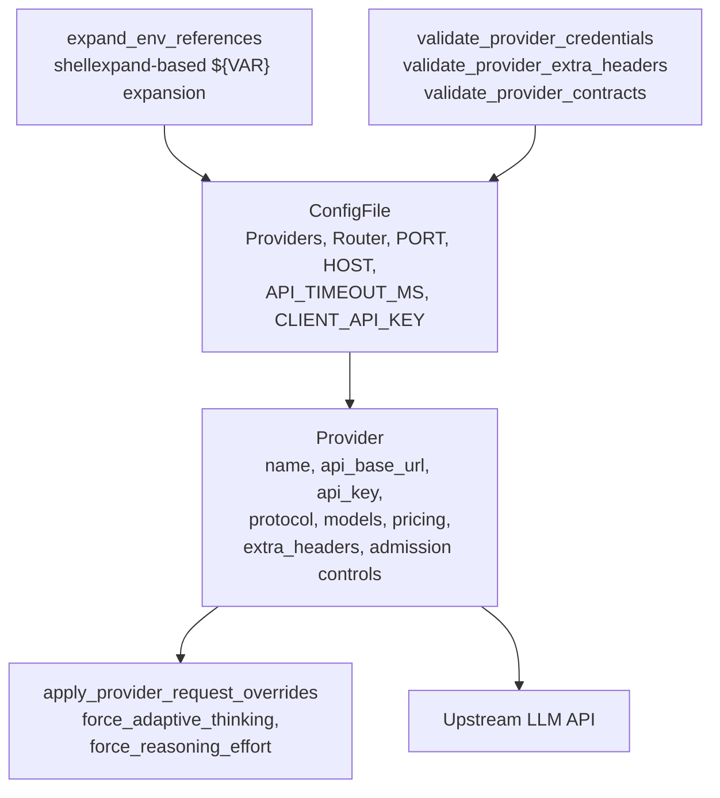
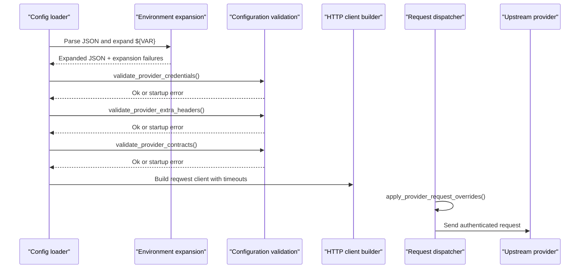
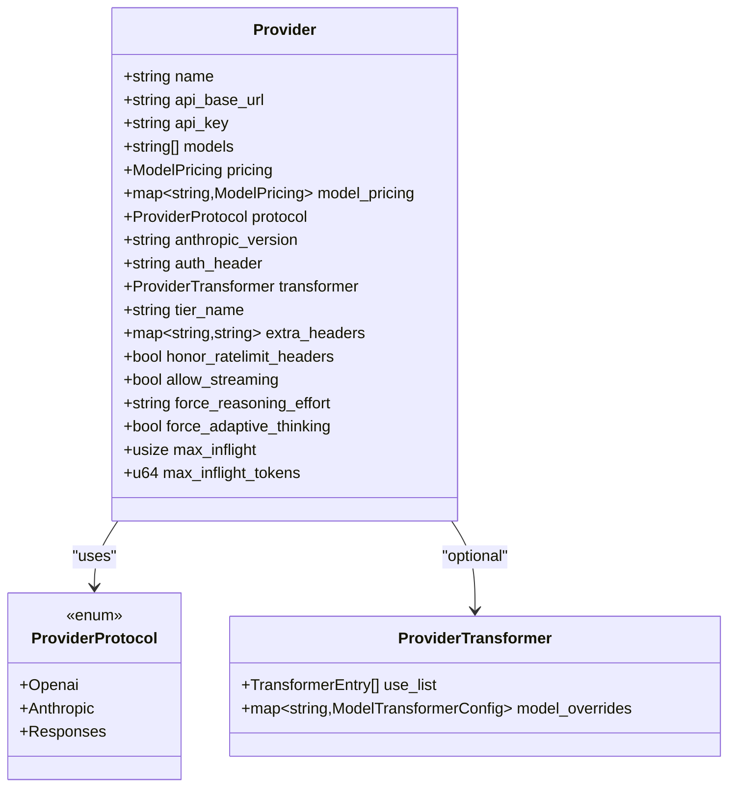
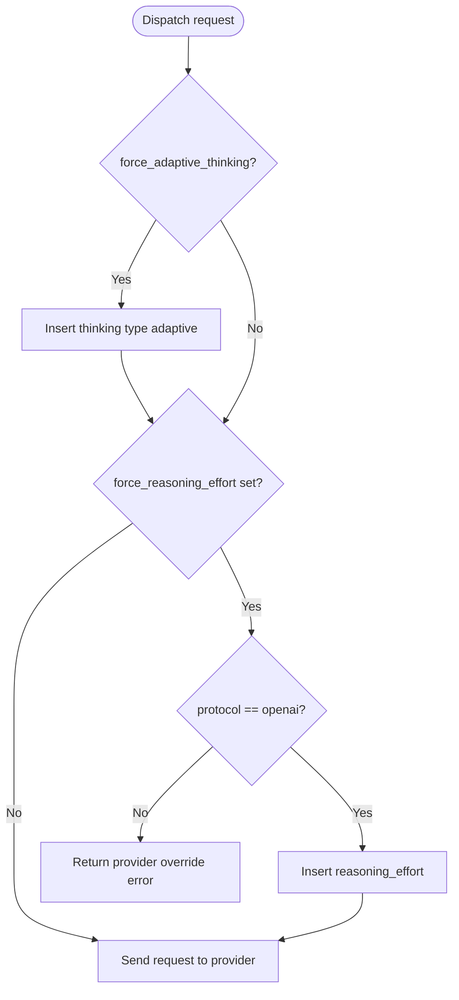
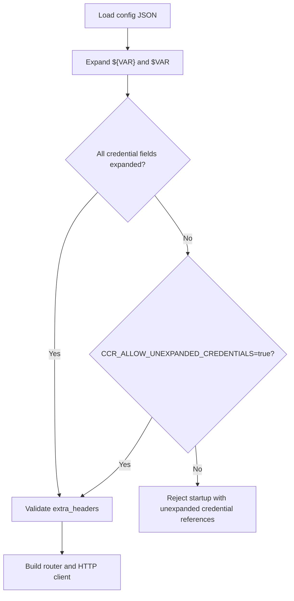
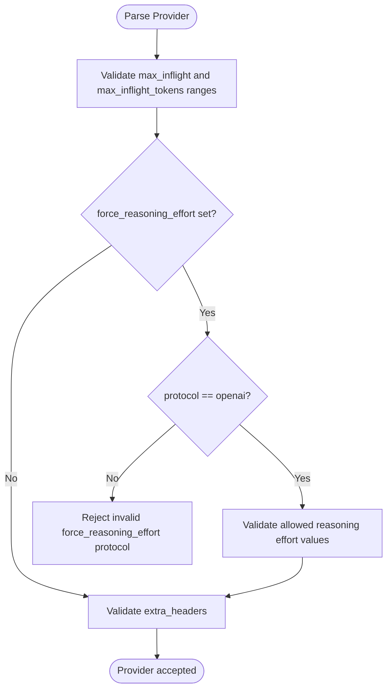
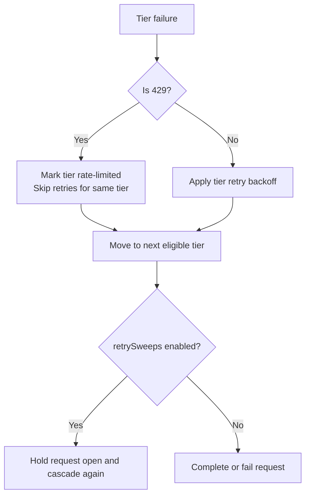

# Provider Configuration

<cite>
**Referenced Files in This Document**
- [types.rs](file://src/config/types.rs)
- [mod.rs](file://src/config/mod.rs)
- [provider_overrides.rs](file://src/router/dispatch/provider_overrides.rs)
- [configuration.md](file://docs/configuration.md)
- [troubleshooting.md](file://docs/troubleshooting.md)
- [openrouter-free.json](file://examples/openrouter-free.json)
- [sensenova.json](file://examples/sensenova.json)
</cite>

## Table of Contents
1. [Introduction](#introduction)
2. [Project Structure](#project-structure)
3. [Core Components](#core-components)
4. [Architecture Overview](#architecture-overview)
5. [Detailed Component Analysis](#detailed-component-analysis)
6. [Provider Setup Guide](#provider-setup-guide)
7. [Environment Variables and Secrets Management](#environment-variables-and-secrets-management)
8. [Validation Rules and Defaults](#validation-rules-and-defaults)
9. [Retry, Timeout, and Admission Controls](#retry-timeout-and-admission-controls)
10. [Troubleshooting Guide](#troubleshooting-guide)
11. [Conclusion](#conclusion)

## Introduction
This document explains how to configure LLM providers in CCR-Rust. It focuses on the provider configuration model, authentication, base URLs, timeouts, retry behavior, admission controls, provider-specific parameters, environment variable expansion, validation rules, defaults, and troubleshooting for common configuration problems.

CCR-Rust does not define one single `ProviderConfig` struct; the relevant configuration is modeled by:
- The `Provider` structure that describes each upstream LLM provider entry.
- The top-level `ConfigFile` that contains the list of providers, router settings, listener settings, and HTTP client options.
- Runtime overrides applied just before dispatching a request to a provider.

The JSON schema documented here corresponds to these structures and their validation logic.

## Project Structure
Provider configuration lives primarily in the configuration layer, with runtime application of provider-specific request overrides in the router dispatch layer. Example configurations are included under `examples/`.



**Diagram sources**
- [mod.rs:23-206](file://src/config/mod.rs#L23-L206)
- [types.rs:280-445](file://src/config/types.rs#L280-L445)
- [provider_overrides.rs:1-47](file://src/router/dispatch/provider_overrides.rs#L1-L47)

**Section sources**
- [types.rs:280-445](file://src/config/types.rs#L280-L445)
- [mod.rs:23-206](file://src/config/mod.rs#L23-L206)

## Core Components
The main configuration objects involved in provider setup are:

| Object | Purpose | Key fields relevant to providers |
|---|---|---|
| `ConfigFile` | Top-level parsed configuration | `providers`, `router`, `port`, `host`, `api_timeout_ms`, `pool_idle_timeout_ms`, `client_api_key` |
| `Provider` | One upstream LLM provider entry | `name`, `api_base_url`, `api_key`, `models`, `pricing`, `model_pricing`, `protocol`, `anthropic_version`, `auth_header`, `transformer`, `tier_name`, `extra_headers`, `honor_ratelimit_headers`, `allow_streaming`, `force_reasoning_effort`, `force_adaptive_thinking`, `max_inflight`, `max_inflight_tokens` |
| `ProviderProtocol` | Selected upstream API protocol | `openai`, `anthropic`, `responses` |
| Request override function | Applies provider-level runtime request changes | Inserts adaptive thinking or reasoning effort into the outgoing request |

The most important provider-level object is `Provider`. It maps directly to entries in the `Providers` array of the configuration file.

**Section sources**
- [types.rs:280-445](file://src/config/types.rs#L280-L445)
- [mod.rs:402-470](file://src/config/mod.rs#L402-L470)
- [provider_overrides.rs:1-47](file://src/router/dispatch/provider_overrides.rs#L1-L47)

## Architecture Overview
The provider configuration lifecycle is:

1. Load JSON from the configured config file path.
2. Expand `${VAR}` and `$VAR` references using shell-style environment expansion.
3. Record expansion failures for credential fields.
4. Validate expanded credentials, extra headers, provider contracts, retry sweeps, retry budget, hedging, tier ordering, and model aliases.
5. Build an HTTP client using the global timeout and pool idle timeout.
6. Apply provider-level request overrides when dispatching requests.



**Diagram sources**
- [mod.rs:23-206](file://src/config/mod.rs#L23-L206)
- [mod.rs:611-633](file://src/config/mod.rs#L611-L633)
- [provider_overrides.rs:1-47](file://src/router/dispatch/provider_overrides.rs#L1-L47)

**Section sources**
- [mod.rs:23-206](file://src/config/mod.rs#L23-L206)
- [mod.rs:611-633](file://src/config/mod.rs#L611-L633)

## Detailed Component Analysis

### Provider Data Model
The `Provider` structure captures all per-provider configuration. Its most relevant fields are:

| Field | Type / Default | Meaning |
|---|---|---|
| `name` | string, required | Unique provider identifier used in routes and logs. |
| `api_base_url` | string, required | Full upstream API endpoint URL. |
| `api_key` | string, required | Provider authentication secret. |
| `models` | string array, required | Available model identifiers served by this provider. |
| `pricing` | optional model pricing object | Default token pricing for the provider. |
| `model_pricing` | optional map of model pricing | Per-model pricing overrides. |
| `protocol` | `openai`, `anthropic`, `responses`; default `openai` | Upstream API protocol family. |
| `anthropic_version` | optional string | Anthropic API version header when `protocol=anthropic`. |
| `auth_header` | optional string | Authentication header style for Anthropic-compatible providers. |
| `transformer` | optional transformer chain | Request/response transformation configuration. |
| `tier_name` | optional string | Optional display name for metrics and dashboards. |
| `extra_headers` | optional map of string key/value | Additional HTTP headers sent to this provider. |
| `honor_ratelimit_headers` | boolean, default `true` | Skip tier when upstream reports zero remaining rate-limit quota. |
| `allow_streaming` | boolean, default `false` | Force native streaming even when non-streaming mode is globally enabled. |
| `force_reasoning_effort` | optional string | Forces OpenAI Chat Completions `reasoning_effort` on every request. |
| `force_adaptive_thinking` | boolean, default `false` | Injects adaptive thinking state for providers that require it. |
| `max_inflight` | optional integer | AIMD admission control limit; validated between 1 and 64. |
| `max_inflight_tokens` | optional integer | Static prefill-token budget; validated between 1,000 and 4,000,000. |



**Diagram sources**
- [types.rs:280-445](file://src/config/types.rs#L280-L445)
- [types.rs:446-466](file://src/config/types.rs#L446-L466)

**Section sources**
- [types.rs:280-445](file://src/config/types.rs#L280-L445)
- [types.rs:446-466](file://src/config/types.rs#L446-L466)

### Request Override Behavior
Before dispatching a request, CCR-Rust applies provider-level request overrides. This is separate from static configuration and happens at request time.

Behavior:
- If `force_adaptive_thinking` is true, the request receives `thinking: {type: "adaptive"}`.
- If `force_reasoning_effort` is set, the request receives `reasoning_effort` with the configured value.
- `force_reasoning_effort` is only allowed when `protocol=openai`.
- If the request is not a JSON object when overrides are applied, dispatch fails with a provider-specific error.



**Diagram sources**
- [provider_overrides.rs:1-47](file://src/router/dispatch/provider_overrides.rs#L1-L47)

**Section sources**
- [provider_overrides.rs:1-47](file://src/router/dispatch/provider_overrides.rs#L1-L47)

## Provider Setup Guide
Below are concrete configuration patterns for the providers requested. Each example shows how to fill the required `Providers` array entry and relevant router settings. Replace placeholder values with real secrets before starting CCR-Rust.

### Common Required Fields
Every provider needs:
- `name`: A stable identifier.
- `api_base_url`: The full upstream endpoint.
- `api_key`: The provider API secret.
- `models`: At least one model identifier supported by the provider.

### Anthropic-Compatible Providers
For providers that implement the Anthropic Messages API, set `protocol: "anthropic"`. You may also need `anthropic_version` and `auth_header`, depending on the provider implementation.

Example pattern:
```json
{
  "Providers": [
    {
      "name": "anthropic",
      "api_base_url": "https://api.anthropic.com/v1/messages",
      "api_key": "${ANTHROPIC_API_KEY}",
      "protocol": "anthropic",
      "anthropic_version": "2023-06-01",
      "models": ["claude-sonnet-4-20250514", "claude-opus-4-20250514"]
    }
  ],
  "Router": {
    "default": "anthropic,claude-sonnet-4-20250514"
  }
}
```

Key notes:
- Use `protocol: "anthropic"` so CCR-Rust sends Anthropic-compatible requests.
- Set `anthropic_version` if your provider requires a specific version header.
- Set `auth_header` only if the provider expects `Authorization: Bearer` instead of the Anthropic default header style.

**Section sources**
- [types.rs:303-337](file://src/config/types.rs#L303-L337)
- [configuration.md:143-200](file://docs/configuration.md#L143-L200)

### OpenAI-Compatible Providers
Most providers (OpenAI, DeepSeek, GLM, Kimi, SenseNova, and many third-party gateways) use the OpenAI Chat Completions protocol. Leave `protocol` unset or set it to `"openai"`.

Example pattern:
```json
{
  "Providers": [
    {
      "name": "openai",
      "api_base_url": "https://api.openai.com/v1/chat/completions",
      "api_key": "${OPENAI_API_KEY}",
      "models": ["gpt-4o", "gpt-4o-mini"]
    }
  ],
  "Router": {
    "default": "openai,gpt-4o"
  }
}
```

If you need to force reasoning effort, add:
```json
{
  "force_reasoning_effort": "none",
  "force_adaptive_thinking": false
}
```

**Section sources**
- [types.rs:303-362](file://src/config/types.rs#L303-L362)
- [mod.rs:237-260](file://src/config/mod.rs#L237-L260)

### GLM
GLM providers typically expose an OpenAI-compatible endpoint. Configure them like any other OpenAI provider, then set the appropriate model names. Some GLM implementations have specific accepted effort labels; see the reasoning controls section below.

Example pattern:
```json
{
  "Providers": [
    {
      "name": "glm",
      "api_base_url": "https://your-glm-endpoint/v1/chat/completions",
      "api_key": "${GLM_API_KEY}",
      "models": ["glm-5", "glm-4-plus"]
    }
  ],
  "Router": {
    "default": "glm,glm-5"
  }
}
```

Note: GLM-5.3 accepts only certain effort labels and has provider-specific behavior for missing controls.

**Section sources**
- [configuration.md:143-200](file://docs/configuration.md#L143-L200)

### MiniMax
MiniMax can be configured as an OpenAI-compatible provider. It also supports specialized admission controls through `max_inflight` and `max_inflight_tokens`.

Example pattern:
```json
{
  "Providers": [
    {
      "name": "minimax",
      "api_base_url": "https://your-minimax-endpoint/v1/chat/completions",
      "api_key": "${MINIMAX_API_KEY}",
      "models": ["MiniMax-M3", "MiniMax-M3.1-flash"],
      "maxInflight": 4,
      "maxInflightTokens": 200000
    }
  ],
  "Router": {
    "default": "minimax,MiniMax-M3"
  }
}
```

Notes:
- `maxInflight` uses camel-case deserialization alias support.
- `maxInflightTokens` is useful when 429 errors come from concurrent prefill volume rather than pure request count.

**Section sources**
- [types.rs:367-379](file://src/config/types.rs#L367-L379)
- [mod.rs:221-235](file://src/config/mod.rs#L221-L235)
- [mod.rs:1109-1126](file://src/config/mod.rs#L1109-L1126)

### DeepSeek
DeepSeek is commonly exposed as an OpenAI-compatible endpoint. Configure it like any other OpenAI provider and include its model identifiers.

Example pattern:
```json
{
  "Providers": [
    {
      "name": "deepseek",
      "api_base_url": "https://api.deepseek.com/v1/chat/completions",
      "api_key": "${DEEPSEEK_API_KEY}",
      "models": ["deepseek-chat", "deepseek-coder"]
    }
  ],
  "Router": {
    "default": "deepseek,deepseek-chat"
  }
}
```

**Section sources**
- [mod.rs:1041-1048](file://src/config/mod.rs#L1041-L1048)

### Kimi
Kimi can be configured as an OpenAI-compatible provider. Some coding agent integrations benefit from additional headers such as `User-Agent`.

Example pattern:
```json
{
  "Providers": [
    {
      "name": "kimi",
      "api_base_url": "https://your-kimi-endpoint/v1/chat/completions",
      "api_key": "${KIMI_API_KEY}",
      "models": ["kimi-k2.5"],
      "extra_headers": {
        "User-Agent": "claude-cli/2.1.30 (external, cli)"
      }
    }
  ],
  "Router": {
    "default": "kimi,kimi-k2.5"
  }
}
```

**Section sources**
- [types.rs:320-337](file://src/config/types.rs#L320-L337)

### OpenRouter
The repository includes a working OpenRouter free-inference example. It uses the OpenAI-compatible `/api/v1` base URL, sets `extra_headers.User-Agent`, and applies a transformer chain.

Concrete example from the repository:
```json
{
  "Providers": [
    {
      "name": "openrouter",
      "api_base_url": "https://openrouter.ai/api/v1",
      "api_key": "${OPENROUTER_API_KEY}",
      "pricing": {
        "input_per_million_tokens": 0.0,
        "output_per_million_tokens": 0.0
      },
      "extra_headers": {
        "User-Agent": "claude-cli/2.1.30 (external, cli)"
      },
      "models": [
        "openrouter/free",
        "minimax/minimax-m3.1-flash:free",
        "xingchen-agi/xing4.0-29b-a4b:free",
        "nvidia/nemotron-3.5-super-vl:free",
        "nvidia/nemotron-3.5-lightning:free",
        "cohere/north-mini-code:free",
        "poolside/laguna-xs-2.1:free",
        "thinkingmachines/inkling-small:free"
      ],
      "transformer": {
        "use": ["anthropic", "openrouter"]
      }
    }
  ],
  "Router": {
    "default": "openrouter,openrouter/free",
    "tiers": [
      "openrouter,openrouter/free",
      "openrouter,minimax/minimax-m3.1-flash:free",
      "openrouter,nvidia/nemotron-3.5-super-vl:free",
      "openrouter,cohere/north-mini-code:free",
      "openrouter,poolside/laguna-xs-2.1:free",
      "openrouter,xingchen-agi/xing4.0-29b-a4b:free",
      "openrouter,nvidia/nemotron-3.5-lightning:free",
      "openrouter,thinkingmachines/inkling-small:free"
    ],
    "strictTierOrder": true
  },
  "Persistence": {
    "mode": "none"
  }
}
```

**Section sources**
- [openrouter-free.json:1-54](file://examples/openrouter-free.json#L1-L54)

### SenseNova
SenseNova is demonstrated as an OpenAI-compatible provider with adaptive-thinking forcing and reasoning effort disabled.

Concrete example from the repository:
```json
{
  "Providers": [
    {
      "name": "sensenova",
      "api_base_url": "https://token.sensenova.ai/v1",
      "api_key": "${CCR_SENSENOVA_API_KEY}",
      "protocol": "openai",
      "models": ["sensenova-6.8-flash-lite"],
      "tier_name": "ccr-sensenova",
      "force_adaptive_thinking": true,
      "force_reasoning_effort": "none"
    }
  ],
  "Router": {
    "default": "sensenova,sensenova-6.8-flash-lite",
    "tiers": ["sensenova,sensenova-6.8-flash-lite"],
    "strictTierOrder": true
  },
  "Persistence": {
    "mode": "none"
  },
  "HOST": "127.0.0.1",
  "PORT": 3456
}
```

**Section sources**
- [sensenova.json:1-29](file://examples/sensenova.json#L1-L29)
- [provider_overrides.rs:1-47](file://src/router/dispatch/provider_overrides.rs#L1-L47)

## Environment Variables and Secrets Management
CCR-Rust expands `${VAR_NAME}` and `$VAR` references in string values during configuration loading. Expansion happens before credential validation.

### Supported Expansion Syntax
- `${VAR_NAME}`
- `$VAR` without braces

### Where Variables Come From
Variables are expanded from the router process environment at config load time. CCR-Rust does not read `.env` files itself. Export variables in the shell, service manager, Docker, or CI environment before starting the router.

### Credential Validation
If a provider `api_key` or `extra_headers` value contains an unexpanded variable reference, CCR-Rust rejects startup unless overridden. The error identifies which provider and field failed expansion.

Override option:
- Set `CCR_ALLOW_UNEXPANDED_CREDENTIALS=true` to allow startup with literal placeholders. This should only be used for intentionally local or loopback-only setups where authentication is not expected to work against real providers.



**Diagram sources**
- [mod.rs:23-95](file://src/config/mod.rs#L23-L95)
- [mod.rs:97-139](file://src/config/mod.rs#L97-L139)
- [mod.rs:611-617](file://src/config/mod.rs#L611-L617)

**Section sources**
- [mod.rs:23-95](file://src/config/mod.rs#L23-L95)
- [mod.rs:97-139](file://src/config/mod.rs#L97-L139)
- [configuration.md:15-56](file://docs/configuration.md#L15-L56)

## Validation Rules and Defaults
CCR-Rust validates configuration before accepting traffic. Important rules for provider configuration include:

### Required and Structural Rules
- Each provider must have `name`, `api_base_url`, `api_key`, and `models`.
- `extra_headers` keys must be valid HTTP header names.
- `extra_headers` values must be strings that parse as valid HTTP header values.
- Unexpanded `api_key` or `extra_headers` values are rejected at startup unless `CCR_ALLOW_UNEXPANDED_CREDENTIALS=true`.

### Range and Contract Rules
- `max_inflight` must be between 1 and 64.
- `max_inflight_tokens` must be between 1,000 and 4,000,000.
- `force_reasoning_effort` is only allowed when `protocol=openai`.
- `force_reasoning_effort` must be one of the allowed reasoning effort values.

### Defaults
| Field | Default |
|---|---|
| `protocol` | `openai` |
| `honor_ratelimit_headers` | `true` |
| `allow_streaming` | `false` |
| `force_adaptive_thinking` | `false` |
| `tier_name` | Not set; defaults to provider name in display contexts |
| `api_timeout_ms` | Global default derived from configuration |
| `pool_idle_timeout_ms` | Global default derived from configuration |



**Diagram sources**
- [mod.rs:219-260](file://src/config/mod.rs#L219-L260)

**Section sources**
- [mod.rs:219-260](file://src/config/mod.rs#L219-L260)
- [types.rs:357-379](file://src/config/types.rs#L357-L379)

## Retry, Timeout, and Admission Controls

### Global Timeouts
Global HTTP client timeouts are part of the top-level configuration:

| Setting | Description |
|---|---|
| `API_TIMEOUT_MS` | Overall API timeout in milliseconds. |
| `POOL_IDLE_TIMEOUT_MS` | HTTP connection pool idle timeout in milliseconds. |
| `CLIENT_API_KEY` | Optional client-facing API key for authenticated access to CCR-Rust itself. |

These values configure the underlying HTTP client built from the loaded configuration.

**Section sources**
- [mod.rs:402-418](file://src/config/mod.rs#L402-L418)
- [mod.rs:461-470](file://src/config/mod.rs#L461-L470)
- [mod.rs:626-633](file://src/config/mod.rs#L626-L633)

### Provider-Level Admission Controls
CCR-Rust uses admission control to avoid overwhelming upstream providers:

| Field | Scope | Behavior |
|---|---|---|
| `max_inflight` | Per provider | Initial and maximum in-flight attempts for AIMD admission control. Validated between 1 and 64. |
| `max_inflight_tokens` | Per provider | Static prefill-token budget. Admission defers a request when reserved in-flight tokens plus estimated request size would exceed the budget. Validated between 1,000 and 4,000,000. |
| `honor_ratelimit_headers` | Per provider | Skips tiers when upstream reports zero remaining rate-limit quota. |
| `allow_streaming` | Per provider | Forces native streaming even when global non-streaming mode is enabled. |

AIMD adjusts per-route limits based on success and 429 responses, while `max_inflight_tokens` remains a static budget.

**Section sources**
- [types.rs:357-379](file://src/config/types.rs#L357-L379)
- [types.rs:408-445](file://src/config/types.rs#L408-L445)

### Router-Level Retry and Sweep Configuration
Router-level retry behavior is separate from provider configuration but affects how failed requests are retried across tiers.

Key concepts:
- Per-tier retry limits and backoff are defined in `tierRetries`.
- Stream timeouts are controlled by stream-first-event and stream-idle timeouts.
- `retryBudgetPercent` controls the overall retry budget percentage.
- `retrySweeps` allows holding an exhausted request open and re-cascading through the tier list.
- `sweepCooldownMs` must be greater than zero when retry sweeps are enabled.



**Diagram sources**
- [mod.rs:642-653](file://src/config/mod.rs#L642-L653)
- [mod.rs:696-727](file://src/config/mod.rs#L696-L727)
- [mod.rs:730-744](file://src/config/mod.rs#L730-L744)
- [mod.rs:262-275](file://src/config/mod.rs#L262-L275)

**Section sources**
- [mod.rs:642-653](file://src/config/mod.rs#L642-L653)
- [mod.rs:696-727](file://src/config/mod.rs#L696-L727)
- [mod.rs:730-744](file://src/config/mod.rs#L730-L744)
- [mod.rs:262-275](file://src/config/mod.rs#L262-L275)

## Troubleshooting Guide

### Authentication Failures
**Symptoms:**
- Every provider returns 401 Unauthorized.
- Startup error mentions unexpanded credential references.

**Likely causes:**
- `api_key` still contains `${VAR}` because the environment variable was not exported.
- `extra_headers` contains an unexpanded secret.
- The router was started outside the credential launcher without the required environment variables.

**Fixes:**
- Export the referenced environment variables before starting CCR-Rust.
- Use the credential launcher when available.
- For intentional local-only setups without real authentication, set `CCR_ALLOW_UNEXPANDED_CREDENTIALS=true`.
- Verify that `api_key` is present and nonempty after expansion.

**Section sources**
- [mod.rs:97-139](file://src/config/mod.rs#L97-L139)
- [mod.rs:1365-1410](file://src/config/mod.rs#L1365-L1410)
- [configuration.md:15-56](file://docs/configuration.md#L15-L56)

### Invalid Extra Headers
**Symptoms:**
- Startup fails with an error about invalid `extra_headers`.

**Likely causes:**
- Header name is not a valid HTTP header name.
- Header value is not a string.
- Header value does not parse as a valid HTTP header value.

**Fixes:**
- Ensure all `extra_headers` keys are valid HTTP header names.
- Ensure all values are strings.
- Avoid spaces or characters that do not form valid HTTP header values.

**Section sources**
- [mod.rs:140-206](file://src/config/mod.rs#L140-L206)
- [mod.rs:1404-1410](file://src/config/mod.rs#L1404-L1410)

### Network Connectivity Problems
**Symptoms:**
- Connection refused.
- SSL/TLS errors.
- Gateway timeouts.

**Likely causes:**
- Incorrect `api_base_url`.
- Provider endpoint unreachable.
- Missing system CA certificates.
- Firewall or proxy blocking outbound HTTPS.

**Fixes:**
- Verify the provider URL is reachable from the CCR-Rust host.
- Install system CA certificates.
- Use debug logging to inspect network details.
- Adjust timeouts if upstream latency is high.

**Section sources**
- [troubleshooting.md:1-28](file://docs/troubleshooting.md#L1-L28)

### Unsupported Reasoning Effort Values
**Symptoms:**
- Startup error says `force_reasoning_effort` requires protocol `openai`.
- Startup error says `force_reasoning_effort` has an invalid value.
- Upstream validation error for unsupported effort labels.

**Likely causes:**
- Using `force_reasoning_effort` with `protocol=anthropic` or `protocol=responses`.
- Supplying a reasoning effort value not in the allowed set.
- Sending an effort label that the destination provider does not accept.

**Fixes:**
- Use `force_reasoning_effort` only with `protocol=openai`.
- Use allowed values such as `none`, `minimal`, `low`, `medium`, `high`, `xhigh`, `max`.
- For Anthropic-compatible providers, prefer native `output_config.effort` or native thinking controls.
- For GLM-5.3, use accepted effort labels and follow provider-specific defaults.

**Section sources**
- [mod.rs:237-260](file://src/config/mod.rs#L237-L260)
- [provider_overrides.rs:1-47](file://src/router/dispatch/provider_overrides.rs#L1-L47)
- [configuration.md:143-200](file://docs/configuration.md#L143-L200)

### Rate Limiting and 429 Behavior
**Symptoms:**
- Requests move to lower-priority tiers.
- Logs show rate limited, backing off, skipping tier, or quota exhausted messages.
- Metrics show rate-limit hits and backoffs.

**Likely causes:**
- Provider account quota reached.
- Too many concurrent requests.
- Pre-request token volume collisions.

**Fixes:**
- Add additional provider tiers for failover.
- Put frequently rate-limited providers lower in the route order.
- Tune `max_inflight` and `max_inflight_tokens`.
- Verify provider quotas and request higher limits if needed.
- Keep `tierRetries` for transient non-429 failures; 429 behavior is handled separately.

**Section sources**
- [troubleshooting.md:14-56](file://docs/troubleshooting.md#L14-L56)
- [types.rs:357-379](file://src/config/types.rs#L357-L379)

### Streaming vs Non-Streaming Issues
**Symptoms:**
- Native tool-use blocks are missing when non-streaming mode is forced.
- Pseudo-SSE conversion drops content blocks.
- Latency increases for providers where non-streaming mode is slow.

**Likely causes:**
- `forceNonStreaming` converts some provider responses to SSE events and may drop unsupported block types.
- Some providers perform better with native streaming.

**Fixes:**
- Enable `allow_streaming: true` for providers where non-streaming mode causes excessive latency.
- Inspect capture logs for dropped content blocks.
- Prefer native streaming where possible.

**Section sources**
- [troubleshooting.md:58-142](file://docs/troubleshooting.md#L58-L142)
- [types.rs:345-355](file://src/config/types.rs#L345-L355)

## Conclusion
CCR-Rust provider configuration centers on the `Provider` object inside the `Providers` array. Each provider defines its identity, endpoint, authentication secret, supported models, protocol family, and optional runtime behaviors such as adaptive thinking, reasoning effort, extra headers, and admission controls.

For reliable operation:
- Always export secrets as environment variables and let CCR-Rust expand `${VAR}` references.
- Use `protocol=openai` for OpenAI-compatible providers and `protocol=anthropic` for Anthropic-compatible providers.
- Validate `force_reasoning_effort` against allowed values and only use it with OpenAI protocol.
- Tune `max_inflight` and `max_inflight_tokens` according to provider rate-limit behavior.
- Use examples like OpenRouter and SenseNova as templates for multi-tier routing and provider-specific overrides.
- Consult the troubleshooting guide for authentication, connectivity, rate limiting, and streaming issues.