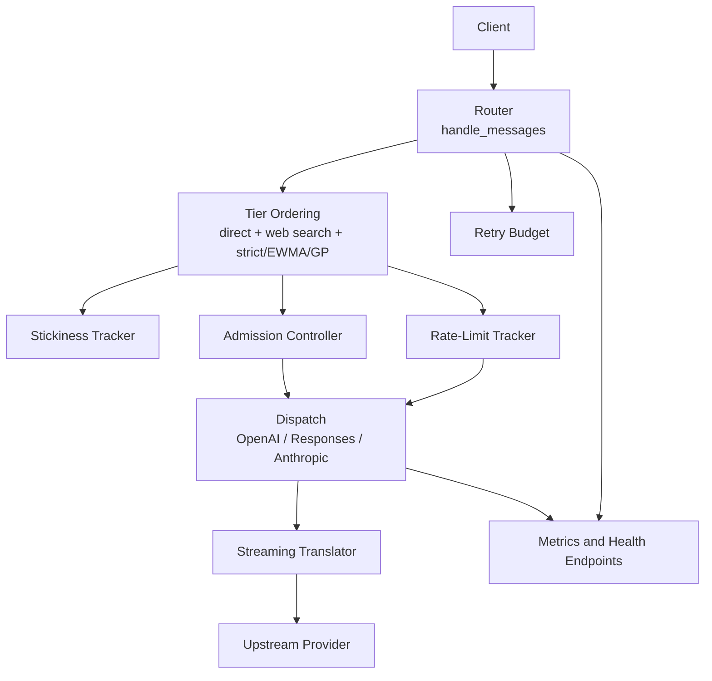
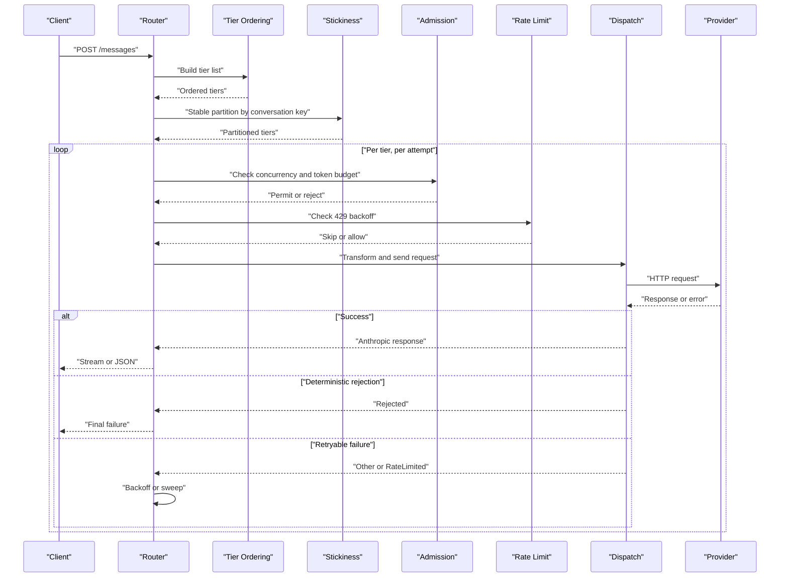
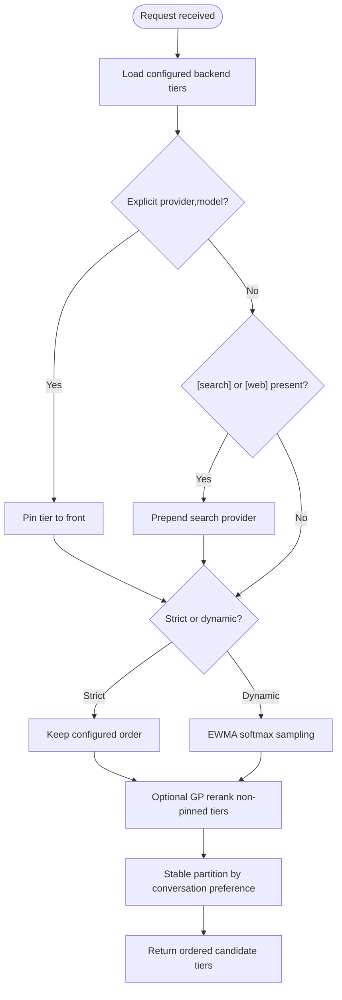
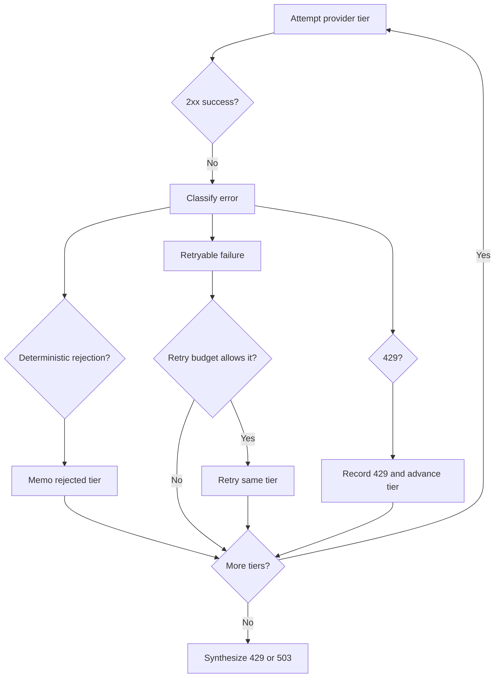
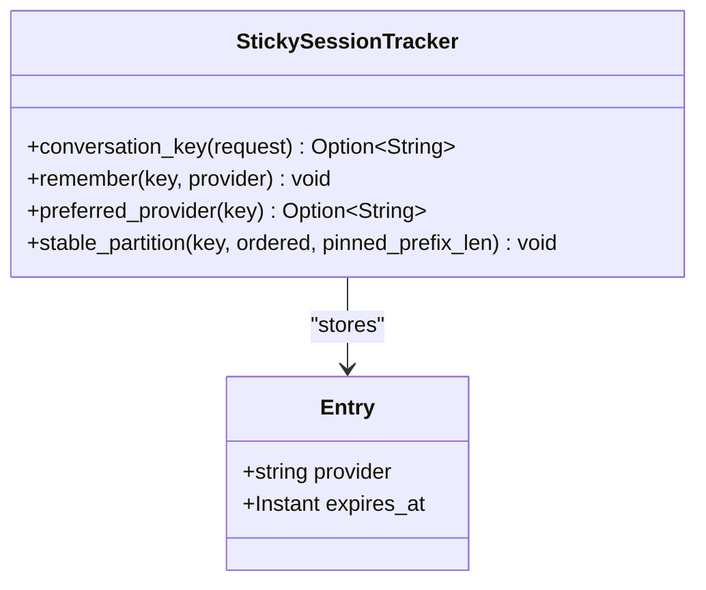
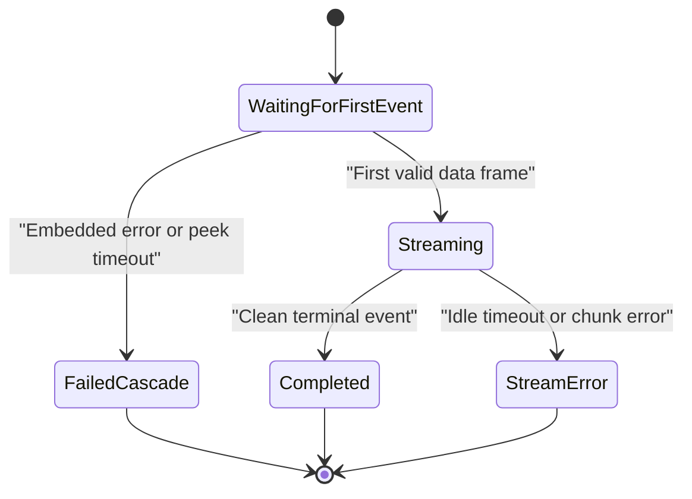
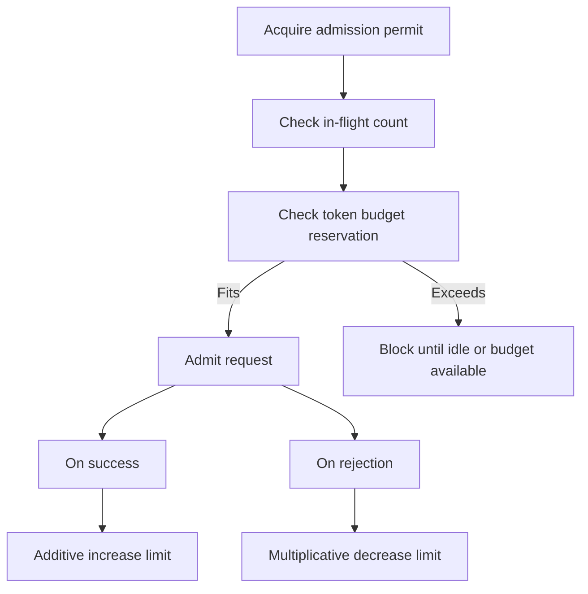
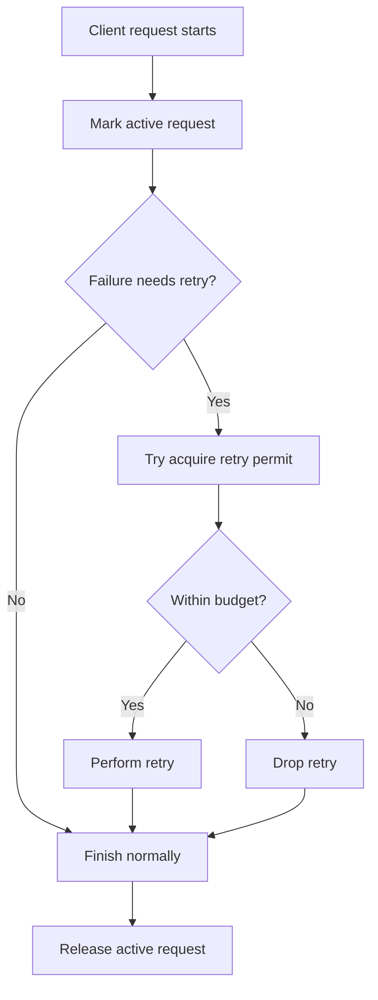
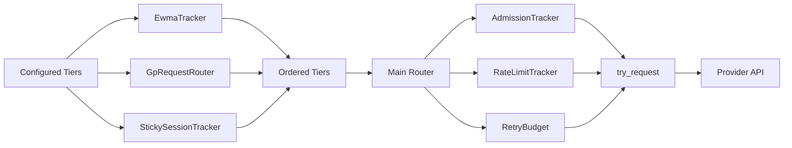
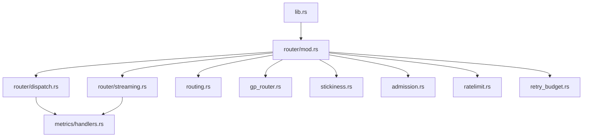

# Provider Lifecycle Management

<cite>
**Referenced Files in This Document**   
- [lib.rs](file://src/lib.rs)
- [main router module](file://src/router/mod.rs)
- [dispatch module](file://src/router/dispatch.rs)
- [streaming module](file://src/router/streaming.rs)
- [routing engine](file://src/routing.rs)
- [stickiness tracker](file://src/stickiness.rs)
- [GP routing module](file://src/gp_router.rs)
- [admission controller](file://src/admission.rs)
- [rate-limit tracker](file://src/ratelimit.rs)
- [retry budget](file://src/retry_budget.rs)
- [metrics handlers](file://src/metrics/handlers.rs)
- [failover architecture documentation](file://docs/failover_architecture.md)
- [observability documentation](file://docs/observability.md)
</cite>

## Table of Contents
1. [Introduction](#introduction)
2. [Project Structure](#project-structure)
3. [Core Components](#core-components)
4. [Architecture Overview](#architecture-overview)
5. [Detailed Component Analysis](#detailed-component-analysis)
6. [Dependency Analysis](#dependency-analysis)
7. [Performance Considerations](#performance-considerations)
8. [Troubleshooting Guide](#troubleshooting-guide)
9. [Conclusion](#conclusion)

## Introduction
This document explains how CCR-Rust manages provider lifecycles from configuration through dispatch, failover, and runtime monitoring. Providers are not long-lived connections; they are selected per request through a tiered routing pipeline that supports direct pinning, web-search prefixes, EWMA-based latency steering, optional GP reranking, stickiness, hedging, adaptive admission control, rate-limit backoff, bounded retry amplification, and streaming-aware error handling.

The lifecycle is best understood as six phases:

1. **Configuration resolution**: providers and tiers are loaded into the router.
2. **Tier ordering**: direct routing, web search, strict or EWMA/GP ordering produce a candidate list.
3. **Admission and rate-limit gating**: each attempt checks per-tier concurrency, token budgets, and 429 backoffs.
4. **Dispatch**: the request is transformed and sent to the upstream protocol (OpenAI, Responses, or Anthropic).
5. **Failover and recovery**: deterministic rejections stop early; retryable failures cascade across tiers with bounded retries and optional sweeps.
6. **Monitoring**: usage, latency, token drift, throughput, and health state are exposed for Prometheus, dashboards, and operators.

## Project Structure
Provider lifecycle logic is spread across several focused modules:

| Area | Responsibility | Key files |
|---|---|---|
| Library layout | Declares public subsystems | `src/lib.rs` |
| Request entry and tier cascade | Builds ordered tiers, runs attempts, handles sweeps | `src/router/mod.rs` |
| Provider dispatch | Translates requests, calls upstreams, classifies errors | `src/router/dispatch.rs` |
| Streaming translation | Converts OpenAI SSE to Anthropic SSE, tracks TTFT and throughput | `src/router/streaming.rs` |
| Latency steering | EWMA tracking and softmax-weighted tier sampling | `src/routing.rs` |
| Conversation stickiness | Keeps conversations on their original provider family | `src/stickiness.rs` |
| GP reranking | Optional Bayesian-quality-cost reranking | `src/gp_router.rs` |
| Admission control | AIMD per-tier concurrency and token-budget guards | `src/admission.rs` |
| Rate limiting | Per-route 429 backoff, Retry-After handling, starvation escalation | `src/ratelimit.rs` |
| Retry budget | Process-wide retry amplification limiter | `src/retry_budget.rs` |
| Metrics endpoints | `/v1/usage`, `/v1/latencies`, `/metrics`, and related JSON APIs | `src/metrics/handlers.rs` |
| Operational design notes | Failover phases, invariants, and production context | `docs/failover_architecture.md`, `docs/observability.md` |

**Diagram sources**
- [main router module:201-650](file://src/router/mod.rs#L201-L650)
- [dispatch module:501-1300](file://src/router/dispatch.rs#L501-L1300)
- [streaming module:1-200](file://src/router/streaming.rs#L1-L200)
- [routing engine:201-400](file://src/routing.rs#L201-L400)
- [admission controller:1-200](file://src/admission.rs#L1-L200)
- [rate-limit tracker:1-200](file://src/ratelimit.rs#L1-L200)
- [retry budget:1-181](file://src/retry_budget.rs#L1-L181)
- [metrics handlers:1-200](file://src/metrics/handlers.rs#L1-L200)

**Section sources**
- [lib.rs:1-27](file://src/lib.rs#L1-L27)
- [failover architecture documentation:1-200](file://docs/failover_architecture.md#L1-L200)

## Core Components
The provider lifecycle is built around these components:

- **Tier list**: configured backend tiers, optionally reordered by EWMA latency or GP quality-cost scoring.
- **Direct routing**: explicit `provider,model` model names can be pinned to the front unless disabled.
- **Web-search prefix**: `[search]` or `[web]` content prepends a dedicated search provider.
- **Strict vs dynamic ordering**: strict order preserves provider priority; dynamic order uses EWMA softmax sampling.
- **GP reranking**: when enabled, reorders non-pinned candidates using a learned surrogate.
- **Stickiness**: remembers a conversation’s preferred provider family and partitions fallback tiers accordingly.
- **Hedging**: optional concurrent attempt against a second tier after a configurable time-to-first-token threshold.
- **Admission control**: per-tier additive-increase-multiplicative-decrease limits plus an optional token budget.
- **Rate limiting**: per-route 429 backoff honoring server `Retry-After`, with local escalation for starved routes.
- **Retry budget**: process-wide bound on retry amplification relative to active client requests.
- **Error classification**: deterministic rejections (e.g., authentication, billing, validation) versus retryable failures.
- **Streaming boundary**: only pre-first-token failures may cascade; post-first-token failures surface as stream events.
- **Observability**: per-tier counters, histograms, EWMA gauges, token drift, cost, and health endpoints.

**Section sources**
- [main router module:201-650](file://src/router/mod.rs#L201-L650)
- [routing engine:201-400](file://src/routing.rs#L201-L400)
- [gp_router.rs:1-500](file://src/gp_router.rs#L1-L500)
- [stickiness tracker:1-248](file://src/stickiness.rs#L1-L248)
- [admission controller:1-200](file://src/admission.rs#L1-L200)
- [rate-limit tracker:1-200](file://src/ratelimit.rs#L1-L200)
- [retry budget:1-181](file://src/retry_budget.rs#L1-L181)
- [dispatch module:501-1300](file://src/router/dispatch.rs#L501-L1300)

## Architecture Overview
At request entry, the router constructs an ordered list of candidate tiers, then iterates through attempts until one succeeds, all candidates fail, or deterministic rejection rules stop further work.

**Diagram sources**
- [main router module:201-650](file://src/router/mod.rs#L201-L650)
- [dispatch module:501-1300](file://src/router/dispatch.rs#L501-L1300)
- [rate-limit tracker:1-200](file://src/ratelimit.rs#L1-L200)
- [admission controller:1-200](file://src/admission.rs#L1-L200)

## Detailed Component Analysis

### Tier Ordering and Routing Decision
The router starts from the configured backend tiers and applies these transformations in order:

1. **Strict or EWMA ordering**:
   - Strict mode keeps the configured provider priority chain.
   - Dynamic mode uses EWMA latency samples and softmax-weighted sampling to distribute load toward faster tiers while still considering recent failures.

2. **Direct routing**:
   - If the client model contains a provider prefix such as `provider,model`, that exact tier is moved to the front.
   - The pinned prefix length is preserved by later reorderings.

3. **Web-search prefix**:
   - Requests containing `[search]` or `[web]` prepend a configured search provider.
   - Search tags are stripped before forwarding.

4. **GP reranking**:
   - When enabled and not in strict mode, GP reranking may reorder non-pinned candidates based on learned quality signals, uncertainty, and estimated cost.
   - It never moves the pinned prefix.

5. **Stickiness partition**:
   - For a stable conversation key, the tracker prefers the remembered provider family inside the fallback portion.
   - The pinned prefix remains untouched.

**Diagram sources**
- [main router module:201-650](file://src/router/mod.rs#L201-L650)
- [routing engine:201-400](file://src/routing.rs#L201-L400)
- [gp_router.rs:1-500](file://src/gp_router.rs#L1-L500)
- [stickiness tracker:1-248](file://src/stickiness.rs#L1-L248)

**Section sources**
- [main router module:201-650](file://src/router/mod.rs#L201-L650)
- [routing engine:201-400](file://src/routing.rs#L201-L400)
- [gp_router.rs:1-500](file://src/gp_router.rs#L1-L500)
- [stickiness tracker:1-248](file://src/stickiness.rs#L1-L248)

### Provider Initialization and Validation
CCR-Rust does not maintain persistent HTTP connections per provider. Provider initialization is primarily configuration-driven:

- Providers are resolved from configuration through the config layer.
- Each tier maps to a provider and model combination.
- Authentication headers are constructed per provider protocol:
  - OpenAI-compatible providers use bearer authorization.
  - Anthropic-compatible providers support multiple auth header styles and inject `anthropic-version`.
  - Extra provider headers are merged where supported.
- Protocol selection determines whether the request goes to chat completions, responses, or messages.
- Model canonicalization adjusts known aliases, such as MiniMax M3-family normalization.
- Request transformers are built against the requested model so per-model pricing and transformation behavior remain consistent even when the wire model name differs.

Validation is distributed:

- Missing provider entries return a dispatch error.
- Invalid auth headers become structured errors.
- Unsupported Anthropic auth header values are rejected.
- Native Responses payloads cannot be combined with request transformers that operate on the Anthropic shape.

**Section sources**
- [dispatch module:501-900](file://src/router/dispatch.rs#L501-L900)
- [dispatch module:901-1300](file://src/router/dispatch.rs#L901-L1300)

### Runtime Monitoring and Health Checking
Health and monitoring are exposed through HTTP endpoints and Prometheus metrics:

| Endpoint or metric | Purpose |
|---|---|
| `/health` | Basic liveness; optional details include configured tiers and default route |
| `/v1/usage` | Aggregate request counts, failures, tokens, cache usage, USD cost, active streams, and active requests |
| `/v1/latencies` | Real-time EWMA latency stats per tier |
| `/v1/token-drift` | Comparison between locally estimated and upstream-reported token counts |
| `/v1/token-audit` | Recent pre-request token breakdowns |
| `/v1/frontend-metrics` | Frontend-specific request counts and average latency |
| `/metrics` | Prometheus scrape endpoint |

Key observability signals include:

- `ccr_requests_total` and `ccr_failures_total` labeled by tier.
- `ccr_request_duration_seconds` histogram per tier.
- `ccr_tier_ewma_latency_seconds` gauge per tier.
- Active stream and backpressure counters.
- Input/output token totals, cache read and creation totals.
- Cost totals when pricing metadata is configured.
- Token drift percentages for estimating estimator accuracy.

Persistence can be enabled via Redis so counters, histogram offsets, token drift state, audit log, and EWMA state survive restarts.

**Section sources**
- [main router module:1-40](file://src/router/mod.rs#L1-L40)
- [metrics handlers:1-200](file://src/metrics/handlers.rs#L1-L200)
- [metrics handlers:201-450](file://src/metrics/handlers.rs#L201-L450)
- [observability documentation:1-200](file://docs/observability.md#L1-L200)

### Tier-Based Failover and Sweep Recovery
Failover is driven by classified errors rather than raw HTTP status codes alone:

- `RateLimited`: immediate tier skip and sweep coordination.
- `Rejected`: deterministic failures such as authentication, billing, permission, unknown model, and most validation errors. These are attempted once per tier and do not enter the retry budget.
- `Other`: transport errors, timeouts, connection failures, and other non-deterministic failures eligible for retry and cascading.

Per-tier retry behavior:

- Default is one initial attempt plus three retries.
- Backoff timing distinguishes retryable failures from deterministic rejections.
- 429 and `Rejected` failures move to the next tier immediately.
- Retry sweeps continue when rate limiting or retryable failures were observed, subject to cooldown and hold budgets.

Terminal responses:

- A synthesized 429 is returned only when the final sweep saw exclusively rate-limited candidates.
- Other exhausted cascades return 503 with aggregate information including tier, attempt, and sweep counts.
- Provenance headers identify the routed tier and the full set of rate-limited routes.

**Diagram sources**
- [main router module:201-650](file://src/router/mod.rs#L201-L650)
- [dispatch module:501-1300](file://src/router/dispatch.rs#L501-L1300)
- [failover architecture documentation:1-200](file://docs/failover_architecture.md#L1-L200)

**Section sources**
- [main router module:201-650](file://src/router/mod.rs#L201-L650)
- [dispatch module:501-1300](file://src/router/dispatch.rs#L501-L1300)
- [failover architecture documentation:1-200](file://docs/failover_architecture.md#L1-L200)

### Stickiness and Session Affinity
Conversation stickiness reduces mid-conversation protocol translation and makes fallback less visible. It works at the conversation-key level, not by binding a single HTTP session:

- The key is derived from the normalized system prompt and the first user message.
- The payload is hashed so private prompt text is not logged or used directly as a cache key.
- Entries expire after a TTL.
- The map is defensively bounded; stale entries are harmless if evicted.
- The preferred provider is placed ahead of other providers in the fallback portion while preserving the pinned prefix and relative order.

**Diagram sources**
- [stickiness tracker:1-200](file://src/stickiness.rs#L1-L200)

**Section sources**
- [stickiness tracker:1-248](file://src/stickiness.rs#L1-L248)
- [failover architecture documentation:1-200](file://docs/failover_architecture.md#L1-L200)

### Streaming Boundary and Error Handling
Streaming introduces a sharp operational boundary:

- **Pre-first-token failures**: embedded provider errors in 200 streams, transport errors, and peek timeouts are treated as retryable and may cascade to the next tier.
- **Post-first-token failures**: no cascade occurs. Idle timeout emits an in-stream error event; upstream chunk errors forward as body errors.
- First-event peaking is bounded in bytes and time to avoid poisoning latency estimates during slow-start inference.
- Embedded error detection parses either raw JSON or SSE `data:` frames carrying an error object.

**Diagram sources**
- [dispatch module:201-500](file://src/router/dispatch.rs#L201-L500)
- [streaming module:1-200](file://src/router/streaming.rs#L1-L200)

**Section sources**
- [dispatch module:201-500](file://src/router/dispatch.rs#L201-L500)
- [streaming module:1-200](file://src/router/streaming.rs#L1-L200)
- [failover architecture documentation:1-200](file://docs/failover_architecture.md#L1-L200)

### Adaptive Admission Control
Admission control protects individual tiers from overload:

- Each tier has an adaptive limit that grows additively on success and shrinks multiplicatively on rejection.
- Bounds are clamped between a minimum and maximum; provider-configured `max_inflight` pins both starting limit and ceiling.
- An optional token budget prevents collisions caused by large concurrent prefills.
- Large requests larger than the whole budget are admitted only when the route is otherwise idle.
- Permits track reserved tokens and release them exactly once, even for streaming attempts.

**Diagram sources**
- [admission controller:1-200](file://src/admission.rs#L1-L200)

**Section sources**
- [admission controller:1-200](file://src/admission.rs#L1-L200)

### Rate-Limit Backoff and Generation Guarding
Rate limiting is per full `provider,model` route:

- Server-provided `Retry-After` is honored verbatim, capped at 60 seconds.
- 429s without guidance pace the tier for one second while the route is still admitting requests.
- On starved routes—no recent success—the local backoff doubles per consecutive 429 up to 60 seconds.
- A generation counter prevents a successful request from clearing a newer 429 recorded by another overlapping request.
- Header-derived quota state (`remaining`, `reset_at`) is updated independently of backoff clearing.

**Section sources**
- [rate-limit tracker:1-200](file://src/ratelimit.rs#L1-L200)
- [dispatch module:901-1300](file://src/router/dispatch.rs#L901-L1300)

### Retry Budget and Amplification Control
Per-request retry limits do not prevent aggregate retry storms under concurrent failure. The retry budget bounds total retries process-wide:

- It packs active-client-request count and admitted-retry count into one atomic word.
- A small floor ensures quiet routers can still recover from transient failures.
- Zero percent disables retries.
- Permits are RAII objects released automatically.

**Diagram sources**
- [retry budget:1-181](file://src/retry_budget.rs#L1-L181)

**Section sources**
- [retry budget:1-181](file://src/retry_budget.rs#L1-L181)

### Interaction Between Dispatch, Routing Engine, and Provider Selection
The three systems collaborate as follows:

| System | Role | Output consumed by |
|---|---|---|
| Routing engine | Tracks per-tier EWMA latency and produces a latency-aware tier order | Main router tier ordering |
| GP router | Optionally reranks non-pinned candidates by quality, uncertainty, and cost | Main router tier ordering |
| Stickiness tracker | Partitions fallback tiers by remembered provider family | Main router tier ordering |
| Admission controller | Limits per-tier concurrency and token usage | Individual dispatch attempts |
| Rate-limit tracker | Skips tiers under active 429 backoff | Tier selection and sweep loop |
| Retry budget | Limits total retries across the process | Hedge and retry path |
| Dispatch | Transforms, sends, and classifies upstream results | Tier cascade and response assembly |

**Diagram sources**
- [routing engine:201-400](file://src/routing.rs#L201-L400)
- [gp_router.rs:1-500](file://src/gp_router.rs#L1-L500)
- [stickiness tracker:1-248](file://src/stickiness.rs#L1-L248)
- [main router module:201-650](file://src/router/mod.rs#L201-L650)
- [dispatch module:501-1300](file://src/router/dispatch.rs#L501-L1300)

**Section sources**
- [routing engine:201-400](file://src/routing.rs#L201-L400)
- [gp_router.rs:1-500](file://src/gp_router.rs#L1-L500)
- [stickiness tracker:1-248](file://src/stickiness.rs#L1-L248)
- [main router module:201-650](file://src/router/mod.rs#L201-L650)
- [dispatch module:501-1300](file://src/router/dispatch.rs#L501-L1300)

## Dependency Analysis
The dependency graph shows clear layering:

- `src/lib.rs` declares modules but does not implement lifecycle logic.
- `src/router/mod.rs` is the orchestration layer.
- `src/router/dispatch.rs` implements provider protocol details.
- `src/router/streaming.rs` handles streamed translation and lifecycle metrics.
- `src/routing.rs`, `src/gp_router.rs`, and `src/stickiness.rs` provide candidate ordering.
- `src/admission.rs`, `src/ratelimit.rs`, and `src/retry_budget.rs` are cross-cutting controls.
- `src/metrics/handlers.rs` exposes accumulated state.

**Diagram sources**
- [lib.rs:1-27](file://src/lib.rs#L1-L27)
- [main router module:1-40](file://src/router/mod.rs#L1-L40)

**Section sources**
- [lib.rs:1-27](file://src/lib.rs#L1-L27)
- [main router module:1-40](file://src/router/mod.rs#L1-L40)

## Performance Considerations
Several mechanisms influence performance and resilience:

- **EWMA smoothing factor**: defaults to 0.3, giving more weight to recent latency while retaining history.
- **Minimum samples**: tiers need a baseline number of samples before EWMA influences ordering.
- **Failure penalty**: failures multiply current EWMA rather than recording wall-clock duration, avoiding pathological timeout distortion.
- **Softmax temperature**: lower temperatures favor the fastest tier; higher temperatures distribute traffic more evenly.
- **Top-k sampling**: limits how many tiers participate in weighted sampling.
- **Unmeasured cold start**: shuffles unmeasured tiers to avoid always hammering the first configured tier.
- **Stream first-event peek**: bounded in bytes and time to avoid penalizing legitimate slow-start models.
- **AIMD admission**: avoids global backoff for concurrency-capped providers by adapting local concurrency.
- **Retry budget floor**: allows recovery under low load while capping amplification under high load.
- **Token budget**: guards against collision of large concurrent prefills without shrinking the request-count AIMD limit.

[No sources needed since this section provides general guidance]

## Troubleshooting Guide
Common operational questions and their code-backed answers:

| Symptom | Likely cause | What to inspect |
|---|---|---|
| All candidates return 429 | Concurrency-cap exhaustion or true quota exhaustion | `/v1/usage`, `/metrics`, rate-limit backoff logs |
| One model repeatedly fails while its provider sibling works | Per-route 429 state keyed by `provider,model` | `/v1/latencies`, rate-limit tracker state |
| Deterministic 400-class errors keep retrying | Classification treats non-context-window 400/401-404/422 as `Rejected`; verify whether the body matches context-window signatures | Dispatch error classification and upstream response body |
| Streaming request fails after first token | Post-first-token failures do not cascade | Streaming error path and idle timeout logs |
| EWMA latencies appear extreme | Unclamped durations fed into EWMA can distort gauges | Routing EWMA implementation and upstream timeout configuration |
| Restart loses routing intelligence | In-memory state resets unless Redis persistence is enabled | Persistence configuration and `/v1/latencies` after restart |
| Token estimates differ from provider usage | Local tokenizer estimation drift | `/v1/token-drift` and `/v1/token-audit` |
| Unexpected provider selection | Direct routing, model alias, web search, strict ordering, GP rerank, or stickiness interaction | Router logs, tier order debug output, and configuration |

Recommended diagnostics:

1. Check `/health?details` for configured tiers and default route.
2. Inspect `/v1/usage` for per-tier requests, failures, tokens, and costs.
3. Check `/v1/latencies` for EWMA latency and sample counts.
4. Review `/v1/token-drift` for estimator accuracy.
5. Scrape `/metrics` for `ccr_rate_limit_backoffs_total`, `ccr_active_streams`, `ccr_stream_backpressure_total`, and tier-specific counters.
6. Use the dashboard or worker inspection utilities described in repository documentation for real-time operational views.

**Section sources**
- [main router module:1-40](file://src/router/mod.rs#L1-L40)
- [metrics handlers:1-200](file://src/metrics/handlers.rs#L1-L200)
- [metrics handlers:201-450](file://src/metrics/handlers.rs#L201-L450)
- [observability documentation:1-200](file://docs/observability.md#L1-L200)
- [failover architecture documentation:1-200](file://docs/failover_architecture.md#L1-L200)

## Conclusion
CCR-Rust’s provider lifecycle is a layered pipeline rather than a single provider manager. Providers are selected per request through a controlled cascade that balances operator intent, measured latency, optional quality-cost learning, conversation affinity, admission capacity, and rate-limit awareness. Failover is typed: deterministic provider errors stop early, while transient failures cascade within bounded retry budgets. Streaming adds a hard boundary where only pre-first-token failures may fall back. Observability is intentionally rich: per-tier counters, latency gauges, token drift, throughput, cost, and health endpoints let operators monitor both routing decisions and provider health without requiring proprietary vendor tooling.