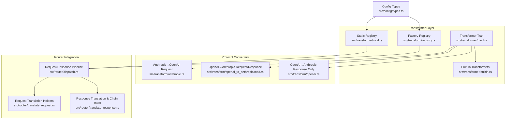
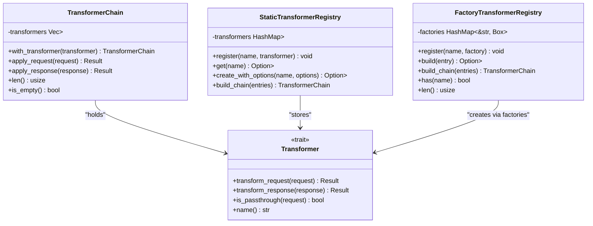
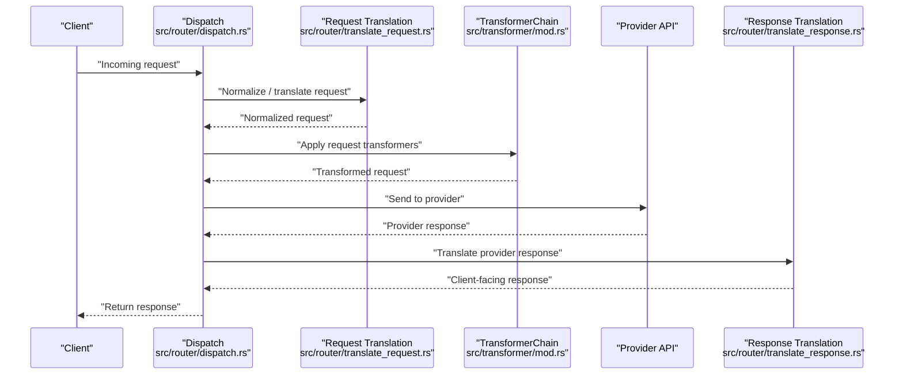
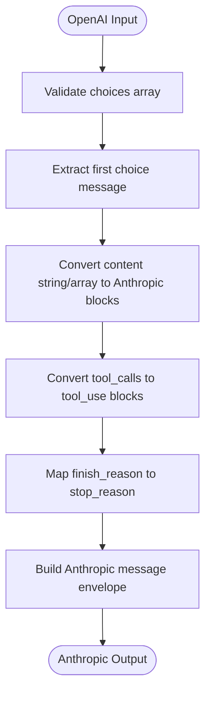
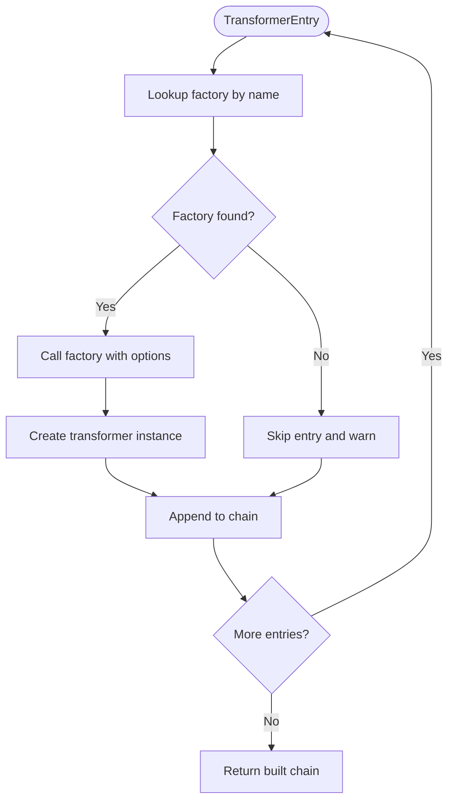
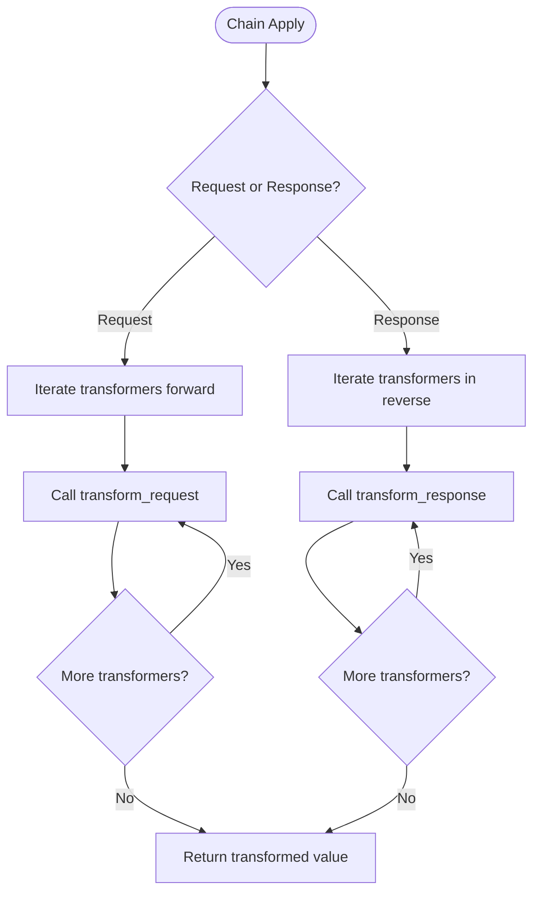
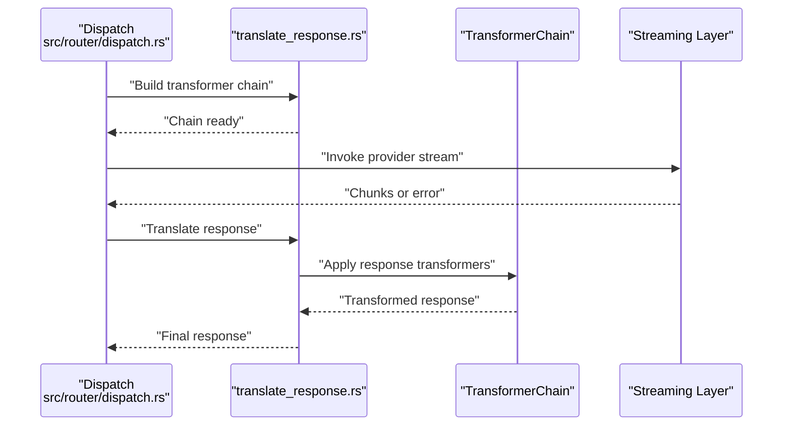
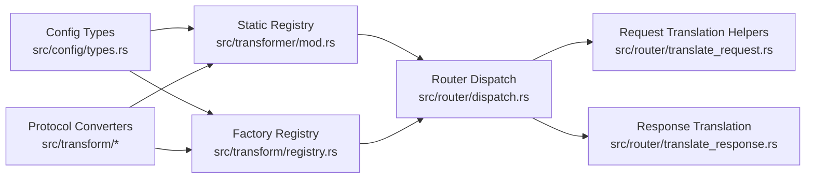

# Transformer Registry System

<cite>
**Referenced Files in This Document**
- [src/transform/mod.rs](file://src/transform/mod.rs)
- [src/transform/registry.rs](file://src/transform/registry.rs)
- [src/transformer/mod.rs](file://src/transformer/mod.rs)
- [src/transformer/builtin.rs](file://src/transformer/builtin.rs)
- [src/transform/openai.rs](file://src/transform/openai.rs)
- [src/transform/anthropic.rs](file://src/transform/anthropic.rs)
- [src/transform/openai_to_anthropic/mod.rs](file://src/transform/openai_to_anthropic/mod.rs)
- [src/router/dispatch.rs](file://src/router/dispatch.rs)
- [src/router/translate_request.rs](file://src/router/translate_request.rs)
- [src/router/translate_response.rs](file://src/router/translate_response.rs)
- [src/config/types.rs](file://src/config/types.rs)
</cite>

## Table of Contents
1. [Introduction](#introduction)
2. [Project Structure](#project-structure)
3. [Core Components](#core-components)
4. [Architecture Overview](#architecture-overview)
5. [Detailed Component Analysis](#detailed-component-analysis)
6. [Dependency Analysis](#dependency-analysis)
7. [Performance Considerations](#performance-considerations)
8. [Troubleshooting Guide](#troubleshooting-guide)
9. [Conclusion](#conclusion)
10. [Appendices](#appendices)

## Introduction
This document explains CCR-Rust’s transformer registry system that translates requests and responses between LLM provider protocols, primarily Anthropic and OpenAI formats. It covers how transformers are defined through a shared trait, discovered via registries, composed into ordered chains, and invoked during request routing and response normalization. It also documents built-in transformers such as Anthropic-to-OpenAI and OpenAI-to-Anthropic converters, explains error handling and performance characteristics, and provides practical guidance for adding new protocol support and debugging transformation issues.

## Project Structure
The transformer subsystem is split across two closely related areas:

- `src/transformer`: Defines the core `Transformer` trait, a static `TransformerRegistry`, and built-in transformer implementations.
- `src/transform`: Provides a factory-based `TransformerRegistry`, provider-specific adapters (DeepSeek, GLM, Kimi, Minimax), and additional conversion utilities.

**Diagram sources**
- [src/transformer/mod.rs:1-200](file://src/transformer/mod.rs#L1-L200)
- [src/transformer/builtin.rs:1-200](file://src/transformer/builtin.rs#L1-L200)
- [src/transform/registry.rs:1-200](file://src/transform/registry.rs#L1-L200)
- [src/transform/anthropic.rs:1-200](file://src/transform/anthropic.rs#L1-L200)
- [src/transform/openai_to_anthropic/mod.rs:1-200](file://src/transform/openai_to_anthropic/mod.rs#L1-L200)
- [src/transform/openai.rs:1-200](file://src/transform/openai.rs#L1-L200)
- [src/router/dispatch.rs:1-200](file://src/router/dispatch.rs#L1-L200)
- [src/router/translate_request.rs:1-200](file://src/router/translate_request.rs#L1-L200)
- [src/router/translate_response.rs:1-200](file://src/router/translate_response.rs#L1-L200)
- [src/config/types.rs:1-120](file://src/config/types.rs#L1-L120)

**Section sources**
- [src/transform/mod.rs:1-41](file://src/transform/mod.rs#L1-L41)
- [src/transformer/mod.rs:1-200](file://src/transformer/mod.rs#L1-L200)
- [src/transform/registry.rs:1-200](file://src/transform/registry.rs#L1-L200)
- [src/router/dispatch.rs:1-200](file://src/router/dispatch.rs#L1-L200)
- [src/config/types.rs:1-120](file://src/config/types.rs#L1-L120)

## Core Components
The transformer system revolves around three primary concepts:

- **Transformer trait**: The interface every transformer implements to mutate requests, responses, or act as an identity passthrough.
- **TransformerChain**: An ordered sequence of transformers applied to requests and reversed for responses.
- **Registries**: Two registry implementations exist:
  - Static registry in `src/transformer/mod.rs`, which stores ready-made `Arc<dyn Transformer>` instances.
  - Factory registry in `src/transform/registry.rs`, which stores factory functions that construct transformers from optional JSON configuration.

**Diagram sources**
- [src/transformer/mod.rs:1-200](file://src/transformer/mod.rs#L1-L200)
- [src/transformer/mod.rs:201-500](file://src/transformer/mod.rs#L201-L500)
- [src/transform/registry.rs:1-200](file://src/transform/registry.rs#L1-L200)

**Section sources**
- [src/transformer/mod.rs:1-200](file://src/transformer/mod.rs#L1-L200)
- [src/transformer/mod.rs:201-500](file://src/transformer/mod.rs#L201-L500)
- [src/transform/registry.rs:1-200](file://src/transform/registry.rs#L1-L200)

## Architecture Overview
At runtime, incoming client requests enter the router layer, where they may be normalized and then passed through a configured transformer chain. Responses from upstream providers are translated back into the client-facing protocol and run through a response-side transformer pipeline.

**Diagram sources**
- [src/router/dispatch.rs:1-200](file://src/router/dispatch.rs#L1-L200)
- [src/router/translate_request.rs:1-200](file://src/router/translate_request.rs#L1-L200)
- [src/router/translate_response.rs:1-200](file://src/router/translate_response.rs#L1-L200)
- [src/transformer/mod.rs:201-350](file://src/transformer/mod.rs#L201-L350)

**Section sources**
- [src/router/dispatch.rs:1-200](file://src/router/dispatch.rs#L1-L200)
- [src/router/translate_request.rs:1-200](file://src/router/translate_request.rs#L1-L200)
- [src/router/translate_response.rs:1-200](file://src/router/translate_response.rs#L1-L200)

## Detailed Component Analysis

### Transformer Trait Interface
The `Transformer` trait defines four capabilities:

| Capability | Purpose | Default Behavior |
|---|---|---|
| `transform_request` | Mutates an incoming request before sending it upstream | Returns the request unchanged |
| `transform_response` | Mutates an outgoing response before returning it to the client | Returns the response unchanged |
| `is_passthrough` | Declares whether a transformer can be skipped entirely | Returns false |
| `name` | Identifies the transformer for logging and diagnostics | Returns `"unknown"` |

Implementations include identity passthroughs (`IdentityTransformer`), protocol adapters (`AnthropicToOpenaiTransformer`, `OpenAiToAnthropicTransformer`), provider-specific normalizers (`DeepSeekTransformer`, `GlmTransformer`, `KimiTransformer`, `MinimaxTransformer`), and utility transformers such as token capping, tool normalization, reasoning block normalization, thinking tag stripping, and output compression.

Complexity notes:
- Most transformers operate on `serde_json::Value` trees. Typical transformations are linear in the number of messages or content blocks.
- Regex-based text cleaning (e.g., thinking tag stripping) is proportional to text length.
- Tool call ID generation uses a monotonic counter to avoid external dependencies.

**Section sources**
- [src/transformer/mod.rs:1-200](file://src/transformer/mod.rs#L1-L200)
- [src/transformer/builtin.rs:1-200](file://src/transformer/builtin.rs#L1-L200)

### Built-in Transformers

#### Anthropic-to-OpenAI Request Transformer
Located in `src/transform/anthropic.rs`, this transformer converts Anthropic-format requests to OpenAI format:

- Moves top-level `system` into a leading `role: "system"` message.
- Converts Anthropic content arrays to OpenAI-compatible strings or multimodal arrays.
- Rewrites tools from Anthropic schema shape to OpenAI function shape.
- Normalizes `tool_choice`.
- Removes or renames Anthropic-specific fields like `stop_sequences`.

This is used when the internal pipeline needs to send an OpenAI-compatible request to a provider expecting OpenAI semantics.

**Section sources**
- [src/transform/anthropic.rs:1-200](file://src/transform/anthropic.rs#L1-L200)
- [src/transformer/builtin.rs:1-200](file://src/transformer/builtin.rs#L1-L200)

#### OpenAI-to-Anthropic Request and Response Transformers
Two related converters exist:

- `OpenAiToAnthropicTransformer` in `src/transform/openai_to_anthropic/mod.rs` handles both request and response conversion, including system extraction, message normalization, tool rewriting, tool choice mapping, field cleanup, and max-token normalization.
- `OpenaiToAnthropicTransformer` in `src/transform/openai.rs` focuses on converting OpenAI-style responses into Anthropic-style responses, mapping finish reasons and content blocks.

**Diagram sources**
- [src/transform/openai.rs:1-200](file://src/transform/openai.rs#L1-L200)

**Section sources**
- [src/transform/openai_to_anthropic/mod.rs:1-200](file://src/transform/openai_to_anthropic/mod.rs#L1-L200)
- [src/transform/openai.rs:1-200](file://src/transform/openai.rs#L1-L200)

### Static Transformer Registry
Defined in `src/transformer/mod.rs`, the static registry pre-registers concrete transformers and supports:

- Registration by name.
- Lookup by name.
- Construction with options for special transformers like `maxtoken` and `toolcompress`.
- Building a `TransformerChain` from configuration entries.

Its default set includes protocol adapters, provider adapters, and utility transformers.

**Section sources**
- [src/transformer/mod.rs:201-500](file://src/transformer/mod.rs#L201-L500)

### Factory-Based Transformer Registry
Defined in `src/transform/registry.rs`, the factory registry is designed for dynamic instantiation from configuration:

- Stores closures that take optional JSON configuration and return boxed transformers.
- Pre-registers provider transformers, format converters, and utility transformers.
- Exposes `build` for single transformers and `build_chain` for ordered pipelines.
- Logs warnings when unregistered transformer names are encountered.

**Diagram sources**
- [src/transform/registry.rs:1-200](file://src/transform/registry.rs#L1-L200)

**Section sources**
- [src/transform/registry.rs:1-200](file://src/transform/registry.rs#L1-L200)

### Transformer Chain Execution Order
A `TransformerChain` applies transformers sequentially for requests and in reverse order for responses. This reversal ensures that response transformations undo request transformations in the opposite direction.

Key behaviors:
- Request processing iterates from first to last transformer.
- Response processing iterates from last to first transformer.
- Each step logs the transformer name and the transformed value at debug/trace levels.
- Errors from any transformer propagate immediately as `anyhow::Result` failures.

**Diagram sources**
- [src/transformer/mod.rs:201-350](file://src/transformer/mod.rs#L201-L350)

**Section sources**
- [src/transformer/mod.rs:201-350](file://src/transformer/mod.rs#L201-L350)

### Configuration Model
Transformer chains are described using `TransformerEntry`, which supports:

- Bare names: `"deepseek"`.
- Named entries with options: `["maxtoken", {"max_tokens": 65536}]`.

These entries compose into `TransformerUseList`, `ModelTransformerConfig`, and `ProviderTransformer`, allowing provider-wide chains and model-specific overrides.

**Section sources**
- [src/config/types.rs:1-120](file://src/config/types.rs#L1-L120)

### Router Integration
The dispatch layer integrates transformers into the request/response lifecycle:

- Imports `TransformerChain`, `TransformerRegistry`, and specific converters.
- Builds transformer chains from configuration.
- Translates OpenAI responses to Anthropic format.
- Streams provider responses while tracking errors and headers.

**Diagram sources**
- [src/router/dispatch.rs:1-200](file://src/router/dispatch.rs#L1-L200)
- [src/router/translate_response.rs:1-200](file://src/router/translate_response.rs#L1-L200)

**Section sources**
- [src/router/dispatch.rs:1-200](file://src/router/dispatch.rs#L1-L200)
- [src/router/translate_response.rs:1-200](file://src/router/translate_response.rs#L1-L200)

## Dependency Analysis
The transformer subsystem has clear separation between protocol conversion logic, registry construction, and routing integration.

**Diagram sources**
- [src/config/types.rs:1-120](file://src/config/types.rs#L1-L120)
- [src/transformer/mod.rs:201-500](file://src/transformer/mod.rs#L201-L500)
- [src/transform/registry.rs:1-200](file://src/transform/registry.rs#L1-L200)
- [src/router/dispatch.rs:1-200](file://src/router/dispatch.rs#L1-L200)
- [src/router/translate_request.rs:1-200](file://src/router/translate_request.rs#L1-L200)
- [src/router/translate_response.rs:1-200](file://src/router/translate_response.rs#L1-L200)

Potential coupling concerns:
- Both registries expose chain-building APIs, but they differ in lifetime management: static registry stores `Arc<dyn Transformer>`, while factory registry constructs fresh instances per build.
- Protocol converters are reused across multiple layers; changes to their contract affect both request translation helpers and response translation.

**Section sources**
- [src/transformer/mod.rs:201-500](file://src/transformer/mod.rs#L201-L500)
- [src/transform/registry.rs:1-200](file://src/transform/registry.rs#L1-L200)
- [src/router/dispatch.rs:1-200](file://src/router/dispatch.rs#L1-L200)

## Performance Considerations
- **JSON tree traversal**: Transformers walk messages, content blocks, and tools. Chains should avoid redundant reformatting of already-normalized data.
- **Passthrough optimization**: Identity and protocol-specific passthrough transformers allow skipping unnecessary work when the request already matches the expected format.
- **Reverse response ordering**: Reversing the chain for responses avoids applying request-only logic twice but requires careful transformer design to ensure idempotence.
- **Regex usage**: Thinking tag stripping compiles a regex lazily and scans text content; consider limiting its use to transformers where it is required.
- **Streaming cost**: Error detection over streaming responses buffers early bytes up to a maximum size to detect embedded error payloads without waiting indefinitely.
- **Memory churn**: Converting between Anthropic and OpenAI shapes creates intermediate values; batching or avoiding unnecessary conversions reduces allocations.

[No sources needed since this section provides general guidance]

## Troubleshooting Guide

### Adding New Protocol Support
To add a new provider or protocol adapter:

1. Implement the `Transformer` trait in a dedicated module under `src/transform` or `src/transformer`.
2. Decide which registry path fits best:
   - Use the static registry if the transformer is stateless and does not need complex configuration.
   - Use the factory registry if the transformer needs JSON options or fresh instances per build.
3. Register the transformer:
   - Static registry: register the instance by name.
   - Factory registry: register a factory closure that constructs the transformer from options.
4. Wire it into the chain:
   - Add it to the configuration’s `use` list.
   - If it affects request flow, ensure request translation helpers understand the new shape.
   - If it affects response flow, ensure response translation maps provider fields correctly.
5. Test:
   - Verify request transformation produces the expected provider payload.
   - Verify response transformation maps back to the client-facing protocol.
   - Confirm passthrough behavior where applicable.

### Debugging Transformation Issues
Recommended steps:

- Enable debug and trace logging to observe each transformer’s name and transformed payload.
- Inspect the transformer chain length and composition logged during chain construction.
- Validate configuration entries: unknown transformer names are skipped and warned about.
- For OpenAI-to-Anthropic conversion errors, check missing `choices`, empty messages, malformed tool calls, or unsupported finish reasons.
- For streaming issues, examine embedded error detection in HTTP 200 streams and first-event timeouts.

Common error patterns:
- Missing required JSON fields cause explicit error messages.
- Unknown transformer names result in skipped entries and warnings.
- Unexpected content types in response bodies trigger conversion errors.
- Streaming peek buffers exceeding limits indicate malformed or oversized early provider responses.

**Section sources**
- [src/transformer/mod.rs:201-500](file://src/transformer/mod.rs#L201-L500)
- [src/transform/registry.rs:1-200](file://src/transform/registry.rs#L1-L200)
- [src/transform/openai.rs:1-200](file://src/transform/openai.rs#L1-L200)
- [src/router/dispatch.rs:1-200](file://src/router/dispatch.rs#L1-L200)

## Conclusion
CCR-Rust’s transformer registry system separates transformer definition, discovery, and execution. The `Transformer` trait standardizes request and response mutation, while two registries support both static and factory-based instantiation. Built-in transformers handle Anthropic–OpenAI protocol translation, provider-specific normalization, and common utility tasks. The router composes these pieces into a deterministic pipeline where request transformations apply in order and response transformations apply in reverse. Proper configuration, logging, and validation make it straightforward to extend the system with new protocols and maintain reliable transformation behavior.

[No sources needed since this section summarizes without analyzing specific files]

## Appendices

### How to Implement a Custom Transformer
Steps:

1. Define a struct implementing `Transformer`.
2. Implement `name` for diagnostics.
3. Override `transform_request` or `transform_response` as needed.
4. Optionally implement `is_passthrough` to skip unnecessary work.
5. Register the transformer:
   - Static registry: add it under `src/transformer/mod.rs`.
   - Factory registry: add it under `src/transform/registry.rs`.
6. Add it to the configuration’s `use` list.
7. Validate behavior against representative requests and responses.

**Section sources**
- [src/transformer/mod.rs:1-200](file://src/transformer/mod.rs#L1-L200)
- [src/transform/registry.rs:1-200](file://src/transform/registry.rs#L1-L200)
- [src/config/types.rs:1-120](file://src/config/types.rs#L1-L120)