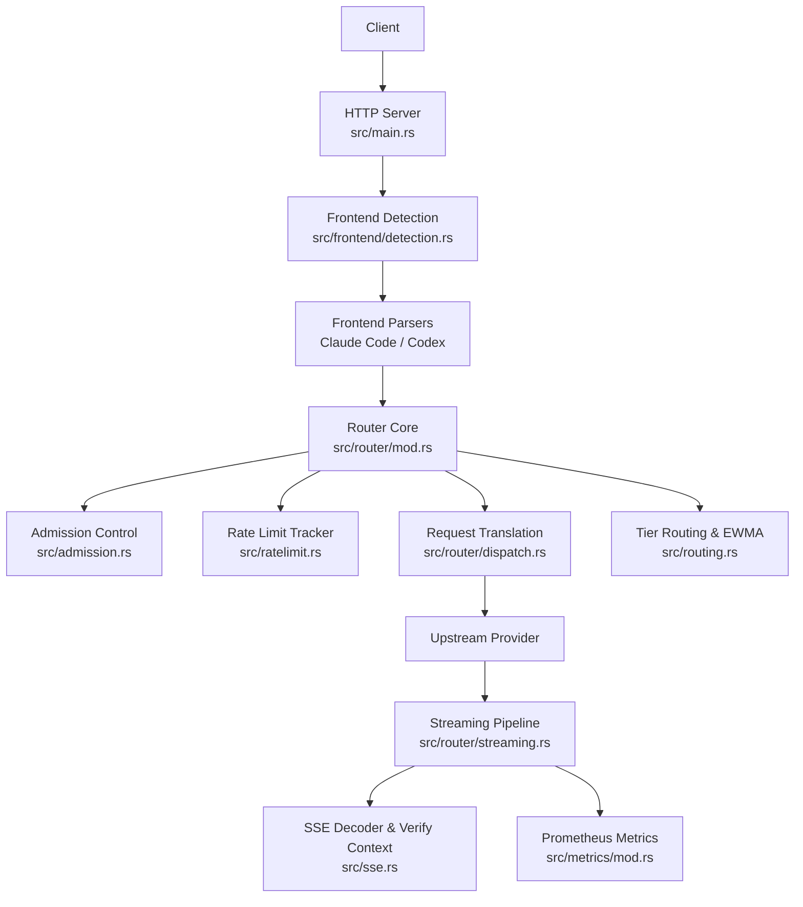
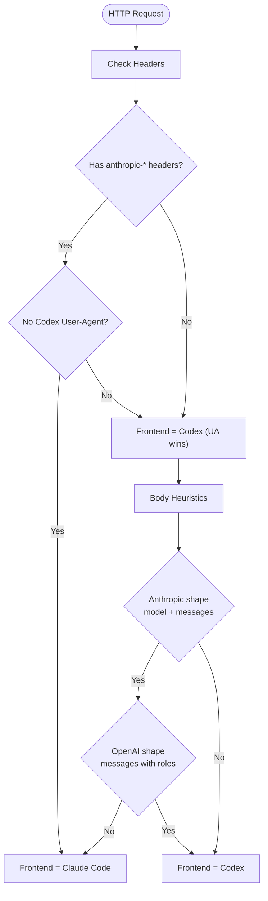
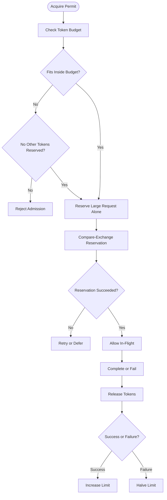
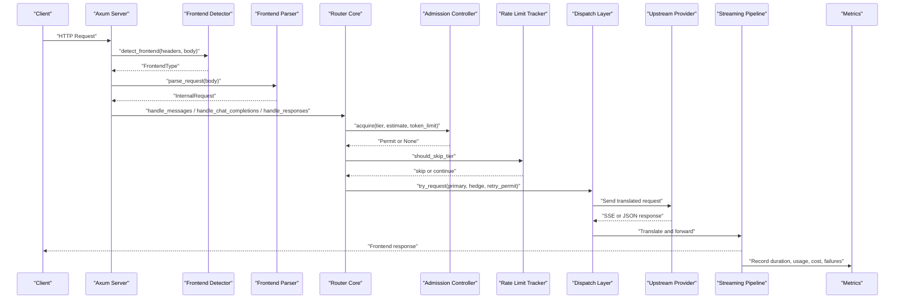
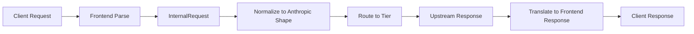
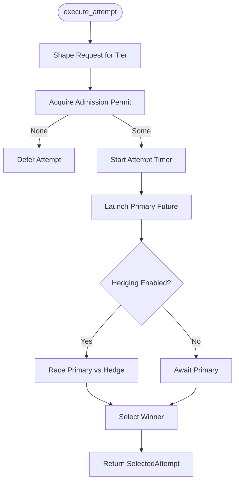
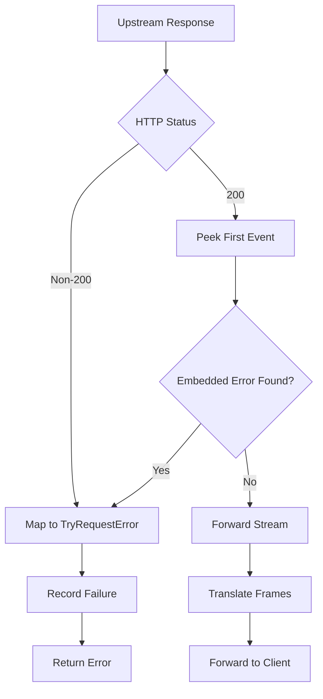
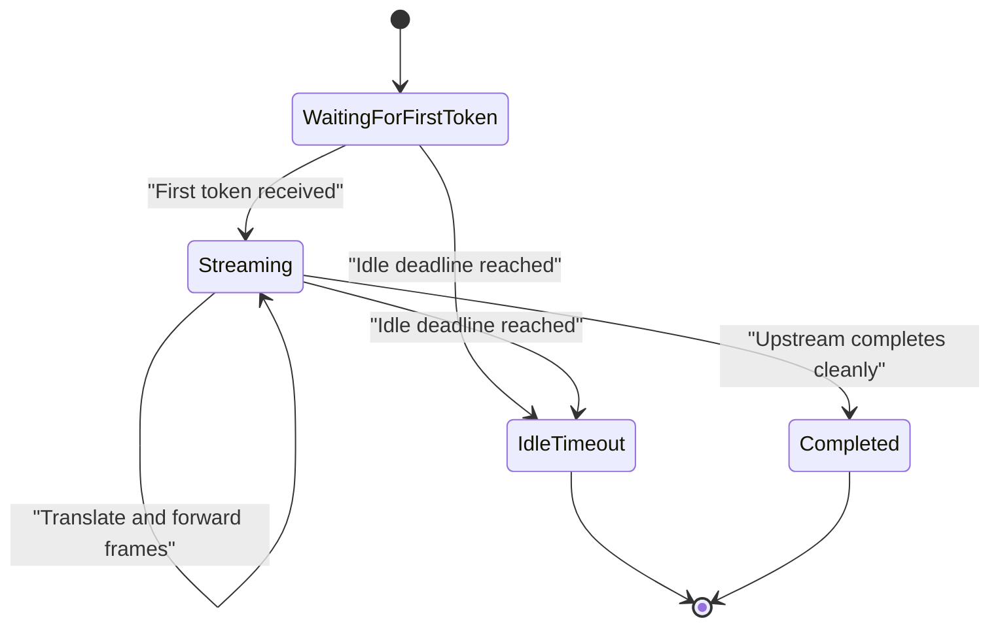
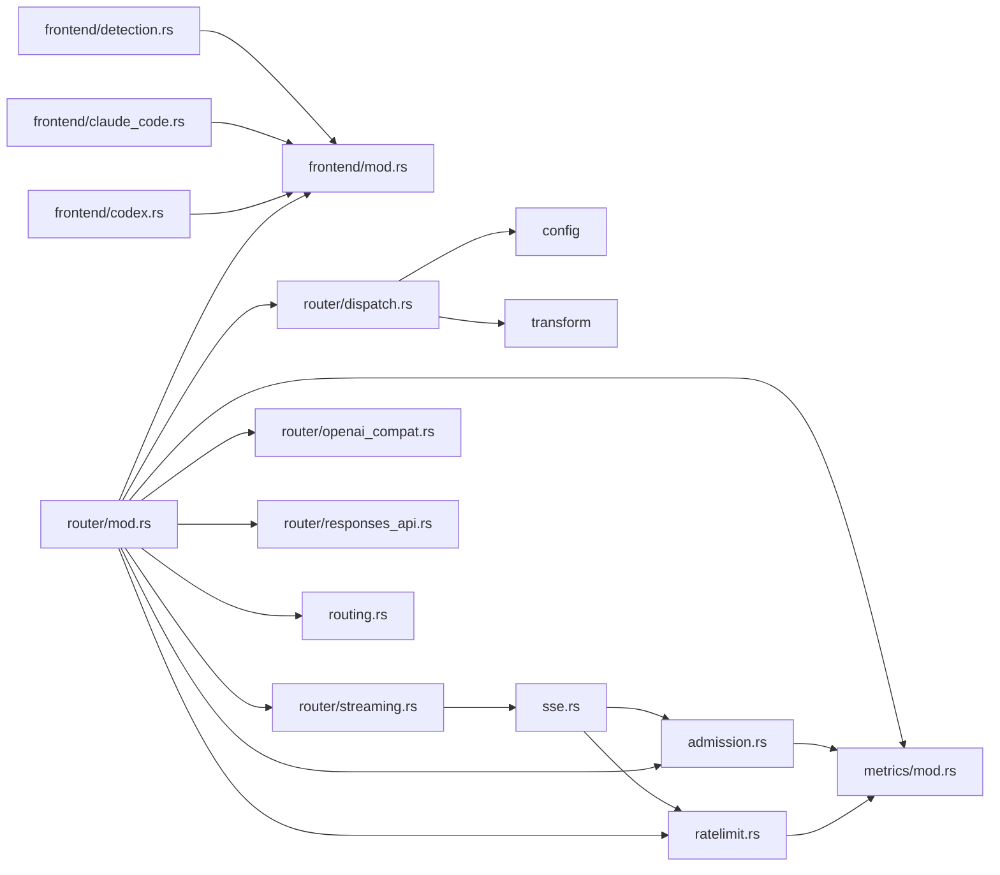

# Request Lifecycle

<cite>
**Referenced Files in This Document**
- [main.rs](file://src/main.rs)
- [lib.rs](file://src/lib.rs)
- [frontend/mod.rs](file://src/frontend/mod.rs)
- [frontend/detection.rs](file://src/frontend/detection.rs)
- [frontend/claude_code.rs](file://src/frontend/claude_code.rs)
- [frontend/codex.rs](file://src/frontend/codex.rs)
- [admission.rs](file://src/admission.rs)
- [ratelimit.rs](file://src/ratelimit.rs)
- [retry_budget.rs](file://src/retry_budget.rs)
- [routing.rs](file://src/routing.rs)
- [router/mod.rs](file://src/router/mod.rs)
- [router/dispatch.rs](file://src/router/dispatch.rs)
- [router/openai_compat.rs](file://src/router/openai_compat.rs)
- [router/responses_api.rs](file://src/router/responses_api.rs)
- [router/streaming.rs](file://src/router/streaming.rs)
- [sse.rs](file://src/sse.rs)
- [metrics/mod.rs](file://src/metrics/mod.rs)
</cite>

## Table of Contents
1. [Introduction](#introduction)
2. [Project Structure](#project-structure)
3. [Core Components](#core-components)
4. [Architecture Overview](#architecture-overview)
5. [Detailed Component Analysis](#detailed-component-analysis)
6. [Dependency Analysis](#dependency-analysis)
7. [Performance Considerations](#performance-considerations)
8. [Troubleshooting Guide](#troubleshooting-guide)
9. [Conclusion](#conclusion)

## Introduction
This document traces the complete request lifecycle in CCR-Rust from the HTTP entry point to upstream provider dispatch and response streaming. It explains how requests are identified as coming from Claude Code or Codex, how frontend parsing normalizes them, how admission control and rate limiting gate execution, how the router selects tiers, how protocol translation bridges OpenAI and Anthropic formats, and how streaming responses are translated, monitored, and observed.

The lifecycle is not a single synchronous pipeline: it mixes synchronous preprocessing with asynchronous upstream calls, concurrent hedging, retry budgets, and per-stream timeout handling. The router core acts as the orchestrator that coordinates frontends, admission control, tier routing, provider dispatch, and metrics collection.

## Project Structure
CCR-Rust is organized by responsibility:

- Entry point and Axum server setup live in `src/main.rs`.
- Public module declarations live in `src/lib.rs`.
- Frontend detection and normalization live under `src/frontend/`.
- Admission control lives in `src/admission.rs`.
- Rate-limit state and backoff logic live in `src/ratelimit.rs`.
- Retry amplification budget lives in `src/retry_budget.rs`.
- EWMA-based tier latency tracking lives in `src/routing.rs`.
- Router orchestration, dispatch, translation, and streaming live under `src/router/`.
- Streaming frame decoding and verification context live in `src/sse.rs`.
- Prometheus metrics are centralized in `src/metrics/mod.rs`.

**Diagram sources**
- [main.rs:1-80](file://src/main.rs#L1-L80)
- [frontend/detection.rs:1-80](file://src/frontend/detection.rs#L1-L80)
- [admission.rs:1-80](file://src/admission.rs#L1-L80)
- [ratelimit.rs:1-80](file://src/ratelimit.rs#L1-L80)
- [router/mod.rs:1-80](file://src/router/mod.rs#L1-L80)
- [router/dispatch.rs:1-80](file://src/router/dispatch.rs#L1-L80)
- [router/streaming.rs:1-80](file://src/router/streaming.rs#L1-L80)
- [sse.rs:1-80](file://src/sse.rs#L1-L80)
- [metrics/mod.rs:1-80](file://src/metrics/mod.rs#L1-L80)

**Section sources**
- [main.rs:1-120](file://src/main.rs#L1-L120)
- [lib.rs:1-27](file://src/lib.rs#L1-L27)

## Core Components

### Frontends: Claude Code and Codex
Frontends translate client-specific API formats into normalized internal types:

- `InternalRequest` carries model, messages, system prompt, token limits, temperature, stream flag, tools, tool choice, stop sequences, and extra parameters.
- `InternalResponse` carries response id, type, role, model, content blocks, stop reason, usage, and extra data.
- `ContentBlock` supports text, image, tool use, tool result, and thinking blocks.
- Claude Code handles Anthropic-style messages, including block arrays, system prompts, and Anthropic tools.
- Codex handles OpenAI Chat Completions format, including role normalization, tool-call conversion, reasoning blocks, and image URL normalization.

Frontend detection uses headers first, then body heuristics:

| Signal | Result |
|---|---|
| `anthropic-*` header without Codex User-Agent | Claude Code |
| Codex User-Agent | Codex |
| Anthropic-style body without OpenAI roles | Claude Code |
| OpenAI-style messages with roles | Codex |
| Ambiguous or missing signals | Codex default |

**Diagram sources**
- [frontend/detection.rs:1-177](file://src/frontend/detection.rs#L1-L177)
- [frontend/mod.rs:1-180](file://src/frontend/mod.rs#L1-L180)

**Section sources**
- [frontend/mod.rs:1-200](file://src/frontend/mod.rs#L1-L200)
- [frontend/detection.rs:1-177](file://src/frontend/detection.rs#L1-L177)
- [frontend/claude_code.rs:1-120](file://src/frontend/claude_code.rs#L1-L120)
- [frontend/codex.rs:1-120](file://src/frontend/codex.rs#L1-L120)

### Admission Control
Admission control protects individual provider tiers using AIMD-style concurrency limits and an optional token budget:

- Each `provider,model` route has an inflight counter, a dynamic limit, a ceiling, and an estimated in-flight token counter.
- Initial and maximum limits are clamped to defaults unless explicitly configured.
- Token reservation uses compare-exchange loops so two concurrent acquires cannot reserve the same budget.
- A request larger than the whole token budget is allowed only when no other tokens are reserved, letting long-context fallback traffic run alone.
- Success increases the limit additively; rejection halves it multiplicatively.
- Permits are RAII resources that release tokens on drop and record success exactly once.

**Diagram sources**
- [admission.rs:1-200](file://src/admission.rs#L1-L200)

**Section sources**
- [admission.rs:1-200](file://src/admission.rs#L1-L200)

### Rate Limiting
The rate-limit tracker maintains per-tier backoff windows based on 429 responses:

- A successful response can clear backoff only if its generation predates the newest recorded 429.
- Explicit `Retry-After` values are honored up to a cap.
- Without server guidance, starved routes double their local backoff exponentially up to the same cap.
- Non-starved routes keep a flat one-second pacing so mixed admission regimes do not blanket-skip providers.
- Proactive skipping is possible when trusted headers report zero remaining quota.

**Section sources**
- [ratelimit.rs:1-200](file://src/ratelimit.rs#L1-L200)

### Retry Budget
The process-wide retry budget prevents aggregate retry storms:

- Active client requests and admitted retries share a packed atomic state.
- Reserving a retry is linearized against both request arrival and completion.
- A small floor ensures recovery even at low activity.
- Zero percent disables retries entirely.

**Section sources**
- [retry_budget.rs:1-181](file://src/retry_budget.rs#L1-L181)

### Tier Latency Tracking
The EWMA tracker smooths per-tier latency for routing decisions:

- Successful attempts update EWMA using a configurable alpha.
- Failed attempts apply a penalty multiplier rather than raw wall-clock failure time.
- Tiers with insufficient samples retain configuration-defined priority.
- Sorting returns measured tiers by ascending EWMA and unmeasured tiers in original order.

**Section sources**
- [routing.rs:1-200](file://src/routing.rs#L1-L200)

## Architecture Overview
The request lifecycle consists of these processing stages:

1. **HTTP entry**: Axum routes handle `/v1/chat/completions`, `/v1/responses`, health checks, and dashboard endpoints.
2. **Frontend detection**: Determine whether the request comes from Claude Code or Codex.
3. **Frontend parsing**: Convert the client request into `InternalRequest`.
4. **Protocol normalization**: Translate to the router’s internal request shape, typically Anthropic-shaped for downstream dispatch.
5. **Admission control**: Gate the attempt by per-tier inflight count and optional token budget.
6. **Rate-limit gating**: Skip tiers under active backoff or exhausted quota.
7. **Tier selection**: Choose primary and optional hedge tiers using configuration, deterministic routing, and EWMA ordering.
8. **Provider dispatch**: Send the translated request to the selected provider.
9. **Streaming translation**: Convert upstream SSE chunks to the expected frontend response format.
10. **Observability**: Record metrics, costs, token usage, failures, timeouts, and debug captures.

**Diagram sources**
- [main.rs:1-120](file://src/main.rs#L1-L120)
- [frontend/detection.rs:1-80](file://src/frontend/detection.rs#L1-L80)
- [router/mod.rs:1-120](file://src/router/mod.rs#L1-L120)
- [router/dispatch.rs:1-120](file://src/router/dispatch.rs#L1-L120)
- [router/streaming.rs:1-120](file://src/router/streaming.rs#L1-L120)
- [metrics/mod.rs:1-120](file://src/metrics/mod.rs#L1-L120)

**Section sources**
- [router/mod.rs:1-200](file://src/router/mod.rs#L1-L200)
- [router/dispatch.rs:1-120](file://src/router/dispatch.rs#L1-L120)

## Detailed Component Analysis

### HTTP Entry Points
The application exposes multiple commands through a CLI, including `start`, `status`, `validate`, `doctor`, `workers`, and MCP modes. For request handling, the relevant HTTP paths are:

- `/v1/chat/completions`: OpenAI Chat Completions compatibility layer.
- `/v1/responses`: OpenAI Responses API compatibility layer.
- Health endpoint returning basic status or detailed backend tier information.

The router module re-exports handlers and shared state, while the main binary wires Axum routers, tracing, CORS, and observability infrastructure.

**Section sources**
- [main.rs:1-120](file://src/main.rs#L1-L120)
- [router/mod.rs:1-60](file://src/router/mod.rs#L1-L60)

### Frontend Detection and Parsing
Frontend detection resolves ambiguity between Anthropic Messages API and OpenAI Chat Completions by prioritizing explicit headers over body shape. When both signals conflict, Codex User-Agent takes precedence. If neither signal is decisive, the presence of OpenAI-style roles defaults to Codex.

Parsing converts:

| Input Format | Normalization |
|---|---|
| Claude Code Anthropic messages | InternalRequest with block arrays, system prompt, Anthropic tools |
| Codex OpenAI chat completions | InternalRequest with role normalization, tool-call conversion, reasoning extraction |
| Images | OpenAI `image_url` normalized to Anthropic `image` where needed |
| Thinking blocks | Preserved as `thinking` content blocks |

**Section sources**
- [frontend/detection.rs:1-177](file://src/frontend/detection.rs#L1-L177)
- [frontend/mod.rs:1-200](file://src/frontend/mod.rs#L1-L200)
- [frontend/claude_code.rs:1-200](file://src/frontend/claude_code.rs#L1-L200)
- [frontend/codex.rs:1-200](file://src/frontend/codex.rs#L1-L200)

### Protocol Translation
Translation occurs in two directions:

- **Request translation**: OpenAI-style requests are converted into Anthropic-shaped requests before routing. This includes rewriting `image_url` blocks, converting tool definitions, and extracting reasoning controls.
- **Response translation**: Upstream Anthropic responses are converted back into OpenAI-compatible responses for Codex clients. Streaming chunks are transformed incrementally.

**Diagram sources**
- [router/openai_compat.rs:1-120](file://src/router/openai_compat.rs#L1-L120)
- [router/dispatch.rs:1-120](file://src/router/dispatch.rs#L1-L120)
- [router/streaming.rs:1-120](file://src/router/streaming.rs#L1-L120)

**Section sources**
- [router/openai_compat.rs:1-200](file://src/router/openai_compat.rs#L1-L200)
- [router/dispatch.rs:1-200](file://src/router/dispatch.rs#L1-L200)

### Router Core Orchestration
The router core coordinates:

- Request guards that track active requests and integrate with the retry budget.
- Tier-specific request shaping, including model resolution and stream flag enforcement.
- Attempt execution, which acquires admission permits, starts timing, launches primary and optional hedge attempts, and manages retry permits.
- Hedging logic that races primary and hedge futures after a configurable threshold.
- Forced non-streaming behavior for providers whose protocol does not support streaming or when configuration overrides streaming.

**Diagram sources**
- [router/mod.rs:120-260](file://src/router/mod.rs#L120-L260)

**Section sources**
- [router/mod.rs:60-300](file://src/router/mod.rs#L60-L300)

### Provider Dispatch and Error Handling
Dispatch normalizes upstream responses and errors:

- Some providers wrap payloads in envelopes such as `{success: true, data: ...}`; dispatch unwraps them when safe.
- Streaming responses are peeked for embedded error objects even when HTTP status is 200.
- Embedded errors include code and message extraction from nested JSON structures.
- Debug captures redact sensitive headers and persist interaction metadata.

**Diagram sources**
- [router/dispatch.rs:1-200](file://src/router/dispatch.rs#L1-L200)

**Section sources**
- [router/dispatch.rs:1-200](file://src/router/dispatch.rs#L1-L200)

### Response Streaming and Timeouts
Streaming handles incremental translation from upstream Anthropic or OpenAI streams into the frontend’s expected format:

- An idle timeout terminates slow-start or stalled streams and emits a structured error event.
- TTFT is measured from stream start to the first useful token.
- Throughput and backpressure are tracked when the output channel is full.
- Usage counters accumulate input/output tokens, cache reads, and reasoning tokens.
- The decoder buffers incomplete SSE frames up to a bounded limit and discards malformed frames safely.

**Diagram sources**
- [router/streaming.rs:1-200](file://src/router/streaming.rs#L1-L200)
- [sse.rs:1-120](file://src/sse.rs#L1-L120)

**Section sources**
- [router/streaming.rs:1-200](file://src/router/streaming.rs#L1-L200)
- [sse.rs:1-120](file://src/sse.rs#L1-L120)

### OpenAI Responses API Compatibility
The Responses API layer translates between OpenAI Responses and OpenAI Chat Completions:

- Supports zstd-decoded request bodies with a bounded window size.
- Enforces a per-response body budget derived from configuration.
- Parses SSE-like frames and double-encoded JSON defensively.
- Uses a dedicated stream converter to adapt upstream responses into the Responses surface.

**Section sources**
- [router/responses_api.rs:1-200](file://src/router/responses_api.rs#L1-L200)

### Observability Hooks and Logging
Observability spans every stage:

| Stage | Hook | Purpose |
|---|---|---|
| Request entry | Active request gauge | Track total in-flight requests |
| Frontend selection | Frontend counters and histograms | Measure frontend-specific volume and latency |
| Admission | Tier limit and defers | Observe AIMD convergence and local capacity pressure |
| Rate limiting | Backoff counters | Observe 429-induced suppression |
| Routing | EWMA gauges | Observe smoothed latency estimates |
| Dispatch | Cost, usage, and failure counters | Attribute tokens, cost, and error reasons |
| Streaming | Backpressure, throughput, TTFT | Observe real-time streaming performance |
| Errors | Structured failure records | Support debugging and alerting |

Prometheus metrics include request totals, durations, frontend breakdowns, failures, token counts, cost estimates, active streams, admission state, retry sweeps, hedging outcomes, and deterministic rejections.

**Section sources**
- [metrics/mod.rs:1-200](file://src/metrics/mod.rs#L1-L200)
- [admission.rs:1-200](file://src/admission.rs#L1-L200)
- [router/streaming.rs:1-200](file://src/router/streaming.rs#L1-L200)

## Dependency Analysis

**Diagram sources**
- [frontend/mod.rs:1-80](file://src/frontend/mod.rs#L1-L80)
- [router/mod.rs:1-80](file://src/router/mod.rs#L1-L80)
- [router/dispatch.rs:1-80](file://src/router/dispatch.rs#L1-L80)
- [router/streaming.rs:1-80](file://src/router/streaming.rs#L1-L80)
- [router/openai_compat.rs:1-80](file://src/router/openai_compat.rs#L1-L80)
- [router/responses_api.rs:1-80](file://src/router/responses_api.rs#L1-L80)
- [sse.rs:1-80](file://src/sse.rs#L1-L80)
- [admission.rs:1-80](file://src/admission.rs#L1-L80)
- [ratelimit.rs:1-80](file://src/ratelimit.rs#L1-L80)
- [routing.rs:1-80](file://src/routing.rs#L1-L80)
- [metrics/mod.rs:1-80](file://src/metrics/mod.rs#L1-L80)

**Section sources**
- [lib.rs:1-27](file://src/lib.rs#L1-L27)
- [router/mod.rs:1-80](file://src/router/mod.rs#L1-L80)

## Performance Considerations

### Concurrency and Admission
- AIMD admission limits reduce cascading overload by cutting concurrency aggressively on rejection and growing slowly on success.
- Token budgets protect against concurrent prefill collisions that a simple request-count gate cannot see.
- Large requests can run alone when they exceed the token budget but the route is otherwise idle.

### Streaming Efficiency
- Incremental SSE decoding avoids buffering entire responses.
- Idle timeouts prevent hung streams from consuming resources indefinitely.
- Backpressure is observable through stream-backpressure counters, allowing operators to tune buffer sizes or detect slow consumers.

### Hedging and Retries
- Hedging reduces tail latency when a slower provider responds quickly enough to win the race.
- Process-wide retry budgets prevent retry amplification during outages.
- EWMA routing prefers historically faster tiers once sufficient samples exist.

### Memory and Safety
- SSE decoder bounds pending bytes for malformed frames.
- Zstd request decoding bounds window size and decoded payload size.
- Debug capture redacts sensitive headers.

[No sources needed since this section provides general guidance]

## Troubleshooting Guide

### Request Rejected Before Dispatch
Possible causes:

- Admission limit reached: check `ccr_admission_defers_total` and `ccr_tier_limit`.
- Token budget exceeded: large requests may be deferred if concurrent reservations already occupy the tier.
- Rate-limit backoff: check `ccr_rate_limit_backoffs_total` and whether the tier is under a 429 window.

**Section sources**
- [admission.rs:1-200](file://src/admission.rs#L1-L200)
- [ratelimit.rs:1-200](file://src/ratelimit.rs#L1-L200)
- [metrics/mod.rs:1-200](file://src/metrics/mod.rs#L1-L200)

### Slow First Token or Stalled Stream
Possible causes:

- Stream idle timeout triggered: look for timeout-related failure records and the idle timeout value used.
- Provider slow start: measure TTFT and compare against stream idle timeout configuration.
- Embedded provider error in 200 stream: dispatch peeks early and surfaces nested error objects.

**Section sources**
- [router/streaming.rs:1-200](file://src/router/streaming.rs#L1-L200)
- [router/dispatch.rs:1-200](file://src/router/dispatch.rs#L1-L200)

### Unexpected Frontend Behavior
Possible causes:

- Incorrect frontend detection due to conflicting headers or ambiguous body shape.
- Missing Anthropic headers causing Codex path to be selected.
- OpenAI-style images not converted to Anthropic images before downstream translators.

**Section sources**
- [frontend/detection.rs:1-177](file://src/frontend/detection.rs#L1-L177)
- [router/openai_compat.rs:1-120](file://src/router/openai_compat.rs#L1-L120)

### Excessive Retries or Retry Storms
Possible causes:

- Retry budget overflow: indicates aggregate retries exceeded the configured percentage of active requests.
- Persistent 429s: rate-limit tracker may escalate backoff for starved routes.
- Hedging amplifying load: verify hedge thresholds and provider responsiveness.

**Section sources**
- [retry_budget.rs:1-181](file://src/retry_budget.rs#L1-L181)
- [ratelimit.rs:1-200](file://src/ratelimit.rs#L1-L200)
- [metrics/mod.rs:1-200](file://src/metrics/mod.rs#L1-L200)

## Conclusion
CCR-Rust’s request lifecycle is a layered pipeline that separates concerns clearly:

- Frontends normalize heterogeneous client APIs into a single internal representation.
- Admission control and rate limiting provide adaptive protection against overload and quota exhaustion.
- The router core orchestrates tier selection, hedging, retries, and protocol translation.
- Streaming translation preserves incremental semantics while enforcing timeouts and collecting fine-grained metrics.
- Observability hooks expose admission state, latency, token usage, cost, failures, and streaming health.

For operators, the most useful diagnostics are the combination of Prometheus metrics, structured logging, debug captures, and the tier-level EWMA latency view. For developers, the key extension points are frontend implementations, provider dispatch, streaming translation, and metrics recording.

[No sources needed since this section summarizes without analyzing specific files]