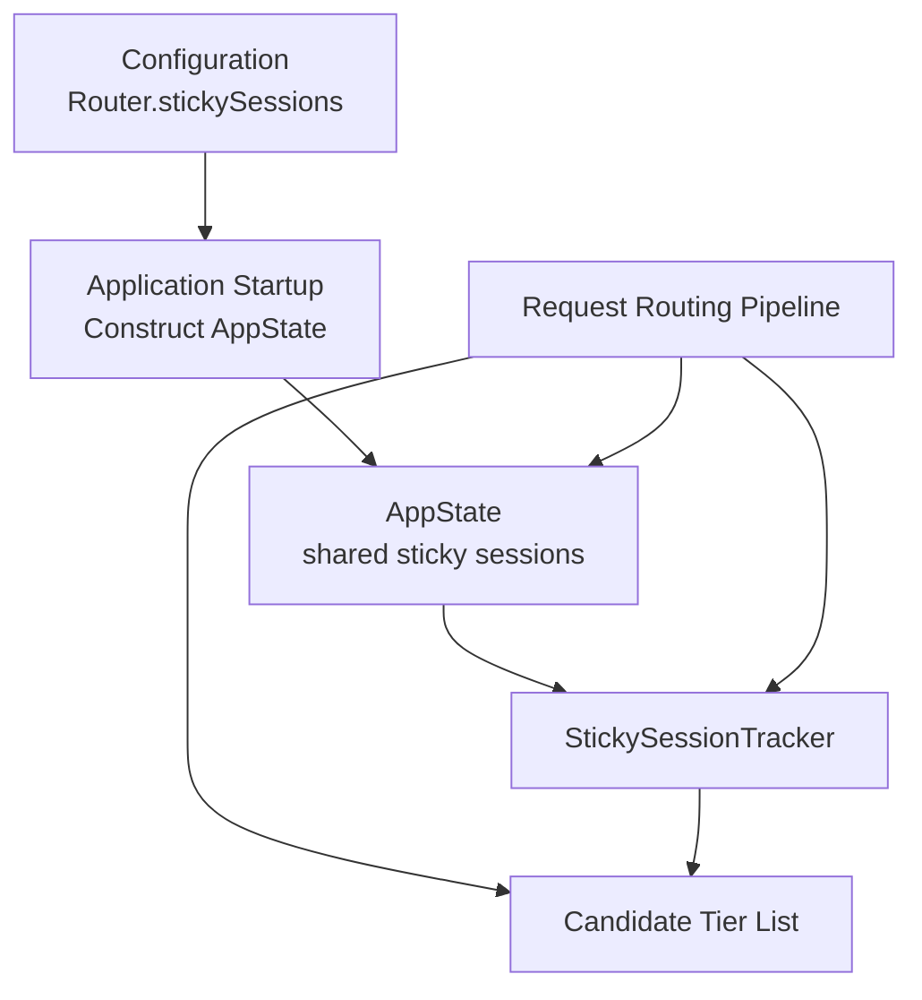
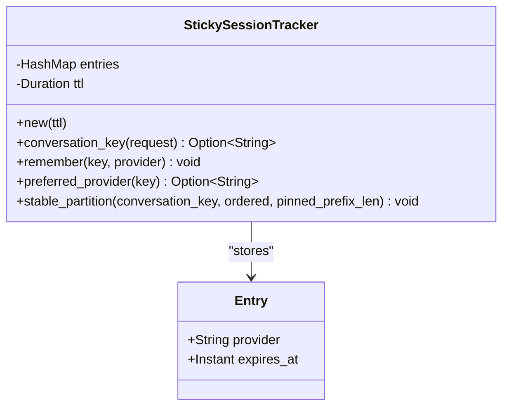
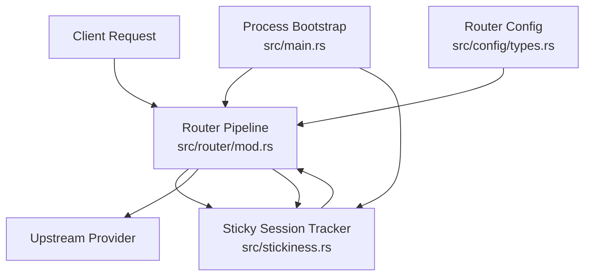
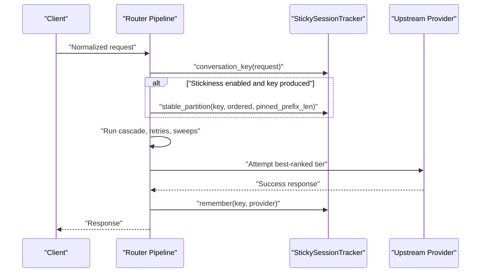
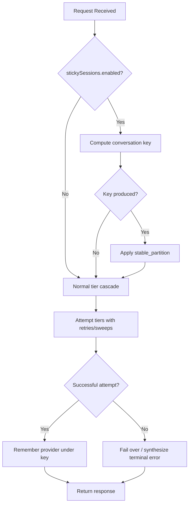
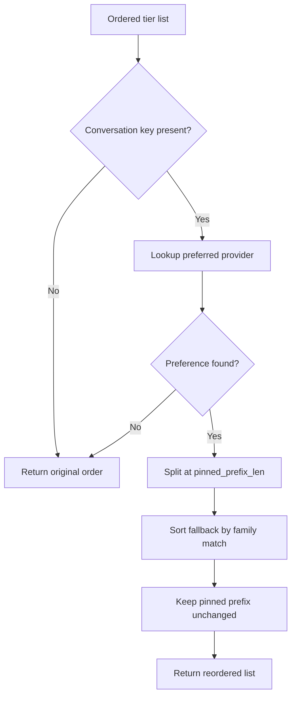
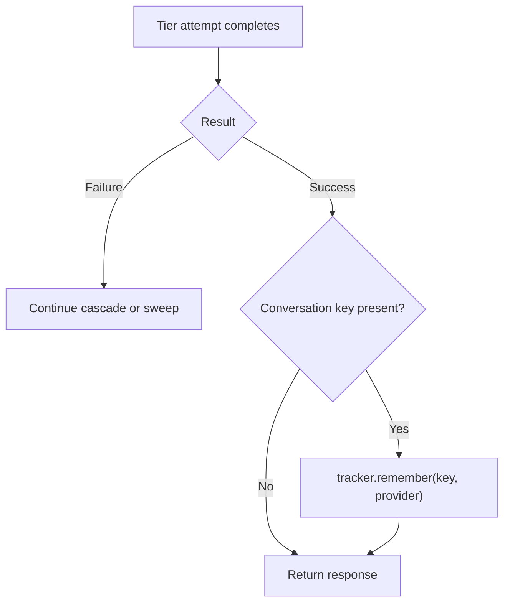
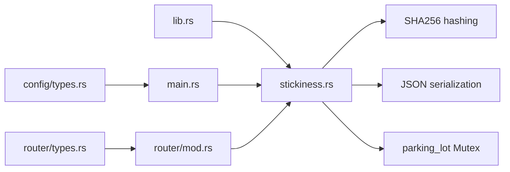

# Conversation Stickiness & Session Affinity

<cite>
**Referenced Files in This Document**
- [stickiness.rs](file://src/stickiness.rs)
- [router/mod.rs](file://src/router/mod.rs)
- [router/types.rs](file://src/router/types.rs)
- [main.rs](file://src/main.rs)
- [config/types.rs](file://src/config/types.rs)
- [lib.rs](file://src/lib.rs)
</cite>

## Table of Contents
1. [Introduction](#introduction)
2. [Project Structure](#project-structure)
3. [Core Components](#core-components)
4. [Architecture Overview](#architecture-overview)
5. [Detailed Component Analysis](#detailed-component-analysis)
6. [Dependency Analysis](#dependency-analysis)
7. [Performance Considerations](#performance-considerations)
8. [Troubleshooting Guide](#troubleshooting-guide)
9. [Privacy and Operational Guidance](#privacy-and-operational-guidance)
10. [Conclusion](#conclusion)

## Introduction
Conversation stickiness is a routing aid that remembers which provider family last handled a conversation, then prefers that same family for subsequent requests while the preference remains valid. Its main goals are:

- Reduce protocol translation overhead by keeping a conversation within one provider family.
- Improve fallback stability so clients do not observe unexpected provider switches mid-conversation.
- Preserve explicit routing constraints such as pinned prefixes and web-search overrides.
- Bound memory usage and expire stale preferences using TTL-based session management.

Stickiness does not replace the normal tier ordering, retry logic, rate-limiting, admission control, EWMA tracking, or failover pipeline. It only reshapes the fallback portion of the candidate list to prefer previously successful providers within the same family.

## Project Structure
The implementation spans a small, focused set of modules:

| Area | Responsibility |
|---|---|
| `src/stickiness.rs` | Core stickiness state, key generation, TTL expiration, and stable partitioning |
| `src/router/mod.rs` | Integrates stickiness into the request routing pipeline |
| `src/router/types.rs` | Declares the router application state field holding the shared sticky session tracker |
| `src/main.rs` | Constructs the sticky session tracker from configuration and injects it into application state |
| `src/config/types.rs` | Defines the `stickySessions` configuration schema and defaults |
| `src/lib.rs` | Exposes the stickiness module publicly |



**Diagram sources**
- [config/types.rs:661-664](file://src/config/types.rs#L661-L664)
- [config/types.rs:801-822](file://src/config/types.rs#L801-L822)
- [main.rs:481-494](file://src/main.rs#L481-L494)
- [router/mod.rs:572-580](file://src/router/mod.rs#L572-L580)
- [router/types.rs:77](file://src/router/types.rs#L77)
- [stickiness.rs:38-40](file://src/stickiness.rs#L38-L40)

**Section sources**
- [stickiness.rs:1-20](file://src/stickiness.rs#L1-L20)
- [router/mod.rs:572-580](file://src/router/mod.rs#L572-L580)
- [router/types.rs:77](file://src/router/types.rs#L77)
- [main.rs:481-494](file://src/main.rs#L481-L494)
- [config/types.rs:661-664](file://src/config/types.rs#L661-L664)
- [config/types.rs:801-822](file://src/config/types.rs#L801-L822)
- [lib.rs:21](file://src/lib.rs#L21)

## Core Components

### StickySessionTracker
`StickySessionTracker` is an in-process cache that maps a stable conversation identifier to a preferred provider entry. Each entry records:

- The provider route used for the remembered preference.
- An expiration time based on the configured TTL.

It provides four primary operations:

| Operation | Purpose |
|---|---|
| `conversation_key` | Derives a stable, hashed conversation identifier from normalized request data |
| `remember` | Records a preferred provider with TTL expiration |
| `preferred_provider` | Reads an active preference if present |
| `stable_partition` | Moves entries belonging to the preferred provider family before other families in the fallback portion of the tier list |

The tracker uses a mutex-protected hash map and enforces a hard capacity bound. When the bound is reached, it first removes expired entries and then evicts the oldest remaining entry until the map fits.



**Diagram sources**
- [stickiness.rs:20-20](file://src/stickiness.rs#L20-L20)
- [stickiness.rs:36-40](file://src/stickiness.rs#L36-L40)
- [stickiness.rs:43-56](file://src/stickiness.rs#L43-L56)
- [stickiness.rs:58-117](file://src/stickiness.rs#L58<docs>
# Conversation Stickiness & Session Affinity

<cite>
**Referenced Files in This Document**
- [stickiness.rs](file://src/stickiness.rs)
- [router/mod.rs](file://src/router/mod.rs)
- [router/types.rs](file://src/router/types.rs)
- [config/types.rs](file://src/config/types.rs)
- [main.rs](file://src/main.rs)
- [lib.rs](file://src/lib.rs)
- [configuration.md](file://docs/configuration.md)
</cite>

## Table of Contents
1. [Introduction](#introduction)
2. [Project Structure](#project-structure)
3. [Core Components](#core-components)
4. [Architecture Overview](#architecture-overview)
5. [Detailed Component Analysis](#detailed-component-analysis)
6. [Dependency Analysis](#dependency-analysis)
7. [Performance Considerations](#performance-considerations)
8. [Troubleshooting Guide](#troubleshooting-guide)
9. [Conclusion](#conclusion)
10. [Appendices](#appendices)

## Introduction
Conversation stickiness is a routing preference mechanism that keeps a conversation within the same provider family after it has successfully used one. The goal is to reduce mid-conversation protocol translation and make fallback behavior more predictable. Instead of re-evaluating every tier independently, the router first computes a stable conversation key from request content, looks up any remembered preferred provider for that key, and then applies a stability-preserving partition that moves matching providers toward the front of the fallback portion.

Stickiness does not replace failover. It only changes the ordering of eligible tiers before the normal retry, rate-limit, admission-control, and sweep-based cascade logic runs. A remembered provider remains a preference; it does not pin a route or bypass health checks.

## Project Structure
The implementation spans five primary areas:

| Area | Responsibility | Key files |
|---|---|---|
| Sticky session cache | Stable key generation, TTL expiration, bounded memory, family-aware partitioning | `src/stickiness.rs` |
| Routing integration | Optional key computation, partition application, successful-attempt recording | `src/router/mod.rs` |
| Application state wiring | Lifetime of `StickySessionTracker`, TTL construction, dependency injection | `src/main.rs` |
| Configuration model | Enable flag, TTL milliseconds, defaults | `src/config/types.rs` |
| Public module surface | Re-export of stickiness module | `src/lib.rs` |



**Diagram sources**
- [router/mod.rs:572-580](file://src/router/mod.rs#L572-L580)
- [router/mod.rs:895-900](file://src/router/mod.rs#L895-L900)
- [stickiness.rs:36-146](file://src/stickiness.rs#L36-L146)
- [config/types.rs:799-826](file://src/config/types.rs#L799-L826)
- [main.rs:481-494](file://src/main.rs#L481-L494)

**Section sources**
- [stickiness.rs:1-146](file://src/stickiness.rs#L1-L146)
- [router/mod.rs:560-587](file://src/router/mod.rs#L560-L587)
- [config/types.rs:799-826](file://src/config/types.rs#L799-L826)
- [main.rs:481-494](file://src/main.rs#L481-L494)
- [lib.rs:21](file://src/lib.rs#L21)

## Core Components

### StickySessionTracker
`StickySessionTracker` is the central stateful component. It stores an in-memory map from conversation keys to provider preferences, each entry carrying a provider identifier and an expiration time.

Key responsibilities:
- Generate a stable conversation key from normalized request content.
- Remember a preferred provider after a successful attempt.
- Look up a preferred provider while enforcing TTL expiration.
- Partition the fallback tier list so remembered providers come first, while preserving pinned prefixes and relative order.

Memory safety is enforced through:
- A hard cap of 10,000 entries.
- An initial retain pass removing expired entries when the cap is reached.
- A loop removing the least-expired entries until the map fits.
- A TTL applied at write time and checked at read time.

Concurrency is protected by a mutex around the internal hash map.

**Section sources**
- [stickiness.rs:20-146](file://src/stickiness.rs#L20-L146)

### Sticky Sessions Configuration
Stickiness is opt-in through `Router.stickySessions`. By default, it is disabled. When enabled, it uses a TTL configured in milliseconds. The default TTL is 3,600,000 milliseconds (one hour).

| Field | Type | Default | Behavior |
|---|---:|---:|---|
| `enabled` | boolean | false | Enables or disables stickiness. |
| `ttlMs` | number | 3,600,000 | Milliseconds a remembered provider remains eligible. |

The configuration is parsed into `StickySessionsConfig` and converted to a `std::time::Duration` during process bootstrap.

**Section sources**
- [config/types.rs:661-666](file://src/config/types.rs#L661-L666)
- [config/types.rs:799-826](file://src/config/types.rs#L799-L826)
- [main.rs:481-494](file://src/main.rs#L481-L494)

### Router Integration
Stickiness integrates into the routing pipeline before candidate attempts begin. For each incoming request:

1. If stickiness is enabled, compute a conversation key.
2. If a key exists, apply `stable_partition` to reorder the tier list.
3. Run the normal cascade, including admission control, rate limiting, retries, hedging, and sweeps.
4. On success, remember the selected provider under the conversation key.



**Diagram sources**
- [router/mod.rs:572-580](file://src/router/mod.rs#L572-L580)
- [router/mod.rs:895-900](file://src/router/mod.rs#L895-L900)

**Section sources**
- [router/mod.rs:572-580](file://src/router/mod.rs#L572-L580)
- [router/mod.rs:895-900](file://src/router/mod.rs#L895-L900)

## Architecture Overview
At runtime, stickiness is part of the per-request routing decision. It sits between tier list preparation and upstream dispatch. It does not own authentication, streaming, serialization, or upstream transport. Its contract is narrow: prefer a previously successful provider family without overriding explicit routing invariants.



**Diagram sources**
- [router/mod.rs:572-580](file://src/router/mod.rs#L572-L580)
- [router/mod.rs:895-900](file://src/router/mod.rs#L895-L900)
- [stickiness.rs:58-146](file://src/stickiness.rs#L58-L146)

## Detailed Component Analysis

### Conversation Key Generation
A conversation key identifies a logical conversation without embedding private prompt text in logs, metrics, or cache identifiers.

Algorithm:
1. Require a system prompt in the normalized Anthropic request.
2. Find the first message whose role is `user`.
3. Serialize both the system prompt and the complete first user message into JSON.
4. Hash the serialized payload with SHA256.
5. Prefix the hex digest with the literal string `conversation:`.

Properties:
- Deterministic: identical inputs produce the same key.
- Private-safe: raw prompt content is hashed before being stored as a key.
- Conversational: shared system prompts do not collide because the first user message is included.
- Family-oriented: the key is used to select a preferred provider family, not a single backend instance.

Complexity:
- Time: dominated by JSON serialization and SHA256 hashing of the combined system prompt and first user message.
- Space: proportional to the size of the serialized payload plus the resulting 64-character hex key.

Privacy considerations:
- The key is derived from request content already present on the wire.
- No external identity, client ID, or unavailable metadata is assumed.
- The raw prompt is never written as a cache key.
- Tests assert that known prompt values do not appear in generated keys.

**Section sources**
- [stickiness.rs:23-34](file://src/stickiness.rs#L23-L34)
- [stickiness.rs:58-78](file://src/stickiness.rs#L58-L78)
- [stickiness.rs:160-196](file://src/stickiness.rs#L160-L196)

### TTL-Based Session Expiration
Each remembered entry stores an expiration timestamp calculated as the current time plus the configured TTL. Lookup enforces this boundary:

1. Lock the session map.
2. Retrieve the entry for the conversation key.
3. If the entry is expired or missing, remove it and return no preference.
4. Otherwise, return the remembered provider.

This means TTL expiration is lazy: entries are removed when accessed, not by background cleanup.

Configuration mapping:
- `ttl_ms` is converted to a `Duration` at startup.
- The default TTL is one hour.
- A zero TTL causes immediate expiration after insertion.

**Section sources**
- [stickiness.rs:36-56](file://src/stickiness.rs#L36-L56)
- [stickiness.rs:107-118](file://src/stickiness.rs#L107-L118)
- [config/types.rs:801-826](file://src/config/types.rs#L801-L826)
- [main.rs:481-494](file://src/main.rs#L481-L494)
- [stickiness.rs:243-247](file://src/stickiness.rs#L243-L247)

### Memory Bounds Enforcement
The tracker enforces a hard bound of 10,000 entries. When inserting beyond the limit:

1. Perform an initial retain pass removing all expired entries.
2. While the map still exceeds the limit, repeatedly find the entry with the earliest expiration time.
3. Remove that oldest entry.
4. Insert the new entry.

This approach avoids scanning the entire map on every insert and prefers dropping stale entries first. Eviction is defensive: conversations are not unbounded state, and stale entries are harmless if removed.

Complexity:
- Typical insertion: O(1) when capacity is available.
- Capacity eviction: O(n log n) for the retain pass plus O(k · n) for repeated minimum searches, where k is the number of evictions needed. In practice, k is small after the initial expiry pass.

**Section sources**
- [stickiness.rs:20-20](file://src/stickiness.rs#L20-L20)
- [stickiness.rs:80-106](file://src/stickiness.rs#L80-L106)
- [stickiness.rs:200-212](file://src/stickiness.rs#L200-L212)

### Family-Aware Stable Partition
The partition step improves fallback stability by moving providers belonging to the same family as the remembered provider toward the front of the fallback section.

Rules:
- Only the fallback portion is reordered; the pinned prefix is untouched.
- A provider’s “family” is derived from the first comma-separated segment of its tier route.
- Entries whose family matches the remembered provider are moved before other families.
- Relative order among entries within each group is preserved.
- If no preference exists, the original order is unchanged.

This design preserves direct routing and web-search pinned prefixes while still gaining stickiness benefits for ordinary fallback candidates.



**Diagram sources**
- [stickiness.rs:121-146](file://src/stickiness.rs#L121-L146)
- [router/mod.rs:577-580](file://src/router/mod.rs#L577-L580)

**Section sources**
- [stickiness.rs:121-146](file://src/stickiness.rs#L121-L146)
- [router/mod.rs:577-580](file://src/router/mod.rs#L577-L580)

### Successful Attempt Recording
After a successful attempt, the router records the chosen provider under the conversation key. This makes the next request with the same key prefer the same family.

Important constraints:
- Recording happens only after success.
- The provider is recorded as a string extracted from the selected tier.
- Recording is conditional on the presence of a conversation key.
- Failed attempts do not poison the sticky preference.



**Diagram sources**
- [router/mod.rs:895-900](file://src/router/mod.rs#L895-L900)

**Section sources**
- [router/mod.rs:895-900](file://src/router/mod.rs#L895-L900)

## Dependency Analysis
The following diagram shows how stickiness depends on and interacts with other modules.



**Diagram sources**
- [lib.rs:21](file://src/lib.rs#L21)
- [main.rs:481-494](file://src/main.rs#L481-L494)
- [config/types.rs:799-826](file://src/config/types.rs#L799-L826)
- [router/types.rs:14-14](file://src/router/types.rs#L14-L14)
- [router/types.rs:77-77](file://src/router/types.rs#L77-L77)
- [router/mod.rs:572-580](file://src/router/mod.rs#L572-L580)
- [stickiness.rs:1-20](file://src/stickiness.rs#L1-L20)

Coupling characteristics:
- Low coupling to routing: stickiness exposes a small API (`conversation_key`, `remember`, `preferred_provider`, `stable_partition`).
- High cohesion: all session affinity logic lives in one module.
- No circular dependency: `router/mod.rs` imports `stickiness`, but `stickiness.rs` does not import the router except indirectly through types used for key generation.
- External dependencies: `sha2` for hashing, `serde_json` for serialization, `parking_lot::Mutex` for concurrency.

**Section sources**
- [router/mod.rs:572-580](file://src/router/mod.rs#L572-L580)
- [router/types.rs:14-14](file://src/router/types.rs#L14-L14)
- [router/types.rs:77-77](file://src/router/types.rs#L77-L77)
- [stickiness.rs:1-20](file://src/stickiness.rs#L1-L20)

## Performance Considerations
- Key generation cost scales with the size of the system prompt and first user message. Because it runs once per request, it should be acceptable even for moderately large prompts.
- JSON serialization occurs twice per key generation path: once for the key input and again in tests using synthetic requests.
- TTL lookup is O(1) average case for hash map access.
- Partitioning sorts only the fallback portion and uses a simple family comparison; it is typically fast unless the fallback tier list is large.
- Memory usage grows with active conversations up to the hard cap. Expired entries are reclaimed lazily on insert and lookup.
- Concurrency overhead comes from locking the session map on every read and write. Given the small critical section, contention is expected to be low compared to upstream I/O.

Recommendations:
- Keep system prompts concise where possible to reduce serialization and hashing cost.
- Monitor process memory when enabling stickiness in production, especially with many concurrent long-running conversations.
- Tune TTL to balance preference stability against memory retention.

[No sources needed since this section provides general guidance]

## Troubleshooting Guide

### Stickiness Is Not Applied
Check these conditions:
- `Router.stickySessions.enabled` must be true.
- The request must have a system prompt.
- The request must contain at least one message with role `user`.
- If either condition fails, `conversation_key` returns `None`, and the normal routing pipeline proceeds without stickiness.

Likely fixes:
- Enable stickiness in configuration.
- Ensure the normalized request includes a system prompt.
- Ensure the first user message is present.

**Section sources**
- [config/types.rs:661-666](file://src/config/types.rs#L661-L666)
- [stickiness.rs:58-78](file://src/stickiness.rs#L58-L78)
- [router/mod.rs:572-580](file://src/router/mod.rs#L572-L580)

### Preferred Provider Expires Too Quickly
Symptoms:
- Conversations frequently restart with different provider families.
- Stickiness appears effective only for short bursts.

Actions:
- Increase `Router.stickySessions.ttlMs`.
- Confirm that the configured TTL is non-zero.
- Review whether conversations are genuinely short-lived or if they are being treated as separate conversations due to differing system prompts or first messages.

**Section sources**
- [config/types.rs:801-826](file://src/config/types.rs#L801-L826)
- [main.rs:481-494](file://src/main.rs#L481-L494)

### Memory Usage Grows Under Load
Symptoms:
- Process RSS increases with many concurrent conversations.
- New sessions cause older preferences to be dropped.

Behavioral notes:
- The tracker caps entries at 10,000.
- Expired entries are removed first.
- Oldest entries are removed until capacity is restored.

Actions:
- Reduce TTL to shorten retention.
- Verify that conversations are not sharing identical keys unintentionally; this would merge preferences rather than increase memory use.
- Consider disabling stickiness if memory pressure is severe and stability gains are not required.

**Section sources**
- [stickiness.rs:20-20](file://src/stickiness.rs#L20-L20)
- [stickiness.rs:80-106](file://src/stickiness.rs#L80-L106)
- [stickiness.rs:200-212](file://src/stickiness.rs#L200-L212)

### Pinned Routes Are Still Respected
If a route is pinned, such as a web-search or direct-routing tier, stickiness will not move it. Only the fallback portion is reordered. This preserves existing routing invariants.

Verification:
- Inspect the pinned prefix length passed to `stable_partition`.
- Confirm that the remembered provider belongs to the fallback portion.

**Section sources**
- [stickiness.rs:121-146](file://src/stickiness.rs#L121-L146)
- [router/mod.rs:577-580](file://src/router/mod.rs#L577-L580)

## Conclusion
Conversation stickiness adds a lightweight, privacy-safe preference layer to the routing pipeline. It reduces unnecessary protocol translation by keeping conversations within their successful provider family, improves fallback stability by grouping matching families, and preserves explicit routing invariants through pinned-prefix protection.

Its operational model is intentionally conservative:
- Opt-in via configuration.
- Keyed by system prompt and first user message.
- Bounded in memory.
- Expired by TTL.
- Applied only as a preference, not a guarantee.
- Integrated alongside retries, rate limits, admission control, and sweeps.

For long-running conversations, stickiness can improve consistency and reduce cross-provider translation costs, provided TTL and memory settings are tuned to the deployment’s workload.

[No sources needed since this section summarizes without analyzing specific files]

## Appendices

### Configuration Reference
The relevant configuration object is nested under `Router.stickySessions`.

| Path | Type | Default | Description |
|---|---:|---:|---|
| `Router.stickySessions.enabled` | boolean | false | Enables conversation-provider stickiness. |
| `Router.stickySessions.ttlMs` | number | 3,600,000 | Milliseconds a remembered provider remains eligible. |

Example placement in configuration:
```json
{
  "Router": {
    "stickySessions": {
      "enabled": true,
      "ttlMs": 3600000
    }
  }
}
```

**Section sources**
- [config/types.rs:661-666](file://src/config/types.rs#L661-L666)
- [config/types.rs:799-826](file://src/config/types.rs#L799-L826)
- [configuration.md:520-540](file://docs/configuration.md#L520-L540)

### Privacy Best Practices for Long-Running Conversations
- Avoid placing secrets, tokens, or personally identifiable information in the system prompt or first user message, even though the key is hashed.
- Prefer stable, high-level conversation context in the system prompt; changing it creates a new key.
- Treat the conversation key as opaque; do not log or export raw prompt content.
- Use TTLs aligned with conversation lifetime to avoid retaining preferences longer than necessary.
- Monitor memory usage when enabling stickiness in production workloads with many concurrent conversations.

[No sources needed since this section provides general guidance]