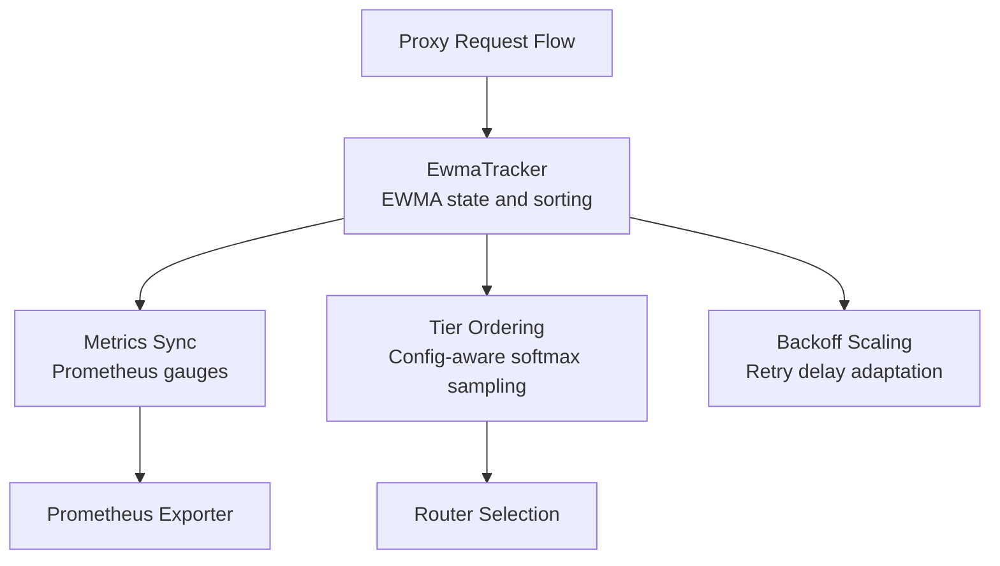
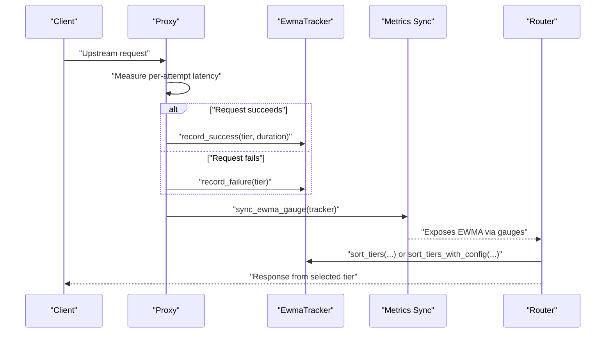
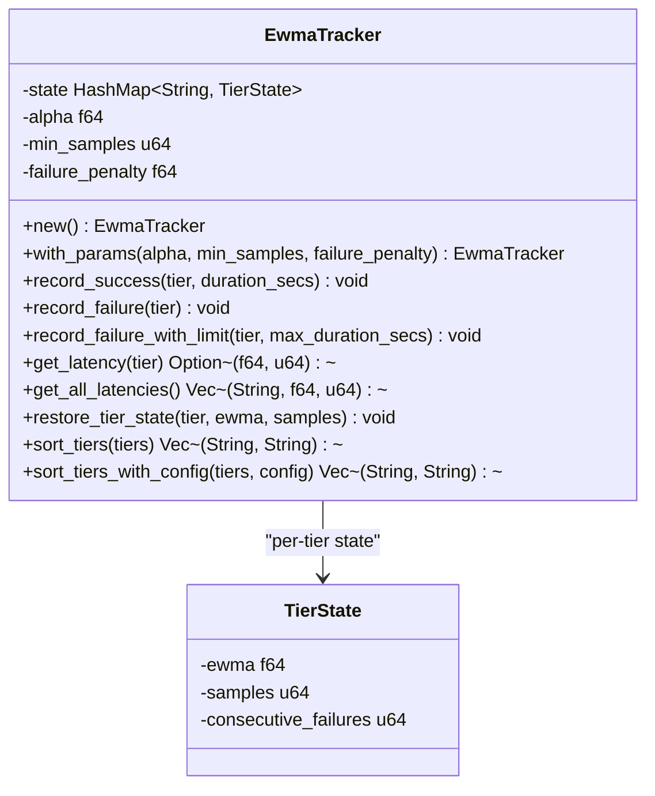
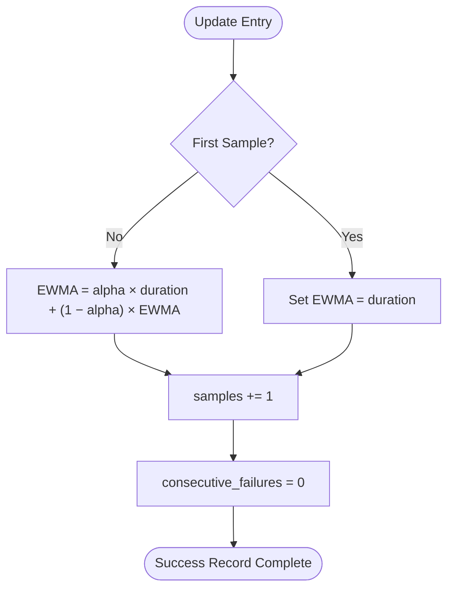
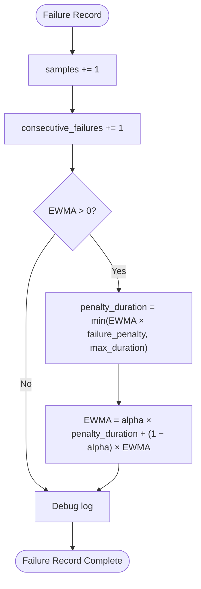
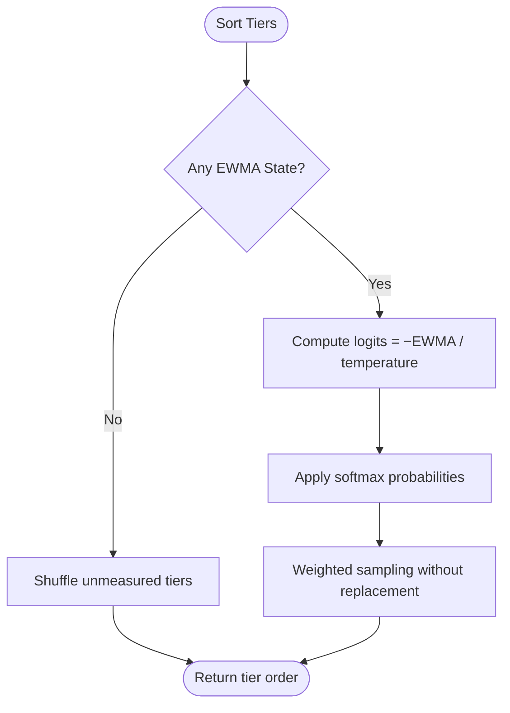
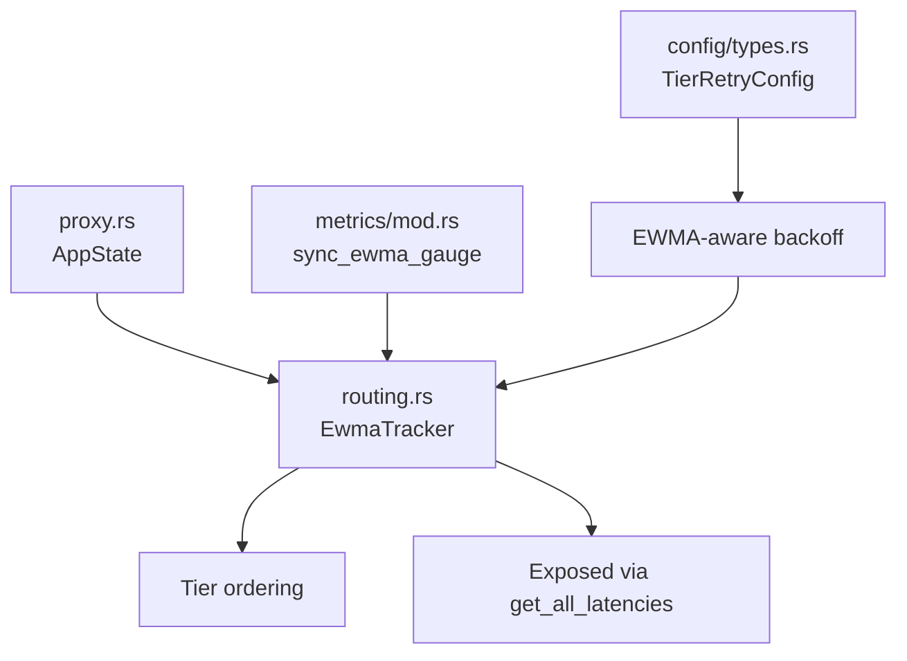

# EWMA Latency Tracking

<cite>
**Referenced Files in This Document**
- [routing.rs](file://src/routing.rs)
- [proxy.rs](file://src/proxy.rs)
- [mod.rs](file://src/metrics/mod.rs)
- [types.rs](file://src/config/types.rs)
</cite>

## Table of Contents
1. [Introduction](#introduction)
2. [Project Structure](#project-structure)
3. [Core Components](#core-components)
4. [Architecture Overview](#architecture-overview)
5. [Detailed Component Analysis](#detailed-component-analysis)
6. [Dependency Analysis](#dependency-analysis)
7. [Performance Considerations](#performance-considerations)
8. [Troubleshooting Guide](#troubleshooting-guide)
9. [Conclusion](#conclusion)
10. [Appendices](#appendices)

## Introduction
This document explains the Exponentially Weighted Moving Average (EWMA) latency tracking system used to adaptively estimate backend tier responsiveness and influence routing decisions. The tracker records per-attempt latency for each provider tier, giving more weight to recent measurements while retaining a smoothed view of historical behavior. It is especially important that failed requests do not inflate latency estimates using raw timeout durations; instead, they apply a penalty multiplier so degraded providers are deprioritized without being poisoned by arbitrary wall-clock timeouts.

The key parameters are:
- **Smoothing factor (alpha)**: controls how much a new sample changes the current EWMA.
- **Minimum samples threshold**: prevents cold or unreliable tiers from influencing routing until enough data exists.
- **Failure penalty multiplier**: scales the current EWMA when a request fails, avoiding use of actual failure duration.

## Project Structure
The EWMA implementation lives primarily in the routing layer, with integration points in the proxy and metrics subsystems.

**Diagram sources**
- [routing.rs:1-120](file://src/routing.rs#L1-L120)
- [routing.rs:200-350](file://src/routing.rs#L200-L350)
- [proxy.rs:1-60](file://src/proxy.rs#L1-L60)
- [mod.rs:100-120](file://src/metrics/mod.rs#L100-L120)
- [mod.rs:442-449](file://src/metrics/mod.rs#L442-L449)

**Section sources**
- [routing.rs:1-120](file://src/routing.rs#L1-L120)
- [proxy.rs:1-60](file://src/proxy.rs#L1-L60)
- [mod.rs:100-120](file://src/metrics/mod.rs#L100-L120)
- [mod.rs:442-449](file://src/metrics/mod.rs#L442-L449)

## Core Components
The EWMA system is centered on `EwmaTracker`, which maintains per-tier latency state, updates it on successes and failures, exposes latency values, and produces reordered tier lists used by the router.

Key responsibilities:
- Maintain per-tier EWMA latency, sample count, and consecutive failure count.
- Update EWMA on successful attempts using actual latency.
- Apply a failure penalty rather than recording raw timeout durations.
- Provide latency snapshots for monitoring.
- Sort tiers by measured EWMA once sufficient samples exist.
- Provide a config-aware weighted sampler for probabilistic tier distribution.

**Section sources**
- [routing.rs:1-120](file://src/routing.rs#L1-L120)
- [routing.rs:200-350](file://src/routing.rs#L200-L350)

## Architecture Overview
At runtime, incoming requests are routed through the proxy. For each upstream attempt, the proxy measures per-attempt latency and calls into the EWMA tracker. After updating the tracker, the metrics subsystem synchronizes the current EWMA values to Prometheus gauges. The router then uses either deterministic ordering or weighted sampling based on temperature and observed latencies.

**Diagram sources**
- [proxy.rs:1-60](file://src/proxy.rs#L1-L60)
- [routing.rs:1-120](file://src/routing.rs#L1-L120)
- [mod.rs:442-449](file://src/metrics/mod.rs#L442-L449)

## Detailed Component Analysis

### EwmaTracker Data Model
`EwmaTracker` holds:
- A map of tier name to `TierState`.
- Alpha, minimum samples, and failure penalty parameters.
- Per-tier state including EWMA latency, total samples, and consecutive failures.

**Diagram sources**
- [routing.rs:1-120](file://src/routing.rs#L1-L120)

**Section sources**
- [routing.rs:1-120](file://src/routing.rs#L1-L120)

### EWMA Update Logic
Successful requests update EWMA using actual latency. The first sample initializes the EWMA directly; subsequent samples blend the new measurement with the existing EWMA.

Mathematical formulation for a successful sample:
- If this is the first sample for the tier:
  - `EWMA = duration_seconds`
- Otherwise:
  - `EWMA_new = alpha × duration_seconds + (1 − alpha) × EWMA_old`

Failed requests do not use raw timeout durations. Instead, they apply a penalty proportional to the current EWMA:
- Penalty duration:
  - `penalty_duration = clamp(EWMA × failure_penalty, upper_bound)`
- Updated EWMA:
  - `EWMA_new = alpha × penalty_duration + (1 − alpha) × EWMA_old`

A bounded variant accepts an explicit maximum duration so pathological timeouts cannot poison gauges.

**Diagram sources**
- [routing.rs:1-120](file://src/routing.rs#L1-L120)

**Section sources**
- [routing.rs:1-120](file://src/routing.rs#L1-L120)

### Failure Handling Flow
Failures increment both total samples and consecutive failures. They only change EWMA if a baseline EWMA already exists, preventing multiplication of zero. The penalty is capped by an optional maximum duration.

**Diagram sources**
- [routing.rs:1-120](file://src/routing.rs#L1-L120)

**Section sources**
- [routing.rs:1-120](file://src/routing.rs#L1-L120)

### Tier Reordering and Routing
There are two primary ordering modes:

1. **Deterministic ordered sorting**: Tiers with enough samples are sorted by ascending EWMA; tiers below the minimum sample threshold retain their configured order.
2. **Config-aware weighted sampling**: Latencies are converted into logits by negating normalized EWMA divided by routing temperature, then softmax probabilities are computed. Tiers are sampled without replacement according to these probabilities, distributing load across backends rather than always selecting the fastest one.

Unmeasured tiers receive a very large negative logit penalty, ensuring measured tiers are preferred. Cold-start traffic without any EWMA data is shuffled so the first configured tier does not always receive all initial requests.

**Diagram sources**
- [routing.rs:200-350](file://src/routing.rs#L200-L350)

**Section sources**
- [routing.rs:200-350](file://src/routing.rs#L200-L350)

### Integration Points

#### Proxy Integration
The proxy constructs and owns an `EwmaTracker`, stores it in application state, and uses it to record per-attempt outcomes. The metrics subsystem syncs EWMA gauges after tracker updates.

**Section sources**
- [proxy.rs:1-60](file://src/proxy.rs#L1-L60)
- [proxy.rs:552-560](file://src/proxy.rs#L552-L560)

#### Metrics Synchronization
The metrics module exposes a gauge vector `ccr_tier_ewma_latency_seconds` and synchronizes it by iterating over all tracked tiers. It also persists EWMA state for recovery.

**Section sources**
- [mod.rs:100-120](file://src/metrics/mod.rs#L100-L120)
- [mod.rs:442-449](file://src/metrics/mod.rs#L442-L449)

#### Retry Backoff Scaling
EWMA latency influences retry backoff scaling. Slower tiers receive longer retries within bounds, while faster tiers may retry more aggressively. The configuration provides a method that computes scaled backoff based on current EWMA relative to a reference latency.

**Section sources**
- [types.rs:900-1000](file://src/config/types.rs#L900-L1000)
- [types.rs:1000-1100](file://src/config/types.rs#L1000-L1100)

## Dependency Analysis
The EWMA system has clear boundaries:
- `EwmaTracker` owns latency state and sorting logic.
- The proxy integrates the tracker into request handling.
- The metrics module exports gauges and persistence hooks.
- Configuration types expose EWMA-aware backoff scaling.

**Diagram sources**
- [routing.rs:1-120](file://src/routing.rs#L1-L120)
- [proxy.rs:552-560](file://src/proxy.rs#L552-L560)
- [mod.rs:442-449](file://src/metrics/mod.rs#L442-L449)
- [types.rs:900-1000](file://src/config/types.rs#L900-L1000)

**Section sources**
- [routing.rs:1-120](file://src/routing.rs#L1-L120)
- [proxy.rs:552-560](file://src/proxy.rs#L552-L560)
- [mod.rs:442-449](file://src/metrics/mod.rs#L442-L449)
- [types.rs:900-1000](file://src/config/types.rs#L900-L1000)

## Performance Considerations
- **Alpha tuning**:
  - Higher alpha reacts faster to latency changes but can be noisy under bursty traffic.
  - Lower alpha smooths noise but adapts slowly to degradation.
- **Minimum samples**:
  - Prevents cold-start tiers from dominating routing before enough evidence exists.
  - Too high a threshold delays adaptive reordering.
- **Failure penalty**:
  - Must be greater than 1.0 to penalize failures meaningfully.
  - Excessively high penalties can over-degrade a tier after transient errors.
- **Routing temperature**:
  - Low temperature favors the fastest measured tier deterministically.
  - High temperature distributes traffic more evenly across tiers.
- **Concurrency**:
  - The tracker uses read-write locking around tier state, suitable for moderate concurrency.
  - Monitoring synchronization iterates all tiers, so keep tier counts reasonable.

[No sources needed since this section provides general guidance]

## Troubleshooting Guide

### Symptom: EWMA never stabilizes
Possible causes:
- Alpha too high for the traffic pattern.
- Insufficient minimum samples causing frequent cold-state behavior.
- Frequent failures inflating EWMA due to penalty multiplier.

Recommended checks:
- Inspect `ccr_tier_ewma_latency_seconds` for volatile values.
- Compare sample counts with the configured minimum samples threshold.
- Review failure reasons and whether timeouts dominate failures.

**Section sources**
- [mod.rs:100-120](file://src/metrics/mod.rs#L100-L120)
- [routing.rs:1-120](file://src/routing.rs#L1-L120)

### Symptom: Failed requests inflate latency estimates
Likely cause:
- Raw timeout durations are being recorded instead of applying failure penalties.

Verification:
- Confirm failures go through `record_failure` or `record_failure_with_limit`.
- Ensure no custom path bypasses the tracker’s failure handling.

**Section sources**
- [routing.rs:1-120](file://src/routing.rs#L1-L120)

### Symptom: Fastest tier is always selected
Likely cause:
- Routing temperature is too low, making selection nearly deterministic.
- Only one tier has enough samples.

Mitigation:
- Increase routing temperature to distribute load.
- Allow more time for multiple tiers to accumulate samples.

**Section sources**
- [routing.rs:200-350](file://src/routing.rs#L200-L350)

### Symptom: Tier ordering ignores recent improvements
Likely cause:
- Alpha is too low for rapid recovery scenarios.
- Minimum samples threshold is too high.

Mitigation:
- Increase alpha for faster reaction.
- Lower minimum samples if early adaptation is acceptable.

**Section sources**
- [routing.rs:1-120](file://src/routing.rs#L1-L120)
- [routing.rs:200-350](file://src/routing.rs#L200-L350)

## Conclusion
The EWMA latency tracker provides a practical mechanism for adaptive tier routing. By blending recent measurements with history, it balances responsiveness and stability. Successes reflect real backend speed, while failures apply controlled penalties to avoid poisoning estimates with timeout artifacts. When tuned correctly—especially alpha, minimum samples, failure penalty, and routing temperature—the system improves latency-aware routing, supports probabilistic load distribution, and integrates cleanly with metrics and retry backoff scaling.

[No sources needed since this section summarizes without analyzing specific files]

## Appendices

### Parameters Reference

| Parameter | Default Value | Meaning | Tuning Guidance |
|---|---:|---|---|
| Alpha | 0.3 | Fraction of new sample blended into EWMA | Use higher values for rapidly changing environments; lower values for stable, noisy environments |
| Minimum samples | 3 | Required samples before EWMA influences routing | Raise to stabilize cold-start behavior; lower to allow earlier adaptation |
| Failure penalty | 2.0 | Multiplier applied to current EWMA on failure | Keep above 1.0; increase cautiously to penalize unstable tiers |
| Routing temperature | 1.0 | Controls softmax randomness in weighted tier sampling | Lower for deterministic fast-tier preference; higher for broader distribution |

**Section sources**
- [routing.rs:1-120](file://src/routing.rs#L1-L120)
- [routing.rs:200-350](file://src/routing.rs#L200-L350)

### Monitoring Approach
- Track `ccr_tier_ewma_latency_seconds` to observe per-tier EWMA trends.
- Correlate EWMA with failure counters and request duration histograms.
- Use tier ordering debug logs to confirm whether measured tiers are preferred.
- Persist EWMA state where supported so restarts recover approximate latency history.

**Section sources**
- [mod.rs:100-120](file://src/metrics/mod.rs#L100-L120)
- [mod.rs:442-449](file://src/metrics/mod.rs#L442-L449)