# GP Routing Optimization

<cite>
**Referenced Files in This Document**   
- [src/gp_router.rs](file://src/gp_router.rs)
- [src/config/types.rs](file://src/config/types.rs)
- [vendor/gp-routing/src/lib.rs](file://vendor/gp-routing/src/lib.rs)
- [vendor/gp-routing/src/surrogate.rs](file://vendor/gp-routing/src/surrogate.rs)
- [vendor/gp-routing/src/acquisition.rs](file://vendor/gp-routing/src/acquisition.rs)
- [vendor/gp-routing/src/features.rs](file://vendor/gp-routing/src/features.rs)
- [vendor/gp-routing/src/ring_buffer.rs](file://vendor/gp-routing/src/ring_buffer.rs)
- [vendor/gp-routing/src/config.rs](file://vendor/gp-routing/src/config.rs)
</cite>

## Table of Contents
1. [Introduction](#introduction)
2. [Project Structure](#project-structure)
3. [Core Components](#core-components)
4. [Architecture Overview](#architecture-overview)
5. [Detailed Component Analysis](#detailed-component-analysis)
6. [Dependency Analysis](#dependency-analysis)
7. [Performance Considerations](#performance-considerations)
8. [Troubleshooting Guide](#troubleshooting-guide)
9. [Conclusion](#conclusion)

## Introduction
The optional Genetic Programming (GP) routing optimization feature is a learning-based reranking layer that sits on top of the existing tier ordering used by the router. Rather than changing which providers and models are available, it reorders eligible tiers for each request based on learned relationships between request characteristics and observed backend performance.

At its core, the system:
- Encodes a request into a fixed-size feature vector.
- Scores candidate backends using a Gaussian Process surrogate model.
- Selects acquisition strategies such as UCB, Thompson sampling, greedy exploitation, or epsilon-greedy exploration.
- Stores observations in an in-memory ring buffer.
- Fits or refits the surrogate when enough data has accumulated.
- Optionally orders credible candidates by estimated cost while preserving statistically indistinguishable quality.

This document explains how these pieces work together, how to configure them, how to interpret results, and what operational trade-offs to expect.

## Project Structure
The GP routing implementation is split across two layers:

| Layer | Responsibility | Key files |
|---|---|---|
| Application integration | Builds features, reranks candidate tiers, records outcomes, and applies business rules around cost and credibility. | [src/gp_router.rs](file://src/gp_router.rs), [src/config/types.rs](file://src/config/types.rs) |
| Vendored GP library | Provides the surrogate model, observation buffer, feature encoding, acquisition functions, and GP configuration. | [vendor/gp-routing/src/lib.rs](file://vendor/gp-routing/src/lib.rs), [vendor/gp-routing/src/surrogate.rs](file://vendor/gp-routing/src/surrogate.rs), [vendor/gp-routing/src/acquisition.rs](file://vendor/gp-routing/src/acquisition.rs), [vendor/gp-routing/src/features.rs](file://vendor/gp-routing/src/features.rs), [vendor/gp-routing/src/ring_buffer.rs](file://vendor/gp-routing/src/ring_buffer.rs), [vendor/gp-routing/src/config.rs](file://vendor/gp-routing/src/config.rs) |

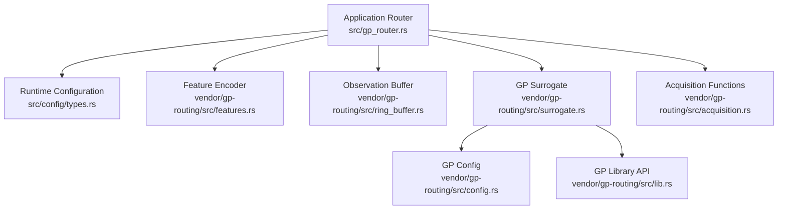

**Diagram sources**
- [src/gp_router.rs:1-120](file://src/gp_router.rs#L1-L120)
- [src/config/types.rs:450-560](file://src/config/types.rs#L450-L560)
- [vendor/gp-routing/src/features.rs:1-120](file://vendor/gp-routing/src/features.rs#L1-L120)
- [vendor/gp-routing/src/ring_buffer.rs:1-80](file://vendor/gp-routing/src/ring_buffer.rs#L1-L80)
- [vendor/gp-routing/src/surrogate.rs:1-120](file://vendor/gp-routing/src/surrogate.rs#L1-L120)
- [vendor/gp-routing/src/acquisition.rs:1-60](file://vendor/gp-routing/src/acquisition.rs#L1-L60)
- [vendor/gp-routing/src/config.rs:1-80](file://vendor/gp-routing/src/config.rs#L1-L80)
- [vendor/gp-routing/src/lib.rs:1-44](file://vendor/gp-routing/src/lib.rs#L1-L44)

**Section sources**
- [src/gp_router.rs:1-120](file://src/gp_router.rs#L1-L120)
- [src/config/types.rs:450-560](file://src/config/types.rs#L450-L560)
- [vendor/gp-routing/src/lib.rs:1-44](file://vendor/gp-routing/src/lib.rs#L1-L44)

## Core Components
The GP routing system can be understood as four cooperating components:

1. **Request feature encoder**: Converts request metadata and runtime context into a bounded numerical representation suitable for regression.
2. **Observation buffer**: A fixed-capacity FIFO structure storing past `(features, outcome)` pairs.
3. **GP surrogate model**: A Gaussian Process regressor that predicts mean performance and uncertainty for new feature vectors.
4. **Acquisition strategy**: Converts posterior predictions into a ranking score for candidate backends.

### Request Features
The application builds `RequestFeatureContext` from incoming requests and then translates it into a `FeatureVector`. The encoded features include:

| Feature category | Meaning | Encoding behavior |
|---|---|---|
| Prompt size | Total message plus system prompt text length | Log-scaled and clipped to `[0, 1]` |
| Request class | Streaming vs tool-heavy classification | One-hot over four buckets |
| System prompt | Whether a system prompt is present | Binary indicator |
| Message count | Number of conversation messages | Normalized dependency count |
| Retry attempt | Attempt number within a routed call | Normalized retry count |
| Backend identity | Candidate provider/model tier | One-hot over up to 32 slots |
| Load state | Idle and in-flight stream ratios | Normalized capacity ratios |
| Time of day | Current hour | Circular sine/cosine encoding |
| Tool usage | Number of tools in the request | Normalized loop count |
| Estimated cost | Relative cost compared to the most expensive priced candidate | Continuous signal with a known-cost flag |

The encoder uses a fixed feature dimension so the GP model remains stable even as the backend catalog changes.

**Section sources**
- [src/gp_router.rs:24-118](file://src/gp_router.rs#L24-L118)
- [src/gp_router.rs:288-370](file://src/gp_router.rs#L288-L370)
- [vendor/gp-routing/src/features.rs:1-200](file://vendor/gp-routing/src/features.rs#L1-L200)

### Observation Buffer
`ObservationBuffer` stores observations until the surrogate needs training data. It supports:

- Fixed capacity with FIFO overwrite semantics.
- Clamped outcome values in `[0, 1]`.
- Tracking the number of pushes since the last successful fit.
- Efficient conversion to training matrices for the GP.

When the buffer reaches capacity, the oldest entries are overwritten. Training data is returned in insertion order, including wrap-around indexing for circular buffers.

**Section sources**
- [vendor/gp-routing/src/ring_buffer.rs:1-117](file://vendor/gp-routing/src/ring_buffer.rs#L1-L117)

### GP Surrogate Model
The surrogate wraps a Gaussian Process regression model. Its responsibilities include:

- Validating configuration before fitting.
- Normalizing target outcomes during training.
- Performing model fitting with configurable nugget jitter and optional KPLS dimensionality reduction.
- Returning prior mean/variance when no model is fitted or prediction fails.
- Exposing fit count, last fit duration, and persistence helpers.

The model does not optimize hyperparameters dynamically; instead, it uses a fixed theta tuning path for stability in the FP32 routing workload.

**Section sources**
- [vendor/gp-routing/src/surrogate.rs:1-200](file://vendor/gp-routing/src/surrogate.rs#L1-L200)
- [vendor/gp-routing/src/surrogate.rs:201-369](file://vendor/gp-routing/src/surrogate.rs#L201-L369)
- [vendor/gp-routing/src/config.rs:1-145](file://vendor/gp-routing/src/config.rs#L1-L145)

### Acquisition Strategies
The GP library exposes several ways to convert posterior predictions into scores:

| Strategy | Behavior |
|---|---|
| UCB | Adds uncertainty-weighted exploration through `mean + kappa × sqrt(variance)`. |
| Thompson sampling | Draws from the posterior distribution per backend. |
| Greedy | Uses the predicted mean directly. |
| Epsilon-greedy | Occasionally promotes one randomly selected backend to encourage exploration. |

The application maps runtime configuration to these strategies and adds a credibility-aware cost ordering step after scoring.

**Section sources**
- [vendor/gp-routing/src/acquisition.rs:1-105](file://vendor/gp-routing/src/acquisition.rs#L1-L105)
- [src/config/types.rs:450-560](file://src/config/types.rs#L450-L560)

## Architecture Overview
The GP reranker integrates into the normal routing flow as follows:

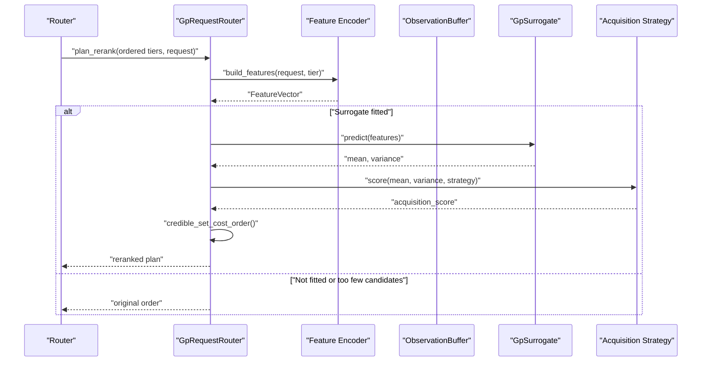

**Diagram sources**
- [src/gp_router.rs:120-210](file://src/gp_router.rs#L120-L210)
- [src/gp_router.rs:288-370](file://src/gp_router.rs#L288-L370)
- [vendor/gp-routing/src/surrogate.rs:260-320](file://vendor/gp-routing/src/surrogate.rs#L260-L320)
- [vendor/gp-routing/src/acquisition.rs:60-105](file://vendor/gp-routing/src/acquisition.rs#L60-L105)

After routing completes, the application calls `record_attempt`, which encodes the outcome, appends it to the buffer, and triggers surrogate fitting when configured thresholds are met.

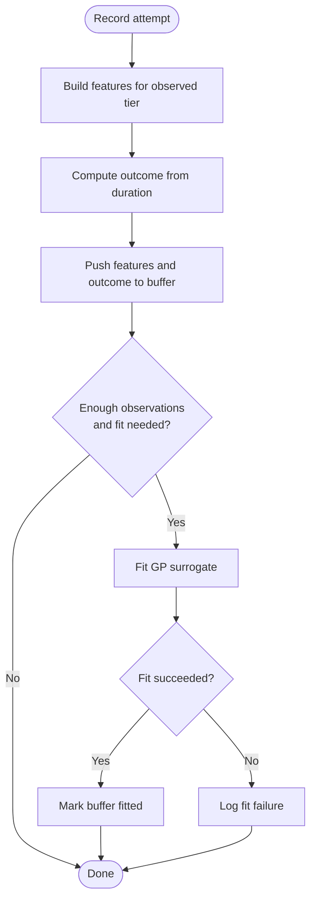

**Diagram sources**
- [src/gp_router.rs:230-275](file://src/gp_router.rs#L230-L275)
- [src/gp_router.rs:370-420](file://src/gp_router.rs#L370-L420)
- [vendor/gp-routing/src/ring_buffer.rs:30-80](file://vendor/gp-routing/src/ring_buffer.rs#L30-L80)
- [vendor/gp-routing/src/surrogate.rs:201-260](file://vendor/gp-routing/src/surrogate.rs#L201-L260)

## Detailed Component Analysis

### GpRequestRouter
`GpRequestRouter` is the application-facing entry point. It holds:

- Runtime configuration for enabling and tuning GP routing.
- Internal GP configuration derived from runtime settings.
- A surrogate model instance.
- An in-memory observation buffer.
- A mapping from tier names to bounded backend indices.

Key behaviors:

- **Construction**: Binds configured tiers to at most 32 backend slots and warns if more tiers exist than the GP encoder can represent.
- **Reranking**: Skips reranking when the surrogate is unfitted, when fewer than two valid candidates remain, or<docs>
# GP Routing Optimization

<cite>
**Referenced Files in This Document**   
- [src/gp_router.rs](file://src/gp_router.rs)
- [src/config/types.rs](file://src/config/types.rs)
- [vendor/gp-routing/src/lib.rs](file://vendor/gp-routing/src/lib.rs)
- [vendor/gp-routing/src/surrogate.rs](file://vendor/gp-routing/src/surrogate.rs)
- [vendor/gp-routing/src/acquisition.rs](file://vendor/gp-routing/src/acquisition.rs)
- [vendor/gp-routing/src/features.rs](file://vendor/gp-routing/src/features.rs)
- [vendor/gp-routing/src/ring_buffer.rs](file://vendor/gp-routing/src/ring_buffer.rs)
- [vendor/gp-routing/src/config.rs](file://vendor/gp-routing/src/config.rs)
</cite>

## Table of Contents
1. [Introduction](#introduction)
2. [Project Structure](#project-structure)
3. [Core Components](#core-components)
4. [Architecture Overview](#architecture-overview)
5. [Detailed Component Analysis](#detailed-component-analysis)
6. [Dependency Analysis](#dependency-analysis)
7. [Performance Considerations](#performance-considerations)
8. [Troubleshooting Guide](#troubleshooting-guide)
9. [Conclusion](#conclusion)

## Introduction
The optional Genetic Programming routing optimization feature adds a learned reranking layer on top of the existing tier ordering pipeline. Rather than always using the configured or EWMA-based order, the router can learn which backend tiers are likely to perform better for a given request shape and runtime context.

At its core, the system:
- Extracts request features such as prompt size, estimated token counts, message and tool counts, time of day, and current stream load.
- Maintains an in-memory observation buffer of past attempts with outcomes derived from response duration.
- Fits a Gaussian Process surrogate model that predicts expected outcome and uncertainty for each candidate backend.
- Reranks candidates using acquisition strategies such as Upper Confidence Bound (UCB), Thompson sampling, greedy exploitation, or epsilon-greedy exploration.
- Periodically refits the surrogate once enough observations have accumulated or after a configurable number of requests since the last fit.

This document explains how these pieces interact, how to configure them safely, and how to interpret and troubleshoot results.

## Project Structure
GP routing is implemented in two layers:

1. **Application integration layer** (`src/gp_router.rs`, `src/config/types.rs`):
   - Builds request feature contexts.
   - Estimates per-tier costs.
   - Applies reranking only to a bounded set of candidate positions.
   - Records attempts and triggers surrogate fitting.

2. **Vendored GP library** (`vendor/gp-routing/*`):
   - Provides the fixed-size feature encoder.
   - Implements the ring-buffer observation store.
   - Wraps the Gaussian Process surrogate used for prediction and refitting.
   - Exposes acquisition utilities for UCB, Thompson sampling, greedy selection, and epsilon-greedy promotion.

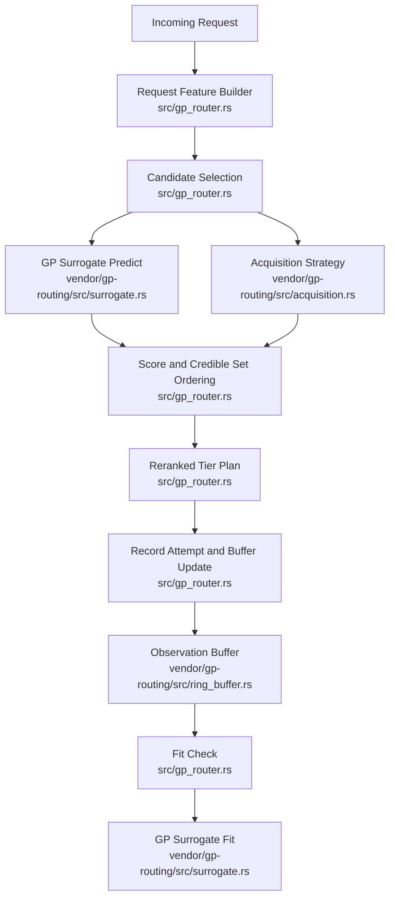

**Diagram sources**
- [src/gp_router.rs:60-190](file://src/gp_router.rs#L60-L190)
- [src/gp_router.rs:230-330](file://src/gp_router.rs#L230-L330)
- [vendor/gp-routing/src/surrogate.rs:170-260](file://vendor/gp-routing/src/surrogate.rs#L170-L260)
- [vendor/gp-routing/src/acquisition.rs:1-105](file://vendor/gp-routing/src/acquisition.rs#L1-L105)
- [vendor/gp-routing/src/ring_buffer.rs:1-117](file://vendor/gp-routing/src/ring_buffer.rs#L1-L117)

**Section sources**
- [src/gp_router.rs:1-715](file://src/gp_router.rs#L1-L715)
- [vendor/gp-routing/src/lib.rs:1-44](file://vendor/gp-routing/src/lib.rs#L1-L44)

## Core Components
| Component | Responsibility | Key Implementation Location |
|---|---|---|
| `GpRequestRouter` | Encapsulates runtime configuration, surrogate model, observation buffer, and backend index mapping; plans rerankings and records outcomes. | [src/gp_router.rs:18-320](file://src/gp_router.rs#L18-L320) |
| `RequestFeatureContext` | Captures prompt size, estimated input tokens, output budget, request class, system prompt presence, message/tool counts, active/max streams, and hour of day. | [src/gp_router.rs:34-68](file://src/gp_router.rs#L34-L68) |
| `GpRoutingRuntimeConfig` | User-facing configuration: enable flag, max candidates, buffer capacity, minimum observations, refit interval, UCB kappa, nugget, KPLS dimension, priors, acquisition strategy, and epsilon. | [src/config/types.rs:452-540](file://src/config/types.rs#L452-L540) |
| `GpSurrogate` | Thread-safe wrapper around a Gaussian Process model; supports fit, predict, batch predict, save, and load. | [vendor/gp-routing/src/surrogate.rs:110-369](file://vendor/gp-routing/src/surrogate.rs#L110-L369) |
| `ObservationBuffer` | Fixed-capacity FIFO ring buffer storing feature vectors and normalized outcomes; tracks requests since last fit. | [vendor/gp-routing/src/ring_buffer.rs:1-117](file://vendor/gp-routing/src/ring_buffer.rs#L1-L117) |
| `FeatureVector` | Fixed-dimensional encoder for prompt length, priority buckets, system prompt indicator, dependency/retry counts, backend one-hot encoding, load ratios, cyclic hour-of-day, loop count, and relative cost. | [vendor/gp-routing/src/features.rs:1-200](file://vendor/gp-routing/src/features.rs#L1-L200) |
| Acquisition utilities | Provide UCB score, Thompson sampling, greedy scoring, and epsilon-greedy backend promotion. | [vendor/gp-routing/src/acquisition.rs:1-105](file://vendor/gp-routing/src/acquisition.rs#L1-L105) |

**Section sources**
- [src/gp_router.rs:18-120](file://src/gp_router.rs#L18-L120)
- [src/config/types.rs:452-540](file://src/config/types.rs#L452-L540)
- [vendor/gp-routing/src/surrogate.rs:110-200](file://vendor/gp-routing/src/surrogate.rs#L110-L200)
- [vendor/gp-routing/src/ring_buffer.rs:1-117](file://vendor/gp-routing/src/ring_buffer.rs#L1-L117)
- [vendor/gp-routing/src/features.rs:1-200](file://vendor/gp-routing/src/features.rs#L1-L200)
- [vendor/gp-routing/src/acquisition.rs:1-105](file://vendor/gp-routing/src/acquisition.rs#L1-L105)

## Architecture Overview
GP routing does not replace the full routing pipeline. Instead, it reranks a subset of candidate positions after the original ordered list has been produced. The default behavior is conservative: if the surrogate is unfitted, too few candidates remain after prefix pinning, or no valid backend slot exists, the original order is preserved.

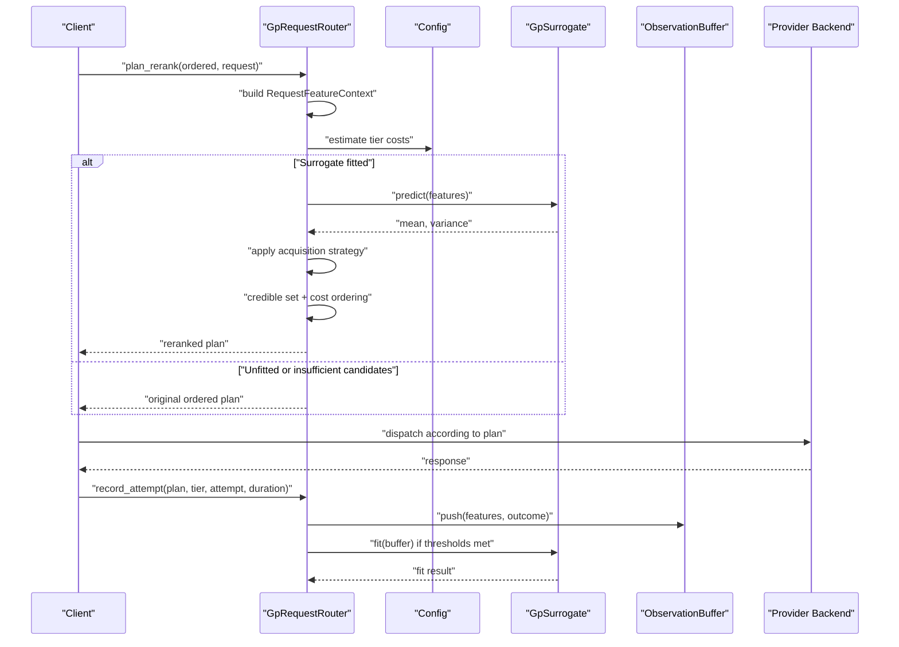

**Diagram sources**
- [src/gp_router.rs:120-190](file://src/gp_router.rs#L120-L190)
- [src/gp_router.rs:230-330](file://src/gp_router.rs#L230-L330)
- [vendor/gp-routing/src/surrogate.rs:200-260](file://vendor/gp-routing/src/surrogate.rs#L200-L260)

## Detailed Component Analysis

### GP Routing Runtime Configuration
The runtime configuration controls whether GP reranking is enabled and how aggressively it explores versus exploits. Important fields include:

| Field | Purpose | Default Value | Notes |
|---|---|---:|---|
| `enabled` | Enables GP reranking | `false` | Must be explicitly enabled. |
| `max_candidates` | Maximum configured tiers exposed to the GP | `32` | Matches bounded backend capacity. |
| `buffer_capacity` | In-memory training buffer size | `500` | Oldest observations are evicted when full. |
| `min_observations` | Minimum observations before initial fit | `40` | Lower values reduce learning stability. |
| `refit_interval` | Requests between automatic refits | `200` | `0` disables periodic refits. |
| `ucb_kappa` | Exploration weight for UCB | `2.0` | Higher values explore more. |
| `nugget` | Numerical jitter for GP fitting | `1e-4` | Improves matrix conditioning. |
| `kpls_dim` | Optional KPLS dimensionality reduction | `None` | Reduces feature space before fitting. |
| `prior_mean` | Prediction fallback mean | `0.5` | Used when surrogate is unfitted. |
| `prior_variance` | Prediction fallback variance | `0.25` | Controls initial uncertainty. |
| `acquisition` | Acquisition strategy | `Ucb` | Supported: `Ucb`, `Thompson`, `Greedy`, `EpsilonGreedy`. |
| `epsilon` | Random exploration rate for `EpsilonGreedy` | Defaults through config | Clamped to `[0.0, 1.0]`. |

Configuration defaults are defined separately from the runtime struct defaults.

**Section sources**
- [src/config/types.rs:452-540](file://src/config/types.rs#L452-L540)
- [src/config/types.rs:1000-1030](file://src/config/types.rs#L1000-L1030)

### Request Feature Extraction
The router builds a `RequestFeatureContext` from each incoming request. Features include:

- Prompt character count.
- Estimated input tokens derived from prompt characters.
- Maximum output tokens.
- Request class: plain, streaming, tool-heavy, or mixed.
- Whether a system prompt is present.
- Message count.
- Tool count.
- Active and maximum stream counts.
- Hour of day.

These contextual signals allow the surrogate to learn patterns such as:
- Larger prompts or longer outputs may favor different backends.
- Streaming requests may behave differently from non-streaming ones.
- Tool-heavy requests may incur extra latency or cost.
- Time-of-day effects may reflect regional provider performance.
- Current load may influence observed throughput.

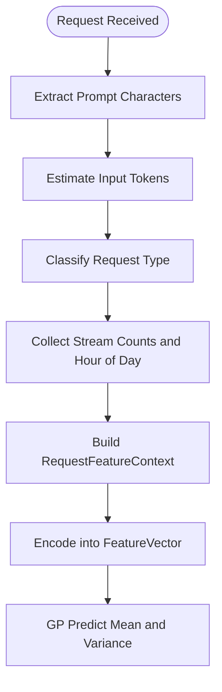

**Diagram sources**
- [src/gp_router.rs:34-68](file://src/gp_router.rs#L34-L68)
- [vendor/gp-routing/src/features.rs:80-200](file://vendor/gp-routing/src/features.rs#L80-L200)

**Section sources**
- [src/gp_router.rs:34-68](file://src/gp_router.rs#L34-L68)
- [src/gp_router.rs:260-330](file://src/gp_router.rs#L260-L330)
- [vendor/gp-routing/src/features.rs:1-200](file://vendor/gp-routing/src/features.rs#L1-L200)

### GP Surrogate Model
The surrogate wraps a Gaussian Process regression model trained over the encoded feature vectors. It uses:
- Constant mean model.
- Matern 5/2 correlation model.
- Fixed theta tuning for numerical stability.
- Optional KPLS dimension reduction.
- Nugget jitter for numerical conditioning.
- Normalized target values during fitting.

Before any fit, predictions return the configured prior mean and variance. After fitting, predictions return posterior mean and variance. Failed single or batch predictions fall back to priors rather than failing the request path.

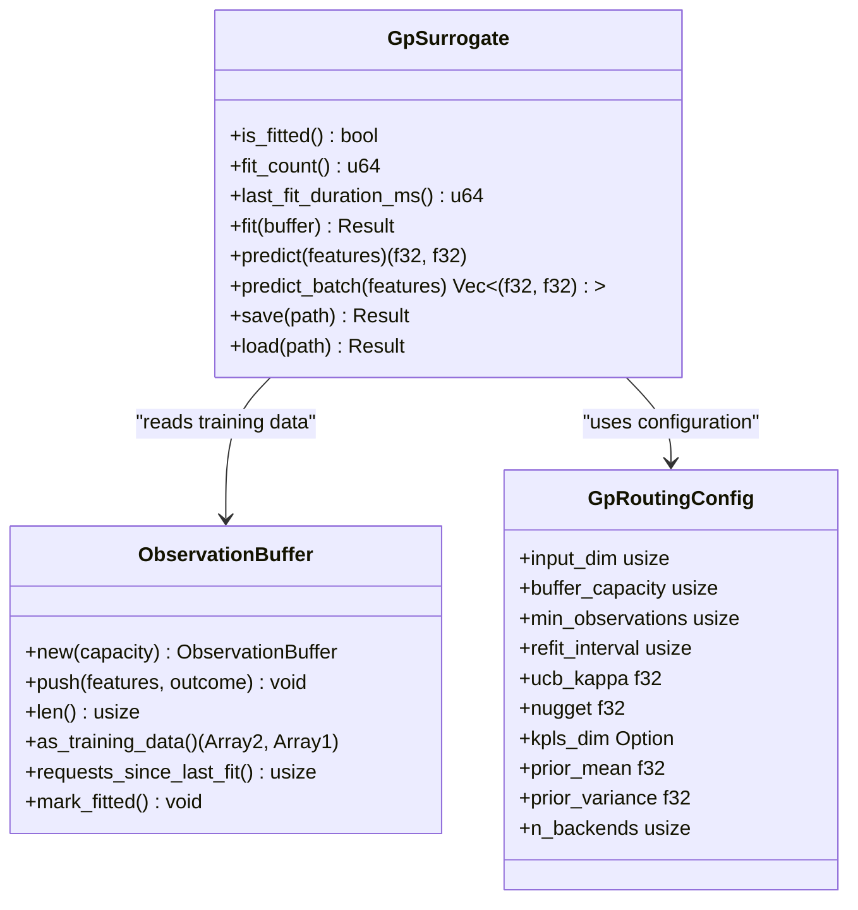

**Diagram sources**
- [vendor/gp-routing/src/surrogate.rs:110-369](file://vendor/gp-routing/src/surrogate.rs#L110-L369)
- [vendor/gp-routing/src/ring_buffer.rs:1-117](file://vendor/gp-routing/src/ring_buffer.rs#L1-L117)
- [vendor/gp-routing/src/config.rs:1-145](file://vendor/gp-routing/src/config.rs#L1-L145)

**Section sources**
- [vendor/gp-routing/src/surrogate.rs:110-369](file://vendor/gp-routing/src/surrogate.rs#L110-L369)
- [vendor/gp-routing/src/config.rs:1-145](file://vendor/gp-routing/src/config.rs#L1-L145)

### Observation Buffer Management
The observation buffer is a fixed-capacity FIFO structure:
- Each entry stores a `FeatureVector` and a normalized outcome.
- When full, new entries overwrite the oldest position.
- Outcomes are clamped to `[0.0, 1.0]`.
- It tracks how many requests have occurred since the last successful fit.
- Training data is returned in insertion order, handling wraparound correctly.

The outcome is derived from response duration: faster responses receive higher scores, while missing or invalid durations map to zero.

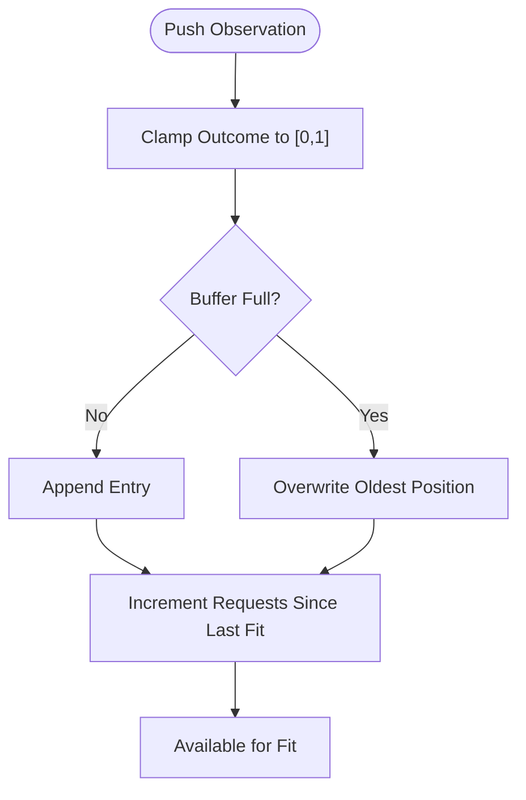

**Diagram sources**
- [vendor/gp-routing/src/ring_buffer.rs:30-117](file://vendor/gp-routing/src/ring_buffer.rs#L30-L117)
- [src/gp_router.rs:350-370](file://src/gp_router.rs#L350-L370)

**Section sources**
- [vendor/gp-routing/src/ring_buffer.rs:1-117](file://vendor/gp-routing/src/ring_buffer.rs#L1-L117)
- [src/gp_router.rs:350-370](file://src/gp_router.rs#L350-L370)

### Acquisition Strategies
The router evaluates candidate positions using one of four strategies:

| Strategy | Behavior | Best Use Case |
|---|---|---|
| `Ucb` | Scores `mean + kappa * sqrt(variance)` | Balanced exploration/exploitation controlled by `ucb_kappa`. |
| `Thompson` | Samples from `N(mean, variance)` | Probabilistic exploration suitable when uncertainty varies across backends. |
| `Greedy` | Uses raw posterior mean | Exploitation-focused; riskier early in deployment. |
| `EpsilonGreedy` | Occasionally promotes a random candidate | Useful when you want explicit random exploration at a fixed rate. |

For `EpsilonGreedy`, the selected candidate receives an artificial score boost so it is more likely to be promoted, while other candidates keep their normal acquisition score.

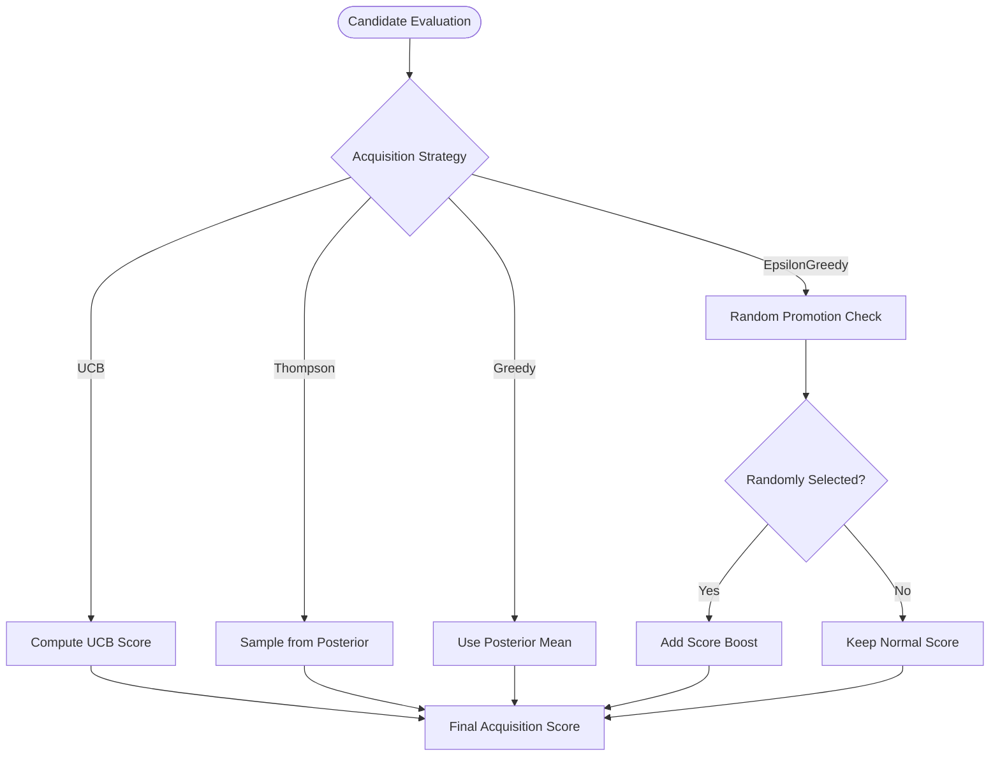

**Diagram sources**
- [src/gp_router.rs:300-330](file://src/gp_router.rs#L300-L330)
- [vendor/gp-routing/src/acquisition.rs:1-105](file://vendor/gp-routing/src/acquisition.rs#L1-L105)

**Section sources**
- [src/gp_router.rs:300-330](file://src/gp_router.rs#L300-L330)
- [vendor/gp-routing/src/acquisition.rs:1-105](file://vendor/gp-routing/src/acquisition.rs#L1-L105)

### Reranking and Cost-Aware Ordering
The reranking process:
1. Computes request features.
2. Estimates per-tier USD cost and relative cost.
3. Skips reranking if the surrogate is unfitted.
4. Respects a pinned prefix length so earlier tiers remain preferred unless explicitly overridden.
5. Limits candidates to `max_candidates` and bounded backend slots.
6. Scores candidates using the chosen acquisition strategy.
7. Applies a credible-set filter based on posterior confidence bounds.
8. Within the credible set, prefers lower estimated cost when pricing is available for all credible candidates.
9. Falls back to acquisition score ordering otherwise.

This design avoids assigning a fixed monetary exchange rate between quality and cost. Missing pricing metadata does not masquerade as free; instead, acquisition ordering is retained.

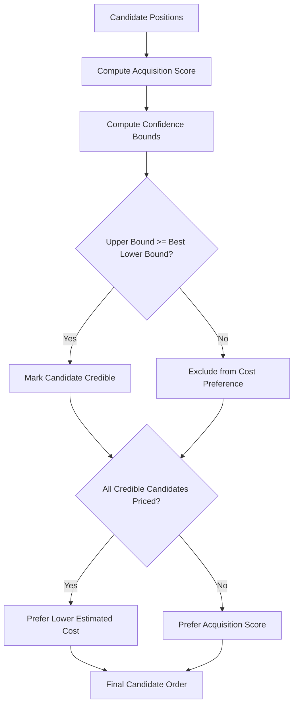

**Diagram sources**
- [src/gp_router.rs:120-190](file://src/gp_router.rs#L120-L190)
- [src/gp_router.rs:370-460](file://src/gp_router.rs#L370-L460)

**Section sources**
- [src/gp_router.rs:120-190](file://src/gp_router.rs#L120-L190)
- [src/gp_router.rs:370-460](file://src/gp_router.rs#L370-L460)

### Fitting Triggers and Lifecycle
Fitting occurs when:
- The buffer contains at least `min_observations`.
- Either the surrogate is unfitted, or `refit_interval > 0` and enough requests have passed since the last successful fit.

After a successful fit:
- The buffer’s “requests since last fit” counter resets.
- Fit count and last-fit duration are tracked.
- Logs record observation count, fit count, and fit duration.

If fitting fails, the router logs a warning but continues routing using the previous model state or priors.

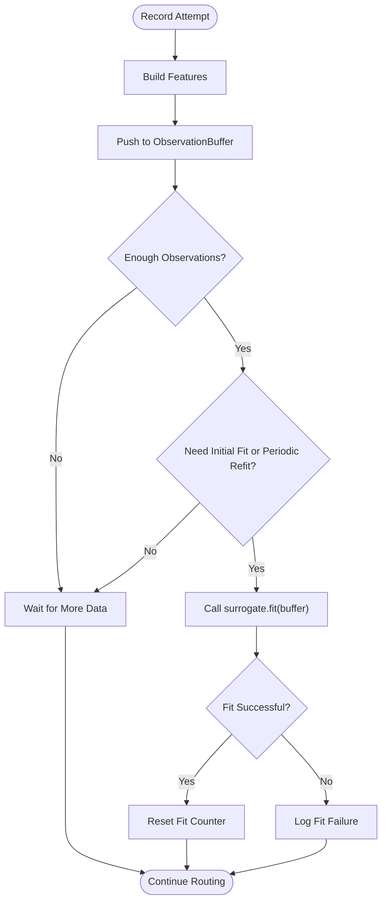

**Diagram sources**
- [src/gp_router.rs:230-310](file://src/gp_router.rs#L230-L310)
- [vendor/gp-routing/src/surrogate.rs:200-260](file://vendor/gp-routing/src/surrogate.rs#L200-L260)

**Section sources**
- [src/gp_router.rs:230-310](file://src/gp_router.rs#L230-L310)
- [vendor/gp-routing/src/surrogate.rs:200-260](file://vendor/gp-routing/src/surrogate.rs#L200-L260)

## Dependency Analysis
The application layer depends on the vendored GP routing crate for modeling primitives. The main dependencies are:

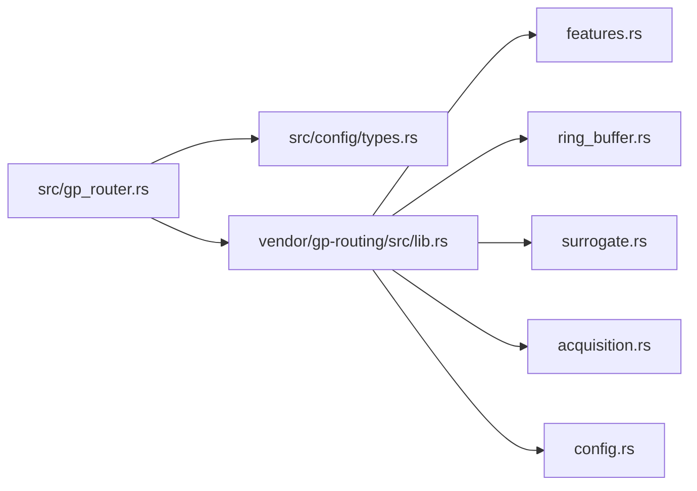

**Diagram sources**
- [src/gp_router.rs:1-20](file://src/gp_router.rs#L1-L20)
- [vendor/gp-routing/src/lib.rs:1-44](file://vendor/gp-routing/src/lib.rs#L1-L44)

Key coupling points:
- `GpRequestRouter` constructs `GpRoutingConfig` from `GpRoutingRuntimeConfig`.
- Feature construction maps application request fields into fixed GP feature slots.
- Backends are limited to 32 slots; additional tiers remain in fallback order.
- Acquisition strategies bridge GP posteriors into concrete routing decisions.

**Section sources**
- [src/gp_router.rs:60-120](file://src/gp_router.rs#L60-L120)
- [vendor/gp-routing/src/features.rs:1-40](file://vendor/gp-routing/src/features.rs#L1-L40)
- [vendor/gp-routing/src/lib.rs:1-44](file://vendor/gp-routing/src/lib.rs#L1-L44)

## Performance Considerations
- **Prediction overhead**: Prediction is performed for each candidate backend. With bounded backend slots and a capped candidate set, this remains localized.
- **Fit overhead**: GP fitting runs periodically, not per request. The surrogate tracks fit count and last-fit duration, making monitoring feasible.
- **Memory footprint**: The observation buffer is fixed capacity; it does not grow unbounded.
- **Feature dimensionality**: The feature vector has a fixed dimension determined by the encoder. This avoids dynamic sizing at inference time.
- **Numerical stability**: Nugget jitter and normalized targets help stabilize GP fitting.
- **Frontend safety**: Unfitted models and failed predictions fall back to priors rather than blocking routing.

Recommended operational guidance:
- Start with `enabled = false` and gradually increase `min_observations` only after sufficient traffic has accumulated.
- Use `Ucb` initially with moderate `ucb_kappa`; increase exploration only if routing appears overly deterministic.
- Avoid extremely small `buffer_capacity` values, as they can cause rapid eviction of useful history.
- Monitor fit duration logs to detect periods where model updates become expensive.

[No sources needed since this section provides general guidance]

## Troubleshooting Guide

### GP Routing Does Not Rerank
Common causes:
- `enabled` is `false`.
- The surrogate is unfitted because `min_observations` has not been reached.
- Too few candidates remain after applying the pinned prefix.
- No candidate tier maps to a valid backend slot.

Checks:
- Verify `GpRoutingRuntimeConfig.enabled`.
- Inspect logs for surrogate fit completion.
- Confirm that tier names map to backend indices.
- Reduce `max_candidates` or adjust pinned prefix behavior if appropriate.

**Section sources**
- [src/config/types.rs:452-540](file://src/config/types.rs#L452-L540)
- [src/gp_router.rs:120-190](file://src/gp_router.rs#L120-L190)

### Surrogate Fit Fails Repeatedly
Possible reasons:
- Insufficient observations.
- Invalid `kpls_dim`.
- Underlying GP fitting failure.

Actions:
- Increase `min_observations` cautiously.
- Remove or adjust `kpls_dim` until fitting stabilizes.
- Review logs for `gp-routing surrogate fit failed`.
- Temporarily disable periodic refits by setting `refit_interval = 0`.

**Section sources**
- [vendor/gp-routing/src/surrogate.rs:200-260](file://vendor/gp-routing/src/surrogate.rs#L200-L260)
- [src/gp_router.rs:230-310](file://src/gp_router.rs#L230-L310)

### Routing Becomes Too Exploratory
Symptoms:
- Frequently changing backend preferences.
- Lower reliability during warm-up.

Adjustments:
- Switch from `EpsilonGreedy` or `Thompson` to `Ucb` or `Greedy`.
- Lower `ucb_kappa` for less exploration.
- Reduce `epsilon` for epsilon-greedy mode.
- Increase `min_observations` to allow more stable learning.

**Section sources**
- [src/config/types.rs:452-540](file://src/config/types.rs#L452-L540)
- [vendor/gp-routing/src/acquisition.rs:1-105](file://vendor/gp-routing/src/acquisition.rs#L1-L105)

### Routing Becomes Too Expensive Without Quality Improvement
Symptoms:
- Reranking favors cheaper backends even when quality suffers.

Behavioral notes:
- Cost preference applies only within the statistically credible set.
- If pricing is unavailable, acquisition ordering is preserved.
- Relative cost normalization prevents currency-specific scaling artifacts.

Adjustments:
- Increase `ucb_kappa` to prioritize quality uncertainty.
- Ensure accurate pricing metadata is configured.
- Reduce reliance on cost-only ordering by lowering `max_candidates` to focus on high-confidence options.

**Section sources**
- [src/gp_router.rs:370-460](file://src/gp_router.rs#L370-L460)

### Unexpected Eviction of Historical Observations
Cause:
- The ring buffer overwrites old entries once `buffer_capacity` is reached.

Mitigation:
- Increase `buffer_capacity` if historical trends matter.
- Tune `refit_interval` so the model learns from recent data without waiting indefinitely.
- Monitor buffer-related logs and fit frequency.

**Section sources**
- [vendor/gp-routing/src/ring_buffer.rs:1-117](file://vendor/gp-routing/src/ring_buffer.rs#L1-L117)

## Setup Instructions

### Enable GP Routing
1. Set `router.gp_routing.enabled = true` in your configuration.
2. Choose an acquisition strategy:
   - `Ucb` for balanced exploration.
   - `Thompson` for probabilistic exploration.
   - `Greedy` for exploitation.
   - `EpsilonGreedy` for explicit random exploration.
3. Adjust `min_observations` based on expected traffic volume.
4. Optionally tune `refit_interval`, `ucb_kappa`, and `epsilon`.

### Interpret Optimization Results
- Look for logs indicating surrogate fit completion.
- Compare original tier order with reranked order when debugging.
- Track fit count and last-fit duration to assess model maintenance activity.
- Observe whether reranking improves latency or cost objectives over time.

### Monitor Model Accuracy
- GP routing optimizes an outcome derived from response duration.
- Faster responses receive higher outcome scores.
- Use metrics and logs to correlate reranking changes with downstream performance.
- If accuracy degrades, temporarily reduce exploration or disable GP routing.

[No sources needed since this section provides general guidance]

## Data Privacy Implications
GP routing observes request-level metadata and response timing to learn routing patterns. The implementation includes:
- Request features such as prompt size, token estimates, message/tool counts, and stream load.
- Timestamp-derived hour-of-day information.
- Response duration used as outcome.
- Optional relative cost estimation from configured provider pricing.

Operational considerations:
- The observation buffer is in-memory and bounded.
- The surrogate model itself is serializable and can be saved to disk; treat persisted models as potentially containing indirect usage signals.
- Do not log raw feature vectors or outcomes unless privacy requirements permit it.
- Avoid enabling GP routing for workloads containing sensitive prompt content unless data retention policies allow it.

[No sources needed since this section provides general guidance]

## Conclusion
GP routing adds a learned reranking layer that adapts to request characteristics and runtime conditions. It is intentionally conservative: it preserves original ordering when insufficient evidence exists, limits backend exposure, and falls back to priors when the model is unavailable.

For safe deployment:
- Enable it only after understanding your traffic volume and privacy requirements.
- Start with moderate exploration settings.
- Monitor fit frequency, reranking behavior, and downstream latency/cost outcomes.
- Tune buffer capacity, minimum observations, refit intervals, and acquisition parameters based on observed performance.

When properly configured, GP routing can improve backend selection under varying workload shapes, load levels, and temporal patterns without replacing the broader routing and failover mechanisms already in place.