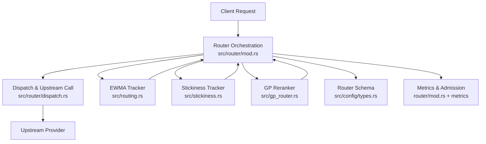
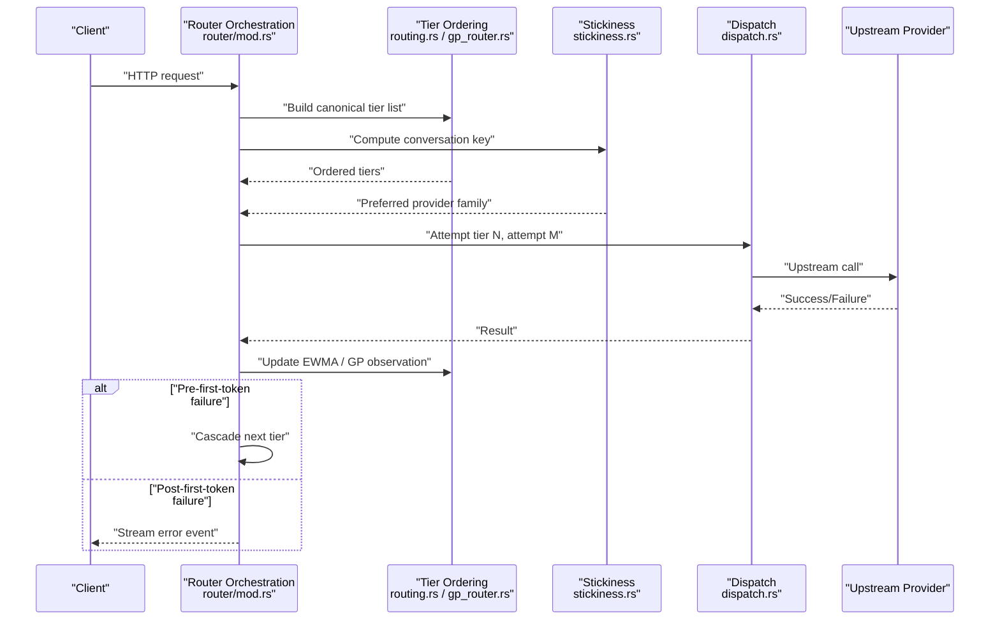
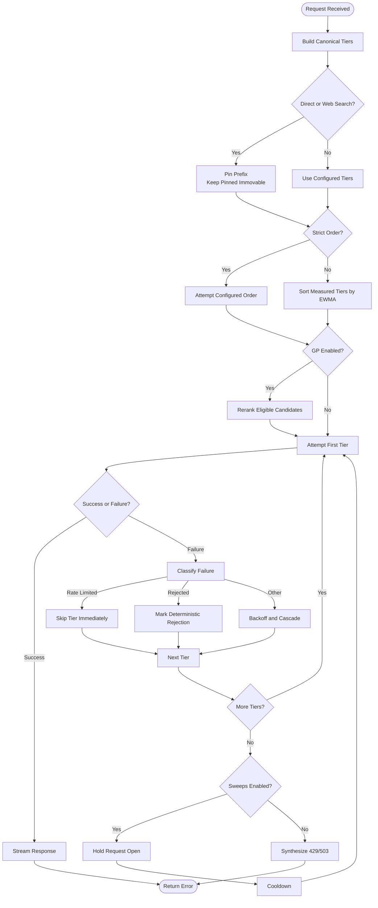
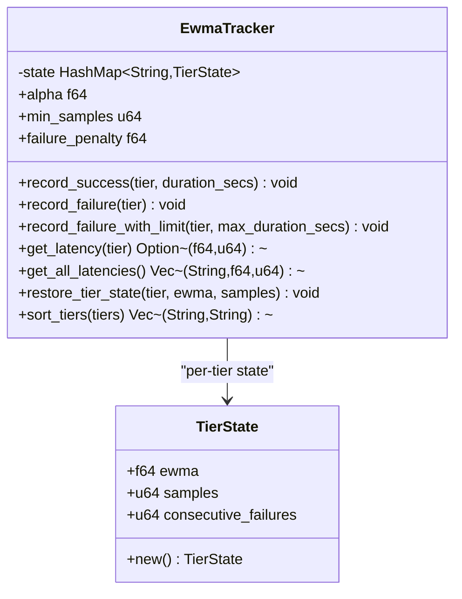
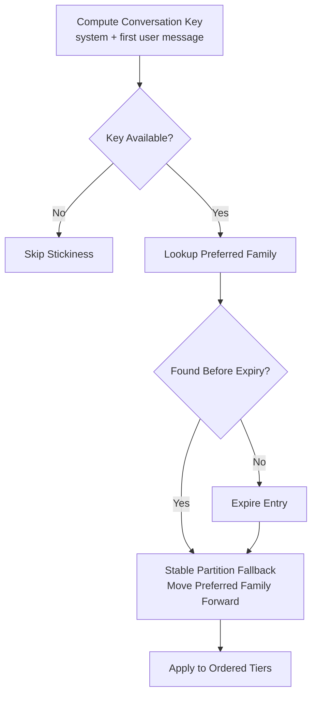
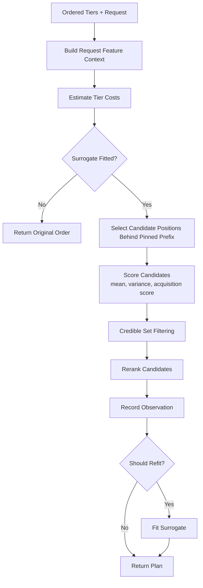
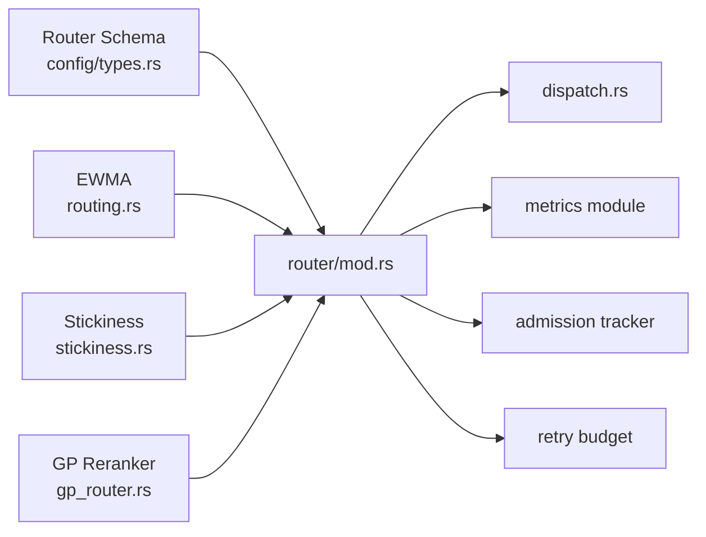

# Routing Engine

<cite>
**Referenced Files in This Document**
- [src/routing.rs](file://src/routing.rs)
- [src/stickiness.rs](file://src/stickiness.rs)
- [src/gp_router.rs](file://src/gp_router.rs)
- [src/router/mod.rs](file://src/router/mod.rs)
- [src/config/types.rs](file://src/config/types.rs)
- [docs/configuration.md](file://docs/configuration.md)
- [docs/failover_architecture.md](file://docs/failover_architecture.md)
- [tests/test_routing.rs](file://tests/test_routing.rs)
</cite>

## Table of Contents
1. [Introduction](#introduction)
2. [Project Structure](#project-structure)
3. [Core Components](#core-components)
4. [Architecture Overview](#architecture-overview)
5. [Detailed Component Analysis](#detailed-component-analysis)
6. [Dependency Analysis](#dependency-analysis)
7. [Performance Considerations](#performance-considerations)
8. [Troubleshooting Guide](#troubleshooting-guide)
9. [Conclusion](#conclusion)

## Introduction
This document explains CCR-Rust’s intelligent routing engine. It covers how providers are organized into cascading tiers, how EWMA latency tracking influences ordering, how traffic classes (default, think, background, web search) select routes, how client-specific direct routing and provider-family stickiness work, and how optional GP-backed genetic programming reranking can optimize decisions. It also provides configuration examples, monitoring guidance, load-balancing behavior, and performance tuning advice.

## Project Structure
The routing engine is implemented across a small set of focused modules:

- `src/router/mod.rs` — request orchestration, tier cascade, direct/web-search pinning, streaming lifecycle, hedging, and integration with admission control and retry budgets.
- `src/routing.rs` — EWMA tracker, per-tier latency state, and EWMA-based tier sorting.
- `src/stickiness.rs` — conversation-keyed provider-family affinity that keeps fallback conversations on the same family when possible.
- `src/gp_router.rs` — optional GP surrogate model that reranks candidates using request features, posterior quality estimates, and cost information.
- `src/config/types.rs` — router schema including traffic-class routes, tier ordering, retries, sweeps, stickiness, hedging, and GP runtime options.
- `docs/configuration.md`, `docs/failover_architecture.md` — operational documentation for configuration semantics, failure classification, streaming rules, and architectural invariants.
- `tests/test_routing.rs` — unit tests for tier backoff behavior and deserialization contracts.

**Diagram sources**
- [src/router/mod.rs:1-200](file://src/router/mod.rs#L1-L200)
- [src/routing.rs:1-200](file://src/routing.rs#L1-L200)
- [src/stickiness.rs:1-120](file://src/stickiness.rs#L1-L120)
- [src/gp_router.rs:1-120](file://src/gp_router.rs#L1-L120)
- [src/config/types.rs:600-850](file://src/config/types.rs#L600-L850)

**Section sources**
- [src/router/mod.rs:1-200](file://src/router/mod.rs#L1-L200)
- [src/routing.rs:1-200](file://src/routing.rs#L1-L200)
- [src/stickiness.rs:1-120](file://src/stickiness.rs#L1-L120)
- [src/gp_router.rs:1-120](file://src/gp_router.rs#L1-L120)
- [src/config/types.rs:600-850](file://src/config/types.rs#L600-L850)
- [docs/failover_architecture.md:1-120](file://docs/failover_architecture.md#L1-L120)

## Core Components
- **Tier cascade**: Providers are attempted in an ordered list. Direct or web-search requests can pin specific tiers to the front. The rest of the chain is reordered by EWMA unless strict order is configured.
- **EWMA latency tracker**: Tracks per-attempt latency per tier, penalizes failures without requiring wall-clock duration, and sorts measured tiers ahead of unmeasured ones while preserving config order among cold tiers.
- **Traffic class routing**: Default, think, background, and web-search classes select different route prefixes; web search prepends its tier before normal fallback.
- **Client-specific routing**: Requests may directly target a provider/model pair. When not ignored, that tier is pinned at the front.
- **Conversation stickiness**: A stable hash over system prompt and first user message maps a conversation to a preferred provider family; fallback order within the family is preserved.
- **Optional GP reranking**: After EWMA ordering, eligible candidate positions behind a pinned prefix can be reranked using a GP surrogate that observes request shape, attempt number, utilization, time-of-day, and estimated cost.
- **Admission, retries, sweeps, and hedging**: Per-tier backoff, global retry budget, held-request re-cascades, and optional tail-latency hedging complete the failover pipeline.

**Section sources**
- [src/router/mod.rs:1-200](file://src/router/mod.rs#L1-L200)
- [src/routing.rs:1-200](file://src/routing.rs#L1-L200)
- [src/stickiness.rs:1-120](file://src/stickiness.rs#L1-L120)
- [src/gp_router.rs:1-120](file://src/gp_router.rs#L1-L120)
- [src/config/types.rs:600-850](file://src/config/types.rs#L600-L850)
- [docs/failover_architecture.md:120-220](file://docs/failover_architecture.md#L120-L220)

## Architecture Overview
At request time, the router constructs a canonical tier list from traffic-class routes and optional explicit tiers, pins direct/web-search entries, optionally applies EWMA reordering, then optionally applies GP reranking to eligible candidates. Each tier is attempted with per-tier retries and exponential backoff. Rate-limited tiers may be skipped immediately; other failures can cascade. Streaming success pre-first-token allows cascade; post-first-token failures surface as stream errors rather than cascading.

**Diagram sources**
- [src/router/mod.rs:1-200](file://src/router/mod.rs#L1-L200)
- [src/routing.rs:1-200](file://src/routing.rs#L1-L200)
- [src/stickiness.rs:1-120](file://src/stickiness.rs#L1-L120)
- [src/gp_router.rs:1-120](file://src/gp_router.rs#L1-L120)

## Detailed Component Analysis

### Tier-Based Failover and Cascade
The router builds a cascading fallback chain:

- If explicit tiers are configured, they form the base chain.
- Traffic-class defaults (`default`, `background`, `think`) can contribute tiers.
- Direct routing pins the requested provider/model to the front unless `ignoreDirect` is true.
- Web search prepends its configured tier(s), growing the pinned prefix.
- With `strictTierOrder: false`, measured tiers move ahead of unmeasured ones according to EWMA.
- With `strictTierOrder: true`, the configured chain is attempted verbatim; EWMA does not reorder it, and GP reranking does not move it.

Per tier:
- Retries follow `TierRetryConfig`: exponential backoff clamped by `max_backoff_ms`.
- 429s and deterministic `Rejected` errors skip immediately to the next tier.
- Other failures trigger per-tier backoff and cascade.
- Retry sweeps can hold the request open and re-cascade after a cooldown.

**Diagram sources**
- [src/router/mod.rs:1-200](file://src/router/mod.rs#L1-L200)
- [src/routing.rs:1-200](file://src/routing.rs#L1-L200)
- [src/config/types.rs:600-850](file://src/config/types.rs#L600-L850)
- [docs/failover_architecture.md:120-220](file://docs/failover_architecture.md#L120-L220)

**Section sources**
- [src/router/mod.rs:1-200](file://src/router/mod.rs#L1-L200)
- [src/config/types.rs:600-850](file://src/config/types.rs#L600-L850)
- [docs/failover_architecture.md:120-220](file://docs/failover_architecture.md#L120-L220)

### EWMA Latency Tracking
The EWMA tracker maintains per-tier state:

- `ewma`: smoothed latency estimate in seconds.
- `samples`: total successes plus failures recorded.
- `consecutive_failures`: resets on success; used for diagnostics.

Key behaviors:
- Success updates EWMA with alpha-weighted smoothing; default alpha is 0.3.
- Failure applies a penalty multiplier (default 2.0× current EWMA) rather than recording raw timeout duration, protecting gauges from pathological values.
- Sorting promotes measured tiers above unmeasured ones only once samples reach the minimum threshold (default 3).
- Unmeasured tiers preserve their original configuration index.

**Diagram sources**
- [src/routing.rs:1-200](file://src/routing.rs#L1-L200)

Practical notes:
- Use `get_all_latencies()` to observe per-tier EWMA and sample counts.
- Tune `alpha` to balance responsiveness vs noise; higher values react faster but are noisier.
- Increase `min_samples` if early routing is unstable during cold starts.
- Keep `failure_penalty` high enough to discourage failing tiers but bounded by upstream timeouts to avoid poisoning gauges.

**Section sources**
- [src/routing.rs:1-200](file://src/routing.rs#L1-L200)

### Traffic Class Routing
CCR supports four conceptual traffic classes:

- `default`: standard interactive requests.
- `think`: reasoning/thinking-heavy models.
- `background`: lower-priority background tasks.
- `webSearch`: web search requests, which prepend their tier before normal fallback.

Configuration fields:
- `Router.default`: required primary route.
- `Router.background`: optional background route.
- `Router.think`: optional thinking route.
- `Router.webSearch`: optional web-search route.

Operational implications:
- Web search grows the pinned prefix so its tier remains immutable under EWMA and GP reranking.
- If explicit `tiers` are configured, they override automatic construction from these classes.
- Direct routing can still pin a requested provider/model to the front unless `ignoreDirect` is enabled.

Example setup:
- Set `default` to a fast, reliable provider.
- Set `think` to a model optimized for reasoning.
- Set `background` to a cheaper or slower provider for low-priority work.
- Set `webSearch` to a provider capable of tool use or external lookup.

**Section sources**
- [src/config/types.rs:600-850](file://src/config/types.rs#L600-L850)
- [docs/configuration.md:200-350](file://docs/configuration.md#L200-L350)

### Client-Specific Routing and Stickiness
Client-specific routing has two layers:

1. **Direct routing**: When a client targets `provider,model`, CCR pins that tier at the front unless `ignoreDirect: true`.
2. **Conversation stickiness**: For Anthropic-compatible normalized requests, CCR computes a stable conversation key from the system prompt and first user message, hashes it, and remembers a preferred provider family for a configurable TTL.

Stickiness behavior:
- No key means stickiness is skipped; existing routing continues.
- The preferred provider family is moved ahead of other families in the fallback portion.
- Pinned prefixes (direct and web search) remain untouched.
- Entries expire after TTL; stale entries are evicted defensively.
- The local map is capped to prevent unbounded growth.

**Diagram sources**
- [src/stickiness.rs:1-120](file://src/stickiness.rs#L1-L120)
- [src/stickiness.rs:120-248](file://src/stickiness.rs#L120-L248)

**Section sources**
- [src/stickiness.rs:1-120](file://src/stickiness.rs#L1-L120)
- [src/stickiness.rs:120-248](file://src/stickiness.rs#L120-L248)
- [src/config/types.rs:600-850](file://src/config/types.rs#L600-L850)

### Optional GP-Backed Genetic Programming Optimization
When enabled, GP reranking operates after EWMA ordering and respects the pinned prefix:

- Only backend slots up to a bounded capacity are considered; extra tiers remain in fallback order.
- Candidate positions behind the pinned prefix are scored using a surrogate model.
- Features include prompt length, estimated input tokens, output token budget, request class, presence of a system prompt, message count, tool count, active streams, maximum streams, hour of day, attempt number, and relative tier cost.
- Acquisition strategies include UCB, Thompson sampling, greedy, and epsilon-greedy exploration.
- Credibility filtering avoids trading off quality and cost arbitrarily: candidates remain credible when their upper confidence bound overlaps the best lower bound; cost preference applies only within the credible set.
- Observations are buffered and periodically refit based on configured intervals.

**Diagram sources**
- [src/gp_router.rs:1-120](file://src/gp_router.rs#L1-L120)
- [src/gp_router.rs:200-450](file://src/gp_router.rs#L200-L450)

Configuration highlights:
- `gpRouting.enabled`: opt-in.
- `gpRouting.maxCandidates`: maximum candidate positions considered.
- `gpRouting.acquisition`: strategy selection.
- Additional runtime parameters such as buffer capacity, minimum observations, refit interval, UCB kappa, nugget, KPLS dimension, prior mean/variance, and backend slot count are constructed from runtime configuration.

**Section sources**
- [src/gp_router.rs:1-120](file://src/gp_router.rs#L1-L120)
- [src/gp_router.rs:200-450](file://src/gp_router.rs#L200-L450)
- [docs/configuration.md:350-500](file://docs/configuration.md#L350-L500)

### Load Balancing Strategies
CCR’s routing combines several strategies:

- **Latency-weighted ordering**: EWMA moves responsive tiers ahead of slower ones when measurements are sufficient.
- **Strict priority chains**: `strictTierOrder` forces exact configured order, disabling EWMA and GP reordering of the chain.
- **Direct routing pinning**: Honors client-selected provider/model at the front unless disabled.
- **Web search pinning**: Keeps search-related tiers fixed at the beginning.
- **Conversation stickiness**: Reduces protocol translation churn by keeping fallback conversations on one provider family.
- **Hedging**: Optional tail-latency hedging launches a secondary attempt if the primary does not produce a usable first result before a threshold.
- **AIMD admission control**: Per-tier in-flight limits cut multiplicatively on rejection and grow additively on clean completion, adapting to upstream concurrency caps.

Best practices:
- Start with `strictTierOrder: false` to let EWMA learn.
- Use `ignoreDirect: true` if you must enforce your tier policy regardless of client hints.
- Enable `stickySessions` for long-lived conversations where staying on one protocol family reduces conversion overhead.
- Use hedging cautiously; it increases upstream load and should be tuned against observed TTFT distributions.

**Section sources**
- [src/router/mod.rs:1-200](file://src/router/mod.rs#L1-L200)
- [src/routing.rs:1-200](file://src/routing.rs#L1-L200)
- [src/stickiness.rs:1-120](file://src/stickiness.rs#L1-L120)
- [docs/failover_architecture.md:220-350](file://docs/failover_architecture.md#L220-L350)

### Monitoring Routing Decisions
Useful signals:

- **EWMA latencies**: Inspect all tracked tiers via the EWMA tracker API.
- **Tier attempts**: Logs record tier names, attempt numbers, sweep counts, and whether rate limiting was involved.
- **Streaming behavior**: Pre-first-token failures cascade; post-first-token failures surface as stream events.
- **GP observations**: Logs indicate surrogate fit status, candidate scores, and reranking changes when enabled.
- **Health endpoint**: When details are requested, returns current tiers and default route.

Recommended dashboard queries:
- Per-tier EWMA latency and sample count.
- Consecutive failure counters.
- Rate-limit skips and 429 handling.
- Active and maximum streams.
- GP surrogate fit count and last fit duration.

**Section sources**
- [src/routing.rs:1-200](file://src/routing.rs#L1-L200)
- [src/router/mod.rs:1-200](file://src/router/mod.rs#L1-L200)
- [src/gp_router.rs:200-450](file://src/gp_router.rs#L200-L450)
- [docs/failover_architecture.md:120-220](file://docs/failover_architecture.md#L120-L220)

## Dependency Analysis
The routing subsystem depends on configuration, dispatch, metrics, and optional GP components. The main orchestrator coordinates them while preserving critical invariants such as pinned prefix immutability and terminal response semantics.

**Diagram sources**
- [src/config/types.rs:600-850](file://src/config/types.rs#L600-L850)
- [src/routing.rs:1-200](file://src/routing.rs#L1-L200)
- [src/stickiness.rs:1-120](file://src/stickiness.rs#L1-L120)
- [src/gp_router.rs:1-120](file://src/gp_router.rs#L1-L120)
- [src/router/mod.rs:1-200](file://src/router/mod.rs#L1-L200)

Key dependencies and risks:
- Tight coupling between `router/mod.rs` and `dispatch.rs` for attempt execution and streaming.
- EWMA state is shared and concurrent; correctness relies on locking around per-tier state.
- GP reranking is optional and gated by runtime configuration; missing pricing or insufficient observations degrade gracefully.
- Stickiness uses a bounded local cache; eviction is defensive but never blocks request processing.

**Section sources**
- [src/router/mod.rs:1-200](file://src/router/mod.rs#L1-L200)
- [src/routing.rs:1-200](file://src/routing.rs#L1-L200)
- [src/stickiness.rs:1-120](file://src/stickiness.rs#L1-L120)
- [src/gp_router.rs:1-120](file://src/gp_router.rs#L1-L120)

## Performance Considerations
- **EWMA tuning**:
  - Increase `alpha` for faster reaction to latency spikes; decrease it for smoother estimates.
  - Raise `min_samples` if cold-start routing is noisy.
  - Ensure `failure_penalty` reflects expected timeout behavior without inflating gauges beyond upstream bounds.
- **Retry tuning**:
  - Use per-tier `tierRetries` to tailor backoff for different providers.
  - Validate exponential backoff expectations through unit tests covering saturation and fractional multipliers.
- **Sweep tuning**:
  - Enable `retrySweeps` for long-lived agent sessions; configure `sweepCooldownMs` and `maxHoldMs` carefully.
  - Remember that unlimited sweeps and unlimited hold times are explicit opt-ins.
- **Admission and hedging**:
  - Configure per-provider `maxInflight` and `maxInflightTokens` to match upstream constraints.
  - Use hedging only after measuring TTFT distributions; excessive thresholds waste resources.
- **GP routing**:
  - Start with conservative `maxCandidates`.
  - Monitor surrogate fit frequency and observation buffer size.
  - Treat estimated costs as guides; missing pricing should not bias routing toward unknown tiers.

[No sources needed since this section provides general guidance]

## Troubleshooting Guide
Common issues and remedies:

- **Stalled requests under rate limits**:
  - Verify 429 handling and `Retry-After` respect.
  - Check whether `honor_ratelimit_headers` is appropriate for your provider.
  - Use retry sweeps cautiously; ensure cooldown and hold limits protect clients.
- **Deterministic 400-class errors**:
  - These are classified as `Rejected`; they do not enter the retry budget and are attempted at most once per request.
  - Inspect request transformation and provider compatibility.
- **EWMA gauge anomalies**:
  - Confirm durations are bounded and penalties are applied correctly.
  - Avoid feeding unclamped wall-clock durations from timeouts into EWMA.
- **Streaming failures**:
  - Pre-first-token failures cascade; post-first-token failures surface as stream events.
  - Tune stream first-event and idle timeouts per tier.
- **GP reranking not activating**:
  - Ensure `gpRouting.enabled` is set.
  - Check that the surrogate is fitted and observations exceed the minimum threshold.
  - Verify candidate positions exist behind the pinned prefix.

**Section sources**
- [docs/failover_architecture.md:120-220](file://docs/failover_architecture.md#L120-L220)
- [src/routing.rs:1-200](file://src/routing.rs#L1-L200)
- [tests/test_routing.rs:1-200](file://tests/test_routing.rs#L1-L200)

## Conclusion
CCR-Rust’s routing engine combines a clear tier cascade with adaptive EWMA ordering, optional GP reranking, conversation stickiness, and robust failover controls. Operators can tune traffic-class routes, strict ordering, retries, sweeps, hedging, and GP acquisition strategies to match workload characteristics. Monitoring EWMA, sweep activity, streaming behavior, and GP observations helps maintain predictable latency, cost, and availability across heterogeneous upstream providers.

[No sources needed since this section summarizes without analyzing specific files]