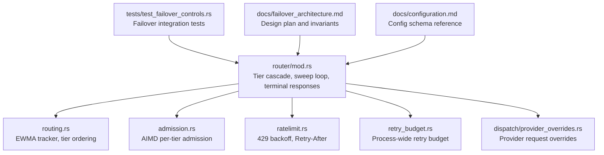
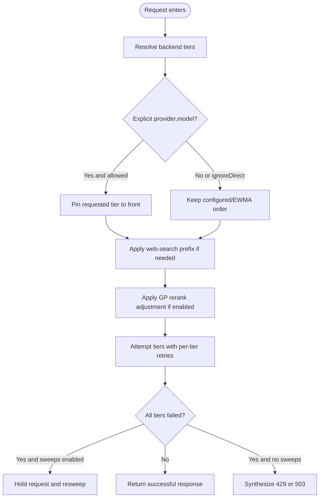
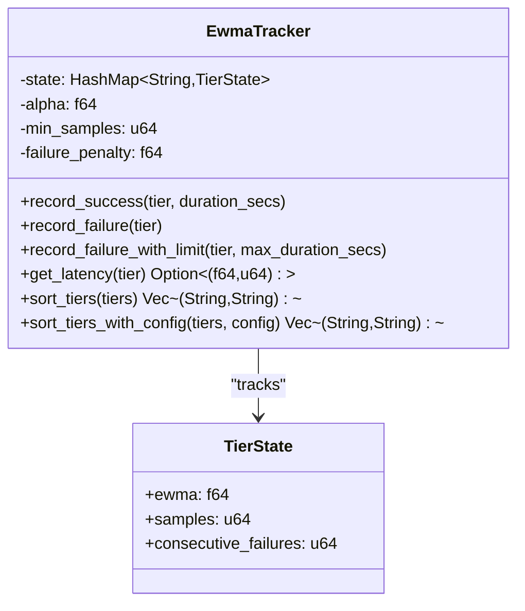
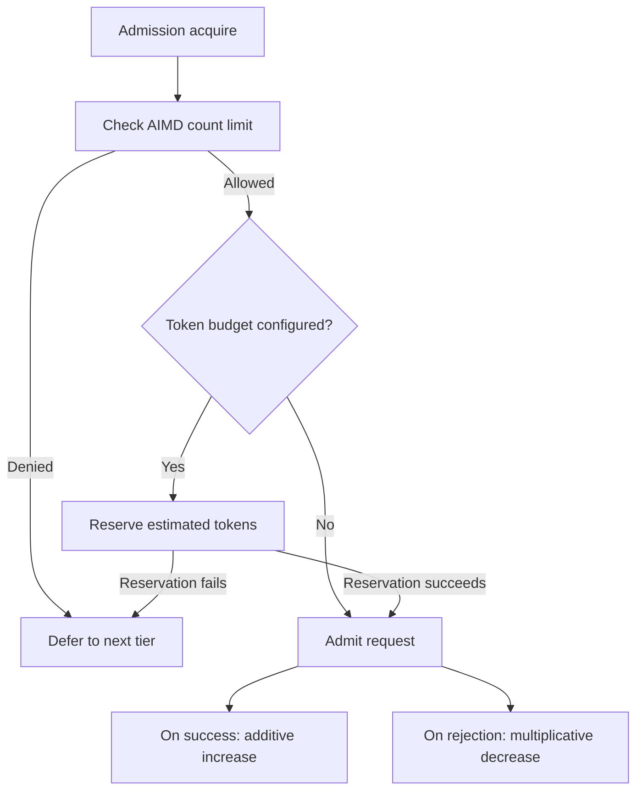
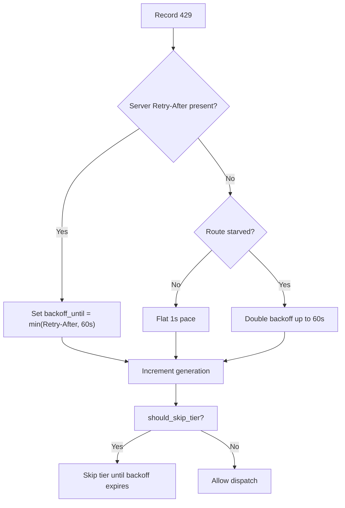
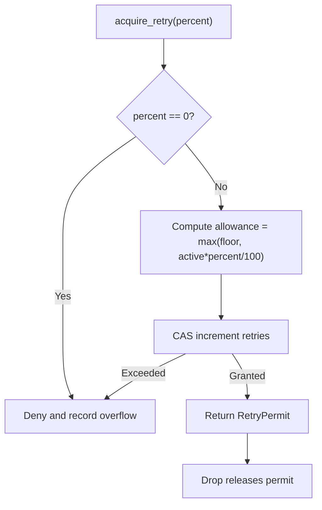
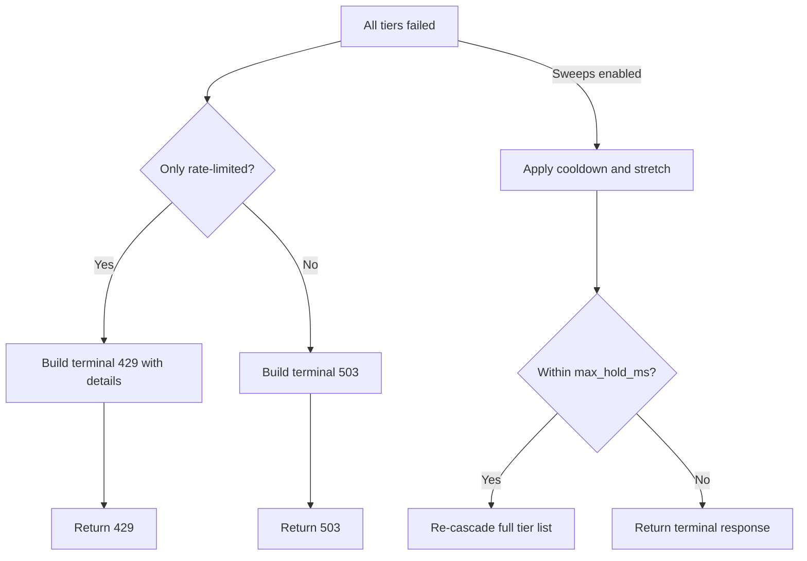
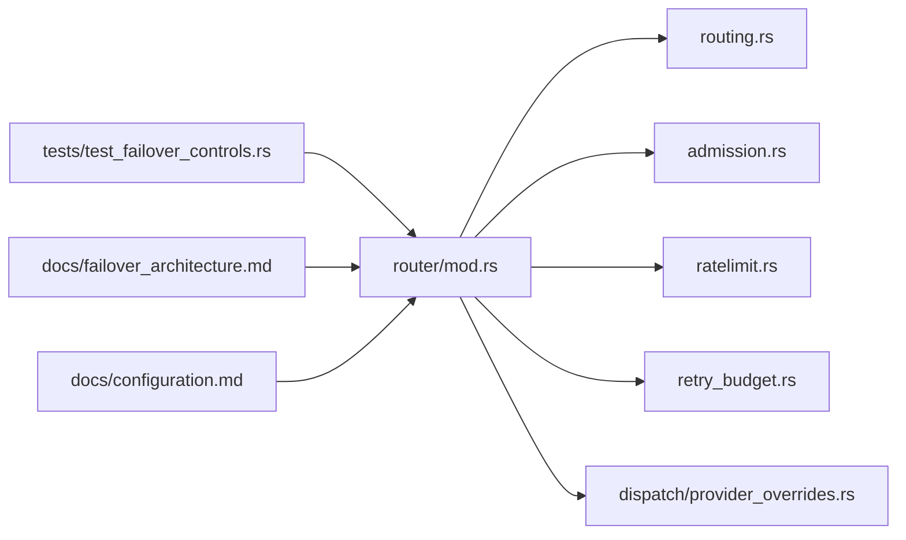

# Tier-Based Failover System

<cite>
**Referenced Files in This Document**   
- [failover_architecture.md](file://docs/failover_architecture.md)
- [shared-fallback-policy.md](file://docs/shared-fallback-policy.md)
- [configuration.md](file://docs/configuration.md)
- [config-recovery.md](file://docs/config-recovery.md)
- [mod.rs](file://src/router/mod.rs)
- [routing.rs](file://src/routing.rs)
- [admission.rs](file://src/admission.rs)
- [ratelimit.rs](file://src/ratelimit.rs)
- [retry_budget.rs](file://src/retry_budget.rs)
- [provider_overrides.rs](file://src/router/dispatch/provider_overrides.rs)
- [test_failover_controls.rs](file://tests/test_failover_controls.rs)
</cite>

## Table of Contents
1. [Introduction](#introduction)
2. [Project Structure](#project-structure)
3. [Core Components](#core-components)
4. [Architecture Overview](#architecture-overview)
5. [Detailed Component Analysis](#detailed-component-analysis)
6. [Dependency Analysis](#dependency-analysis)
7. [Performance Considerations](#performance-considerations)
8. [Troubleshooting Guide](#troubleshooting-guide)
9. [Conclusion](#conclusion)
10. [Appendices](#appendices)

## Introduction
This document explains CCR-Rust’s tier-based failover system: how providers are grouped into cascading tiers, how requests fall back when upstreams become unavailable or overloaded, and how the router recovers when providers recover. It covers configuration for tier ordering, failover triggers such as connection failures, timeouts, rate limits, and latency spikes, automatic recovery behavior, practical multi-tier scenarios, monitoring, tuning sensitivity, best practices for tier design, cost optimization across tiers, and handling partial outages.

The implementation is built around several cooperating subsystems:
- A tier list that may be strict or EWMA-weighted.
- Per-tier retry with backoff.
- Retry sweeps that hold open requests and re-cascade.
- Adaptive admission control to avoid amplifying concurrency-capped 429 errors.
- A process-wide retry budget to bound aggregate retry load.
- Rate-limit tracking with server `Retry-After` support and escalation under starvation.
- Optional conversation stickiness and tail-latency hedging.

**Section sources**
- [failover_architecture.md:1-120](file://docs/failover_architecture.md#L1-L120)

## Project Structure
The failover logic spans a small set of focused modules:



**Diagram sources**
- [mod.rs:200-650](file://src/router/mod.rs#L200-L650)
- [routing.rs:1-200](file://src/routing.rs#L1-L200)
- [admission.rs:1-200](file://src/admission.rs#L1-L200)
- [ratelimit.rs:1-200](file://src/ratelimit.rs#L1-L200)
- [retry_budget.rs:1-181](file://src/retry_budget.rs#L1-L181)
- [provider_overrides.rs:1-47](file://src/router/dispatch/provider_overrides.rs#L1-L47)
- [test_failover_controls.rs:1-200](file://tests/test_failover_controls.rs#L1-L200)
- [failover_architecture.md:1-120](file://docs/failover_architecture.md#L1-L120)
- [configuration.md:1-200](file://docs/configuration.md#L1-L200)

**Section sources**
- [mod.rs:1-200](file://src/router/mod.rs#L1-L200)
- [routing.rs:1-200](file://src/routing.rs#L1-L200)
- [admission.rs:1-200](file://src/admission.rs#L1-L200)
- [ratelimit.rs:1-200](file://src/ratelimit.rs#L1-L200)
- [retry_budget.rs:1-181](file://src/retry_budget.rs#L1-L181)
- [provider_overrides.rs:1-47](file://src/router/dispatch/provider_overrides.rs#L1-L47)
- [test_failover_controls.rs:1-200](file://tests/test_failover_controls.rs#L1-L200)
- [failover_architecture.md:1-120](file://docs/failover_architecture.md#L1-L120)
- [configuration.md:1-200](file://docs/configuration.md#L1-L200)

## Core Components
- **Tier cascade controller**: Builds an ordered list of provider tiers, pins direct routes, optionally inserts web-search or GP rerank positions, attempts retries per tier, and coordinates sweeps.
- **EWMA latency tracker**: Maintains smoothed latency estimates per tier, applies penalties on failures, and supports softmax-weighted random sampling when strict ordering is disabled.
- **Adaptive admission controller**: Uses AIMD to limit per-tier concurrent requests; halves on rejection, adds one on success, bounded by configured ceilings. Also supports optional token-volume budgets.
- **Rate-limit tracker**: Records 429 events, honors server `Retry-After`, escalates local backoffs under starvation, and proactively skips exhausted quota windows when headers are trusted.
- **Retry budget**: Caps process-wide retries as a percentage of active requests with a minimum floor.
- **Retry sweep coordinator**: Holds requests open and re-cascades after cooldowns, subject to maximum hold time.
- **Optional features**: Conversation stickiness, tail-latency hedging, provider request overrides.

**Section sources**
- [failover_architecture.md:120-240](file://docs/failover_architecture.md#L120-L240)
- [mod.rs:200-650](file://src/router/mod.rs#L200-L650)
- [routing.rs:1-200](file://src/routing.rs#L1-L200)
- [admission.rs:1-200](file://src/admission.rs#L1-L200)
- [ratelimit.rs:1-200](file://src/ratelimit.rs#L1-L200)
- [retry_budget.rs:1-181](file://src/retry_budget.rs#L1-L181)

## Architecture Overview
At request entry, CCR resolves the effective tier list, orders it either strictly or by EWMA, applies direct routing and search/GP adjustments, then executes per-tier attempts. On failure, it classifies the error, decides whether to retry within the tier, skip the tier, or cascade to the next tier. When all tiers exhaust, it can synthesize a terminal response or enter retry sweeps.

```mermaid
sequenceDiagram
    participant Client as "Client"
    participant Router as "Router handler"
    participant Orderer as "Tier orderer"
    participant Admission as "Admission tracker"
    participant Upstream as "Upstream provider"
    participant RL as "Rate-limit tracker"
    participant Budget as "Retry budget"
    participant Sweeps as "Sweep coordinator"

    Client->>Router: "POST /v1/messages"
    Router->>Orderer: "Resolve and order tiers"
    Orderer-->>Router: "Ordered tier list"
    Router->>Budget: "Start active request"
    loop For each tier
        Router->>Admission: "Acquire permit (count + tokens)"
        alt Permit denied
            Router->>Sweeps: "Defer; wait for permits"
        else Permit granted
            Router->>RL: "Snapshot generation"
            Router->>Upstream: "Dispatch attempt"
            alt Success
                Upstream-->>Router: "2xx response"
                Router->>RL: "Clear backoff if current"
                Router-->>Client: "Response"
            else Failure
                Upstream-->>Router: "Error"
                Router->>Router: "Classify failure"
                alt Deterministic rejection
                    Router->>Router: "Skip tier once"
                else Rate limited
                    Router->>RL: "Record 429 + Retry-After"
                    Router->>Router: "Move to next tier immediately"
                else Other
                    Router->>Router: "Per-tier backoff retry"
                end
            end
        end
    end
    alt All tiers failed and sweeps enabled
        Router->>Sweeps: "Hold request and re-cascade"
        Sweeps->>Router: "Cooldown + retry"
    else No more options
        Router-->>Client: "Terminal 429 or 503"
    end
```

**Diagram sources**
- [mod.rs:200-650](file://src/router/mod.rs#L200-L650)
- [routing.rs:200-618](file://src/routing.rs#L200-L618)
- [admission.rs:1-200](file://src/admission.rs#L1-L200)
- [ratelimit.rs:1-200](file://src/ratelimit.rs#L1-L200)
- [retry_budget.rs:1-181](file://src/retry_budget.rs#L1-L181)
- [failover_architecture.md:120-240](file://docs/failover_architecture.md#L120-L240)

**Section sources**
- [mod.rs:200-650](file://src/router/mod.rs#L200-L650)
- [failover_architecture.md:120-240](file://docs/failover_architecture.md#L120-L240)

## Detailed Component Analysis

### Tier Ordering and Cascade Controller
The tier list comes from configuration and can be constructed explicitly through `tiers`, or derived from `default`, `background`, and `think`. Direct model targeting moves the requested tier to the front unless `ignoreDirect` is true. Web search and GP reranking can prepend or adjust position while preserving pinned prefixes.

Key behaviors:
- Strict ordering preserves config priority.
- Non-strict ordering uses EWMA softmax sampling with temperature and top-k controls.
- Per-tier retries use exponential backoff, except deterministic rejections and rate-limited responses.
- Sweep loops continue while rate limiting or retryable failures were observed, subject to cooldown and maximum hold.



**Diagram sources**
- [mod.rs:200-650](file://src/router/mod.rs#L200-L650)
- [routing.rs:200-618](file://src/routing.rs#L200-L618)

**Section sources**
- [mod.rs:200-650](file://src/router/mod.rs#L200-L650)
- [routing.rs:200-618](file://src/routing.rs#L200-L618)
- [failover_architecture.md:120-240](file://docs/failover_architecture.md#L120-L240)

### EWMA Latency Tracker
The EWMA tracker records per-attempt latency, not total multi-retry duration. Successful durations update the smoothed estimate; failures apply a penalty multiplier rather than raw elapsed time. Tiers without enough samples retain their configured order. In non-strict mode, latencies are converted to logits, normalized via softmax, and sampled proportionally.

Important parameters:
- Alpha defaults to 0.3.
- Minimum samples before trusting EWMA defaults to 3.
- Failure penalty multiplier defaults to 2.0× current EWMA.
- Success durations are clamped to an upstream timeout bound where available.



**Diagram sources**
- [routing.rs:1-200](file://src/routing.rs#L1-L200)

**Section sources**
- [routing.rs:1-200](file://src/routing.rs#L1-L200)

### Adaptive Admission Control
Admission prevents many concurrent requests from hitting a concurrency-capped upstream simultaneously. Each route has a count-based AIMD limit and an optional token-volume ceiling. Rejections halve the limit; successes add one step up to a configured ceiling. Token reservations block other concurrent acquires until release, allowing large-context fallback traffic when the route is idle.

Operational effects:
- Excess concurrency is deferred to the next eligible tier instead of queuing behind a saturated primary.
- Large requests exceeding the token ceiling are admitted only when the route is otherwise empty.
- The live limit can be clamped immediately when operator reduces the ceiling.



**Diagram sources**
- [admission.rs:1-200](file://src/admission.rs#L1-L200)

**Section sources**
- [admission.rs:1-200](file://src/admission.rs#L1-L200)

### Rate-Limit Tracking and Recovery
The rate-limit tracker stores per-route state including backoff windows, remaining quota, reset times, consecutive 429 counts, and a generation counter to protect against overlapping-request ordering issues. Server `Retry-After` is honored verbatim, capped at 60 seconds. Without guidance, the tracker paces rejected routes at one second while the route remains partially alive, and doubles backoff under sustained starvation up to the same 60-second cap.

Recovery rules:
- A success clears backoff only if its generation matches the latest 429 snapshot.
- Proactive skipping based on `remaining == 0` and `reset_at` depends on `honor_ratelimit_headers`.
- Terminal all-rate-limited responses include every tried or skipped route with retry hints.



**Diagram sources**
- [ratelimit.rs:1-200](file://src/ratelimit.rs#L1-L200)
- [mod.rs:200-650](file://src/router/mod.rs#L200-L650)

**Section sources**
- [ratelimit.rs:1-200](file://src/ratelimit.rs#L1-L200)
- [failover_architecture.md:240-360](file://docs/failover_architecture.md#L240-L360)

### Process-Wide Retry Budget
The retry budget caps aggregate retries across the process as a percentage of active requests, with a floor of three. A zero percent setting disables retries entirely. Permits are acquired atomically and released automatically when dropped.

Behavioral guarantees tested:
- Zero budget forbids retries even when per-tier `max_retries` is high.
- Exhaustion still allows the first cascade to proceed to the next tier.
- Exhaustion bounds sweep expansion so the current cascade completes but extra exempt sweeps do not start indefinitely.



**Diagram sources**
- [retry_budget.rs:1-181](file://src/retry_budget.rs#L1-L181)

**Section sources**
- [retry_budget.rs:1-181](file://src/retry_budget.rs#L1-L181)
- [test_failover_controls.rs:200-450](file://tests/test_failover_controls.rs#L200-L450)

### Retry Sweeps and Terminal Responses
When every tier fails, CCR can return a terminal response immediately or keep the HTTP request open and re-cascade after a cooldown. Sweeps are governed by `enabled`, `maxSweeps`, `sweepCooldownMs`, and `maxHoldMs`. Cooldown stretches to the largest observed rate-limit backoff hint, capped at 60 seconds, and is clamped to the remaining hold budget.

Terminal response semantics:
- Synthesized 429 only when the final sweep saw exclusively rate limiting.
- 503 for other exhausted cascades.
- Response body includes details about each rate-limited candidate, including retry-after hints.



**Diagram sources**
- [mod.rs:200-650](file://src/router/mod.rs#L200-L650)
- [failover_architecture.md:120-240](file://docs/failover_architecture.md#L120-L240)

**Section sources**
- [mod.rs:200-650](file://src/router/mod.rs#L200-L650)
- [failover_architecture.md:120-240](file://docs/failover_architecture.md#L120-L240)

### Optional Features

#### Conversation Stickiness
Stickiness remembers the provider family used for a conversation and prefers it on later turns, even if it appears later in the configured chain. This avoids protocol mismatches mid-stream and improves consistency.

#### Tail-Latency Hedging
Hedging launches a secondary attempt on the next eligible tier after a configurable time-to-first-token threshold. If the hedge returns successfully, it wins over a still-running primary; if both fail, the earlier error drives classification.

#### Provider Request Overrides
Before dispatch, provider-level overrides can force adaptive thinking or reasoning effort for OpenAI-protocol requests. These are applied per-provider and validated against protocol constraints.

**Section sources**
- [test_failover_controls.rs:450-751](file://tests/test_failover_controls.rs#L450-L751)
- [mod.rs:200-650](file://src/router/mod.rs#L200-L650)
- [provider_overrides.rs:1-47](file://src/router/dispatch/provider_overrides.rs#L1-L47)

## Dependency Analysis
The following diagram shows runtime dependencies among core failover components:



**Diagram sources**
- [mod.rs:200-650](file://src/router/mod.rs#L200-L650)
- [routing.rs:1-200](file://src/routing.rs#L1-L200)
- [admission.rs:1-200](file://src/admission.rs#L1-L200)
- [ratelimit.rs:1-200](file://src/ratelimit.rs#L1-L200)
- [retry_budget.rs:1-181](file://src/retry_budget.rs#L1-L181)
- [provider_overrides.rs:1-47](file://src/router/dispatch/provider_overrides.rs#L1-L47)
- [test_failover_controls.rs:1-200](file://tests/test_failover_controls.rs#L1-L200)
- [failover_architecture.md:1-120](file://docs/failover_architecture.md#L1-L120)
- [configuration.md:1-200](file://docs/configuration.md#L1-L200)

Coupling notes:
- The router orchestrates all subsystems but keeps policy decisions close to the cascade loop.
- EWMA influences ordering and backoff scaling but does not directly drive failure classification.
- Admission and rate limiting cooperate: admission defers before dispatch; rate limiting governs post-dispatch pacing.
- The retry budget bounds aggregate retries independently of per-tier retry limits.
- Tests validate failfast deterministic rejections, sweep bounds, budget exhaustion behavior, stickiness, and hedging.

**Section sources**
- [mod.rs:200-650](file://src/router/mod.rs#L200-L650)
- [test_failover_controls.rs:1-751](file://tests/test_failover_controls.rs#L1-L751)

## Performance Considerations
- Prefer `strictTierOrder` for deliberate quality-ordered fallback chains where a faster cheap model must not preempt a preferred tier.
- Use `topK` and `routingTemperature` cautiously in non-strict mode; low temperature favors fastest tiers, high temperature distributes load more evenly.
- Tune AIMD `maxInflight` per provider to match real concurrency caps; avoid letting repeated 429s shrink the limit below useful throughput.
- Configure token-volume budgets for providers whose collisions come from concurrent prefill volume rather than request count.
- Enable retry sweeps for long-lived agent sessions to maximize message survival, but bound `maxHoldMs` to prevent unbounded client waits.
- Use hedging selectively for slow primaries where a cheaper fallback can win early without duplicating expensive work.
- Avoid enabling redundant retries: per-tier retries plus sweeps plus hedging can amplify load if misconfigured.

[No sources needed since this section provides general guidance]

## Troubleshooting Guide

### Common Failover Scenarios

#### Deterministic 400 Errors
Deterministic client errors are attempted once per tier and never enter retry sweeps. They should cascade to a larger-context or compatible tier rather than burning retries.

Evidence:
- A 400 from the first tier costs exactly one attempt and fails fast.
- Context-window 400s cascade to the next tier.

**Section sources**
- [test_failover_controls.rs:1-200](file://tests/test_failover_controls.rs#L1-L200)
- [failover_architecture.md:240-360](file://docs/failover_architecture.md#L240-L360)

#### Saturated Primary Due to Concurrency Cap
When a primary provider admits some requests but rejects others under concurrency limits, excess concurrency should defer to the fallback tier rather than queueing behind the saturated route.

Evidence:
- With `maxInflight: 1`, two concurrent requests result in one served by the primary and one deferred to backup.

**Section sources**
- [admission.rs:1-200](file://src/admission.rs#L1-L200)
- [test_failover_controls.rs:200-450](file://tests/test_failover_controls.rs#L200-L450)

#### Exhausted Retry Budget
A process-wide retry budget exhaustion must stop additional retries but must not suppress the first attempt on a later fallback tier.

Evidence:
- Exhaustion still allows the cascade to try the next tier.
- Exhaustion bounds sweeps to complete the current cascade without starting extra exempt sweeps.

**Section sources**
- [retry_budget.rs:1-181](file://src/retry_budget.rs#L1-L181)
- [test_failover_controls.rs:200-450](file://tests/test_failover_controls.rs#L200-L450)

#### Terminal Rate Limiting
When all candidate tiers are rate limited, the router returns a structured 429 with details for each exhausted route and optional `Retry-After`. Subsequent requests skip those routes during their backoff window while preserving provenance.

**Section sources**
- [ratelimit.rs:1-200](file://src/ratelimit.rs#L1-L200)
- [test_failover_controls.rs:450-751](file://tests/test_failover_controls.rs#L450-L751)

#### Slow Primary with Fast Fallback
Hedging can launch a fallback tier after a threshold and return whichever attempt produces a usable result first.

**Section sources**
- [test_failover_controls.rs:450-751](file://tests/test_failover_controls.rs#L450-L751)
- [mod.rs:200-650](file://src/router/mod.rs#L200-L650)

### Monitoring Failover Events
Use the metrics endpoint to observe:
- Active requests and stream gauges.
- Retry budget overflow counters.
- Rate-limit backoff counters per tier.
- Hedge launch and hedge-win counters.
- EWMA gauges and tier-order debug logs when tracing is enabled.

For operational health checks:
- `/health` provides basic liveness.
- `/health?details=1` exposes configured tiers and default route.
- Configuration recovery tools compare in-memory route order against consumer configs and can idle-gate and restart listeners.

**Section sources**
- [test_failover_controls.rs:450-751](file://tests/test_failover_controls.rs#L450-L751)
- [config-recovery.md:1-120](file://docs/config-recovery.md#L1-L120)

### Tuning Failover Sensitivity
- Increase `routingTemperature` to distribute load more broadly when EWMA is noisy.
- Decrease `routingTemperature` to prefer measured fastest tiers more aggressively.
- Raise `topK` to consider more tiers in weighted sampling.
- Reduce `tierRetries.max_retries` for deterministic or non-recoverable upstream errors.
- Increase `tierRetries.base_backoff_ms` and `backoff_multiplier` for transient network issues; keep them modest for short-lived agents.
- Tune `retrySweeps.sweepCooldownMs` and `retrySweeps.maxHoldMs` to balance message survival against client-side retry pressure.
- Adjust AIMD `maxInflight` per provider based on observed 429 patterns.
- Use token budgets only when upstream 429s correlate with concurrent prefill volume.

**Section sources**
- [routing.rs:200-618](file://src/routing.rs#L200-L618)
- [admission.rs:1-200](file://src/admission.rs#L1-L200)
- [ratelimit.rs:1-200](file://src/ratelimit.rs#L1-L200)

## Conclusion
CCR-Rust’s tier-based failover system combines explicit tier ordering, adaptive admission, rate-limit-aware pacing, bounded retry sweeps, and optional hedging and stickiness. Correctly designed tiers separate fast cheap models, robust production endpoints, specialized tools like web search, and resilient local or free fallbacks. Operators should prioritize strict ordering for intentional fallback chains, tune AIMD and retry budgets for upstream concurrency characteristics, enable sweeps for long-lived sessions, and monitor 429 backoffs, EWMA trends, and terminal responses to detect partial outages.

[No sources needed since this section summarizes without analyzing specific files]

## Appendices

### Configuration Schema Highlights for Failover
- `Router.default`: Default provider-model route.
- `Router.tiers`: Explicit tier ordering for cascading fallback.
- `Router.strictTierOrder`: Enforce configured order instead of EWMA reordering.
- `Router.ignoreDirect`: Ignore explicit `provider,model` targeting and always follow tier order.
- `Router.topK`: Number of top-performing providers to consider in weighted sampling.
- `Router.routingTemperature`: Softmax temperature for EWMA-based tier selection.
- `Router.retryBudgetPercent`: Process-wide retry budget as percentage of active requests.
- `Router.tierRetries`: Per-tier retry limits and backoff settings.
- `Router.retrySweeps`: Enable held-request re-cascading with cooldown and hold bounds.
- `Router.stickySessions`: Enable conversation-provider stickiness.
- `Router.hedging`: Enable tail-latency hedging with threshold.
- Provider fields:
  - `name`, `api_base_url`, `api_key`, `models`.
  - `maxInflight`: AIMD initial and maximum per-route in-flight attempts.
  - `maxInflightTokens`: Optional token-volume budget.
  - `honor_ratelimit_headers`: Controls proactive skipping on informational quota headers.
  - `tier_name`: Display name carried in `x-ccr-tier`.

**Section sources**
- [configuration.md:1-200](file://docs/configuration.md#L1-L200)
- [types.rs:580-760](file://src/config/types.rs#L580-L760)

### Practical Multi-Tier Examples

#### High Availability Chain
- Tier 1: Preferred paid provider with robust capacity.
- Tier 2: Secondary paid provider for regional redundancy.
- Tier 3: Local or free provider as last resort.

Configuration pattern:
- Use `strictTierOrder: true`.
- Set `tierRetries` per provider to reflect expected transient failure rates.
- Enable `retrySweeps` for long conversations.

#### Concurrency-Capped Primary
- Tier 1: Primary with small `maxInflight`.
- Tier 2: Backup with higher concurrency tolerance.

Behavior:
- Excess concurrency defers to backup.
- AIMD adapts to 429 patterns.

#### Web Search Offload
- Prepend web-search tier for requests containing search tags.
- Strip tags before downstream dispatch.
- Ensure search provider is inexpensive and tolerant of frequent calls.

#### Partial Outage Handling
- Use multiple providers for the same logical model across regions.
- Monitor `x-ccr-rate-limited-tiers` and per-tier 429 backoffs.
- Use `honor_ratelimit_headers` appropriately depending on provider header semantics.

**Section sources**
- [test_failover_controls.rs:1-751](file://tests/test_failover_controls.rs#L1-L751)
- [shared-fallback-policy.md:1-200](file://docs/shared-fallback-policy.md#L1-L200)

### Best Practices for Tier Design and Cost Optimization
- Place expensive or high-quality tiers first only when they provide meaningful value; otherwise put them later to minimize cost exposure.
- Keep a local or free tier last to absorb degraded or overflow traffic.
- Avoid placing exhausted or credential-invalid providers in the active chain; derive configurations through the shared policy tooling and run preflights.
- Use provider pricing metadata to understand cost impact when EWMA redistributes load.
- Separate authentication suites and scopes; do not mix personal and corporate credentials in one shared fallback list.
- Recover configuration changes through snapshots and verified restores rather than ad hoc edits.

**Section sources**
- [shared-fallback-policy.md:1-200](file://docs/shared-fallback-policy.md#L1-L200)
- [config-recovery.md:1-120](file://docs/config-recovery.md#L1-L120)