# Traffic Class Routing

<cite>
**Referenced Files in This Document**
- [src/router/mod.rs](file://src/router/mod.rs)
- [src/routing.rs](file://src/routing.rs)
- [src/gp_router.rs](file://src/gp_router.rs)
- [src/config/types.rs](file://src/config/types.rs)
- [src/config/mod.rs](file://src/config/mod.rs)
- [src/router/dispatch.rs](file://src/router/dispatch.rs)
- [src/router/streaming.rs](file://src/router/streaming.rs)
- [docs/configuration.md](file://docs/configuration.md)
</cite>

## Table of Contents
1. [Introduction](#introduction)
2. [Project Structure](#project-structure)
3. [Core Components](#core-components)
4. [Architecture Overview](#architecture-overview)
5. [Detailed Component Analysis](#detailed-component-analysis)
6. [Dependency Analysis](#dependency-analysis)
7. [Performance Considerations](#performance-considerations)
8. [Troubleshooting Guide](#troubleshooting-guide)
9. [Conclusion](#conclusion)

## Introduction
This document explains how CCR-Rust classifies and routes requests across provider tiers. The system does not use a fixed, user-visible “traffic class” enum. Instead, it derives routing behavior from request characteristics such as web-search markers, explicit model targets, streaming flags, tool usage, and measured backend latency.

The main concepts are:

| Concept | Meaning in CCR-Rust |
|---|---|
| Default route | The configured `Router.default` tier; the normal path for ordinary requests. |
| Background route | An optional `Router.background` tier that can be used by higher-level components to target background work. It is not automatically selected from request content. |
| Think route | An optional `Router.think` tier intended for reasoning-heavy workflows; it is also not auto-selected from request content. |
| Web search classification | A runtime detection based on `[search]` or `[web]` text markers in message content, which prepends a dedicated search provider before the normal tier cascade. |
| Tier | A configured `provider,model` candidate that may be tried in strict order, EWMA-weighted order, or GP-reranked order. |
| Priority | Determined by configuration, direct routing pinning, web search pinning, sticky sessions, and optional GP reranking. |
| Provider preference | Controlled by tier ordering, provider admission limits, rate-limit backoff, hedging, retry sweeps, and per-tier retry configuration. |

CCR-Rust therefore treats “default”, “think”, and “background” primarily as **configuration-driven tier labels**, while “web search” is the only built-in **request-content classifier**. Optional features such as GP routing and EWMA-based load balancing then refine which configured tier wins when multiple candidates exist.

**Section sources**
- [src/config/types.rs:590-640](file://src/config/types.rs#L590-L640)
- [src/router/mod.rs:364-545](file://src/router/mod.rs#L364-L545)
- [docs/configuration.md:130-200](file://docs/configuration.md#L130-L200)

## Project Structure
The traffic class routing system spans several modules:

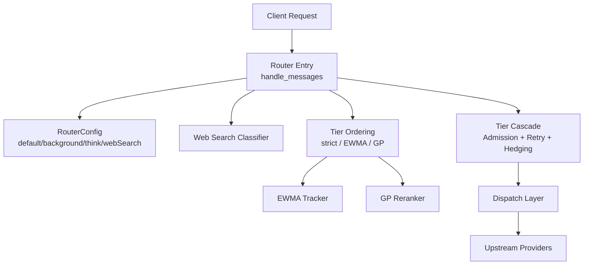

**Diagram sources**
- [src/router/mod.rs:364-545](file://src/router/mod.rs#L364-L545)
- [src/router/mod.rs:562-900](file://src/router/mod.rs#L562-L900)
- [src/routing.rs:201-350](file://src/routing.rs#L201-L350)
- [src/gp_router.rs:59-110](file://src/gp_router.rs#L59-L110)
- [src/router/dispatch.rs:151-220](file://src/router/dispatch.rs#L151-L220)

**Section sources**
- [src/router/mod.rs:1-120](file://src/router/mod.rs#L1-L120)
- [src/config/types.rs:590-740](file://src/config/types.rs#L590-L740)

## Core Components

### Router Configuration
The router’s default, background, think, and web search behavior is declared in `RouterConfig`:

| Field | Purpose |
|---|---|
| `default` | Mandatory primary tier label used when no explicit routing overrides apply. |
| `background` | Optional tier label for background-oriented workloads. |
| `think` | Optional tier label for thinking/reasoning-oriented workloads. |
| `modelAliases` | Maps bare model names to explicit `provider,model` routes. |
| `tiers` | Optional explicit tier list that overrides automatic construction from `default`, `background`, and `think`. |
| `webSearch` | Enables web-search detection and optionally pins a search provider. |
| `strictTierOrder` | Forces cascading fallback without EWMA reordering. |
| `topK` | Limits the number of top tiers considered by EWMA sampling. |
| `routingTemperature` | Controls softmax randomness around EWMA latency. |
| `gpRouting` | Optional Gaussian-process reranker layered on top of base ordering. |

**Section sources**
- [src/config/types.rs:590-740](file://src/config/types.rs#L590-L740)
- [docs/configuration.md:130-200](file://docs/configuration.md#L130-L200)

### Tier Ordering and Priority
A request’s effective tier priority is composed from several layers:

1. **Direct routing:** If the client sends an explicit `provider,model` model name and `ignoreDirect` is false, that tier is moved to the front.
2. **Model aliases:** Bare model names can be mapped to explicit routes.
3. **Web search:** If enabled and detected, the configured search provider is inserted at position zero.
4. **Sticky sessions:** Optionally partitions the ordered list so prior conversation providers stay near the front.
5. **GP reranking:** If enabled and fitted, can reorder non-pinned suffix tiers using cost, latency uncertainty, and request features.
6. **Base ordering:** Either strict configured order or EWMA-weighted weighted random sampling.

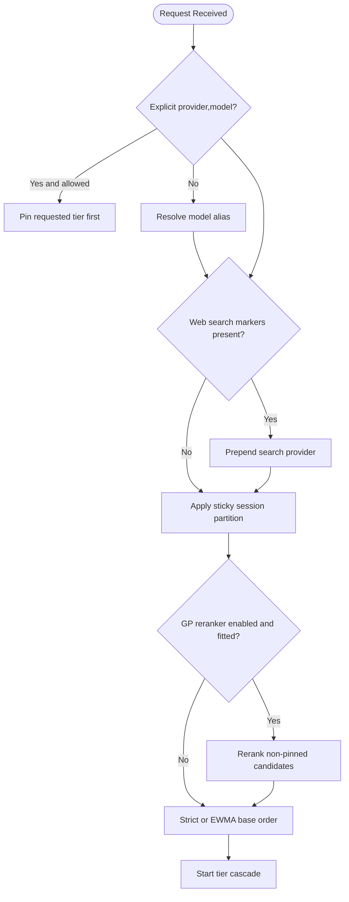

**Diagram sources**
- [src/router/mod.rs:480-561](file://src/router/mod.rs#L480-L561)
- [src/router/mod.rs:562-610](file://src/router/mod.rs#L562-L610)
- [src/gp_router.rs:110-190](file://src/gp_router.rs#L110-L190)

**Section sources**
- [src/router/mod.rs:480-610](file://src/router/mod.rs#L480-L610)
- [src/gp_router.rs:110-190](file://src/gp_router.rs#L110-L190)

### Web Search Classification
The only built-in request-content classifier looks for `[search]` or `[web]` substrings in message text:

| Characteristic | Behavior |
|---|---|
| Detection | Scans all messages for `[search]` or `[web]`. |
| Action | Strips those tags and inserts the configured `web_search.search_provider` as the first tier. |
| Scope | Applies only when `web_search.enabled` is true. |
| Priority effect | Pinned prefix length increases, protecting the search provider from later reordering. |

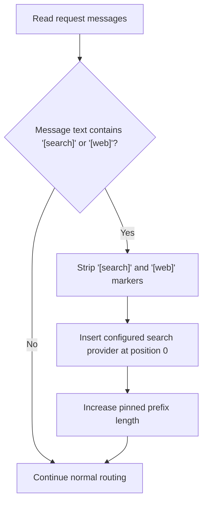

**Diagram sources**
- [src/router/mod.rs:364-410](file://src/router/mod.rs#L364-L410)
- [src/router/mod.rs:536-545](file://src/router/mod.rs#L536-L545)

**Section sources**
- [src/router/mod.rs:364-410](file://src/router/mod.rs#L364-L410)
- [src/router/mod.rs:536-545](file://src/router/mod.rs#L536-L545)

### Thinking and Background Requests
Thinking and background requests do **not** have their own automatic classifiers in the router. They are represented as configuration slots:

| Route Slot | Automatic Request Classifier? | Typical Use |
|---|---:|---|
| `default` | No | Normal interactive chat. |
| `think` | No | Reasoning-focused models; selection must come from client model name, alias, or frontend behavior. |
| `background` | No | Background jobs; selection must come from client model name, alias, or frontend behavior. |
| `webSearch` | Yes | Detected through `[search]`/`[web]` markers. |

If a frontend or client explicitly selects a model aliased to the think or background route, that route participates in normal routing. There is no code path that inspects prompt length, thinking budget, or response complexity to decide whether a request is “thinking”.

**Section sources**
- [src/config/types.rs:590-640](file://src/config/types.rs#L590-L640)
- [src/config/mod.rs:700-710](file://src/config/mod.rs#L700-L710)

### Streaming Requirements
Streaming is not a separate traffic class. It affects:

- Whether downstream providers receive `stream: true`.
- Whether non-streaming providers force pseudo-SSE wrapping.
- Admission, timeout, throughput, and cost metrics.
- Whether responses are wrapped when the client wants streaming but the provider cannot stream.

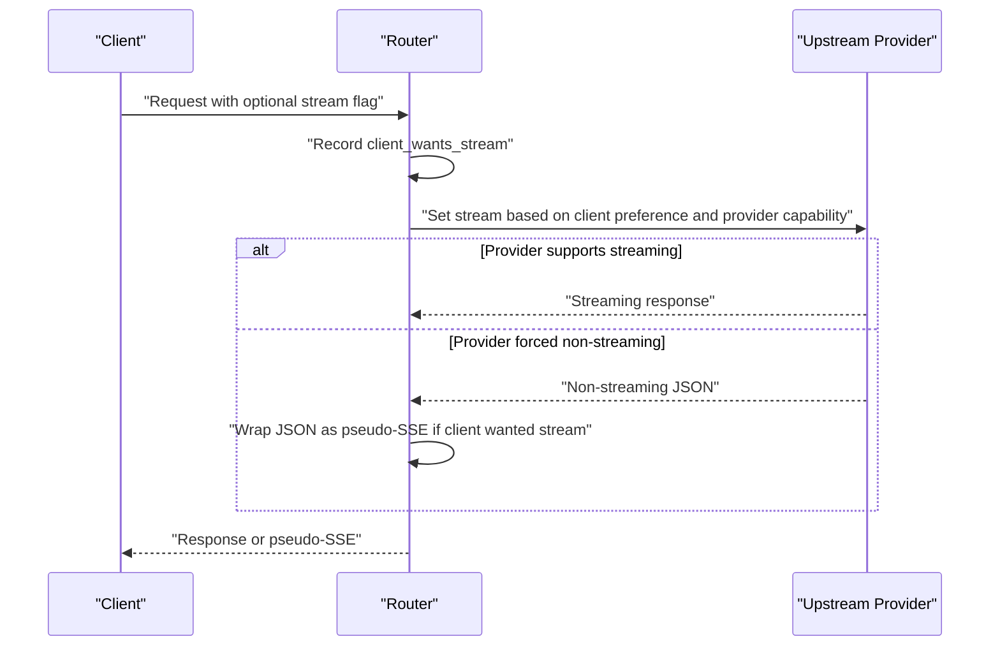

**Diagram sources**
- [src/router/mod.rs:120-150](file://src/router/mod.rs#L120-L150)
- [src/router/mod.rs:900-930](file://src/router/mod.rs#L900-L930)
- [src/router/streaming.rs:1-50](file://src/router/streaming.rs#L1-L50)

**Section sources**
- [src/router/mod.rs:120-150](file://src/router/mod.rs#L120-L150)
- [src/router/mod.rs:900-930](file://src/router/mod.rs#L900-L930)
- [src/router/streaming.rs:1-50](file://src/router/streaming.rs#L1-L50)

## Architecture Overview
The complete request flow combines classification, tier ordering, admission control, retries, hedging, and dispatch:

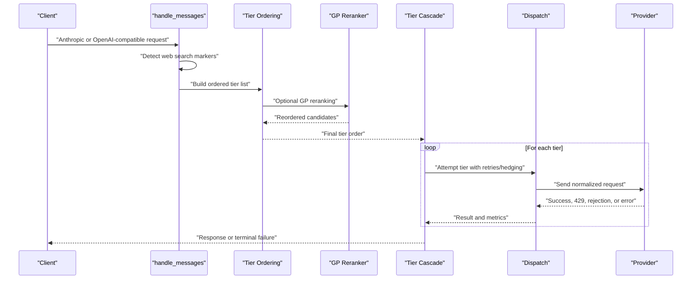

**Diagram sources**
- [src/router/mod.rs:364-545](file://src/router/mod.rs#L364-L545)
- [src/router/mod.rs:562-900](file://src/router/mod.rs#L562-L900)
- [src/gp_router.rs:110-190](file://src/gp_router.rs#L110-L190)
- [src/router/dispatch.rs:151-220](file://src/router/dispatch.rs#L151-L220)

## Detailed Component Analysis

### Web Search Traffic Class
The web search class is the only explicit request-content classifier.

#### Classification Criteria
- Message text contains `[search]` or `[web]`.
- `web_search.enabled` is true.
- `web_search.search_provider` is configured.

#### Routing Effect
- The markers are stripped from message text.
- The configured search provider is inserted at index zero.
- The pinned prefix length increases, preventing later reordering.

#### Configuration Example
In the router configuration schema, web search appears under `webSearch`. A minimal setup enables the feature and assigns a search-capable provider/model:

```json
{
  "Router": {
    "default": "anthropic,claude-sonnet-4-6",
    "webSearch": {
      "enabled": true,
      "search_provider": "exa,some-exa-model"
    }
  }
}
```

**Section sources**
- [src/router/mod.rs:364-410](file://src/router/mod.rs#L364-L410)
- [src/router/mod.rs:536-545](file://src/router/mod.rs#L536-L545)
- [docs/configuration.md:130-200](file://docs/configuration.md#L130-L200)

### Default, Think, and Background Routes
These are configuration-defined tier labels rather than auto-detected classes.

| Route | Configuration Key | Auto-Classification | Customization Notes |
|---|---|---:|---|
| Default | `Router.default` | No | Always part of the tier set unless overridden by `Router.tiers`. |
| Think | `Router.think` | No | Useful for reasoning-heavy models; select via model alias or client model name. |
| Background | `Router.background` | No | Useful for batch/background work; select via model alias or client model name. |
| Web Search | `Router.webSearch` | Yes | Detects `[search]`/`[web]` in message text. |

To customize these routes:

1. Set `Router.default`, `Router.think`, and/or `Router.background` to `provider,model`.
2. Optionally define `Router.modelAliases` so clients can refer to them by a friendly model name.
3. Optionally define `Router.tiers` to override automatic tier construction.
4. Ensure providers are defined in the `Providers` section.

**Section sources**
- [src/config/types.rs:590-640](file://src/config/types.rs#L590-L640)
- [src/config/mod.rs:700-710](file://src/config/mod.rs#L700-L710)
- [docs/configuration.md:13<docs>
# Traffic Class Routing

<cite>
**Referenced Files in This Document**
- [routing.rs](file://src/routing.rs)
- [router/mod.rs](file://src/router/mod.rs)
- [router/types.rs](file://src/router/types.rs)
- [router/dispatch.rs](file://src/router/dispatch.rs)
- [config/types.rs](file://src/config/types.rs)
- [config/mod.rs](file://src/config/mod.rs)
- [gp_router.rs](file://src/gp_router.rs)
- [streaming.rs](file://src/router/streaming.rs)
- [configuration.md](file://docs/configuration.md)
</cite>

## Table of Contents
1. [Introduction](#introduction)
2. [Project Structure](#project-structure)
3. [Core Components](#core-components)
4. [Architecture Overview](#architecture-overview)
5. [Detailed Component Analysis](#detailed-component-analysis)
6. [Dependency Analysis](#dependency-analysis)
7. [Performance Considerations](#performance-considerations)
8. [Troubleshooting Guide](#troubleshooting-guide)
9. [Conclusion](#conclusion)
10. [Appendices](#appendices)

## Introduction
This document explains how CCR-Rust classifies and routes requests across provider tiers. The system does not use a single monolithic “traffic class” enum; instead, it composes several classification signals:

- **Explicit routing**: A client may request a specific `provider,model` route.
- **Model aliases**: Bare model names are resolved to configured provider routes.
- **Web search detection**: Messages containing `[search]` or `[web]` tags trigger special handling.
- **Streaming requirements**: Whether the client requested streaming affects downstream provider selection and response wrapping.
- **Request shape for cost-aware reranking**: Prompt length, message count, tool usage, output budget, stream flag, active streams, time of day, and a four-way request-class label feed an optional Gaussian-process reranker.
- **Configured fallback chains**: `default`, `background`, and `think` routes define preferred tier lists, which can be strict or EWMA-weighted.
- **Admission, rate limiting, retries, hedging, and retry sweeps**: These control when and how many tiers are attempted.

The result is a tier ordering per request, with optional prefix pinning (for direct routes, web-search providers, or sticky sessions), optional GP reranking, and a cascading attempt loop that records latency, failures, and costs.

## Project Structure
The traffic-class behavior lives primarily in the router and configuration layers:

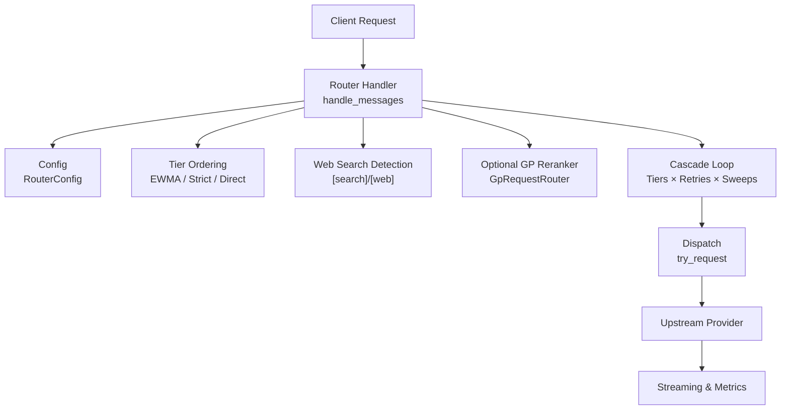

**Diagram sources**
- [router/mod.rs:364-561](file://src/router/mod.rs#L364-L561)
- [router/mod.rs:693-1150](file://src/router/mod.rs#L693-L1150)
- [routing.rs:167-356](file://src/routing.rs#L167-L356)
- [gp_router.rs:39-65](file://src/gp_router.rs#L39-L65)
- [dispatch.rs:306-503](file://src/router/dispatch.rs#L306-L503)

**Section sources**
- [router/mod.rs:364-561](file://src/router/mod.rs#L364-L561)
- [router/mod.rs:693-1150](file://src/router/mod.rs#L693-L1150)
- [routing.rs:167-356](file://src/routing.rs#L167-L356)
- [gp_router.rs:39-65](file://src/gp_router.rs#L39-L65)
- [dispatch.rs:306-503](file://src/router/dispatch.rs#L306-L503)

## Core Components

### Request Types and Classification Signals
CCR-Rust distinguishes routing signals rather than enforcing one fixed set of classes:

| Signal | How It Is Classified | Routing Effect |
|---|---|---|
| Default request | Uses the configured default tier list unless overridden by alias or explicit route. | Cascades through default tiers. |
| Explicit route | Client supplies `provider,model`. | Moves target tier to front, or dispatches it directly if absent from configured tiers. |
| Model alias | Bare model name mapped by `modelAliases`. | Replaces the requested model with its configured route before tier processing. |
| Web search request | Message text contains `[search]` or `[web]`. | Strips tags and prepends the configured `web_search.search_provider` as the first tier. |
| Background request | Configured via `Router.background`. | Defines a dedicated background tier list used where the caller selects that route. |
| Think request | Configured via `Router.think`. | Defines a dedicated think-tier route used where the caller selects that route. |
| Streaming request | `request.stream` true. | Used by downstream logic and by the GP request-class feature vector. |
| Tool-heavy request | Non-empty `tools` array or messages with role `tool`. | Feeds the GP request-class bucket and influences cost estimation. |

The most complete internal classifier is the GP router’s four-way request class:

| Class Value | Meaning |
|---|---|
| 0 | Not streaming and not tool-heavy. |
| 1 | Streaming but not tool-heavy. |
| 2 | Not streaming but tool-heavy. |
| 3 | Streaming and tool-heavy. |

**Section sources**
- [router/mod.rs:364-395](file://src/router/mod.rs#L364-L395)
- [router/mod.rs:505-561](file://src/router/mod.rs#L505-L561)
- [config/types.rs:595-640](file://src/config/types.rs#L595-L640)
- [gp_router.rs:344-358](file://src/gp_router.rs#L344-L358)

### Tier Ordering Strategies
There are two primary strategies for ordering candidate tiers:

1. **Strict tier order**: Tiers are attempted in configured order. This is the intended contract for deliberate quality-ordered fallback chains.
2. **EWMA-weighted ordering**: Latency observations are converted into softmax probabilities, then sampled without replacement up to `topK`. Low routing temperature favors the fastest measured tier; high temperature flattens distribution.

Unmeasured tiers retain their config position under strict mode. Under EWMA mode, unmeasured tiers receive a large negative logit penalty and are shuffled at cold start so the first request does not always hit the same backend.

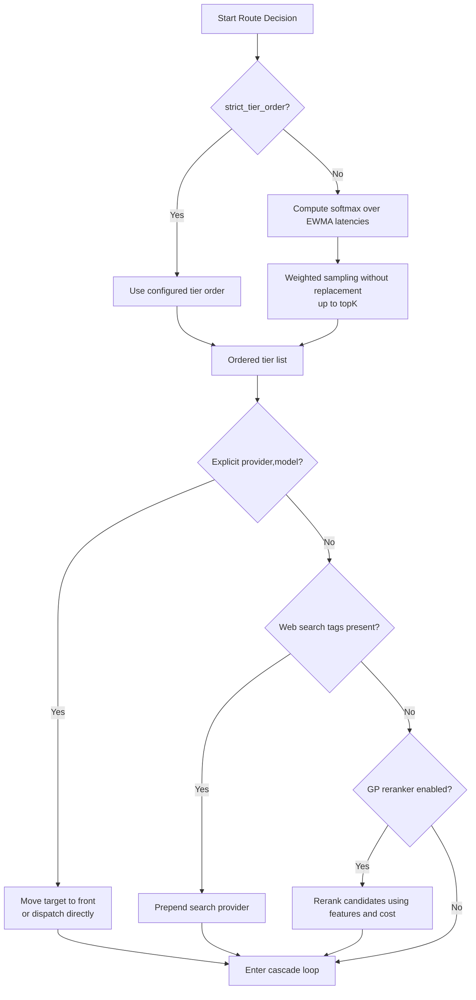

**Diagram sources**
- [router/mod.rs:505-561](file://src/router/mod.rs#L505-L561)
- [routing.rs:167-356](file://src/routing.rs#L167-L356)
- [gp_router.rs:108-170](file://src/gp_router.rs#L108-L170)

**Section sources**
- [routing.rs:167-356](file://src/routing.rs#L167-L356)
- [router/mod.rs:505-561](file://src/router/mod.rs#L505-L561)
- [gp_router.rs:108-170](file://src/gp_router.rs#L108-L170)

### Web Search Routing
When web search is enabled and a message contains `[search]` or `[web]`:

1. The router detects the tag.
2. The tags are stripped from message content.
3. If a `web_search.search_provider` is configured, it is inserted at position zero in the ordered tier list.
4. The rest of the normal cascade proceeds.

This means web search is not a separate endpoint in this path; it is a modifier to the tier ordering pipeline. Actual MCP tools such as `web_search_exa` and `web_search_jina` live elsewhere and are registered independently.

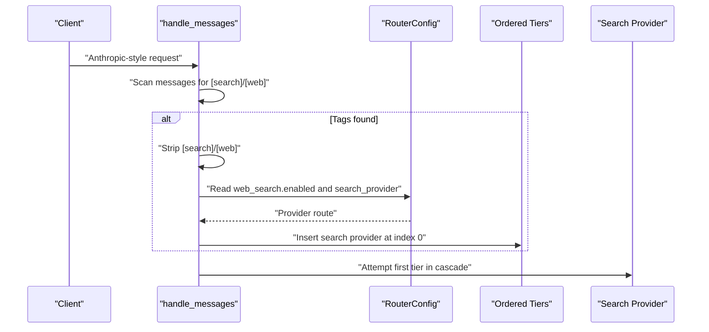

**Diagram sources**
- [router/mod.rs:364-395](file://src/router/mod.rs#L364-L395)
- [router/mod.rs:536-561](file://src/router/mod.rs#L536-L561)

**Section sources**
- [router/mod.rs:364-395](file://src/router/mod.rs#L364-L395)
- [router/mod.rs:536-561](file://src/router/mod.rs#L536-L561)

### Streaming Requirements and Forced Non-Streaming
Streaming is preserved from the client request unless a provider explicitly cannot stream:

- Providers using the Responses protocol are forced non-streaming.
- Providers whose configuration says they do not allow streaming are also forced non-streaming when `force_non_streaming` is enabled.
- When the client wants streaming but the selected provider is forced non-streaming, the response is wrapped as pseudo-SSE so clients expecting SSE can parse JSON responses.

This matters because some agent workloads fail when SSE frame limits are exceeded; the configuration option exists to suppress streaming globally while keeping routing behavior intact.

**Section sources**
- [router/mod.rs:108-138](file://src/router/mod.rs#L108-L138)
- [router/mod.rs:900-920](file://src/router/mod.rs#L900-L920)
- [configuration.md:112-140](file://docs/configuration.md#L112-L140)

### Request Shape Features and Response Complexity
For the optional GP reranker, request shape is summarized before any upstream call:

| Feature | Source | Purpose |
|---|---|---|
| Prompt characters | Sum of UTF-8 bytes in messages plus optional system prompt | Estimate input size and relative cost. |
| Estimated input tokens | Approximate formula applied to prompt characters | Feed cost estimator and GP features. |
| Max output tokens | `max_tokens` field | Estimate potential response complexity. |
| Request class | Streaming × tool-heavy boolean combination | Bucket similar workload shapes. |
| System prompt presence | `system` field | Adds context about conversation framing. |
| Message count | Number of messages | Proxy for conversation depth. |
| Tool count | Length of `tools` array | Proxy for tool-use complexity. |
| Active streams | Runtime state | Load awareness. |
| Max streams | Configuration limit | Capacity normalization. |
| Hour of day | Local clock | Time-of-day signal for learned routing. |

Response complexity is not classified statically in the main router. Instead, it is reflected indirectly through `max_tokens`, estimated input tokens, actual token usage after dispatch, and throughput metrics recorded during streaming.

**Section sources**
- [gp_router.rs:39-65](file://src/gp_router.rs#L39-L65)
- [gp_router.rs:331-358](file://src/gp_router.rs#L331-L358)
- [gp_router.rs:374-418](file://src/gp_router.rs#L374-L418)
- [streaming.rs:325-358](file://src/router/streaming.rs#L325-L358)

## Architecture Overview

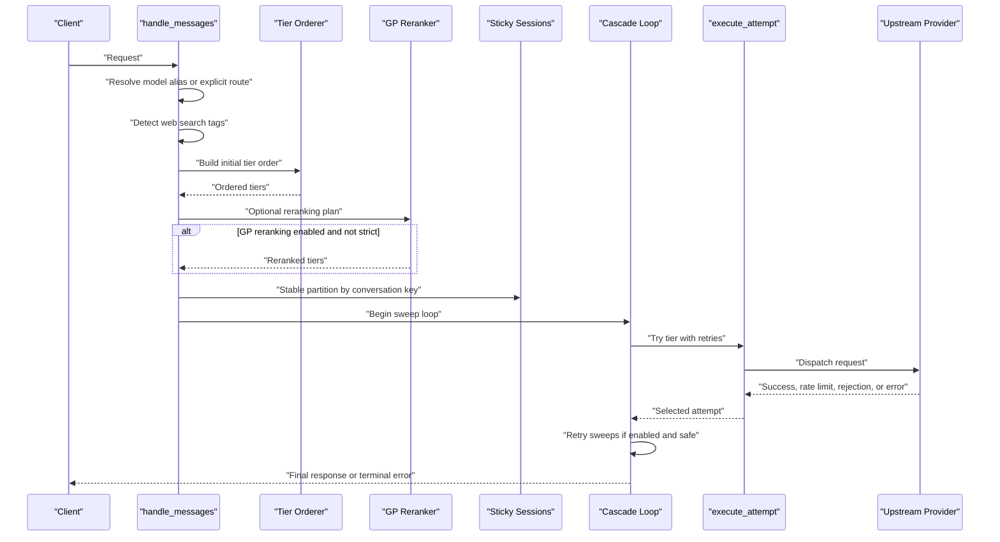

**Diagram sources**
- [router/mod.rs:505-561](file://src/router/mod.rs#L505-L561)
- [router/mod.rs:693-1150](file://src/router/mod.rs#L693-L1150)
- [gp_router.rs:108-170](file://src/gp_router.rs#L108-L170)
- [routing.rs:201-356](file://src/routing.rs#L201-L356)

## Detailed Component Analysis

### Tier Ordering and Priority Levels
The priority level of a tier is not determined solely by latency. Several mechanisms contribute:

1. **Configured chain**: `default`, `background`, and `think` define baseline routes.
2. **Strict vs EWMA**: Strict mode preserves configured priority; EWMA mode reorders by recent latency with randomization for unmeasured tiers.
3. **Direct routing**: An explicit `provider,model` request moves the matching tier to the front.
4. **Web search**: A search provider is prepended when tags are detected.
5. **Sticky sessions**: Requests belonging to a conversation are partitioned around a stable session key.
6. **GP reranking**: Optionally reorders candidates after the pinned prefix.

The effective priority is therefore layered:

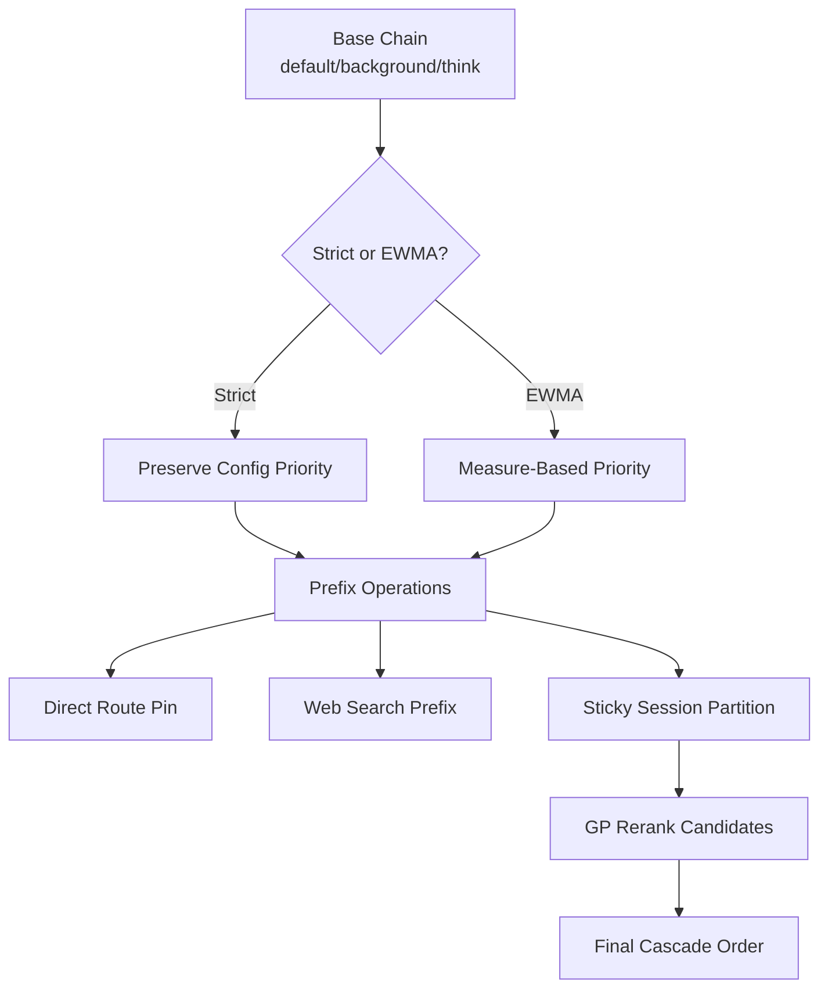

**Diagram sources**
- [router/mod.rs:505-561](file://src/router/mod.rs#L505-L561)
- [router/mod.rs:603-618](file://src/router/mod.rs#L603-L618)
- [routing.rs:201-356](file://src/routing.rs#L201-L356)
- [gp_router.rs:108-170](file://src/gp_router.rs#L108-L170)

**Section sources**
- [router/mod.rs:505-561](file://src/router/mod.rs#L505-L561)
- [router/mod.rs:603-618](file://src/router/mod.rs#L603-L618)
- [routing.rs:201-356](file://src/routing.rs#L201-L356)
- [gp_router.rs:108-170](file://src/gp_router.rs#L108-L170)

### EWMA Latency Tracking
The EWMA tracker maintains per-tier latency estimates:

- Successful attempts record real elapsed time.
- Failed attempts apply a configurable failure penalty multiplier rather than wall-clock failure duration.
- Unmeasured tiers are ignored by `sort_tiers`; measured tiers sort ascending by EWMA.
- `sort_tiers_with_config` applies softmax over negative EWMA values and samples without replacement.
- Parameters include smoothing alpha, minimum sample threshold, and failure penalty.

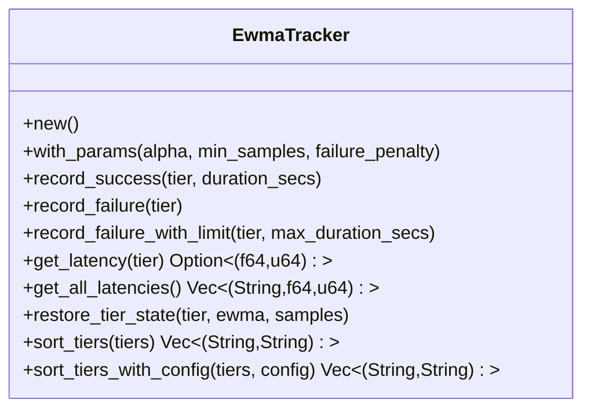

**Diagram sources**
- [routing.rs:1-356](file://src/routing.rs#L1-L356)

**Section sources**
- [routing.rs:1-200](file://src/routing.rs#L1-L200)
- [routing.rs:201-356](file://src/routing.rs#L201-L356)

### Cascade, Retries, Hedging, and Retry Sweeps
The cascade loop is the core execution engine:

- Each sweep iterates the ordered tier list once.
- Admission control defers tiers at capacity.
- Rate-limit tracking skips backoff-backed tiers.
- Per-tier retries use exponential backoff scaled by EWMA.
- Optional hedging launches a concurrent attempt on the next eligible tier after a TTFT threshold.
- Deterministic rejections (401/402/403/404) remove the tier from later sweeps.
- Retry sweeps keep the HTTP request open and re-cascade after a cooldown, subject to `maxHoldMs`, `maxSweeps`, and retry budget.

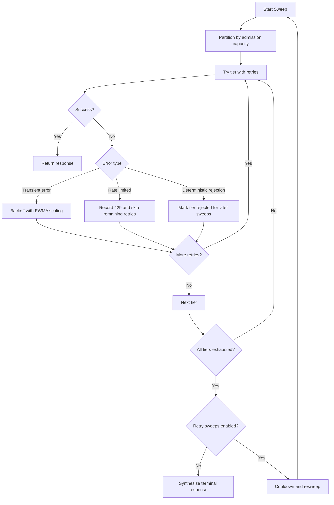

**Diagram sources**
- [router/mod.rs:693-1150](file://src/router/mod.rs#L693-L1150)

**Section sources**
- [router/mod.rs:693-1150](file://src/router/mod.rs#L693-L1150)

### Provider Dispatch and Headers
Dispatch handles both Anthropic-compatible and OpenAI-compatible protocols. It builds provider headers, translates requests when needed, inspects streaming responses, validates embedded errors, records usage, and inserts CCR metadata headers including the tier name.

Key responsibilities:

- Build Anthropic or OpenAI headers.
- Translate between protocols when required.
- Detect early streaming errors from providers that embed JSON errors inside HTTP 200 streams.
- Normalize OpenAI wrapper envelopes from gateways.
- Insert `x-ccr-tier` with the configured tier display name.
- Record token usage, cost, TTFT, and throughput.

**Section sources**
- [dispatch.rs:306-503](file://src/router/dispatch.rs#L306-L503)
- [dispatch.rs:724-984](file://src/router/dispatch.rs#L724-L984)
- [dispatch.rs:1069-1170](file://src/router/dispatch.rs#L1069-L1170)
- [dispatch.rs:1221-1532](file://src/router/dispatch.rs#L1221-L1532)

### Configuration Schema for Routing
Important routing-related configuration fields include:

| Field | Type | Default | Description |
|---|---|---|---|
| `default` | String | Required | Default route. |
| `background` | String? | None | Dedicated background route. |
| `think` | String? | None | Dedicated think route. |
| `modelAliases` | Map | Empty | Bare model name to provider route mapping. |
| `forceNonStreaming` | Boolean | false | Force non-streaming for all providers. |
| `ignoreDirect` | Boolean | false | Ignore explicit `provider,model` routing. |
| `tiers` | Vec<String>? | None | Override automatic tier construction. |
| `strictTierOrder` | Boolean | false | Preserve configured tier order instead of EWMA weighting. |
| `webSearch` | Object | Disabled | Web search configuration block. |
| `tierRetries` | Map | Global defaults | Per-tier retry and stream timeout settings. |
| `retrySweeps` | Object | Disabled | Hold-and-resweep behavior. |
| `retryBudgetPercent` | u8 | 20 | Percentage of active requests allowed as in-flight retries. |
| `stickySessions` | Object | Disabled | Conversation-provider stickiness. |
| `hedging` | Object | Disabled | Optional tail-latency hedging. |
| `presets` | Map | Empty | Named parameter and routing overrides. |
| `batching` | Object? | None | Request batching configuration. |
| `topK` | usize? | All tiers | Number of top providers considered for EWMA routing. |
| `routingTemperature` | f64? | 1.0 | Softmax routing temperature. |
| `gpRouting` | Object | Disabled | Optional Gaussian-process reranker configuration. |

**Section sources**
- [config/types.rs:595-740](file://src/config/types.rs#L595-L740)
- [configuration.md:112-200](file://docs/configuration.md#L112-L200)

## Dependency Analysis

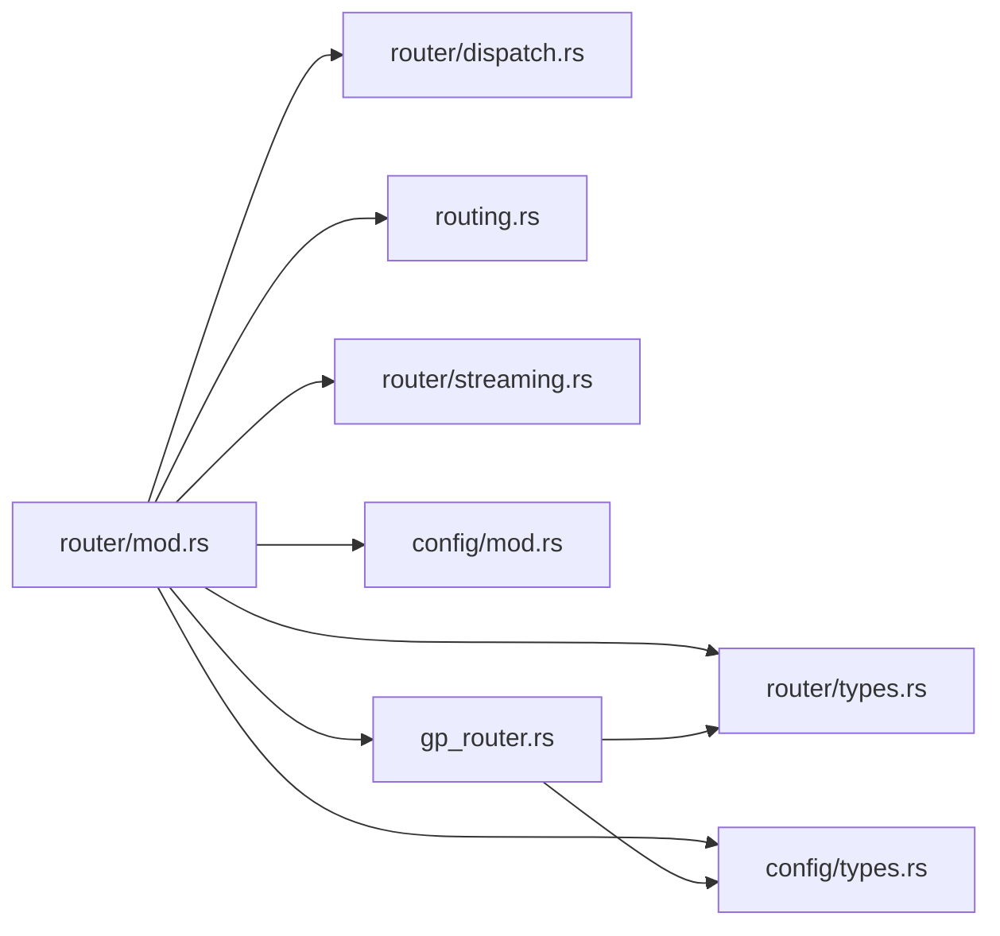

**Diagram sources**
- [router/mod.rs:1-20](file://src/router/mod.rs#L1-L20)
- [gp_router.rs:1-30](file://src/gp_router.rs#L1-L30)
- [routing.rs:1-20](file://src/routing.rs#L1-L20)
- [config/types.rs:595-740](file://src/config/types.rs#L595-L740)

**Section sources**
- [router/mod.rs:1-20](file://src/router/mod.rs#L1-L20)
- [gp_router.rs:1-30](file://src/gp_router.rs#L1-L30)
- [routing.rs:1-20](file://src/routing.rs#L1-L20)
- [config/types.rs:595-740](file://src/config/types.rs#L595-L740)

## Performance Considerations

- **EWMA smoothing**: A higher alpha reacts faster to latency changes but is noisier. A lower alpha smooths out transient spikes but adapts more slowly.
- **Minimum samples**: Tiers below the sample threshold keep config-defined order, preventing premature routing decisions from sparse data.
- **Failure penalty**: Failures inflate EWMA without recording long timeout durations, reducing the risk of poisoned latency estimates.
- **Softmax routing temperature**: Low temperature makes routing nearly deterministic; high temperature distributes load more evenly.
- **Top-K sampling**: Limiting the number of sampled tiers reduces unnecessary exploration while preserving probabilistic load distribution.
- **Strict tier order**: Use for intentional quality-ordered fallback chains where fast cheap models must not preempt preferred ones.
- **Hedging**: Launching a hedge improves time-to-first-token for tail latency but doubles resource use until the primary wins.
- **Retry sweeps**: Keep requests alive across backoffs, improving survival at the cost of longer client-held connections.
- **Prompt-length-based cost estimation**: Uses a simple four-byte-per-token approximation; authoritative cost still comes from provider usage.
- **Token budget admission**: Defers requests when a route’s reserved in-flight token total would exceed the configured budget.

**Section sources**
- [routing.rs:1-356](file://src/routing.rs#L1-L356)
- [router/mod.rs:108-138](file://src/router/mod.rs#L108-L138)
- [router/mod.rs:693-1150](file://src/router/mod.rs#L693-L1150)
- [gp_router.rs:374-418](file://src/gp_router.rs#L374-L418)

## Troubleshooting Guide

### All Candidate Tiers Are Rate Limited
When every tier returns 429, the router synthesizes a terminal response listing each exhausted route, optional per-tier retry-after hints, and a `retry-after` header when available.

Diagnostic steps:

1. Check `x-ccr-rate-limited-tiers` for the full list of exhausted routes.
2. Inspect per-tier `tierRetries` configuration.
3. Verify whether `retrySweeps` is enabled; if disabled, the first 429 may be returned immediately depending on code path.
4. Monitor rate-limit metrics recorded by tier.

**Section sources**
- [router/mod.rs:396-459](file://src/router/mod.rs#L396-L459)
- [router/mod.rs:820-903](file://src/router/mod.rs#L820-L903)
- [router/mod.rs:1090-1150](file://src/router/mod.rs#L1090-L1150)

### Deterministic Upstream Rejection
Rejections such as 401, 402, 403, or 404 are treated as non-retryable. The tier is marked rejected for the remainder of the request, preventing repeated load against the same failing route.

Diagnostic steps:

1. Confirm credentials and account status for the affected provider.
2. Check whether `ignoreDirect` is suppressing an explicit route.
3. Review tier-specific retry configuration.
4. Inspect metrics for `provider_rejected` and deterministic rejection counters.

**Section sources**
- [router/mod.rs:939-972](file://src/router/mod.rs#L939-L972)

### Streaming Timeout or Idle Stream Issues
Streaming paths track first-event and idle timeouts. If a stream stalls, the router reports an idle-timeout failure and records it against the tier.

Diagnostic steps:

1. Compare `stream_first_event_timeout_ms` and `stream_idle_timeout_ms` with upstream performance.
2. Check whether the provider is forcing non-streaming despite client streaming preference.
3. Inspect streaming metrics for TTFT and throughput.
4. Validate whether the provider wraps errors inside streaming bodies.

**Section sources**
- [streaming.rs:77-101](file://src/router/streaming.rs#L77-L101)
- [streaming.rs:438-443](file://src/router/streaming.rs#L438-L443)
- [dispatch.rs:213-243](file://src/router/dispatch.rs#L213-L243)

### Customizing Traffic Class Behavior
To customize routing behavior:

1. Set `Router.default`, `Router.background`, and `Router.think` to assign provider-model routes.
2. Use `Router.modelAliases` to map bare model names to provider routes.
3. Enable `Router.webSearch` and configure `webSearch.searchProvider` to inject a search tier.
4. Use `Router.strictTierOrder` for deterministic fallback chains.
5. Tune `Router.topK` and `Router.routingTemperature` for EWMA-based load distribution.
6. Configure `Router.tierRetries` per tier for custom retry/backoff/stream timeouts.
7. Enable `Router.retrySweeps` to hold requests open across backoffs.
8. Enable `Router.hedging` to reduce tail latency at the cost of extra provider calls.
9. Use provider `tier_name` to control the displayed tier label in headers and logs.

**Section sources**
- [config/types.rs:595-740](file://src/config/types.rs#L595-L740)
- [config/mod.rs:662-729](file://src/config/mod.rs#L662-L729)
- [configuration.md:112-200](file://docs/configuration.md#L112-L200)

### Monitoring Traffic Distribution Across Classes
Monitoring focuses on tier-level telemetry rather than a single traffic-class histogram:

- Record request counts and durations per frontend and tier.
- Track per-tier latency EWMA through metrics synchronization.
- Observe rate-limit hits and backoff events.
- Inspect final `x-ccr-tier` and `x-ccr-rate-limited-tiers` headers.
- Use debug capture to inspect raw provider interactions when enabled.

**Section sources**
- [router/mod.rs:900-908](file://src/router/mod.rs#L900-L908)
- [router/mod.rs:1090-1150](file://src/router/mod.rs#L1090-L1150)
- [dispatch.rs:503-510](file://src/router/dispatch.rs#L503-L510)

## Conclusion
CCR-Rust’s traffic class routing is a composition of explicit routes, model aliases, web search tagging, streaming requirements, request-shape features, and layered ordering strategies. The most important design principle is separation of concerns:

- **Classification** identifies what kind of request is arriving.
- **Ordering** decides which tiers are candidates and in what priority.
- **Execution** runs the cascade with retries, hedging, admission control, and retry sweeps.
- **Observability** records latency, failures, costs, and tier provenance.

For production systems, prefer explicit `default`/`background`/`think` routes for predictable priority, enable `strictTierOrder` when fallback quality matters, and use EWMA and GP reranking only after sufficient telemetry has accumulated.

## Appendices

### Configuration Examples

#### Basic Default, Background, and Think Routes
Set distinct provider-model pairs for general, background, and thinking workloads.

Example configuration structure:

```json
{
  "Providers": [
    {
      "name": "example",
      "api_base_url": "https://api.example.com/v1/chat/completions",
      "api_key": "${EXAMPLE_API_KEY}",
      "models": ["fast-model", "thinking-model", "background-model"]
    }
  ],
  "Router": {
    "default": "example,fast-model",
    "background": "example,background-model",
    "think": "example,thinking-model"
  }
}
```

#### High-Priority Think Requests With Strict Fallback
Use strict order to ensure a premium model is attempted before cheaper models.

```json
{
  "Router": {
    "default": "example,fast-model",
    "think": "example,thinking-model",
    "strictTierOrder": true,
    "tierRetries": {
      "tier-0": {
        "max_retries": 3,
        "base_backoff_ms": 100,
        "backoff_multiplier": 2.0,
        "max_backoff_ms": 10000
      }
    }
  }
}
```

#### Web Search Enabled With Dedicated Search Provider
Enable web search and point it to a specialized provider.

```json
{
  "Router": {
    "default": "example,default-model",
    "webSearch": {
      "enabled": true,
      "searchProvider": "example,search-model"
    }
  }
}
```

#### EWMA Weighted Routing With Temperature Control
Allow latency-aware load distribution across multiple providers.

```json
{
  "Router": {
    "default": "example,model-a",
    "topK": 3,
    "routingTemperature": 1.0
  }
}
```

#### Retry Sweeps For Resilient Long-Running Requests
Keep requests alive during temporary provider outages.

```json
{
  "Router": {
    "default": "example,model-a",
    "retrySweeps": {
      "enabled": true,
      "maxSweeps": 5,
      "sweepCooldownMs": 2000,
      "maxHoldMs": 60000
    }
  }
}
```

**Section sources**
- [configuration.md:112-200](file://docs/configuration.md#L112-L200)
- [config/types.rs:595-740](file://src/config/types.rs#L595-L740)