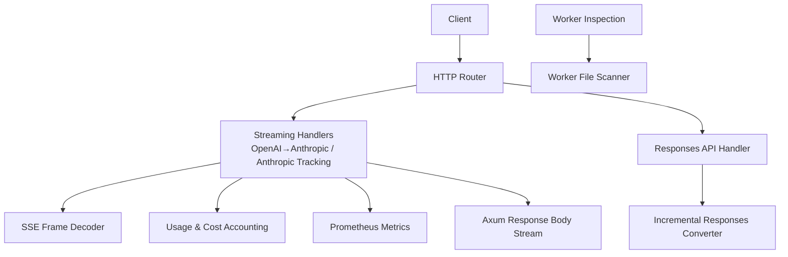
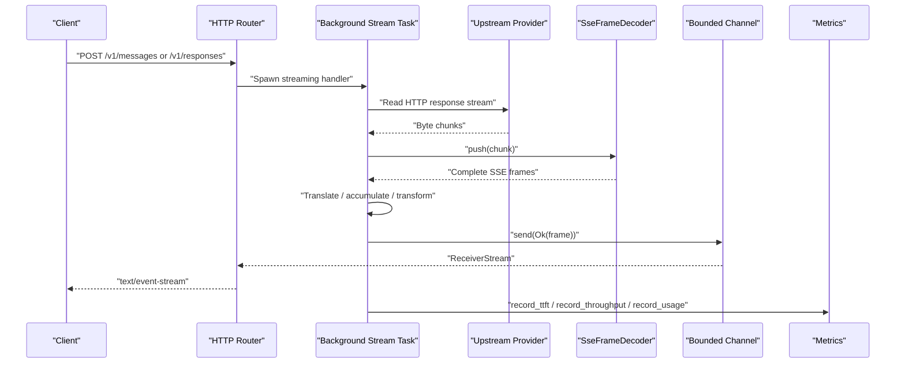
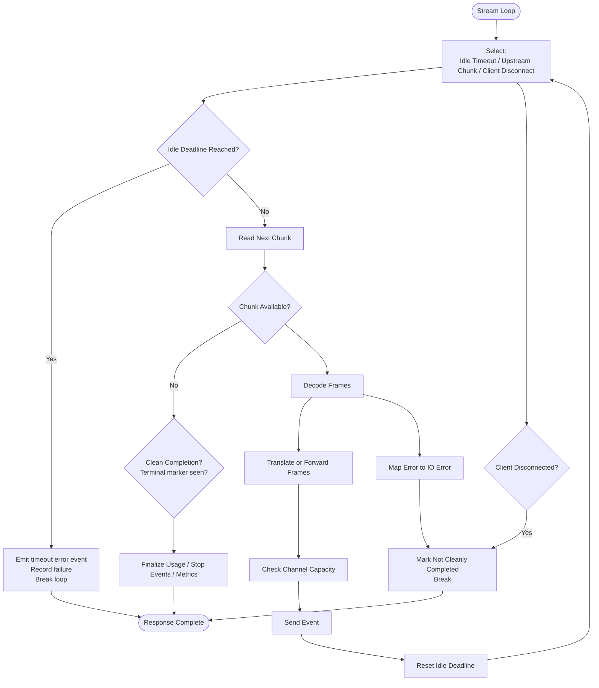
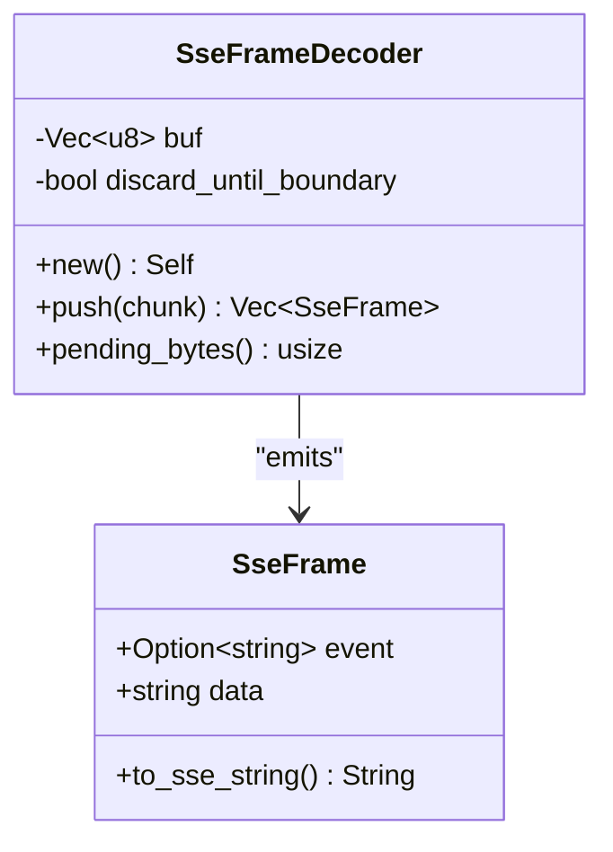
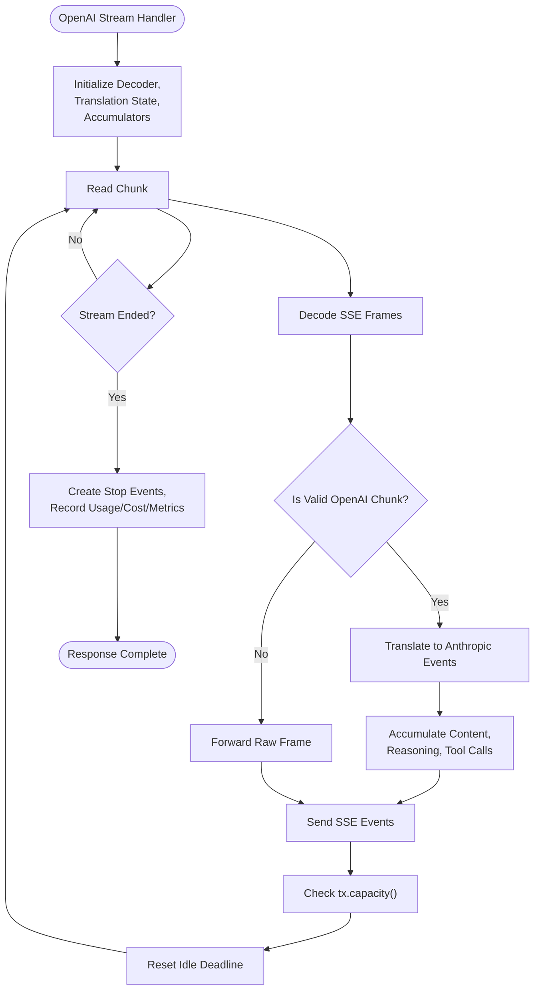
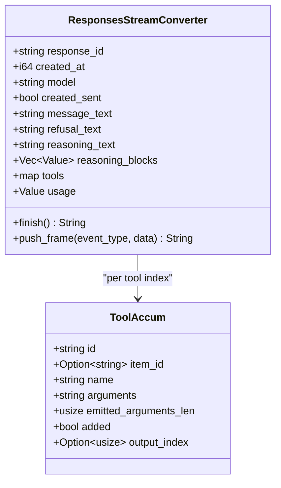
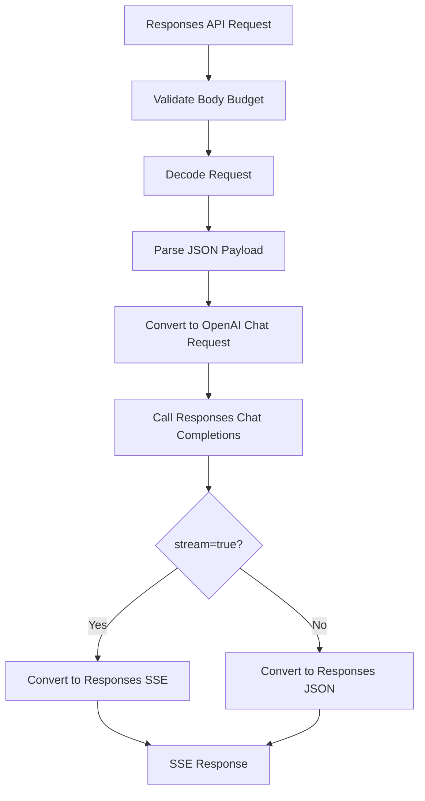
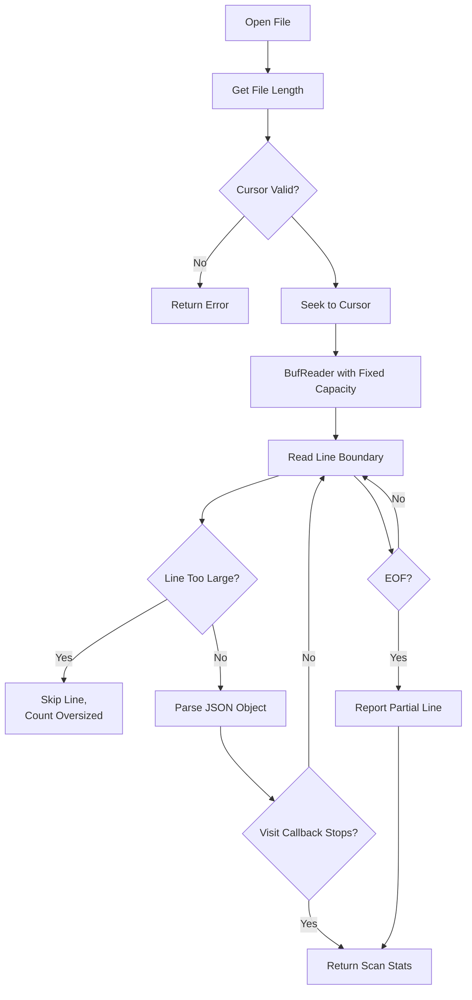
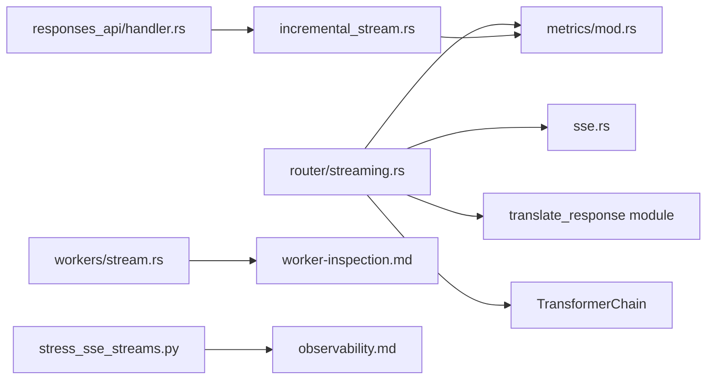

# Streaming System

<cite>
**Referenced Files in This Document**
- [README.md](file://README.md)
- [src/lib.rs](file://src/lib.rs)
- [src/main.rs](file://src/main.rs)
- [src/sse.rs](file://src/sse.rs)
- [src/router/streaming.rs](file://src/router/streaming.rs)
- [src/router/responses_api/incremental_stream.rs](file://src/router/responses_api/incremental_stream.rs)
- [src/router/responses_api/handler.rs](file://src/router/responses_api/handler.rs)
- [src/workers/stream.rs](file://src/workers/stream.rs)
- [src/metrics/mod.rs](file://src/metrics/mod.rs)
- [docs/streaming_incremental_design.md](file://docs/streaming_incremental_design.md)
- [docs/observability.md](file://docs/observability.md)
- [docs/worker-inspection.md](file://docs/worker-inspection.md)
- [benchmarks/stress_sse_streams.py](file://benchmarks/stress_sse_streams.py)
</cite>

## Table of Contents
1. [Introduction](#introduction)
2. [Project Structure](#project-structure)
3. [Core Components](#core-components)
4. [Architecture Overview](#architecture-overview)
5. [Detailed Component Analysis](#detailed-component-analysis)
6. [Dependency Analysis](#dependency-analysis)
7. [Performance Considerations](#performance-considerations)
8. [Troubleshooting Guide](#troubleshooting-guide)
9. [Conclusion](#conclusion)

## Introduction
This document explains CCR-Rust’s real-time streaming architecture with a focus on high-throughput HTTP response delivery, backpressure management, Server-Sent Events (SSE) handling, incremental response processing, stream state management, error recovery, resource cleanup, and the relationship between streaming and the worker inspection system. It also covers performance characteristics for concurrent streams, memory management, monitoring metrics, debugging techniques, and throughput optimization guidance.

CCR-Rust is an LLM router that translates between client-facing protocols (Anthropic-style and OpenAI-compatible APIs) and upstream provider formats while supporting long-running, token-by-token streaming responses. The streaming path avoids materializing entire upstream payloads and instead processes SSE frames incrementally through bounded channels.

**Section sources**
- [README.md:1-120](file://README.md#L1-L120)

## Project Structure
The streaming system spans several modules:

| Area | Responsibility |
|---|---|
| `src/sse.rs` | Incremental SSE frame decoder and per-stream verification context |
| `src/router/streaming.rs` | Main streaming handlers: OpenAI-to-Anthropic translation, Anthropic tracking, pseudo-streaming, usage accounting, idle timeouts, and backpressure recording |
| `src/router/responses_api/incremental_stream.rs` | Stateful OpenAI/Anthropic to Responses API converter |
| `src/router/responses_api/handler.rs` | Entry point that chooses streaming vs non-streaming Responses conversion |
| `src/metrics/mod.rs` | Prometheus gauges, counters, histograms, active-stream tracking, TTFT, throughput, drift, and persistence constants |
| `src/workers/stream.rs` | Streaming file scanner used by the worker inspection subsystem |
| `src/main.rs` | CLI entry point exposing server options such as maximum concurrent streams |
| `docs/streaming_incremental_design.md` | Design specification for incremental streaming, backpressure policy, and test scenarios |
| `docs/observability.md` | Metrics endpoints, dashboard, and streaming-related observability |
| `docs/worker-inspection.md` | Low-context worker inspection workflow and command surface |
| `benchmarks/stress_sse_streams.py` | Concurrent SSE stress test harness |

**Diagram sources**
- [src/router/streaming.rs:1-120](file://src/router/streaming.rs#L1-L120)
- [src/sse.rs:1-80](file://src/sse.rs#L1-L80)
- [src/router/responses_api/handler.rs:1-120](file://src/router/responses_api/handler.rs#L1-L120)
- [src/router/responses_api/incremental_stream.rs:1-80](file://src/router/responses_api/incremental_stream.rs#L1-L80)
- [src/workers/stream.rs:1-40](file://src/workers/stream.rs#L1-L40)
- [src/metrics/mod.rs:1-120](file://src/metrics/mod.rs#L1-L120)

**Section sources**
- [src/lib.rs:1-27](file://src/lib.rs#L1-L27)
- [src/main.rs:1-120](file://src/main.rs#L1-L120)
- [docs/streaming_incremental_design.md:1-177](file://docs/streaming_incremental_design.md#L1-L177)

## Core Components
The streaming system is built around these core components:

| Component | Purpose | Key Behaviors |
|---|---|---|
| `SseFrameDecoder` | Incremental SSE parser | Accepts arbitrary byte chunks, emits complete `(event, data)` frames, bounds incomplete frame buffers, skips malformed frames safely |
| `StreamVerifyCtx` | Per-stream metadata | Tracks tier name, rate-limit key and generation, admission permit, pricing, stream start time, idle timeout, and local token estimate |
| `stream_response_translated` | OpenAI → Anthropic streaming | Decodes OpenAI SSE, translates chunks, accumulates tool calls and reasoning, emits stop events, records usage and metrics |
| `stream_anthropic_response_with_tracking` | Anthropic streaming | Parses Anthropic SSE events, tracks usage fields, applies transformers, records cost and drift, updates rate-limit success only on clean completion |
| `ResponsesStreamConverter` | OpenAI/Anthropic → Responses API | Maintains message, reasoning, refusal, tool, and usage state; emits created/output_item/delta/done/terminal events incrementally |
| Active stream guard | Concurrency accounting | Increments/decrements active stream gauge via `ActiveStreamGuard` |
| Worker stream scanner | Inspect persisted worker logs | Streams JSON lines from files with cursor support, size limits, and truncation detection |

**Section sources**
- [src/sse.rs:1-120](file://src/sse.rs#L1-L120)
- [src/router/streaming.rs:1-120](file://src/router/streaming.rs#L1-L120)
- [src/router/responses_api/incremental_stream.rs:1-120](file://src/router/responses_api/incremental_stream.rs#L1-L120)
- [src/workers/stream.rs:1-40](file://src/workers/stream.rs#L1-L40)

## Architecture Overview
At runtime, a client request enters the HTTP router. For streaming requests, the router spawns a background task that reads the upstream response, decodes it incrementally, transforms or forwards events, and writes them into a bounded channel. Axum converts that channel into a streaming response body.

**Diagram sources**
- [src/router/streaming.rs:1-200](file://src/router/streaming.rs#L1-L200)
- [src/sse.rs:1-120](file://src/sse.rs#L1-L120)
- [src/metrics/mod.rs:1-120](file://src/metrics/mod.rs#L1-L120)

### Streaming Control Flow
The main streaming loop uses `tokio::select!` to multiplex three concerns:

1. **Idle timeout**: If no useful frame is forwarded within `stream_idle_timeout`, emit a timeout error event and terminate the stream.
2. **Upstream chunk**: Read the next chunk, decode SSE frames, translate or forward events, update timing, and refresh the idle deadline.
3. **Client disconnect**: If the downstream channel closes, abort upstream reading immediately.

**Diagram sources**
- [src/router/streaming.rs:1-200](file://src/router/streaming.rs#L1-L200)
- [src/router/streaming.rs:524-700](file://src/router/streaming.rs#L524-L700)

**Section sources**
- [src/router/streaming.rs:1-200](file://src/router/streaming.rs#L1-L200)
- [src/router/streaming.rs:524-700](file://src/router/streaming.rs#L524-L700)

## Detailed Component Analysis

### SSE Frame Decoder
`SseFrameDecoder` is designed for robust, incremental parsing under network fragmentation. It maintains an internal buffer and supports:

- Splitting across arbitrary byte boundaries.
- Handling both LF and CRLF line endings.
- Reassembling multiline `data:` fields.
- Preserving non-JSON payloads for pass-through cases.
- Discarding malformed frames without losing later valid frames.
- Bounding incomplete frame memory with `MAX_PENDING_BYTES`.

**Diagram sources**
- [src/sse.rs:1-80](file://src/sse.rs#L1-L80)
- [src/sse.rs:80-120](file://src/sse.rs#L80-L120)

Key properties:
- `MAX_PENDING_BYTES` prevents unbounded memory growth when an upstream sends an unterminated frame.
- `discard_until_boundary` ensures discarded malformed content does not leak into subsequent frames.
- Tests verify split frames, oversized batches, CRLF handling, and preservation of raw error payloads.

**Section sources**
- [src/sse.rs:1-120](file://src/sse.rs#L1-L120)
- [src/sse.rs:120-345](file://src/sse.rs#L120-L345)

### OpenAI-to-Anthropic Streaming Translation
`stream_response_translated` handles the common case where CCR-Rust receives OpenAI-format streaming chunks and must deliver Anthropic-compatible SSE events.

Responsibilities:
- Decode OpenAI SSE frames using `SseFrameDecoder`.
- Accumulate prompt and completion usage from OpenAI chunks.
- Translate deltas into Anthropic events.
- Accumulate tool call fragments by index.
- Track first and last token times for TTFT and throughput.
- Apply optional transformer chain to streamed content.
- Emit final stop events with normalized usage.
- Record token usage, cost, drift verification, TTFT, throughput, and rate-limit success only when the stream completed cleanly.

**Diagram sources**
- [src/router/streaming.rs:1-200](file://src/router/streaming.rs#L1-L200)
- [src/router/streaming.rs:200-523](file://src/router/streaming.rs#L200-L523)

Important behaviors:
- When the downstream channel is full, `tx.capacity() == 0` triggers backpressure recording.
- A client disconnect sets `upstream_completed_cleanly = false`, preventing misleading rate-limit success signals.
- If upstream usage is missing, the handler can fall back to accumulated content length or pre-request estimates before emitting terminal usage events.

**Section sources**
- [src/router/streaming.rs:1-200](file://src/router/streaming.rs#L1-L200)
- [src/router/streaming.rs:200-523](file://src/router/streaming.rs#L200-L523)

### Anthropic Streaming with Tracking
`stream_anthropic_response_with_tracking` parses Anthropic protocol SSE events and adds usage accounting, transformer application, and metric recording.

Key points:
- Extracts input, output, cache read, and cache creation tokens from multiple locations (`usage`, `message.usage`).
- Uses positive-value semantics so later events do not zero earlier reports.
- Applies transformers to frames when configured.
- Estimates output tokens from text length if providers return zeros.
- Records TTFT and throughput similarly to the OpenAI path.
- Only clears rate-limit backoff on clean completion.

**Section sources**
- [src/router/streaming.rs:524-900](file://src/router/streaming.rs#L524-L900)

### Responses API Incremental Converter
`ResponsesStreamConverter` implements the most complex incremental state machine: it converts either OpenAI or Anthropic SSE frames into the OpenAI Responses API event model.

State tracked includes:
- Response identity, model, status, and creation timestamp.
- Whether the initial `response.created` event has been emitted.
- Message text, refusal text, and quote-artifact buffering.
- Reasoning text and reasoning blocks with signature handling.
- Tool-call accumulation per index.
- Usage mapping between OpenAI and Anthropic formats.

**Diagram sources**
- [src/router/responses_api/incremental_stream.rs:1-120](file://src/router/responses_api/incremental_stream.rs#L1-L120)
- [src/router/responses_api/incremental_stream.rs:120-200](file://src/router/responses_api/incremental_stream.rs#L120-L200)

Lifecycle:
1. `push_frame` parses each upstream frame and emits incremental Responses events.
2. Message content parts are introduced lazily and flushed at finish.
3. Reasoning blocks are sealed when block indices change.
4. Tool calls are deduplicated by index and finalized with merged arguments.
5. `finish` emits `output_item.done` events, final items, and a terminal response event such as `completed`, `incomplete`, or `failed`.

Quote artifact handling is intentional: leading quote-like prefixes are held until real body text appears, preventing accidental misclassification of quoted artifacts as message content.

**Section sources**
- [src/router/responses_api/incremental_stream.rs:1-200](file://src/router/responses_api/incremental_stream.rs#L1-L200)
- [src/router/responses_api/incremental_stream.rs:200-616](file://src/router/responses_api/incremental_stream.rs#L200-L616)
- [src/router/responses_api/incremental_stream.rs:617-1025](file://src/router/responses_api/incremental_stream.rs#L617-L1025)
- [src/router/responses_api/incremental_stream.rs:1026-1132](file://src/router/responses_api/incremental_stream.rs#L1026-L1132)

### Responses API Handler
The Responses handler decides whether to convert streaming or non-streaming OpenAI responses into the Responses format.

Behavior:
- Reads and validates the request body against `max_request_body_bytes`.
- Converts the Responses request into an OpenAI chat request.
- Delegates to `handle_responses_chat_completions`.
- Attaches a body budget extension for downstream use.
- Chooses `convert_openai_stream_response_to_responses` or `convert_openai_json_response_to_responses` based on the `stream` field.

**Diagram sources**
- [src/router/responses_api/handler.rs:1-120](file://src/router/responses_api/handler.rs#L1-L120)

**Section sources**
- [src/router/responses_api/handler.rs:1-120](file://src/router/responses_api/handler.rs#L1-L120)

### Pseudo-Streaming and Non-Streaming Conversion
When a client requests streaming but the upstream returned a complete response, CCR-Rust can emit pseudo-streaming events by wrapping the finished response into Anthropic-style SSE frames. This preserves consistency for clients expecting SSE even when the upstream was non-streaming.

**Section sources**
- [src/router/streaming.rs:900-1478](file://src/router/streaming.rs#L900-L1478)

### Worker Inspection Stream Scanner
The worker inspection subsystem reads persisted launcher artifacts rather than live model calls. Its streaming scanner:

- Opens a file and inspects its length.
- Validates cursors relative to file bytes.
- Requires the cursor to be positioned immediately after a newline.
- Reads fixed-size buffered chunks.
- Skips oversized lines and counts malformed lines.
- Reports partial lines and truncation.
- Supports pagination via `after` cursor and `visit` callback.

**Diagram sources**
- [src/workers/stream.rs:1-107](file://src/workers/stream.rs#L1-L107)

**Section sources**
- [src/workers/stream.rs:1-107](file://src/workers/stream.rs#L1-L107)
- [docs/worker-inspection.md:1-120](file://docs/worker-inspection.md#L1-L120)

## Dependency Analysis
The streaming subsystem depends on routing, SSE decoding, metrics, and worker inspection infrastructure.

**Diagram sources**
- [src/router/streaming.rs:1-60](file://src/router/streaming.rs#L1-L60)
- [src/router/responses_api/handler.rs:1-60](file://src/router/responses_api/handler.rs#L1-L60)
- [src/router/responses_api/incremental_stream.rs:1-60](file://src/router/responses_api/incremental_stream.rs#L1-L60)
- [src/workers/stream.rs:1-40](file://src/workers/stream.rs#L1-L40)
- [docs/observability.md:1-80](file://docs/observability.md#L1-L80)
- [benchmarks/stress_sse_streams.py:1-60](file://benchmarks/stress_sse_streams.py#L1-L60)

Coupling observations:
- Streaming handlers depend on `SseFrameDecoder` for robust framing and on `metrics` for TTFT, throughput, backpressure, and usage.
- The Responses converter owns significant in-memory state for message, reasoning, and tool accumulation.
- Worker scanning is independent of live streaming; it provides offline inspection of persisted launcher logs.
- The stress test integrates with `/v1/usage` and the public HTTP API, making it suitable for measuring concurrency and throughput behavior.

**Section sources**
- [src/router/streaming.rs:1-120](file://src/router/streaming.rs#L1-L120)
- [src/router/responses_api/incremental_stream.rs:1-120](file://src/router/responses_api/incremental_stream.rs#L1-L120)
- [src/workers/stream.rs:1-40](file://src/workers/stream.rs#L1-L40)
- [docs/observability.md:1-80](file://docs/observability.md#L1-L80)
- [benchmarks/stress_sse_streams.py:1-60](file://benchmarks/stress_sse_streams.py#L1-L60)

## Performance Considerations

### Backpressure Management
The streaming implementation uses a bounded `tokio::sync::mpsc` channel. When the downstream consumer cannot keep up:

- `tx.capacity() == 0` is detected before sending.
- `record_stream_backpressure()` increments `ccr_stream_backpressure_total`.
- The upstream read continues, but failed sends mark the stream as not cleanly completed.
- The design specification recommends coalescing high-frequency delta events under backpressure and aborting persistent stalls.

Recommendations:
- Monitor `ccr_stream_backpressure_total` alongside `ccr_active_streams`.
- Tune `max_streams` via the CLI option `--max-streams`; setting it to `0` allows unlimited concurrent streams, which may increase memory pressure under load.
- Ensure clients consume SSE frames promptly to avoid channel saturation.

**Section sources**
- [src/router/streaming.rs:1-120](file://src/router/streaming.rs#L1-L120)
- [docs/streaming_incremental_design.md:100-177](file://docs/streaming_incremental_design.md#L100-L177)
- [src/main.rs:80-140](file://src/main.rs#L80-L140)

### Memory Management
Memory risks in streaming are primarily caused by:

- Unbounded incomplete SSE frames: mitigated by `MAX_PENDING_BYTES`.
- Accumulated tool-call arguments, reasoning text, and message text in `ResponsesStreamConverter`.
- Accumulated content strings in OpenAI-to-Anthropic translation.
- Large pseudo-streaming event vectors when wrapping complete responses.

Mitigations present in code:
- Incomplete frame buffer limit.
- Discard-and-resume boundary logic for malformed frames.
- Incremental event emission rather than full-body buffering for most streaming paths.
- Worker scanner uses fixed `READ_CHUNK_BYTES` and `MAX_RECORD_BYTES`.

Optimization opportunities:
- Bound accumulated tool-call argument buffers per stream.
- Periodically flush partial reasoning or message text where protocol correctness permits.
- Avoid holding reference-counted values longer than necessary in hot loops.

**Section sources**
- [src/sse.rs:1-120](file://src/sse.rs#L1-L120)
- [src/router/responses_api/incremental_stream.rs:1-200](file://src/router/responses_api/incremental_stream.rs#L1-L200)
- [src/workers/stream.rs:1-40](file://src/workers/stream.rs#L1-L40)

### Monitoring Streaming Metrics
Key metrics include:

| Metric | Meaning |
|---|---|
| `ccr_active_streams` | Current number of active SSE streams |
| `ccr_peak_active_streams` | High-water mark for concurrent streams |
| `ccr_stream_backpressure_total` | Number of times a producer blocked due to a full channel |
| `ccr_ttft_seconds` | Time-to-first-token histogram per tier |
| `ccr_output_tokens_per_second` | Output throughput histogram per tier |
| `ccr_input_tokens_total` | Total input tokens per tier |
| `ccr_output_tokens_total` | Total output tokens per tier |
| `ccr_cost_usd_total` | Estimated USD cost per tier |
| `ccr_token_drift_pct` | Drift between local token estimates and upstream-reported usage |

These are exposed through Prometheus at `/metrics` and summarized by `/v1/usage`, `/v1/token-drift`, and the terminal dashboard.

**Section sources**
- [src/metrics/mod.rs:1-200](file://src/metrics/mod.rs#L1-L200)
- [src/metrics/mod.rs:200-500](file://src/metrics/mod.rs#L200-L500)
- [docs/observability.md:1-120](file://docs/observability.md#L1-L120)

### Concurrent Streams
Concurrency is controlled at two levels:

1. **Process-wide stream concurrency**: Configured via `--max-streams` in the CLI.
2. **Per-tier admission and inflight controls**: Exposed through metrics like `ccr_tier_inflight`, `ccr_tier_limit`, and `ccr_admission_defers_total`.

The benchmark script launches many concurrent SSE streams, measures TTFB, total duration, chunk count, byte count, and polls `/v1/usage` for peak active streams.

**Section sources**
- [src/main.rs:80-140](file://src/main.rs#L80-L140)
- [src/metrics/mod.rs:120-200](file://src/metrics/mod.rs#L120-L200)
- [benchmarks/stress_sse_streams.py:1-120](file://benchmarks/stress_sse_streams.py#L1-L120)

## Troubleshooting Guide

### Symptom: Streams Stall Under Load
Likely causes:
- Downstream consumer is slow, causing channel saturation.
- Client disconnected while upstream still producing.
- Provider returns very large or malformed SSE frames.

What to check:
- `ccr_stream_backpressure_total` increasing.
- `ccr_active_streams` near the configured limit.
- Logs mentioning client disconnection or idle timeout.

Actions:
- Increase client consumption speed.
- Adjust `--max-streams`.
- Inspect upstream provider stability and frame size.

**Section sources**
- [src/router/streaming.rs:1-200](file://src/router/streaming.rs#L1-L200)
- [src/sse.rs:1-120](file://src/sse.rs#L1-L120)

### Symptom: Missing or Incorrect Token Counts
Likely causes:
- Upstream omitted usage fields.
- Local tiktoken estimate differs from upstream-reported usage.
- Cache splits reported inconsistently.

What to check:
- `/v1/token-drift`.
- `ccr_token_drift_pct`.
- `ccr_input_tokens_total` and `ccr_output_tokens_total`.

Actions:
- Compare local prompt construction with upstream expectations.
- Review provider documentation for cache token reporting.
- Use `/v1/token-audit` for recent pre-request breakdowns.

**Section sources**
- [src/router/streaming.rs:200-523](file://src/router/streaming.rs#L200-L523)
- [src/router/streaming.rs:524-700](file://src/router/streaming.rs#L524-L700)
- [docs/observability.md:120-200](file://docs/observability.md#L120-L200)

### Symptom: Responses API Events Are Delayed or Out of Order
Likely causes:
- Quote artifact buffering delaying message deltas.
- Tool-call arguments arriving late.
- Reasoning blocks being sealed only on index changes.

What to check:
- Responses converter state in logs.
- Whether tool deltas arrive before `id` or `name`.
- Whether reasoning blocks use stable indices.

Actions:
- Prefer providers that send tool metadata early.
- Avoid relying on exact delta timing when artifact buffering is involved.
- Validate final `output_item.done` payloads rather than only intermediate deltas.

**Section sources**
- [src/router/responses_api/incremental_stream.rs:200-616](file://src/router/responses_api/incremental_stream.rs#L200-L616)
- [src/router/responses_api/incremental_stream.rs:617-1025](file://src/router/responses_api/incremental_stream.rs#L617-L1025)

### Symptom: Worker Inspection Fails Midway
Likely causes:
- Cursor exceeds snapshot size.
- Cursor not aligned to newline.
- Worker log truncated during inspection.
- Malformed or oversized JSON lines.

What to check:
- `next_cursor`, `file_bytes`, `malformed_lines`, `oversized_lines`, `partial_line`.
- Restart from cursor `0` when truncation is detected.

Actions:
- Rescan from a safe cursor.
- Reduce payload size or inspect raw launcher relay logs separately.

**Section sources**
- [src/workers/stream.rs:1-107](file://src/workers/stream.rs#L1-L107)
- [docs/worker-inspection.md:120-200](file://docs/worker-inspection.md#L120-L200)

### Debugging Techniques
Recommended approach:

1. Reproduce with a small request and capture logs.
2. Check `/health`, `/metrics`, `/v1/usage`, and `/v1/token-drift`.
3. Run the stress test with a reduced stream count to isolate backpressure.
4. Compare `ccr_active_streams` with observed client connections.
5. Inspect worker inspection artifacts for past runs when diagnosing delegation failures.
6. Use the terminal dashboard for real-time EWMA latency and token drift visibility.

**Section sources**
- [docs/observability.md:1-120](file://docs/observability.md#L1-L120)
- [benchmarks/stress_sse_streams.py:1-120](file://benchmarks/stress_sse_streams.py#L1-L120)
- [docs/worker-inspection.md:1-120](file://docs/worker-inspection.md#L1-L120)

## Conclusion
CCR-Rust’s streaming architecture combines incremental SSE decoding, bounded-channel backpressure, protocol translation, usage accounting, and explicit stream lifecycle management. The system prioritizes low-latency delivery and resilience over full-payload buffering, while retaining enough state to reconstruct meaningful protocol events such as tool calls, reasoning blocks, and terminal responses.

For operators, the most important knobs and signals are:

- Configure `--max-streams` according to available memory and client consumption capacity.
- Monitor `ccr_active_streams`, `ccr_peak_active_streams`, and `ccr_stream_backpressure_total`.
- Watch TTFT and throughput histograms for degradation.
- Track token drift to detect estimation or provider-reporting mismatches.
- Use worker inspection for offline diagnostics without adding live model calls.
- Use the provided stress test to validate concurrent stream behavior under realistic load.