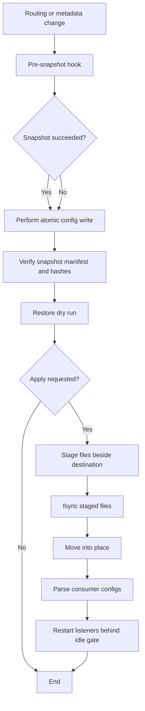
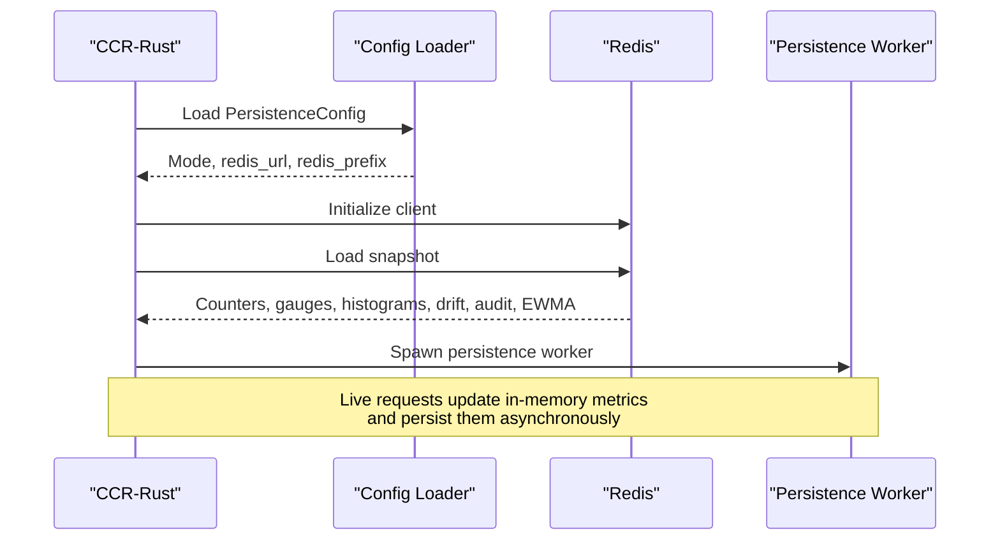
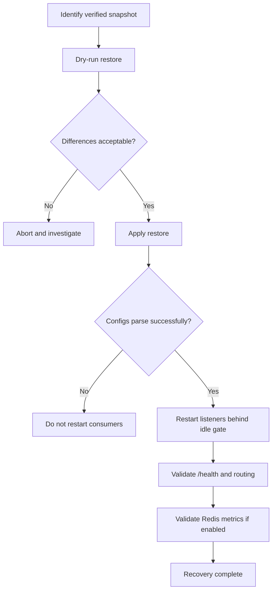
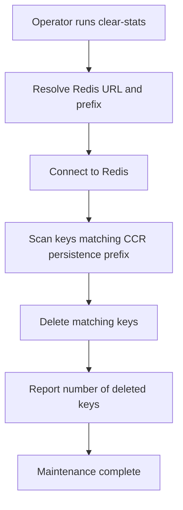
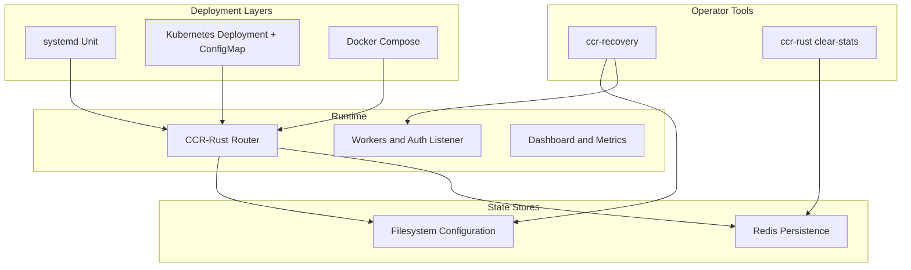

# Backup and Recovery

<cite>
**Referenced Files in This Document**   
- [docs/config-recovery.md](file://docs/config-recovery.md)
- [docs/configuration.md](file://docs/configuration.md)
- [docs/telemetry.md](file://docs/telemetry.md)
- [docs/observability.md](file://docs/observability.md)
- [scripts/ccr_recovery.py](file://scripts/ccr_recovery.py)
- [src/metrics/persistence.rs](file://src/metrics/persistence.rs)
- [src/config/mod.rs](file://src/config/mod.rs)
- [src/config/types.rs](file://src/config/types.rs)
- [deploy/ccr-rust.service](file://deploy/ccr-rust.service)
- [k8s/deployment.yaml](file://k8s/deployment.yaml)
- [k8s/configmap.yaml](file://k8s/configmap.yaml)
- [docker-compose.yml](file://docker-compose.yml)
- [Dockerfile](file://Dockerfile)
</cite>

## Table of Contents
1. [Introduction](#introduction)
2. [Data Inventory for Backups](#data-inventory-for-backups)
3. [Automated Backup Strategy](#automated-backup-strategy)
4. [Backup Scheduling and Retention](#backup-scheduling-and-retention)
5. [Storage Locations and Security](#storage-locations-and-security)
6. [Disaster Recovery Procedures](#disaster-recovery-procedures)
7. [Configuration Version Control and Rollback](#configuration-version-control-and-rollback)
8. [Testing Recovery Processes](#testing-recovery-processes)
9. [Operational Maintenance Tasks](#operational-maintenance-tasks)
10. [Recovery Time Objectives and Business Continuity](#recovery-time-objectives-and-business-continuity)
11. [Architecture Overview](#architecture-overview)
12. [Troubleshooting Guide](#troubleshooting-guide)
13. [Conclusion](#conclusion)

## Introduction
This document defines the backup, recovery, and business continuity approach for CCR-Rust deployments. It covers what data must be preserved, how to back it up automatically, where to store backups securely, how to recover from partial or full failures, and how to maintain observability state across restarts.

CCR-Rust has two distinct persistence concerns:

| Concern | What it is | Default behavior | When it matters for recovery |
|---|---|---|---|
| Configuration and routing surface | JSON configuration files, credential files, launchd/systemd units, launcher scripts, local tool manifests, Codex catalog and profile files, deployed policy modules | Filesystem-based; not versioned by CCR itself | Required to restore routing, authentication, pricing, model catalogs, and listener definitions |
| Observability and metrics state | Prometheus counters, gauges, histograms, token drift state, audit log entries, EWMA latency state | In-memory by default; optional Redis persistence | Recoverable after restart only when Redis persistence is enabled |

The repository includes a dedicated recovery utility that snapshots and restores the live routing surface, plus built-in Redis-backed persistence for observability metrics.

## Data Inventory for Backups
Backups should cover both the routing configuration surface and any persistent observability state.

### Configuration and Routing Surface
The recovery tool treats the following areas as part of the live routing surface:

| Area | Purpose | Backup priority |
|---|---|---|
| `~/.claude-code-router` consumer configs | Main router, worker, auth, and OCR configurations | Critical |
| `fallback-policy.json` | Generated fallback routing policy | Critical |
| `runtime-credentials.json`, `ccr-api-key.env`, `.env` | Provider API keys and environment credentials | Critical and sensitive |
| Launcher scripts such as `serve.py`, `serve-glm-workers.py`, `shape_probe_auth.py` | Startup entrypoints for listeners | High |
| Toolbelt and Lapis tool manifests | Registered recovery, catalog-sync, and idle-gate tools | High |
| `local-bin` wrappers and `local-bin-targets` symlinks | Deployed CLI helpers including `ccr-rust`, `ccr-wait-idle`, `ccr-fallback-policy`, `ccr-catalog-sync`, `codex-ccr`, and `ccr-recovery` | High |
| `share/` and `cloudflared/` | Deployed policy module, recovery module, tunnel configuration | Medium to high depending on deployment |
| Syncthing configuration | Replication share ownership and synchronization settings | Environment-dependent |
| `~/.codex` catalog and profiles | Model catalog, active `config.toml`, profile files, GLM worker role | High because an unlisted catalog slug can silently degrade sessions |
| LaunchAgent plists | macOS listener jobs, API tunnel, and model guard services | Environment-dependent but critical when used |
| systemd unit file | Linux service definition for `ccr-rust` | Environment-dependent |
| Kubernetes Deployment and ConfigMap | Containerized configuration injection and replica topology | Critical for cloud deployments |

The recovery tool explicitly captures configuration files, launcher scripts, tool manifests, client-side Codex state, launch agents, local binaries, shared policy copies, and related operational directories.

**Section sources**
- [docs/config-recovery.md:1-120](file://docs/config-recovery.md#L1-L120)
- [scripts/ccr_recovery.py:1-200](file://scripts/ccr_recovery.py#L1-L200)
- [deploy/ccr-rust.service:1-14](file://deploy/ccr-rust.service#L1-L14)
- [k8s/deployment.yaml:1-50](file://k8s/deployment.yaml#L1-L50)
- [k8s/configmap.yaml:1-10](file://k8s/configmap.yaml#L1-L10)

### Telemetry and Metrics State
When Redis persistence is enabled, CCR-Rust persists:

| State | Description | Recoverable after restart? |
|---|---|---|
| Prometheus counters and gauges | Request counts, failures, cost estimates, stream counts | Yes, if Redis is configured |
| Histogram offsets | Latency and token distribution tracking | Yes, if Redis is configured |
| Token drift aggregate state | Per-tier drift tracking | Yes, if Redis is configured |
| Token audit ring buffer | Recent pre-request token breakdowns | Yes, if Redis is configured |
| EWMA tier latency state | Latency-based tier ordering state | Yes, if Redis is configured |

Without Redis, these values are process-local and reset on restart. They are useful for monitoring but are not equivalent to durable business configuration.

**Section sources**
- [docs/observability.md:1-200](file://docs/observability.md#L1-L200)
- [src/metrics/persistence.rs:1-200](file://src/metrics/persistence.rs#L1-L200)
- [src/config/types.rs:531-560](file://src/config/types.rs#L531-L560)

### Telemetry Exporter Notes
Telemetry export via OpenTelemetry is separate from metrics persistence. The exporter sends minimal request spans to a Collector and does not retain application logs or secrets in exported spans. Export failures do not delay request handling.

**Section sources**
- [docs/telemetry.md:1-57](file://docs/telemetry.md#L1-L57)

## Automated Backup Strategy
There are two complementary automated strategies:

1. **Configuration surface snapshotting through `ccr-recovery`**
2. **Observability state persistence through Redis**

### Configuration Surface Snapshots
The `ccr-recovery` utility provides:

| Operation | Behavior |
|---|---|
| `snapshot --label <name>` | Captures the live routing surface now |
| `list` | Lists snapshots newest first with verification results |
| `verify [name]` | Re-hashes one snapshot, defaulting to the newest |
| `restore [name]` | Dry run showing drift without writing |
| `restore [name] --apply` | Writes snapshot files back onto the live system |
| `restore [name] --apply --restart` | Restarts listeners behind the idle gate |
| `activate --listener <name>` | Validates, idles, restarts, and runtime-checks one listener |
| `doctor` | Compares health, file drift, and in-memory route drift |
| `sanitize [name]` | Produces a verified secret-free copy for replication |

Some writers call the pre-snapshot hook before performing routing or metadata writes, so ordinary changes can capture prior state automatically. A failed snapshot does not block the writer; the primary safety boundary remains the atomic write operation.

**Diagram sources**
- [docs/config-recovery.md:1-120](file://docs/config-recovery.md#L1-L120)
- [scripts/ccr_recovery.py:1-200](file://scripts/ccr_recovery.py#L1-L200)

### Observability Persistence
For metrics and dashboard state, configure Redis in the CCR configuration:

| Setting | Purpose |
|---|---|
| `Persistence.mode` | Selects persistence mode; `redis` enables Redis-backed state |
| `Persistence.redis_url` | Redis connection URL; also supported via `CCR_REDIS_URL` |
| `Persistence.redis_prefix` | Key prefix scoped to CCR persistence records |

On startup, CCR loads a Redis snapshot, applies counters, gauges, histogram offsets, token drift state, audit entries, and EWMA state, then spawns a background worker for subsequent persistence events.

**Diagram sources**
- [src/metrics/persistence.rs:1-200](file://src/metrics/persistence.rs#L1-L200)
- [src/config/types.rs:531-560](file://src/config/types.rs#L531-L560)

**Section sources**
- [docs/config-recovery.md:1-120](file://docs/config-recovery.md#L1-L120)
- [scripts/ccr_recovery.py:1-200](file://scripts/ccr_recovery.py#L1-L200)
- [src/metrics/persistence.rs:1-200](file://src/metrics/persistence.rs#L1-L200)
- [src/config/types.rs:531-560](file://src/config/types.rs#L531-L560)

## Backup Scheduling and Retention
Recommended schedule:

| Backup type | Frequency | Retention | Notes |
|---|---|---|---|
| Full routing surface snapshot | Every meaningful configuration change | At least 30 snapshots | The recovery tool uses a retention setting of 30 snapshots |
| Scheduled snapshot | Hourly or daily | Rotate older than 30 days | Use `ccr-recovery snapshot` with descriptive labels |
| Redis metrics persistence | Continuous while Redis is available | Managed by Redis retention policies | Requires external Redis backup strategy |
| Kubernetes ConfigMaps | On every deployment change | Git history | Keep immutable configuration in version control |
| systemd unit file | On host service changes | Git or infrastructure-as-code repository | Ensure it matches the target platform |

Retention guidance:

- Prefer keeping more snapshots than storage budgets suggest, because losing good rollback state is worse than paying for disk space.
- Do not rely on temporary filesystems for long-term snapshots.
- For Redis-backed metrics, apply separate retention at the database level rather than assuming CCR will clean old snapshots.

**Section sources**
- [docs/config-recovery.md:1-120](file://docs/config-recovery.md#L1-L120)
- [scripts/ccr_recovery.py:1-200](file://scripts/ccr_recovery.py#L1-L200)

## Storage Locations and Security
### Local Snapshots
Snapshots are written under a private directory outside the live configuration root. Each snapshot directory is created with restrictive permissions, and individual file permission bits are preserved because some files contain raw API keys.

Key rules:

- Snapshots must not be world-readable.
- Snapshots must not be placed in shared or public locations.
- Sanitized copies may be used for replication, but they omit real credentials entirely.
- Credential restoration should remain a local, trusted operation against the private snapshot root.

### Sanitization for Replication
The sanitization path removes:

- `.env`
- `ccr-api-key.env`
- `runtime-credentials.json`
- Syncthing `config.xml`

It also scans remaining text files for common credential-assignment patterns and private-key headers. If suspicious content is found, sanitization fails closed rather than publishing potentially leaked secrets.

### Kubernetes and Container Storage
In the provided Kubernetes example, configuration is injected through a ConfigMap mounted at `/etc/ccr`. Secrets such as provider API keys should not normally be stored directly in plain ConfigMaps in production; use a secrets manager or encrypted configuration source and inject credentials through environment variables or a protected volume.

The Dockerfile exposes port `3456`, runs as a non-root user, and uses a healthcheck against `/health`. The compose file mounts `config.json` read-only and sets `CCR_CONFIG`.

**Section sources**
- [docs/config-recovery.md:1-120](file://docs/config-recovery.md#L1-L120)
- [scripts/ccr_recovery.py:1-200](file://scripts/ccr_recovery.py#L1-L200)
- [k8s/deployment.yaml:1-50](file://k8s/deployment.yaml#L1-L50)
- [k8s/configmap.yaml:1-10](file://k8s/configmap.yaml#L1-L10)
- [docker-compose.yml:1-17](file://docker-compose.yml#L1-L17)
- [Dockerfile:1-19](file://Dockerfile#L1-L19)

## Disaster Recovery Procedures

### Complete System Restoration
Use this procedure when the entire routing surface is lost or corrupted.

1. Identify the latest verified snapshot using `ccr-recovery list`.
2. Run a dry-run restore to inspect differences: `ccr-recovery restore <name>`.
3. Review output carefully for unexpected deletions or symlink changes.
4. Apply the restore: `ccr-recovery restore <name> --apply`.
5. If needed, restart listeners safely: `ccr-recovery restore <name> --apply --restart`.
6. Validate routing endpoints and listener health.
7. Confirm providers authenticate successfully.
8. If Redis persistence is enabled, verify restored metrics endpoints.

Important constraints:

- Restore is staged: files are written beside their destinations, fsynced, and moved into place.
- Only after files are written are consumer configs re-parsed.
- A restore that leaves invalid JSON does not restart anything.
- Symlinks are restored as symlinks based on the manifest.
- Retired wrapper binaries are reported as unmapped instead of being restored.

**Diagram sources**
- [docs/config-recovery.md:1-120](file://docs/config-recovery.md#L1-L120)
- [scripts/ccr_recovery.py:1-200](file://scripts/ccr_recovery.py#L1-L200)

### Configuration Recovery
If only routing configuration is damaged:

1. Locate the nearest known-good snapshot.
2. Compare current files with the snapshot using `ccr-recovery doctor`.
3. Use `ccr-recovery restore` dry-run to confirm expected drift.
4. Apply the restore.
5. If listeners are running, use the restart option to drain live work and reload configuration.

If configuration comes from Kubernetes:

1. Update the ConfigMap or replace the referenced configuration source.
2. Roll out the new Deployment.
3. Verify readiness probes pass.
4. Validate routing behavior.

If configuration comes from systemd:

1. Replace `/etc/ccr/config.json` with the recovered configuration.
2. Reload the systemd manager.
3. Restart the `ccr-rust` service.
4. Check service status and health endpoint.

**Section sources**
- [docs/config-recovery.md:1-120](file://docs/config-recovery.md#L1-L120)
- [deploy/ccr-rust.service:1-14](file://deploy/ccr-rust.service#L1-L14)
- [k8s/deployment.yaml:1-50](file://k8s/deployment.yaml#L1-L50)

### Data Migration Between Environments
Use sanitization and version-controlled configuration to move between environments.

Recommended flow:

1. Generate a sanitized snapshot copy for the target environment.
2. Inspect the sanitized copy for residual secrets.
3. Inject environment-specific credentials through secure mechanisms:
   - systemd `Environment=` or `.env` loader for native hosts
   - Kubernetes secrets or environment variables for containers
   - External credential managers where available
4. Test connectivity to upstream providers without spending real quota.
5. Enable Redis persistence only when the target environment has a managed Redis instance.
6. Perform a controlled rollout with health checks and traffic validation.

Do not replicate live credential files directly. The sanitization tool omits known credential files and rejects common secret patterns.

**Section sources**
- [docs/config-recovery.md:1-120](file://docs/config-recovery.md#L1-L120)
- [docs/configuration.md:1-200](file://docs/configuration.md#L1-L200)
- [k8s/deployment.yaml:1-50](file://k8s/deployment.yaml#L1-L50)

## Configuration Version Control and Rollback
Configuration in CCR-Rust is derived from generated policy and multiple consumer files. Treat configuration as code:

- Store generated policy and consumer configuration templates in version control.
- Pin policy integrity where possible; the recovery documentation describes a policy integrity pin that gates the live fallback policy on approved routes, consumer registrations, and provider definitions.
- Avoid ad hoc dated copies beside live files; use `ccr-recovery` snapshots as the authoritative rollback mechanism.
- Keep Kubernetes manifests and systemd units in infrastructure-as-code repositories.
- Never commit secrets.

Rollback procedures:

1. Find the last verified snapshot or committed configuration revision.
2. Compare current state with the target revision.
3. Apply the rollback through `ccr-recovery restore --apply`.
4. If rolling back Kubernetes configuration, revert the ConfigMap and Deployment.
5. Validate listeners, routing, and provider authentication.
6. Monitor error rates, latency, and token drift after rollback.

Policy integrity guidance:

- Changing the policy body requires a source change with tests and review.
- Direct JSON edits can bypass structural checks.
- A SHA-256 policy pin closes gaps where unchecked fields could be changed.

**Section sources**
- [docs/config-recovery.md:1-120](file://docs/config-recovery.md#L1-L120)
- [scripts/ccr_recovery.py:1-200](file://scripts/ccr_recovery.py#L1-L200)

## Testing Recovery Processes
Regular recovery testing should include:

| Test | Procedure | Success criteria |
|---|---|---|
| Snapshot creation | Run `ccr-recovery snapshot` | Exit code indicates success; manifest exists and verifies |
| Snapshot verification | Run `ccr-recovery verify` | All file hashes match |
| Dry-run restore | Run `ccr-recovery restore <name>` | Output shows expected drift |
| Apply restore | Run `ccr-recovery restore <name> --apply` | No crash during file staging or config parsing |
| Listener restart | Run restore with restart flag | Listeners drain and restart safely |
| Active listener activation | Run `ccr-recovery activate --listener <name>` | Listener drains, restarts, and reports expected tier order |
| Live smoke test | Optional `--live-check` | One low-effort completion returns assistant content |
| Redis persistence reset | Run `ccr-rust clear-stats` | Persisted counters and gauges are cleared |
| Kubernetes rollout | Update ConfigMap and redeploy | Readiness probe passes and routing works |

The `activate` workflow is stricter than a liveness probe: it validates the installed executable vnode inode and compares returned tier order with the consumer configuration. The optional live check spends provider quota, so it should be opt-in and limited.

**Section sources**
- [docs/config-recovery.md:1-120](file://docs/config-recovery.md#L1-L120)
- [docs/observability.md:1-200](file://docs/observability.md#L1-L200)

## Operational Maintenance Tasks

### Database Cleanup
When Redis persistence is enabled:

- Use `ccr-rust clear-stats` to clear persisted observability state.
- Override Redis target and prefix through command-line arguments when necessary.
- Ensure the prefix matches the configured `Persistence.redis_prefix`.
- The cleanup function is scoped to the configured prefix to avoid deleting unrelated Redis data.

For large datasets, the cleanup implementation uses Redis `SCAN` with a bounded count to iterate keys without blocking the server.

**Diagram sources**
- [src/metrics/persistence.rs:1-200](file://src/metrics/persistence.rs#L1-L200)
- [src/main.rs:179-300](file://src/main.rs#L179-L300)

**Section sources**
- [docs/observability.md:1-200](file://docs/observability.md#L1-L200)
- [src/metrics/persistence.rs:1-200](file://src/metrics/persistence.rs#L1-L200)

### Log Rotation Strategies
Logs are controlled through standard logging configuration rather than CCR-specific log management:

- Set `RUST_LOG` in the service environment.
- In systemd, configure `Environment=RUST_LOG=info`.
- In Kubernetes, set the `RUST_LOG` environment variable.
- Use the host OS log rotation facility (for example, `journald` or application log rotators) to rotate stdout/stderr logs.
- Telemetry export is independent of local logging and should be managed through the Collector and ingestion pipeline.

Because telemetry export failures do not delay request handling, log loss or exporter failure should not be treated as a routing outage.

**Section sources**
- [deploy/ccr-rust.service:1-14](file://deploy/ccr-rust.service#L1-L14)
- [k8s/deployment.yaml:1-50](file://k8s/deployment.yaml#L1-L50)
- [docs/telemetry.md:1-57](file://docs/telemetry.md#L1-L57)

### Environment Variables and Credentials
Configuration supports `${VAR_NAME}` expansion at load time. Recommended practices:

- Export required provider keys in the shell or service manager before starting CCR-Rust.
- Use environment variables for production secrets.
- Treat `.env` files as medium security and keep them out of version control.
- Validate required variables before startup without printing them.
- Unexpanded placeholders may remain in configuration if expansion fails; this does not prove credentials were accepted by providers.

**Section sources**
- [docs/configuration.md:1-200](file://docs/configuration.md#L1-L200)
- [src/config/mod.rs:21-86](file://src/config/mod.rs#L21-L86)

## Recovery Time Objectives and Business Continuity

### Recovery Point Objectives
| Data | RPO guidance | Reason |
|---|---|---|
| Routing configuration | Near-zero when using continuous snapshot hooks | Changes trigger pre-write snapshots |
| Manual configuration changes | Last scheduled or last-change snapshot | Depends on operator cadence |
| Redis metrics state | As close as Redis replication allows | Metrics are auxiliary unless persistence is required |
| Kubernetes manifests | Last committed revision | Infrastructure-as-code provides deterministic rollbacks |

### Recovery Time Objectives
| Scenario | Target RTO | Dependencies |
|---|---:|---|
| Single listener failure | Minutes | Service manager restart and health checks |
| Configuration corruption | Minutes | Verified snapshot and `ccr-recovery restore` |
| Full host failure | Hours | Restore files, credentials, services, and validate routing |
| Cloud environment failure | Minutes to hours | Manifest rollout, secret resolution, and provider reachability |
| Redis metrics loss | Seconds to minutes after restart | Redis availability and persistence initialization |

### Business Continuity Guidance
- Keep at least three verified snapshots locally so recent rollbacks are fast.
- Keep sanitized configuration templates in version control for environment provisioning.
- Keep credentials in a secure, access-controlled store.
- Test recovery drills quarterly, including:
  - Deleting live configuration and restoring from snapshot
  - Simulating Redis downtime
  - Rolling back Kubernetes configuration
  - Validating provider authentication after restore
- Treat provider authentication failures separately from file restoration: restore proves files were written and parsed, not that credentials still work.

## Architecture Overview
The backup and recovery architecture combines filesystem snapshots, service lifecycle management, and optional Redis-backed metrics persistence.

**Diagram sources**
- [docs/config-recovery.md:1-120](file://docs/config-recovery.md#L1-L120)
- [src/metrics/persistence.rs:1-200](file://src/metrics/persistence.rs#L1-L200)
- [deploy/ccr-rust.service:1-14](file://deploy/ccr-rust.service#L1-L14)
- [k8s/deployment.yaml:1-50](file://k8s/deployment.yaml#L1-L50)
- [docker-compose.yml:1-17](file://docker-compose.yml#L1-L17)

## Troubleshooting Guide

### Snapshot Verification Fails
- Check whether the snapshot directory was modified externally.
- Run `ccr-recovery verify` to recompute hashes.
- Recreate the snapshot if the manifest or file contents no longer match.

### Restore Does Not Restart Listeners
- Use the restart flag when you need listener reload.
- Remember that restart waits for idle state before restarting listeners.
- If a listener is busy, allow it to drain before applying restart.

### Restore Leaves Invalid Configuration
- The tool parses consumer configs after writing files.
- If parsing fails, listeners are not restarted.
- Fix the configuration manually or restore a different snapshot.

### Redis Persistence Initialization Fails
- Ensure `Persistence.mode` is set to `redis`.
- Provide `Persistence.redis_url` or `CCR_REDIS_URL`.
- Check network connectivity and Redis authentication.
- Use `clear-stats` with explicit URL and prefix if overriding targets.

### Telemetry Export Fails
- Export failures do not delay request handling.
- Check the OpenTelemetry Collector endpoint.
- Validate loopback-only restrictions and endpoint format.
- Configure tail sampling and ingestion caps at the Collector.

**Section sources**
- [docs/config-recovery.md:1-120](file://docs/config-recovery.md#L1-L120)
- [src/metrics/persistence.rs:1-200](file://src/metrics/persistence.rs#L1-L200)
- [docs/telemetry.md:1-57](file://docs/telemetry.md#L1-L57)

## Conclusion
Effective CCR-Rust backup and recovery depends on separating configuration from ephemeral metrics state. Configuration should be backed up through `ccr-recovery` snapshots, version-controlled through infrastructure-as-code, and restored using staged, verifiable operations. Observability state should be preserved through Redis when post-restart metric continuity matters. Regular testing, strict credential handling, and clear RPO/RTO expectations ensure that configuration changes remain safe rollbacks rather than outages.