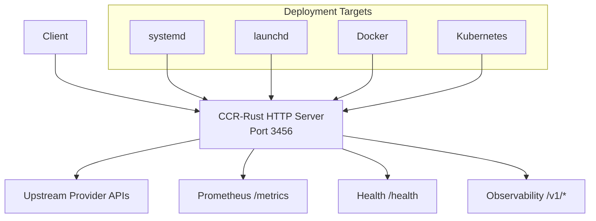
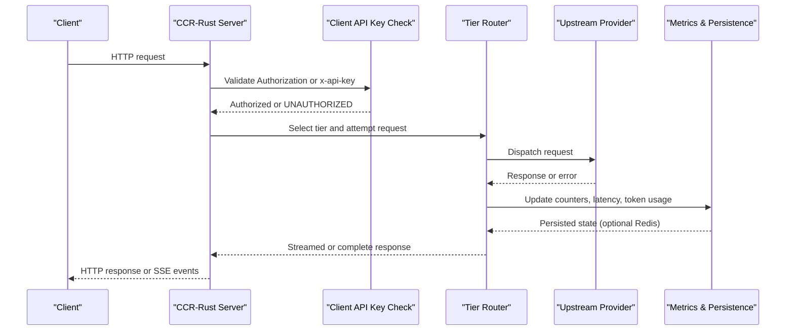
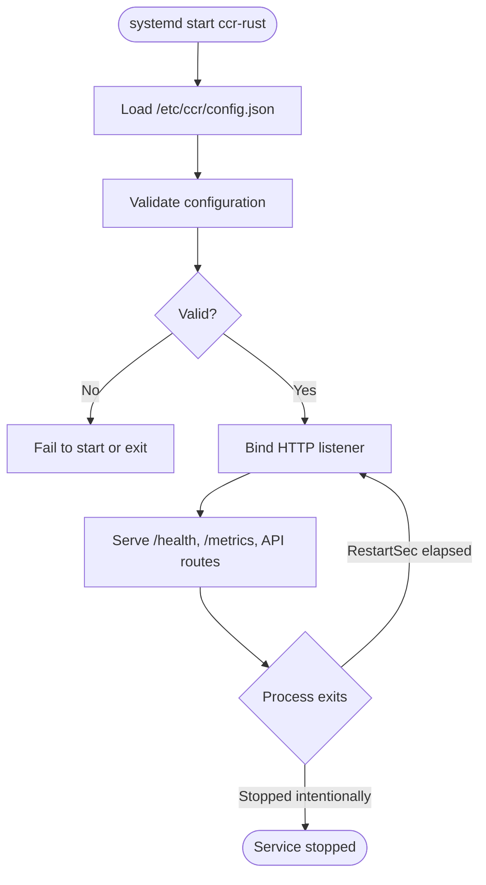
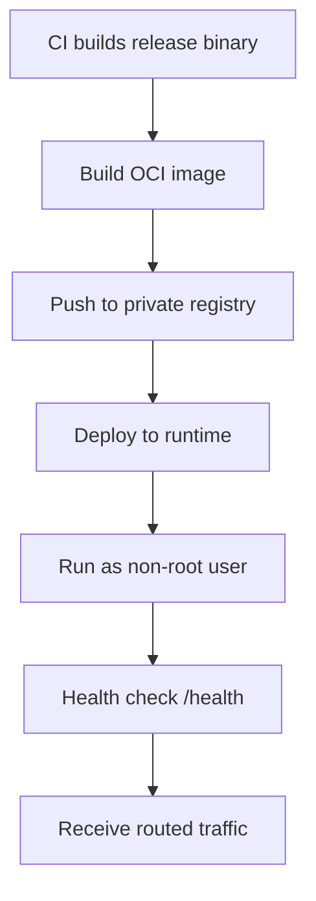
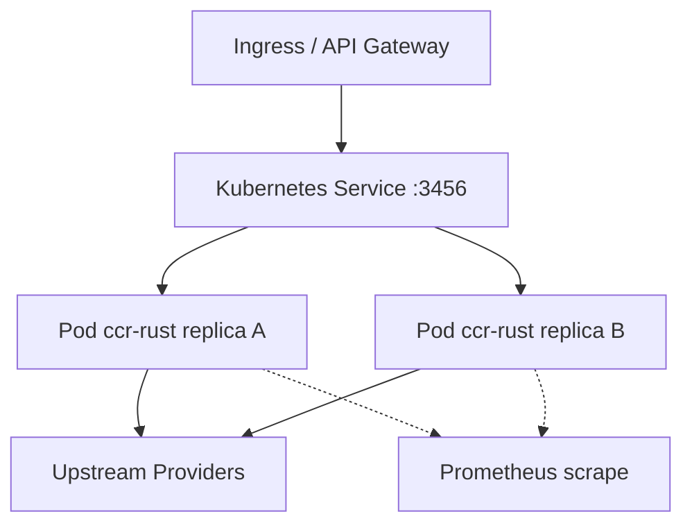
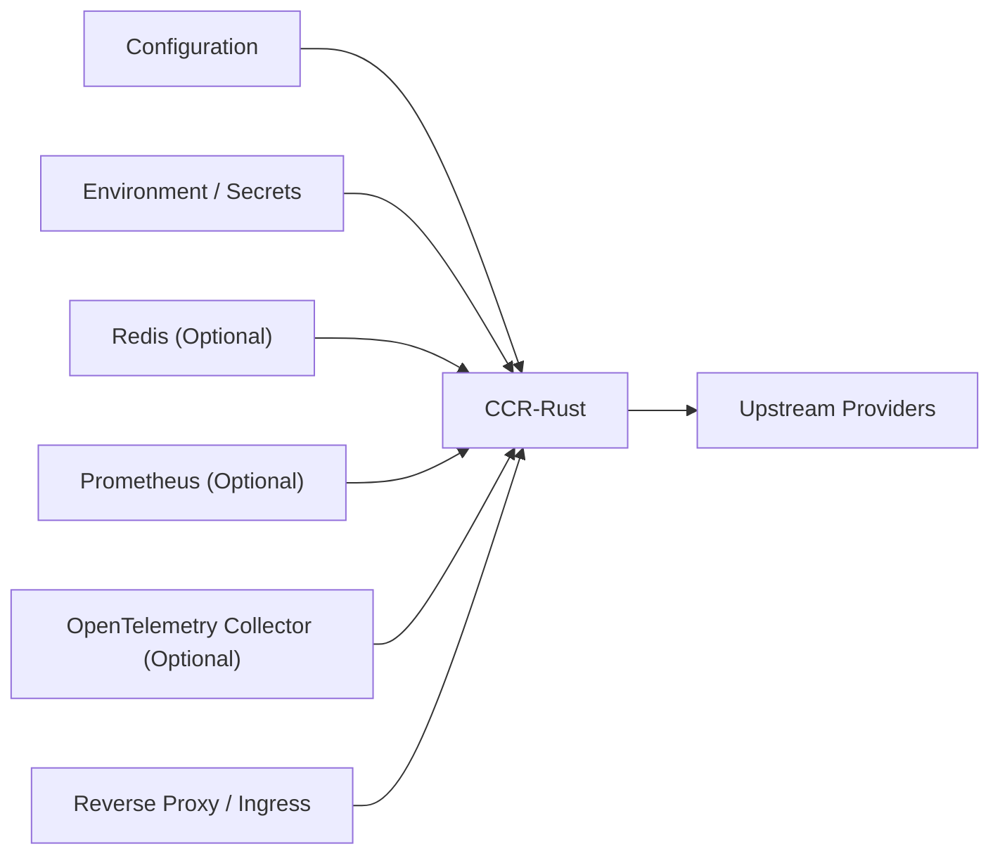
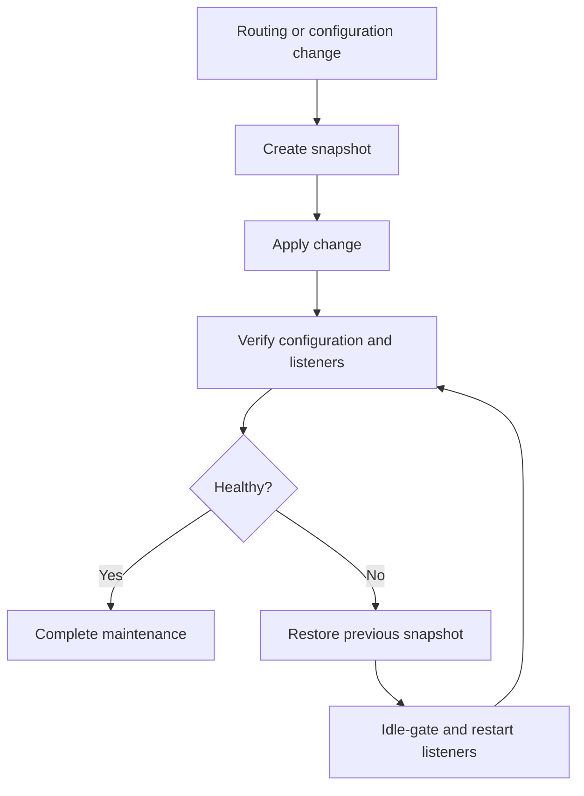

# Deployment and Operations

<cite>
**Referenced Files in This Document**
- [main.rs](file://src/main.rs)
- [client_auth.rs](file://src/client_auth.rs)
- [Dockerfile](file://Dockerfile)
- [docker-compose.yml](file://docker-compose.yml)
- [ccr-rust.service](file://deploy/ccr-rust.service)
- [com.ccr.rust.plist](file://deploy/com.ccr.rust.plist)
- [deployment.yaml](file://k8s/deployment.yaml)
- [service.yaml](file://k8s/service.yaml)
- [configmap.yaml](file://k8s/configmap.yaml)
- [configuration.md](file://docs/configuration.md)
- [local-operation.md](file://docs/local-operation.md)
- [auth-suites.md](file://docs/auth-suites.md)
- [deployment.md](file://docs/deployment.md)
- [observability.md](file://docs/observability.md)
- [prometheus-snippet.yml](file://monitoring/prometheus-snippet.yml)
- [monitoring README.md](file://monitoring/README.md)
- [failover_architecture.md](file://docs/failover_architecture.md)
- [troubleshooting.md](file://docs/troubleshooting.md)
- [config-recovery.md](file://docs/config-recovery.md)
- [telemetry.md](file://docs/telemetry.md)
</cite>

## Table of Contents
1. [Introduction](#introduction)
2. [Project Structure](#project-structure)
3. [Core Components](#core-components)
4. [Architecture Overview](#architecture-overview)
5. [Detailed Component Analysis](#detailed-component-analysis)
6. [Dependency Analysis](#dependency-analysis)
7. [Performance Considerations](#performance-considerations)
8. [Troubleshooting Guide](#troubleshooting-guide)
9. [Conclusion](#conclusion)
10. [Appendices](#appendices)

## Introduction
This document describes how to deploy, operate, secure, scale, monitor, and recover CCR-Rust in production environments. CCR-Rust is a multi-provider LLM router that exposes an HTTP server with streaming support, client authentication, metrics, health checks, and optional persistence through Redis. It can be run as a system service on Linux, a launchd job on macOS, inside Docker, or within Kubernetes. Production operations should treat it as a stateful routing gateway: configuration and secrets are critical, upstream provider limits matter, and observability is required for safe scaling and failure handling.

The default HTTP listener listens on port `3456`, but the host and port are configurable. The application also supports an authenticated client API key, separate ports per authentication suite, Prometheus metrics at `/metrics`, and JSON observability endpoints such as `/v1/usage` and `/v1/latencies`.

**Section sources**
- [main.rs:1-200](file://src/main.rs#L1-L200)
- [configuration.md:1-120](file://docs/configuration.md#L1-L120)
- [observability.md:1-80](file://docs/observability.md#L1-L80)

## Project Structure
The repository includes deployment artifacts, container definitions, Kubernetes manifests, documentation, monitoring examples, and the Rust source tree. The most relevant operational paths are:

| Area | Path | Purpose |
|---|---:|---|
| Linux service | `deploy/ccr-rust.service` | systemd unit for long-running operation |
| macOS service | `deploy/com.ccr.rust.plist` | launchd job for development and workstation use |
| Container image | `Dockerfile` | Multi-stage build producing a non-root runtime image |
| Local compose | `docker-compose.yml` | Single-container development stack with healthcheck |
| Kubernetes | `k8s/*.yaml` | Deployment, Service, ConfigMap |
| Configuration | `docs/configuration.md` | Environment variables, config schema, ports, auth settings |
| Monitoring | `monitoring/prometheus-snippet.yml` | Prometheus scrape example |
| Observability docs | `docs/observability.md` | Metrics, dashboards, Redis persistence, token drift |
| Core binary entry point | `src/main.rs` | CLI, server startup, stream limits, dashboard, status commands |
| Client authentication | `src/client_auth.rs` | Bearer and Anthropic-style client API key verification |

**Diagram sources**
- [main.rs:1-200](file://src/main.rs#L1-L200)
- [Dockerfile:1-19](file://Dockerfile#L1-L19)
- [deployment.yaml:1-50](file://k8s/deployment.yaml#L1-L50)

**Section sources**
- [ccr-rust.service:1-14](file://deploy/ccr-rust.service#L1-L14)
- [com.ccr.rust.plist:1-23](file://deploy/com.ccr.rust.plist#L1-L23)
- [Dockerfile:1-19](file://Dockerfile#L1-L19)
- [docker-compose.yml:1-17](file://docker-compose.yml#L1-L17)
- [deployment.yaml:1-50](file://k8s/deployment.yaml#L1-L50)
- [service.yaml:1-11](file://k8s/service.yaml#L1-L11)
- [configmap.yaml:1-10](file://k8s/configmap.yaml#L1-L10)

## Core Components
### Command-Line Interface and Server Lifecycle
The binary exposes several commands:

| Command | Operational Use |
|---|---|
| `start` | Start the HTTP router; accepts `--host`, `--port`, `--max-streams`, and `--shutdown-timeout` |
| `validate` | Check configuration syntax and providers without starting the server |
| `status` | Probe whether another CCR instance is listening |
| `doctor` | Diagnose configuration, listeners, and optional provider probes |
| `dashboard` | Launch the terminal dashboard for live metrics |
| `clear-stats` | Clear persisted statistics from Redis |
| `mcp` | Run as an MCP server |
| `version` | Print version and build information |

The server defaults to loopback binding on port `3456`, with a default maximum concurrent stream count of `512`. The CLI documents environment overrides such as `CCR_MAX_STREAMS` and `CCR_DASHBOARD_HOST`/`CCR_DASHBOARD_PORT`.

**Section sources**
- [main.rs:1-200](file://src/main.rs#L1-L200)

### Configuration and Environment
Configuration is loaded from a JSON file whose location can be set by `--config` or the `CCR_CONFIG` environment variable, with a default path documented under local operation. Environment variables support `${VAR_NAME}` expansion at load time. Important production configuration fields include:

| Field | Meaning |
|---|---|
| `Providers` | Upstream provider endpoints, models, pricing, and transformers |
| `Router` | Default route, background routes, tier retries, GP routing, and fallback behavior |
| `PORT` | HTTP server port |
| `HOST` | Bind address |
| `AUTH_PORT` / `AUTH_HOST` | Separate authenticated listener address and port |
| `API_TIMEOUT_MS` | API timeout setting |
| `CLIENT_API_KEY` | Optional client-facing API key digest |
| `POOL_*` | HTTP connection pool tuning |
| `SSE_BUFFER_SIZE` | Streaming buffer size |
| `Persistence` | In-memory or Redis-backed observability state |

Secrets should not be committed into configuration files. Prefer process environment variables, secret managers, or the documented runtime credential mechanisms. Validate configuration before deploying changes and verify that all required environment variables expand successfully.

**Section sources**
- [configuration.md:1-120](file://docs/configuration.md#L1-L120)
- [local-operation.md:1-120](file://docs/local-operation.md#L1-L120)

### Client Authentication
CCR-Rust supports an optional client-facing API key. When configured, requests must supply either:

- `Authorization: Bearer <token>`
- `x-api-key: <token>`

The configured token is stored as a SHA-256 digest, and comparison uses constant-time equality to reduce timing risk. A missing or invalid key returns an `UNAUTHORIZED` response with a `Bearer` challenge. The `/health` endpoint remains accessible for liveness checks even when client authentication is enabled.

For multi-account isolation, run separate CCR processes per authentication suite with disjoint provider lists, distinct ports, and distinct persistence namespaces if Redis is used.

**Section sources**
- [client_auth.rs:1-144](file://src/client_auth.rs#L1-L144)
- [auth-suites.md:1-120](file://docs/auth-suites.md#L1-L120)

## Architecture Overview
At runtime, CCR-Rust binds an HTTP server, parses configuration, initializes routing, streaming, metrics, optional telemetry, and optional Redis-backed persistence. Incoming requests are routed to configured upstream providers according to tiers, retry policies, rate-limit tracking, and admission controls. Responses may be streamed using SSE-compatible transports, and failures are classified so that deterministic errors do not amplify retries while transient failures may cascade through configured tiers.

**Diagram sources**
- [client_auth.rs:1-144](file://src/client_auth.rs#L1-L144)
- [main.rs:1-200](file://src/main.rs#L1-L200)
- [failover_architecture.md:1-120](file://docs/failover_architecture.md#L1-L120)
- [observability.md:1-80](file://docs/observability.md#L1-L80)

## Detailed Component Analysis

### Linux Deployment with systemd
The provided systemd unit runs CCR-Rust as user `ccr`, starts the `start` command, binds to `0.0.0.0`, loads configuration from `/etc/ccr/config.json`, sets `RUST_LOG=info`, and restarts the service automatically after failures.

Recommended production hardening:

- Create a dedicated `ccr` user with no interactive shell and minimal filesystem access.
- Store configuration under `/etc/ccr/config.json` with restrictive ownership and permissions.
- Mount configuration read-only where possible.
- Restrict network exposure to a private interface or reverse proxy instead of publishing directly to `0.0.0.0`.
- Enable log rotation for journald output or redirect logs to a managed logging pipeline.
- Add firewall rules limiting inbound traffic to trusted clients or proxies.
- Use TLS termination at a reverse proxy or ingress controller rather than exposing plaintext HTTP to untrusted networks.
- Pin the deployed binary hash and verify upgrades before restarting.

**Diagram sources**
- [ccr-rust.service:1-14](file://deploy/ccr-rust.service#L1-L14)
- [configuration.md:1-120](file://docs/configuration.md#L1-L120)

**Section sources**
- [ccr-rust.service:1-14](file://deploy/ccr-rust.service#L1-L14)
- [deployment.md:1-50](file://docs/deployment.md#L1-L50)

### macOS Deployment with launchd
The provided launchd plist runs `/usr/local/bin/ccr-rust start --config /Users/Shared/.claude-code-router/config.json`, keeps the process alive, and writes standard output and standard error to `/usr/local/var/log/ccr-rust.log` and `/usr/local/var/log/ccr-rust.err`.

Operational notes:

- Use a dedicated macOS user account for production workloads.
- Store credentials in a protected directory with restrictive permissions.
- Redirect logs to a centralized logging agent.
- Treat this plist as a reference; production macOS deployments should integrate with your organization's service management and secret management tooling.
- Coordinate restarts around active sessions because long-lived streams may be interrupted.

**Section sources**
- [com.ccr.rust.plist:1-23](file://deploy/com.ccr.rust.plist#L1-L23)
- [local-operation.md:1-120](file://docs/local-operation.md#L1-L120)

### Docker Containerization
The Dockerfile builds a release binary using a Rust builder stage and copies it into a Debian slim runtime image. It creates a non-root `ccr` user, exposes port `3456`, defines a health check against `/health`, and starts the server with `start --host 0.0.0.0`.

Production container recommendations:

- Build images in a CI pipeline and push immutable tags to a container registry.
- Do not bake secrets into images; pass them via runtime secrets or environment variables.
- Mount configuration as a read-only volume or inject it from a secret/config mechanism.
- Set resource requests and limits in the orchestrator.
- Configure a readiness probe for traffic routing and a liveness probe for unhealthy process recovery.
- Run the container as non-root and drop unnecessary capabilities.
- Use a private container registry and scan images for vulnerabilities.
- Avoid `latest` tags in production; pin image digests or semantic versions.

**Diagram sources**
- [Dockerfile:1-19](file://Dockerfile#L1-L19)
- [docker-compose.yml:1-17](file://docker-compose.yml#L1-L17)

**Section sources**
- [Dockerfile:1-19](file://Dockerfile#L1-L19)
- [docker-compose.yml:1-17](file://docker-compose.yml#L1-L17)

### Kubernetes Deployment
The Kubernetes manifests define:

- A `Deployment` named `ccr-rust` with two replicas, Prometheus annotations, resource requests and limits, liveness and readiness probes against `/health`, and a mounted ConfigMap containing `/etc/ccr/config.json`.
- A `Service` of type `ClusterIP` exposing port `3456` to other pods in the cluster.
- A `ConfigMap` containing a minimal `config.json`.

Production Kubernetes recommendations:

- Replace the example `ConfigMap` with a manifest generated from a secret manager or sealed secrets workflow.
- Keep `config.json` free of secrets; prefer environment variables or mounted secret volumes.
- Use Horizontal Pod Autoscaler based on CPU, memory, custom metrics, or queue depth rather than manual replica counts.
- Add NetworkPolicies to restrict ingress to authorized clients or an Ingress Controller.
- Place an Ingress or API Gateway in front of the Service for TLS termination, rate limiting, authentication, and audit logging.
- Use PodDisruptionBudgets to protect rolling updates.
- Store logs in a central collector and ship them out of the node filesystem.
- Tune resource requests and limits based on measured throughput, streaming concurrency, and upstream timeouts.
- Use topology spread constraints and anti-affinity rules for high availability across nodes and zones.

**Diagram sources**
- [deployment.yaml:1-50](file://k8s/deployment.yaml#L1-L50)
- [service.yaml:1-11](file://k8s/service.yaml#L1-L11)
- [configmap.yaml:1-10](file://k8s/configmap.yaml#L1-L10)

**Section sources**
- [deployment.yaml:1-50](file://k8s/deployment.yaml#L1-L50)
- [service.yaml:1-11](file://k8s/service.yaml#L1-L11)
- [configmap.yaml:1-10](file://k8s/configmap.yaml#L1-L10)

## Dependency Analysis
The operational dependencies are:

| Dependency | Required? | Notes |
|---|---:|---|
| HTTP client libraries | Yes | Used to call upstream provider APIs |
| CA certificates | Yes | Installed in the Docker runtime image |
| Configuration file | Yes | Determines providers, routing, ports, and behavior |
| Secrets or environment variables | Recommended | API keys, client tokens, and provider credentials |
| Redis | Optional | Enables persistent metrics, dashboards, and EWMA state |
| Prometheus | Optional | Scrape `/metrics` for monitoring |
| OpenTelemetry Collector | Optional | Requires `telemetry` feature and loopback endpoint validation |
| Reverse proxy or Ingress | Recommended | TLS termination, authentication, rate limiting, audit logging |

**Diagram sources**
- [configuration.md:1-120](file://docs/configuration.md#L1-L120)
- [observability.md:1-80](file://docs/observability.md#L1-L80)
- [telemetry.md:1-57](file://docs/telemetry.md#L1-L57)

**Section sources**
- [configuration.md:1-120](file://docs/configuration.md#L1-L120)
- [observability.md:1-80](file://docs/observability.md#L1-L80)
- [telemetry.md:1-57](file://docs/telemetry.md#L1-L57)

## Performance Considerations

### Resource Planning
Use the following categories when planning capacity:

| Category | What to Measure | Typical Tuning |
|---|---|---|
| CPU | Request routing, transformation, serialization, retries | Start with small requests and scale based on observed utilization |
| Memory | Streams, buffers, token accounting, persistence state | Monitor peak memory under streaming load |
| Streams | Concurrent SSE connections and request throughput | Tune `--max-streams` and `SSE_BUFFER_SIZE` |
| Connection Pool | Upstream HTTP connections | Tune `POOL_MAX_IDLE_PER_HOST` and idle timeout |
| Timeouts | Provider response latency and streaming duration | Tune `API_TIMEOUT_MS` and shutdown timeout |
| Storage | Redis persistence and logs | Size disks and retention policies |

The default maximum concurrent streams is `512`. Reduce it when running in constrained environments or when upstream providers impose strict per-client concurrency limits. Increase it only after measuring throughput and memory pressure.

**Section sources**
- [main.rs:1-200](file://src/main.rs#L1-L200)
- [configuration.md:1-200](file://docs/configuration.md#L1-L200)

### Scaling Strategies
- **Horizontal scaling**: Run multiple CCR-Rust replicas behind a load balancer. Each replica maintains its own routing state unless Redis persistence is enabled.
- **Vertical scaling**: Increase CPU and memory when streaming concurrency or token accounting becomes a bottleneck.
- **Route partitioning**: Split heavy or expensive provider families across multiple instances with different provider lists.
- **Sticky sessions**: Not required for basic routing, but conversation stickiness exists as a disabled-by-default feature in the failover design.
- **Backpressure**: Use orchestrator-level autoscaling triggered by latency, failure rate, or active stream metrics.

High availability should combine multiple replicas, distributed placement, health-based routing, graceful shutdown, and rolling updates.

**Section sources**
- [deployment.yaml:1-50](file://k8s/deployment.yaml#L1-L50)
- [failover_architecture.md:1-120](file://docs/failover_architecture.md#L1-L120)

### Capacity Management
Key capacity signals include:

- Active and peak active streams
- Per-tier request counts and failure reasons
- Latency histograms and EWMA latency gauges
- Token estimation drift
- Rate-limit hits and backoffs
- Upstream timeout and rejection rates

Monitor these through Prometheus and the JSON observability endpoints. Use alert thresholds for sustained 429s, increasing drift, rising latency, and failing health probes.

**Section sources**
- [observability.md:1-200](file://docs/observability.md#L1-L200)
- [troubleshooting.md:1-120](file://docs/troubleshooting.md#L1-L120)

### Performance Optimization
- Disable optional features such as telemetry and dashboard when they are not needed.
- Pin provider model lists to avoid unnecessary catalog lookups.
- Tune retry budgets and tier retry configurations for your provider behavior.
- Avoid excessive direct routing by enabling `ignoreDirect` when clients cache model strings that bypass tier ordering.
- Use Redis persistence only when you need cross-restart observability state; it adds network dependency and latency.
- Place CCR-Rust close to both clients and upstream providers when possible.
- Use connection pooling and keepalive settings appropriate for upstream provider limits.

[No sources needed since this section provides general guidance]

## Security Hardening

### Network Security
- Bind the main listener to loopback unless explicitly exposed through a reverse proxy.
- Use TLS termination at a reverse proxy, API gateway, or Ingress Controller.
- Restrict inbound traffic with firewalls, security groups, or NetworkPolicies.
- Do not expose `/metrics`, `/v1/*`, or API routes directly to the internet.
- Separate unauthenticated internal listeners from externally facing ones.

**Section sources**
- [configuration.md:1-120](file://docs/configuration.md#L1-L120)
- [local-operation.md:1-120](file://docs/local-operation.md#L1-L120)

### Authentication and Access Control
- Enable `CLIENT_API_KEY` for any externally reachable listener.
- Accept both `Authorization: Bearer` and `x-api-key` forms depending on client compatibility.
- Generate strong, random client tokens and rotate them regularly.
- For multi-account setups, run separate CCR-Rust processes per suite with disjoint provider lists and ports.
- Never rely on port separation alone as an access-control boundary.
- Store API keys and runtime credentials outside Git and restrict file permissions.

**Section sources**
- [client_auth.rs:1-144](file://src/client_auth.rs#L1-L144)
- [auth-suites.md:1-120](file://docs/auth-suites.md#L1-L120)

### Secrets Management
- Prefer environment variables or secret managers over `.env` files in production.
- If using `.env`, ensure it is private, not committed, and sourced securely.
- Use the documented runtime credential mechanisms rather than embedding secrets in configuration.
- Sanitize snapshots before sharing them externally; the documented recovery tool omits common credential files and scans for private keys.

**Section sources**
- [configuration.md:1-120](file://docs/configuration.md#L1-L120)
- [config-recovery.md:1-120](file://docs/config-recovery.md#L1-L120)

## Backup and Recovery

### Configuration Backup
- Back up configuration directories, provider catalogs, launcher scripts, and policy modules.
- Version control generated configuration separately from generated outputs and secrets.
- Use the documented recovery tool to snapshot, verify, restore, and sanitize the operational surface.
- Automate pre-change snapshots for routing or metadata updates.

### Disaster Recovery
- Maintain a verified, sanitized snapshot copy outside the production environment.
- Test restores regularly without contacting upstream providers.
- Include listener restart and runtime verification steps in disaster runbooks.
- Separate credential restoration from configuration restoration.

### Maintenance Tasks
- Rotate client API keys and provider credentials.
- Review and update provider model lists and pricing data.
- Upgrade binaries through a controlled rollback plan.
- Purge stale logs and rotated captures.
- Rebuild and re-scan container images periodically.
- Verify Redis persistence integrity and clear stats only when necessary.

**Diagram sources**
- [config-recovery.md:1-120](file://docs/config-recovery.md#L1-L120)

**Section sources**
- [config-recovery.md:1-120](file://docs/config-recovery.md#L1-L120)

## Monitoring and Alerting

### Metrics
Expose and scrape `/metrics` with Prometheus. The repository includes a scrape configuration snippet targeting localhost port `3456`. Adjust targets when deploying remotely or in clusters.

Key metric families include request counts, latency histograms, retry counters, failure counters, active SSE streams, and token-related metrics.

**Section sources**
- [prometheus-snippet.yml:1-7](file://monitoring/prometheus-snippet.yml#L1-L7)
- [monitoring README.md:1-26](file://monitoring/README.md#L1-L26)

### JSON Observability Endpoints
Use these endpoints for programmatic health and operational insight:

| Endpoint | Purpose |
|---|---|
| `/health` | Liveness check |
| `/v1/usage` | Aggregate token usage per tier |
| `/v1/latencies` | Real-time EWMA latency stats |
| `/v1/token-drift` | Token estimation accuracy per tier |
| `/v1/token-audit` | Recent pre-request token breakdowns |
| `/v1/frontend-metrics` | Frontend-oriented metrics |

**Section sources**
- [observability.md:1-200](file://docs/observability.md#L1-L200)

### Persistence and Dashboards
By default, observability state is in-memory. Enable Redis persistence to survive restarts for counters, gauges, histogram offsets, token drift state, token audit state, and EWMA latency state. Use a dedicated Redis instance with appropriate authentication, encryption, backup, and replication policies.

The terminal dashboard reads `CCR_DASHBOARD_HOST` and `CCR_DASHBOARD_PORT` and connects to the router’s observability endpoints.

**Section sources**
- [observability.md:1-200](file://docs/observability.md#L1-L200)

### Log Aggregation
- On Linux, collect journald output or configure the service manager to forward logs.
- On macOS, collect launchd-standard output and error logs.
- In containers, stream stdout/stderr to a log aggregator.
- In Kubernetes, use sidecar log collectors or platform-native log pipelines.
- Redact secrets, tokens, headers, and provider responses before exporting logs.

**Section sources**
- [ccr-rust.service:1-14](file://deploy/ccr-rust.service#L1-L14)
- [com.ccr.rust.plist:1-23](file://deploy/com.ccr.rust.plist#L1-L23)

### Optional Telemetry
When built with the `telemetry` feature, CCR-Rust can export minimal request spans to an OpenTelemetry Collector at a validated loopback endpoint. Exported spans exclude raw URLs, query strings, headers, bodies, tool outputs, and source locations. Export failures do not block request handling.

**Section sources**
- [telemetry.md:1-57](file://docs/telemetry.md#L1-L57)

## Operational Runbooks

### Common Scenarios

#### Service Fails to Start
1. Run `ccr-rust validate` to check configuration structure.
2. Verify that all required environment variables expand successfully.
3. Confirm that the configured port is available.
4. Check logs from the service manager or container runtime.
5. Inspect provider credentials and network reachability.

**Section sources**
- [main.rs:1-200](file://src/main.rs#L1-L200)
- [configuration.md:1-120](file://docs/configuration.md#L1-L120)

#### High Failure Rate or Sustained 429s
1. Check `/v1/latencies` and `/metrics` for per-tier failure reasons.
2. Identify rate-limited tiers and backoff windows.
3. Add additional provider tiers or adjust tier order.
4. Verify upstream quota and request limits.
5. Retain `tierRetries` for transient failures; remember that 429 handling is separate.

**Section sources**
- [troubleshooting.md:1-120](file://docs/troubleshooting.md#L1-L120)
- [failover_architecture.md:1-120](file://docs/failover_architecture.md#L1-L120)

#### Streaming Requests Stall
1. Check active stream metrics.
2. Inspect upstream timeouts and streaming error events.
3. Verify SSE buffer sizing and connection pool settings.
4. Look for post-first-token streaming semantics where cascading retries are not applied.
5. Reduce concurrency if upstreams enforce per-client concurrency limits.

**Section sources**
- [observability.md:1-200](file://docs/observability.md#L1-L200)
- [failover_architecture.md:1-120](file://docs/failover_architecture.md#L1-L120)

#### Unexpected Tier Routing
1. Check whether clients send a specific `model` value that pins a tier.
2. Enable `ignoreDirect` if clients cache model strings.
3. Restart CCR-Rust after changing routing configuration.
4. Compare `/health?details=1` with the expected consumer configuration.

**Section sources**
- [troubleshooting.md:1-200](file://docs/troubleshooting.md#L1-L200)
- [config-recovery.md:1-120](file://docs/config-recovery.md#L1-L120)

#### Configuration Drift
1. Run the recovery doctor to compare live state with snapshots.
2. Restore a verified snapshot dry-run first.
3. Apply the snapshot and gate restarts until listeners drain.
4. Optionally perform a low-effort live check through the configured default model.

**Section sources**
- [config-recovery.md:1-120](file://docs/config-recovery.md#L1-L120)

## Conclusion
CCR-Rust is a production-grade routing layer that requires careful configuration, secret management, networking controls, and observability. Deploy it as a systemd service, launchd job, Docker container, or Kubernetes workload according to your environment. Protect it with TLS termination, client API keys, and network restrictions. Plan capacity around streams, memory, CPU, and upstream provider limits. Use Prometheus and JSON observability endpoints for monitoring, enable Redis persistence when needed, and maintain automated backups with tested recovery procedures. Operate it with disciplined change management, rollback plans, and incident-focused runbooks.

[No sources needed since this section summarizes without analyzing specific files]

## Appendices

### Ports and Endpoints Reference
| Port or Endpoint | Description |
|---|---|
| `3456` | Default HTTP server port |
| `--host` | Configurable bind address |
| `--port` | Configurable HTTP port |
| `--max-streams` | Maximum concurrent streams |
| `--shutdown-timeout` | Graceful shutdown timeout |
| `/health` | Health check |
| `/metrics` | Prometheus metrics |
| `/v1/usage` | Token usage |
| `/v1/latencies` | EWMA latency stats |
| `/v1/token-drift` | Token drift |
| `/v1/token-audit` | Token audit |
| `dashboard` | Terminal dashboard command |

**Section sources**
- [main.rs:1-200](file://src/main.rs#L1-L200)
- [observability.md:1-200](file://docs/observability.md#L1-L200)