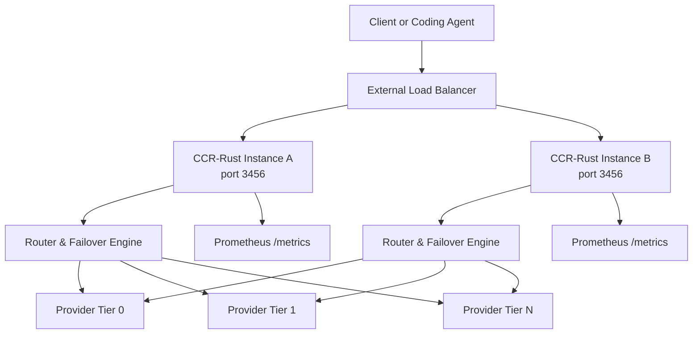
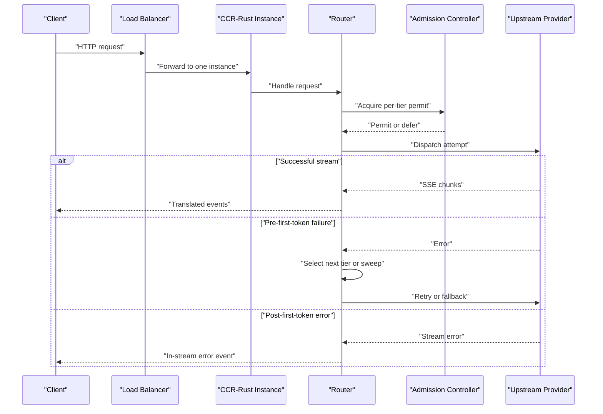
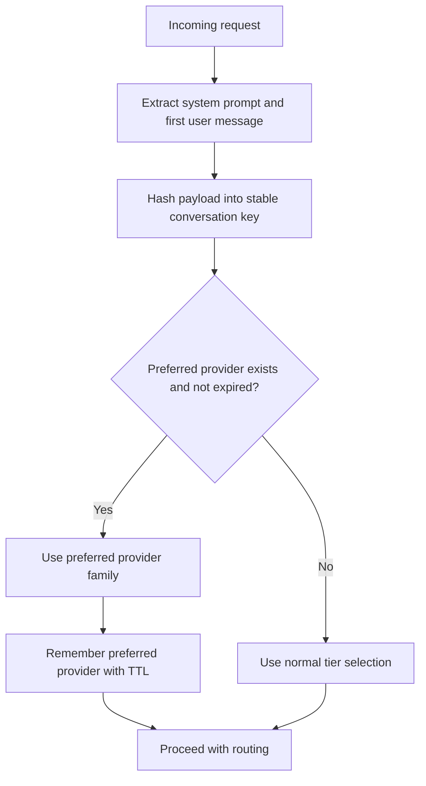
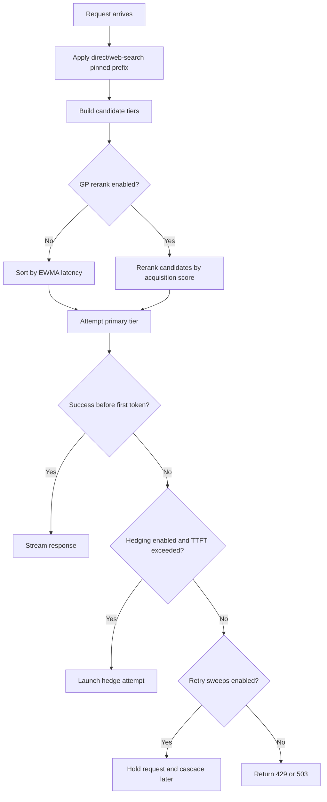
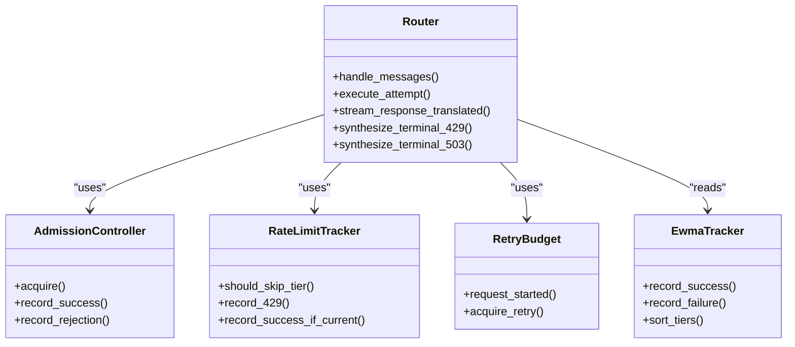
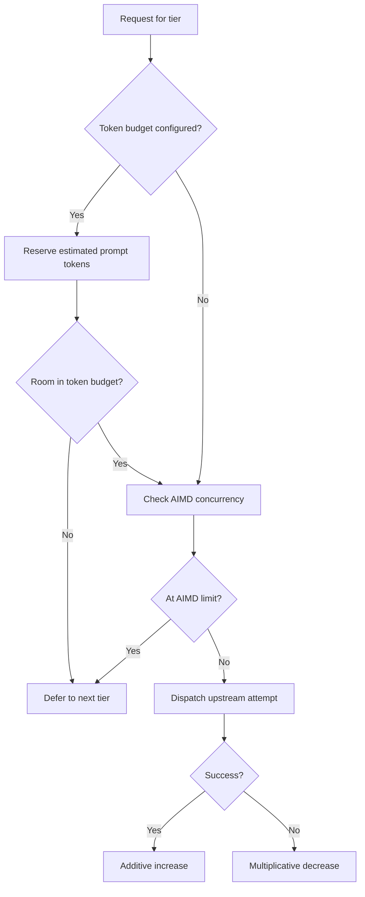
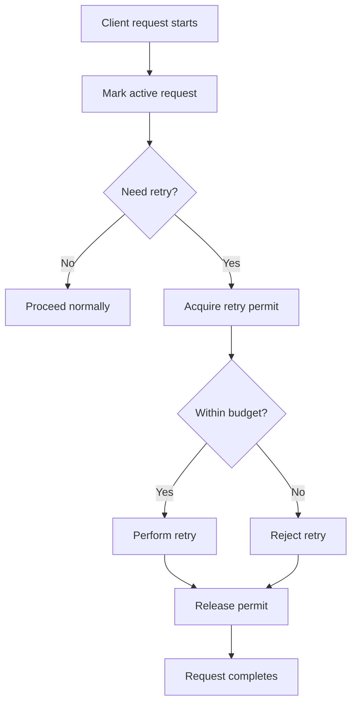
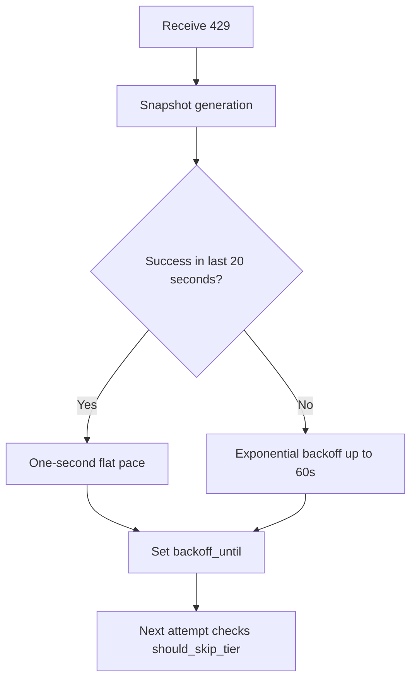
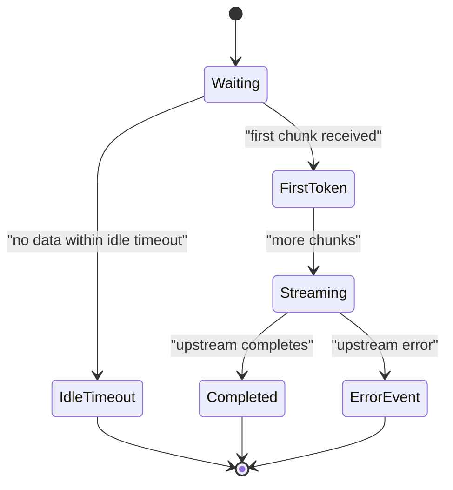
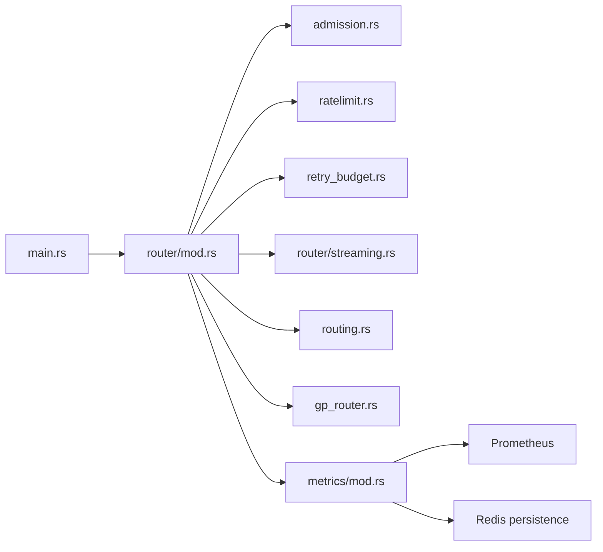

# High Availability and Scaling

<cite>
**Referenced Files in This Document**
- [README.md](file://README.md)
- [Cargo.toml](file://Cargo.toml)
- [src/main.rs](file://src/main.rs)
- [src/lib.rs](file://src/lib.rs)
- [src/router/mod.rs](file://src/router/mod.rs)
- [src/router/streaming.rs](file://src/router/streaming.rs)
- [src/routing.rs](file://src/routing.rs)
- [src/gp_router.rs](file://src/gp_router.rs)
- [src/stickiness.rs](file://src/stickiness.rs)
- [src/admission.rs](file://src/admission.rs)
- [src/retry_budget.rs](file://src/retry_budget.rs)
- [src/ratelimit.rs](file://src/ratelimit.rs)
- [src/doctor.rs](file://src/doctor.rs)
- [src/metrics/mod.rs](file://src/metrics/mod.rs)
- [k8s/deployment.yaml](file://k8s/deployment.yaml)
- [k8s/service.yaml](file://k8s/service.yaml)
- [monitoring/prometheus-snippet.yml](file://monitoring/prometheus-snippet.yml)
- [docs/deployment.md](file://docs/deployment.md)
- [docs/failover_architecture.md](file://docs/failover_architecture.md)
- [docs/observability.md](file://docs/observability.md)
- [docs/configuration.md](file://docs/configuration.md)
</cite>

## Table of Contents
1. [Introduction](#introduction)
2. [Project Structure](#project-structure)
3. [Core Components](#core-components)
4. [Architecture Overview](#architecture-overview)
5. [Detailed Component Analysis](#detailed-component-analysis)
6. [Dependency Analysis](#dependency-analysis)
7. [Performance Considerations](#performance-considerations)
8. [Troubleshooting Guide](#troubleshooting-guide)
9. [Conclusion](#conclusion)
10. [Appendices](#appendices)

## Introduction
This document explains how to operate CCR-Rust as a high-availability, horizontally scalable LLM router. It covers:

- Load balancing across multiple CCR-Rust instances behind a load balancer.
- Session stickiness for conversation-provider affinity at the application layer.
- Traffic distribution patterns including tiered fallback, adaptive latency ordering, GP reranking, hedging, and retry sweeps.
- Horizontal scaling considerations: per-instance resource requirements, CPU/memory profiling guidance, capacity planning, and Kubernetes defaults.
- Application-level failover (tier cascades, admission control, retry budgets, rate-limit backoff).
- Infrastructure-level failover (Kubernetes health probes, process restart policies, configuration reload behavior).
- Health checking strategies using `/health`, `/v1/latencies`, `/metrics`, and `ccr-rust doctor`.
- Circuit breaker-like behavior through rate-limit backoff, AIMD admission limits, and deterministic rejection skipping.
- Graceful degradation via retry sweeps, held requests, fallback tiers, and stream-first-token failure semantics.
- Performance tuning for high-throughput scenarios: connection pooling, SSE buffer sizing, streaming backpressure, EWMA tuning, and memory management.
- Monitoring and alerting thresholds for scaling decisions.

CCR-Rust is designed as a lightweight, self-hosted router that translates between Anthropic and OpenAI-compatible protocols while automatically failing over across provider tiers. It is not a stateful session store; instance-local stickiness and EWMA state are bounded in-process.

**Section sources**
- [README.md:1-80](file://README.md#L1-L80)

## Project Structure
The relevant HA and scaling surface is concentrated in the HTTP entry point, routing engine, admission controller, retry budget, rate-limit tracker, streaming pipeline, observability, and Kubernetes manifests.

**Diagram sources**
- [src/main.rs:1-120](file://src/main.rs#L1-L120)
- [src/router/mod.rs:1-80](file://src/router/mod.rs#L1-L80)
- [k8s/service.yaml:1-11](file://k8s/service.yaml#L1-L11)
- [monitoring/prometheus-snippet.yml:1-7](file://monitoring/prometheus-snippet.yml#L1-L7)

Key responsibilities by module:

| Area | Primary File(s) | Responsibility |
|---|---:|---|
| CLI and listener | `src/main.rs` | Parse host/port, maximum concurrent streams, graceful shutdown timeout, dashboard, MCP commands, and start Axum server. |
| Public API modules | `src/lib.rs` | Expose router, metrics, ratelimit, retry budget, admission, routing, and stickiness subsystems. |
| Request routing and failover | `src/router/mod.rs` | Tier selection, attempt execution, streaming handling, hedging, sweep loop, terminal response synthesis. |
| Latency-based ordering | `src/routing.rs` | EWMA tracking, per-tier sorting, sample counting, failure penalty. |
| Request-aware reranking | `src/gp_router.rs` | Optional Gaussian-process reranking of candidate tiers based on request features and cost estimates. |
| Conversation stickiness | `src/stickiness.rs` | In-process preferred-provider cache keyed by hashed system prompt plus first user message. |
| Admission control | `src/admission.rs` | Per-tier AIMD concurrency and token-budget admission. |
| Retry amplification control | `src/retry_budget.rs` | Process-wide retry budget with active-request ratio and floor. |
| Rate-limit backoff | `src/ratelimit.rs` | Route-scoped 429 backoff, starvation detection, generation-guarded success clearing. |
| Streaming pipeline | `src/router/streaming.rs` | SSE decoding, translation, idle timeouts, backpressure recording, usage accumulation. |
| Observability | `src/metrics/mod.rs`, `docs/observability.md` | Prometheus counters, gauges, histograms, persistence, endpoints. |
| Deployment | `k8s/deployment.yaml`, `k8s/service.yaml`, `docs/deployment.md` | Systemd, Docker, Kubernetes replicas, liveness/readiness probes, resource requests/limits. |

**Section sources**
- [src/main.rs:1-120](file://src/main.rs#L1-L120)
- [src/lib.rs:1-27](file://src/lib.rs#L1-L27)
- [src/router/mod.rs:1-80](file://src/router/mod.rs#L1-L80)
- [src/routing.rs:1-60](file://src/routing.rs#L1-L60)
- [src/gp_router.rs:1-60](file://src/gp_router.rs#L1-L60)
- [src/stickiness.rs:1-40](file://src/stickiness.rs#L1-L40)
- [src/admission.rs:1-40](file://src/admission.rs#L1-L40)
- [src/retry_budget.rs:1-30](file://src/retry_budget.rs#L1-L30)
- [src/ratelimit.rs:1-40](file://src/ratelimit.rs#L1-L40)
- [src/router/streaming.rs:1-60](file://src/router/streaming.rs#L1-L60)
- [src/metrics/mod.rs:1-80](file://src/metrics/mod.rs#L1-L80)
- [docs/observability.md:1-40](file://docs/observability.md#L1-L40)
- [k8s/deployment.yaml:1-50](file://k8s/deployment.yaml#L1-L50)
- [k8s/service.yaml:1-11](file://k8s/service.yaml#L1-L11)
- [docs/deployment.md:1-50](file://docs/deployment.md#L1-L50)

## Core Components
For high availability and scaling, the most important components are:

1. **Request router and tier cascade:** Selects providers according to configured tiers, direct routing, web-search pinning, EWMA ordering, optional GP reranking, and hedging.
2. **Admission controller:** Applies per-tier AIMD concurrency and optional token-budget admission so overloaded upstreams do not amplify local load.
3. **Retry budget:** Bounds aggregate retry amplification across all in-flight client requests.
4. **Rate-limit tracker:** Implements route-scoped 429 backoff with starvation detection and generation-guarded success clearing.
5. **Streaming pipeline:** Translates upstream events, tracks first-token timing, handles idle timeouts, and records backpressure.
6. **Session stickiness:** Keeps conversations within the same protocol/provider family when possible.
7. **Health and diagnostics:** `/health`, `/v1/latencies`, `/metrics`, and `ccr-rust doctor`.

These components together provide application-level circuit breaking, graceful degradation, and controlled backoff without requiring an external service mesh.

**Section sources**
- [src/router/mod.rs:1-120](file://src/router/mod.rs#L1-L120)
- [src/admission.rs:1-60](file://src/admission.rs#L1-L60)
- [src/retry_budget.rs:1-60](file://src/retry_budget.rs#L1-L60)
- [src/ratelimit.rs:1-80](file://src/ratelimit.rs#L1-L80)
- [src/router/streaming.rs:1-100](file://src/router/streaming.rs#L1-L100)
- [src/stickiness.rs:1-80](file://src/stickiness.rs#L1-L80)
- [docs/observability.md:1-60](file://docs/observability.md#L1-L60)

## Architecture Overview
At runtime, a client sends either an Anthropic-style or OpenAI-compatible request to one CCR-Rust instance. The router chooses a provider tier, applies admission control, dispatches the attempt, and then either streams the response or falls back to the next tier. If retries and sweeps exhaust all eligible tiers, it synthesizes a terminal 429 when only rate limiting was observed, otherwise returns a 503.

**Diagram sources**
- [src/router/mod.rs:120-220](file://src/router/mod.rs#L120-L220)
- [src/admission.rs:120-220](file://src/admission.rs#L120-L220)
- [src/router/streaming.rs:100-220](file://src/router/streaming.rs#L100-L220)

### Load Balancing Approaches Across Multiple Instances
CCR-Rust itself does not implement multi-instance coordination. Each instance maintains its own EWMA state, AIMD limits, rate-limit backoffs, retry budget, and sticky session map. Therefore:

- Use an external load balancer (Layer 4 TCP or Layer 7 HTTP) to distribute traffic across instances.
- Keep the backend tier configuration identical across instances so each instance independently selects the same logical provider families.
- Do not rely on a single instance’s EWMA or AIMD state for cluster-wide scaling decisions; observe Prometheus metrics from all instances.
- If session stickiness is required, configure the load balancer to use consistent hashing based on stable request attributes, or accept that CCR-Rust’s application-layer stickiness works best within a single instance.

The Kubernetes Service manifest defines a ClusterIP service with selector `app: ccr-rust`; this is the standard place to integrate with an ingress controller, cloud load balancer, or service mesh.

**Section sources**
- [k8s/service.yaml:1-11](file://k8s/service.yaml#L1-L11)
- [k8s/deployment.yaml:1-50](file://k8s/deployment.yaml#L1-L50)
- [src/routing.rs:1-60](file://src/routing.rs#L1-L60)
- [src/stickiness.rs:1-40](file://src/stickiness.rs#L1-L40)

### Session Stickiness Configuration
CCR-Rust includes a `StickySessionTracker` that remembers a preferred provider for a conversation. It derives a stable key from the normalized Anthropic request’s system prompt and first user message, hashes the payload, and stores the preferred provider with a TTL.

Important characteristics:

| Property | Behavior |
|---|---|
| Key source | System prompt plus first user message |
| Privacy | Payload is hashed; raw prompt text is not used as a cache key |
| Capacity bound | Local map is capped at 10,000 entries |
| TTL | Default 3,600 seconds |
| Eviction strategy | Expired entries are removed; oldest entries are evicted when the cap is exceeded |
| Partitioning | Stable partition keeps directly routed and web-search pinned prefixes untouched |
| Scope | In-process only; not shared across instances |

For multi-instance deployments:

- If you need cross-instance stickiness, configure your load balancer with consistent hashing.
- If you accept instance-local stickiness, ensure long-lived sessions are likely to remain on the same instance, or design clients to reconnect gracefully when provider families change.
- Use `/health?details=1` to inspect configured tiers and default routing, but note that stickiness state is not exposed there.

**Diagram sources**
- [src/stickiness.rs:1-160](file://src/stickiness.rs#L1-L160)

**Section sources**
- [src/stickiness.rs:1-200](file://src/stickiness.rs#L1-L200)

### Traffic Distribution Patterns
CCR-Rust supports several layered distribution mechanisms:

1. **Configured tier order:** Direct routing pins a specific tier at the front; web-search prepends and grows the pinned prefix.
2. **EWMA-based ordering:** When strict tier order is disabled, measured tiers are sorted by EWMA latency; unmeasured tiers retain configured order.
3. **GP reranking:** Optional request-aware reordering of candidate tiers based on feature vectors such as prompt size, output tokens, request class, active streams, and hour of day.
4. **Hedging:** A secondary fallback attempt can be launched after a time-to-first-token threshold if hedging is enabled.
5. **Retry sweeps:** Requests exhausted by every tier may be held open and retried after cooldown windows, subject to a retry budget.
6. **Deterministic rejection memoization:** Deterministic 401–404 rejections are attempted once and skipped afterward.

**Diagram sources**
- [src/router/mod.rs:120-220](file://src/router/mod.rs#L120-L220)
- [src/gp_router.rs:120-220](file://src/gp_router.rs#L120-L220)
- [src/routing.rs:180-260](file://src/routing.rs#L180-L260)

**Section sources**
- [src/router/mod.rs:120-220](file://src/router/mod.rs#L120-L220)
- [src/gp_router.rs:120-220](file://src/gp_router.rs#L120-L220)
- [src/routing.rs:180-260](file://src/routing.rs#L180-L260)
- [docs/failover_architecture.md:120-200](file://docs/failover_architecture.md#L120-L200)

## Detailed Component Analysis

### Routing and Failover Engine
The router orchestrates tier selection, attempt execution, streaming, hedging, and sweep logic. It integrates admission control, rate-limit tracking, transformer registry, debug capture, and metrics.

Key behaviors:

- Tier list comes from configuration.
- Direct routing and web-search pinning preserve a prefix that cannot be reordered by EWMA or GP reranking.
- Each tier has configurable retries and backoff parameters.
- Pre-first-token failures cascade to the next tier.
- Post-first-token failures do not cascade; they surface as in-stream errors.
- Exhausted cascades return synthesized 429 when only rate limiting was seen, otherwise 503.

**Diagram sources**
- [src/router/mod.rs:1-120](file://src/router/mod.rs#L1-L120)
- [src/admission.rs:1-120](file://src/admission.rs#L1-L120)
- [src/ratelimit.rs:1-120](file://src/ratelimit.rs#L1-L120)
- [src/retry_budget.rs:1-120](file://src/retry_budget.rs#L1-L120)
- [src/routing.rs:1-120](file://src/routing.rs#L1-L120)

**Section sources**
- [src/router/mod.rs:1-220](file://src/router/mod.rs#L1-L220)
- [docs/failover_architecture.md:80-200](file://docs/failover_architecture.md#L80-L200)

### Admission Control and Circuit Breaker Pattern
The admission controller implements an adaptive approach similar to a circuit breaker:

- Per-tier AIMD concurrency limit starts at a default initial value and grows additively on success until a ceiling.
- On 429, the per-tier limit halves multiplicatively.
- A separate token budget can block requests whose estimated prompt tokens would exceed the configured in-flight token ceiling.
- Large requests are admitted when the route is otherwise idle, preserving fallback capability for long-context traffic.
- AIMD state is exposed via `ccr_tier_limit`.

**Diagram sources**
- [src/admission.rs:1-220](file://src/admission.rs#L1-L220)

**Section sources**
- [src/admission.rs:1-220](file://src/admission.rs#L1-L220)
- [src/metrics/mod.rs:120-220](file://src/metrics/mod.rs#L120-L220)

### Retry Budget and Amplification Control
The retry budget prevents aggregate retry storms when many client requests fail simultaneously. It packs active-client counts and in-flight retries into one atomic counter and allows retries up to a percentage of active requests, with a small floor.

Scaling implications:

- When active requests rise, the allowed number of retries rises proportionally.
- With zero percent retries, the budget immediately rejects additional retry permits.
- The floor ensures a quiet process can still recover from isolated transient failures.
- `ccr_retry_budget_overflow_total` indicates when retries are being rejected.

**Diagram sources**
- [src/retry_budget.rs:1-181](file://src/retry_budget.rs#L1-L181)

**Section sources**
- [src/retry_budget.rs:1-181](file://src/retry_budget.rs#L1-L181)
- [src/metrics/mod.rs:160-220](file://src/metrics/mod.rs#L160-L220)

### Rate-Limit Backoff and Starvation Detection
The rate-limit tracker provides per-route 429 backoff behavior:

- Server-supplied `Retry-After` is honored up to a 60-second cap.
- Without guidance, a non-starved route paces at one second.
- A starved route doubles exponential backoff per consecutive 429 up to 60 seconds.
- Starvation means no successful admission has been observed for 20 seconds.
- Generation guards prevent a successful request that started before a newer 429 from clearing the backoff.

This is the closest built-in implementation of a circuit breaker for provider quota exhaustion.

**Diagram sources**
- [src/ratelimit.rs:1-200](file://src/ratelimit.rs#L1-L200)

**Section sources**
- [src/ratelimit.rs:1-200](file://src/ratelimit.rs#L1-L200)
- [docs/failover_architecture.md:160-200](file://docs/failover_architecture.md#L160-L200)

### Streaming Pipeline and Graceful Degradation
The streaming pipeline handles SSE frames, translates events, tracks first-token timing, enforces idle timeouts, and records backpressure.

Graceful degradation rules:

- Pre-first-token failures allow tier cascading.
- Post-first-token failures do not cascade; they emit in-stream error events.
- Idle timeouts emit structured error events rather than silently dropping connections.
- Backpressure events are counted so operators can detect slow downstream consumers.

**Diagram sources**
- [src/router/streaming.rs:1-220](file://src/router/streaming.rs#L1-L220)

**Section sources**
- [src/router/streaming.rs:1-220](file://src/router/streaming.rs#L1-L220)
- [src/metrics/mod.rs:60-120](file://src/metrics/mod.rs#L60-L120)

### EWMA and Adaptive Latency Ordering
EWMA tracks per-attempt latency per tier:

- Alpha is 0.3, meaning 30% weight on new samples and 70% on history.
- Minimum samples before trust is three.
- Failure penalties multiply the current EWMA by a penalty factor instead of using wall-clock duration.
- Tiers without enough samples keep their config-defined position.

This makes slower or degraded tiers fall behind faster ones when strict tier order is disabled.

**Section sources**
- [src/routing.rs:1-120](file://src/routing.rs#L1-L120)
- [docs/failover_architecture.md:140-160](file://docs/failover_architecture.md#L140-L160)

### GP Reranking
GP reranking is optional and builds a feature vector from request context:

- Prompt character count.
- Estimated input tokens.
- Max output tokens.
- Request classification.
- Presence of a system prompt.
- Message count.
- Tool count.
- Active streams and maximum streams.
- Hour of day.

It scores candidate tiers using acquisition strategies and cost estimates, then reranks candidates after the pinned prefix.

**Section sources**
- [src/gp_router.rs:1-220](file://src/gp_router.rs#L1-L220)

## Dependency Analysis
CCR-Rust is a Rust binary built with Tokio and Axum. Its dependencies relevant to HA and scaling include:

- `tokio`: async runtime for streams, signals, and concurrency.
- `axum`: HTTP server and routing.
- `parking_lot`: fast locking primitives for in-process state.
- `prometheus`: metrics exposure.
- `reqwest`: HTTP client to upstream providers.
- `redis`: optional persistence for metrics and EWMA state.
- `tiktoken-rs`: pre-request token estimation.
- `gp-routing`: optional Gaussian-process routing.
- `opentelemetry`: optional distributed tracing.

**Diagram sources**
- [src/main.rs:1-120](file://src/main.rs#L1-L120)
- [src/lib.rs:1-27](file://src/lib.rs#L1-L27)
- [src/metrics/mod.rs:1-80](file://src/metrics/mod.rs#L1-L80)
- [Cargo.toml:1-87](file://Cargo.toml#L1-L87)

**Section sources**
- [Cargo.toml:1-87](file://Cargo.toml#L1-L87)
- [src/lib.rs:1-27](file://src/lib.rs#L1-L27)

## Performance Considerations

### Connection Pooling Optimization
Connection pooling configuration is part of the documented configuration schema. Relevant fields include:

| Field | Purpose |
|---|---|
| `POOL_MAX_IDLE_PER_HOST` | Controls idle connection pool size per upstream host. |
| `POOL_IDLE_TIMEOUT_MS` | Controls idle connection lifetime. |
| `SSE_BUFFER_SIZE` | Controls the internal channel buffer for SSE frame forwarding. |

For high-throughput deployments:

- Increase pool sizes if connections are frequently created and destroyed under load.
- Tune idle timeouts to balance connection reuse against stale connections.
- Monitor `ccr_stream_backpressure_total` to detect when the SSE buffer is too small for consumer throughput.
- Adjust `max_streams` via CLI or `CCR_MAX_STREAMS` if the default 512 is insufficient for your workload.

**Section sources**
- [docs/configuration.md:160-200](file://docs/configuration.md#L160-L200)
- [src/main.rs:60-100](file://src/main.rs#L60-L100)
- [src/router/streaming.rs:1-80](file://src/router/streaming.rs#L1-L80)
- [src/metrics/mod.rs:80-140](file://src/metrics/mod.rs#L80-L140)

### Memory Management for High-Throughput Scenarios
Memory-related concerns:

- Sticky session map is bounded to 10,000 entries.
- EWMA state is per-tier and lightweight.
- AIMD state is per route with atomic counters.
- Retry budget uses a packed atomic counter.
- Streaming accumulates content, reasoning blocks, and tool-call fragments during translation.
- Prometheus metrics maintain counters, gauges, and histogram buckets.
- Optional Redis persistence retains metrics and EWMA snapshots across restarts.

Recommendations:

- Monitor RSS and heap usage through your platform’s process metrics.
- Enable Redis persistence only if you need cross-restart observability state; it adds network and serialization overhead.
- Avoid enabling unnecessary features such as telemetry unless you collect traces.
- Profile with production-like workloads because the release profile enables LTO and a single codegen unit.

**Section sources**
- [src/stickiness.rs:1-120](file://src/stickiness.rs#L1-L120)
- [src/routing.rs:1-120](file://src/routing.rs#L1-L120)
- [src/admission.rs:1-120](file://src/admission.rs#L1-L120)
- [src/retry_budget.rs:1-120](file://src/retry_budget.rs#L1-L120)
- [src/router/streaming.rs:100-220](file://src/router/streaming.rs#L100-L220)
- [docs/observability.md:1-60](file://docs/observability.md#L1-L60)
- [Cargo.toml:60-87](file://Cargo.toml#L60-L87)

### CPU and Memory Profiling Guidance
CCR-Rust exposes rich metrics but does not include an embedded profiler in the default build. For profiling:

- Build with appropriate Rust profiling flags in your deployment pipeline.
- Use platform tools such as `perf`, `pprof`, or language-native profilers available in your container image.
- Correlate CPU spikes with:
  - High request volume.
  - Many concurrent streams.
  - GP reranking computation.
  - Request/response transformation.
  - Token estimation and usage accounting.
- Correlate memory growth with:
  - Long streaming responses.
  - Accumulated content and reasoning blocks.
  - Sticky session growth.
  - Redis-backed metric persistence.
  - OpenTelemetry spans if telemetry is enabled.

[No sources needed since this section provides general guidance tied to existing capabilities]

### Capacity Planning Guidelines
Capacity planning should account for both the router’s CPU and memory usage and the upstream provider’s admission constraints.

Guidelines:

1. Start with one instance per node and measure baseline CPU, memory, streams, and upstream latency.
2. Increase replicas when:
   - `ccr_active_requests` is consistently near the instance’s effective limit.
   - `ccr_active_streams` approaches the configured maximum.
   - `ccr_admission_defers_total` rises significantly.
   - Upstream 429 rates cause frequent AIMD cuts.
3. Tune per-tier `maxInflight` and `maxInflightTokens` for providers where 429s come from concurrency or token-volume collisions.
4. Use Kubernetes resource requests and limits as starting points, then adjust based on observed profiles.
5. Treat CCR-Rust as a thin coordinator; most capacity comes from upstream provider quotas, not the router.

Current Kubernetes defaults:

| Resource | Request | Limit |
|---|---:|---:|
| CPU | 100m | 500m |
| Memory | 64Mi | 256Mi |

These values are suitable for development and light production use but must be validated against real traffic.

**Section sources**
- [k8s/deployment.yaml:20-40](file://k8s/deployment.yaml#L20-L40)
- [src/admission.rs:1-120](file://src/admission.rs#L1-L120)
- [src/metrics/mod.rs:100-220](file://src/metrics/mod.rs#L100-L220)
- [docs/configuration.md:140-200](file://docs/configuration.md#L140-L200)

## Troubleshooting Guide

### Health Checking Strategies
Use these health checks in different layers:

| Layer | Check | Meaning |
|---|---|---|
| Liveness probe | `GET /health` | Basic process and listener reachability. |
| Readiness probe | `GET /health` | Whether the instance can accept traffic. |
| Operator check | `GET /health?details=1` | Returns configured tiers and default route. |
| Latency check | `GET /v1/latencies` | Real-time EWMA latency stats. |
| Metrics scrape | `GET /metrics` | Prometheus counters, gauges, and histograms. |
| Diagnostic probe | `ccr-rust doctor` | Config validity, provider catalog/auth probe, listener diagnosis. |

Kubernetes liveness and readiness probes are configured against `/health` on port 3456.

**Section sources**
- [src/router/mod.rs:40-80](file://src/router/mod.rs#L40-L80)
- [src/doctor.rs:1-120](file://src/doctor.rs#L1-L120)
- [k8s/deployment.yaml:30-50](file://k8s/deployment.yaml#L30-L50)
- [docs/observability.md:40-100](file://docs/observability.md#L40-L100)

### Circuit Breaker and Failover Indicators
Watch these metrics and behaviors:

| Indicator | Metric or Signal | Action |
|---|---|---|
| Rising AIMD limit drops | `ccr_tier_limit` decreases | Provider is rejecting requests; reduce load or scale upstream. |
| Repeated 429 backoffs | `ccr_rate_limit_backoffs_total` | Expect tier skip; verify `Retry-After` and starvation behavior. |
| Retry budget overflow | `ccr_retry_budget_overflow_total` | Too many retries; reduce retry percentage or investigate request failures. |
| Streams rejected | `ccr_rejected_streams_total` | Concurrency limit reached; increase `max_streams` or scale out. |
| Stream backpressure | `ccr_stream_backpressure_total` | Downstream consumer is slow; tune buffer or investigate client behavior. |
| Deterministic rejections | `ccr_deterministic_rejections_total` | Likely malformed or unsupported requests; fix client or provider compatibility. |

**Section sources**
- [src/ratelimit.rs:1-200](file://src/ratelimit.rs#L1-L200)
- [src/retry_budget.rs:1-181](file://src/retry_budget.rs#L1-L181)
- [src/metrics/mod.rs:80-220](file://src/metrics/mod.rs#L80-L220)
- [docs/failover_architecture.md:120-200](file://docs/failover_architecture.md#L120-L200)

### Graceful Degradation Checklist
When upstream capacity degrades:

1. Verify `/health` is healthy.
2. Check whether `/health?details=1` shows expected tiers.
3. Inspect `ccr_tier_inflight` and `ccr_tier_limit` for overload.
4. Inspect `ccr_tier_ewma_latency_seconds` for degraded tiers.
5. Check whether 429 backoff is active.
6. Confirm retry sweeps are not holding excessive requests open.
7. Observe whether requests successfully cascade to lower-cost or alternate tiers.
8. Use `ccr-rust doctor` to validate credentials and model catalogs separately from live traffic.

**Section sources**
- [src/router/mod.rs:120-220](file://src/router/mod.rs#L120-L220)
- [src/doctor.rs:1-200](file://src/doctor.rs#L1-L200)
- [docs/observability.md:60-140](file://docs/observability.md#L60-L140)

## Conclusion
CCR-Rust provides a robust application-layer foundation for high availability and controlled scaling:

- It replaces hard failures with tiered fallback, retry sweeps, and adaptive admission.
- It approximates circuit breaker behavior through per-route 429 backoff, AIMD concurrency limits, and deterministic rejection skipping.
- It offers session stickiness within a process and can be combined with load-balancer stickiness for cross-instance affinity.
- It exposes Prometheus metrics and diagnostic endpoints suitable for automated scaling and alerting.
- It scales horizontally through external load balancing and Kubernetes replication, while keeping each instance’s state bounded and in-process.

For production HA, combine:

- Multiple CCR-Rust replicas behind a load balancer.
- Kubernetes liveness and readiness probes.
- Prometheus monitoring with alerts on admission defers, retry budget overflow, stream backpressure, AIMD limit cuts, and 429 backoffs.
- Carefully tuned per-tier admission and retry budgets.
- Optional Redis-backed observability persistence for restart-safe metrics and EWMA state.

[No sources needed since this section summarizes without analyzing specific files]

## Appendices

### Monitoring and Alerting Thresholds
Recommended thresholds for scaling and incident response:

| Metric | Warning Threshold | Critical Threshold | Suggested Action |
|---|---|---|---|
| `ccr_admission_defers_total` | Sustained increase over 5 minutes | Rapid spike | Scale out or reduce per-tier inflight limits. |
| `ccr_retry_budget_overflow_total` | Non-zero growth | Sustained growth | Reduce retry percentage or investigate failure causes. |
| `ccr_stream_backpressure_total` | Non-zero growth | Rapid growth | Increase `SSE_BUFFER_SIZE` or investigate slow consumers. |
| `ccr_tier_limit` | Drops below configured minimum | Continues decreasing | Provider is rejecting requests; expect tier skip. |
| `ccr_tier_ewma_latency_seconds` | Above P95 baseline by 50% | Above P95 baseline by 2x | Investigate upstream latency or consider disabling strict tier order. |
| `ccr_active_streams` | Near `max_streams` | At or above `max_streams` | Increase `max_streams` or scale out. |
| `ccr_failures_total` | Any sustained increase | Sharp increase | Inspect failure reasons and upstream status. |
| `ccr_rate_limit_backoffs_total` | Occasional increases | Sustained increases | Honor provider backoff; avoid aggressive retry settings. |

**Section sources**
- [src/metrics/mod.rs:80-220](file://src/metrics/mod.rs#L80-L220)
- [docs/observability.md:60-140](file://docs/observability.md#L60-L140)

### Kubernetes Reference Configuration
The provided Kubernetes manifests define:

- A Deployment with two replicas.
- A ClusterIP Service exposing port 3456.
- Prometheus scrape annotations.
- Environment variables for logging and config path.
- Resource requests and limits.
- Liveness and readiness probes against `/health`.
- A mounted ConfigMap for configuration.

Operators should adapt replica count, resources, secrets, TLS termination, and service type to their environment.

**Section sources**
- [k8s/deployment.yaml:1-50](file://k8s/deployment.yaml#L1-L50)
- [k8s/service.yaml:1-11](file://k8s/service.yaml#L1-L11)
- [docs/deployment.md:1-50](file://docs/deployment.md#L1-L50)